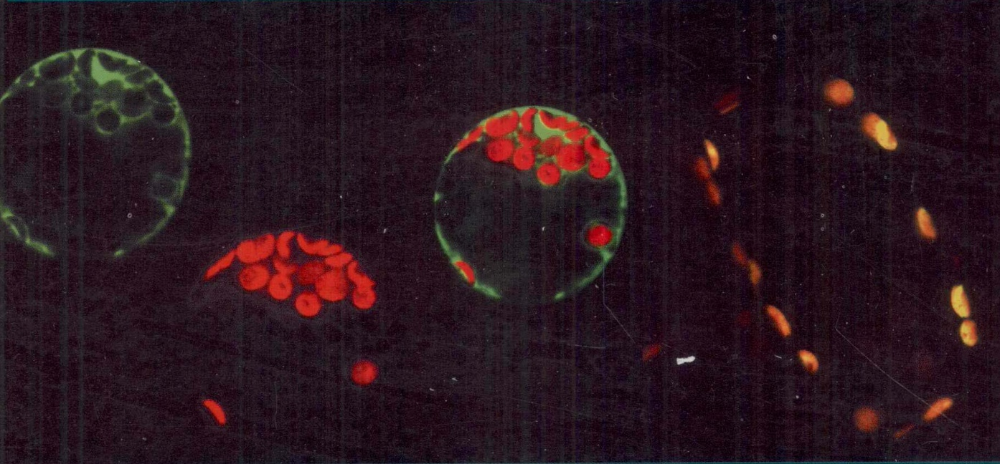
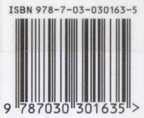

国家精品课程配套立体化教材

EXPERIMENT OF CELL BIOLOGY

# 细胞生物学实验教程

(第二版)

王金发 何炎明 刘兵 主编

P

科学出版社

---

(Q-2635.0101)

# 细胞生物学 实验教程（第二版）

Experiment Of Cell Biology

高等教育出版中心

电话:010-64030233

http://www.sciencep.com

e-mail: bio@mail.sciencep.com

销售分类建议:生物学/实验教材

www.sciencep.com

ISBN 978-7-03-030163-5

定价:30.00元

---

# 国家精品课程配套立体化教材

# 细胞生物学实验教程

(第二版)

王金发 何炎明 刘兵 主编

科学出版社

北京

---

## 内容简介

本书是王金发教授主持编写的《细胞生物学》配套实验教材，是在2004年出版的《细胞生物学实验教程》基础上重新修订的。全书包括12章共71个实验，内容既保留了目前在细胞生物学研究领域中经常用到的经典实验，又新增了不少与现代细胞生物学和分子生物学相关的新技术，包括:线粒体膜电位检测，抗性膜和胆固醇去除，细胞电泳技术，DNA、RNA和蛋白质的原位杂交，差异基因表达，酵母中cDNA的表达，细胞凋亡检测，果蝇胚胎的共聚焦显微技术等。

本书可供综合性大学及农林、医学、师范院校本科生和研究生细胞生物学实验课教学使用，也可作为从事相关专业研究人员的参考用书。

图书在版编目(CIP)数据

细胞生物学实验教程/王金发,何炎明,刘兵主编.—2版.--北京:科学出版社,2011

(国家精品课程配套立体化教材)

ISBN 978-7-03-030163-5

I. ①细… II. ①王…②何…③刘… III. ①细胞生物学-实验-高等学校-教材 IV. ①Q2-33

中国版本图书馆 CIP 数据核字(2011)第 061170 号

责任编辑:单冉东 / 责任校对:李影

责任印制:张克忠 / 封面设计:耕者设计工作室

科学出版社出版

北京东黄城根北街16号

邮政编码:100717

http://www.sciencep.com

化学工业出版社印刷厂 印刷

科学出版社发行 各地新华书店经销

2004年1月第一版 开本:787×1092 1/16

2011年2月第二版 印张:163/4

2011年2月第十次印刷 字数:390000

印数:38 001-44 000

定价:30.00元

(如有印装质量问题,我社负责调换)

---

## 第二版前言

《细胞生物学实验教程》自2004年出版以来，深受读者厚爱。但由于细胞生物学的迅速发展和技术不断更新，以及各学科之间的相互渗透，原书已不能满足教学的需要。为此，我们对教材的内容进行了调整和修订，以适应教学改革的需要。

全书包括 12 章共 71 个实验，内容既保留了目前在细胞生物学研究领域中经常用到的经典实验，又新增了不少与现代细胞生物学和分子生物学相关的新技术，包括:线粒体膜电位检测，抗性膜和胆固醇去除，细胞电泳技术，DNA、RNA 和蛋白质的原位杂交，差异基因表达，酵母中 cDNA 的表达，细胞凋亡检测，果蝇胚胎的共聚焦显微技术等。书中新增的实验内容有 20 个，并对细胞减数分裂的内容作了适当的改动，对细胞电泳、细胞凋亡的内容重新作了全面的修改，也删去了一些与其他学科重复的内容。此外，还对部分内容进行了调整，其中把原第八章中的“植物体细胞杂交——原生质体的融合”调到第十一章，把原第九章中的“琼脂糖凝胶电泳检测 DNA 片段”调到第十章中，从而使得全书内容更加紧凑。

由于《细胞生物学实验教程》是细胞生物学基础实验，因此在实验项目的设置上，选择细胞结构和功能研究所涉及的基本方法，目的是让学生掌握细胞生物学研究最基本的技术。

参与本书编写的人员有王金发、何炎明、戚康标、王宏斌、刘兵、冯冬茹等教师，他们长期从事细胞生物学实验教学和研究工作。刘兵老师对第一版全书进行了文字编辑和校对的工作，何炎明老师对再版全书进行了文字编辑和校对工作。

由于编者水平有限，难免有所疏漏，敬请广大读者给予批评指正。

编者

2010年11月

---

## 第一版前言

细胞生物学是高校生命科学的主干课程之一，是一门实验性很强的学科。生命科学的许多重大发现与细胞生物学实验技术的不断创新、发展是分不开的。因此，学习和掌握细胞生物学最基本的技术和最新的实验方法，对于从事生命科学研究工作者来说是非常重要和完全必要的。

目前，适用于高等院校不同层次使用的细胞生物学实验教材不多。由于细胞生物学已成为重要的前沿生物学科，其发展速度可谓日新月异。各种研究新方法、新技术如雨后春笋层出不穷。各学科之间的相互渗透，相互依存紧密相连，如细胞生物学与分子生物学、分子遗传学等实验技术之间就具有很强的依存性和相融性。细胞生物学实验技术的巨大变化，将推动细胞生物学向着更深的层次发展。我们为了紧跟学科发展的趋势，把握学科前进的方向，适应学科发展的需要，将多年来在教学和科研实践中积累及编写的细胞生物学技术编写成《细胞生物学实验教程》一书。旨在让学生能掌握细胞生物学研究的基本操作技能和新的实验技术，从细胞生物学的角度分析生物学中的问题，为独立进行研究打下基础。

本书是王金发教授主编的《细胞生物学》的配套教材之一。全书共有64个实验，内容较丰富，知识面广，既包括常规的经典实验，又新增了不少与现代细胞生物学和分子生物学相关的新技术，如电穿孔和电融合技术、反转录病毒载体介导的基因转导技术、胚胎干细胞的培养和体外分化技术、流式细胞技术、细胞显微注射、共聚焦显微技术、细胞凋亡检测技术等。这些实验内容新颖、技术先进、可操作性强，对培养学生的动手能力、分析问题和解决问题的能力很有帮助。

本书第一至四章由戚康标编写；第五至七章由何炎明编写；第八章由何炎明、张利红编写；第九、十二章及附录由刘兵编写，并对全书进行了文字编辑和校对；第十、十一章由张利红、张为民编写；冯冬茹参加了部分实验的初稿编写工作。

本书在编写过程中得到王金发教授的亲自指导和中山大学生命科学院的大力支持，在此表示感谢。

由于编者的水平有限，难免出现错误，恳请广大读者给予批评指正。

编者

2004年3月

---

## 目录

- 第一章 前言
- 第一章 光学显微镜技术 …… 1
- 实验 1 普通光学显微镜的构造原理及使用方法 …… 1
- 实验 2 特殊显微镜的原理和使用 …… 7
- 实验 3 光学显微标本的制作技术 …… 12
- 第二章 电子显微镜技术 …… 21
- 实验 4 透射电子显微镜 …… 21
- 实验 5 透射电子显微镜样品制备 …… 24
- 实验 6 扫描电子显微镜 …… 28
- 实验 7 扫描电子显微镜样品制备 …… 30
- 第三章 细胞的形态结构 …… 33
- 实验 8 细胞形态结构与几种细胞器的观察 …… 33
- 实验 9 液泡系和线粒体的活体染色 …… 34
- 实验 10 用荧光脂质进行细胞活体染色 …… 37
- 实验 11 植物细胞骨架的光学显微镜观察 …… 41
- 实验 12 细胞骨架的免疫荧光显示 …… 43
- 实验 13 细胞的超微结构 …… 46
- 实验 14 细胞的显微测量 …… 50
- 第四章 细胞化学 …… 53
- 实验 15 DNA 的细胞化学——Feulgen 反应 …… 53
- 实验 16 RNA 的细胞化学——Brachet 反应 …… 55
- 实验 17 细胞中多糖和过氧化物酶的定位 …… 56
- 实验 18 细胞中酸性磷酸酶的定位 …… 58
- 实验 19 细胞中碱性磷酸酶的定位 …… 60
- 第五章 细胞生理 …… 62
- 实验 20 小鼠巨噬细胞吞噬的观察 …… 62
- 实验 21 胞饮作用 …… 63
- 实验 22 细胞膜的通透性 …… 64
- 实验 23 核质穿梭测定法 …… 66
- 实验 24 线粒体膜电位检测 …… 72

---

vi

细胞生物学实验教程

- 实验25 细胞电泳 …… 73
- 第六章 细胞分裂与染色体畸变 …… 79
- 实验26 细胞的无丝分裂与有丝分裂 …… 79
- 实验27 细胞减数分裂 …… 81
- 实验28 环境因素及辐射诱变染色体改组的观察 …… 86
- 实验29 细胞毒和细胞生长测定 …… 88
- 实验30 彗星测定 …… 93
- 第七章 染色体技术与核型分析 …… 96
- 实验31 植物染色体标本的制备和观察 …… 96
- 实验32 动物骨髓细胞染色体标本的制备 …… 98
- 实验33 人体外周血淋巴细胞培养与染色体标本制备 …… 100
- 实验34 人类染色体G带技术 …… 103
- 实验35 植物染色体分带技术 …… 105
- 实验36 人类体细胞染色体组型分析 …… 107
- 实验37 染色体核仁组织区(NOR)的显示 …… 109
- 实验38 姐妹染色单体色差分析技术 …… 111
- 第八章 细胞和组织培养技术 …… 114
- 实验39 植物组织培养技术 …… 114
- 实验40 原生质体的分离和培养 …… 117
- 实验41 细胞计数 …… 120
- 实验42 动物细胞原代培养 …… 121
- 实验43 果蝇胚胎细胞的原代培养 …… 123
- 实验44 传代细胞培养 …… 126
- 实验45 细胞的冻存与复苏 …… 128
- 第九章 细胞化学成分的分离 …… 130
- 实验46 细胞核与线粒体的分级分离 …… 130
- 实验47 高尔基体的分离 …… 132
- 实验48 核仁的分离 …… 138
- 实验49 过氧化物体的分离 …… 143
- 实验50 完整叶绿体的分离 …… 149
- 实验51 中期染色体的分离纯化 …… 151
- 实验52 动物细胞基因组DNA的提取 …… 154
- 实验53 植物基因组DNA的提取 …… 156
- 实验54 细胞和组织总RNA的提取 …… 157
- 第十章 蛋白质、核酸的定位与检测 …… 159
- 实验55 琼脂糖凝胶电泳检测DNA片段 …… 159

---

目录

vii

- 实验 56 同步检测 DNA、RNA 和蛋白质的原位杂交技术 …… 161
- 实验 57 银染法检测凝胶中的蛋白质——改良硝酸银染法 …… 168
- 实验 58 染色质免疫共沉淀 …… 170
- 实验 59 代表性差异分析:研究差异基因表达的方法 …… 175
- 实验 60 酵母中 cDNA 表达 …… 182
- 第十一章 细胞工程技术 …… 189
- 实验 61 细胞融合 …… 189
- 实验 62 植物体细胞杂交——原生质体的融合 …… 191
- 实验 63 单克隆抗体的制备 …… 193
- 实验 64 产细胞克隆测定 …… 200
- 实验 65 去污剂抗性膜和胆固醇去除的应用 …… 202
- 第十二章 其他技术 …… 208
- 实验 66 细胞放射自显影 …… 208
- 实验 67 流式细胞技术 …… 210
- 实验 68 荧光标记技术 …… 216
- 实验 69 细胞凋亡的检测 …… 218
- 实验 70 共聚焦显微技术及去旋技术 …… 223
- 实验 71 果蝇胚胎的共聚焦显微技术 …… 235
- 参考文献 …… 242
- 附录 …… 246
- 附录 1 一些常用的换算 …… 246
- 附录 2 常用试剂及溶液的配制和使用 …… 246
- 附录 3 光学仪器保养与清洁的要点 …… 251
- 附录 4 常用缩写汇编 …… 252
- 附录 5 常用细菌培养基的配方 …… 254