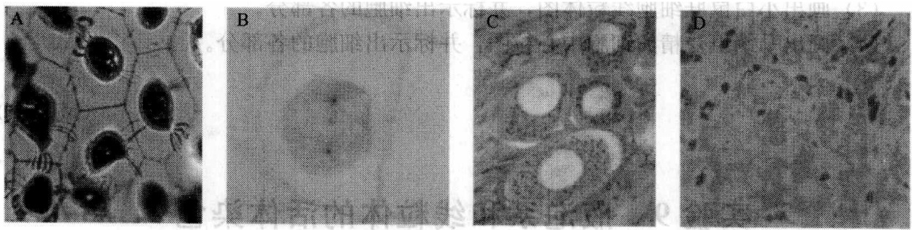
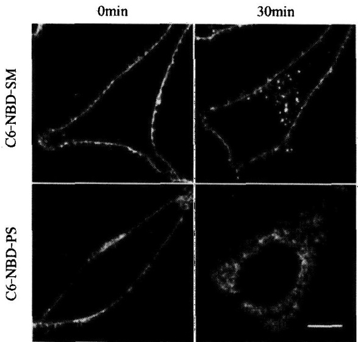
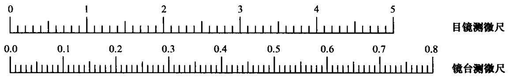

## 第三章 细胞的形态结构

细胞是生命活动的基本结构单位和功能单位，它的体积很小，如人和动物细胞的直径为 $10\sim 20\mu \mathrm{m}$ ，而人眼的分辨率是 $100\mu \mathrm{m}$ ，所以人的眼睛是看不到这些细胞的。细胞内的一些结构的体积更小，如线粒体、高尔基体、中心体、核仁、染色体等，用肉眼就更看不到了，但它们的大小都在 $0.2\mu \mathrm{m}$ 以上，而一般光学显微镜最大的分辨率为$0.2\mu \mathrm{m}$ ，因此可以借助显微镜来观察细胞的外部形态结构和内部的一些细胞器结构。电子显微镜的分辨率又比光学显微镜提高了1000倍，能观察到的物体的大小可达到$0.2\mathrm{nm}$ ，用它就可以观察到细胞内各种细胞器的细微结构。通常把在光学显微镜下所见到的结构称为显微结构，而在电子显微镜下所见到的微细结构，则被称为亚显微结构或超微结构。

## 实验 8 细胞形态结构与几种细胞器的观察

## 【实验目的】

在普通光学显微镜下识别细胞和细胞器的形态结构，掌握生物绘图的方法。

## 【实验原理】

细胞在形态上是多种多样的，有球形、椭圆形、扁平形、立方形、梭形、星形等。虽然细胞的形状各异，但是它们却有共同的基本结构特点，都由细胞膜、细胞壁（植物）、细胞质和细胞核组成。细胞中的各种细胞器，如线粒体、高尔基体、中心体、核仁、染色体等，一般经过固定染色处理后，大多数可以在光学显微镜下看见（图3-1）。细胞器的形态结构在普通光学显微镜下与在电子显微镜下所看到的结构有很大的差别。

图3-1 细胞形态结构

A. 柿胚乳细胞示胞间连丝；B. 马蛔虫受精卵分裂中期示中心粒；C. 兔的神经节细胞中高尔基体； D. 小鼠肝细胞线粒体

---

34

细胞生物学实验教程

【实验仪器、材料和试剂】

（1）仪器、用具:复式显微镜、擦镜纸。

(2) 材料: 洋葱根尖切片、小白鼠肝切片、兔神经节切片、马蛔虫受精卵切片。

（3）试剂:香柏油或液体石蜡、二甲苯。

## 【方法与步骤】

## 1. 洋葱根尖切片细胞的观察

先用低倍镜观察根尖的纵切面，注意分生区、伸长区、成熟区细胞的异同，然后再用高倍镜仔细观察细胞的形态结构，特别注意细胞的形状、大小，以及细胞壁、细胞核、核仁、细胞质、液泡的形态结构。

## 2. 兔神经节细胞切片高尔基体的观察

先在低倍镜下找到兔神经节细胞，然后转用高倍镜观察，可看到细胞内淡黄色的背景上有黄褐色的细胞核，核的周围分布着许多深褐色的（硝酸银镀染）高尔基体，呈弯曲的线状、颗粒状，少量分散在细胞质中。

## 3. 小白鼠肝细胞切片线粒体的观察

先用低倍镜后用高倍镜观察，可见到许多肝小叶，每小叶有许多紧密排列成索状的多角形的肝细胞，细胞中央有大而圆的细胞核。这时，转用油镜观察，可见到细胞质内分布着许多被苏木精染成深紫色的线粒体，呈颗粒状和线状。

## 4. 马蛔虫受精卵切片中心体的观察

取马蛔虫受精卵切片，在显微镜下找到充满子宫腔的受精卵，每个马蛔虫受精卵外围有一层较厚的卵膜，膜内有宽大的围卵腔，各围卵腔内有处在不同分裂期的卵细胞。找到分裂中期的细胞，在细胞中央被染成蓝色条状或棒状的结构，这就是染色体。可见在染色体两侧各有一个较小的，亦被染成蓝色的小粒，称中心粒。在中心粒的周围可见呈放射状的星丝。

## 【作业】

（1）画出洋葱根尖细胞图，并标示出细胞的各部分。

(2) 画出兔神经节细胞高尔基体图，并标示出细胞的各部分。

(3) 画出小白鼠肝细胞线粒体图，并标示出细胞的各部分。

（4）画出马蛔虫受精卵细胞中心粒图，并标示出细胞的各部分。

(戚康标)

## 实验 9 液泡系和线粒体的活体染色

## 【实验目的】

掌握动物、植物细胞活体染色的原理和有关的技术。

---

第三章 细胞的形态结构

35

## 【实验原理】

活体染色是指对生活有机体的细胞或组织能着色，但又无毒害的一种染色方法。目的在于显示生活细胞内的某些天然结构，而不影响细胞的生命活动和产生任何物理、化学变化引起细胞的死亡。活体染色技术可用来研究生活状态下的细胞结构和生理、病理状态。

液泡是细胞内浓缩产物的主要场所，有十分重要的功能。中性红（neutral red）是

液泡的特殊染色剂，只将液泡染成红色。在细胞处于生活状态时，细胞质和细胞核不被中性红染色。

线粒体是细胞内的一个重要细胞器，是细胞进行呼吸作用的场所。詹纳斯绿 B（Janus green B）对线粒体染色具有专一性，是毒性最小的碱性染料。詹纳斯绿 B 染色是由于线粒体中的细胞色素氧化酶系的作用，染料始终保持氧化状态，呈蓝绿色，而周围的细胞质被还原成无色的色基（图 3-2）。

图3-2 洋葱鳞茎内表皮细胞线粒体

## 【实验仪器、材料和试剂】

(1) 仪器、用具: 显微镜、解剖盘、剪刀、镊子、解剖刀、吸管、载玻片、盖玻片、擦镜纸、吸水纸。

(2) 材料:洋葱鳞茎、小白鼠或兔子、青蛙。

(3) 试剂

1) Ringer 溶液:

氯化钠 8.5g（变温动物用6.5g）
氯化钙 0.12g
碳酸氢钠 0.20g
氯化钾 0.14g
磷酸氢二钠 0.01g
葡萄糖 2.0g
加蒸馏水 至1000ml

2) 1%和1/3000中性红溶液:称取0.5g中性红溶于50ml Ringer溶液中，稍加热（30～40℃）使之很快溶解，用滤纸过滤，装入棕色瓶于暗处保存，否则易氧化沉淀，失去染色能力。

临用前，取 $1\%$ 中性红溶液 $1 \mathrm{ml}$，加入 $29 \mathrm{ml} Ringer$ 溶液混匀，装入棕色瓶备用。

3) 1%和1/5000 詹纳斯绿 B 溶液:称取 0.5g 詹纳斯绿 B 溶于 50ml Ringer 溶液中，稍加热（30～40℃）使之很快溶解，用滤纸过滤，即成 1%原液。临用前，取 1% 原液 1ml，加入 49ml Ringer 溶液混匀，即成 1/5000 工作液，装入棕色瓶备用，以保持

---

36

细胞生物学实验教程

它的充分氧化能力。

## 【方法与步骤】

## （一）液泡系的活体染色与观察

## 1. 蛙（蟾蜍）胸骨剑突软骨细胞的液泡系活体染色观察

解剖蛙（蟾蜍），剪取胸骨剑突软骨最薄部分一小块，放入载玻片中央的1/3000中性红染液中，染色5～10min。然后用吸管吸去染液，滴加Ringer溶液，盖上盖玻片，用油镜观察。可见软骨细胞为椭圆形，细胞核及核仁清楚易见，在细胞核上方的胞质中，有许多被染成玫瑰红色的大小液泡，这一特定的区域称为高尔基区。

## 2. 植物细胞液泡的活体染色

撕取洋葱鳞茎内表皮，放在加有一滴 1/3000 的中性红染液的载玻片中，染色 5～10min，用吸水纸吸去中性红染液，换上 Ringer 溶液，盖上盖玻片，显微镜观察，可见到被染成砖红色的中央大液泡。

## （二）线粒体的活体染色

## 1. 动物细胞线粒体活体染色的观察

（1）取样染色:用水溺死兔子，置于解剖盘中，迅速打开腹部，取肝边缘较薄的肝组织一小块，放入盛有 Ringer 溶液的表面皿内，洗去血液。

（2）取另一干净表面皿，滴加1/5000詹纳斯绿B溶液，再将肝组织块移入染液，但不可将组织块完全浸没，要让组织上面部分半裸露在外面，这样细胞内的线粒体酶系可充分得到氧化，易被染色。当组织块边缘被染成蓝绿色时即可（一般需染20～30min）。

（3）分离细胞:染色后，用两根解剖针左右手同时操作，将两根针压住组织块，然后用右手稍稍用力拉开组织块，这样就会有一些细胞或细胞群与组织块分离开。

（4）装片:用吸管将分离的细胞吸起，滴一滴在载玻片上，盖上盖玻片，显微镜观察。在高倍镜或油镜下观察，可见肝细胞中的线粒体被染成蓝绿色，呈颗粒状或线条状，在细胞核周围分布特别多。

## 2. 植物细胞线粒体的活体染色

（1）用吸管吸取 1/5000 詹纳斯绿 B 染液，滴一滴在干净的载玻片上，然后用镊子撕取洋葱鳞茎内表皮一小块，置于染液中，染色 10～15min。

(2) 吸去染液, 加一滴 Ringer 溶液, 注意使内表皮展平, 盖上盖玻片, 显微镜观察。在高倍镜下, 可见表皮细胞中央被一大液泡所占据, 细胞核被挤到旁边, 线粒体被染成蓝绿色, 呈颗粒状或线条状。

## 【作业】

(1) 简述液泡系中性红活体染色及线粒体詹纳斯绿 B 活体染色的原理。

(2) 分别绘图示液泡和线粒体形态及分布。

(戚康标)

---

第三章 细胞的形态结构

37

## 实验 10 用荧光脂质进行细胞活体染色

## 【实验目的】

学习用荧光脂质进行细胞膜染色的原理与技术。

## 【实验原理】

合成荧光脂质类似物是一类人工合成的、带有荧光基团标记的脂质类似物，可混合于质膜成分中，是研究膜脂动力学的有力工具。但是多种合成脂质分子中，只有小部分可用于细胞生物学研究，原因是这些合成类似物与对应的细胞天然成分相比，疏水性较差，易与细胞膜解离。此外，荧光脂质带有大量荧光基团，部分荧光基团可能影响其脂质结构原有的物理和生物学特性，导致进入细胞的荧光脂质分子与内源脂质分子的行为并非完全一致，因此，相关实验必须设定合适的对照。

## 【实验仪器、材料和试剂】

(1) 仪器与用具: 激光共聚焦显微镜、35mm 玻璃底培养皿、60mm 培养皿、螺口玻璃瓶 (聚四氟乙烯内衬)、分光光度计。

(2) 材料:HeLa 细胞。

(3) 试剂: C6-NBD-SM, C6-NBD-Cer、C12-NBD-Cer、C6-NBD-PS、C5-BODIPY-Cer。以上荧光脂质分子的结构如图 3-3 所示。

| C6-NBD-SM$\begin{array}{c}CH_{3}(CH_{2})_{12}CH=C-CHOH \\ \| \\ NH(CH_{2})_{5}-C-NH-CH-O-P-OCH_{2}CH_{2}N'(CH_{3})_{3} \\ \| \\ NO_{2} \end{array}$ | C6-NBD-PS$\begin{array}{c}O \\ \| \\ CH_{3}(CH_{2})_{14}C-O-CH_{2} \\ \| \\ NH(CH_{2})_{5}-C-O-CH-O-P-OCH_{2}C-NH_{3} \\ \| \\ NO_{2} \end{array}$ |
| --- | --- |
| C6-NBD-Cer$\begin{array}{c}CH_{3}(CH_{2})_{12}CH=C-CHOH \\ \| \\ NH(CH_{2})_{5}-C-NH-CH-O-P-OCH_{2}CH_{2}N'(CH_{3})_{3} \\ \| \\ NO_{2} \end{array}$ | C12-NBD-Cer$\begin{array}{c}CH_{3}(CH_{2})_{12}CH=C-CHOH \\ \| \\ NH(CH_{2})_{11}-C-NH-CH-O-P-OCH_{2}CH_{2}N'(CH_{3})_{3} \\ \| \\ NO_{2} \end{array}$ |
| C5-BODIPY-Cer$\begin{array}{c}CH_{3}(CH_{2})_{12}CH=C-CHOH \\ \| \\ H_{3}C-N(B-N(CH_{2})_{4}-C-NH-CH-O-P-OCH_{2}CH_{2}N'(CH_{3})_{3} \\ \| \\ H_{3}C \end{array}$ |  |

图3-3 荧光脂质分子的结构（Celis，2006）

---

38

细胞生物学实验教程

DMEM 培养基、DMEM F-12、磷酸缓冲液（PBS）、连二亚硫酸钠、Brefeldin A（布雷菲德菌素 A）。

具体配制方法见各实验步骤。

## 【方法与步骤】

## (一) NBD 标记的不同脂质分子在成纤维细胞质膜中的动态检测

本实验通过跟踪嵌入到细胞质膜的荧光脂质分子的去向，研究不同脂质分子的分布及去向。荧光脂质去向的不同取决于脂质分子亲水头部的特性。

## 1. 荧光脂质溶液配制方法

将 C6-NBD-PS 溶解于氯仿，C6-NBD-SM 溶解于乙醇（1mg/ml）。氯仿溶液应保存于螺口玻璃瓶（聚四氟乙烯内衬），而乙醇原液可用玻璃或者塑料管保存。母液存于 -20℃。使用前真空抽干（先通氮气再经真空干燥），溶剂挥发干燥后的脂质分子加入 DMEM 培养基使其浓度为 4μmol/L。摇匀溶液并置于 4℃ 保存。

## 2. 步骤

(1) 在 $35 \mathrm{~mm}$ 的玻璃底培养皿中培养 2 份 HeLa 细胞 $1 \sim 2$ 天, 至细胞达到 $50 \% \sim 80 \%$ 汇合率。

(2) 用冰冷的 DMEM 洗涤 HeLa 细胞 2 次。

(3) 细胞层中加入 $1 \mathrm{ml}$ 含有 $4 \mu \mathrm{mol} / \mathrm{L}$ C6-NBD-SM 或 C6-NBD-PS 的 $1 \mathrm{ml}$ DMEM, $4^{\circ} \mathrm{C}$ 孵育细胞 $30 \mathrm{~min}$ 。

(4) 将其中 1 份样品用冰浴的 DMEM F-12 洗涤 2 次, 然后加入 $1 \mathrm{ml}$ 冰浴的 DMEM F-12。共聚焦显微镜记录荧光图片 (图 3-4, “0min” 样品)。

图3-4 C6-NBD-PS和C6-NBD-SM标记的HeLa细胞在 $4^{\circ}\mathrm{C}$ 处理 $30\mathrm{min}$ （0min）和在$4^{\circ}\mathrm{C}$ 处理后在 $37^{\circ}\mathrm{C}$ 孵育 $30\mathrm{min}$ （30min）的荧光共聚焦显微图像（Celis，2006）标尺 $= 10\mu \mathrm{m}$

(5) 另外 1 份样品用冰冷的 DMEM 洗涤 2 次, 然后加入 $1 \mathrm{ml}$ 预热到 $37^{\circ} \mathrm{C}$ 的 DMEM。

(6) 在 $37^{\circ} \mathrm{C}$ 条件下, $\mathrm{CO}_{2}$ 培养箱中孵育细胞 $30 \mathrm{~min}$ 。

(7) 室温下 DMEM F-12 洗涤细胞 2 次。

(8) 加入 1ml DMEM F-12 并镜检观察 HeLa 细胞（图 3-4，“30min”样品）。

## 【注意事项】

在低温条件下（2～4℃），C6-NBD-SM与C6-NBD-PS这两种荧光脂质分子都可通过脂质自发流动从培养基转运到细胞质膜外层中。提高温度可诱导ATP依赖的C6-NBD-PS脂双层翻转扩散（flip-flop）。在哺乳动物细胞中，脂质的能量依赖型双分子层

---

第三章 细胞的形态结构

39

翻转扩散只存在于氨基磷脂类分子，如磷脂酰丝氨酸和磷脂酰乙醇胺中。翻转扩散可在低至7℃的条件下观察到。一旦内化，C6-NBD-PS可被自发运输到内膜系统，与C6-NBD-PS不同的是，C6-NBD-SM只停留在质膜外层并通过内吞作用内化。C6-NBD-SM可与C6-NBD标记的糖脂分子一起，用于研究恶性肿瘤细胞的极性脂质运输。由于DMEM F-12含有HEPES，所以在 $CO_{2}$ 培养箱外反应也可保持pH稳定。观察时应使用无酚红的DMEM F-12。类似地，荧光胆固醇类似物麦角固醇可用于跟踪细胞表面胆固醇的去向。

## （二）通过连二亚硫酸法测量 NBD 标记鞘磷脂的循环量

连二亚硫酸盐可漂白细胞外侧的 NBD，基于该原理，可对 NBD 标记的脂质结合到质膜上的量进行测定。

## 1. 检测荧光脂质在细胞中的分布

溶液:荧光脂质母液的配制方法如前文所述。连二亚硫酸钠母液为 $1\mathrm{mol} / \mathrm{L}$ 的水溶液（需新鲜配制），使用时用DMEM稀释（最终浓度:$50\mathrm{mmol} / \mathrm{L}$）。

步骤:

（1）在 35mm 的玻璃底培养皿中培养 3 份 HeLa 细胞，经过 1～2 天，至细胞长到 50%～80% 汇合率。

(2) 用冰冷的 DMEM 洗涤细胞 2 次。

(3) 加入含有 $4\mu \mathrm{mol} / \mathrm{L}$ C6-NBD-SM 的 $1\mathrm{ml}$ DMEM, 在 $4^{\circ}\mathrm{C}$ 反应 $30\mathrm{min}$ 。

（4）用冰冷的DMEM洗涤细胞2次，然后加入 $1\mathrm{ml}37^{\circ}\mathrm{C}$ 预热的DMEM。

(5) $\mathrm{CO}_{2}$ 培养箱中，$37^{\circ} \mathrm{C}$ 孵育细胞 $30 \mathrm{~min}$。

（6）室温下用DMEMF-12洗涤其中一份样品2次，然后加入1ml DMEM F-12并在显微镜下观察（图3-5，“淬灭前”）。

(7) 室温下用 DMEM 洗另外两份样品 2 次。

(8) 加入 1ml 溶解有 50mmol/L 连二亚硫酸钠的 DMEM 溶液，室温反应 1min。

（9）室温下用DMEM F-12洗涤8中的其中一个样品2次，然后加入1ml DMEM F-12并在显微镜下观察（图3-5，“淬灭后”）。

(10) 室温下，用 DMEM 洗涤最后 1 个样品 2 次。

(11) $\mathrm{CO}_{2}$ 培养箱中, $37^{\circ} \mathrm{C}$ 孵育细胞 $30 \mathrm{~min}$ 。

(12) 室温下用 DMEM F-12 洗涤细胞 2 次。

(13) 加入 1ml DMEM F-12 并在显微镜下观察（图 3-5，“淬灭+30min 示踪”）。

## 2. C6-NBD-SM 循环量的测定

步骤:

（1）在 60mm 的培养皿中培养 2 份 HeLa 细胞，培养 1～2 天至细胞长到 50%～80% 汇合率。

(2) 用冰冷的 DMEM 洗涤细胞 2 次。

(3) 加入含有 $4\mu \mathrm{mol} / \mathrm{L}$ C6-NBD-SM 的 $2\mathrm{ml}$ DMEM, 在 $4^{\circ}\mathrm{C}$ 反应 $30\mathrm{min}$ 。

---

40

细胞生物学实验教程

图 3-5 C6-NBD-SM 标记的 HeLa 细胞在  $37^{\circ}$ C 孵育 30min（淬灭前），连二亚硫酸钠漂白 HeLa 细胞表面的荧光脂质（淬灭后），连二亚硫酸钠漂白细胞表面荧光脂质后  $37^{\circ}$ C 孵育细胞 30min （淬灭 + 30min 示踪）的荧光共聚焦显微图像（Celis，2006）
标尺= $10\mu m$

(4) 用冰冷的 DMEM 洗涤细胞 2 次，然后加入 $2 \mathrm{ml} 37^{\circ} \mathrm{C}$ 预热的 DMEM。

(5) ${\mathrm{{CO}}}_{2}$ 培养箱中, ${37}^{ \circ  }\mathrm{C}$ 孵育细胞 ${30}\mathrm{\;{min}}$ 。

(6) 室温下用 DMEM 洗涤细胞 2 次。

(7) 加入 2ml 含有 50mmol/L 连二亚硫酸钠的 DMEM 溶液，室温反应 1min。

(8) 室温下, 用 PBS 洗涤其中一个培养皿 2 次, 然后加入 $1 \mathrm{ml}$ 含有 $1 \%$ Triton X-100 的 PBS。刮取细胞并在 Jasco FP-6500 分光光度计上测量 $535 \mathrm{~nm}$ 处的 OD 值 (激发

图3-6 C6-NBD-SM标记的HeLa细胞在$37^{\circ}C$ 孵育 $30\mathrm{min}$ 后立即用连二亚硫酸钠处理（first quench）和在 $37^{\circ}C$ 孵育 $30\mathrm{min}$ 后立即用连二亚硫酸钠处理后再次在 $37^{\circ}C$ 的DMEM中孵育 $30\mathrm{min}$ （second quench）的荧光强度比较（Celis，2006）

光波长 475nm）（图 3-6，“第 1 次淬灭”）。

(9) 室温下用 DMEM 洗涤另外一个培养皿。

（10）加入 2ml DMEM， $CO_{2}$ 培养箱中，37℃孵育细胞 30min。

（11）加入 2ml 含有 50mmol/L 连二亚硫酸钠的 DMEM 溶液，室温反应 1min。

（12）室温下 PBS 洗涤细胞 2 次，然后加入 1ml 含有 1% Triton X-100 的 PBS。

(13) 刮落细胞层并在 Jasco FP-6500 分光光度计上测量 535nm 处的 OD 值（激发光波长 475nm）（图 3-6，“第 2 次淬灭”）。

---

第三章 细胞的形态结构

41

## 【注意事项】

(1) 由于溶剂蒸发使荧光脂质原液在贮存时会逐渐浓缩。NBD 标记脂质的溶液浓度可通过测定波长 $475 \mathrm{~nm}$ 吸光率来确定浓度是否改变。

(2) 脂质分子可能发生降解。可通过薄层层析来鉴定脂质样品的纯度, 当脂质发生降解时, 必须更换新的荧光脂质试剂。

## 【作业】

（1）简述荧光脂质分子标记在细胞质膜研究中的作用原理。

(2) 对所做的实验的结果作比较分析。

(刘兵)

## 实验 11 植物细胞骨架的光学显微镜观察

## 【实验目的】

了解细胞骨架的结构特征及其样品制备技术。

## 【实验原理】

细胞骨架（cytoskeleton）是由蛋白质丝组成的复杂网状结构，根据其组成成分和形态结构可分为微管、微丝和中间纤维。它们对细胞形态的维持，细胞的生长、运动、分裂、分化，物质运输，能量转换，信息传递，基因表达等起到重要作用。用适当浓度的 Triton X-100 处理细胞，可将细胞质膜中和细胞质中的蛋白质和全部脂质溶解抽提，但细胞骨架系统的蛋白质不受破坏而被保存，经用戊二醛固定，考马斯亮蓝 R250 染色后，可在光学显微镜下观察到由微丝组成的微丝束为网状结构（图 3-7），这就是细胞骨架。

图3-7 洋葱鳞茎内表皮细胞骨架

---

42

细胞生物学实验教程

## 【实验仪器、材料和试剂】

（1）仪器、用具:普通光学显微镜、50ml烧杯、玻璃滴管、容量瓶、试剂瓶、载玻片、盖玻片、镊子、小剪刀、吸水纸、擦镜纸。

(2) 材料:洋葱鳞茎。

## (3) 试剂

1）M缓冲液:50mmol/L咪唑、50mmol/L KCl、0.5mmol/L MgCl₂、1mmol/L EGTA [乙二醇双（α-氨基乙基醚）四乙酸]、0.1mmol/L EDTA、1mmol/L巯基乙醇或DTT（二硫苏糖醇）。

2）6mmol/L（pH6.8）磷酸缓冲液（用  $NaHCO_{3}$  调 pH）。

3）1% Triton X-100，用 M 缓冲液配制。

4）0.2%考马斯亮蓝 R250，其溶剂为:甲醇 46.5ml、冰醋酸 7ml、蒸馏水 46.5ml。

5）3%戊二醛，用2）液配制。

6）50%乙醇、70%乙醇、95%乙醇。

7）叔丁醇、正丁醇、二甲苯、中性树胶。

## 【方法与步骤】

（1）撕取洋葱鳞茎内表皮（约 $1\mathrm{cm}^2$ 大小若干片）置于装有 $\mathrm{pH6.8}$ 磷酸缓冲液的$50\mathrm{ml}$ 烧杯中，使其下沉。

(2) 吸去磷酸缓冲液，用 1% Triton X-100 处理 20\~30min。

(3) 吸去 Triton X-100，用 M 缓冲液洗 3 次，每次 10min。

(4) 3%戊二醛固定0.5\~1h。

(5) pH6.8 磷酸缓冲液洗 3 次，每次 10min。

(6) 0.2%考马斯亮蓝 R250 染色 20\~30min。

（7）用蒸馏水洗 1 或 2 次，细胞置于载玻片上，加盖玻片，于普通光学显微镜下观察。

(8) 若观察效果好，可制作成永久切片:

在有样品的 50ml 烧杯中，顺序通过如下药物:50%乙醇、70%乙醇、95%乙醇、1/2 V 95%乙醇+1/2 V 叔丁醇、叔丁醇（每级 5～10min）；或正丁醇、正丁醇、二甲苯、二甲苯（每级 5～10min），然后捞取样品，平展于载玻片上，经镜检，效果好的，可加一滴中性树胶，盖上盖玻片，即成永久片。

## 【作业】

（1）绘出植物细胞骨架微丝结构图。

(2) 分析和论述在光学显微镜下观察到的细胞骨架的形态特征。

(戚康标)

---

第三章 细胞的形态结构

43

## 实验 12 细胞骨架的免疫荧光显示

## I.动物细胞微管的观察

## 【实验目的】

(1) 学习用间接免疫荧光法显示动物细胞微管技术。

(2) 了解动物细胞内微管的结构特征。

## 【实验原理】

微管（microtubule）是真核细胞所特有并普遍存在的结构，它是由管蛋白（α和β管蛋白二聚体）和少量微管结合蛋白（MAP）聚合而成的管状纤维，在不同类型的细胞中微管具有相同的基本形态；管蛋白二聚体螺旋盘绕装配成微管的壁，13个二聚体绕一周，这是单管；它们又可以进一步组装成二联管（在纤毛和鞭毛）或三联管（在基体和中心粒）。观察微管可用电镜和免疫组织化学方法，其中较常用的有间接免疫荧光技术。用抗微管蛋白的免疫血清（一级抗体，如兔抗微管蛋白抗体）与细胞一起温育，该抗体将与胞质中的微管（抗原）特异结合，然后再加荧光素标记的抗球蛋白抗体［二级抗体，如异硫氰酸荧光素（FITC）标记的羊抗兔抗体］共同温育，该二抗与一抗结合，从而使微管间接地标上荧光素。置荧光显微镜下用一定波长激发光照射，即由荧光所在显示出微管的形态和分布。间接免疫荧光法特异和灵敏度均较高，广泛用于生物大分子或结构的定位和形态显示。

## 【实验仪器、材料和试剂】

（1）仪器、用具:荧光显微镜、冰箱、毛细吸管、放有湿纱布的铝盒、载玻片、35mm小染色缸、振荡器、指甲油。

## (2) 材料

1）培养在盖玻片上的动物细胞。

2）细胞涂片、组织块冰冻切片、石蜡切片、塑料包埋切片、铺片（小血管、胃肠道、胆管、心脏等可分层剥离铺片，用甲醛-明胶液粘片在载玻片上，注意某些动物细胞微管不发达、形态不典型，如分化成熟的红细胞、粒细胞、淋巴细胞、巨噬细胞等，一般不宜采用）。

(3) 试剂

1）0.01mol/L 磷酸盐缓冲生理盐水（PBS，pH7.2）:

$$
\begin{array}{l l} 0. 2 \mathrm{mol/L} \mathrm{Na} _ {2} \mathrm{HPO} _ {4} & 7 7 \mathrm{ml} \\ 0. 2 \mathrm{mol/L} \mathrm{NaH} _ {2} \mathrm{PO} _ {4} & 2 3 \mathrm{ml} \\ \mathrm{NaCl} & 0. 1 5 \mathrm{mol/L} \\ \text {重蒸馏水} & \text {至} 1 0 0 0 \mathrm{ml} \end{array}
$$

---

44

细胞生物学实验教程

2) PEM 缓冲液:
pipes 80mmol/L
EGTA 1mmol/L
MgCl₂ 0.5mmol/L

用 NaOH 调 pH 至 6.9\~7.0，注意先用 8mol/L 的浓 NaOH 调节，然后用较稀的 NaOH 溶液小心调制。

3）PEMD缓冲液:含1%二甲基亚砜（DMSO）的PEM溶液。

4）PEMP缓冲液:含 $4\times$ 聚乙二醇（PEG）的PEM溶液。

5）固定液:3.7%甲醛-PEMD溶液。

6) 0.5% Triton X-100/PEMP 溶液。

7）1%和0.3%的Triton X-100/PBS溶液。

8）兔抗微管蛋白抗体（一抗）和 FITC-羊抗兔抗体（二抗）。使用前用 0.3% Triton X-100/PBS 或直接用 PBS 稀释 20 倍以上，一般第一抗体稀释度应更高。最好在使用前试验最佳工作稀释度，以特异性染色反应荧光最强而非特异性染色阴性为最佳。

9）甘油-PBS（9:1），pH5.0～9.0。

## 【方法与步骤】

（1）细胞培养在裁成小条的盖玻片上，长到++至+++时取出，用PEMP缓冲液轻轻漂洗细胞。

(2) 0.5% Triton X-100/PEMP 溶液预温到 37℃，处理细胞 1.5\~2min。Triton X-100 是非离子型去污剂，可适当增加细胞膜的通透性，使抗体容易进入细胞，同时 Triton X-100 抽提掉若干杂蛋白质使胞质背景清晰。

(3) PEMP 洗细胞 2 次。

(4) 用 $3.7\%$ 甲醛-PEMD溶液在室温下固定样品 $30\mathrm{min}$。

(5) PBS 洗 2 次，用滤纸吸干多余的液体。

（6）结合一抗。用毛细吸管滴约 20pl 已经稀释的兔抗微管蛋白抗体放于载玻片中央，将盖片条的细胞面覆于其上，在 37℃ 湿盒内温育 60min。

（7）取出细胞样品，放 35mm 小染色缸内，按 PBS→1% Triton X-100/PBS→PBS 顺序漂洗细胞，每次 3\~5min，可以放在振荡器上振荡漂洗。取出盖片条，用滤纸吸干液体。

（8）结合二抗。用已经稀释的 FITC-羊抗兔抗体与细胞温育 40～60min。操作步骤同（6），洗涤步骤同（7）。

（9）去离子水洗样品 2 次，稍干，滴加甘油-PBS 封片，四周涂指甲油封固。样品在  $4^{\circ}$ C 置暗处可保存数天。

## Ⅱ.植物细胞微管的观察

## 【实验目的】

（1）学习用间接免疫荧光法显示植物原生质体质膜内的微管。

---

第三章 细胞的形态结构

45

(2) 了解植物细胞内微管的结构特征。

## 【实验原理】

同“I.动物细胞微管的观察”。

【实验仪器、材料和试剂】

（1）仪器、用具:荧光显微镜、盖玻片、塑料或玻璃小皿、载玻片、指甲油、湿盒。

(2) 材料:悬浮培养的细胞或叶肉细胞的原生质体。

(3) 试剂

1）洗涤缓冲液:

山梨醇（sorbitol） 0.7mol/L  
2-N-吗啉乙烷磺酸（MES） 3.0mmol/L  
$\mathrm{CaCl_2\cdot 2H_2O}$ 6.0mmol/L  
$\mathrm{NaH_2PO_4}$ 0.7mmol/L

以上溶液用细胞培养液按 $1:1$ 稀释。

2）0.15%多聚赖氨酸（polylysine):
多聚赖氨酸（MW=8000） 0.1g
加蒸馏水 至 100ml

3) MtSB 缓冲液:
PIPES 100mmol/L
 $Mg_{2}SO_{4}$  1.0mmol/L
EGTA 2.0mmol/L
用 NaOH 调 pH 到 6.9。

4）3.7%甲醛固定液，用MtSB缓冲液配。

5）磷酸盐缓冲液（PBS，pH7.0）:

| NaCl | 0.14mmol/L |
| --- | --- |
| KCl | 2.7mmol/L |
| $Na_{2}HPO_{4}$ | 8.0mmol/L |
| $KH_{2}PO_{4}$ | 1.5mmol/L |

6）兔抗微管蛋白抗血清（一抗）。FITC-羊抗兔抗血清（二抗）。一抗的效价应须先测定或根据商品说明书。

7）甘油-PBS（9:1），pH8.5～9:PBS溶液配方见附录。

## 【方法与步骤】

（1）滴少许多聚赖氨酸溶液在盖玻片上，铺展开，然后用洗涤缓冲液轻轻洗一下，吸去水分，不待干即用于以下操作。

(2) 用洗涤缓冲液悬浮原生质体, 滴在上述盖玻片上, 静置 $20 \mathrm{~min}$ 左右待原生质

---

46

细胞生物学实验教程

体下沉附在盖玻片表面，将盖玻片浸入适量的洗涤缓冲液中，移去漂浮的原生质体。注意在操作过程中盖玻片应水平放置，保持原生质体上有一层液体，以免原生质体干燥失活，微管降解。

（3）盖玻片随即浸入 100ml MtSB 缓冲液，稳定微管。然后取一带凹坑的玻片或小皿，盛有 MtSB 缓冲液，将盖玻片附着原生质体的一面扣在其上约 20min，任原生质体崩解。内容物流失，而微管仍连在质膜上。将盖玻片再浸入 MtSB 液中，更换 3 次 MtSB 液，最后吸 MtSB 液轻轻冲原生质体，除去残留的内容物。此时剩下原生质体质膜贴在玻片上。

(4) 加入 3.7% 甲醛液固定 30min。

(5) 加入 PBS 溶液浸洗，更换 PBS 3 次。再用 PBS 轻轻冲洗，吸干 PBS。

（6）清洁载玻片上滴  $50 \sim 100 \mu l$  兔抗微管蛋白抗血清（第一抗体），样品反扣其上，放于湿盒中孵育  $45 \sim 60 min$ 。抗体要预先测定效价，即将抗体作系列稀释，测出能够清晰显示微管的最高稀释度，该稀释度即作为该抗体的效价。实验时抗体应按此效价稀释后使用。

(7) 吸除一抗，样品在 PBS 中浸洗 3 次，再用 PBS 冲洗。滤纸吸干。

（8）同上用  $50 \sim 100 \mu l$  FITC-羊抗兔抗血清（第二抗体）与样品孵育  $30 \sim 45 min$ 。二抗稀释范围  $1:5 \sim 1:50$ 。用 PBS 稀释。

(9) 样品在 PBS 中浸洗 3 次，再用 PBS 冲洗，去离子水冲洗。

(10) 用甘油-PBS封片, 盖片四周用指甲油封住。制好的样品可暂时存放于 $4^{\circ} \mathrm{C}$ 冰箱中。

(11) 用荧光显微镜观察。蓝光激发，微管呈黄绿色荧光。

## 【注意事项】

原生质体残骸内黄绿色的微管交错成网。由此可以看到与质膜相连的微管总体分布及密集程度。

## 【作业】

（1）分别绘出动物、植物细胞微管在细胞内的分布图。

(2) 分析动物、植物细胞微管的形态特征与分布特点。

(戚康标)

## 实验13 细胞的超微结构

## 【实验目的】

（1）通过细胞电镜照片、幻灯片及录像片的观察，掌握细胞的超微结构。

(2) 进一步熟悉各种细胞器的功能。

---

第三章 细胞的形态结构

47

## 【实验原理】

光学显微镜，由于受到光波特性的限制，一般分辨力较低，通常只能观察到0.2μm以上的物体结构，因此对细胞内许多微细结构无法看到。电子显微镜用电子束做光源，使分辨力达到0.2～0.25nm，可观察到细胞内各种细胞器的微细结构，电子显微镜的出现，对研究细胞内部结构以及细胞的各种活动规律，起到重要作用。由于在电镜下所观察到的细胞结构是细胞器的微细结构，所以通常把其称为超微结构（ultra-microscopic structure）。

【实验仪器、材料和试剂】

（1）仪器、用具:放像机、电视机、幻灯机。

(2) 材料:细胞的超微结构录像带、幻灯片、照片。

## 【方法与步骤】

## 1. 观看细胞超微结构照片、录像、幻灯片熟悉细胞的超微结构内容自行选择。

## 2. 讲解细胞的超微结构幻灯片

（1）质膜（plasma membrane）:细胞与外环境之间的界膜。经电镜高倍放大，质膜呈三层结构，即内外两层为电子致密层，厚度2～2.5nm，中间有一层透亮层，厚度为3.5nm。这三层结构又称为单位膜（unit membrane）。细胞内所有的膜性结构均具有单位膜的形式。

在细胞膜外面有一层细丝状结构称为细胞外被（cell coat），厚度为 25～200nm，主要成分为糖蛋白，是膜内糖蛋白分子伸展到细胞外面的糖链部分。在结构和功能上，细胞外被是质膜的一个组成部分，对细胞有保护、连接、支持、识别、免疫等功能。

(2) 核糖体（ribosome）:是蛋白质合成的装配机，几乎存在于所有细胞。主要化学成分是 RNA 和蛋白质。在电镜下，是无包膜的电子致密颗粒，略呈圆形或椭圆形，平均直径为 15～25nm。核糖体由大、小两个亚单位组成。大亚基略呈半圆形，直径约 23nm，有一侧伸出三个突起，中心有一条中央管，沉降系数为 60S。其上有与氨酰-tRNA 结合的位点，还含有转肽酶活性部位。小亚基呈长条形，大小为 23nm×12nm，沉降系数为 40S，其上有蛋白质合成启动因子结合位点、起始氨酰-tRNA 结合部位和 mRNA 结合位点。在电镜下，核糖体常成群呈环状或螺旋状存在，与 mRNA 结合，构成多聚核糖体（polyribosome）。附着于内质网上的称附着核糖体（bound ribosome），主要合成外输性蛋白质。散在胞质中的称游离核糖体（free ribosome），合成细胞本身生长所需的蛋白质。

(3) 内质网 (endoplasmic reticulum): 内质网是广泛分布于细胞质内的膜性管状或囊状结构, 它的膜比质膜薄, 厚度约 $6 \mathrm{~nm}$ 。根据其膜外表面有无核糖体附着, 分为粗面内质网和滑面内质网两种类型。① 粗面内质网 (rough endoplasmic reticulum): 由厚约 $6 \mathrm{~nm}$ 的膜所构成相连的长形小管或扁平囊泡。膜的外表面附有核糖体。主要合成

---

48

细胞生物学实验教程

各种酶原、黏蛋白、抗体、肽类激素等外输性蛋白质，并对新合成的蛋白质起着储存、运输、分隔的作用。②滑面内质网（smooth endoplasmic reticulum）:多为相互连通、迂回的膜性管道结构。电镜切片上常呈小泡状或短管状，长管状结构较少见。膜的厚度小于 $6\mathrm{nm}$，表面无核糖体附着。大多数细胞的滑面内质网，虽然形态十分相似，但化学组成、结合的酶系统、大分子结构都有差异，因而功能也不同。其主要功能与脂类的合成、糖原分解和解毒功能有关。

（4）高尔基复合体（Golgi complex）:电镜下观察到典型的高尔基复合体由扁平囊（saccule）、大泡（vacuole）、小泡（vesicle）组成。扁平囊的空间结构似一叠平行堆积的扁囊，扁囊间距为20～30nm，囊腔宽6～9nm。扁平囊的切面呈弓形，中央较狭窄，边缘稍膨胀，内充满中等电子密度的物质。弓形的凸面能与粗面内质网所芽生的小泡融合，接受新合成的蛋白质，成为形成面（forming face），膜厚度为6nm，与内质网膜相近。形成面所接受的物质经高尔基复合体浓缩之后，在弓形凹面处形成分泌颗粒，凹面称分泌面（secreting face）或成熟面（mature face），膜厚8nm，接近质膜的厚度。高尔基复合体的功能与细胞的分泌活动，蛋白质的加工、分选，膜的转化等功能有关。

（5）线粒体（mitochondria）:线粒体大多呈圆形、卵圆形和杆状，长度差别较大，为 $2\sim 5\mu \mathrm{m}$ 不等，直径平均为 $500\mathrm{nm}$ 。在电镜下，线粒体是由双层单位膜包围而成的封闭囊状细胞器。外膜平坦，内膜向内折叠形成许多嵴（cristae），内外膜之间的间隙称为外室或膜间腔，宽 $6\sim 8\mathrm{nm}$，电子密度低。内膜所包围的腔隙称为内腔，充满细颗粒状基质，电子密度较大。外膜厚约 $6\mathrm{nm}$，表面光滑，有直径 $1\sim 3\mathrm{nm}$ 的小孔。内膜结构复杂，厚 $5\sim 7\mathrm{nm}$ 。嵴有板状、管状两种基本形态。内膜和嵴上附有许多基粒，每个基粒由头部、柄部和基片三部分构成，用负染法在电镜下清晰看见。内腔的基质为无定形的或细颗粒状物质组成，包括各种酶系、基质颗粒、DNA、RNA、核糖体等。线粒体是细胞内生物氧化的主要场所，三羧酸循环、电子传递、氧化磷酸化等产能作用都在此进行，细胞生命活动所需总能量中，约有 $95\%$ 来自线粒体。

(6) 溶酶体 (lysosome): 溶酶体是由单位膜包围而成的囊状细胞器, 直径从 $25 \mathrm{~nm}$ 至 $0.8 \mu \mathrm{m}$ 不等。膜厚 $6 \mathrm{~nm}$ 左右。内含多种水解酶, 其中酸性磷酸酶为溶酶体的标志酶。初级溶酶体 (primary lysosome) 所含酶尚未与底物作用, 它呈圆形或卵圆形, 直径 $25 \sim 50 \mathrm{~nm}$, 含有电子染色均匀而致密的细颗粒状内容物。初级溶酶体较集中地分布在高尔基体的分泌面附近。当初级溶酶体与异噬泡 (heterophagosome)、自噬泡 (autophagosome) 以及细胞内多余分泌颗粒融合, 便形成了各种次级溶酶体 (secondary lysosome), 呈现出多形态的结构。不能再消化物质的次级溶酶体称为残余小体 (residual body), 它由单位膜包裹, 大小差别甚大, 内容物多样, 常含有脂褐素、髓样体、脂滴等, 但不含水解酶, 这些残余物在电镜下呈现较高电子密度。

(7) 微体 (microbody): 微体又称过氧化物酶体 (peroxisome), 是由单位膜包裹的囊状细胞器, 膜厚约 $6 \mathrm{~nm}$, 直径 $0.3 \sim 0.5 \mu \mathrm{m}$, 常呈圆形或卵圆形。中央常含有电子密度较高、规则的结晶状结构, 称为类核体 (nucleoid)。微体的形态和数量随动物种类、细胞种类不同而有较大差异。它的特征酶是过氧化氢酶, 能分解多余的过氧化氢, 调节和控制过氧化氢的含量, 防止细胞中毒。

---

第三章 细胞的形态结构

49

(8) 微管（microtubule）:微管为不分支的均匀细管，普遍存在于真核细胞内，为非膜性结构细胞器，需用戊二醛溶液固定才能较好保存。电镜下微管是一中空圆柱状结构，外径 $25\mathrm{nm}$，内腔直径 $15\mathrm{nm}$，管壁平均厚度为 $5\mathrm{nm}$，长度变化不定，约几微米。用X射线衍射分析证明其管壁由13根直径为 $5\mathrm{nm}$ 的细丝呈螺旋状排列而成，这些细丝又是由直径为 $5\mathrm{nm}$ 的球形亚单位组装而成。仅有13根细丝围成的微管称单微管，存在于胞质，它的结构不太稳定，易受低温、 $\mathrm{Ca^{2+}}$ 和秋水仙素的影响而解聚，一旦这些外界因素消除，微管又可重组。微管的主要成分是微管蛋白，$\alpha$、$\beta$ 微管蛋白在细胞内以异二聚体的形式存在，是组装微管的基本单位。细胞质内有大量单管微管，参与细胞运动、维持细胞形态等功能。还可形成二联微管、三联微管，如中心粒、纤毛、鞭毛内的微管，与细胞器的位移、细胞运动有关。

（9）微丝（microfilament）:微丝为直径约6nm的实心纤维，由肌动蛋白组成，经常成束平行排列在细胞膜下。张力丝、肌丝等是不同种类细胞中微丝的存在类型。微丝与微管共同组成细胞支架，与细胞质的运动有关。

(10) 中间纤维 (intermediate filament): 直径约为 $10 \mathrm{~nm}$ 的纤维。成分复杂, 分为角质纤维蛋白、神经纤维蛋白、结蛋白、胶质纤维酸性蛋白、波形蛋白 5 种, 严格地分别分布在不同类型的细胞中, 常用来作为鉴别细胞来源的指标。

(11) 中心粒（centriole）:中心粒是短筒状的细胞器，长 150～400nm，直径 150nm，筒壁由 9 组纵行的三联微管有规律地围成风轮状的结构。每组三联微管都包埋在电子密度较高的均质状物质之中。这些物质向胞质放射状延伸，形成中心粒周围的卫星小体（pericentriolar satellite）。有丝分裂时的纺锤丝微管在此形成，参与染色体的移动。

（12）核膜（nuclear membrane）:核膜是内膜系统的一部分。在切面上可见到两层并列的单位膜——核内膜和核外膜，两膜之间的腔隙被称为核周隙。内外膜局部融合形成核膜孔。核内膜厚约8nm，在核质面上附着电子致密的纤维层，平均厚度为25nm，主要为多肽物质。核外膜类似于粗面内质网，膜厚度小于8nm，比内膜略薄，胞质面有核糖体附着。核外膜常与内质网相连，使核周隙与内质网腔直接相通。核周隙宽20～50nm。

核内、外膜彼此融合处称为核孔。电镜下观察常规制作的超薄切片，可见核孔由一薄层隔膜封闭，隔膜中央常有一个致密颗粒。若进一步放大，可见核孔是由颗粒和细丝构成，这些结构统称为核孔复合体（nuclear pore complex）。在内外核膜上有直径约为10nm的8对球形颗粒组成核孔壁，呈对称的八角形排列，核孔正中有一颗粒，借助于辐射的细丝与孔壁上的8对颗粒相连，8对颗粒间也有细丝相连。核孔复合体是严格控制核质之间物质交换的结构。

（13）染色质（chromatin）:在间期核中，染色质大部分呈分散细丝状、颗粒状和团块状。根据染色质卷曲和聚集的程度，以及在代谢活动中所起的作用，又分为常染色质和异染色质。

常染色质（euchromatin）的电子密度均匀，着色浅，大部分分布在核中央，小部分可深入到核孔内侧，也有深入核仁内的。常染色质是在间期核中伸展的非卷曲部分，

---

50

细胞生物学实验教程

在代谢上很活跃。

异染色质（heterochromatin）是由染色质细丝卷曲缠绕，形成大小不等的颗粒和团块，电子密度大，外无膜包裹。多聚集在核周围。按其分布可分为周围染色质、核仁相随染色质、分散染色质等。异染色质在代谢上不活跃。

（14）核仁（nucleolus）:核仁是间期核中一种较恒定的结构，常呈圆形或卵圆形，无包膜。在电镜下，核仁具有较高的电子致密度，其结构如松散的粗线团，其外附有异染色质块，核仁的细微结构有四部分:核仁相随染色质、纤维区、颗粒区、核仁基质。核仁相随染色质由直径10nm纤维组成，包括核仁周染色质和核仁内染色质。纤维区多在核仁中心部分，是紧密排列的原纤维丝，即核仁丝，直径5～10nm，其主要成分是rRNA和蛋白质。颗粒区常位于核仁的外围，含电子密度较大的颗粒，颗粒直径15～20nm，是核糖体亚单位的前身。纤维区与颗粒区无严格界限。核仁基质为无定形基质部分。核仁是细胞内合成rRNA和装配核糖体亚单位的场所。

## 【作业】

通过本实验，简述研究细胞超微结构对认识细胞形态特征与功能的意义。

(戚康标)

## 实验14 细胞的显微测量

## 【实验目的】

掌握显微测微计的基本原理及使用方法。

## 【实验原理】

细胞长度、面积、体积的测量是研究正常或病理组织细胞的基本方法之一。在显微镜下用来测量细胞长度的工具叫显微测量计，由目镜测微尺（ocular micrometer）和镜台测微尺（stage micrometer）组成，两尺要配合使用。目镜测微尺是放在目镜内的一直径为2cm圆形玻片上，里面有100等分格的刻度尺。每一小格表示的实际长度随不同的显微镜、不同放大倍数的物镜而不同。镜台测微尺是一块特制的载玻片，在它的中央由一片圆形盖片封固着一具有精细刻度的标尺，标尺全长为1mm，分为100等份的小格，每小格的长度为0.01mm（10μm），标尺的外围有一小黑环，便于找到标尺的位置。显微测量时，先用镜台测微尺标定目镜测微尺每小格所表示的实际长度。在测量细胞时，移去镜台测微尺，换上被测标本，用目镜测微尺即可测得观察标本的实际长度。

## 【实验仪器、材料和试剂】

（1）仪器、用具:显微镜、目镜测微尺、镜台测微尺、解剖剪、解剖镊、注射器、载玻片、盖玻片、试管、无菌采血针。

---

第三章 细胞的形态结构

51

(2) 材料:血涂片。

（3）试剂:生理盐水、瑞氏（Wright）染色液。

## 【方法与步骤】

## 1. 制片

(1) 人血涂片:用采血针刺取耳垂血，制成薄血涂片，晾干后瑞氏染色。

(2) 蟾蜍血装片: 用注射器直接取蟾蜍心脏血, 用生理盐水稀释后制成细胞悬液,制成装片。

## 2.长度测量

（1）取下目镜，将目镜测微尺的刻度面向下放入目镜内的视场光阑上，再旋上上透镜。

（2）将镜台测微尺盖片面朝上放在载物台上，用低倍镜观察，调节焦距看清镜台测微尺的刻度。

（3）移动镜台测微尺，同时转动目镜，使目镜测微尺与镜台测微尺平行靠近，并将两尺的“0”点刻度线或某刻度线对齐。然后从左向右查看两尺刻度线另一重合处，分别记录重合线间目镜测微尺和镜台测微尺的格数。以下式计算目镜测微尺每小格表示的实际长度:

$$
\text {目镜测微尺每小格实际长度} = \frac {\text {镜台测微尺格数} \times 1 0 \mu \mathrm{m}}{\text {目镜测微尺格数}}
$$

（4）移去镜台测微尺，换上血涂片，用目镜测微尺测量细胞所占小格数并乘以目镜测微尺每小格代表的实际长度，即为被测细胞的实际长度（图3-8）。

图3-8 目镜测微尺与镜台测微尺实际长度测算

## 3. 厚度测量法

测量细胞的厚度，最简便的方法是利用显微镜上的微调焦轮上的标尺对细胞厚度进行测量。先将焦点面与被测物体的上端对齐一致，记下轮上的度数，然后旋转微调轮，使焦点面与下端对齐一致，再记下度数，两者之差便是所测物体的厚度。此法简单但不精确。

## 【注意事项】

（1）如果需换用高倍镜或油镜测量时，要用同样的方法重新计算高倍镜或油镜下目镜测微尺每小格的实际长度。

(2) 在测量时要注意将被测物体放在视野中央, 因为这个位置镜像最清晰, 相差最小。

---

52

细胞生物学实验教程

(3) 每一种被测物体（细胞）需反复测量数个或数十个，采用其平均值。

## 【作业】

（1）测量10个红细胞的长度，求其平均值。

(2) 根据测量结果写实验报告。

## - 附1 根据长度测量结果计算细胞、细胞核的体积及核质比

椭圆形 $V = 4 / 3\pi ab^{2}$ （$a$、$b$ 分别为长短半径）

圆球形 $V = 4 / 3\pi R^3$ （$R$ 为半径）

核质比 $\mathrm{NP} = V_{\mathrm{n}} / V_{\mathrm{c}} - V_{\mathrm{n}}$ （$V_{\mathrm{n}}$ 为核体积，$V_{\mathrm{c}}$ 为细胞体积）

## - 附2 镜台移动尺的使用

一些较精细的显微镜的镜台上装有标本推进器，它有纵横可移动的游标尺，既可测量标本的长度，又可确定标本的位置。游标尺由主标尺和副标尺组成，主标尺刻有1mm的刻度，副标尺刻有9/10刻度，读数精度为0.1mm，读数时先看副标尺的位置，再看副标尺和主标尺的重合点，即可读出。

(戚康标)