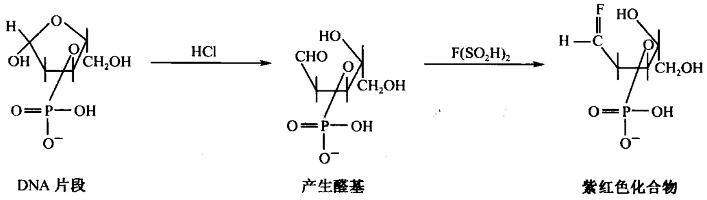
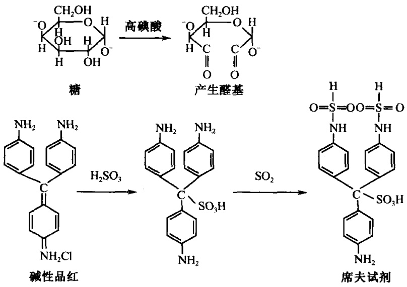
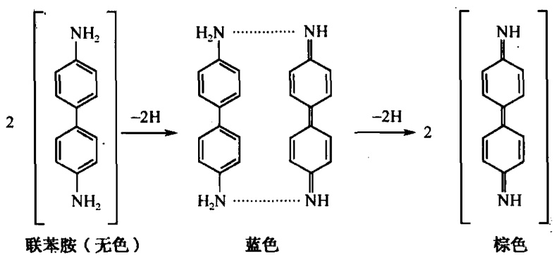

## 第四章 细胞化学

细胞化学是细胞形态学与化学、生物化学之间的交叉科学。其特点是利用已知的化学反应，在保持细胞原有的形态结构上，以化学反应的方法显示出细胞中的化学成分。然后通过显微镜进行定性、定位和定量分析。

细胞化学不但有利于研究细胞的形态联系功能与代谢，定位显示化学性质和化学成分，而且还有利于确定细胞的特征，细胞发生中的特征及化学成分的变化规律，细胞损伤状态下的诊断，病因机理和预后判断等。

随着现代科学技术的发展，细胞化学除了普通染色、光学显微镜基础上的细胞化学外，电镜细胞化学、荧光细胞化学、免疫细胞化学等现代细胞化学技术正在广泛应用，这不但丰富了细胞化学的内容，而且更方便和有利于研究细胞的结构及活动规律。本章主要介绍几种常用和简易的细胞化学技术。

## 实验 15 DNA 的细胞化学——Feulgen 反应【实验目的】

了解Feulgen反应的原理，掌握有关的操作方法。

## 【实验原理】

DNA 是由许多单核苷酸聚合成的多核苷酸，每个单核苷酸又由磷酸、脱氧核糖和碱基构成。DNA 经 1mol/L 盐酸水解，其上的嘌呤碱和脱氧核糖之间的键打开，使脱氧核糖的第一碳原子上形成游离的醛基，这些醛基与席夫试剂反应。席夫试剂是由碱性品红和偏重亚硫酸钠相作用，形成的无色品红液，无色品红与醛基结合形成紫红色的化合物。因此凡有 DNA 的地方，都能显示紫红色。紫红色的产生，是由于反应产物的分子内含有醌基，醌基是一个发色基团，所以具有颜色。材料不经过水解或预先用热的三氯乙酸或 DNA 酶处理，得到的反应是阴性的，从而证明了 Feulgen 反应的专一性（图 4-1）。

图4-1 Feulgen反应

---

54

细胞生物学实验教程

## 【实验仪器、材料和试剂】

（1）仪器、用具:显微镜、恒温水浴箱、温度计、解剖针、酒精灯、试管、烧杯、载玻片、盖玻片、吸水纸。

(2) 材料:洋葱鳞茎或根尖。

## (3) 试剂

1）1mol/L盐酸的配制:取82.5ml相对密度1.19的浓盐酸加蒸馏水至1000ml。

2）席夫试剂的配制及保存:称取0.5g碱性品红加入到100ml煮沸的蒸馏水中（用三角烧瓶），时时振荡，继续煮5min（勿使之沸腾），使之充分溶解。然后冷却至50℃时用滤纸过滤，滤液中加入10ml 1mol/L HCl，冷却至25℃时，加入0.5g Na₂S₂O₅（偏重亚硫酸钠或偏重亚硫酸钾），充分振荡后，塞紧瓶塞，在室温暗处静置至少24h（有时需2\~3天），使其颜色褪至淡黄色，然后加入0.5g活性炭，用力振荡1min，最后用粗滤纸过滤于棕色瓶中，封严瓶塞，外包黑纸。滤液应为无色也无沉淀，贮于4℃冰箱中备用。如有白色沉淀，就不能再使用，如颜色变红，可加入少许偏重亚硫酸钠或偏重亚硫酸钾，使之再转变为无色时，仍可再用。

3）亚硫酸水溶液:取 200ml 自来水，加 10ml 10% 偏重亚硫酸钠（或偏重亚硫酸钾）水溶液和 10ml 1mol/L HCl，三者于使用前混匀。

## 【方法与步骤】

(1) 将洋葱根尖或鳞茎内表皮放在 $1 \mathrm{~mol} / \mathrm{L} \mathrm{HCl}$ 中, 加热到 $60^{\circ} \mathrm{C}$ 水解 $8 \sim 10 \mathrm{~min}$ 。

(2) 蒸馏水水洗。

(3) 席夫试剂遮光染色 30min。

(4) 用新鲜配制的亚硫酸水溶液洗 3 次，每次 $1 \mathrm{~min}$。

(5) 水洗 5min。

（6）将根尖放在载玻片上，镊子捣碎，盖上盖玻片，压片（洋葱表皮可省去压片这一步）。

(7) 显微镜检查，细胞中凡有 DNA 的部位应呈现紫红色的阳性反应。

## - 对照片

方法一:先将材料放在 $5\%$ 三氯乙酸中 $90^{\circ}\mathrm{C}$ 水浴 $15\mathrm{min}$，主要把DNA抽提掉，然后按步骤（1）～（7）制片观察。

方法二:材料不经 1mol/L HCl 水解，直接放在席夫试剂中染色，然后按步骤（4）～（7）制片观察。

## 【作业】

(1) 简述 Feulgen 反应的原理和实验的关键步骤。

(2) 绘图示洋葱根尖细胞或鳞茎表皮细胞 DNA 的分布部位。

(戚康标)

---

第四章 细胞化学

55

## 实验 16 RNA 的细胞化学——Brachet 反应

## 【实验目的】

了解Brachet反应的原理，掌握有关的操作方法。

## 【实验原理】

甲基绿-派洛宁（methyl green-pyronin）为碱性染料，它能分别与细胞内的 DNA、RNA 结合而呈现不同颜色。当甲基绿与派洛宁作为混合染料时，甲基绿和染色质中 DNA 选择性结合显示绿色或蓝色；派洛宁与核仁、细胞质中的 RNA 选择结合显示红色。其原因可能是两种染料的混合染液中有竞争作用，同时两种核酸分子都是多聚体，而其聚合程度有所不同。甲基绿易与聚合程度高的 DNA 结合呈现绿色。而派洛宁则与聚合程度较低的 RNA 结合呈现红色，但解聚的 DNA 也能与派洛宁结合呈现红色。即 RNA 对派洛宁亲和力大，被染成红色，而 DNA 对甲基绿亲和力大，被染成蓝绿色。

## 【实验仪器、材料和试剂】

（1）仪器、用具:显微镜、镊子、载玻片、盖玻片、吸水纸。

(2) 材料:洋葱鳞茎表皮。

(3) 试剂

1）Unna 试剂:甲基绿-派洛宁（methyl green-pyronin）染色液

甲液:5%派洛宁水溶液 6ml  
2%甲基绿水溶液 6ml  
蒸馏水 16ml

乙液:1mol/L 乙酸缓冲液（pH4.8） 16ml

甲、乙两液分别置  $4^{\circ}$ C 冰箱备用，用时甲乙两液混匀。

2）1mol/L乙酸缓冲液（pH4.8）配方:

A 液:冰醋酸 6ml 加蒸馏水至 100ml。

B液:乙酸钠 $13.5\mathrm{g}$ 加蒸馏水 $100\mathrm{ml}$。

取 A 液 40ml 与 B 液 60ml 混匀即为 pH=4.8。

配制注意事项:①Pyronin 可加热助溶；②Methyl green 批号不同，染色效果差别很大。商品 Methyl green 常混有甲基紫，影响染色效果，应先把药品放在分液漏斗中，加入足量的氯仿，用力振荡，然后静置，直到洗脱甲基紫为止，最后干燥备用。

## 【方法与步骤】

(1) 用镊子撕取洋葱鳞茎内表皮一小块，置于载玻片上。

(2) 滴一滴 Unna 试剂，染色 30min。

---

56

细胞生物学实验教程

(3) 蒸馏水洗 2 次，吸水纸吸去多余的水分。

(4) 盖上盖玻片，镜检。

## - 对照片

（1）撕取洋葱鳞茎内表皮，经5%三氯乙酸中90℃水浴处理15min。再经70%乙醇洗片刻，然后按步骤（1）～（4）制片观察。

（2）撕取洋葱鳞茎内表皮，用0.1%RNA酶室温下处理10～15min。蒸馏水洗，吸干，然后按步骤（1）～（4）制片观察。

## 【作业】

简述Brachet反应的原理。绘图示细胞中RNA和DNA的分布。

(戚康标)

## 实验 17 细胞中多糖和过氧化物酶的定位

## 【实验目的】

掌握显示细胞中多糖和过氧化物酶反应的原理和方法。

## 【实验原理】

高碘酸-席夫试剂反应，简称 PAS 反应。主要是利用高碘酸作为强氧化剂，这种强氧化剂能打开 C—C 键，使多糖分子中的乙二醇变成乙二醛，氧化所得到的醛基与席夫试剂反应形成紫红色化合物（图 4-2）。颜色的深浅与糖类的多少有关。

细胞内的过氧化物酶能把联苯胺氧化为蓝色或棕色络合物（图4-3），根据蓝色或棕色的出现来表示过氧化物酶的存在。

---

第四章 细胞化学

57

图4-2 PAS反应

图4-3 过氧化物酶联苯胺反应

## 【实验仪器、材料和试剂】

(1) 仪器、用具:显微镜、镊子、染色钵、刀片、载玻片、盖玻片、吸水纸等。

（2）材料:马铃薯块茎、洋葱根尖或洋葱鳞茎。

(3) 试剂

1）高碘酸溶液:

高碘酸（$\mathrm{HIO_4 \cdot 2H_2O}$）

0.4g

95%乙醇

1/3mol/L 乙酸钠溶液 (2.72g 乙酸钠溶于 100ml H₂O) 蒸馏水

$$
10 \mathrm{ml}
$$

2）席夫试剂（配法见Feulgen反应）。

3）亚硫酸水溶液（配法见Feulgen反应）。

4） $70\%$ 乙醇。

5）联苯胺溶液:在 $0.85\%$ 盐水内加入联苯胺至饱和为止，临用前加入 $20\%$ 体积的 $\mathrm{H}_2\mathrm{O}_2$ ，每 $2\mathrm{ml}$ 加一滴。

6）0.1%钼酸铵溶液:称取0.1g钼酸铵溶于100ml 0.85%盐水中。

---

58

细胞生物学实验教程

## 【方法与步骤】

## 1. 细胞中多糖的测定

\- 高碘酸-席夫（PAS）反应

(1) 把马铃薯块茎用刀片徒手切成薄片。

(2) 浸于高碘酸溶液 5\~15min。

(3) 移入 70%乙醇中浸片刻。

(4) 席夫试剂染色 15min。

(5) 亚硫酸水溶液洗 3 次，每次 1min。

(6) 蒸馏水洗片刻。

(7) 装片镜检。

## 2. 细胞中过氧化物酶的测定

## - 联苯胺反应

（1）把洋葱根尖徒手切成  $20 \sim 40 \mu m$  厚的薄片或用镊子撕取洋葱鳞茎内表皮一小块。

(2) 浸在溶有 $0.1\%$ 钼酸铵的 $0.85\%$ 盐水溶液中 $5\mathrm{min}$ （钼酸铵的作用是催化剂）。

(3) 浸在联苯胺溶液内 2min 至切片出现蓝色。

(4) 在 $0.85\%$ 盐水溶液中洗 $1\mathrm{min}$。

(5) 将薄片置于载玻片上展开，盖上盖玻片，显微镜检查。

## 【作业】

(1) 简述 PAS 反应及联苯胺反应的原理。

(2) 绘图示细胞中多糖及过氧化物酶的分布。

(戚康标)

## 实验 18 细胞中酸性磷酸酶的定位

## 【实验目的】

（1）了解和掌握酸性磷酸酶定位的原理及操作步骤。

(2) 观察酸性磷酸酶在细胞中的分布。

## 【实验原理】

酸性磷酸酶（ACP）是溶酶体的特征性酶，主要存在于巨噬细胞，定位于溶酶体内。正常条件下，巨噬细胞处于休止状态，酶活性很低。但在合适的 pH 条件下，经过活化，其形态、代谢和功能上表现出一系列显著的变化，如膜活性增高和酸性磷酸酶活性增强，从而改变其渗透性，底物可以渗入，酶活力被显示。通常酸性磷酸酶在 pH 为

---

第四章 细胞化学

59

5 左右时发生作用，能水解磷酸酯而释放出磷酸基， $PO_{4}^{3-}$  与底物中硝酸铅反应生成磷酸铅沉淀物。由于这些沉淀物是无色的，需再与黄色的硫化铵反应，生成棕黄色到棕黑色的硫化铅沉淀而被显示出来。其反应过程如下:

$$
\beta - \text {甘油磷酸钠} \xrightarrow {\text {酸性磷酸酶}} \text {甘油} + \mathrm{PO} _ {4} ^ {3 -}
$$

$$
\mathrm{PO} _ {4} ^ {3 -} + \mathrm{Pb} (\mathrm{NO} _ {3}) _ {2} \longrightarrow \mathrm{Pb} _ {3} (\mathrm{PO} _ {4}) _ {2} \downarrow
$$

$$
\mathrm{Pb} _ {3} (\mathrm{PO} _ {4}) _ {2} + (\mathrm{NH} _ {4}) _ {2} \mathrm{S} \longrightarrow \mathrm{PbS} \downarrow (\text {棕黑色})
$$

## 【实验仪器、材料和试剂】

（1）仪器、用具:注射器、解剖剪、镊子、恒温水浴锅、显微镜、载玻片、盖玻片、吸水纸、擦镜纸。

(2) 材料:小白鼠。

(3) 试剂

1）6%淀粉肉汤:牛肉膏0.3g，蛋白胨1.0g，氯化钠0.5g，可溶性淀粉6.0g，蒸馏水100ml，煮沸灭菌，4℃保存，使用时热水浴融化。

## 2）酸性磷酸酶作用液（临用时配）:

称取硝酸铅 25mg，加入 0.05mol/L 乙酸缓冲液 22.5ml，搅动使之全部溶解后，再缓慢地逐滴加入 3%β-甘油磷酸钠液 2.5ml，边加边搅动，防止产生絮状沉淀。

3）甲醛钙固定液:甲醛 10ml，10%CaCl₂10ml，蒸馏水 80ml。

4）0.05mol/L乙酸缓冲液:

A液（0.2mol/L乙酸液）:冰醋酸1.2ml加蒸馏水至100ml；

B 液（0.2mol/L 乙酸钠液）:NaAc·3H₂O 2.72g 加蒸馏水至 100ml；

取 A 液 30ml + B 液 70ml + 蒸馏水 300ml 即成 0.05mol/L 乙酸缓冲液，置 4℃ 保存。

5）2%硫化铵液（临用时配）:硫化铵 2ml+蒸馏水 98ml。

## 【方法与步骤】

## 1. 前处理

(1) 小白鼠每日腹腔注射 $6\%$ 淀粉肉汤 $1 \mathrm{ml}$, 连续注射 3 天。

(2) 第 3 天注射后 $3 \sim 4 \mathrm{~h}$, 再向腹腔注射 $1 \mathrm{ml}$ 生理盐水, 过 $3 \sim 5 \mathrm{~min}$ 后用颈椎脱臼法处死小鼠, 剖开腹腔, 吸取腹腔液。

## 2. 制片

(1) 将腹腔液滴一滴于冰冻的干净载玻片上，并用牙签涂开，自然干燥。

(2) 标本放入作用液中，37℃保温 30min。

(3) 蒸馏水中漂洗片刻。

(4) 放入甲醛钙固定液中固定 5min。

(5) 蒸馏水中漂洗。

(6) 放入 2% 硫化铵液中 3\~5min。

---

60

细胞生物学实验教程

(7) 蒸馏水中漂洗，镜检。

显微镜下观察，小鼠腹腔巨噬细胞为不规则形状，阳性细胞内有大小不等的棕色或棕黑色的颗粒即为酸性磷酸酶。

## 3. 对照实验

标本放入作用液前先用高温（50℃）处理30min，使酶失去活性，做好标记，其他步骤相同。也可在对照组的作用液中不加入β-甘油磷酸钠，而以蒸馏水代替。

## 【注意事项】

作用液中铅离子的浓度是至关重要的，必须现配现用，当铅离子浓度过低时产生的磷酸离子不能被完全捕捉而引起弥散，并可进入细胞核内造成细胞核染色的假阳性，孵育时间过长也可发生酶扩散和核染色的现象。

## 【作业】

简述实验的原理，记录分析实验结果。

(戚康标)

## 实验 19 细胞中碱性磷酸酶的定位

## 【实验目的】

(1) 了解冰冻切片的制作过程。

(2) 熟悉碱性磷酸酶定位的原理及操作步骤。

（3）观察碱性磷酸酶在细胞中的分布。

## 【实验原理】

碱性条件下（pH9.2～9.8），碱性磷酸酶经镁离子激活后可以分解磷酸酯，释放出磷酸根离子，磷酸根与钙盐反应，生成磷酸钙沉淀物。磷酸钙无色，须与硝酸钴反应生成磷酸钴，再与黄色硫化铵作用形成黑色的硫化钴沉淀物，从而能够显示出细胞内碱性磷酸酶的分布。

## 【实验仪器、材料和试剂】

（1）仪器、用具:冰冻切片机、解剖剪、镊子、恒温水浴锅、显微镜、染色缸、载玻片、盖玻片、吸水纸、擦镜纸。

(2) 材料:小白鼠肾冰冻切片。

(3) 试剂

1）碱性磷酸酶作用液:

$$
3 \% \text {甘油磷酸钠} \quad 10 \mathrm{ml}
$$

---

第四章 细胞化学

61

2%巴比妥钠 10ml

2%氯化钙 2ml

2%硫酸镁 1ml

蒸馏水 20ml

2）2%硝酸钴。

3）1%硫化铵（临用前配）。

## 【方法与步骤】

（1）新鲜肾组织冰冻切片置 $37^{\circ}\mathrm{C}$ 碱性磷酸酶作用液 $30\sim 60\mathrm{min}$。

(2) 蒸馏水漂洗。

(3) 浸入 2% 硝酸钴溶液中 3\~5min。

（4）蒸馏水漂洗。

(5) 浸入 1% 硫化铵溶液中 3\~5min。

(6) 蒸馏水洗数次。

(7) 晾干，甘油明胶封片。

(8) 镜检。

碱性磷酸酶呈灰黄色、灰黑色到黑色，色深者表示酶的量多。

\- 对照实验:

标本与作用液反应前先用高温（50～80℃）处理30min，使酶失去活性，做好标记，其他步骤相同。对照组的作用液中也可不加β-甘油磷酸钠，而以蒸馏水代替。

## 【作业】

简述实验的原理，记录分析实验结果。

(戚康标)