## 第九章 细胞化学成分的分离

细胞亚成分包括生物大分子成分的分离制备，是研究细胞亚成分如细胞器的结构和功能，以及生物大分子如蛋白质、核酸等的结构和功能的技术基础。保持分离组分的结构完整性及其生理、生化活性，是分离实验的两个要素。近年来随着生物技术的发展，越来越多的先进技术用于细胞组分的分离，本章介绍其中一些基本的技术，分离细胞器多采用分级离心或梯度离心方案，分离生物大分子如 DNA、RNA 等采用生物化学及分子生物学实验技术。

## 实验 46 细胞核与线粒体的分级分离

## 【实验目的】

了解差速离心法分离细胞器的原理，以及练习使用差速离心法分离哺乳动物的细胞核与线粒体。

## 【实验原理】

用组织匀浆的方法在悬浮介质中进行差速离心制备线粒体。在一给定的离心场中，球形颗粒的沉降速度取决于它的密度、半径和悬浮介质的黏度。在一均匀悬浮介质中离心一段时间后，组织匀浆中的各种细胞器及其他内含物由于沉降速度不同而停留在高低不同的位置。依次增加离心力和离心时间，就能够使这些颗粒按其大小、轻重分批沉降在离心管底部，从而分批收集。细胞器中最先沉淀的是细胞核，其次是线粒体，其他更轻的细胞器和大分子可依次再分离。

悬浮介质通常用缓冲的蔗糖溶液，它属于等渗溶液，比较接近细胞质的分散相，在一定程度上能保持细胞器结构和酶的活性，有利于分离，此外，该方法中采用的氯化钙有稳定核膜的作用。整个操作应注意使样品保持4℃，以避免酶失活。线粒体的鉴定用詹纳斯绿B（Janus green B）活性染色法。

## 【实验仪器、材料和试剂】

（1）仪器、用具:高速冷冻离心机、显微镜、天平、玻璃匀浆器、解剖刀剪、烧杯、量筒、离心管、高速离心管、玻璃漏斗、尼龙布、载玻片、盖玻片。

(2) 材料:大白鼠。

（3）试剂:0.9%生理盐水、0.25mol/L蔗糖、3mmol/L  $CaCl_{2}$  匀浆液、1%甲苯胺蓝溶液、0.02%詹纳斯绿B染液。

## 【方法与步骤】

## （一）细胞核的分离提取

（1）实验前大鼠空腹 12h，击头处死，迅速剖腹取肝，在冰浴的小烧杯中剪成小块（去除结缔组织），尽快置于冰冷的生理盐水中，反复洗涤，尽量除去血液，用滤纸吸去表面的液体。

（2）剪碎的肝组织移入玻璃匀浆管中，加入适量匀浆液，进行匀浆（注意保持冰浴状态），快速匀浆20～30次后，用蔗糖/ $CaCl_{2}$ 预湿的尼龙布过滤于离心管中。

（3）将装有滤液的离心管以 2500r/min，4℃ 离心 15min，取上清液，移入高速离心管中，并保存于冰浴中，待分离线粒体用。

(4) 收集的沉淀以少量蔗糖/$\mathrm{CaCl}_{2}$ 溶液重新悬浮, 以 $2500 \mathrm{r} / \mathrm{min}$ 离心 $15 \mathrm{~min}$, 弃上清。

（5）洗涤过的沉淀以少量溶液重新悬浮，制备成细胞核悬液，滴一滴于干净的载玻片上，做涂片，自然干燥。

(6) 涂片用 1% 甲苯胺蓝染色，在光镜下观察。

## （二）差速离心分离提取线粒体

（1）将装有上清液的高速离心管配平衡后，17 000r/min 离心 20min，弃上清，收集沉淀。

(2) 加入 0.25mol/L 蔗糖/3mmol/L CaCl₂ 溶液 1ml，用吸管吹打成悬液，17 000r/min，4℃离心 20min，将上清液吸入另一试管中，沉淀加入 0.1ml 蔗糖/CaCl₂ 溶液制成悬液。

（3）取上清液和沉淀物悬液，分别滴一滴于干净载玻片上，各滴一滴 $0.02\%$ 詹纳斯绿B染液，染色 $20\mathrm{min}$，镜检（为利于线粒体的有氧呼吸，不必加盖玻片），可见有活性的线粒体进行活跃的运动，并且着色成蓝绿色。

## 【注意事项】

(1) 动物材料实验前可空腹过夜, 以降低肝脏组织中的脂肪含量, 便于实验操作。

（2）实验中必须注意保持细胞器的完整性，避免过于剧烈的机械操作。尤其是线粒体在保持了呼吸氧化功能时才能经活性染色法检测。

（3）由于核沉淀中可能依然存在大量因为粘连或缠绕而沉淀的线粒体，所以可酌情将步骤（4）中洗涤核沉淀后离心得到的上清，与步骤（3）的上清合并加以利用。

（4）由于线粒体进行活性染色法的检测，所以样品制备好后应尽快染色，不要放置过久。

## 【作业】

光镜或油镜下观察制备的细胞核与线粒体样本。

(刘兵)

## 实验 47 高尔基体的分离

## 【实验目的】

学习利用大鼠肝脏细胞分离纯化高尔基体及其相对浓度测定的方法。

## 【实验原理】

高尔基体是细胞中的主要细胞器之一，它存在于细胞质中，由于高尔基体的体积很小，一般需要用光学显微镜或电子显微镜才能辨认清楚，同时高尔基体在细胞中的数量很少，据研究，肝细胞中的高尔基体约占细胞质体积的 $2\%$ ，因此给研究带来一定的困难。Leelavathi和Hino等用大鼠肝脏细胞通过匀浆、增加蛋白酶抑制剂、差速离心等，成功分离纯化细胞内的高纯度的高尔基体，并测定它们在细胞匀浆中的相对浓度，对高尔基体的研究起到重要的推动作用。

高尔基体的纯度可以通过检测高尔基体中的  $\beta-1,4-$ 半乳糖转移酶（GalT）活性对于肝脏研磨液的增加程度来确定。本实验分离纯化的高尔基体，可以提供结构与功能方面的研究应用。

## 【实验仪器、材料和试剂】

（1）仪器、用具:超速离心机、离心管、 $150\mu \mathrm{m}$ 不锈钢实验筛和不锈钢接收器、$0\sim 50\%$ Delta折射计、LS6500闪烁计数器、分光光度计、蛋白质检测仪。

(2) 材料:雌性大鼠。

（3）试剂:磷酸钾、氯化镁、高氯酸、二甲基亚砜，Tris、SDS、β-巯基乙醇、氯化锰、Triton X-100、磷钨酸、卵类黏蛋白、ATP、UDP-半乳糖、抑胃肽A、二甲胂酸盐、蛋白酶抑制剂片剂（完全不含EDTA的片剂）、活性为30～50Ci/mmol的 $[^{3}H]$ UDP-半乳糖、乙醇、闪烁液。

所有的试剂均为分析级或更高，实验中使用的水是双蒸水并经过过滤。

## 【方法与步骤】

## （一）大鼠肝脏高尔基体的纯化

## 1. 溶液配制

(1) 0.5mol/L 磷酸钾缓冲液，pH6.7:分别将 43.55g 无水  $K_{2}HPO_{4}$  和 34.02g 无水  $KH_{2}PO_{4}$  溶于 500ml 水中，制成 0.5mol/L  $K_{2}HPO_{4}$  及 0.5mol/L  $KH_{2}PO_{4}$  溶液。在 400ml 0.5mol/L  $K_{2}HPO_{4}$  中逐渐加入 0.5mol/L  $KH_{2}PO_{4}$  溶液直到 pH 为 6.7。配好的缓冲液在 4℃ 保存。

(2) 2mol/L 蔗糖溶液: 将 342.3g 蔗糖溶解在预热到 $50^{\circ} \mathrm{C}$ 的温水中。然后加水定容至 $500 \mathrm{ml}$, 在 $4^{\circ} \mathrm{C}$ 中保存。

(3) $2 \mathrm{~mol} / \mathrm{L} \mathrm{MgCl}_{2}$: 将 $40.7 \mathrm{~g} \mathrm{MgCl}_{2} \cdot 6 \mathrm{H}_{2} \mathrm{O}$ 溶解到 $100 \mathrm{ml}$ 水中, 室温保存。

（4）蛋白酶抑制剂:直接将一片不含 EDTA 的药片溶解在 50ml 溶液中，然后加入 50ml 抑胃肽 A（5mmol/L 贮液）。准备抑胃肽 A 的方法为溶解 3.43mg 粉末于 1ml DMSO 中，在 -20℃ 贮存。

(5) 梯度缓冲液: 如表 9-1 所示, 用前述的三种贮液和冷双蒸水配制 A\~E 缓冲液。准备中等用量的缓冲液需要 $50 \mathrm{ml}$ 缓冲液 A、B 和 E, 并且需要 $100 \mathrm{ml}$ 缓冲液 C 和 D。缓冲液 C 和 D 中需要加入不含 EDTA 蛋白酶抑制剂药片 (每 $50 \mathrm{ml}$ 缓冲液需加入 1 片) 和抑胃肽 ($5 \mu \mathrm{mol} / \mathrm{L}$)。通常需要配制 $500 \mathrm{ml}$ 不含蛋白酶抑制剂 (价格很贵) 的缓冲液 C 用以清洗肝脏组织。配制溶液所要用到的水必须先放在 $4^{\circ} \mathrm{C}$ 中过夜贮存, 以确保所有缓冲液都是冰冻的。

表 9-1 梯度缓冲液 (A\~E) 配制

| 缓冲液 | A | B | C | D | E |
| --- | --- | --- | --- | --- | --- |
| 蔗糖浓度/(mol/L) | 0 | 0.25 | 0.5 | 0.86 | 1.3 |
| 0.5mol/L磷酸缓冲液,pH6.7/ml | 10 | 10 | 20 | 20 | 10 |
| 2mol/L蔗糖溶液/ml | --- | 6.25 | 25 | 43 | 32.5 |
| 2mol/L氯化镁/ml | 0.125 | 0.125 | 0.125 | 0.25 | 0.25 |
| 水/ml | 39.9 | 33.6 | 54.8 | 36.8 | 7.4 |
| 总体积/ml | 50 | 50 | 100 | 100 | 50 |
| 蔗糖%(w/w) | 0 | 8.6 | 16.0 | 26.4 | 38.6 |
| 折射系数 | 1.333 | 1.346 | 1.357 | 1.375 | 1.397 |

当混合多种成分和使用折射计测定每种缓冲溶液折射系数时，操作过程应尽量精确。相对于蔗糖溶液，最终的折射系数应在±0.5%内（折射系数相差0.001之内），特别是缓冲液C和D。

## 2. 实验步骤

本实验方案是对高尔基体膜进行一般的生化研究而设计的。它也同样适用于使用电子显微镜进行的研究实验。

(1) 选 6 只雌性 Sprague-Dawley 大鼠，（每只体重 150～200g）处于饥饿状态 24h。

（2）把大鼠用  $CO_{2}$  处死，快速将其肝脏转移到大量冰冻且不含蛋白酶抑制剂的缓冲液 C 中（这一过程使肝脏降温并且洗干净血液）。然后将肝脏转移到含有蛋白酶抑制剂的缓冲液 C 中。用剪刀（图 9-1A）将肝脏剪成小块（每块直径为 4～5mm）。将剪碎的肝脏组织放到 50ml 规格的 Falcon 管中。

（3）称量肝脏的重量，一般为 40～50g。最多能得到的 50g 肝脏组织可以做 12 个梯度。

（4）用 250ml 锥形瓶轻轻按压不锈钢筛网，并转动从而对组织进行研磨（图 9-1B）。再加入少量的缓冲液 C（带有蛋白酶抑制剂）到筛中，使肝脏组织更容易进入并通过网格（图 9-1C）。将研磨液汇总到一支 50ml 的 Falcon 管中（图 9-1D）；最终研磨液溶剂大约为 50ml。保留 200μl 置于冰上进行酶测定。

## (5) 蔗糖梯度（图 9-2A）

1）在 12 支 SW-41 超净管中均加入 6ml 缓冲液 D。

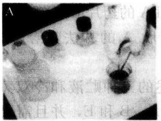

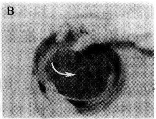

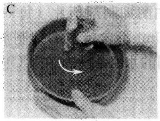

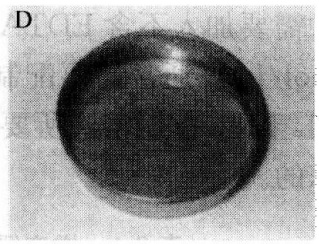

图 9-1 研磨大鼠肝脏的步骤（引自 Celis，2006）

A. 在冰冻的缓冲液 C 中将大鼠肝脏剪碎；B 和 C. 通过金属筛轻轻地压肝脏；D. 接收筛上的研磨液

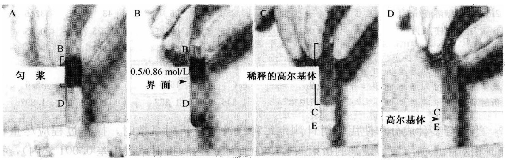

图 9-2 利用蔗糖浓度梯度从大鼠肝脏中分离纯化高尔基体（Celis，2006）

A. 首先将肝脏匀浆液加在 0.86mol/L 蔗糖（缓冲液 D）的上层，然后用 0.25mol/L 蔗糖溶液（缓冲液 B）覆盖其上。左边的字母指示用来制造梯度的蔗糖缓冲液；B. 超速离心后，高尔基体在 0.5/0.86mol/L 交界处富集；C. 从第一个梯度中粗提取的高尔基体样本被转移到第二个梯度中；D. 离心后，高尔基体在 0.5/1.3mol/L 界面处形成了一个微弱的带并且可以用巴斯德移液器进行收集

2）加入 4.5ml 研磨液覆盖其上。

3）加入 1.8ml 缓冲液 B 覆盖其上并平衡每一支管的重量，误差在 0.01g 之内。

(6) 在 $4^{\circ}\mathrm{C}$ 下，以 $29000\mathrm{r / min}$ 离心 $60\mathrm{min}$。

(7) 弃去位于上层和胞质中的脂肪 (由于红细胞的存在而显红色), 并使用塑料巴斯特移液器收集在 $0.5 / 0.86 \mathrm{~mol} / \mathrm{L}$ 界面 (出现模糊带) 富集的高尔基体片段 (图 9-2B)。

(8) 把高尔基体片段收集在一支 $50 \mathrm{ml}$ Falcon 管中。通常, 收集溶液的总体积约为 $15 \mathrm{ml}$, 折射系数大约为 1.370 (0.77 mol/L 蔗糖溶液)。保留 $200 \mu \mathrm{l}$ 置于冰上用作酶测定实验, 使用缓冲液 A 把高尔基体样品置于 $0.25 \mathrm{~mol} / \mathrm{L}$ 蔗糖溶液中 (折射系数 1.345)。如果有必要, 用缓冲液 B 补充溶液至 $50 \mathrm{ml}$ 。

(9) 对于第二个梯度 (图 9-2C), 在每一支管中加入 $2 \mathrm{ml}$ 缓冲液 C 后, 接着加入 $1 \mathrm{ml}$ 缓冲液 E, 再加入 $8 \mathrm{ml}$ 稀释的高尔基体片段覆盖其上。

(10) 在 $4^{\circ} \mathrm{C}$ 下, 以 $8000 \mathrm{r} / \mathrm{min}$ 离心 $30 \mathrm{~min}$ 。

(11) 弃去上清液并且收集在 0.5/1.3mol/L 蔗糖溶液界面处的高尔基体膜（弱带）（图 9-2D）。轻轻地将高尔基体膜（1.5～2ml）与 1 倍体积缓冲液 A 混匀。最终体积为 3～4ml。利用 Bradford 实验（Bio-Rad）检测蛋白质浓度，通常浓度为 1～2mg/ml。

（12）将样品置于液氮中冷冻然后贮存在 $-80^{\circ}\mathrm{C}$ 。样品可以冻融2次而不会导致酶活性显著降低和失去形态。

## （二） $\beta-1,4-$ 半乳糖转移酶活性的检测

## 1. 溶液配制

(1) $0.4 \mathrm{~mol} / \mathrm{L}$ 甲肿酸钠, $\mathrm{pH} 6.6$; 将 $17.1 \mathrm{~g}$ 甲肿酸钠溶解在 $150 \mathrm{ml}$ 水中, 用 HCl 调节 $\mathrm{pH}$ 到 6.6。定容至 $200 \mathrm{ml}$ 并在室温下保存。

(2) $175\mathrm{mg / ml}$ 卵类黏蛋白:溶解 $1\mathrm{g}$ 于水中并最终加水至 $5.7\mathrm{ml}$ 。用 $0.45\mu \mathrm{m}$ 滤膜进行过滤，制成标准溶液并在 $-20^{\circ}\mathrm{C}$ 保存。

(3) 10mmol/L UDP-半乳糖苷酶: 将 25mg 粉末溶解在 4.4ml 水中, 制成标准溶液并在 $-20^{\circ}\mathrm{C}$ 保存。

(4) 10% (w/V) Triton X-100: 将 10g 粉末溶解在 80ml 水中, 最终定容至 100ml, 在 4℃保存。

(5) 0.2mol/L ATP: 将 605mg ATP 溶解在 3ml 水中，用 1mol/L NaOH 调 pH 至 6.5\~7.0 并用水最终定容至 5ml。制成标准溶液并在 -20℃ 保存。

(6) $2 \mathrm{~mol} / \mathrm{L} \mathrm{MnCl}_{2}$: 将 $9.9 \mathrm{~g} \mathrm{MnCl}_{2} \cdot 4 \mathrm{H}_{2} \mathrm{O}$ 溶解到 $15 \mathrm{ml}$ 水中, 在 $4^{\circ} \mathrm{C}$ 保存。

(7) 1%磷钨酸/0.5mol/L HCl (PTA/HCl): 把 5g 磷钨酸溶解在 400ml 水中, 加 22ml 浓 HCl 并用水定容至 500ml, 4℃保存。

(8) 5% (w/V) SDS: 将 5g SDS 溶解到 80ml 水中，定容至 100ml，4℃保存。

(9) 2mol/L Tris: 将 24.2gTris 溶解在 70ml 水中, 最后定容至 100ml, 室温下保存。

（10）测定混合液:使用前述的药品制备一批测定混合液:200μl甲胂酸钠，6μl巯基乙醇，200μl卵类黏蛋白，40μl UDP-半乳糖苷酶，40μl Triton X-100，20μl ATP，40μl MnCl₂，10μl [³H] UDP-半乳糖苷酶和1040μl水。在混合液中UDP-半乳糖苷酶的浓度为0.25mmol/L。

## 2. 实验步骤

(1) 当高尔基体制备完成时, 配制 $1: 20$ 的匀浆液, 中间液和高尔基体裂解用水。

(2) 往装有 $20\mu \mathrm{l}$ 稀释样品或水（空白对照）的螺母型 Eppendorf 管中加入 $80\mu \mathrm{l}$ 测定混合液（重复实验）。在 $37^{\circ} \mathrm{C}$ 条件下转动温育 $30 \mathrm{~min}$。

(3) 加入 1ml 冰冻 PTA/HCl 溶液停止反应，并在 13000r/min 速度下离心 10s。

(4) 弃上清液，并加入 $1 \mathrm{ml} \mathrm{PTA} / \mathrm{HCl}$ 。按步骤（3）中的方法重新悬浮沉淀物。

（5）吸取并丢弃上清液。加入 1ml 冰冻的 95% 乙醇并按步骤（4）重新悬浮沉淀物。

(6) 按步骤 (3) 进行离心, 弃上清液。加入 $50 \mu \mathrm{l} 2 \mathrm{~mol} / \mathrm{L}$ Tris, 然后加入 $200 \mu \mathrm{l}$

5%SDS 进行重新悬浮。震动直到沉淀完全溶解。

（7）在1支干净的离心管中加入 $10\mu \mathrm{l}$ 测定混合液（包含2.5nmol UDP-半乳糖苷酶），$40\mu \mathrm{l}$ 水和 $200\mu \mathrm{l}5\%$ SDS。这一步骤确保了混合液中 $\left[^{3}\mathrm{H}\right]$ UDP-半乳糖苷酶特异性活性。

(8) 在每个样本中加入 $1 \mathrm{ml}$ 闪烁液。转动并使用闪烁计数器的氚通道计数。

## （三）蛋白质浓度的确定

(1) 当 GalT 实验正在进行温育时, 用水配制以下三个样本的稀释液: ①匀浆液进行 $1:100$ 稀释; ②中间片段进行 $1:20$ 稀释; ③高尔基体段进行 $1:2$ 稀释。

(2) 制备稀释的 Bio-Rad 蛋白质测定溶液（用水进行 5 倍稀释）。

（3）将每一管稀释样品分装 $10\mu \mathrm{l}$ 到 $1\mathrm{ml}$ 小试管中，用 $10\mu \mathrm{l}$ 水作为空白对照。同样地分装 $10\mu \mathrm{l}0.1\mathrm{mg / ml}$ 、 $0.2\mathrm{mg / ml}$ 、 $0.4\mathrm{mg / ml}$ 和 $0.8\mathrm{mg / ml}$ 小牛血清（BSA）作标准曲线。

(4) 加入 $990\mu \mathrm{l}$ 稀释的Bio-Rad蛋白质测定溶液，充分混匀，在 $595\mathrm{nm}$ 处测定吸收光。

## （四）纯化表格的计算

（1）通过测定每管不同浓度 BSA 的吸收值描点制定蛋白质的标准曲线。计算斜率  $(m)$  并在纵坐标轴  $(c)$  截取值。

$$
\text {蛋白质浓度} (\mathrm{mg/ml}) = \frac {(\text {样品吸收光} - c) \times \text {稀释倍数}}{m}
$$

总蛋白质量（mg）=蛋白质浓度（mg/ml）×体积（ml）

(2) 计算测定混合液中的 $\left[{ }^{3} \mathrm{H}\right]$ UDP-半乳糖苷酶的特异性活性（SA）。

$$
\mathrm{SA} \left[ ^ {3} \mathrm{H} \right] \text {UDP - 半乳糖苷酶 (dpm / nmol)} = \frac {\mathrm{dpm 标准一空白}}{2 . 5 \mathrm{nmol}}
$$

10μl 测定混合液中包含 2.5nmol [$^{3}$H] UDP-半乳糖苷酶 [β-1,4-半乳糖转移酶活性的检测步骤 (7)]。

## (3) 计算每一样品中 GalT 的活性:

$$
\frac {\mathrm{GalT活性浓度}}{\left[ \mathrm{nmol/(h} \cdot \mathrm{ml)} \right]} = \frac {\text {平均dpm一空白对照}}{\mathrm{SA} \left[ ^ 3 \mathrm{H} \right] \mathrm{UDP-半乳糖苷酶}} \times \frac {1}{0 . 0 2 \mathrm{ml}} \times \frac {1}{0 . 5 \mathrm{h}} \times 2 0 (\text {稀释因子})
$$

总 GalT 活性 (nmol/h)=GalT 活性浓度 [nmol/(h·ml)] × 体积 (ml)

（4）通过除以在  $37^{\circ}$ C 下与其蛋白质浓度相同的样品计算在  $37^{\circ}$ C 条件下 GalT 每个分子每小时每升的 SA [以 GalT 浓度除以同一样品的蛋白质浓度计算 GalT 的 AS，达到 nmol/(mg·h)]。

（5）高尔基体膜的产量可根据高尔基体片段中 GalT 的总活性和匀浆液中 GalT 的总活性比值计算出来。

(6) 纯化倍数是反映 GalT 的 SA 在高尔基体片段相对于匀浆液的因子。

表 9-2 是使用 10 个分离纯化结果而编辑的，每一个参数以平均值±SEM 的形式呈现。因此特异性活性，产量和纯化倍数仅仅是在算数上与 GalT 和蛋白质浓度相关。

表 9-2 中间片段制备溶浆液中高尔基体标记 β-1,4-半乳糖转移酶（GalT）的富集

| 片 段 | 体积/ml | [蛋白质]/(mg/ml) | 总GalT/(nmol/h) | 特异性活性/[nmol/(h·mg)] | GalT产量/% | 纯化/倍 |
| --- | --- | --- | --- | --- | --- | --- |
| 匀浆液 | 48.4±2.7 | 103±16 | 26 000±700 | 5.3±1.4 | 100.0 | 1.0 |
| 0.5/0.86mol/L | 17.6±2.1 | 12.9±3.9 | 5 350±360 | 23.6±1.6 | 20.2±1.2 | 4.5±0.4 |
| 界面 |  |  |  |  |  |  |
| 高尔基体 | 4.6±0.6 | 1.5±0.2 | 3 560±160 | 520±22.8 | 13.7±0.4 | 97.4±4.2 |

## （五）检测结果

如表 9-2 描述的一样，这一实验通常可从匀浆液中提取 80～100 倍纯化的高尔基体。根据 β-1,4-半乳糖转移酶（Landegren，1984）和鱼藤酮非敏感 NADH-细胞色素 c 还原酶（Sottocasa et al.，1967）实验，高尔基体制备包含非常少溶酶体和内质网成分。这些高尔基体膜折叠的状态可用电子显微镜检测（图 9-3）。按 Pypaert 等（1991）描述的方法将样品固定在悬浮液中。

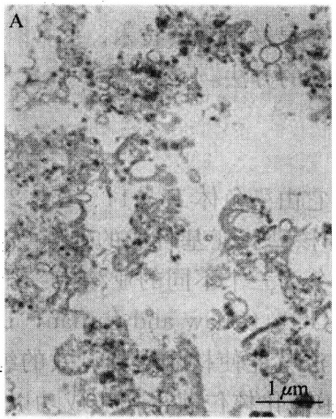

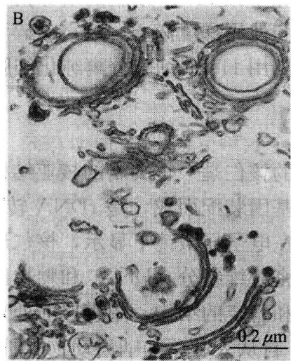

图 9-3 一个典型大鼠肝脏高尔基体制备时囊泡膜在低（A）和高（B）放大率下的代表性显微图像（Celis，2006）

## 【注意事项】

(1) 在整个细胞器纯化过程中, 保持所有溶液在 $4^{\circ} \mathrm{C}$, 以避免过多的蛋白酶消化作用是极重要的。若有可能, 步骤 (3)～(5) 应在冷冻房中进行。加入蛋白酶抑制剂有助于限制样品蛋白质水解。

(2) 所有步骤的进行应越快越好, 从杀大鼠到冷冻最终样品, 整个过程应在 $3 \sim 3.5 \mathrm{~h}$ 中完成。

(3) 梯度不可以由于增加匀浆液浓度而过载, 因为这会增加污染的线粒体数量。

(4) 最终的高尔基体颗粒应呈白色。棕色颗粒表明有污染的线粒体存在。降低匀浆液浓度可以减少这种污染。

(5) $150\mu \mathrm{m}$ 筛在过度使用后会被连接的组织阻塞。通过在 $4\mathrm{mol} / \mathrm{LNaOH}$ 中浸泡 $20\sim 30\mathrm{min}$ 并用大量水洗刷可清洗干净。长期在 $4\mathrm{mol} / \mathrm{LNaOH}$ 中浸泡会侵蚀用于将网格固定到筛孔的胶水，故应避免。

## 【作业】

(1) 大鼠高尔基体纯化过程中，为什么所有的溶液都必须保存在 $4^{\circ} \mathrm{C}$?

(2) 检测高尔基体, 计算高尔基体膜的产量, 拍片并分析其形态特征。

(戚康标)

## 实验48 核仁的分离

## 【实验目的】

(1) 学习和掌握 HeLa 细胞的培养技术。

(2) 学习和使用梯度离心、超声破碎和相差显微镜观察技术。

(3) 掌握利用 HeLa 细胞分离纯化细胞核仁的方法。

## 【实验原理】

人类细胞的核仁是一个突出的核亚结构，它由染色体13、14、15、21和22上连续重复的核糖体基因装配而成，是rDNA转录和核糖体亚基合成的地点（Shaw and Jordan，1995）。在电子显微镜下显示，核仁形态分为三个不同的亚结构:纤维中心（FC）及其周围的致密纤维组分（DFC）和颗粒区（GC）（Shaw and Jordan，1995）。由于核仁具有高密度和稳定的结构，用直接的处理方法就能使核仁得到有效的纯化。在20世纪60年代初，自从人肿瘤和啮齿动物肝脏细胞纯化核仁获得初步成功以后，许多研究都报道了关于游离核仁的描述。核仁从各种各样的哺乳动物组织中被纯化，包括肝脏，大脑（Banks and Johnson，1973）和甲状腺（Voets et al.，1979），也可以从非哺乳物种的细胞中被纯化，如蛙的细胞。大范围地分离纯化核仁的方法，为鉴别、纯化和研究核仁提供了极好的依据，同时也为人们对核仁结构的认识起到重要的促进作用。

本实验是基于从培养人细胞中分离细胞核的程序。这个程序非常稳定，分离的核仁由具有合适能量的超声处理，能使核的其他部分被断裂而核仁保持完整。将分离的核仁通过一个密度梯度离心，得到纯度比较高的核仁成分。然后利用高灵敏大规模的光谱技术进行详细分析（Andersen et al., 2002），这种方法是生产高纯度核仁的可再生和有效的途径。

## 【实验仪器、材料和试剂】

（1）仪器、用具:$\mathrm{CO}_{2}$ 培养箱、组织匀浆器、相差显微镜、Misonix XL2020 超声仪、冷冻离心机、陪替氏培养皿。

(2) 材料:HeLa 细胞。

(3) 试剂

1）含有 4mmol/L L-谷氨酸、4.5mg/ml 葡萄糖和 0.11mg/ml 丙酮酸钠的 DMEM 培养基。

2）青霉素、链霉素。

3）胰岛素-EDTA溶液。

4）2.55mol/L的蔗糖溶液（制备蔗糖溶液见备注）。

5）磷酸缓冲盐（PBS）

缓冲液 A:10mmol/L HEPES，pH7.9，10mmol/L KCl，1.5mmol/L  $MgCl_{2}$ ，0.5mmol/L 二硫苏糖醇（DTT）。

S1 溶液:0.25mol/L 蔗糖和 10mmol/L MgCl₂。

S2 溶液:0.35mol/L 蔗糖和 0.5mmol/L MgCl₂。

S3溶液:0.88mol/L蔗糖和0.5mmol/L $\mathrm{MgCl_2}$

所有的溶液都以全蛋白酶抑制剂片补足，使最后的浓度为 1 片/50ml。

## 【方法与步骤】

(1) 将 HeLa 细胞（CCL-2）接种于 $10\mathrm{cm} \times 14\mathrm{cm}$ 的陪替氏培养皿中，培养基用 DMEM 培养基（含有 $4\mathrm{mmol/L}$ L-谷氨酸、$4.5\mathrm{mg/ml}$ 葡萄糖和 $0.11\mathrm{mg/ml}$ 丙酮酸钠），加入 $100\mathrm{U/ml}$ 的青霉素和 $100\mu\mathrm{g/ml}$ 的链霉素 $[1\% (V/V)$ 青霉素/链霉素溶液]，并在 $37^{\circ}\mathrm{C}$、$5\% \mathrm{CO}_{2}$ 下培养，直到大于 $90\%$ 的细胞聚集（每个培养皿大约有 $10^{7}$ 个细胞）。具有这个数目的 HeLa 细胞，尽管会影响分离核仁的纯度，但是可以减少准备的步骤，并可以提供高产量和高纯度的核仁。确保每一个步骤都用相差显微镜监控（见后）。核仁分离 $1\mathrm{h}$ 后，更换新鲜、预热的培养基。

(2) 通过胰酶处理获得细胞。用预热的 PBS 清洗每个培养皿 3 次，并在最后一次清洗后除去 PBS，每个培养皿加入 $2 \mathrm{ml}$ 的胰岛素-EDTA 溶液。旋动培养皿，确保胰岛素-EDTA 均匀分布，并将培养皿置于培养箱约 $5 \mathrm{~min}$ 。在相差显微镜下检查，确保所有的细胞已经游离。如有需要，可延长孵育的时间。每个培养皿加入 $8 \mathrm{ml}$ 预热的培养基，用吸液管吹打使所有细胞形成单细胞悬浮液。将所有的细胞转至 $100 \mathrm{ml}$ 的 Falcon 管中。对于某些 HeLa 细胞系，还需在 $5 \mathrm{ml}$ 冰冻的 PBS 中刮下细胞。因为这种可能会在某些 HeLa 细胞中造成不纯的核仁制备，所以这并不是最佳方法。

(3) 加入冰冻的 PBS, 在 $4^{\circ} \mathrm{C}$ 下离心 (1000r/min), 重复 3 次清洗细胞。

（4）最后一次 PBS 清洗后，用 5ml 缓冲液 A 重悬细胞，在冰上孵育 5min。滴一小滴细胞悬浮液于玻片上，在相差显微镜下用 20×物镜观察。细胞应该是胀大但没有破裂的（图 9-4）。培养的哺乳动物细胞的核仁在 37℃、低渗条件下会裂解（Zatsepina et al., 1997）。因此在这步骤中保持细胞悬浮液在冰上是很必要的。

（5）将细胞悬浮液转至 7ml 预冷的玻璃匀浆器。用致密的匀浆棒匀浆 10 次，同时保持匀浆器置在冰上。所需的匀浆次数取决于所用的细胞类型。因此每匀浆 10 次就要在相差显微镜下检查匀浆的细胞。当大于90%的细胞破裂就停止，保持核仁的完整无缺，这时核仁上面会附着各种细胞质的物质。大多数情况下，这种细胞质杂质不会影响分离的核仁的最终纯度（图9-5）。在4℃下218g离心匀浆后的细胞5min。沉淀中含有浓缩的，纯度不高的核仁。

图9-4 经过步骤（4）后的HeLa细胞（Celis，2006)

注意胀大的细胞质和突出的细胞核标尺=10μm

图 9-5 步骤（5）和（6）（Celis，2006）

(6) 用 $3 \mathrm{ml}$ 的 S1 溶液重悬沉淀, 然后轻轻吹打使沉淀重悬。不能重悬的沉淀中含有裂解的细胞核, 应该弃去。用 $3 \mathrm{ml}$ 的 S2 溶液使重悬液分层。需注意的是, 要保持两层液体的清晰分离。在 $4^{\circ} \mathrm{C}$ 下 $1430 \mathrm{~g}$ 离心 $5 \mathrm{~min}$ 。这个步骤可以形成更为干净的核沉淀。加入 $3 \mathrm{ml}$ 的 S2 溶液, 吹打, 重悬沉淀 (图 9-6)。

(7) 用 60s 的脉冲对核悬浮液进行超声 (每次超声间隔 10s), 使用 Misonix XL2020 超声仪, 装上微探头, 能量调至第 5 挡。在相差显微镜下监测超声后的细胞核。当观察到没有完整的细胞, 而核仁是致密的, 折射强的球体 (图 9-7A、图 9-7B)。最佳的超声时间取决于所用的细胞类型。如果是第一次尝试从一种类型的细胞分离核仁，就需要每超声10s就在显微镜下检查超声的物质。超声过度会造成核仁的破坏。

图9-6 步骤（7）(Celis，2006)

注意离心前 S1 和 S2 层之间的清晰分界。插图为上清和沉淀的 DIC 图像。注意沉淀中细胞核内突出的核仁。标尺 = 10μm

图9-7 A.超声的设置；B.超声后的细胞核的DIC图像（Celis，2006）注意突出的核仁。标尺 $= 10\mu \mathrm{m}$

(8) 用 $3 \mathrm{ml}$ 的 S3 溶液使超声后的样品分层, 并在 $4^{\circ} \mathrm{C}$ 下 $2000 \mathrm{~g}$ 离心 $10 \mathrm{~min}$ 。沉淀中含有核仁, 同时上清可以保留作为核质部分 (图 9-8)。

(9) 用 $0.5 \mathrm{ml}$ 的 S2 溶液重悬核仁, 在 $4^{\circ} \mathrm{C}$ 下 $1430 \mathrm{~g}$ 离心 $5 \mathrm{~min}$ 。沉淀中含有高纯度的核仁。在相差显微镜下观察, 确保预备物中只含有高纯度的核仁, 而没有其他物质 (图 9-8)。可以使核仁在 $0.5 \mathrm{ml}$ 的 S2 溶液中重悬, 并在 $-80^{\circ} \mathrm{C}$ 下保存。

## 1. $2.55\mathrm{mol / L}$ 蔗糖溶液的配制方法

(1) 称取 $1710 \mathrm{~g}$ 的蔗糖 (BDH), 把它放在干净的容器中。

图9-8 步骤（9）(Celis，2006)

注意离心前后S2和S3层之间清晰分界，沉淀应该是小而可见（插图）；

上清和沉淀的DIC图像，沉淀中应该包含纯化的核仁

(2) 在 $5 \mathrm{~L}$ 的烧杯中准确加入 $900 \mathrm{ml}$ 的水和一个磁棒, 把烧杯放在搅拌器上并开始搅拌。

(3) 加入 1/3 的蔗糖于烧杯中，确保磁棒可以自由地转动，搅拌 1h。

(4) 加入另外 1/3 的蔗糖于烧杯中，再次确保磁棒的转动没有减弱，搅拌 1h。

(5) 加入剩下的蔗糖, 搅拌 $1 \mathrm{~h}$, 或者直至所有蔗糖均溶解。最后的体积应准确为 $2 \mathrm{~L}$ 。

以上方案制备的蔗糖储备液，最终的浓度是 2.55mol/L 或质量分数为 66%。它的密度在  $20^{\circ}$ C 下为 1.3224g/cm $^{3}$ ，折射率为 1.4558。储备液在  $4^{\circ}$ C 下比较稳定，适用于核仁的分离。这些步骤可以在室温下进行，不需要通过加热溶液来促进蔗糖溶解，因为加热会使没有完全溶解的蔗糖变焦而影响蔗糖溶液的质量。

## 2. 超声仪的使用

为了确保可重复的超声，必须遵循以下几点:

(1) 实验使用装上微探头的 Misonix XL2020 超声仪，能量设为第 5 挡。

(2) 每次换探头后必须调整超声仪。按照制造商的手册去调整程序。

(3) 由于超声会引起溶液局部强烈的升温。为了减少这种升温, 正确的方法是缩短超声时间和增加脉冲之间的间隔时间, 并把试管置于冰上或在冷室中进行超声。

(4) 如果探头过于接近液体表面, 会产生泡沫, 并降低超声效率。解决的方法是将探头浸没在溶液中, 大概在试管底部上面的 $5 \mathrm{~mm}$ 处, 但探头不要碰到试管底部或试管壁。

(5) 当重复使用时, 超声探头的末端会产生凹陷, 随着时间的推移超声的效率会逐渐降低。因此, 在探头逐渐老化时, 必须用相差显微镜来监测超声的结果, 并及时调节超声的时间, 如果超声的效率显著下降时就要更换探头, 以保持高效率的超声效果。

## 3. 分离核仁的分析

(1) 免疫标记纯化的核仁: 在涂有一层多熔素的玻片上滴加约 $5 \mu \mathrm{l}$ 的核仁悬浮液,

并晾干液滴，在进行标准的免疫着色步骤前，将玻片置于 PBS 中 5min。

(2) 为了在凝胶中分离核仁蛋白质, 可以直接在 Laemmli SDS 样品缓冲液或者在首选的缓冲液中重悬样品, 在分离的核仁中, 高浓度的核酸使裂解的样品非常黏滞, 样品通过 QIAshredder spin 柱子后会变澄清。也可以用 RIPA 缓冲液来提取核仁 (150mmol/L NaCl, 1%NP40, 0.5%脱氧胆酸, 0.1%SDS, 50mmol/L Tris pH 8.0)。用 RIPA 缓冲液处理的核仁裂解液可以用来进行免疫沉淀。

## 4. 核仁分离方法适用的细胞类型

上述的方案可以应用于其他细胞类型。除了 HeLa 细胞外，对这方案作出少许修改后，可以用于分离来自 MCF-7（人乳腺上皮细胞）、WI-38（人纤维原细胞）、IMR-32（人成神经细胞瘤）、HL60（人前髓细胞白血病）的细胞，还有植物拟南芥的细胞。当对一种不同的细胞类型使用该方案时，必须在每一步骤后都用相差显微镜仔细检查产物。例如，不同的细胞类型可能需要一个不同的均质化过程和（或）超声强度。 $MgCl_{2}$  的浓度也会对分离核仁的纯度有很大的影响。如果分离的核仁不够纯，可以尝试降低 S2 和 S3 溶液的  $MgCl_{2}$  浓度。如果产量太低，或者核仁碎片化，则提高  $MgCl_{2}$  的浓度。

## 【作业】

(1) 在分离核仁的过程中，为什么要用超声处理？如何掌握最佳的超声时间？

（2）观察和分析纯化核仁的结果。

(戚康标)

## 实验 49 过氧化物体的分离

## 【实验目的】

学习用蔗糖密度梯度离心法分离纯化小鼠肝脏的过氧化物体。

## 【实验原理】

研究过氧化物体（PO）的独特功能与结构，前提条件是获得这个细胞器的高度纯化片段。然而，实现这一前提条件受到两个方面的限制:①过氧化物体的相对含量极少（占总肝脏蛋白的2%）；②过氧化物体容易破碎。因此在分离过氧化物体的过程中，需要保持一个温和、均一的外部环境，需要把机械压、静水压和渗透压对过氧化物体的损伤减到最低。

一般分离过氧化物体大致需要 3 个步骤:①获得组织匀浆或破坏细胞；②利用差速离心法纯化匀浆；③利用密度梯度离心法分离已纯化的过氧化物体。

在匀浆过程中，通常需要在一个低盐浓度、等张等压的媒介中进行，目的是避免聚合。添加螯合剂（如EDTA）可以防止微粒体的聚集，减少其对过氧化物体的污染。另外，匀浆缓冲液（HB）应该添加抗氧化剂（DTT）和蛋白酶抑制剂（PMSF、$\varepsilon-$氨基己酸)，以防止分离过氧化物体过程中发生氧化和蛋白质酶解反应。

分离纯化过氧化物体通常利用密度梯度离心来实现，经典的方法是利用蔗糖密度梯度和特制的转子来分离纯化，实际上是在一个等压的环境中，使自生的梯度与垂直转子相结合，从而达到分离过氧化物体的目的。若要获得高度纯化的过氧化物体，最直接的方法是利用甲泛葡胺（metrizamide）、nycodenz或碘克沙醇（OptiPrep）的碘化梯度介质，以及垂直转子来分离。后者中，过氧化物体能与较高密度的物质（1.24g/cm³）相互结合，因为它们对低分子质量物质具有渗透性，所以能很好地从溶酶体、线粒体和微粒体中分离出来。

用上述方法，可以从正常鼠的肝脏中提取高纯度（>98%）的过氧化物体。同时，这种方法已经被应用到从哺乳动物的肝脏和肾脏中提取过氧化物体。运用这种方法，再加上微分离心法，还可以分离出过氧化物体的亚结构。流程见图9-9。

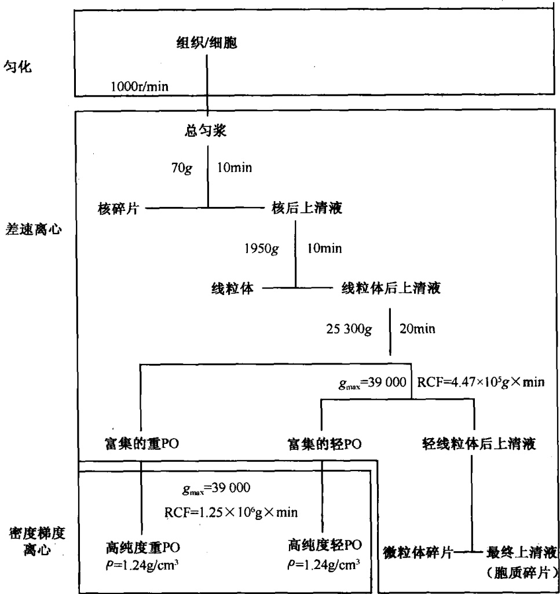

图 9-9 分离小鼠肝脏高纯度（>98%）PO 的流程图（Celis，2006）

【实验仪器、材料和试剂】

（1）仪器、用具:灌流装置（自制）、电动高速搅拌器、研钵、聚四氟乙烯杵、冷冻低速和高速离心机、折射计。

(2) 材料:体重为 $220 \sim 250 \mathrm{~g}$ 的雌鼠，实验前一晚需要停止喂食。

(3) 试剂:MOPS、PMSF、DTT、乙醇、EDTA、$\varepsilon$-氨基己酸、蔗糖、甲泛葡胺

NaOH。

## 【方法与步骤】

## （一）灌流和匀化

## 1. 溶液配制

（1）匀化缓冲液（HB）:首先在蒸馏水中溶解 85.56g 的蔗糖（250mmol/L）、1.046g MOPS（5mmol/L）、0.372g 的 EDTA- $Na_{2}$ （1mmol/L）、1ml（0.1%）的乙醇，然后用 NaOH 调到 pH7.2，最后加水至 1L，4℃ 贮藏。使用前每 100ml 加入:0.2μl 的 PMSF，0.1ml 的 1mol/L ε-氨基己酸，20μl 的 1mol/L DTT。

(2) 盐溶液 (0.9%):在蒸馏水中溶解 9g 的 NaCl，定溶至 1L。

## 2. 实验步骤

(1) 麻醉动物。

(2) 称动物体重, 剖腹, 通过静脉入口向肝脏灌流 $0.9\%$ 的盐溶液, 直至血液全部排干。

（3）移除肝脏，把周围组织分离开，称量肝重，并将其切成碎片，收集在一个冰浴的陶制研钵中，研钵中预先加入 $3\mathrm{ml / g}$ （肝脏净重）的冷冻HB。

(4) 用杵把组织研磨、匀化（1000r/min）。

(5) 将匀浆倒入 50ml 的离心管中。

## （二）亚细胞水平的分馏

## 1. 溶液配制

匀浆冲液（HB）方法同上。

## 2. 实验步骤

（1）将匀浆放在冷冻低速离心机中离心 $10\mathrm{min}$ （70g），除去碎片、未破碎的肝细胞、血细胞及大部分的核。

(2) 小心倾倒出上清液, 把小颗粒悬浮在 $2 \mathrm{ml} / \mathrm{g}$ 的 HB 中再次匀浆、离心, 条件与步骤 (1) 相同。

（3）倾倒出第二次的上清液，并与第一次的（去核后的上清液）合并，弃去沉淀颗粒。

(4) 把去核后的上清液在冷冻高速离心机中离心 10min (1950g)。

（5）轻轻地把上清液倒出，把小颗粒悬浮在 $1\mathrm{ml / g}$ 的冷冻HB中，再次离心(1950g)。最后的固体小颗粒（重线粒体碎片）含有线粒体、大微粒体薄片及一些剩余核质。而合并在一起的上清液就是线粒体后上清液。

(6) 把线粒体后上清液高速离心 $20 \mathrm{~min}$ (25300g); 除去上清液以及吸取微红色的蓬松层; 把固体小颗粒悬浮在约 $10 \mathrm{ml}$ 的冷冻 HB 中; 再次离心 $15 \mathrm{~min}$ (25300g)。把最后的固体小颗粒再次悬浮在 $5 \mathrm{ml}$ 的冷冻 HB 中, 它包含富集的重过氧化物酶体的碎片, 即轻线粒体的碎片。相对应的上清液可以用于直接准备微粒体碎片和最终上清液

(细胞溶质的可溶蛋白质)，或者用于继续分离出轻过氧化物体。

（7）分离到这个程度，用 $g(\max) = 39000$ 的RCF去离心。把固体小颗粒悬浮在$5\mathrm{ml}$ 的冷冻HB中，里面包含富集的轻过氧化物体碎片。

## （三）甲泛葡胺密度梯度离心

## 1. 溶液配制

（1）梯度缓冲液（GB）:配制1L，把1.046g MOPS（5mmol/L）、0.372g的EDTA- $Na_{2}$ （1mmol/L）、1ml（0.1%）的乙醇溶解于蒸馏水中，然后再用NaOH调到pH7.2，最后加水到1L，4℃贮藏。使用前每100ml加入0.2μl的PMSF，0.1ml的1mol/Lε-氨基己酸、20μl的1mol/L DTT。

## (2) 甲泛葡胺溶液 (MS)

1）60%（w/V）的储存溶液:把60g的甲泛葡胺在GB中边搅拌边溶解。最后加GB到100ml。4℃贮藏。

2）梯度溶液:在 $60\%$ 的储存溶液中分别取 $3.78\mathrm{ml}$ 、 $3.38\mathrm{ml}$ 、 $3.53\mathrm{ml}$ 、 $2.06\mathrm{ml}$ 、 $3.2\mathrm{ml}$ 溶液。加入GB到 $10\mathrm{ml}$ 、 $7\mathrm{ml}$ 、 $6\mathrm{ml}$ 、 $3\mathrm{ml}$ 、 $4\mathrm{ml}$，用折射计把其分别调节到密度为 $1.12\mathrm{g/ml}$ 、 $1.155\mathrm{g/ml}$ 、 $1.19\mathrm{g/ml}$ 、 $1.225\mathrm{g/ml}$ 、 $1.26\mathrm{g/ml}$ 。

## 2. 实验步骤

甲泛葡胺密度梯度的准备:

（1）把 4ml、3ml、6ml、7ml、10ml 的 MS（1.12～1.26g/ml）分别加入到 40ml 的离心管中，形成一个不连续的梯度。

(2) 马上把这个梯度在液氮中冷冻，并贮存在 $-20^{\circ}\mathrm{C}$ 中。

(3) 使用一个金属架在室温中解冻。

梯度离心:

(1) 在解冻的梯度中加入 $5 \mathrm{ml}$ 富集轻/重过氧化物体碎片, 密封离心管。

(2) 在一个垂直型转子中梯度离心，使用慢加速度/减速度模式， $g(\max)=39\ 000$ 。在这种条件下，高纯度的重过氧化物体会停留在1.23～1.24g/ml的密度带中，而轻过氧化物体则会停留在1.20～1.21g/ml的密度带中。

（3）用碎片收集器重新获得过氧化物体碎片，用注射器把离心管刺破进行收集。把碎片储藏在 $-80^{\circ}C$ 下。

（4）除去甲泛葡胺，因为它会干扰过氧化物体酶（如尿酸氧化酶）以及蛋白质活性的测定。用 HB 稀释过氧化物体碎片 10 倍，然后各自以 25 000g 和 39 000g 进行离心。

## 【实验观察结果】

表 9-3 所列是重过氧化物体碎片的含量，这是以特异的过氧化物体酶测定的，从表中可以看出原匀浆 38 倍的提纯率。这些过氧化物体碎片的总蛋白质超过 95% 是过氧化物体，而线粒体和微粒体各占大约 2%，溶酶体的含量则小于 1%。以下是通过电子显微镜方法来测定的，显示了过氧化物体在碎片中所占比例为 98%\~99%（图 9-10 和图 9-11）。在图 9-10 中，过氧化物体含有典型的内含物尿酸氧化酶，但在细胞器之间的空隙里也可以看到一些游离的核心酶。在图9-11中，大多数的过氧化物体细胞间质中可以观察到过氧化氢酶的细胞生化反应产物的电子密度，这是经过碱性 $3,3^{\prime}$ -二氨基联苯培养基中的过滤准备培育的，从图中可以看出过氧化物体的完整性以及没有出现过氧化氢酶的渗漏。

表 9-3 正常鼠肝中纯化的重 PO 碎片的含量

| 酶 | mU/mg 匀浆/(mg/g 肝脏) | 覆盖率/% | RSA |
| --- | --- | --- | --- |
| 蛋白质 | 256.36±82.94 | 0.28±0.08 | - |
| 过氧化氢酶 | 203±42.7 | 0.28±0.08 | 37.67±4.28 |
| HA-氧化酶 | 3.3±0.7 | 9.46±1.06 | 40.25±5.83 |
| FA β-氧化 | 3.6±0.96 | 11.18±3.25 | 36.32±5.09 |
| β-葡糖苷酸酶 | 38±5.88 | 0.01±0.01 | 0.07±0.06 |
| 磷酸酶 | 31 | 0.15 | 0.07 |
| 酯酶 | 1229±246.7 | 0.01±0.01 | 0.09±0.07 |
| NADPH-CcR | 18±4.6 | 0.18 | 0.702 |
| Cc-氧化酶 | 127±35.6 | 0.02±0.02 | 0.09±0.05 |
| L-GIDH | 57±16.5 | 0.08±0.02 | 0.679 |

注:HA-氧化酶。α羟基酸氧化酶；FAβ-氧化。脂肪酸β-氧化；NADPH-CcR。NADPH-细胞色素c还原酶；Cc-氧化酶。细胞色素c氧化酶；L-GIDH。L-谷氨酸盐脱氢酶；RSA。相对特异活性。

图9-10 被分离的重PO经过戊二醛、锇酸固定后在电子显微镜下的图像。从图中可以看出碎片主要含有PO，所含的线粒体(M)非常少。很多PO含有尿酸盐氧化酶核心（箭头处）

(Celis, 2006)

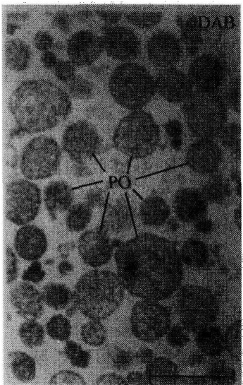

图 9-11 比图 9-10 多了预先经过碱性 3, 3'-二氨基联苯培育的过程，这是为了得到过氧化氢酶的定位。我们可以注意到大多数 PO 的细胞间质中的过氧化氢酶的电子密度反应产物。这说明了过氧化氢酶没有渗漏及它的完整性。标尺 = 1μm (Celis, 2006)

图 9-12（R道）显示了小鼠肝脏的重过氧化物体的多肽样品（SDS-PAGE），此图中并没有出现典型的线粒体和微粒体条带，因此可以看出其高度的提纯。同时，此图还显示了肝脏过氧化物体蛋白成分在小鼠（R道）和豚鼠（G道）中的显著差异。在图 9-13 中，可以明显地看到特异过氧化物体蛋白质可以被选择性地诱导。例如，经降血脂纤维酸衍生物处理后，鼠的三功能蛋白质（PH）被诱导增加，而同时过氧化氢酶（Cat）和尿酸氧化酶（Uox）伴随性地减少了。

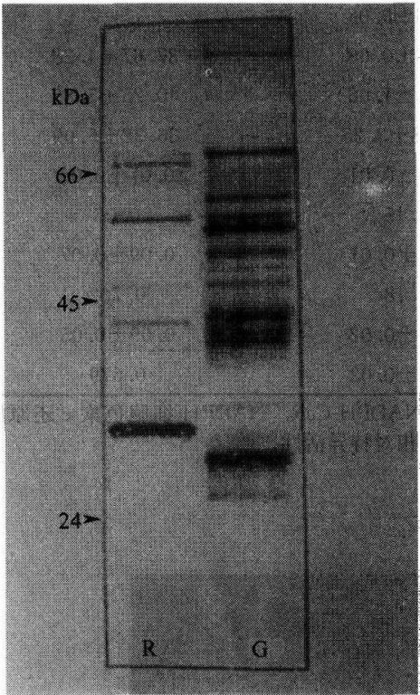

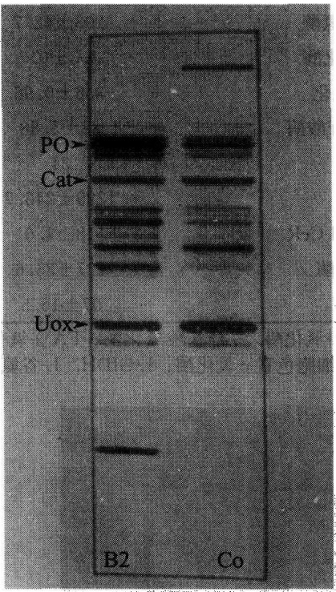

图9-12 左边是高度纯化的重PO的SDS-PAGE，R为鼠肝的，G为豚鼠肝脏的PO。该实验使用$10\% \sim 12.5\%$ 的溶解冻胶，而每条道使用的蛋白质质量为R道$2.4\mu \mathrm{g}$、G道$5.4\mu \mathrm{g}$。多肽带着银色。分子质量标准为:BSA(66kDa)，卵清蛋白（45kDa），胰蛋白酶原（24kDa）。我们可以注意到小鼠和豚鼠的多肽图样的显著不同。标尺 $= 1\mu \mathrm{m}$ (Celis，2006)

图9-13 右边是高度纯化的小鼠PO的SDS-PAGE, Co为对照组，BZ则为经降血脂纤维酸衍生物处理后的实验组。该实验使用 $10\% \sim 15\%$ 的溶解冻胶，每条道都加入 $5.0\mu \mathrm{g}$ 的蛋白质量。多肽带着银色。图中有箭头指示的PO多肽分别为PH，三功能蛋白质；Cat，过氧化氢酶；Uox，尿酸氧化酶。我们可以注意到，在BZ组中，PH被诱导增多了，而Cat和Uox则伴随性地减少了。同时，我们还可以把图9-13的Co（对照组）与图9-12的R道对照，这两者是不同的，而实验使用的溶解冻胶浓度也是不同的（Celis，2006）

这里略述的延伸步骤能成功地从正常小鼠或再生小鼠的肝脏中分离重过氧化物体和轻过氧化物体，其中，这两者的密度、大小、形状、动力学组成都不相同。此外，从人的肝癌细胞系 HepG2 中也可以获得与前两者不同的过氧化物体。然而，这些组织中的过氧化物体亚群并不能通过传统的梯度离心法提纯，这主要是因为它们的沉淀性质与其他的亚细胞器（特别是微粒体）非常接近。但无论如何，对它们的提纯是非常必要的，这不仅对人体中过氧化物体重要功能的研究，而且对其生源论的研究也有非常重要的意义。

除了密度梯度离心法之外，还可以利用免疫自由流电泳（IFFE）的方法来分离、提纯过氧化物体（PO）。IFFE不仅能有效地从小鼠肝脏的轻线粒体碎片中提取完整的过氧化物体（$\rho = 1.22 \sim 1.24 \mathrm{~g/cm}^3$），而且还能从重线粒体碎片和线粒体后碎片中提取过氧化物体。IFFE结合了电泳分离与免疫反应的高度选择性这两者的优点。它利用的原理是，在电泳缓冲液的pH约为8.0（等于IgG分子的pI）的条件下，结合了抗体的亚细胞微粒的电泳迁移率会大大地降低。利用IFFE方法可以从不同的肝亚细胞碎片中分离出过氧化物体，我们通过免疫印迹可以知道这些过氧化物体的细胞间质以及膜蛋白的组成是不同的。这有力地说明了IFFE是一种分离提纯过氧化物体不同亚群的有效方法。

## 【注意事项】

（1）在匀浆过程中，为了避免聚合，除了添加螯合剂（如 EDTA）外，还需要注意保持一个低盐浓度和等张等压的媒介条件。

(2) 在去上清液时动作需要小心轻巧。

## 【作业】

(1) 观察和计算过氧化物体含量。

(2) 分析利用密度梯度离心法分离纯化过氧化物体的效果。

(戚康标)

## 实验 50 完整叶绿体的分离

## 【实验目的】

了解梯度离心法分离细胞成分的原理，掌握Percoll梯度法从植物叶组织中分离完整叶绿体的方法。

## 【实验原理】

梯度离心法是根据被分离样品的密度差异，在一定密度梯度的介质中加以离心力场，使得不同密度的颗粒悬浮停留在相应的介质梯度区。

植物细胞被细胞壁所包围，因此实验中必须在破碎细胞壁的同时保持叶绿体的完整。从破碎细胞中释放出来的叶绿体等质体可经适当的梯度离心，将完整叶绿体和破碎叶绿体分开。

植物细胞的质体中储存的淀粉致密颗粒可能在离心过程中造成质体破裂，因此可在较低光照条件下预处理植物1\~2天，以消除淀粉的积累作用。

用 Percoll（聚乙烯吡咯烷酮包被的硅颗粒）梯度进行叶绿体的分级分离，与蔗糖相比，Percoll 基本上不在梯度内产生渗透压，黏性也较蔗糖低，因而能缩短离心时间。成分中的聚乙二醇（PEG）可对破碎了的叶绿体及过氧化物酶体的条带密度造成影响，因而减小此类破碎细胞器对完整叶绿体的污染程度。PEG、Ficoll 和 BSA 有利于维持叶绿体的生物活性。叶绿体经 Percoll 分级分离后比较稳定，可在冰上保持数小时。叶绿体得率可通过检测叶绿素含量来确定。

## 【实验仪器、材料和试剂】

（1）仪器、用具:玻璃匀浆器、高速冷冻离心机、大容量离心管及微量离心管、可见分光光度计、尼龙网、移液器、研钵（用于液氮）、石英砂。

(2) 材料:新鲜菠菜或豌豆叶。

(3) 试剂

1) 匀浆悬浮缓冲液:
2mmol/L EDTA (pH8.0)
1mmol/L MgCl₂
1mmol/L MnCl₂
50mmol/L HEPES-KOH (pH8.0)
0.33mol/L 山梨醇
0.5g/L BSA (无脂肪酸)
5mmol/L 抗坏血酸钠盐 (使用前添加)
2) 50%PBF-Percoll 梯度:
2mmol/L EDTA (pH8.0)
1mmol/L MgCl₂
1mmol/L MnCl₂
50mmol/L HEPES-KOH (pH8.0)
0.33mol/L 山梨醇
50%Percoll (V/V)
3%PEG6000 (m/V)
1%BSA (无脂肪酸) (w/V)
1%Ficoll (w/V)
3) 1×SH:
50mmol/LHEPES-KOH (pH8.0)
0.33mol/L 山梨醇
4) 丙酮。

## 【方法与步骤】

（一）叶绿体的制备

(1) 梯度的制备:按照试剂 2）的配方制备 50% PBF-Percoll 梯度，在每个 50ml 离心管中加入 25ml 的 PBF-Percoll 溶液。29 000g 离心 15min，即可形成梯度（制好的梯度可于 4℃下过夜存放）。

(2) 材料的准备: 菠菜或豌豆叶材料可直接购买, 或用种子进行水萌发, 光照培养。

（3）匀浆:取 50～100g 的叶组织，研钵中加液氮，迅速研磨几下（为增加研磨强度可添加少许石英砂），转入预冷的匀浆缓冲液匀浆，避免过度匀浆及产生泡沫。

（4）匀浆液用粗孔尼龙布过滤后，在大容量离心管或离心瓶中 2600g，4℃ 离心 5min，收集沉淀。

(5) 用 $2 \mathrm{ml}$ 匀浆缓冲液重悬沉淀（可使用软毛刷轻轻将管壁上的沉淀刷松），小心地加到做好的Percoll梯度上。$10500 \mathrm{~g}$，$4^{\circ} \mathrm{C}$ 离心 $10 \mathrm{~min}$（应见到两条绿色带，上方的条带为破碎的叶绿体，接近底部的为完整叶绿体带）。

(6) 将叶绿体带吸出，用 $1 \times \mathrm{SH}$ 洗涤几次，每次 $2400\mathrm{g}$ 离心，收集沉淀。

(7) 悬浮于  $1 \times SH$ 。

（二）检测叶绿素含量

(1)  $5\mu l$  叶绿体悬液与  $995\mu l$  的 80% 丙酮在微量离心管中混匀。

(2) 13 000g，室温离心 2min。

(3) 取溶液在 663nm 及 645nm 处检测吸光值。

(4) 计算:叶绿素含量 (mg/ml) = (8.02A\_{663} + 20.2A\_{645}) / 5。

## 【注意事项】

（1）植物细胞由细胞壁包围，因此分离叶绿体必须保证破碎细胞壁同时不破坏叶绿体的完整。因此采用液氮研磨加匀浆的方案（研磨时加入石英砂是为了增加机械剪切力）。注意不要研磨匀浆过度。

(2) 菠菜与豌豆的质体较小, 而且都能在不积累淀粉和酶类物质的条件下生长。菠菜的叶绿体/湿重值较高, 而豌豆易于生长。

对于那些叶绿体较大且形状不规则，或包埋在厚纤维组织中的细胞，可先酶解细胞壁，再破裂原生质体。

(3) 使用的牛血清白蛋白（BSA）不能含有脂肪酸，以防止脂肪酸氧化造成膜溶解。
【作业】

用梯度离心法分离、纯化叶绿体，并计算叶绿素含量。

(刘兵)

## 实验 51 中期染色体的分离纯化

## 【实验目的】

用己二醇法或水相法分离培养细胞的中期染色体，同时用梯度法纯化制备的染色体

粗样品，以适用于生化检测及形态分析。

## 【实验原理】

染色体的分离纯化对于研究染色质的结构以及生物性状具有重要的作用。

分离有丝分裂染色体时的一个主要问题，是稳定染色体结构的同时，降低其他细胞结构的稳定性，从而制备染色体。所用的缓冲条件应温和以避免改变染色体的生化性质和形态。常用的方案包括聚胺法、水相法、己二醇法等。

本实验介绍的己二醇法中，染色体主要靠己二醇来维持其稳定性，而无需处于高浓度条件下的二价阳离子（$\mathrm{Ca^{2+}}$）。这种条件下，染色体能保持致密且形态稳定。在 $4^{\circ}\mathrm{C}$ 缓冲液中能保存几周。

而水相法则采用近似生理条件的提取介质，以减少对染色体结构的破坏。

通常用各种方法制备得到的粗制染色体样品，由于混有杂质，并不适用于直接进行一些生物学检测，而是必须将样品进行纯化。最主要的污染物一般是肌动蛋白和中间纤维成分的非染色体蛋白，以及细胞核和发生聚集的染色体。将染色体粗品悬液通过蔗糖梯度进行沉降能去除大部分污染。

## 方法一 己二醇法分离中期染色体

## 【实验仪器、材料和试剂】

（1）仪器、用具:冷冻离心机、离心管、移液器及枪头、玻璃匀浆器、相差显微镜。

(2) 材料:HeLa 细胞。

(3) 试剂

1）己二醇缓冲液:1mol/L 己二醇（2-甲基-2,4-戊二醇），0.5mmol/L CaCl₂，0.1mmol/L PIPES [哌嗪-N,N'-双（2-乙磺酸）] (pH6.5)。

2）蔗糖。

3）秋水仙素。

## 【方法与步骤】

（1）有丝分裂过程中，细胞的同步化处理。在适宜的条件下培养细胞，收集处于有丝分裂前期 $10\sim 16\mathrm{h}$ 的细胞，在培养基中加入 $0.06\mu \mathrm{g / ml}$ 的秋水仙素（有丝分裂指数应大于 $50\%$ ，最好为 $80\% \sim 90\%$ ，细胞应处于对数生长期，细胞密度不大于 $75\%$ 的汇合）。

(2)  $4^{\circ}C$ , 1000g 离心 10min, 用 10ml 培养基重悬, 重悬细胞在  $4^{\circ}C$  放置 20min (低温以促进有丝分裂复合物包括微管的完全解离),  $4^{\circ}C$ , 1000g 离心 4min, 收集细胞。

(3) 用预冷的己二醇缓冲液清洗细胞，按第（2）步离心。

(4) 10ml 预冷的己二醇缓冲液重悬细胞，37℃温浴 10min。

（5）细胞悬液在玻璃匀浆器中匀浆10次，匀浆液于 $4^{\circ}\mathrm{C}$，3000g离心15min进行浓缩，重新悬浮后，即得到染色体粗样品。

（6）蔗糖梯度的制备:在己二醇缓冲液中加入蔗糖，分别制成 $20\%$ 、 $40\%$ 、 $50\%$ 、 $60\%$ 几种蔗糖浓度，小心地加入 $50\mathrm{ml}$ 离心管中，制成不连续梯度，梯度的总体积应不超过离心管容积的 $2/3$ 。

(7) 将得到的染色体粗样品轻轻加到梯度上, $2500 \mathrm{~g}$ 离心 $15 \mathrm{~min}$ 。

通常可溶性细胞成分以及细胞骨架留在顶层，细胞核及聚集的染色体会沉到底部，而纯化的染色体迁移到梯度中间（大约 $50\%$ 的蔗糖浓度梯度处），形成一条弥散的白色条带（取少量样品，可用相差显微镜检测染色体的情况）。

(8) 收集染色体区带，3000g 离心进行浓缩。

(9) 用微量的己二醇缓冲液重悬。

## 方法二 水相法分离中期染色体

## 【实验仪器、材料和试剂】

（1）仪器、用具:冷冻离心机、离心管、移液器及枪头、玻璃匀浆器、相差显微镜。

(2) 材料:HeLa 细胞。

(3) 试剂

1）水相裂解缓冲液:10mmol/L Tris-HCl（pH7.4），120mmol/L KCl，20mmol/L NaCl，0.1% Triton X-100，0.1mmol/L PMSF（苯甲基磺酰氟，含2mmol/L CaCl₂）。

2) 75mmol/L KCl。

3）蔗糖。

4）秋水仙素。

## 【方法与步骤】

（1）细胞的同步化处理，同“己二醇法分离中期染色体”步骤（1）。

(2) 细胞的收集及预冷处理，同“己二醇法分离中期染色体”步骤（2）。

(3) 低渗溶胀: 细胞沉淀悬浮于 $75 \mathrm{mmol} / \mathrm{L} \mathrm{KCl}$ 溶液中, $4^{\circ} \mathrm{C}$ 孵育 $20 \mathrm{~min}$ 进行低渗处理。

注:某些细胞系要求 $40\sim 60\mathrm{mmol / L}$ KCl的低渗条件。

(4) $4^{\circ}\mathrm{C}$, 1000g 离心收集溶胀细胞。

(5) 细胞悬浮于水相裂解缓冲液中，温和搅匀，冰浴 5min。

(6) 细胞悬液温和地用注射器抽吸 10 次，或用玻璃匀浆器匀浆。

(7) $4^{\circ} \mathrm{C}$, $400 \mathrm{~g}$ 离心去除细胞核, 收集上清。

(8) 上清以  $4^{\circ}$ C，3000g 离心收集染色体。

(9) 染色体可进一步纯化或进行检测。

## 【注意事项】

（1）细胞同步化处理前，如果是悬浮培养，则细胞密度应低于 $2 \times 10^{5} / \mathrm{ml}$ 。如单层培养，则处理时细胞应处于对数生长期，细胞密度应不大于 $75\%$ 的汇合。

（2）大多数细胞系也可选用其他药物，如  $10 \mu g/ml$  硫酸长春碱，或  $0.2 \mu g/ml$  秋水仙素阻遏有丝分裂进程。

（3）水相法分离染色体时最大污染源是核糖体，在含有二价阳离子的缓冲体系中易于与染色体聚集黏附在一起。

(4) 己二醇法的优点在于细胞数要求较少，且步骤简单。

## 【作业】

分离纯化中期染色体。

(刘兵)

## 实验 52 动物细胞基因组 DNA 的提取

## 【实验目的】

练习使用苯酚抽提法提取中等长度片段的动物基因组 DNA。

## 【实验原理】

为获取完整的基因组 DNA，分离过程应尽量温和，以减少提取过程中对 DNA 大分子的机械剪切作用。常用的方案可采用蛋白酶 K 消化包埋的细胞核，在去除大部分细胞核蛋白质成分后，可得到较大片段的 DNA，长度可达 Mb 级，一般需通过脉冲场电泳分离、鉴定。但该方案的成本较为昂贵，多用于染色体的分离、分析，以及大片段基因组文库的构建等。当 DNA 长度要求在 kb 级以下时，可采用苯酚抽提法去除蛋白质成分，在 pH8.0 的条件下，DNA 基本分布于水相中，而变性的蛋白质位于上层水相与下层有机相之间的变性层。苯酚抽提法制备的 DNA 片段长度上限一般可达到 50kb。

## 【实验仪器、材料和试剂】

（1）仪器、用具:高速离心机、不同规格的塑料离心管、玻璃匀浆器、大口径玻璃移液管、玻璃棒、冰浴。

(2) 材料:豚鼠或大白鼠。

(3) 试剂

1）抽提缓冲液:10mmol/L Tris-HCl（pH8.0），0.1mol/L EDTA（pH8.0），20μg/ml胰RNA酶，0.5%SDS。

2）Tris平衡酚（pH8.0）。

3）氯仿/异戊醇（24:1）。

4）无水乙醇、90%乙醇、70%乙醇。

5）TE溶液:10mmol/L Tris-HCl（pH8.0），1mmol/L EDTA。

## 【方法与步骤】

（1）材料的获得:豚鼠击头部处死，迅速取出肝脏，置于8～10倍体积的抽提缓冲液中匀浆，37℃温育1h。

(2) 苯酚抽提:随后加入与水相液体等体积的 Tris 平衡酚。反复颠倒离心管 15～20min，以充分混合两相。

5000g 离心 15min，此时应见到上层的水相以及下层的有机相已经分开，位于两层之间的固相杂质为变性后的蛋白质成分等。

（3）回收水相:用大口径移液管吸取上层水相，小心转移到新的离心管中，由于溶液比较黏稠，注意不要搅动中间变性层和下层有机相。

(4) 在新的离心管中重复苯酚抽提步骤 1 或 2 次，到变性层极少或几乎消失为止。

（5）最后一步抽提，加入一半水相体积的平衡酚，再加入一半水相体积的氯仿/异戊醇混合液。混匀，离心。这一步的目的是除去水相中残留的酚。

(6) 沉淀: 加入 2 倍体积冰冷的无水乙醇, 混匀, 可见白色的纤维状沉淀析出, 用洁净的玻璃棒轻轻搅动, 使高分子质量的 DNA 缠绕在玻璃棒上。

（7）洗涤:把粘有DNA沉淀的玻璃棒依次在 $90\%$ 乙醇、 $70\%$ 乙醇中洗涤，以除去盐离子等杂质。

(8) 沉淀风干，待乙醇挥发完全。注意不要过度干燥，否则很难溶解。

(9) 沉淀溶于 TE 或水中。

## 【注意事项】

（1）因为苯酚易于氧化，所以应使用新蒸馏纯化的苯酚（如出现粉红色即为氧化的苯醌，必须蒸馏除去）。重蒸酚用 pH8.0 的 Tris 溶液进行饱和，当上层水相的 pH 稳定为 8.0 时，即得到平衡酚（注意，如酚的 pH 偏低，则 DNA 成分可能会分布于有机相，而不是水相中）。Tris 平衡酚的表面覆盖着一层 Tris 溶液，因此吸取苯酚的时候要避免把水相也吸入。

(2) 苯酚对皮肤、眼睛有刺激性, 实验中应小心, 操作时戴手套, 颠倒离心管以及打开离心管盖时, 要防止苯酚溅到皮肤上。

（3）也可先将平衡酚与氯仿/异戊醇等体积混合成酚/氯仿/异戊醇（25:24:1）溶液，再用于蛋白质的变性抽提，其中氯仿可去除水相中残留的苯酚，并且具有稳定离心后形成的分离界面的作用，异戊醇则能够抑制蛋白质变性过程中产生的泡沫。

## 【作业】

用酚抽提法制备动物肝组织 DNA，制备的 DNA 样品重溶后，在紫外分光光度计上测  $A_{260}/A_{280}$ ，分析样品的纯度。

(刘兵)

## 实验 53 植物基因组 DNA 的提取

## 【实验目的】

了解和掌握 CTAB 法提取植物基因组 DNA 的原理和方法。

## 【实验原理】

与动物细胞相比，植物细胞具有细胞壁，因此提取时必须研磨，以破碎细胞壁。而且植物细胞内，多糖、多酚类物质含量较高，不易除去，给植物基因组 DNA 的分离工作带来了困难。一般为获得 Mb 级以上的大片段 DNA，采用琼脂糖包埋细胞核，蛋白酶 K 消化后，在脉冲场中电泳分离的步骤，适用于基因组文库的构建等实验要求。此外，可采用 CTAB 法提取植物基因组 DNA，该方法获得的 DNA 片段长度一般为 10kb 数量级。CTAB 为强去垢剂，可使细胞膜裂解，释放出内容物。CTAB 法对于去除多糖类杂质及蛋白质污染具有较好的效果。

## 【实验仪器、材料和试剂】

（1）仪器、用具:陶瓷研钵及研磨棒（耐液氮）、Eppendorf离心管（EP管）、金属小匙、微量进样器及配套的枪头、水浴锅、高速离心机。

（2）材料:烟草种子，置于容器中的湿基质上萌发，当小苗生长到 $4\sim 5\mathrm{cm}$ 高时，就可收集用于实验。

## (3) 试剂

1) 2×CTAB缓冲液:2%CTAB（cetyltriethylammonium bromide，十六烷基三乙基溴化胺），0.1mol/L Tris-HCl（pH8.0），20mmol/L EDTA（pH8.0），1.4mol/L NaCl，1%PVP（聚乙烯吡咯烷酮），0.2%β-巯基乙醇。

2）DNA洗液: $10\mathrm{mmol / L}$ 乙酸铵， $75\%$ 乙醇。

3）TE溶液:10mmol/L Tris-HCl（pH8.0），1mmol/L EDTA。

4）Tris平衡酚。

5）氯仿/异戊醇（24:1）。

6）无水异丙醇。

7）无水乙醇，$75\%$ 乙醇。

8) 3mol/L NaAC (pH5.2)。

9）液氮。

## 【方法与步骤】

(1) 材料的研磨及 DNA 的抽提: 取适量的植株幼苗在液氮中快速研磨, 用洁净的金属小匙, 将研磨得到的粉末迅速分装到 EP 管中, 每个管中加 $65^{\circ} \mathrm{C}$ 预热的 $2 \times$ CTAB 溶液, 继续在 $60^{\circ} \mathrm{C}$ 水浴中反应 $1 \mathrm{~h}$, 期间定时颠倒混匀数次。

(2) 每管加入等体积的氯仿/异戊醇, 颠倒混匀, $10000 \mathrm{~g}$ 离心 $15 \mathrm{~min}$, 收集上层水相。

（3）加入等体积异丙醇，混匀，室温静置 30min，离心收集沉淀，得到初步的 DNA 产物。

(4) DNA 沉淀在 DNA 洗液中浸泡 10min，倾去洗液，待洗液中的乙醇成分挥发后，沉淀重溶于数倍体积 TE 中。

（5）DNA溶液加入等体积的酚/氯仿/异戊醇混合液（体积之比，酚:氯仿:异戊醇=25:24:1），混匀，离心，进一步去除蛋白质成分。

(6) 收集上层水相, 加入 $1 / 10$ 体积的 $3 \mathrm{~mol} / \mathrm{L} \mathrm{NaAc} (\mathrm{pH} 5.2)$, 再加入 2 倍体积的无水乙醇, 低温条件下静置 $30 \mathrm{~min}$ 或者过夜, 以充分沉淀 DNA。

(7) 离心收集沉淀，75%乙醇洗涤，干燥，重溶。

## 【注意事项】

（1）第一步沉淀选用异丙醇而不是无水乙醇，不仅体积用量少，而且用异丙醇沉淀，带入的多糖类杂质相对较少。

(2) 为了减少叶绿体 DNA 对核基因组 DNA 提取的污染, 也可将小苗在黑暗条件下生长, 得到不含叶绿体的黄化苗作为实验材料。

## 【作业】

CTAB 法制备植物基因组 DNA。得到的样品可通过琼脂糖凝胶电泳检测片段长度。

(刘兵)

## 实验54 细胞和组织总RNA的提取

## 【实验目的】

使用硫氰酸胍方案从细胞中分离纯化总 RNA。

## 【实验原理】

硫氰酸胍是一种强烈的蛋白质变性剂，而且是一种温和的去垢剂，在含有 4mol/L 硫氰酸胍（pH4.0）的酸性酚环境中，RNA 呈可溶状态，分布于水相，大多数蛋白质和小片段 DNA 在有机相中，而大部分的大片段 DNA 以及部分蛋白质位于两相交界处。本方法为一步提取法，几乎可回收细胞或组织中的全部 RNA。

## 【实验仪器、材料和试剂】

（1）仪器、用具:玻璃匀浆器、离心管、冷冻离心机。

(2) 材料:豚鼠或大白鼠。

(3) 试剂

1）硫氰酸胍变性缓冲液:4mol/L 硫氰酸胍，25mmol/L 柠檬酸钠（pH7.0），

0.5%十二烷基肌氨酸钠（sarkosyl），各组分混合，65℃搅拌溶解，室温可保存3个月。

2）RNA 抽提缓冲液:

硫氰酸胍变性液 20ml

β-巯基乙醇 0.144ml

2mol/L NaAc (pH4.0) 2ml

水饱和酚 22ml

混合后，避光，于 $4^{\circ}\mathrm{C}$ 可保存2个月。

## 【方法与步骤】

(1) 材料的制备: 豚鼠或大白鼠击头处死, 迅速取出肝脏, 置于冰浴的器皿中。

(2) 裂解及匀浆:适量的材料（0.1～0.3g）加入 2.0ml 的抽提缓冲液，冰浴条件下匀浆。

(3) 每 2.0ml 的匀浆液加入  $200\mu l$  氯仿，混合均匀，冰浴 15min。

(4) 裂解物在  $4^{\circ}$ C，5000g 离心 30min。

(5) 收集水相, 转移到新管中, 加入 $1 \mathrm{ml}$ 异丙醇, 于 $-20^{\circ} \mathrm{C}$ 放置 $1 \mathrm{~h}$ 以上。

(6) $4^{\circ}\mathrm{C}$, 8000g 离心 30min 收集沉淀。

(7) 沉淀用 $70\%$ 乙醇洗涤几次, 干燥使乙醇挥发, 注意不要过于干燥, 否则难以溶解。

(8) 沉淀溶于无 RNA 酶的水中, 测光密度 (OD) 值, 计算得率。

## 【注意事项】

(1) RNA 易降解, 实验中应避免 RNA 酶的污染。操作中要戴手套, 不要交谈, 因为唾液及皮肤都含有 RNA 酶。

(2) 尽量使用一次性用具，器皿以及试剂应做 RNA 酶灭活处理。

## - 附 RNA 酶灭活方法

1）玻璃制品:180℃高温干烤数小时。

2）塑料制品:浸泡于 $0.1\%$ 的DEPC（焦碳酸乙酯）水溶液中，室温下放置数小时后，再用水淋洗，烘干并高压蒸汽灭菌 $15\mathrm{min}$ （目的是为了除去残留的痕量DEPC，以防止DEPC通过羧甲基化作用对RNA的嘌呤碱基进行修饰）。

3）RNA 专用电泳槽:电泳槽洗涤干净，用乙醇干燥，再灌满 $3\% \mathrm{H}_2\mathrm{O}_2$ 溶液，室温放置 $10\mathrm{min}$，然后用 DEPC 处理过的水冲洗电泳槽。

4）DEPC 处理的水:水中溶解 0.1% 的 DEPC，室温下放置 12h，高压蒸汽灭菌 15min，以除去 DEPC（DEPC 可与胺类发生反应，因此含有 Tris 的溶液不能用 DEPC 处理，应选用新开瓶的 Tris 晶体以避免 RNA 酶污染）。

## 【作业】

硫氰酸胍一步法提取总RNA并检测得率。

(刘兵)