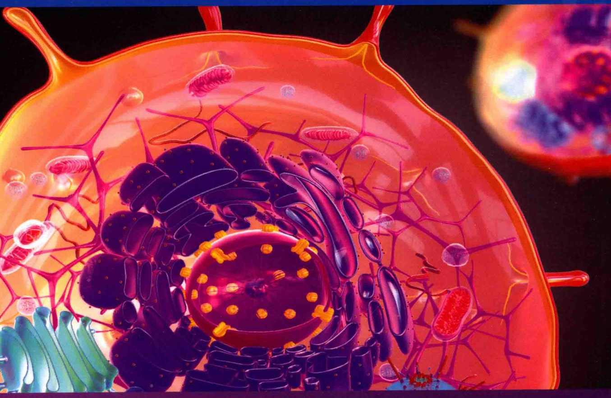
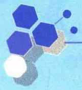
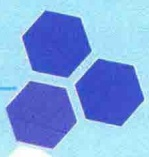
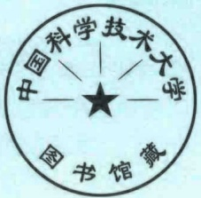
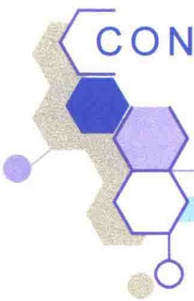

科学出版社

“十三五”普通高等教育本科出版社

国家精品课程配套教材
国家级精品资源共享课配套教材
科学出版社“十三五”普通高等教育本科规划教材

# |生命科学经典教材系列|

# 细胞生物学

(第二版)

王金发 编著

---

国家精品课程配套教材  
国家级精品资源共享课配套教材  
科学出版社“十三五”普通高等教育本科规划教材  
生命科学经典教材系列

# 细胞生物学

# (第二版)

王金发 编著

seal

中国科学技术大学
南
藏
书馆

北京

科学出版社

---

## 内容简介

本书是王金发教授主持的教育部“国家级精品资源共享课”——“细胞生物学”的配套教材，是王金发教授在连续28年系统讲授细胞生物学课程的基础上编著而成。其显著特点是风格一致，内容安排前后呼应。

本书在结构体系上沿袭了第一版的基本风格，注重基础和前沿相结合，突出当今细胞生物学发展的热点；重视细胞生物学理论的源头，对一些重要发现的研究方法和过程给予详细介绍，激发读者对细胞生物学的研究兴趣和灵感。

本书共 15 章，涵盖了细胞生物学的基本内容，并配套教学课件，可作为综合性大学、农林院校、医学院校等相关专业的本科生教材，也可作为细胞生物学网络课程学习的参考教材。此外，本书也可供相关专业的教师、研究生及科研和管理人员参考使用。

图书在版编目（CIP）数据

细胞生物学 / 王金发编著.—2 版.—北京:科学出版社，2020.7

国家精品课程配套教材 国家级精品资源共享课配套教材 科学出版社

“十三五”普通高等教育本科规划教材 生命科学经典教材系列

ISBN 978-7-03-063851-9

I.①细… Ⅱ.①王… Ⅲ.①细胞生物学-高等学校-教材
IV.①Q2

中国版本图书馆 CIP 数据核字（2019）第 288641 号

责任编辑:席慧 刘晶 / 责任校对:严娜

责任印制:张伟 / 封面设计:铭轩堂

科学出版社出版

北京东黄城根北街16号

邮政编码:100717

http://www.sciencep.com

北京虎彩文化传播有限公司 印刷

科学出版社发行 各地新华书店经销

\*

2003年8月第一版 开本: $889\times 1194$ 1/16

2020年7月第二版 印张:33

2020年8月第二十五次印刷 字数:1070000

定价:98.00元

(如有印装质量问题，我社负责调换)

---

作者简介

王金发，1973年1月安徽大学生物系农业微生物学专业毕业并留校任教，1982年7月中山大学生物系遗传学专业研究生毕业，获理学硕士学位。1989年11月至1993年1月作为访问学者在美国洛杉矶希望城分子免疫学系从事癌基因的分子生物学研究。现任中山大学生命科学学院教授、博士生导师。

王金发教授长期从事教学与科学研究工作，主讲的本科生课程有“细胞生物学”“遗传学”“基因工程原理”“微生物遗传学”“现代生命科学”“细胞科学与社会”“大学生涯规划与成才”等。其中，“细胞生物学”和“现代生命科学”为国家精品课程，“细胞生物学”为国家级精品资源共享课，“细胞科学与社会”为国家级精品视频公开课。

以王金发教授为带头人的“细胞生物学与遗传学研究性教学团队”于2007年被评为国家级教学团队。团队主讲的“细胞与遗传学实验”为国家精品课程（主持人）。王金发教授倡导与践行的“开放式教学”于2005年获国家级教学成果奖二等奖（第一完成人），“研究性教学”于2001年获国家级教学成果奖二等奖（第一完成人），“创建‘知识-能力-素质’三位一体的教学模式，做学生引路人”于2018年获广东省教学成果奖一等奖（第二完成人）。

坚持与探索“科研型教学、教学型科研，教学科研互融互通”的发展理念，先后主持国家和广东省自然科学基金研究课题8项，主持教育部教学研究项目10项、广东省教学研究项目10项。先后在《中国高等教育》《中国大学教学》《高等理科教育》《实验技术与管理》《实验室研究与探索》及其他教育类期刊发表教学论文40余篇；在Cell Host & Microbe、Plant Cell、PNAS、The Plant Journal、Plant Physiology，以及其他科研类期刊先后发表论文100余篇。

2001年被评为广东省“南粤教书育人优秀教师”，同年被中山大学学生评为“中大学子心目中的良师”，2002年被评为中山大学师德十佳标兵，2003年获得首届国家级教学名师奖，2004年被评为南粤杰出教师，2005年获国务院颁发的政府特殊津贴，同年获广东省五一劳动奖章。

## 相关课程配套

《细胞生物学》(第二版)

《细胞生物学习题解析》

《细胞生物学实验教程》(第二版)

《遗传学综合实验教程》

《分子生物学与基因工程习题集》（第二版）

王金发 编著

王金发 主编

王金发 何炎明 刘兵 主编

王金发 戚康标 何炎明 主编

王金发 刘兵 王宏斌 编著

---

## 第二版前言

《细胞生物学》第一版出版后，很多同行好友，还有很多用过此书的学生们，都给予了极大的支持，也提出了很多极好的建议，并鼓励我继续修订再版。由于是独立编著，工作量大，加之科研、教学工作不能放弃，经过17年的努力，第二版终于与读者见面了，在此向大家致以诚挚的感谢。

第二版基本保持了第一版的风格，仍以“细胞社会学”为主体概念，介绍细胞社会的结构框架与运行机制。全书共15章，涵盖了细胞生物学的基本内容；虽然没有分篇，但在撰写思路上，大致分为相对独立又相互联系的6个单元。

第 1 章和第 2 章为第一单元，核心内容是细胞学建立的源头创新。在此次再版中，第 1 章的名称由第一版的“细胞概述”改为“细胞的发现与细胞学说”，之所以如此改动，其目的是引导学生重视科学的源头创新，包括实验创新与理论创新，而细胞学的创立与发展正是这两种创新的融合。细胞生物学是实验科学，它的发展离不开各种有效的研究方法，所以将第 2 章“细胞生物学研究方法”划归第一单元。在实际教学中，我们不单独讲授第 2 章，而是结合各章节的内容，将研究方法融入其中。

第 3 章至第 5 章为第二单元，围绕细胞质膜展开，核心内容是学习了解细胞质膜的结构、细胞质膜与环境的物理关系，以及对外部环境信号进行应答的机制。第 3 章主要是介绍细胞质膜的结构及运输作用:细胞质膜不仅使遗传物质有了安定的“家”，而且通过质膜的运输作用，为细胞的生命活动提供了稳定的内部环境。第 4 章讨论多细胞生物体内的环境与互作:在多细胞的真核生物中，细胞要参与细胞组织的建构，包括细胞识别、细胞黏附、细胞连接，都是通过细胞质膜进行的，所以，细胞质膜通过与外部环境的互作，为细胞生命活动提供了安全的外部环境。第 5 章讨论细胞对外部信号的接收与应答的机制，这一重要的细胞活动是通过细胞质膜受体引起的，无论是 G 蛋白偶联受体，还是酶联受体，都是细胞质膜中参与信号转导的蛋白质分子。

第6章讨论核糖体与蛋白质，可自成一个单元，即第三单元，核心内容介绍细胞内蛋白质合成机器——核糖体的结构与功能。该章是细胞生物学与遗传学、生物化学衔接的耦合器。从遗传学角度，讨论核糖体RNA基因的转录与加工、核酶及RNA编辑；从生物化学角度，由于细胞生物学功能的“主角”是蛋白质，所以，除了讨论蛋白质合成的一般过程，还增加了蛋白质的加工、修饰与功能，以及蛋白质合成抑制剂等；从细胞生物学角度，讨论核糖体的结构与装配。

第 7 章至第 10 章是本书的第四单元，核心内容是细胞的内部机构与运行机制，主要讨论细胞内除细胞核以外的膜性细胞器的结构与功能，一个重要的连接线是蛋白质的分选与定位。第 7 章线粒体、第 8 章叶绿体是细胞内能量代谢的细胞器，它们都是半自主性的膜性细胞器；它们的结构与功能蛋白质大多数是由核基因编码、经细胞质游离核糖体合成后转运而来。第 9 章介绍细胞内膜系统中内质网、高尔基体及溶酶体三个主要膜性细胞器的结构与功能。第 10 章则是讨论细胞内的膜运输机制，包括细胞分泌与细胞内吞，以及内体在膜运输中的作用。

第 11 章至第 13 章是本书的第五单元，包括细胞核、细胞骨架及细胞周期，核心内容是细胞生长与分裂的遗传机制。细胞核内染色体的结构与功能是细胞生存、生长与分裂的遗传核心。紧挨细胞核的中心体中的中心粒通过形成的微管不仅维持着细胞的空间结构，而且是细胞内物质运输的大动脉，微丝与中间纤维参与细胞内空间结构的形成。细胞核基因表达细胞生长与细胞周期时相转换的结构与调节蛋白，而由中

---

ii

细胞生物学（第二版）

心粒形成的纺锤体微管与肌动蛋白纤维一起帮助细胞分裂。

第 14 章和第 15 章是本书的第六单元，讨论的内容是细胞的生老病死，通过这两章的讨论，为细胞生物学拓展更多的方向，包括胚胎学、发育生物学、肿瘤学、干细胞，乃至生死学。

本次改版除了力求结构体系的科学性外，在内容选择上还注意前沿与基础的结合，保留了一些重要的原创性的实验，如溶酶体的发现、过氧化物酶体的发现等，引导学生发散思维，重视基础性、原创性研究。

细胞生物学的名词术语多数源自英文，相当多的英文名词译成中文时都有多种词义，在不同的语境时有不同的含义。所以本书对名词术语以保持其生物学内涵为基准，在不产生歧义的前提下，尽可能规范统一。例如，英文“adhesion”，可译成“黏附”与“黏着”，如果刻意统一，只能二者选其一。虽然“黏附”与“黏着”可用同一个英文单词，但中文含义是有区别的。从细胞相互间的关系看，“黏着”比“黏附”要更进一步，如果“黏附”表示二者关系贴近的话，“黏着”就有“喜结连理”之意了。因此，本书保留“黏附”与“黏着”两种表述，需根据句意去理解。另外，在细胞生物学中，有很多词是根据形体表述的，如细胞骨架中的微丝（microfilament），其意是这种骨架的形态相较于微管要细小；由于微丝的化学本质是肌动蛋白，所以，微丝又称为肌动蛋白丝（actin filament），这是一种质的表述。所以在本书的编写中，两种表述都有，看哪种更适合句子的意思。其实在教学过程中，重要的是引导学生对概念的理解，多种表述有利于学生思维能力的培养。

由于细胞生物发展迅速，新的概念不断涌现，很多概念还没有相应的中文表述。例如，与膜脂翻转有关的酶，英文名词就有四种:flip-floppase、flippase、floppase、scramblase，由于目前还没有完全对应的中文，只能根据作者对这四种名称指向的作用方式的理解，分别将其译为翻转酶、内翻酶、外翻酶、混翻酶，是否规范，需要时日验证，但在作用上是基本正确的。

另外，由于细胞生物学研究发展迅速，有些熟知的名词术语有了新的内涵，教师在教学中需要及时调整更新。例如，p53基因，大家都知道p53基因是抑癌基因，也都知道p53基因的突变是隐性的。其实，对p53基因还有另外的描述:p53基因是基因组维护基因，p53基因突变是功能丧失突变，这种描述更符合p53基因的本质特性。

由于细胞生物学的发展十分迅速，随着研究方法的不断发展与创新，人们对细胞生物学运行机制的认识不断深化，新的概念不断产生。本次改版中，虽然结合了不少新鲜内容，但限于篇幅，还有很多新的热点内容没有编入书中，如外泌体、单细胞图谱、相分离等。

细胞生物学是生命科学中重要的专业基础课，建议使用本书的学生在对知识理解的基础上，进一步发散思维，不要满足于仅仅知道是什么，还要会问为什么，更要思考如何去创新与创造。“学会学习”是大学生在大学学习生涯中必须培养的一种终身使用的能力。在作者的教学过程中，要求学生确立“研究性学习”的理念，在细胞生物学课程学习中结合“思维导图”“镜像思维”“章节提要”“文献阅读”等方法培养学习能力，收到极佳的效果，深受学生的欢迎。建议使用本书的读者试一试这些方法，相信是有用的。

感谢所参考的同类教科书及相关论文的作者们!

感谢我的夫人不仅关心照顾我的生活起居，更对我教书育人事业上给予支持与帮助！

感谢 28 年来中山大学生命科学学院本科生对细胞生物学课程的热爱、支持、鼓励与建议。

感谢科学出版社的编辑们对本书付出的心血！

限于作者的学识与能力，书中难免有错漏、不当之处，敬请同行、学生与读者批评指正。

王金发

2020年5月于广州康乐园

---

## 第一版前言

这本教材酝酿至今已有十个年头了，真所谓“十年磨一剑”。早在1993年接手细胞生物学课程的教学任务时就有心写一本《细胞生物学》教材，因自己功底浅，而且细胞生物学课程内容广泛，发展迅速，如是说:能教好就不错了，甭想著书。

经过六年的教学实践和积累，自己总算是入了一点门，也完成了初稿，可就是不敢与世人见面。教材是给学生用的，“丑媳妇总得见公婆”。本书稿第一次抛头露面是2000年秋，当时将她作为中山大学生命科学学院98级本科生细胞生物学课程试用教材，诚请同学们评说，心想，文章不怕“评”和“改”，总是越评越改越好，教材也是如此。

本书稿先后经 1989、1999、2000 级各专业正式试用了三届，每一届试用后都根据学生的建议进行了认真修改，甚至对某些章节进行了重写。先后有 200 多位同学提出书面建议，还有多位进修教师提出修改意见。因此，本书是教师和同学们共同劳动的结晶。

教科书不同于一般的著作，它要介绍科学原理，传授知识，应有两个显著的特点:科学性和先进性，三届同学在试用过程中对本教材的科学性和先进性给予了充分肯定，这才想到将该书稿出版。

正当此书稿在学生中试用时，我们以此书稿为脚本的《细胞生物学》网络课程申请得到教育部“新世纪网络课程建设工程”立项，在2002年4月中期检查及随后的对《细胞生物学》网络课程的质量认证中均得到学科专家和教育技术专家的好评，从而增强了将此书出版的信心。

本教材是国内近几年出版的同类教材中内容较多的一部。本想写简单一点，但在多年教学过程中体会到，内容还是丰富一些好，教师可以有选择性地讲授，留下部分内容让学生自学。如果内容太简单了，选择的余地就很小。在本书的14章内容中，我们通常选择讲授10章，另4章是在教师的指导下让学生自学，旨在培养学生自主学习的能力。

本教材在章节编排上进行了一些新的尝试，如从细胞社会学的观点，将细胞识别、细胞黏着、细胞连接、细胞外基质等并入“细胞环境与互作”一章，使学习者在学习细胞生物学时自然与人类社会相联系，以便加深对细胞生物学的理解。将核糖体与核酶作为一章，主要是出于核酶的发现源于对核糖体RNA加工的研究。合在一起不仅顺理成章，也有利于引导学生将细胞生物学的研究与分子生物学结合。以蛋白质分选为主线将内膜系统的内容融为一章，有利于以系统论的观点学习细胞生物学。另外将细胞通讯提前安排在第5章，不仅有利于激发学生学习的兴趣，也分散了课程的重点和难点章节。

在我们的教学过程中，要求学生必须完成的课程学习作业是写章节提要和编制章节试题。提要要求字数在2000～3000，试题必须包括5种以上题型并附参考答案，故本教材章的内容提要较简，只是给学习者指引一下；章后无思考题，学生可以自行编制，这样可以将被动思考转变为主动思考。多年的教学实践证明这两种做法对于培养学生的综合能力，掌握课程的核心内容是行之有效的方法。

当今的大学教育，根本目的是培养创新人才。教师和学生都要有“以学生为主体，以教师为主导，培养素质和能力”这样的指导思想来完成一门课程的教与学。

我以为，教师讲授的应是一门课程，而不是一本书，任何教材都有它的局限性。我很赞成在教学过程中不要限定教材，但要有教学参考书。在授课中，教师不要限于一本教材，学生不必死啃一本教科书。教师在教学过程中，应博采众家之长，形成自己的风格和特色。

---

iv

细胞生物学（第二版）

当一位好教师不容易，因为“好”的标准太高；编著一本好教材更难，因教材的影响面广，评头论足的多，容不得半点闪失。本书稿出版之际自我感觉尚可，只是有一点自信，但不敢说好。

著书者都是按自己的思维行事，当然是出于好心，我也是如此。由于本书是一人独立完成的，全书的编排和内容的取舍难免有所偏颇，尽管手稿经三届学生试用过，那只是自己的弟子们的意见，出版之后，敬请读者提出宝贵意见。

在此书即将出版之际，我要十分感谢我的妻子王玉珍女士。虽然她没有受过高等教育，但她对大学教师这个职业给予了充分的理解与支持，在我的业绩里有她的一半功劳。

在此书即将出版之际，我要感谢安徽大学。在那里，我开始了大学学习和其后大学教师工作的生涯。安徽大学有我的良师益友，是他们教育我如何献身教育事业。

中山大学是革命伟人创建的学校，“博学、审问、慎思、明辨、笃行”的校训催人奋进。我为有幸成为“中大人”而自豪，在这里我完成了研究生学业，并有了自己的事业。我愿继续努力，为将中山大学建设成世界一流的研究型综合性大学作出自己的贡献。

谨以此书献给中山大学80华诞。

2003年春于广州康乐园

王金发

---

# 《细胞生物学》(第二版) 教学课件索取单

凡使用本书作为教材的主讲教师，可获赠教学课件一份。欢迎通过以下方式与我们联系。本活动解释权在科学出版社。

精美课件抢先看

填写教学课件索取单拍照发送至联系人邮箱。

<table><tr><td>姓名:</td><td>职称:</td><td>职务:</td></tr><tr><td colspan="2">学校:</td><td>院系:</td></tr><tr><td colspan="2">电话:</td><td>QQ:</td></tr><tr><td colspan="3">电子邮箱(重要):</td></tr><tr><td colspan="3">通讯地址及邮编:</td></tr><tr><td colspan="2">所授课程(一):</td><td>学生数:</td></tr><tr><td colspan="2">课程对象:☐研究生 ☐本科( 年级) ☐其他_</td><td>授课专业:</td></tr><tr><td colspan="3">使用教材名称/作者/出版社:</td></tr><tr><td colspan="2">所授课程(二):</td><td>学生数:</td></tr><tr><td colspan="2">课程对象:☐研究生 ☐本科( 年级) ☐其他_</td><td>授课专业:</td></tr><tr><td colspan="3">使用教材名称/作者/出版社:</td></tr><tr><td colspan="3">您对本书的评价及修改意见:</td></tr><tr><td colspan="3">贵校(学院)开设的与生命科学相关的课程有哪些?使用的教材名称/作者/出版社?</td></tr><tr><td colspan="3">推荐国外优秀教材:作者/书名/出版社:</td></tr></table>

联系人:席慧 编辑

电子邮箱:xihui@cspm.com.cn

咨询电话:010-64000815

---

CONTENTS

## 目录

## 作者简介   第二版前言   第一版前言

- 1 细胞的发现与细胞学说 …… 1
- 1.1 细胞的发现及细胞学说的创立 …… 1
- 1.1.1 细胞的发现 …… 1
- 1.1.2 细胞学说的创立 …… 2
- 1.1.3 细胞学说对细胞学发展的推动作用 …… 2
- 1.1.4 细胞生物学发展简史 …… 3
- 1.2 细胞的类型和结构体系 …… 4
- 1.2.1 原核细胞 …… 4
- 1.2.2 真核细胞 …… 5
- 1.2.3 真核细胞的结构体系 …… 6
- 1.2.4 原核细胞与真核细胞的比较 …… 7
- 1.3 细胞的基本特性 …… 7
- 1.3.1 细胞结构的基本特性 …… 7
- 1.3.2 细胞的生理生化特性 …… 8
- 1.3.3 细胞的形态差异 …… 8
- 1.3.4 细胞的大小及体积的恒定 …… 9
- 1.3.5 细胞及细胞器的计量单位 …… 9
- 1.4 细胞的分子基础 …… 10
- 1.4.1 水 …… 10
- 1.4.2 无机盐 …… 11
- 1.4.3 有机分子 …… 11
- 1.4.4 细胞结构体系的组装 …… 16
- 1.5 病毒——非细胞的生命体 …… 17
- 1.5.1 病毒概述 …… 17
- 1.5.2 病毒的生命周期与感染 …… 18
- 1.6 细胞生命的进化 …… 20
- 1.6.1 细胞生命的起源 …… 20
- 1.6.2 真核细胞的进化 …… 21
- 1.6.3 从单细胞向多细胞进化 …… 21

- 1.6.4 模式生物 ……21
- 1.7 合成生物学与“人造”细胞 ……23
- 1.7.1 “Synthia”的诞生过程 ……24
- 1.7.2 简约化的单条、两条染色体酵母诞生 ……25
- 1.7.3 合成生物学与生物安全 ……27
- 2 细胞生物学研究方法 ……29
- 2.1 显微成像技术 ……29
- 2.1.1 显微镜的光学原理 ……29
- 2.1.2 光学显微镜 ……32
- 2.1.3 荧光显微镜与共聚焦显微镜 ……37
- 2.1.4 电子显微镜 ……41
- 2.1.5 间接成像技术 ……44
- 2.2 细胞（细胞器）分离、培养与融合技术 ……46
- 2.2.1 细胞分离 ……46
- 2.2.2 细胞培养 ……48
- 2.2.3 细胞融合与单克隆抗体技术 ……50
- 2.3 蛋白质的纯化与分析技术 ……51
- 2.3.1 层析技术 ……52
- 2.3.2 蛋白质电泳 ……53
- 2.4 分子生物学方法 ……55
- 2.4.1 基因工程技术 ……55
- 2.4.2 基因功能研究技术 ……58
- 3 细胞质膜与穿膜运输 ……64
- 3.1 概述 ……64
- 3.1.1 细胞的膜结构 ……64
- 3.1.2 细胞膜的功能 ……65

---

vi

细胞生物学（第二版）

- 3.2 红细胞与细胞膜结构的研究 ……65
- 3.2.1 红细胞的生物学特性 ……66
- 3.2.2 红细胞膜结构的研究 ……66
- 3.2.3 红细胞质膜的相关蛋白质 ……67
- 3.3 膜的化学组成 ……69
- 3.3.1 膜脂 ……69
- 3.3.2 膜糖 ……72
- 3.3.3 膜蛋白 ……73
- 3.4 细胞质膜的结构与特点 ……75
- 3.4.1 细胞质膜的结构模型 ……75
- 3.4.2 细胞质膜的不对称性 ……78
- 3.4.3 细胞质膜的流动性 ……79
- 3.5 物质的穿膜运输 ……84
- 3.5.1 质膜物质运输概述 ……84
- 3.5.2 被动运输 ……86
- 3.5.3 主动运输 ……91
- 3.5.4 主动运输与被动运输的比较及动物
- 与植物主动运输的比较 ……100
- 4 细胞环境与互作 ……102
- 4.1 细胞外基质 ……102
- 4.1.1 细胞外基质的组成与功能 ……102
- 4.1.2 细胞外基质中的“填充物”
- ——蛋白聚糖 ……104
- 4.1.3 胶原和弹性蛋白 ……105
- 4.1.4 细胞外基质中的黏着蛋白 ……109
- 4.1.5 细胞外基质与细胞的相互关系 ……111
- 4.2 细胞识别与细胞黏附 ……114
- 4.2.1 细胞识别及细胞拣出 ……114
- 4.2.2 细胞黏附的机制 ……115
- 4.3 细胞连接 ……120
- 4.3.1 细胞连接的概念和类型 ……120
- 4.3.2 紧密连接 ……120
- 4.3.3 锚定连接 ……123
- 4.3.4 通讯连接 ……127
- 4.4 植物的细胞外结构:细胞壁 ……129
- 4.4.1 植物细胞壁的结构 ……129
- 4.4.2 细胞壁的化学组成 ……130
- 4.4.3 微管在纤维素微纤维装配中的作用 ……131
- 5 细胞通讯 ……133
- 5.1 细胞通讯的一般原理 ……133
- 5.1.1 细胞通讯网络 ……134
- 5.1.2 信号分子 ……136

- 5.1.3 受体 …… 139
- 5.1.4 信号分子与级联放大 …… 142
- 5.2 G 蛋白偶联受体介导的信号转导 …… 146
- 5.2.1 G 蛋白偶联受体的结构与作用机制 …… 146
- 5.2.2 PKA 系统的信号转导机制 …… 148
- 5.2.3 PKC 系统的信号转导机制 …… 154
- 5.2.4 作用于离子通道的 G 蛋白偶联受体信号转导途径 …… 157
- 5.2.5 Ca$^{2+}$/NO/cGMP 信号转导途径 …… 160
- 5.3 酶联受体信号转导 …… 162
- 5.3.1 受体酪氨酸激酶信号转导的特点 …… 162
- 5.3.2 Ras/MAP 激酶信号转导 …… 165
- 5.3.3 磷脂酰肌醇 3 激酶途径 …… 168
- 5.3.4 胰岛素信号途径 …… 168
- 5.3.5 其他酶联受体信号途径 …… 170
- 5.4 其他形式的信号途径 …… 173
- 5.4.1 通过泛素化控制的信号途径 …… 173
- 5.4.2 植物的细胞通讯 …… 176
- 5.5 信号转导的复杂性与信号的终止 …… 178
- 5.5.1 受体与配体相互作用的复杂性 …… 178
- 5.5.2 信号转导的重叠、趋同、趋异与串流 …… 179
- 5.5.3 信号的适应、解除与终止 …… 181
- 核糖体与蛋白质 …… 187
- 6.1 核糖体的形态结构与 rRNA 基因 …… 187
- 6.1.1 核糖体的形态结构与类型 …… 188
- 6.1.2 核糖体 rRNA 基因扩增与染色体定位 …… 189
- 6.1.3 核糖体 rRNA 基因的转录与加工 …… 189
- 6.2 核糖体的装配 …… 193
- 6.2.1 核糖体亚基的自我装配 …… 193
- 6.2.2 原核生物核糖体重组实验 …… 193
- 6.2.3 真核生物核糖体的装配 …… 193
- 6.3 核糖体的功能——蛋白质合成 …… 194
- 6.3.1 蛋白质合成的基本过程 …… 194
- 6.3.2 核糖体的功能位点 …… 195
- 6.3.3 tRNA 及氨酰 tRNA 的合成 …… 196
- 6.3.4 多聚核糖体 …… 197
- 6.3.5 蛋白质合成抑制剂 …… 199
- 6.4 蛋白质的折叠、修饰与降解 …… 200
- 6.4.1 蛋白质折叠与分子伴侣 …… 200
- 6.4.2 蛋白质的修饰与加工 …… 203
- 6.4.3 蛋白酶体对蛋白质的降解 …… 205
- 6.5 核酶 …… 207
- 6.5.1 核糖体是一种核酶 …… 207
- 6.5.2 具有切割功能的核酶 …… 208

---

目录

vii

- 6.5.3 核酶与内含子的剪接 …… 209
- 6.6 RNA 编辑 …… 211
- 6.6.1 RNA 编辑对表达的调控 …… 211
- 6.6.2 gRNA 介导的 mRNA 插入编辑 …… 211
- 6.6.3 改变 mRNA 中单个核苷酸的 RNA 编辑 …… 211
- 7 线粒体与过氧化物酶体 …… 214
- 7.1 线粒体概述 …… 214
- 7.1.1 线粒体的发现与功能研究 …… 214
- 7.1.2 线粒体的形态结构 …… 215
- 7.1.3 线粒体的化学组成和各部分特性 …… 215
- 7.2 线粒体蛋白的靶向转运 …… 217
- 7.2.1 蛋白质分选与转运 …… 217
- 7.2.2 线粒体蛋白的转运 …… 219
- 7.3 线粒体的功能——氧化磷酸化作用 …… 223
- 7.3.1 真核细胞中的氧化作用 …… 223
- 7.3.2 呼吸链与电子传递 …… 225
- 7.3.3 氧化磷酸化:ATP 形成机制 …… 230
- 7.4 线粒体的遗传、融合与分裂 …… 233
- 7.4.1 线粒体的遗传 …… 233
- 7.4.2 线粒体的融合与分裂 …… 236
- 7.5 过氧化物酶体 …… 237
- 7.5.1 过氧化物酶体的发现及所含酶类 …… 237
- 7.5.2 过氧化物酶体的功能 …… 238
- 7.5.3 过氧化物酶体的生物发生 …… 239
- 8 叶绿体与光合作用 …… 243
- 8.1 质体与叶绿体 …… 243
- 8.1.1 前质体与质体 …… 243
- 8.1.2 叶绿体的形态、大小与数量 …… 244
- 8.2 叶绿体的结构 …… 244
- 8.2.1 叶绿体被膜的结构及特性 …… 244
- 8.2.2 类囊体 …… 245
- 8.2.3 叶绿体基质 …… 246
- 8.3 叶绿体蛋白的转运 …… 246
- 8.3.1 叶绿体基质蛋白的转运 …… 246
- 8.3.2 类囊体蛋白的转运 …… 247
- 8.4 光合作用 …… 247
- 8.4.1 光合作用的四个阶段与特点 …… 247
- 8.4.2 光吸收 …… 248
- 8.4.3 电子传递 …… 250
- 8.4.4 线性及循环式电子传递途径 …… 253
- 8.4.5 光合磷酸化 …… 255
- 8.4.6 暗反应 …… 256

- 8.4.7 过氧化物酶体在光合作用中的作用……258
- 8.5 叶绿体的遗传和起源……260
- 8.5.1 叶绿体的遗传……260
- 8.5.2 叶绿体的起源……260
- 8.6 叶绿体与线粒体的结构与功能的比较……260
- 内膜系统与蛋白质分选……263
- 9.1 概述……263
- 9.1.1 膜性细胞器与内膜系统……263
- 9.1.2 蛋白质分选与膜运输……266
- 9.1.3 内膜系统的研究方法……268
- 9.2 内质网……270
- 9.2.1 内质网的形态结构和化学组成……270
- 9.2.2 滑面内质网的功能……272
- 9.2.3 糙面内质网的功能——蛋白质转运……275
- 9.2.4 蛋白质插入内质网的膜及定向……278
- 9.2.5 蛋白质在内质网中的折叠与修饰……280
- 9.3 高尔基体……284
- 9.3.1 高尔基体的一般特性……284
- 9.3.2 高尔基体的功能……285
- 9.4 溶酶体与液泡……288
- 9.4.1 溶酶体的酶与溶酶体的发现……288
- 9.4.2 溶酶体的功能……289
- 9.4.3 植物细胞的液泡……292
- 0 细胞内膜运输……294
- 10.1 有被小泡的类型、装配因子及信号……295
- 10.1.1 有被小泡的类型……295
- 10.1.2 有被小泡的装配因子……295
- 10.1.3 介导有被小泡形成的信号……295
- 10.2 有被小泡的形成……296
- 10.2.1 网格蛋白有被小泡的形成……296
- 10.2.2 COP 有被小泡的形成……299
- 10.3 小泡的定向运输、停靠与融合机制……300
- 10.3.1 Rab 蛋白介导运输小泡寻靶……301
- 10.3.2 SNARE 蛋白与 NSF 蛋白……302
- 10.4 细胞分泌……304
- 10.4.1 从内质网到高尔基体的分泌……305
- 10.4.2 从反面高尔基网向溶酶体的分泌……309
- 10.4.3 胞吐作用:从反面高尔基网向细胞外分泌……313
- 10.5 内吞作用……315
- 10.5.1 内吞途径……315
- 10.5.2 受体介导的内吞作用……316

---

viii

细胞生物学（第二版）

- 10.5.3 内体的加工与成熟 …… 319
- 10.5.4 吞噬细胞的吞噬 …… 322
- 10.5.5 吞饮作用 …… 322
- 10.6 膜的动态更新 …… 322
- 10.6.1 膜脂的来源及不对称性分布 …… 322
- 10.6.2 膜蛋白的更新 …… 323
- 11 细胞骨架 …… 325
- 11.1 细胞骨架概述 …… 326
- 11.1.1 细胞骨架的组成和分布 …… 326
- 11.1.2 细胞骨架的功能 …… 326
- 11.1.3 细胞骨架的特性 …… 327
- 11.2 微管 …… 330
- 11.2.1 微管的结构和类型 …… 330
- 11.2.2 微管装配的动力学 …… 331
- 11.2.3 微管结合蛋白 …… 335
- 11.2.4 微管马达蛋白 …… 337
- 11.2.5 微管的作用 …… 339
- 11.2.6 微管与有丝分裂 …… 343
- 11.3 微丝 …… 344
- 11.3.1 微丝的化学组成与分布 …… 344
- 11.3.2 微丝装配的动力学 …… 345
- 11.3.3 微丝结合蛋白 …… 347
- 11.3.4 肌球蛋白:基于肌动蛋白的马达蛋白 …… 352
- 11.3.5 肌细胞:特化的肌收缩功能 …… 355
- 11.3.6 肌动蛋白和肌球蛋白在非肌细胞中的作用 …… 359
- 11.3.7 微丝的其他功能 …… 362
- 11.4 中间纤维与隔蛋白纤维 …… 363
- 11.4.1 中间纤维蛋白的形态结构与类型 …… 363
- 11.4.2 中间纤维的装配及动态性 …… 364
- 11.4.3 中间纤维结合蛋白 …… 364
- 11.4.4 中间纤维的功能 …… 365
- 11.4.5 隔蛋白 …… 367
- 12 细胞核与染色体 …… 369
- 12.1 核被膜 …… 370
- 12.1.1 核被膜的结构 …… 370
- 12.1.2 核被膜的功能 …… 372
- 12.2 核孔复合体的运输作用 …… 373
- 12.2.1 核孔复合体运输的一般特点 …… 373
- 12.2.2 信号与受体 …… 374
- 12.2.3 蛋白质与 RNA 的核运输机制 …… 376
- 12.3 分子伴侣 …… 378

- 12.3.1 分子伴侣的发现及特点 …… 379
- 12.3.2 分子伴侣的功能和作用机制 …… 380
- 12.4 染色质 …… 381
- 12.4.1 染色质 DNA …… 381
- 12.4.2 组蛋白与非组蛋白 …… 382
- 12.4.3 染色质的基本结构——核小体 …… 384
- 12.5 染色体 …… 387
- 12.5.1 染色质压缩成染色体 …… 387
- 12.5.2 中期染色体的形态结构 …… 390
- 12.5.3 巨型染色体 …… 391
- 12.6 核仁与核基质 …… 393
- 12.6.1 核仁 …… 393
- 12.6.2 核基质与核骨架 …… 394
- 3 细胞周期与细胞分裂 …… 398
- 13.1 细胞周期时相及研究方法 …… 398
- 13.1.1 细胞周期的时相及细胞类型 …… 398
- 13.1.2 细胞周期各时相的合成活动 …… 400
- 13.1.3 细胞进程与同步化研究 …… 400
- 13.2 细胞周期调控 …… 402
- 13.2.1 细胞周期调控系统 …… 402
- 13.2.2 有丝分裂促进因子的发现与鉴定 …… 402
- 13.2.3 裂殖酵母细胞周期调控 …… 405
- 13.2.4 芽殖酵母细胞周期调控 …… 407
- 13.2.5 哺乳动物细胞周期调控 …… 410
- 13.2.6 CDK 与细胞周期调控 …… 411
- 13.2.7 细胞周期关卡 …… 415
- 13.3 有丝分裂 …… 418
- 13.3.1 有丝分裂过程 …… 418
- 13.3.2 有丝分裂机制 …… 420
- 13.4 减数分裂 …… 426
- 13.4.1 减数分裂Ⅰ与减数分裂Ⅱ的形态变化 …… 427
- 13.4.2 减数分裂过程中的遗传重组及其机制 …… 429
- 13.4.3 减数分裂与有丝分裂的比较及意义 …… 431
- 4 多细胞生物发育与干细胞 …… 433
- 14.1 受精作用与卵的激活 …… 434
- 14.1.1 配子发生 …… 434
- 14.1.2 受精作用 …… 434
- 14.1.3 卵的激活 …… 436
- 14.2 原肠胚形成与细胞分化 …… 437
- 14.2.1 胚胎形成 …… 437
- 14.2.2 细胞分化、细胞决定与形态发生 …… 438
- 14.3 细胞分化的机制 …… 441

---

目录

ix

- 14.3.1 基因表达及调控 …… 441
- 14.3.2 信号诱导作用 …… 442
- 14.4 模式形成的机制 …… 445
- 14.4.1 三胚层形成与极性初级轴 …… 445
- 14.4.2 果蝇的发育模式 …… 447
- 14.5 干细胞与成年组织的维持 …… 452
- 14.5.1 干细胞概述 …… 452
- 14.5.2 胚胎干细胞 …… 453
- 14.5.3 成体干细胞与组织更新 …… 454
- 14.5.4 体细胞的重编程与诱导多能干细胞 …… 457
- 15 细胞衰老、死亡与癌 …… 461
- 15.1 细胞衰老 …… 461
- 主要参考文献 …… 491
- 索引 …… 496
- 15.1.1 衰老的概念 …… 461
- 15.1.2 Hayflick 界限与细胞的寿命 …… 462
- 15.1.3 细胞衰老的特征 …… 463
- 15.1.4 细胞衰老的理论 …… 464
- 15.2 细胞死亡 …… 467
- 15.2.1 多细胞有机体中细胞数量和质量的控制 …… 468
- 15.2.2 细胞凋亡及其形态特征 …… 468
- 15.2.3 细胞凋亡的基因调控机制 …… 470
- 15.2.4 细胞生存与死亡调控的意义 …… 475
- 15.3 癌 …… 478
- 15.3.1 癌的特性及发育 …… 478
- 15.3.2 癌的遗传学基础 …… 481
- 15.3.3 癌的预防与治疗 …… 487