1

细胞的发现与细胞学说

## 1.1 细胞的发现及细胞学说的创立

1.1.1 细胞的发现

1.1.2 细胞学说的创立

1.1.3 细胞学说对细胞学发展的推动作用

1.1.4 细胞生物学发展简史

## 1.2 细胞的类型和结构体系

1.2.1 原核细胞

1.2.2 真核细胞

1.2.3 真核细胞的结构体系

1.2.4 原核细胞与真核细胞的比较

1.3 细胞的基本特性

1.3.1 细胞结构的基本特性

1.3.2 细胞的生理生化特性

1.3.3 细胞的形态差异

1.3.4 细胞的大小及体积的恒定

1.3.5 细胞及细胞器的计量单位

## 1.4 细胞的分子基础

1.4.1 水

1.4.2 无机盐

1.4.3 有机分子

1.4.4 细胞结构体系的组装

## 1.5 病毒——非细胞的生命体

1.5.1 病毒概述

1.5.2 病毒的生命周期与感染

1.6 细胞生命的进化

1.6.1 细胞生命的起源

1.6.2 真核细胞的进化

1.6.3 从单细胞向多细胞进化

1.6.4 模式生物

1.7 合成生物学与“人造”细胞

1.7.1 “Synthia”的诞生过程

1.7.2 简约化的单条、两条染色体酵母诞生

1.7.3 合成生物学与生物安全

自然界有多种形式的生命体，包括细胞、病毒、类病毒、朊病毒等，其中，细胞是进化得最高级、具有精致结构的生命体。

细胞（cell）是由膜包围着含有细胞核（或拟核）的原生质所组成，是生物体结构和功能的基本单位，也是生命活动的基本单位。细胞能够通过分裂而增殖，这是生物体个体发育和系统发育的基础。细菌、酵母等微生物是以单细胞形式存在，而高等动物和高等植物则是由多细胞构成，如人类大约有 $3\times10^{13}$ 个细胞，这些细胞组成不同的组织和器官。

研究细胞及其生物学功能的学科称为细胞生物学（cell biology）。它是以细胞为研究对象，从细胞的整体水平、亚显微水平、分子水平三个层次，以动态的观点研究细胞和细胞器的结构及功能、细胞生活史和各种生命活动规律的学科。

## 1.1 细胞的发现及细胞学说的创立

第一个发现细胞的是英国学者胡克（Robert Hooke）；170多年后，德国植物学家施莱登（Mathias Schleiden）和动物学家施万（Theodor Schwann）创立了细胞学说（cell theory）。

## 1.1.1 细胞的发现

绝大多数细胞是无法用肉眼观察的，所以在显微镜发明之前，人们不知道细胞的存在。细胞的发现得益于光学显微镜的研制和发展。第一台显微镜是荷兰眼镜商 Janssen 在 1604 年发明的，虽然倍数不高（只能观察小昆虫），也并非用它发现了细胞，但它却有着重要的科学意义，因为它触发了一场科

---

2

细胞生物学（第二版）

学与认知革命。用它看星空，透镜下显现了宇宙的新版图；用它看较小的物体，透镜下展示了一个显微世界。

胡克是英国的显微学家，27岁时就当选为英国皇家学会的会长。1665年，胡克出版了《显微图谱》（Micrographia）一书，描述了他用自己设计并制造的显微镜观察栎树软木塞切片时的发现，他看到其中有许多小室（little box），状如蜂窝，就将其称为“cellulae”。这是人类第一次发现细胞，不过，胡克发现的只是植物组织死细胞的细胞壁（图1-1A）。另外，胡克所制造的显微镜放大倍数只有30倍，这就限制了他进一步观察活细胞及细胞的内部结构。胡克的发现对细胞学的建立和发展具有开创性的意义，其后生物学家就用“cell”一词来描述生物体的基本结构。

1674 年，荷兰布商列文虎克（Anton van Leeuwenhoek）为了检查布的质量，致力于磨制透镜。他研制了较高质量的显微镜（270 倍），并观察到了血细胞、池塘水滴中的原生动物，以及人类和其他哺乳类动物的精子，这是人类第一次观察到完整的活细胞，特别是清楚显现了细胞壁（图 1-1B）。列文虎克把他的观察结果写信报告给英国皇家学会，得到学会的充分肯定，并受邀到欧洲的一些国家访问，使其很快成为世界知名人士。

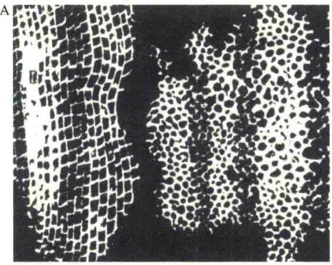

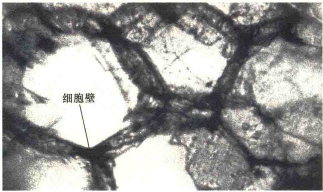

图 1-1 最早在显微镜下看到的细胞结构（引自 Kleinsmith and Kish, 1995）。A. 1665 年胡克论文中展示的栎树细胞，仅是植物组织死细胞的细胞壁；B. 1674 年列文虎克观察到的细胞结构，其细胞壁的结构十分明显，但是看不到细胞内的结构。

## 1.1.2 细胞学说的创立

列文虎克研制的显微镜放大倍数虽然近300倍，但分辨率只有1.4μm，并且清晰度不高，所以仍不能很好地观察细胞内部的细微结构，限制了人们进一步认识细胞。在发现细胞后长达170多年里，人们用光学显微镜陆续发现了一些不同类型的细胞，但对细胞的生物学意义仍然不清楚。直到19世纪30年代，显微镜的制造技术得到较大改进，分辨率达到1μm，人们才开始揭示细胞的生物学意义。

1838 年，德国植物学家施莱登（Matthias Schleiden）根据他的研究结果得出了这样一个结论:尽管植物的不同组织在结构上有着很大的差异，但都是由细胞构成的，植物的胚是由单个细胞产生的。

1839 年，德国动物学家施万发表了关于动物生命的细胞基础的综合性报告，指出动物和植物的细胞具有类似的结构，并提出细胞是所有生物的基本结构单位。

1855年，德国医生和病理学家魏尔肖（Rudolf Virchow）在植物学家布朗（Robert Brown）等发现细胞核及对细胞核进行一系列研究的基础上，补充提出:所有的细胞都是来自已有细胞的分裂，即细胞来自细胞。至此，人们将“所有生物都是由一个或多个细胞构成、细胞是所有生物的基本结构单位、细胞来自已有细胞的分裂”三个基本内容归为细胞学说的三大核心。

细胞学说的创立大大推进了人类对自然界生命的认识，有力地促进了生命科学的发展。细胞学说的提出论证了生物界的统一性和生命的共同起源。恩格斯对细胞学说给予极高的评价，把它与进化论和能量守恒定律并列称为19世纪自然科学的三大发现。

## 1.1.3 细胞学说对细胞学发展的推动作用

细胞科学是实验科学，而实验科学的发展既依赖于实验观察，又有待于理论的升华。尽管细胞是在1665～1674年发现的，但在其后170多年

---

1 细胞的发现与细胞学说

3

的时间里细胞学的研究并没有什么大的发展，究其原因主要是没有将这一发现上升为理论，因而也就没有起到科学发展的推动作用。细胞学说创立之后，在这一理论的指导下，细胞学得到了突飞猛进的发展。

19 世纪的最后 25 年，即 1875～1900 年，是细胞学（cytology）研究的经典时期。这个时期在细胞学说的推动下，应用固定和染色技术，在光学显微镜下观察细胞的形态结构和细胞的分裂活动，取得了极为丰硕的成果，代表性成就有如下几点。

1）原生质理论的提出 1835年，Dujardin在原生动物细胞内发现了十分均匀、有弹性、能收缩的胶状物质，称它为“肉样质”（sarcode）。1846年，von Mohl在植物细胞中也看到了“肉样质”的物质，并将其命名为“原生质”（protoplasm）。1861年，Max Schultze认为动植物细胞中的原生质具有同样的意义，并提出了原生质理论，即认为有机体的组织单位是一小团原生质，这种物质在一般有机体中是相似的，并把细胞明确地定义为“细胞是具有细胞核和细胞膜的生活物质”。至此，细胞的含义就与最先发现时不同了，于是Hanstain（1880）提出“原生质体”（protoplast）概念，把细胞概念演变成由细胞膜包围着的原生质，原生质分化为细胞核和细胞质。

2）细胞受精和分裂的研究 1875 年，Hertwig 发现受精卵中两亲本核的合并；1877 年，Strasburger 发现动物的受精现象；1883 年 van Beneden 在动物、1886 年 Strasburger 在植物中分别发现了减数分裂现象；1880～1882 年 Flemming 在蝾螈幼虫的组织细胞中发现了有丝分裂。

3）一些重要细胞器的发现 1883年van Beneden和Boveri在动物细胞中发现了中心体；1888年Waldeyer提出染色体概念；1898年Golgi发现了高尔基体，同年线粒体也被正式命名。

在这短短的25年里取得如此多的成果，除了细胞学说本身的贡献外，技术革新起着重要的作用。细胞染色技术、切片技术、显微技术等的不断改进和创新保证了科学研究的进步。当然，更重要的是这一时期人才辈出，他们不断追求和探索的精神才是细胞学得以发展的原动力。

## 1.1.4 细胞生物学发展简史

目前对细胞生物学的发展阶段划分不一，本书中分为4个时期。

1）细胞的发现及细胞学说的创立 这一时期跨度较大，从 1665 年到 1874 年。主要事件是细胞的发现与细胞学说的提出。

2）细胞学的经典时期 即我们上面讨论的从1875年到1900年的25年。主要事件包括原生质概念的提出、各类细胞器的发现。

3）实验细胞学时期 从1900年到1953年的半个世纪里，细胞学的发展主要是通过实验研究细胞学的问题，故将这一时期称为实验细胞学（experimental cytology）时期。这一时期的特点是从形态结构的观察深入到生理功能、生物化学、遗传发育机制的研究。由于实验研究不断与相邻学科结合、相互渗透，导致了一些重要分支学科的建立和发展。

（1）细胞遗传学（cytogenetics）。细胞学与遗传学的结合建立了细胞遗传学，主要是从细胞学的角度，特别是从染色体的结构和功能，以及染色体与其他细胞器的关系来研究细胞的遗传现象，阐明细胞的遗传和变异机制。

（2）细胞生理学（cytophysiology）。细胞学同生理学结合建立了细胞生理学，主要研究内容包括细胞从周围环境中摄取营养的能力、代谢功能、能量的获取、生长、发育与繁殖机制，以及细胞受环境的影响而产生适应性和运动性的活动。细胞的离体培养技术对细胞生理学的研究具有巨大贡献。

（3）细胞化学（cytochemistry）。细胞学和化学的结合产生了细胞化学，主要是研究细胞结构的化学组成及化学分子的定位分布及其生理功能。例如，1943年Claude用高速离心法从细胞匀浆液中分离出线粒体，然后研究它的化学组成和生理功能并得出结论:线粒体是细胞氧化中心。1924年Feulgen发明的DNA特殊染色方法——Feulgen反应，开创了DNA的定性定量分析。此后发展了一系列进行细胞内RNA和蛋白质定量分析的方法，对细胞的核酸和蛋白质代谢活动研究起了极大的促进作用。

4）细胞生物学的诞生 1953年Watson和Crick提出DNA双螺旋结构模型，标志着分子生物学（molecular biology）的诞生。由于不断将分子生物学的研究成果和方法引进细胞学，使细胞学的知识得到了极大的更新，同时促进了细胞学从以显微结构为基础的功能研究向以通过分子机制的研究揭示细胞活动的生物学意义方面发展，细胞生物学（cell biology）应运而生。此后，细胞生物学和分子生物学之间相互渗透，相得益彰。

20 世纪 80 年代开始出现的分子细胞生物学 (molecular cell biology)，是细胞生物学的主要发展

---

4

细胞生物学（第二版）

方向。

从细胞生物学发展历程看，有四个显著的特点:①兴趣与假说是推动科学发展的内在动力，胡克发现细胞的原动力是为了回答生活中观察到的现象；②假说或学说是科学发展的引擎，施莱登与施万等提出的细胞学说推动了细胞学的快速发展；③实验手段是推动细胞生物学发展的动力，胡克与列文虎克发现细胞无不借助显微技术；④学科交叉是科学发展的助推器。

## 1.2 细胞的类型和结构体系

地球上的生命种类繁多，千姿百态，如何对构成生命体的细胞进行分类才能更好地认识与理解细胞生命的本质？

可以从不同的角度对细胞进行分类，如根据有无成型的细胞核，分为原核细胞和真核细胞；根据所组成的生物体，分为细菌细胞、动物细胞和植物细胞等；根据所构成的组织类型，分为动物体中的红细胞、肌细胞、神经细胞，以及植物中的叶肉细胞、导管细胞、分生组织细胞等。但是，从学科上看，将细胞分为原核细胞与真核细胞两大类较为科学。

## 1.2.1 原核细胞

原核细胞（prokaryotic cell）是组成原核生物的细胞。这类细胞的主要特征是没有明显可见的、由核膜包裹的细胞核，仅有拟核，进化地位较低。原核生物分为两大系:古细菌（archaebacteria）和真细菌（eubacteria）。古细菌包括甲烷菌、嗜热菌等。大多数原核生物属于真细菌，其中包括支原体。最复杂的原核细胞是蓝细菌（cyanobacteria），如能进行光合作用的蓝绿藻（blue-green algae）。

细菌（bacteria）是原核细胞的主要类群。细菌细胞的基本特点是:遗传信息量少，内部结构简单，特别是没有分化成以膜为基础的专门结构和功能的细胞器（图 1-2）。

A

细菌细胞通常很小，只有几个微米。细菌细胞的界膜，即细胞质膜的外侧被一层较硬的细胞壁包裹起来。细胞壁的厚度有15～100nm，或更厚，有些细菌的表面还有一层荚膜。

原核细胞的细胞质膜是多功能的，除了作为界膜之外，最重要的功能就是运输作用，包括营养物质的吸收、废物的排除、能量代谢等。细菌的细胞质膜往往会内陷折皱形成中膜体（mesosome）。中膜体又称间体或质膜体。每个细胞有一个或数个中膜体，其中含有细胞色素和琥珀酸脱氢酶，为细胞提供呼吸酶，具有类似线粒体的作用，故称为拟线粒体。细菌质膜上还有许多受体蛋白，可被透过细胞壁的分子识别和结合，引起细胞的应答。细菌质膜还参与遗传物质的复制和分配。因为细菌没有细胞核，所以细菌的DNA在复制时只能结合在质膜上，然后进行细胞的分裂（图1-3）。

B

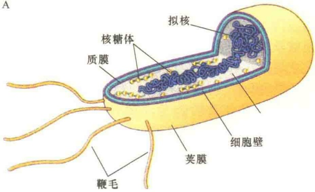

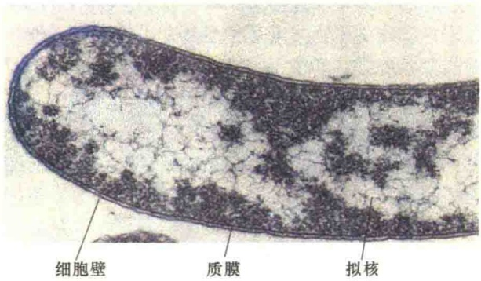

图 1-2 典型细菌细胞形态结构（引自 Kleinsmith and Kish, 1995）。A. 细菌的三维结构。B. 革兰氏阳性菌切片的电子显微镜照片。

细菌没有细胞核结构，仅为DNA与少量RNA或蛋白质结合物，也没有核仁和有丝分裂器。E.coli的DNA是环状的，长为 $4.2 \times 10^{6} \mathrm{bp}$，约4000个基因。由于细菌没有核膜，DNA的转录与蛋白质合成没有时空的隔离，所以细菌的转录与翻译几乎是同步进行的，这是原核生物与真核生物最主要的差别。细菌除了具有染色体DNA外，还有染色体外DNA，即质粒DNA。质粒是比染色体小的遗传物质，为环状的双链DNA，常常赋予细胞对抗生素的抗性。

细菌体表还有菌毛和鞭毛。菌毛有两种，一种是短而细的普通菌毛，可增加细菌吸附于其他细胞或物体的能力；另一种是数量少但细长的性纤毛，为雄性菌所特有。鞭毛是细菌的运动器官，鞭毛蛋

---

细胞的发现与细胞学说

5

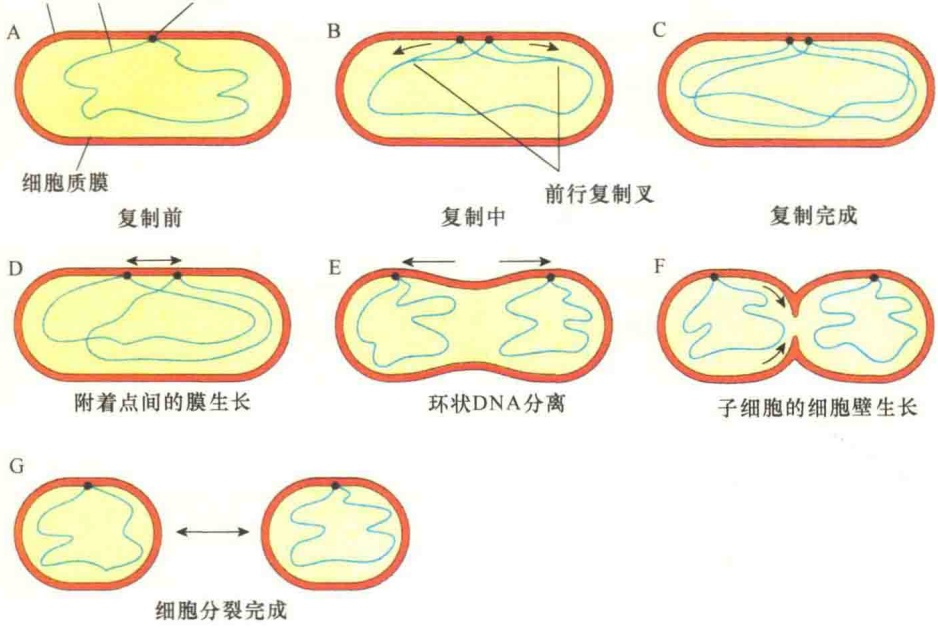

图 1-3 细菌的细胞质膜参与环状 DNA 的复制与分裂（引自 Wolfe，1993）。

白的氨基酸组成与横纹肌中的肌动蛋白相似。

支原体（mycoplasma），又称霉形体，是至今发现的最小、最简单的原核生物，也是唯一没有细胞壁的原核细胞。

支原体的大小介于细菌与病毒之间，一般直径为0.2～0.3μm，能够通过滤菌器，并能独立生活。支原体形态多变，有圆形、丝状或梨形，光镜下难以看清其结构。电镜下观察支原体的膜为三层结构。它有一环状双螺旋DNA，并且均匀地分布在细胞内，没有类似细菌的核区（拟核），能指导合成750多种蛋白质。电镜下支原体细胞中唯一可见的细胞器是核糖体，每个细胞中有800～1500个。支原体感染细胞时，多吸附在细胞表面，或分散在细胞之间。

支原体没有鞭毛，无活动能力，可以通过分裂进行繁殖，也有进行出芽增殖的。

支原体是动物细胞培养的大敌，由于支原体寄生在细胞中，所以培养细胞很容易被支原体污染，污染源主要是血清。

## 1.2.2 真核细胞

真核细胞（eukaryotic cell）是构成真核生物的细胞，具有典型的细胞结构。真核细胞的种类繁多，既包括大量的单细胞生物和原生生物细胞（如原生动物和一些藻类细胞），又包括全部的多细胞生物（一切动植物）的细胞。

真核细胞具有明显的细胞核、核膜、核仁和核基质。真核细胞的细胞核中含有较多的遗传物质，如人的细胞核中含有23对（46条）染色体，含有30亿个DNA碱基对；模式植物拟南芥的细胞核中有5对染色体，单倍体DNA的总长度为7000万碱基对。真核细

## 1.2.2.1 真核细胞的特点

真核细胞的主要特点是以生物膜为基础进一步分化，使细胞内部产生许多功能区室，它们各自分工负责，又相互协调和协作。

胞内部结构比原核生物的要复杂得多，除了多种膜性细胞器（membrane-bound organelle）外，还有许多纤维状的骨架结构，它们不仅维持着真核细胞的形态，还有许多重要的功能，如参与细胞分裂、物质运输等。

真核细胞具有明显的生长周期，时间跨度较长。

## 1.2.2.2 动物细胞与植物细胞

1）动物细胞 动物细胞是真核细胞的主要类型之一（图 1-4）。动物细胞的表面没有细胞壁，

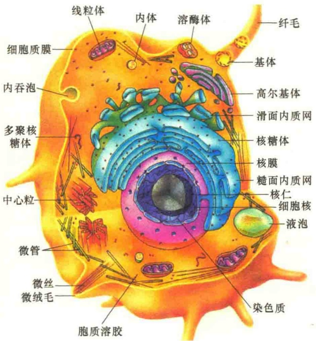

图1-4 动物细胞模式图。

---

6

细胞生物学（第二版）

仅是一层单位膜。细胞内有一个明显可见的细胞核，被两层膜包裹着。

2）植物细胞 植物细胞是真核细胞的另一主要类型（图1-5）。动物细胞具有的结构，植物细胞基本都有，但是植物细胞还有一些独特的结构，包括细胞壁、质体、中央液泡等（表1-1）。液泡是植物细胞特有的结构，它是植物细胞的代谢库，起调节细胞内环境的作用。液泡是由膜包围的封闭结构，内部是水溶液，溶有盐类、糖类与色素等物质，溶液的浓度可以达到很高的程度。液泡的另一个作用可能作为渗透压计（osmometer），使细胞保持膨胀的状态。

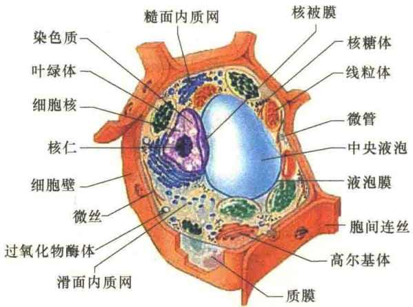

图1-5 植物细胞模式图。

表 1-1 动物细胞与植物细胞的比较

| 细胞器 | 动物细胞 | 植物细胞 |
| --- | --- | --- |
| 细胞壁 | 无 | 有 |
| 叶绿体 | 无 | 有 |
| 液泡 | 无 | 有 |
| 溶酶体 | 有 | 有 |
| 线粒体 | 有 | 有 |
| 过氧化物酶体 | 有 | 有 |
| 通讯连接方式 | 间隙连接 | 胞间连丝 |
| 中心体 | 有 | 无 |
| 胞质分裂方式 | 收缩环 | 细胞板 |

## 1.2.3 真核细胞的结构体系

将真核细胞内的结构体系归纳起来可分为三大系统:生物膜体系、遗传信息表达体系、细胞骨架体系。

## 1.2.3.1 生物膜体系

真核生物在进化过程中，细胞体积不断增大，因而出现了细胞内部结构的分化，最主要的特征是以质膜为基础的既独立又相互联系的膜结构系统。这些结构及细胞器包括细胞质膜、核膜、内质网、高尔基体、溶酶体、线粒体和叶绿体等。

生物膜体系（biomembrane system）的基本作用是为细胞提供保护。

质膜将整个细胞的生命活动保护起来，并进行选择性的物质交换；核膜将遗传物质保护起来，使细胞核的活动更加有效；线粒体和叶绿体的膜将细胞的能量发生同其他的生化反应隔离开来，更好地进行能量转换。

生物膜体系为细胞提供较多的质膜表面，使细胞内部结构区室化。由于大多数酶定位在膜上，且大多数生化反应也是在膜表面进行的，膜表面积的扩大和区室化使这些反应有了相应的隔离，效率更高。

另外，生物膜体系为细胞内的物质运输提供了特殊的运输通道，保证了各种功能蛋白及时准确地“到位”而又互不干扰。例如，溶酶体的酶合成之后不仅立即被“保护”起来，而且一直处于“监护”之下被运送到溶酶体小泡。

## 1.2.3.2 遗传信息表达体系

遗传信息表达体系（genetic information expression system）又称为颗粒纤维结构体系，包括细胞核和核糖体。细胞核中的染色质是纤维结构，由DNA和组蛋白构成。染色体的一级结构是由核小体组成的串珠结构，其直径为10nm，又称为10纳米纤维。核糖体是由RNA和蛋白质构成的颗粒结构，直径为15～25nm，由大、小两个亚基组成，它是细胞内合成蛋白质的场所。

遗传信息的表达分为基因的转录与 mRNA 的翻译两个阶段。在真核细胞中，这两个阶段是时空隔离的。在时间上，转录在先，翻译在后；在空间上，基因的转录、转录的调控、转录后的加工在细胞核中进行，而 mRNA 翻译成蛋白质则是在胞质溶胶中进行的。转录与翻译的时空隔离有利于遗传信息表达的安全。

## 1.2.3.3 细胞骨架体系

细胞的体积虽小，但细胞内却是热闹非凡，各种生化反应瞬息万变，为了保证细胞生命活动的有序进行，细胞必须维持立体结构，这就需要依靠细

---

细胞的发现与细胞学说

7

胞骨架体系（cytoskeleton system）。细胞骨架是由蛋白质与蛋白质搭建起的骨架网络结构，其主要成分是微管、微丝和中间纤维。细胞骨架分为细胞质骨架和细胞核骨架。

细胞骨架体系的主要作用是维持细胞的一定形态，使细胞得以“安居乐业”。细胞骨架对于细胞内物质运输和细胞器的移动来说又起着交通轨道的作用；细胞骨架还将细胞内基质区域化；此外，细胞骨架还具有帮助细胞移动行走的功能。

细胞骨架另一个重要作用是真核细胞分裂的“助产士”。由于真核细胞中的染色体数量多，在进行细胞分裂时就不能采取细菌细胞分裂时染色体着膜的方式，而是要通过一种新的机制进行染色体的均等分配，即通过纺锤体微管将染色体拉向两极，通过肌动蛋白纤维形成胞质分裂环将细胞分裂开。

## 1.2.4 原核细胞与真核细胞的比较

原核细胞和真核细胞无论在结构上还是在功能上都有许多相同之处（表 1-2），但真核细胞具有许多原核细胞所没有的特点（表 1-3）。

表 1-2 原核细胞与真核细胞的相同点

| 序号 | 内容 |
| --- | --- |
| 1 | 都具有类似的细胞质膜结构 |
| 2 | 都以DNA作为遗传物质,并使用相同的遗传密码 |
| 3 | 都以一分为二的方式进行细胞分裂 |
| 4 | 具有相同的遗传信息转录和翻译机制,有类似的核糖体结构 |
| 5 | 代谢机制相同(如糖酵解和三羧酸循环) |
| 6 | 具有相同的化学能贮能机制,如ATP合酶(原核位于细胞质膜上,真核位于线粒体膜上) |
| 7 | 光合作用机制相同(蓝细菌与植物相比较) |
| 8 | 膜蛋白的合成与整合机制相同 |
| 9 | 都是通过蛋白酶体(蛋白质降解结构)降解蛋白质(古细菌与真核细胞相比较) |

表 1-3 真核细胞的特点

| 序号 | 内容 |
| --- | --- |
| 1 | 细胞分裂分为细胞核分裂和细胞质分裂,并且分开进行 |
| 2 | DNA 和蛋白质结合压缩成染色体结构,形成有丝分裂的结构 |
| 3 | 具有复杂的内膜系统和细胞内的膜结构(如内质网、高尔基体、溶酶体、过氧化物酶体、乙醛酸循环体、内体等) |
| 4 | 具有特异的进行有氧呼吸的细胞器(线粒体)和光合作用的细胞器(叶绿体) |
| 5 | 具有复杂的骨架系统(包括微丝、中间纤维和微管) |

续表

| 序号 | 内容 |
| --- | --- |
| 6 | 有复杂的鞭毛和纤毛 |
| 7 | 具有小泡运输系统(内吞作用和分泌作用) |
| 8 | 含有纤维素的细胞壁(如植物细胞) |
| 9 | 利用微管形成的纺锤体进行细胞分裂和染色体分离 |
| 10 | 每个细胞中的遗传物质成双存在,二倍体分别来自两个亲本 |
| 11 | 通过减数分裂和受精作用进行有性生殖 |

## 1.3 细胞的基本特性

细胞学说的提出，阐明了生命的同一性，这种同一性是由不同细胞间在结构和功能上的相似性决定的。

## 1.3.1 细胞结构的基本特性

从细胞类型的讨论中可以看出不同类型的细胞在结构上具有极大的相似性，都具有质膜结构、遗传物质和核糖体。

## 1.3.1.1 质膜结构

无论是原核细胞还是真核细胞都具有一层界膜，将细胞内环境与外环境隔开。为了能够调节物质进出细胞，并使细胞有最适合的内部环境，膜结构有两个基本的作用:一是在细胞内外起屏障作用，即不允许物质随意进出细胞；二是要在细胞内构筑区室，形成各个功能特区。

被质膜包裹在细胞内的所有生活物质称为原生质，包括细胞核和细胞质。细胞质（cytoplasm）是指细胞内除核以外的原生质，包括透明的黏液状的胞质溶胶（cytosol）及悬浮于其中的细胞器。

植物细胞与动物细胞的一个重要差别是在植物细胞质膜的外面还有一层细胞结构，即细胞壁。在离体条件下细胞壁很容易被酶水解掉，脱去细胞壁的细胞就称为原生质体，所以原生质体是一个工程学的概念。例如，植物细胞和细菌（或其他有细胞壁的细胞）通过酶使细胞壁溶解，得到的是具有质膜的原生质体。动物细胞不具有细胞壁，其本身就相当于原生质体。

## 1.3.1.2 遗传物质

细胞内最重要的物质就是遗传物质 DNA。在

---

8

细胞生物学（第二版）

真核细胞中，DNA 被包裹在膜结构，即细胞核中；原核细胞的 DNA 是裸露的，没有核膜包裹，所以称为拟核（nucleoid）。DNA 是遗传信息的一级载体，能够被转录成 RNA，并进行蛋白质的合成，这就是遗传信息流。

现有的研究表明，在生命的进化过程中，最早的遗传物质不是 DNA 而是 RNA，也就是说先出现 RNA，后逐渐进化形成 DNA。由于 DNA 储存遗传信息较 RNA 稳定，复制更精确，并且易于修复，所以它取代 RNA 成为遗传信息的主要载体。为了保证遗传信息的准确传递，RNA 被保留下来，专门负责遗传信息的转录和指导蛋白质的合成。少数原始生命形式的病毒，仍然保留 RNA 作为遗传信息的载体。

## 1.3.1.3 核糖体

所有类型的细胞，包括最简单的支原体都含有核糖体。真核细胞和原核细胞的核糖体不仅功能相同，在结构上也十分相似，都是由大、小两个亚基组成的，只不过原核细胞的核糖体比真核细胞的核糖体稍小一些。核糖体是蛋白质合成的机器，在细胞遗传信息流的传递中起重要作用。

## 1.3.2 细胞的生理生化特性

无论何种来源的细胞，都具有基本相似的生理生化反应。

1）细胞能够进行自我增殖和与分裂 细胞能够以一分为二的分裂方式进行增殖，动植物细胞、细菌细胞都是如此。为了保证新产生的子细胞具有与亲代相似的遗传性，细胞在分裂前遗传物质要成功进行复制，并在分裂时均等分配给每个子细胞。在多数情况下，分裂而成的两个子细胞在体积上大致相等。在某些情况下，如人的卵母细胞在分裂时，其中有一个子细胞不仅得到一套遗传物质，而且还会得到几乎全部的细胞质，另一个细胞仅仅得到遗传物质。此外，细胞都能利用遗传信息指导细胞物质的合成。

2）细胞都能进行新陈代谢 新陈代谢是细胞的基本活动，包括物质代谢和能量代谢。细胞内有机分子的合成和分解反应都是由酶催化的，即细胞的代谢作用是由酶控制的。

3）细胞具有反应能力 细胞具有对内外环境变化做出反应的能力。例如，单细胞的原生动物，可以避开障碍物或移向营养源；多细胞的动物与植物，通过细胞膜受体与底物的相互作用，对环境做出特异性的反应。细胞具有识别环境中激素、生长因子、细胞外物质，以及其他细胞表面物质的受体，并做出特异性的反应，包括调整代谢活性、细胞移动位置、信号转导等。

## 1.3.3 细胞的形态差异

细胞具有多种多样的形态（图 1-6），有球形、杆状、星形、多角形、梭形、圆柱形等。多细胞生物体依照细胞在各种组织和器官中所承担的不同功能，分化形成了各种不同的形态。这些不同的形态一方面取决于对功能的适应，另一方面亦受细胞的表面张力、胞质黏滞性、细胞膜坚韧程度，以及微管和微丝骨架等因素的影响。

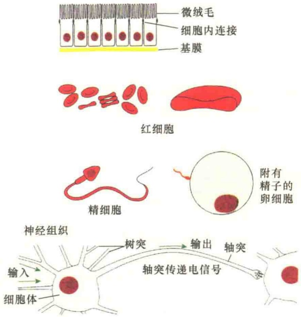

图 1-6 不同的细胞形态（改自 Alberts et al., 1994）。

细胞形态结构与功能的相关性与一致性是很多细胞的共同特点。例如，红细胞呈扁圆形的结构，有利于 $O_{2}$ 和 $CO_{2}$ 的交换；高等动物的卵细胞和精细胞不仅在形态上，而且在大小方面都是截然不同的，这种不同与它们各自的功能相适应。卵细胞之所以既大又圆，是因为卵细胞受精之后，要为受精卵提供早期发育所需的信息和相应的物质。这样，卵细胞除了带有一套完整的基因组外，还有很多预先合成的mRNA和蛋白质，所以体积就大；而圆形的表面则便于与精细胞结合。精细胞的形态是既细又长，这也是与它的功能相适应的。精细胞对后代的责任仅是提供一套基因组，所以它可以“轻装上阵”；至于精细胞的细尾巴则是为了运动寻靶，尖尖的头部是为了更容易将它

---

9

细胞的发现与细胞学说

携带的遗传物质注入卵细胞。

## 1.3.4 细胞的大小及体积的恒定

细胞最为典型的特点是在一个极小的体积中形成极为复杂而又高度组织化的结构。典型的原核细胞的直径平均为 $1\sim 10\mu \mathrm{m}$ ，而真核细胞的直径平均为 $3\sim 30\mu \mathrm{m}$ ，一般为 $10\sim 20\mu \mathrm{m}$ （图1-7）。

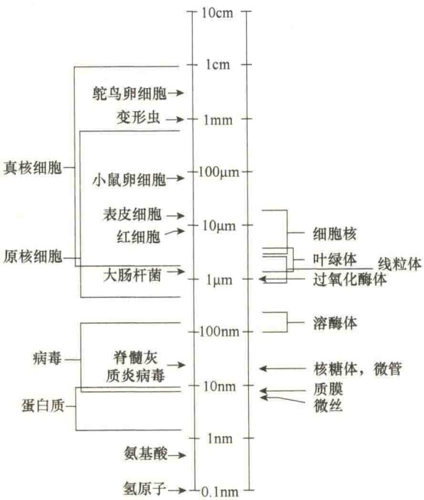

图 1-7 典型的原核细胞、真核细胞、细胞器、病毒和分子的大小（引自 Kleinsmith and Kish，1995）。

某些不同来源的同类细胞的大小变化很大，如人的卵细胞直径只有0.1mm，而鸵鸟的卵细胞直径则有0.5cm。但是，来自不同物种的多数同类型细胞的体积一般是相近的，不依生物个体的大小而增大或缩小，如人、牛、马、鼠、象的肾细胞、肝细胞的大小基本相同。因此，器官的大小主要取决于细胞的数量，与细胞的数量呈正比，而与细胞的大小无关。

细胞本身的大小是不能随意改变的，细胞体积要维持相对恒定。哺乳动物细胞的体积大小受几个因素的限制，其中一个主要限制因素是体积与表面积的关系。以球形细胞为例（身体内的细胞并非都是球形）计算体积与表面积的关系（图1-8），结果表明，球形细胞增大，其体积的增加要比表面积的增加大得多。这样，当细胞增大到一定程度时，质膜的表面积就不适应细胞进行内外物质的交换，细胞为了维持一个最佳的生存条件，必须维持最佳的表面积，从而限制了体积的无限增大。

| 半径 | 5μm | 50μm |
| --- | --- | --- |
| 表面积(4πr2) | 314μm2 | 31400μm2 |
| 体积(4/3πr3) | 524μm3 | 524000μm3 |
| 表面积/体积 | 0.6 | 0.06 |

图 1-8 细胞体积与表面积间的关系（引自 Kleinsmith and Kish, 1995）。

另一个限制细胞体积的因素是细胞内关键分子的浓度。一些重要的分子在细胞内的拷贝数是很少的，当细胞体积增大时，这些分子的浓度就越来越稀，一些重要的生化反应需要一定的分子浓度才能进行，所以细胞内分子浓度就成了限制细胞体积无限增大的另一个因素。真核细胞的体积一般是原核细胞的1000倍，真核细胞为了解决细胞内重要分子的浓度问题，出现了特化的内膜系统，使一些反应局限于特定的膜性细胞器内，这样，一些重要反应的分子浓度并没有随细胞体积的增大而被稀释。

细胞不仅对其体积的增大有限制，而且对体积的减小也有限制。据研究，一个生活细胞要维持正常的独立生活功能，最低限度需要500～1000种不同类型的酶和蛋白质，这是目前在支原体中所发现的酶和蛋白质的量。而支原体是目前所知最小的原核细胞，它的体积只有0.2～0.3μm³，仍能完全独立地生存。很显然，细胞体积的最小化受制于维持细胞生命活动所需的酶和蛋白质种类的最低量。

## 1.3.5 细胞及细胞器的计量单位

有两种计量细胞大小的单位——微米（μm）和纳米（nm）。1μm等于 $10^{-6}$ m，1nm等于 $10^{-9}$ m。使用电子显微镜后又提出埃（Angstrom，Å）为超显微结构的计量单位，1埃（Å）等于0.1nm，但这个单位并不常用。1Å可粗略地看成是一个氢原子的直径。较大细胞器的直径通常用μm表示，如细胞核的直径为5～10μm，而线粒体的长度大约是2μm，DNA的宽度为2nm（图1-9）。

---

10

细胞生物学（第二版）

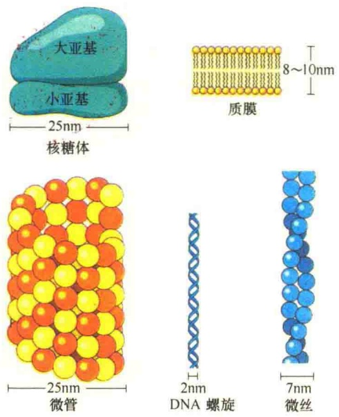

图 1-9 几种细胞结构的大小（引自 Becker et al., 1996）。

## 1.4 细胞的分子基础

生命是物质的，是一种特殊形式的物质运动，它是物质、能量和信息诸变量在特定时空的“表演”，其运转有赖于生命系统有组织的守时及与空间环境的合拍。

所有的细胞都是由水、蛋白质、糖类、脂类、核酸、盐类和各种微量的有机化合物所组成，表 1-4 为细菌细胞的化学组成。

表 1-4 细菌细胞的化学组成

| 化学成分 | 占细胞总质量的比例/% | 每种分子的类型数 |
| --- | --- | --- |
| 水 | 70 | 1 |
| 无机离子 | 1 | 20 |
| 糖及其前体 | 1 | 250 |
| 氨基酸及其前体 | 0.4 | 100 |
| 核苷及其前体 | 0.4 | 100 |
| 脂肪酸及其前体 | 1 | 50 |
| 其他小分子 | 0.2 | 约300 |
| 大分子(蛋白质、核酸和多糖) | 26 | 约3000 |

## 1.4.1 水

生命来自水。细胞中水的含量最高，通常占细胞总量的 70%～80%（图 1-10）。细胞中的所有反应都是在水中进行的，所以水是细胞生命活动的介质。

图 1-10 细胞中各主要成分的相对含量（引自 Kleinsmith and Kish, 1995）。

相邻水分子间的关系是靠氢键维系的（图 1-11），氢键赋予水分子一些独特的性质，而这些性质对于生活细胞是十分重要的。第一，氢键能够吸收较多的热能，将氢键打断需要较高的温度，所以氢键可维持细胞温度的相对稳定。第二，相邻水分子间形成的氢键使水分子具有一定的黏性，这样使水具有较高的表面密度。第三，水分子间的氢键可以提高水的沸点，这样使它不易从细胞中挥发掉。

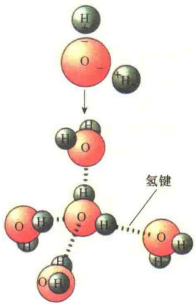

图 1-11 水分子中的氢键（引自 Kleinsmith and Kish, 1995）。

水在细胞中既是反应剂也是溶剂。水分子参与了生命活动的一些重要反应，在大分子的合成过程中水是产物，而在分解反应中水是反应剂。

由于水是极性分子，所以水除了作为反应剂外，还是各种极性有机分子和离子的最好溶剂，主要是靠氢键的形成使这些分子和离子得以溶解（图 1-12）。

---

细胞的发现与细胞学说

11

细胞中的水以两种形式存在:游离水和结合水。游离水是细胞代谢反应的溶剂；结合水则是以氢键和蛋白质结合的水分子，占细胞内全部水的4.5%，是原生质结构的一部分。

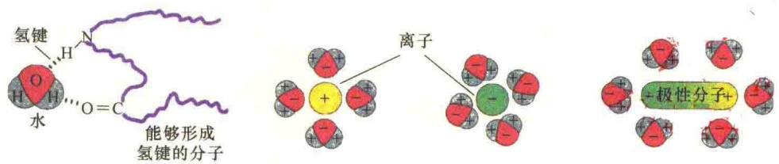

图 1-12 水的溶剂作用（引自 Kleinsmith and Kish, 1995）。

## 1.4.2 无机盐

无机盐是细胞的重要成分，并且是维持细胞生存环境的重要物质。根据无机元素在细胞内的作用分为四大类:①大分子的结构成分，主要是C、H、N、O、P、S等；②各种酶反应所需的离子，主要是 $Ca^{2+}$ 、 $Cu^{2+}$ 、 $Mg^{2+}$ 、 $K^{+}$ 、 $Na^{+}$ 、 $Cl^{-}$ 等；③各种酶活性所需的基础微量元素，包括Co、Cu、Fe、Mn、Zn等；④某些生物需要的特殊微量元素，如I、Cs、Br等。

无机元素的功能有:维持细胞内的 pH 和渗透压，以保持细胞的正常生理活动；同蛋白质结合组成具有特定功能的结合蛋白，参与细胞的生命活动；作为酶反应的辅助因子。

## 1.4.3 有机分子

细胞内有 4 类有机小分子:单糖、脂肪酸、氨基酸和核苷酸。细胞内的有机小分子约占细胞总有机物的 1/10，但却有许多不同的种类。有机大分子则包括多糖、蛋白质、DNA、RNA 等。糖可与蛋白质结合形成糖蛋白或蛋白聚糖。

## 1.4.3.1 单糖与多糖

糖（sugar）是一类称之为碳水化合物的有机分子，由碳、氢、氧按1∶2∶1的比例构成。简单的糖，或称单糖（monosaccharide）是最小的糖，仅含三个碳，但在生物体内常见的是五碳糖（pentose，戊糖）或六碳糖（hexose，己糖）。自然界最常见的六碳糖是葡萄糖，是较简单的糖，也是细胞的主要营养物质，它经过一系列氧化反应释放出能量，最终生成水和 $CO_{2}$ 。

除了葡萄糖，还有其他几种己糖在生物大分子糖构建中起重要作用（图 1-13）。虽然这些糖都含有 6 个碳原子，但是它们的羟基（—OH）或醛基是不同的。五碳糖也是重要的单糖，是核苷酸的重要组成部分。

单纯的多糖由许多葡萄糖残基组成，如动物细胞中的糖原和植物细胞中的淀粉，它们是细胞内贮存的营养物质，提供细胞代谢所需的能源（图 1-14）。

图 1-13 一些重要的单糖（引自 Kleinsmith and Kish, 1995）。

多糖（polysaccharide）是细胞的重要支持材料，是细胞壁的主要结构成分。青霉素之所以能够抑制革兰氏阳性菌的生长，就是阻止了细胞壁中特殊糖链的形成。

糖同蛋白质结合形成糖蛋白。在哺乳动物的组织、体液及分泌物中都有糖蛋白，不同的糖蛋白具有不同的功能。植物的糖蛋白一部分与细胞壁的多糖结合，另一部分以可溶的形式存在。

---

12

细胞生物学（第二版）

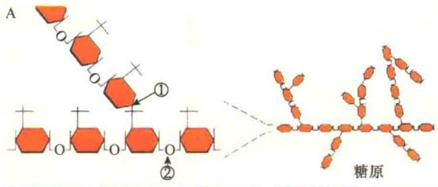

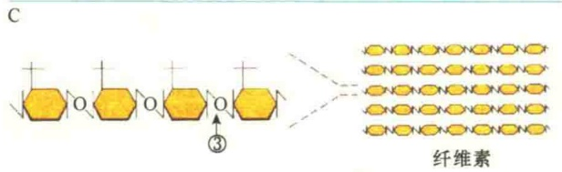

图1-14 相同的单糖构成不同的多糖（引自Karp，1996）。圆圈数字箭头表示三种不同的连接方式。

糖蛋白及其糖链具有很多重要的作用:①作为机体内外表面的保护剂及润滑剂，如鱼体表面黏液中就含有高唾液酸的糖蛋白，能防止水分的丧失。消化道、呼吸道、尿道等体腔黏膜能帮助运输，保护体腔不受机械、化学损伤和微生物感染及润滑等功能；②作为载体与维生素、激素、离子等结合，有助于这些物质在体内转移和分配；③参与细胞识别，是细胞识别的重要分子。几乎所有动物细胞表面都有少量糖，它的作用好比是细胞联络的文字或语言。

蛋白质的糖基化对蛋白质分子的理化性质有很大影响。①溶解度。糖基化往往使蛋白质在水中的溶解度增大。但是，若糖链增长到一定程度，由于相对分子质量增大和形成高级结构，亦会出现憎水性增加的现象。②电荷。氨基糖解离后，应带正电荷。但是，天然存在的氨基糖的氨基都被N-乙酰基取代，实际上相当于中性糖。许多糖链上有唾液酸或糖醛酸，解离后带负电荷，所以糖基化可能使蛋白质增加许多负电荷。

蛋白质的糖基化对蛋白质的生物功能也有很大影响。在迄今已知的上千种蛋白质中，50%以上是糖基化的。许多糖蛋白具有酶、激素、抑制剂等各不相同的生物活性，相当一部分糖蛋白，其分子中糖链是实现生物功能所必需的，去除或破坏糖链会使它们失去生物功能。但某些糖蛋白，去除糖链对其生物功能不会造成影响。

一些糖蛋白中的糖链通过增强蛋白质对热变性和蛋白水解酶的抗性，间接增强糖蛋白的生物学功能。

糖基化对蛋白质合成后加工和运输的影响也是很大的。例如，艾滋病病毒的外壳糖蛋白 gp120 和 gp41 就是由前体蛋白分子 gp160 加工而来的，这种切割加工的信号就是 N-乙酰氨基乳糖型糖链。

## 1.4.3.2 脂

与糖、氨基酸等的概念相比，脂（lipid）不是一类单一的化学分子，而是一类不溶于水、可被辛烷从细胞中提取出来的化学物质。细胞内常见的有以下6类脂（图1-15）。

脂肪酸（fatty acid）是最简单的脂，它是细胞的重要能源来源，按质量比计算，脂肪酸分解产生的能量相当于葡萄糖所产生能量的2倍。脂肪酸在细胞内最重要的功能是构成细胞结构，是细胞质膜的主要组分。脂肪酸具有长的碳链，末端含有羧基团（—COO $^{-}$ ），细胞中大多数具有重要作用的脂肪酸都含有偶数碳原子，最长的脂肪酸长度含有24个碳原子。细胞内几乎所有的脂肪酸分子都是通过它们的羧酸基团与其他分子共价连接。不饱和脂肪酸含有双键，饱和脂肪酸则不含双键。各种脂肪酸的碳氢链长度及所含碳-碳双键的数目和位置的不同，决定了它们不同的化学特性。

三酰甘油（triacylglycerol），俗称脂肪（fat），系指与甘油相连接的脂。甘油是三碳糖还原的衍生物。三酰甘油是细胞内储存脂肪的最好形式，可作为很好的能源以备细胞之需。在动物细胞中三酰甘油储存在脂肪细胞中，在脂肪细胞质中，几乎被脂肪滴所占据。

磷脂（phospholipid），与极低水溶性的三酰甘油相比，磷脂的骨架中含有水溶性的磷酸基团，因此磷脂是两亲性的分子，既亲水又疏水。磷脂可通过磷酸基团与甘油或长链的鞘氨醇（sphingosine）相连。磷脂是细胞质膜的主要结构成分。

糖脂（glycolipid）是鞘氨醇的衍生物，分子中一个糖取代了磷酸基团。由于糖是水溶性的，所以糖脂也是两亲性的。糖脂是某些膜的重要成分，特别是植物细胞与神经细胞的膜。

类固醇（steroid）是四元环，即菲（phenanthrene）构成的化合物，因此，类固醇的结构与其他的脂类有很大的不同。有些类固醇是激素，有些类固醇（如维生素D）可调节肠中钙的吸收，胆固醇在动物细胞中不仅是细胞质膜的成分，也是其他类固醇合成的前体。

---

细胞的发现与细胞学说

13

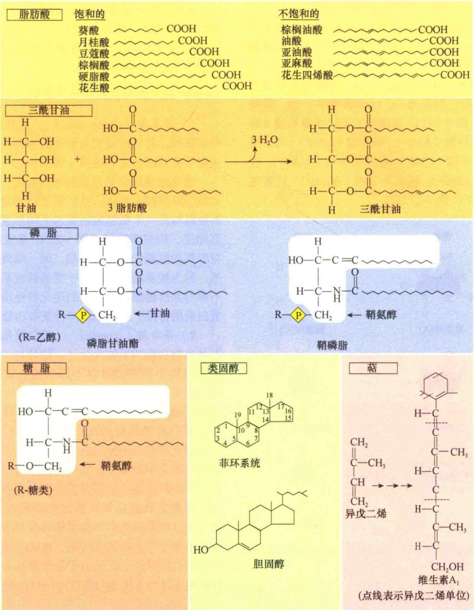

图 1-15 细胞内 6 类不同的脂（引自 Kleinsmith and Kish, 1995）。

萜（terpene）是由五碳的异戊二烯构成的脂。异戊二烯和它的衍生物与不同的化合物结合生成各种底物，如维生素A、辅酶Q、类胡萝卜素等，尽管结构相似，功能却有很大不同。

## 1.4.3.3 核苷酸与核酸

核酸是储存与传递遗传信息的载体，核苷酸（nucleotide）是组成核酸（nucleic acid）的基本单位，每个核苷酸分子由一个戊糖（核糖或脱氧核糖）、一个含氮碱基（嘧啶或嘌呤）和一个磷酸脱水缩合而成（图1-16）。

五碳糖（five-carbon sugar），即戊糖。核酸中

图 1-16 核苷酸的组成单位（引自 Kleinsmith and Kish, 1995）。

---

14

细胞生物学（第二版）

有两类不同的戊糖，即脱氧核糖和核糖。它们之间唯一的差别就在于脱氧核糖的2'-碳原子上缺失了氧。由于这一差别，细胞内的核酸就分为脱氧核糖核酸与核糖核酸。

含氮碱基（nitrogenous base）。细胞中主要含有5种含氮碱基:胞嘧啶（C）、胸腺嘧啶（T）、尿嘧啶（U）、鸟嘌呤（G）、腺嘌呤（A）。主要形成8种核苷酸:腺苷酸（AMP）、尿苷酸（UMP）、鸟苷酸（GMP）、胞苷酸（CMP）、脱氧腺苷酸（dAMP）、脱氧胸苷酸（dTMP）、脱氧鸟苷酸（dGMP）、脱氧胞苷酸（dCMP）（图1-17）。

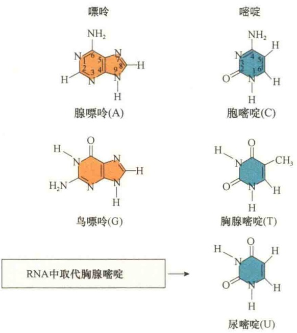

图 1-17 核苷酸中的碱基（引自 Kleinsmith and Kish, 1995）。

磷酸基团（phosphate group）。磷酸基团是核苷酸中的第三种成分，它与五碳糖连接，并将核苷酸相互连接形成核酸。磷酸基团是强酸，这就是为何将 DNA、RNA 称之为“酸”（acid）。

核苷酸除组成脱氧核糖核酸（DNA）和核糖核酸（RNA）外，有些核苷酸在细胞内起重要作

RNA 即是核糖核酸，种类较多，有 tRNA、rRNA、mRNA。还有一些存在于细胞核和细胞质中的小分子 RNA，它们具有不同的功能，在某些病毒中 RNA 是遗传物质。

## 1.4.3.4 氨基酸与蛋白质

1）氨基酸（amino acid）细胞内主要有20种氨基酸，它们的差别主要是R侧链不同，R侧链决定了氨基酸的化学性质（图1-19）。

氨基酸是组成蛋白质的基本单位，蛋白质是长的线性氨基酸多聚体，这些氨基酸通过一个氨基酸的羧基与另一个氨基酸的氨基之间形成的肽键而首尾相连，构成多肽链（图1-20）。多肽链的一端具有游离的氨基，称为氨基端，另一端具有游离的羧基，称为羧基端。多肽链中氨基酸残基的侧链通常不参与共价键形成，它们的理化特性决定了所组成蛋白质的特性，是蛋白质多种复杂功能的基础。

2）蛋白质（protein） 蛋白质是细胞内行使各种生物功能的生物大分子，估计在一个典型哺乳动物细胞中有10 000种不同的蛋白质执行着不同的功能（表1-5）。

组成蛋白质的基本构件只是20种氨基酸，为什么蛋白质却具有如此广泛的功能？其根本原因是蛋白质具有几乎无限的形态结构，因此蛋白质仅仅是一类分子的总称。换句话说，蛋白质之所以有如此广泛的作用，是因为蛋白质具有各种不同的结构，特别是在蛋白质高级结构中具有不同的结构域，而这种不同的空间构型使得蛋白质能够有选择地同其他分子进行相互作用，这就是蛋白质结构决定功能的特异性。正是由于蛋白质具有如此广泛的特异性才维持了生命的高度有序性和复杂性。

3）酶（enzyme） 酶是具有催化功能的蛋白质。它们能够与底物结合，将底物转变成一个或多个经修饰的产物，并且可极大地提高反应速度，保持细胞内温度的相对恒定。所以，酶是一种生物催化剂，维持细胞生命的正常进行。表1-6列出了细胞内一些重要的酶及其催化的反应。

用。例如，三磷酸腺苷（ATP）是细胞内化学能的载体，参与细胞内化学反应间能量传递。环腺苷酸（cAMP）是含嘌呤环状磷酸衍生物，作为细胞内通讯的信号分子，控制细胞内许多不同反应的速度。

脱氧核糖核酸即 DNA 分子，是遗传物质，只有一种类型，其结构是双螺旋的（图 1-18）。

图1-18 DNA的结构。

---

细胞的发现与细胞学说

15

图 1-19 20 种氨基酸的结构。

---

16

细胞生物学（第二版）

图1-20 两个氨基酸之间通过脱水形成肽键。

表 1-5 细胞内蛋白质的某些功能

| 功能 | 举例 | 功能 | 举例 |
| --- | --- | --- | --- |
| 结构材料 | 胶原、角蛋白 | 激素 | 胰岛素、生长激素 |
| 运动 | 肌动蛋白、肌球蛋白 | 物质运输 | $Na^{+}$-$K^{+}$泵 |
| 营养储存 | 酪蛋白、铁蛋白 | 信号传导 | 乙酰胆碱受体 |
| 基因调控 | lac 操纵子 | 渗透压调节 | 血清白蛋白 |
| 免疫作用 | 抗体 | 毒素 | 白喉和霍乱毒素 |
| 电子转移 | 细胞色素 | 酶(催化作用) | 氧化还原酶、连接酶等 |

## 1.4.4 细胞结构体系的组装

细胞是由化学物质组成的。由于细胞的生命活动是高度有序的，所以细胞的化学物质不可能杂乱无章地堆积在一起，而是有规则地分级组装成复杂的细胞结构，如核糖体、细胞核、高尔基体和细胞骨架等（图 1-21）。

由生物分子组装成细胞，可以粗略地分成四级。第一级是构成细胞的较小有机分子的合成，包括碱基、氨基酸、葡萄糖、软脂酸，这些构成了细胞的化学单体。第二级由单体分子合成生物大分子，包括DNA、RNA、蛋白质、多糖。第三级由生物大分子进一步合成超分子的高级结构，如细胞质膜、染色质、多糖、微丝等。第四级由超级生物大分子组装成具有空间结构和生物功能的细胞器，如细胞核、线粒体、叶绿体、内质网、高尔基体、溶酶体、微体等，最后再由细胞器组成细胞。

表 1-6 细胞内一些常见的酶

| 酶 | 催化的反应 |
| --- | --- |
| 水解酶(hydrolase) | 催化切割水解反应的酶,如核酸酶与蛋白酶 |
| 核酸酶(nuclease) | 催化核苷酸之间键水解的酶。核酸内切酶是从多核苷酸链内部水解,而核酸外切酶则是从末端开始水解 |
| 蛋白酶(protease) | 水解蛋白质肽链中氨基酸残基间的肽键 |
| 合成酶(synthase) | 催化两个小分子成为大分子的酶 |
| 连接酶(ligase) | 将两个分子连接起来,是耗能过程,如DNA连接酶通过磷酸二酯键将两个分子末端相连 |
| 异构酶(isomerase) | 催化分子内的重排 |
| 聚合酶(polymerase) | 催化分子的聚合反应,如DNA、RNA的合成 |
| 激酶(kinase) | 催化分子添加磷酸基团的酶,蛋白质激酶是重要的激酶,催化蛋白质磷酸化 |
| 磷酸酶(phosphatase) | 催化底物脱去磷酸的酶 |
| 氧化-还原酶(oxido-reductase) | 催化一个分子氧化、另一分子还原的反应 |
| ATP酶(ATPase) | 水解ATP的酶,为细胞的生命活动提供能量 |
| GTP酶(GTPase) | 水解GTP的酶,GTP结合蛋白是一大类GTP酶 |

各种生物大分子到底如何组装成有功能的细胞结构和组织是当前细胞生物学所要研究的基本问题，目前对组装的机制提出过以下假说。①模板组装（template assembly）是指由模板指导，在一系列酶的催化下，合成新的、与模板完全相同的分子。这是细胞内一种极其重要的组装方式，DNA 和 RNA 的分子组装就属于此类。②酶促组装

图 1-21 植物细胞的化学组装（引自 Nelson and Cox，2013）。

---

1 细胞的发现与细胞学说

17

(enzymatic assembly) 是指相同的单体分子在不同的酶系作用下, 生成不同的产物。例如, 以葡萄糖为原料既可合成纤维素, 也可合成淀粉, 就看进入哪条酶促反应途径。③自组装 (self-assembly) 是指生物大分子借助本身的力量自行装配成高级结构, 现代的概念应理解为不需要模板和酶系的催化, 以别于模板组装和酶效应组装。其实, 这些假说还远远不能解释组装的真正机制, 有待于进一步研究。

细胞内大分子组装的概念已不仅仅指生物分子如何组装成细胞结构和细胞器，越来越多的实验证据表明，细胞内许多代谢活动往往是以蛋白质与蛋白质，或蛋白质与核酸、蛋白质与磷脂组装成特定的复合物，这些复合物构成细胞结构体系的结构基础与功能单位，如 DNA 和组蛋白组装成的核小体是染色质结构的基本单位。

随着分子生物学研究的深入，人们更多地注意反应复合物的组装及其在生命活动中的作用，如DNA复制的引发体（primosome）、转录起始复合物、RNA加工时形成的剪接体（spliceosome）、着丝粒和动粒等的组装。另外，三羧酸循环的酶系、叶绿体光合作用的两大复合物、线粒体的电子传递链等都是蛋白质组装成的反应复合物。

在生命活动中，随着细胞周期的进行和细胞代谢状态的不同，各种反应复合物，包括细胞器乃至整个细胞都要不断进行组装和去组装。因此，细胞生命活动的基础是细胞组装活动，而这些组装活动又不能简单地归结于分子水平的活动，这就是为什么不能仅靠分子生物学而要靠细胞生物学解决生命科学问题的缘由。

## 1.5 病毒——非细胞的生命体

细胞虽然是地球上主要的生命形式，但并非是唯一的生命体，病毒也是生命体，但它却不具有细胞结构。

## 1.5.1 病毒概述

“病毒”（virus）一词来自拉丁语，意思是“毒物”（poison）。其含义随着研究的深入，对其本质的认识与理解不断发生变化。1892年Ivanowsky将烟草花叶病毒（TMV）称为滤过性致病因子，即是指一类可以通过细菌滤器的病原体。同时强调这种病原体由于体积太小，而不能用光学显微镜进行观察，但在活体细胞中增殖可引起感染个体致病。1957年，Lwoff将病毒定义为一类严格具有细胞内寄生和潜在感染性的病原体，并且指出病毒只有一种类型的核酸。19世纪60～70年代，病毒被定义为在化学组成和繁殖方式上不同于其他微生物，只能在宿主细胞内进行复制的一类最小的微生物。

## 1.5.1.1 病毒的大小与形态结构

大多数已知的病毒都是非常小的，比细胞小得多，直径为20～300nm。引起小儿麻痹症的脊髓灰质炎病毒（poliovirus）的直径约30nm，相当于核糖体的大小；引起天花的痘病毒（poxvirus）体积较大，长为300nm，宽为200nm。

大多数病毒不仅体积小，而且基因组也很小。但是近几年发现了巨型病毒，如2004年发现的拟菌病毒Mimivirus；2011年发现的巨型病毒Megavirus；2013年发现的潘多拉病毒（Pandoravirus），长约 $1\mu \mathrm{m}$ 、宽约 $0.5\mu \mathrm{m}$，比某些细菌和真核细胞都大。

病毒没有细胞结构，仅有蛋白质外壳和核酸的核组成。包围在核酸的核（core）外层蛋白质称为衣壳（capsid）。病毒的形态各异，有正二十面体的，有柱形的，也有丝状的（图1-22）。

## 1.5.1.2 病毒的衣壳蛋白与核酸

病毒的衣壳是一种保护性的蛋白质包被（coat），由称为壳粒（capsomer）的蛋白质亚基组成，壳粒决定了病毒的形态。衣壳的形态通常有螺旋对称、多面体对称，有些病毒的衣壳兼具螺旋对称与多面体对称的结构，这样的结构被称为复合型。螺旋对称的病毒，如烟草花叶病毒（tobacco mosaic virus, TMV），它是长杆形、中空的圆柱体，RNA位于圆柱体的空穴中。多面体的病毒，如腺病毒（adenovirus），看起来像一个球形，它的壳粒是正二十面对称的，每一面都是正三角形。感染大肠杆菌的病毒——T4噬菌体由正二十面对称的头与螺旋对称的尾部组成。但需要注意的是，并不是所有的病毒的衣壳都可以被划分为这三类。蛋白质组成的衣壳，不仅仅起到了保护病毒遗传物质的作用，也参与病毒的感染过程。

有些病毒衣壳的外面被一层由脂质和糖蛋白组成的包膜（envelope）包裹着，如流感病毒、艾滋病病毒，将此类病毒称作囊膜病毒（enveloped virus），没有包膜的则称作裸露病毒（naked virus）。通常，囊膜病毒的包膜来自宿主细胞的质膜:成熟病毒从细胞出芽释放时，利用细胞质膜作为包膜将

---

18

细胞生物学（第二版）

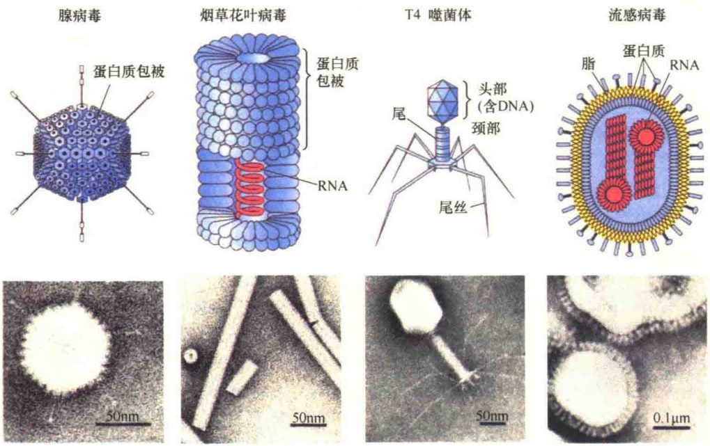

图 1-22 常见病毒的形态和结构（引自 Kleinsmith and Kish, 1995）。上面一行是结构模式图，下面一行是电子显微镜照片。

自己包裹起来。有趣的是，病毒在出芽释放前，会利用宿主核糖体指导合成一些病毒特异的蛋白质，并将之插入到将要出芽的细胞质膜区，因此，病毒的包膜既含有宿主细胞质膜的磷脂和蛋白质，又含有病毒基因编码的蛋白质。病毒基因编码的某些包膜糖蛋白可伸出膜外，形成突起（spike），这些糖蛋白突起在新一轮对宿主的感染中起重要作用。图1-23是囊膜病毒形成的示意图。

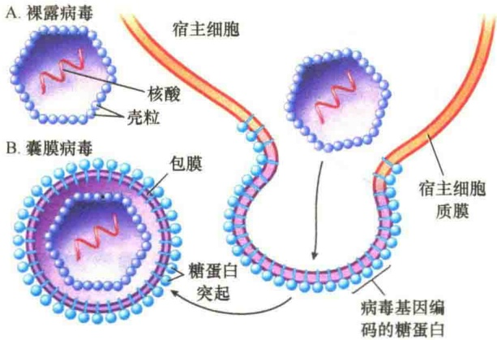

图 1-23 囊膜病毒的形成（引自 Solomon et al., 2019）。

## 1.5.1.3 病毒的遗传物质

病毒的生命特征体现在具有遗传物质，但由于没有将遗传物质转录表达的细胞机器，所以它只能借助于宿主的基因表达系统，繁衍生息。

病毒的遗传物质可以是 DNA，也可以是 RNA，同时又区分为单链与双链，即单链 DNA（ssDNA）、双链 DNA（dsDNA）、单链 RNA（dsRNA）和双链 RNA（dsRNA）四种。在病毒单链 DNA 或 RNA 中还有极性（polarity）的不同，就单链 DNA 来说，与 mRNA 序列相同的 DNA 称为正单链 DNA（+ssDNA），与 mRNA 序列互补且为转录模板的单链 DNA 称为负单链 DNA（-ssDNA）。病毒单链 RNA 如果能够直接作为编码合成蛋白质的模板链或 mRNA 即为正单链 RNA（+ssRNA），与 mRNA 序列互补的单链 RNA 则为负单链 RNA（-ssRNA）。

## 1.5.2 病毒的生命周期与感染

病毒不但没有细胞结构，而且还没有遗传表达系统，所以不能独立生存，只能在宿主细胞中进行增殖。所谓宿主（host）细胞，就是被病毒感染后，由病毒接管遗传表达系统，为病毒生命周期活动提供全套“服务”的生活细胞。

## 1.5.2.1 病毒的生命周期

病毒的生命周期（life cycle）是指病毒从对宿主细胞的识别吸附到最后释放出子代病毒的完整过程。病毒的生命周期一般包括以下5个基本过程。

1）吸附（adsorption） 病毒对细胞的感染起始于病毒蛋白质外壳同宿主细胞表面特殊的受体结合，受体分子是宿主细胞膜或细胞壁的正常成分。由于病毒感染的受体不同，决定着病毒感染的特异性。

---

细胞的发现与细胞学说

19

2）侵入（penetration） 病毒吸附到宿主细胞表面之后，将它的核酸注入宿主细胞内。病毒感染细菌时，用酶将细菌的细胞壁穿孔后注入病毒核酸；对动物细胞的感染，不同的病毒有不同的侵入方式，如流感病毒通过胞吞作用，而艾滋病病毒则直接与细胞质膜融合。

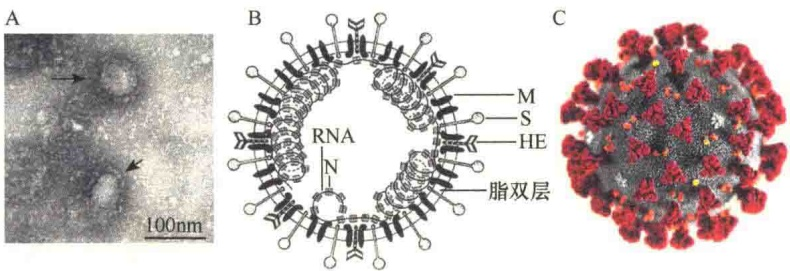

图 1-24 冠状病毒的形态结构。A. 中国国家病原微生物资源库发布的 SARS-CoV-2 病毒的电镜照片（箭头处）。B. 冠状病毒包膜及突起蛋白。图中 N 表示核衣壳蛋白。C. 冠状病毒的形态。

3）复制（replication） 病毒核酸进入细胞后有两种去向:一是病毒的遗传物质整合到宿主的基因组

中，形成溶原性病毒；第二种情况是病毒 DNA（或 RNA）利用宿主的酶系进行复制和表达。

4）成熟（maturation）一旦病毒的基因进行表达，就可合成病毒装配所需的蛋白质外壳，并将病毒的遗传物质包裹起来，形成成熟的病毒颗粒。

5）释放（release） 病毒颗粒装配之后，它们就可从被感染的细胞中释放出来进入细胞外，并感染新的细胞。有些病毒释放时要将被感染的细胞裂解，有些则是通过分泌的方式进入细胞外。

## 1.5.2.2 冠状病毒

2003 年发生的严重急性呼吸综合征（severe acute respiratory syndrome, SARS）、2012 年的中东呼吸综合征（middle east respiratory syndrome, MERS）、2019 年发生的 2019 冠状病毒病（Corona Virus Disease 2019, COVID-19），都是由冠状病毒感染引起的呼吸系统综合征。

1）冠状病毒概述 冠状病毒（Coronavirus）是一种具有包膜的正链单股RNA病毒。冠状病毒最先是1937年从鸡身上分离出来，1965年分离出第一株人的冠状病毒。由于在电子显微镜下可观察到其外膜上有明显的棒状粒子突起，使其形态看上去像中世纪欧洲帝王的皇冠，因此命名为“冠状病毒”。

冠状病毒直径为60～200nm，平均直径为100nm，呈球形或椭圆形，具有多形性。冠状病毒的基因组全长27～32kb，是目前已知RNA病毒中基因组最大的病毒。冠状病毒具有包膜，包膜上有蛋白质突起，包括三种糖蛋白:突起蛋白（spike protein，S）、包膜蛋白（envelope protein，E）和膜蛋白（membrane protein，M），少数种类还有血凝素酯酶（haemaglutinin-esterase，HE）（图1-24A）。S蛋白在识别宿主细胞表面受体、介导病毒包膜与细胞膜融合的过程中起关键作用；M蛋白则参与了病毒包膜的形成与出芽过程；HE蛋白则是构成包膜的短凸起，可能与冠状病毒早期吸附有关，某些冠状病毒的 HE 蛋白可引起红细胞的凝集及对红细胞的吸附。

冠状病毒仅感染脊椎动物，与人和动物的多种疾病有关，可引起人和动物呼吸道、消化道和神经系统疾病。该病毒引起的感染主要发生在冬季和早春。

世界卫生组织将2019年暴发的冠状病毒病命名为“COVID-19”，将新型冠状病毒命名为“SARS-CoV-2”。图1-24显示了冠状病毒的形态结构特征。

冠状病毒主要通过飞沫和接触传播，近距离密切接触可发生人际间传播。在密闭、通风不良的空间里，有可能通过气溶胶传播。可感染人类的冠状病毒主要引起上呼吸道感染症状，如鼻塞、打喷嚏和流鼻涕等，在温带地区，主要发生在冬季，在亚热带地区，一年四季都会发生，以春季和秋季常见。除上呼吸道感染外，冠状病毒还可引起严重的呼吸道感染，如重症肺炎，尤其是在儿童、老年人和免疫力低下的人群中。

冠状病毒对热较为敏感，病毒在4℃合适维持液中为中等稳定，-60℃可保存数年，但随着温度的升高，病毒的抵抗力下降，如SARS-CoV-2于37℃可存活4天，56℃加热90min、75℃加热30min能够灭活病毒。

冠状病毒对有机溶剂和消毒剂敏感，75%乙醇、乙醚、氯仿、甲醛、含氯消毒剂、过氧乙酸和紫外线均可灭活病毒。

2020年2月29日《中国-世界卫生组织新型冠状病毒肺炎（COVID-19）联合考察报告》发布。报告认为SARS-CoV-2病毒是一种动物源性病毒，蝙蝠似乎是该病毒的宿主，但中间宿主尚未查明。该病毒具有冠状病毒家族的典型特征，属于β型冠状病毒。

报告认为 SARS-CoV-2 病毒是一种新出现的病

---

20

细胞生物学（第二版）

原体，传染性强、传播速度快。它既不是SARS，也不是流感。从传播途径看，冠状病毒病在无防护下通过飞沫和密切接触在感染者和被感染者之间发生传播，在医疗机构中或可存在因医疗操作产生气溶胶而发生空气传播的可能，粪-口传播似乎并不是主要传播方式。

2）冠状病毒感染的治疗 从细胞生物学角度来说，对于病毒感染的疾病的治疗，主要靠自身免疫与辅助治疗。

（1）自身免疫治疗。所谓自身免疫，就是依靠自身的免疫系统。说话说，“兵来将挡，水来土掩”。人体不仅有精妙绝伦的各种生命活动的组织与器官，而且有维持生命活动的安全保障系统，称为免疫系统（immune system）。在该系统中有各种抗击入侵病毒的免疫细胞，包括巨噬细胞、树突状细胞、T淋巴细胞、B淋巴细胞，以及巨噬细胞等。这些细胞能够识别各种入侵病原体，并启动相应的应急机制，帮助身体转危为安。需要强调的是，自身免疫系统的战斗力受“主人”精神状态的影响极大，在受到病毒感染时，患者要保持乐观的情绪，有必胜的信心，这是给自身免疫系统最大的支持，个人的良好精神状态，会通过人体细胞的信号传导系统传递到免疫系统。

（2）药物辅助治疗。当有病毒入侵时，用药物进行辅助治疗是必要的，特别是对年老体弱、有其他基础疾病的患者尤为重要。药物辅助治疗主要是为免疫细胞提供一些物质支持，如在抗病毒的治疗中，给患者使用干扰素（interferon，IFN）就是一个很好的药物辅助的例子。干扰素虽然不能直接灭活病毒，但是具有免疫调节作用，可以提高免疫力。另外，中药在冠状病毒感染的治疗中也发挥一定作用。

3）冠状病毒感染的预防 冠状病毒感染的预防措施至关重要的是关闭野生动物交易。国际知名病毒学家、美国哥伦比亚大学 Lipkin 教授 2020 年 1 月曾呼吁:目前已知的传染病 70% 来源于野生动物，人类需要关闭野生动物交易市场，并且对野生动物、家畜、屠宰行业进行持续的监控。Lipkin 担忧地说，目前已经发现了大约 2000 多种的致命病毒，这个数字还在增加。Lipkin 曾用分子生物技术研究了某地的一种蝙蝠，在其体内发现了多达 55 种病毒的存在，其中有 50 种是前所未知的。蝙蝠携带的病毒有可能通过可被人类食用的中间宿主传递给人类，可见关闭野生动物交易是何其重要！

一旦疫情发生，唯一最有效和最便捷的做法就是控制人员流动和聚集。为此，自古至今防止疫情蔓延的做法都是封锁疫区，对患者集中隔离、集中收治，最大限度地限制了病毒的扩散传播。

此外，良好的卫生习惯也至关重要，如外出佩戴口罩，勤洗手，房间经常开窗通风，不随地吐痰，注意营养，适度运动，不乱丢弃生活垃圾，实行分餐制，生活场所定期消毒，尽量避免接触动物尤其是野生动物等。

## 1.6 细胞生命的进化

细胞是由分子和细胞器构成的错综复杂的生命体，细胞内每一种分子和细胞器都能执行一种或多种功能。人们对细胞的认识是在实验室里将细胞打开，然后分离各种细胞器和生物分子，分别研究它们的功能。但是人们能够打开的细胞只是当今生活的细胞，而无法获得远古时期的活细胞。在进化的过程中细胞生命活动的分子是如何形成的？最早的细胞是如何产生的？真核细胞又是如何起源的？

## 1.6.1 细胞生命的起源

导致细胞生命形成的关键因素是地球的形成及地球大气层条件的变化。一般将细胞生命的起源分为5个阶段:①地球和原始大气层的形成；②有机分子的自然形成；③分子聚合体的形成；④生命初级聚合体的形成；⑤原始细胞的形成。

## 1.6.1.1 有机分子的自然形成

地球上形成有机分子，是细胞生命起源的先决条件。

根据化石资料分析，地球上最早的细胞出现在35亿年前。最早的细胞是如何产生的？关于地球上细胞生命起源有两种假说:一种假说认为细胞是由已存在于地球上的分子产生的；另一种假说则认为细胞是从别的宇宙空间来到地球的。在19世纪，认为细胞来自别的星球的假说讨论十分激烈，有人认为地球是45亿年前形成的，第一个细胞是35亿年前出现的，在10亿年期间，是难以形成如此复杂的细胞，但是这种观点给不出任何证据。相反，细胞产自地球的假说却得到许多证据的支持，如细胞生命形式的形成与环境条件有关，在地球存在的第一个10亿年期间，地球表面被大量的水蒸气包围，有大量来自太阳的紫外线，并且还有雷雨和闪电。

---

细胞的发现与细胞学说

21

组成细胞的分子主要是有机分子，所以要形成细胞，地球上首先必须形成有机分子。20世纪20年代后期，苏联的生化学家Oparin提出地球上的有机分子是在合适的化学和物理条件下自然形成的。1953年，这一假说得到了实验的支持。实验的设计者是Miller，当时是一位研究生。他设计了一个实验装置，并通过实验证明在合适的物理化学条件下可以自动合成有机分子（图1-25）。

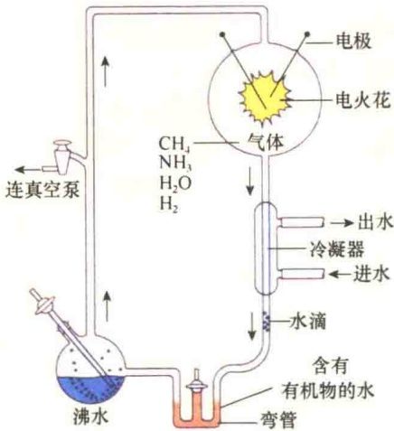

图 1-25 Miller 推测地球上的有机分子自动合成的实验装置（引自 Wolfe，1993）。

Miller 推测，大气层中含有甲烷和氨，也含有氢和水蒸气。他把这些气体一起放入实验装置中，然后一直与电火花接触，在这一装置中靠沸水提供水蒸气。反应一个星期后分析产物。令人惊讶的是，产物中有大量的有机物，包括尿素、生物和非生物的氨基酸等，实验证明了在雷电作用下能够利用大气中的分子合成有机分子。也就是说，在进化的某一过程中地球上有了构成细胞生命物质的基本单元——氨基酸、碱基、单糖等，为细胞的起源做好了物质准备。

## 1.6.1.2 分子聚合体的形成

从分子到原始细胞的生命进化过程中，两个主要事件是遗传信息的形成和细胞质膜的形成。遗传信息的形成是生命进化的转折点。核酶（ribozyme）的发现，说明RNA在生命起源中起了主导作用，它比DNA和蛋白质的起源都早。有机分子如何聚集形成分子聚合体，要有两个基本条件，即溶液中分子能够沉淀出来并能聚集排列形成稳定的结构，或者又能重新溶解。这种聚集有几种不同的机制，最典型的是脂双层结构的自动装配，为细胞质膜的形成提供了可能。

## 1.6.1.3 生命初级聚合体的形成

生命初级聚合体的形成包括:①如何利用能源驱动化学反应途径的进行；②酶分子的形成及酶催化反应途径的形成；③指导合成和再生的信息系统的形成。这里所指的生命初级聚合体的形成包括生物大分子的形成（酶和ATP等）、代谢的生物途径的形成、能量转换、信息的形成。这些生命初级聚合体一旦形成，生命的雏形即已形成。

## 1.6.1.4 原始细胞的形成

突变和自然选择是导致细胞生命形式形成的主要因素。上述各阶段的分子进化可视为是有利的突变，而这种有利的突变则被自然选择下来。将前几个阶段形成的膜结构、酶分子、能量转换系统、遗传信息系统和各种温和代谢途径聚集在一起就形成了原始的细胞。

## 1.6.2 真核细胞的进化

真核细胞由原核细胞进化而来，这是生物学家的基本共识。原核细胞向真核细胞进化的主要事件是呼吸代谢的发展和内膜系统的形成。细胞内两个与能量转换有关的细胞器——线粒体和叶绿体的起源主要是通过内共生机制，而内膜系统则是通过质膜的内陷形成的（图1-26）。首先形成内质网和核膜，然后逐步形成高尔基体、溶酶体、内体等内膜系统的其他结构，这样原核细胞就进化到低等真核细胞。

## 1.6.3 从单细胞向多细胞进化

虽然一个细胞可以是一个生命体，但这种生命体毕竟太简单。在细胞进化过程中出现了细胞的集合体，进一步发展到多细胞有机体。

细胞在向多细胞有机体进化的过程中，最重要的事件是出现细胞的分化，即在多细胞的有机体内，各种细胞向不同的方向发展，形成结构和功能各异的不同的组织，但又互相协调成为一个有机的整体。

在多细胞的有机体内，有一部分细胞高度特化，专门负责细胞生命的繁衍，这些细胞称为生殖细胞（germ cell），以别于有机体内的其他细胞，即体细胞（somatic cell）。

## 1.6.4 模式生物

现今的生物都是从共同祖先进化而来的，并且

---

22

细胞生物学（第二版）

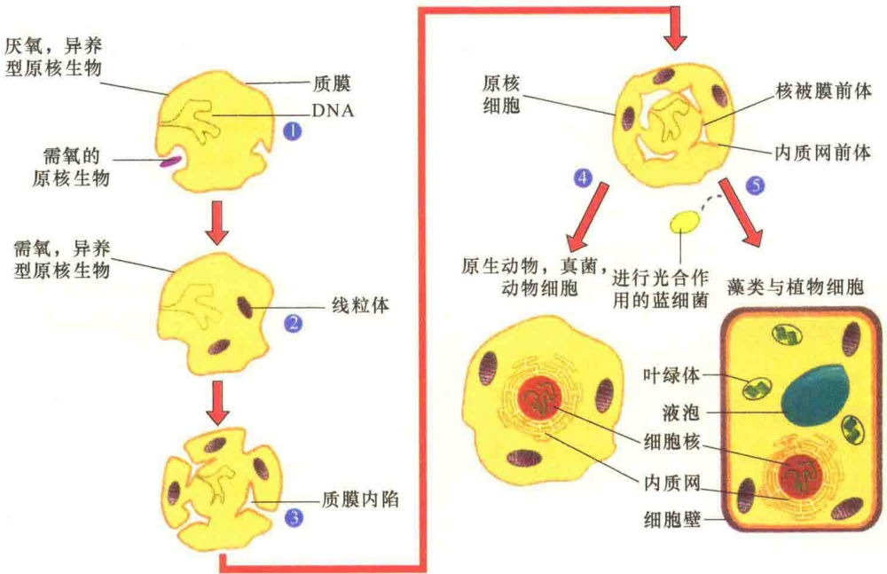

图 1-26 真核细胞的进化（引自 Karp，2010）。进化分为 5 个过程:①一个大的厌氧菌——异养菌吸收了一个小的需氧原核生物，有研究证明所吞的细菌是现今自然界存在的立克次氏体的祖先；②被吞入的好氧细菌进化成线粒体；③部分细胞质膜内陷，形成核膜、内质网膜的前体，形成初级真核细胞；④初级真核细胞继续进化成为无光合作用的原生动物、动物细胞；⑤在另一个途径，初级真核细胞吞入了具有光合作用的细菌，该细菌逐渐内化并演化成植物细胞的叶绿体。

一些重要功能的基因在进化上是高度保守的，所以无论从细胞水平还是分子水平看，不同生物间都遵循共同规律，只不过由于进化梯级不同，结构的复杂性有所不同。因此，可以用比较容易研究的生物作为模型来研究其基因的结构和生物学功能，由此获得的信息可以应用于其他比较难以研究的生物。这些被生物学家选定的用于科学研究，并根据研究结果揭示某种具有普遍规律的生命现象的生物物种就称为模式生物（model organism）。常见的模式生物有酵母、线虫、果蝇、斑马鱼、小鼠及拟南芥等（图1-27）。

A

D

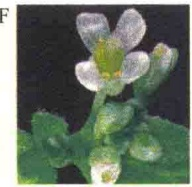

图 1-27 6 种真核生物研究的模式生物（引自 Lodish et al., 2016）。A. 酵母，B. 线虫，C. 果蝇，D. 斑马鱼，E. 小鼠，F. 拟南芥。

1）酵母（yeast） 酵母是最简单的真核生物，有很多实验上的优越性，可用于研究真核生物的一些基本结构与功能。最常用的酿酒酵母（Saccharomyces cerevisiae）的基因组大小约是大肠杆菌的3倍，约6000个基因，比高等真核生物的基因组要小得多，但是，酵母却具有典型的真核生物的特征。它具有核膜包起的细胞核，有16条线性染色体，而且是单倍体，细胞质中含有细胞骨架及亚细胞组织。

酵母很容易培养，并可使用大肠杆菌的研究方法进行研究。虽然酵母不如大肠杆菌生长快，但2h也会分裂一次，也可形成单细胞长成的菌落，因此，可像大肠杆菌一样用于遗传操作。

酵母具有真核生物基本的遗传规律，包括基因突变、DNA复制和转录、RNA加工、蛋白质分选，以及细胞周期调控。因此，酵母是较好地研究真核生物基本遗传规律的模式生物。

## 2）秀丽隐杆线虫（Caenorhabditis elegans）

由于酵母是单细胞的真核生物，不宜用于研究多细胞真核生物发育等方面的遗传规律。线虫由于其具有一些独特的特点，成为研究动物细胞发育与分化的最好模式生物。

线虫的基因组比单细胞的酵母大，但比大多数动物细胞的基因组小。线虫大约有 19 000 个基因，是酵母基因组的 3 倍，几乎与人的基因数量相等。

---

细胞的发现与细胞学说

23

从生物学的角度看，线虫是相当简单的多细胞的生物，成年的线虫只有959个体细胞、1000～2000个生殖细胞。此外，线虫很容易在实验室培养，方便遗传操作。

线虫可以在显微镜下进行观察，因其是透明的，这为发育的研究提供了极大的方便，可用于跟踪不同细胞系发育的途径，也可通过突变研究不同基因突变导致的发育变化。

3）黑腹果蝇（Drosophila melanogaster）如同线虫，果蝇也是研究发育生物学的最好模式生物。果蝇的基因组比线虫的大，但是基因的数量比线虫的少，只有14 000个基因。果蝇很容易在实验室喂养并长期保存。其发育周期也很短（2周），所以是很好的遗传实验材料。

通过对果蝇的遗传分析，已经揭示了一些参与发育与分化的基因，通过深入地研究分析，有助于揭示动物发育的机制，特别是有助于对多细胞生物身体发育与器官形成的了解。

4）斑马鱼（zebra fish） 斑马鱼是研究脊椎动物发育的极好模式生物。斑马鱼很小，容易在实验室内快速养殖，3～4个月一代，并且可以在体外进行胚胎发育，而且可进行移植，因此易于观察其早期的胚胎发育。已经建立了一系列分离影响斑马鱼发育突变体的方法，并鉴定了几千种突变体。由于斑马鱼是较易研究的脊椎动物，它已成为研究人与无脊椎动物间的一座桥梁。

5）小鼠（mouse） 在哺乳动物中，小鼠是最适合遗传分析的，虽然它比酵母、果蝇复杂得多，但已经鉴定了很多影响发育的突变体。更有意义的是，已经建立了一些工程鼠，可将外源基因导入小鼠的生殖系统，研究基因在整体动物体内的功能。小鼠之所以用作研究人发育的模式生物，不仅仅因为小鼠的基因组与人的基因组相似，而且同源基因的突变可产生相似的遗传缺陷，如白斑病就是一个典型的例子（图 1-28）。

6）拟南芥（Arabidopsis thaliana）植物分子生物学与发育的研究是一个活跃而又十分广泛的领域，并且具有十分重要的经济价值。由于植物覆盖的范围广而复杂，因此需要一个相对简单，又像线虫和果蝇那样具有代表性的模式生物，而开小花的拟南芥则是最好的研究植物发育的模式生物。

拟南芥的基因组有 $125 \times 10^{10}$ 个碱基对，含有约26000个基因。但很多基因是重复的，实际上只有约15000个基因，因此，它的复杂程度与线虫、果蝇相似。此外，拟南芥也是易于在实验室培养的，并建立了很多适于拟南芥进行分子遗传研究的方法，已经鉴定了一些与植物发育、开花相关的基因。这些研究表明植物与动物的发育有很大的相似性，也有很大的不同。

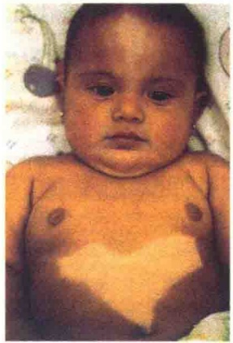

图 1-28 小鼠作为研究人的发育模式生物（引自 Cooper and Hausman，2013）。一个小孩与一只小鼠同一个基因突变造成相同的遗传缺陷。图示胸前的白斑是因为一个基因的突变影响了胚胎发育期黑素细胞的正常迁移所致。

7）大肠杆菌（E.coli）除了上述6类用于真核生物研究的模式生物外，大肠杆菌与噬菌体在分子遗传学的研究中则发挥了巨大作用。由于细菌的结构较为简单，所以是研究生物化学与分子生物学的理想原核生物。研究得最为深入的是E.coli。它是被最早用于研究分子遗传学机制的模式生物。今天我们所了解的大多数分子生物学概念，包括DNA复制、遗传密码、基因表达、蛋白质合成等都来自大肠杆菌的研究。

大肠杆菌有两个特点特别适合实验室的研究工作:一是结构简单，二是易于培养与繁殖。大肠杆菌约含 $4.6\times10^{7}$ 个碱基，约4300个基因。而人的基因组大约是大肠杆菌的1000倍以上，含2.0万～2.5万个基因。所以大肠杆菌以最小的基因组为基因分析做出了巨大贡献。

大肠杆菌的周期短、分裂快也是作为分子生物学研究材料的一大优势。在实验室培养条件下，大肠杆菌每20min分裂一次，在半固体琼脂培养基上，一般培养过夜后，一个单细胞就可以长成菌落，每个菌落中有 $10^{8}$ 个细胞。由于在短时间内可获得大量细胞，所以大肠杆菌对于分离细胞组分、研究抗生素抗性、基因突变等都是十分有利的。

## 1.7 合成生物学与“人造”细胞

美国科学家克雷格·文特尔（Craig Venter）

---

24

细胞生物学（第二版）

及其领导的一个20多人的科研小组通过合成生物学的手段，人工全合成蕈状支原体（Mycoplasma mycoides）的基因组，并引入山羊支原体（Mycoplasma capricolum）细胞，获得杂合细胞。该细胞表现出的是蕈状支原体的生命特性，其研究论文“创建由化学合成基因组控制的细菌细胞”发表在2010年5月20日出版的美国Science杂志上。这是地球上第一个由人类制造并能够自我复制的新物种。文特尔的团队将这一人造细胞称为“Synthia”（译为“辛西娅”，意为“合成体”）。

该成果一经报道立即引起了科学界的轰动。有人将“Synthia”称为“人造生命”，有人将“Synthia”称为“人造细胞”，其实这些说法都言之过甚。“人造”的简单理解就是从无到有地制造出来，而“Synthia”的基因组虽然是“造”出来的，实际上是按蕈状支原体的基因组仿造的，并没有改变遗传性；此外，“Synthia”的细胞质膜及其他一些生命“必需品”都是“租用”自山羊支原体。

尽管如此，这一成果仍具有重要的科学意义，这是人类首次用化学合成的方法，合成了一种生物完整的基因组，并能“借壳还魂”，从而向真正的人造生命迈进了关键的一步。

## 1.7.1 “Synthia”的诞生过程

整个实验如图 1-29 所示，分四个过程。

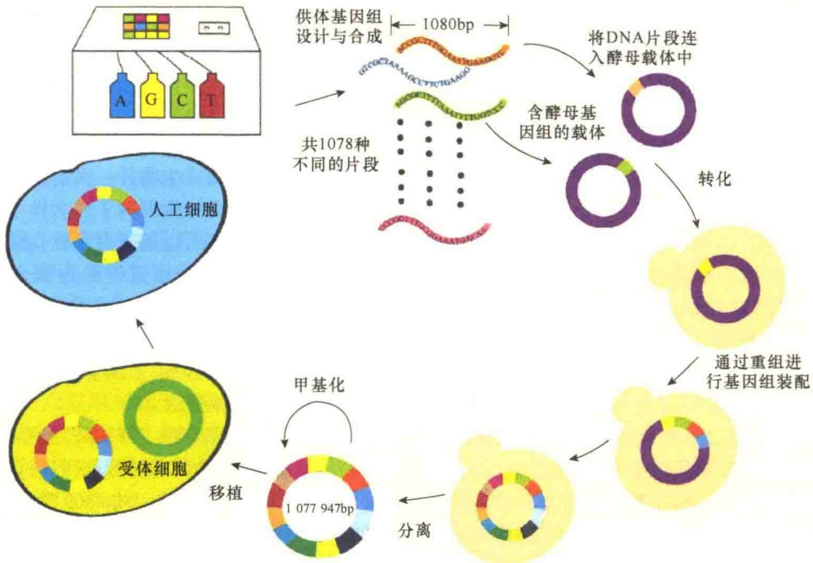

图1-29 “Synthia”的诞生过程（引自孙明伟等，2010）。

## 1.7.1.1 合成供体的基因组 DNA

首先，研究者选取基因数据库中的两种丝状支原体基因组序列，一种用于合成设计，另一种用于对照。将蕈状支原体的全基因组测序后，按照该序列信息用生化方法将其合成平均长度为1080bp的DNA片段，共计1078段。每相邻两个片段间具有80bp的部分重叠，以便于拼接和防止出错。将所有片段拼接起来，构成蕈状支原体的全长基因组。值得注意的是，这些合成的片段较天然基因组略有一些改动，但不会影响细胞的正常生命活动，包括去除了14个不重要的基因、27处单核苷酸多态性（其中 19 处在实验前被发现），为阻断基因而设计的两个插入序列，4 条用来区分于天然序列的“水印”标记（watermark）。

## 1.7.1.2 合成 DNA 片段的拼接与重组体筛选

这一过程最为重要，也最为复杂，策略上分为三个阶段。

（1）将以上合成的 1078 种 DNA 片段分别与载体 DNA 连接，并转化到酵母细胞中，其在酵母细胞中通过同源重组使这 1078 条 DNA 片段以 10 个为一组拼接为 109 个约 10kb 的片段。

（2）将这些连接有目的基因片段的载体从酵母

---

1 细胞的发现与细胞学说

25

中分离出来，转入 E. coli 中进行扩增，以限制酶筛选出阳性克隆。

（3）再将阳性克隆中的109条约 $10\mathrm{kb}$ 的片段按同样的方法每10个为一组拼接成11个约 $100\mathrm{kb}$ 的片段。

运用碱裂解的方法从酵母中分离微克数量级的以上11条DNA片段，并用外切核酸酶和阴离子交换柱纯化。上述方法无法完全去除线状的酵母染色体，于是将200ng的11个上述片段混合于融化琼脂糖（molten agarose）中，随着琼脂糖的凝固，环状DNA被困在凝胶中，而线性DNA则用电泳分离法除去。最终11条约100kb的片段运用以上方法拼接成共1077947bp的完整基因组。

由于携带太大片段的载体在大肠杆菌中不能稳定传代，因此采用多重 PCR 来筛选阳性克隆。此过程有两个衔接反应必须在体外用酶处理，其他合成步骤都可以在酵母细胞内依靠同源重组来完成。

值得注意的是，在此过程中还需对所合成的片段进行纠错，即将其中任意一个合成的基因片段连接到缺失了相应片段的天然基因组上，然后再移植到受体细胞内，如果这种混合的基因组能发挥作用，则证明是对的，反之为错，这项工作的工作量之大是不言而喻的。为了筛选方便，研究人员在合成的基因组上添加了一个抗四环素基因和编码乳糖酶的基因，使其能在含有四环素的培养基上生长，同时还能分解培养基中的特定成分，使菌落呈蓝色，而由天然基因组控制的山羊支原体则不能。

## 1.7.1.3 人工基因组的甲基化修饰

支原体都有一套限制-修饰系统。限制，即用自身合成的限制性内切核酸酶将外来的 DNA 在特

定位点进行降解，这是防御外源DNA的入侵；修饰，即用自身合成的甲基化酶将限制的位点通过甲基化修饰而被保护起来。在此项研究中，由于供体细胞（蕈状支原体）和受体细胞（山羊支原体）共用同一套限制-修饰酶系统，而天然的供体基因组是经甲基化修饰的。因此，拼接完成的基因组DNA在被引入受体细胞之前，需在体外用从蕈状支原体或山羊支原体提取物中纯化的甲基化酶进行甲基化修饰，以避免受体细胞限制酶系统对转入的 DNA 进行降解。

## 1.7.1.4 人工基因组移植入受体细胞

将构建好的、经甲基化修饰的人工合成基因组移植入山羊支原体内。细胞经过不断分裂传代，具有人造基因组的细胞在含抗生素的培养基中筛选出来，同时含有天然 DNA 的细胞逐渐消失殆尽。

最终只剩下含有山羊支原体细胞质但由合成DNA控制的人工嵌合体细胞。虽然蕈状支原体和山羊支原体在基因组上75%是同源的，但该人造细胞明显表现出蕈状支原体的生长特性。最后，还必须经过测序，通过测定水印是否存在，才能“验明正身”。

## 1.7.2 简约化的单条、两条染色体酵母诞生

2018年8月2日，Nature杂志在线发表了两篇简约化酵母染色体的论文，标志“合成生命”的研究取得重要突破。

中国科学院分子植物科学卓越创新中心/植物生理生态研究所合成生物学重点实验室覃重军研究团队与合作者对含有16条染色体（大小区间为230～1532kb）的酿酒酵母进行研究，通过CRISPR-Cas9高效敲除待融合染色体多余的着丝粒和端粒，并利用酿酒酵母的同源重组机制来实现染色体的层级融合，获得了只包含1条染色体的酵母细胞（图1-30）。意外的是，尽管染色体数目发生巨大改变，单染色体和野生型酵母细胞具有几乎相同的转录组和相似的表型组；在酵母体内，只有少数基因表达发生变化。后续在不同培养条件下，染色体数目减少的酵母可支持细胞生命，并没有表现

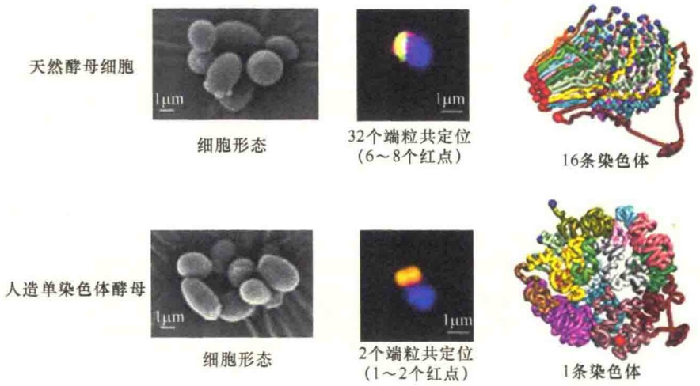

图1-30 简约的1条染色体与16条染色体酵母的比较（引自Shao et al., 2018）。

---

26

细胞生物学（第二版）

出严重的生长缺陷。该研究结果全文被 Nature 杂志在线发表，第一通讯作者是覃重军研究员。

纽约大学系统遗传学研究所（ISG）研究人员采用相似的染色体融合技术，尝试不同策略后获得了含有2条染色体的酵母细胞（图1-31）。该研究结果的研究通讯与中国学者的论文同时在Nature杂志上在线发表。

染色体携带了生命体生长与繁殖的遗传信息，真核生物通常含有线形结构的多条染色体，比如人类有23对染色体，而原核生物通常含有环形结构的一条染色体。对此，覃重军研究员大胆假设真核生物也能像原核生物一样，用一条线形甚至是一条环形的染色体装载所有遗传物质并完成正常的细胞功能。在“大胆猜想”之后，研究团队经过精准设计，制定了人造酵母染色体的指导原则、理性分析与详细实验设计、工程化高效推进的总体方案，历经4年的研究，通过15轮染色体融合，最后成功将天然酿酒酵母单倍体细胞的16条染色体融合为1条，染色体“16合1”后的酿酒酵母菌株被命名为SY14。

如此大幅度地改动酿酒酵母的染色体结构，是否会对它的三维结构产生影响呢？答案是肯定的。研究发现 SY14 的染色体三维结构也发生了巨大变化，野生的酿酒酵母细胞的染色体 “整齐有序”，像一朵含苞待放的花苞，而 SY14 则 “杂乱无序”，更接近球形结构。但是如此巨大的改变，几乎不影响 SY14 的基因表达和细胞功能，从而颠覆了染色体三维结构决定基因时空表达的传统观念。

简约染色体酵母的研究成果对探索真核生物染色体结构和功能有重要的作用与意义。

前面已经讨论过自然界存在的生命体可分为具有被核膜包裹染色体细胞核的真核生物和染色体裸露无核膜包裹的原核生物，真核生物通常含有多条线性结构的染色体，而原核生物通常含有一条环状结构的染色体。而SY14这种单条染色体真核细胞的“诞生”，突破了人们对于真核生物和原核生物界限的传统认知。

细胞衰老是生物在生命过程中整个机体形态、结构和功能逐渐衰退的综合现象。生物的机体由细胞构成，生命的衰老起始于细胞的老化，而细胞的老化又与端粒有着密不可分的关系。

端粒是重复序列和与之相连的端粒结合蛋白

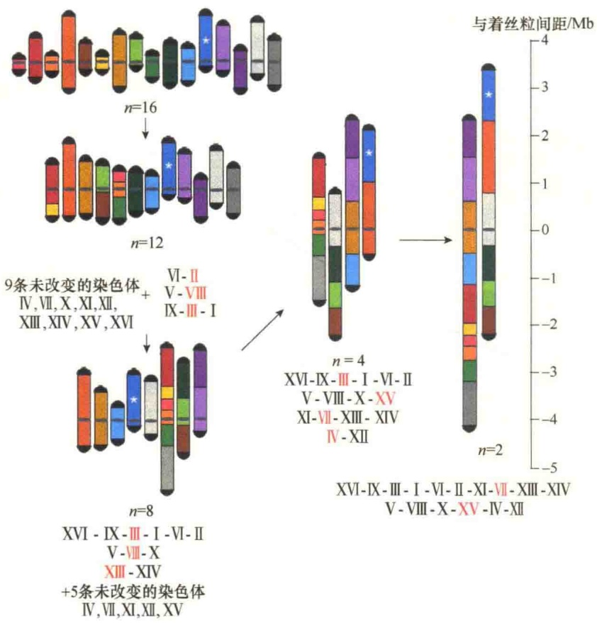

图1-31 简约的2条染色体的策略（引自Luo et al., 2018）。

构成的功能性复合体。端粒的主要作用是保护染色体末端免于融合和退化，在染色体定位、复制、保护和控制细胞生长及寿命方面具有重要作用，并与细胞凋亡、细胞转化和永生化密切相关。当细胞分裂一次，每条染色体的端粒就会逐次变短一些。

人类的过早衰老与染色体的端粒长度直接相关，端粒的缩短还与许多疾病相关。与天然酵母的32个端粒相比，SY14酵母的单条线性染色体仅有2个端粒。由于酿酒酵母1/3基因与人类基因同源，单染色体酵母细胞为研究人类端粒功能及细胞衰老提供了很好的模型，并且对于人类疾病的防治具有重要意义。

覃重军认为，单体染色体工程酵母菌尚不完美，融合后的染色体菌株表现出一些适应性限制和有性生殖缺陷，这些发现或有助于解释拥有较多染

---

1 细胞的发现与细胞学说

27

色体的优势。

## 1.7.3 合成生物学与生物安全

文特尔的“创建由化学合成基因组控制的细菌细胞”，实际上是利用合成生物学的手段改造生命，是对天然细胞生命的一次挑战。简约染色体的酵母细胞的诞生为生命科学另辟了一条蹊径，是利用合成生物学改造生命的又一个里程碑。

合成生物学（synthetic biology）一词最早出现于1911年的The Lancet杂志，许多学者认为合成生物学真正成为一门学科始于2000年。合成生物学是在现代生物学和系统科学基础上发展起来的、融入工程学思想的多学科交叉研究领域。它是一门涉及生物化学、物理化学、分子生物学、系统生物学、生物信息学、基因工程、工程学及计算科学等多个领域的新兴综合性交叉学科。因此，合成生物学是一个综合了科学与工程的新兴研究领域，在生物、医药、农业、能源及环保等方面具有巨大的应用潜力。它囊括了与人类自身和社会发展相关的研究方向及内容，为解答生命科学难题和人类可持续发展所面临的重大挑战提供了新的思路、策略和手段。合成生物学旨在应用工程学的研究思路及手段去设计改造基因、生物元件、生物途径，甚至整个基因组，以可预测和可靠的方式得到新的细胞。

科学是把“双刃剑”，虽然合成生物学有朝一日能直接制造出世界上不存在的生命个体，但是如同20世纪70年代的DNA重组技术、绵羊体细胞克隆技术一样，其所涉及的生物伦理和生物安全等备受关注的问题使得一些学者望而却步。其实科学家在探索科学、创造科学的同时，就义不容辞地肩负两种责任，一是科学责任，另一就是社会责任。因此，科学家在探索一项新的科学、创建一项新的技术时，必须面对社会问题，包括生物安全与生物伦理。

生物安全的风险主要有:逃逸与环境风险；污染自然基因库风险。

逃逸与环境风险是指利用合成生物学制造的具有新的遗传特性的生物可能会被误用，让一些具有致病感染性的病菌威胁人类和其他生物的安全；或者在实验室中制造出未经自然选择而产生的物种，而这些生物的某些特性很可能影响到生态环境，破坏生态平衡。另外，一些合成有机物可能有潜在的危险，但现时又难以进行有效的风险评估，若在这种情况下应用到环境中，难免引起人们的担心，就像转基因产品引起的担忧一样。

污染自然基因库风险是指合成有机物可能将其基因转移到自然有机体内。自然界中不同生物间基因的相互水平转移时有发生，但这些基因原本在自然界就已存在，危害可能有限。然而合成微生物释放到环境中，若发生基因的水平转移，则可能成为“基因黑客”，使天然自然物改变其原有的属性或者是发生演变，产生一些异常功能，影响生态平衡。

我们必须清醒地认识到，合成生物学的产生和快速发展不仅是对生命系统认知和深刻探索的必然结果，也是学科交叉研究与发展的必然结果。合成生物学成为当代科学技术革命的新阶段，将对人类社会产生深远的影响。一个理性的认识是:既不盲目乐观，也不因噎废食，最大化地发挥科学家的智慧，控制风险，确保生物安全。

## 本章小结

细胞是生物体结构和功能的基本单位，也是生命活动的基本单位。1665年胡克首先发现了细胞。170年后，施莱登和施万创立了细胞学说，从而解决了生命的同一性和共同起源。细胞生物学发展经历了四个阶段。

细胞分为原核细胞和真核细胞两大类，真核细胞主要有植物细胞和动物细胞两种类型。真核细胞有三大结构体系:生物膜体系、遗传信息表达体系、细胞骨架体系。病毒是非细胞的生命体。

细胞都具有膜屏障、遗传物质和核糖体，都能进行自我增殖。组成细胞的化合物有水、无机盐、小分子有机物，以及核酸、蛋白质、多糖、脂类等生物大分子。细胞是物质的，生命是物质的特殊运动形式。

病毒是非细胞的生命体。病毒的结构简单，主要由蛋白质外壳和遗传物质的核所组成，分为 DNA 病毒与 RNA 病毒。病毒不能独立生存，只能在活细胞中进行增殖。病毒的增殖周期包括吸附、侵入、复制、成熟与释放 5 个基本过程。

细胞生命的起源分为 5 个阶段:①地球和原始大气层的形成；②有机分子的自然形成；③分子聚合体的形成；④生命初级聚合体的形成；⑤原始细胞的形成。

---

28

## 细胞生物学（第二版）

被生物学家选定的用于科学研究，并根据研究结果揭示某种具有普遍规律的生命现象的生物物种称为模式生物。常见的模式生物有酵母、线虫、果蝇、斑马鱼、小鼠及拟南芥等。

美国科学家克雷格·文特尔及其领导的科研小组通过合成生物学的手段创建了“由化学合成基因组控制的细菌细胞”，这一成果发表在2010年5月20日出版的Science杂志上，这是地球上第一个由人类制造并能够自我复制的新物种，但也引起了生物安全与生物伦理等方面的关注。

2018 年 8 月，Nature 杂志在线发表了中国科学家覃重军、美国科学家杰夫·博伊克利用合成生物学获得简约染色体的酵母工程菌，这一研究成果是合成生物学领域里新的里程碑。

## 思考题

（1）如何理解恩格斯将细胞学说与进化论和能量守恒定律并列称为19世纪自然科学的三大发现？

(2) Friedrich Miescher (1844\~1895)、Gregor Mendel (1822\~1884)、Louis Pasteur (1822\~1894) 和 Rudolf Virchow (1821\~1902) 是四位分别来自瑞士、奥地利、法国和德国的科学家，他们都在 1855\~1875 年的 20 年间做出了杰出的贡献。假定这四位科学家在 1875 年的一次科学会议中相聚，并相互交流了各自在生物学方面的新发现。

① 这四位科学家发现他们研究工作的共同点是什么？

② 你认为 Pasteur 会对 Virchow 的什么工作最感兴趣，并说明原因。

③ 你认为 Virchow 会对 Mendel 的什么工作最感兴趣，并说明原因。

④ 你对哪位科学家的研究最感兴趣，为什么？

（3）比较动物细胞和植物细胞的主要差异。

(4) 如何理解细胞生命的同一性、物质性、组织性、多样性及社会性?

(5) 美国科学家文特尔用合成生物学获得了“创建由化学合成基因组控制的细菌细胞”，这一创新性的结果具有哪些重要意义？