# 细胞环境与互作

4.1 细胞外基质

4.1.1 细胞外基质的组成与功能

4.1.2 细胞外基质中的“填充物”——蛋白聚糖

4.1.3 胶原和弹性蛋白

4.1.4 细胞外基质中的黏着蛋白

4.1.5 细胞外基质与细胞的相互关系

4.2 细胞识别与细胞黏附

4.2.1 细胞识别及细胞拣出

4.2.2 细胞黏附的机制

4.3 细胞连接

4.3.1 细胞连接的概念和类型

4.3.2 紧密连接

4.3.3 锚定连接

4.3.4 通讯连接

4.4 植物的细胞外结构:细胞壁

4.4.1 植物细胞壁的结构

4.4.2 细胞壁的化学组成

4.4.3 微管在纤维素微纤维装配中的作用

多细胞的生命有机体中的细胞组成不同的组织，恰似一个社会，在这些组织中，细胞与细胞之间、细胞与细胞外环境之间维持着良好的关系。即使是那些与组织没有固定关系的细胞，如在机体内负责巡逻任务的白细胞，也必须以高度特异的方式与其他细胞及这些细胞的细胞外基质相互作用。细胞与细胞之间及细胞与细胞外环境间的相互作用调节着细胞的迁移、生长及组织的三维结构。因此，研究和了解细胞与细胞之间、细胞与细胞外基质之间的关系和相互作用，对于认识生命现象的本质是十分重要的。

细胞通过表面发生的作用有细胞识别、细胞黏附、细胞连接、细胞通讯等。由于细胞通讯的内容较多，将在第5章单独讨论，本章主要讨论细胞外基质、细胞识别、细胞黏附和细胞连接等。

## 4.1 细胞外基质

动物是由多种类型的细胞组成的有机体，而且不同类型的细胞通常要组成固定的组织。细胞组织也不仅仅只是由细胞构成，它也包含由蛋白质及多糖等大分子组成的复杂的、连成网状的复合物，即细胞外基质（extracellular matrix，ECM）（图4-1B）。在不同动物组织中，其细胞外基质中的大分子是极为相似的，但在数量上又各不相同。细胞外基质的成分是细胞分泌到细胞外的“填充料”，它们有一定的组织性，不仅能保护细胞，而且有一些重要的生物学功能。

## 4.1.1 细胞外基质的组成与功能

细胞外基质是由细胞合成并分泌到胞外、分布在细胞表面或细胞之间的大分子，主要是一些多糖、

---

4 细胞环境与互作

103

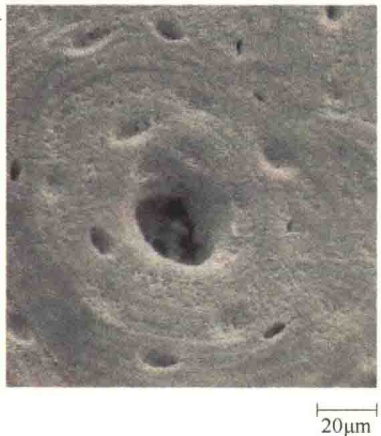

软骨细胞

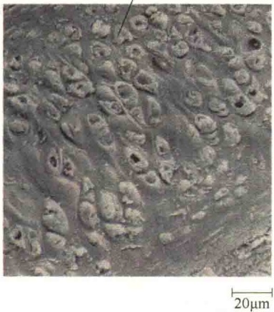

成纤维细胞

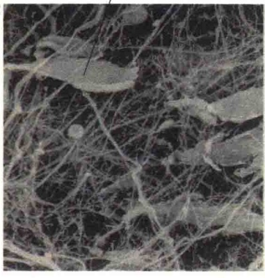

图 4-1 不同类型的细胞外基质（引自 Jeff et al., 2012）。A. 在骨组织中，坚硬钙化的 ECM 位于中央环，中央椭圆的凹陷区是骨细胞。B. 在软骨组织中，细胞被埋在弹性的、含有大量蛋白聚糖的基质中。C. 在皮下结缔组织中，成纤维细胞被含有大量胶原的细胞外基质所包围。

蛋白质或蛋白聚糖。细胞外基质对于一些动物组织的细胞具有重要作用。

## 4.1.1.1 细胞外基质的组成

细胞外基质的组成成分可分为三大类。①蛋白聚糖（proteoglycan，PG），是由糖胺聚糖（glycosaminoglycan，GAG）以共价的形式与线性多肽连接而成的多糖和蛋白质复合物，它们能够形成水性的胶状物，增强细胞的抗压能力。②结构蛋白，主要是胶原和弹性蛋白，它们赋予细胞外基质一定的强度和韧性。胶原蛋白对组织提供结构支持，

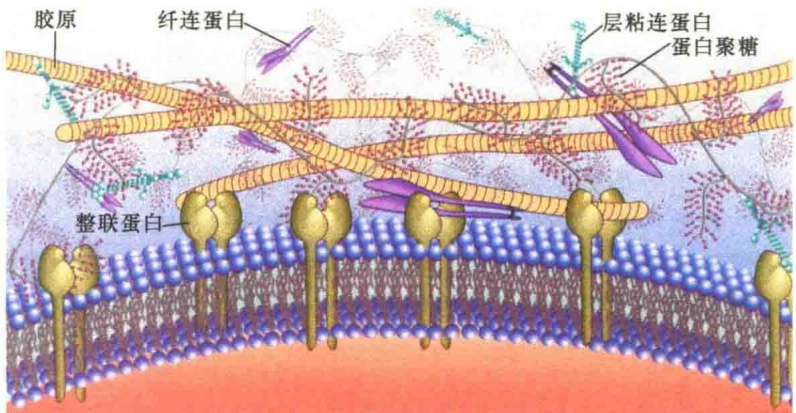

图 4-2 细胞外基质大分子组织结构（引自 Karp，2010）

弹性蛋白则赋予组织弹性。③黏着蛋白（adhesion protein），如纤连蛋白和层粘连蛋白，它们起组织者的作用。其中以胶原和蛋白聚糖为基本骨架在细胞表面形成纤维网状复合物，这种复合物通过纤连蛋白或层粘连蛋白及其他的连接分子直接与细胞表面受体连接，或附着到受体上。由于受体多数是膜整合蛋白，并与细胞内的骨架蛋白相连，所以细胞外基质通过膜整合蛋白将细胞外与细胞内连成了一个整体（图4-2）。

植物细胞没有细胞外基质，但有坚硬的细胞壁。从细胞壁的组成看，与动物细胞的细胞外基质有某些相似之处:有类似胶原作用的纤维素，还有很多半纤维素与伸展蛋白，此外还有起黏附作用的果胶。表 4-1 是动物细胞外基质与植物细胞壁结构与组成的比较。

能够分泌和形成细胞外基质的主要细胞类群是成纤维细胞 (fibroblast) 和少数其他特化组织的细胞。

表 4-1 动物细胞外基质与植物细胞壁的主要组成

| 细胞类型 | 细胞外结构 | 结构纤维 | 水合基质成分 | 黏附分子 |
| --- | --- | --- | --- | --- |
| 动物细胞 | 细胞外基质 | 胶原、弹性蛋白 | 蛋白聚糖 | 纤连蛋白、层粘连蛋白 |
| 植物细胞 | 细胞壁 | 纤维素 | 半纤维素、伸展蛋白 | 果胶 |

## 4.1.1.2 细胞外基质的功能

细胞外基质对细胞具有支撑与保护作用，具有很好的抗压能力，赋予组织弹性。在某些组织中，细胞外基质可组织成纤维状、片层状的基膜，可直接与细胞层相连，不仅具有支撑及过滤作用，也防止细胞的恶性转移。

细胞外基质是由惰性材料组成的细胞外结构，它对细胞的形态和活性具有重要作用。例如，用酶将培养的软骨细胞或哺乳动物胰腺表皮细胞的细胞外基质水解掉，细胞的合成和分泌活动就会显著下

---

104

细胞生物学（第二版）

降，此时将细胞外基质材料再添加到处理的培养器皿中，可使细胞恢复活力并分泌产物。

另外，细胞外基质能够帮助某些细胞完成特有的功能。例如，肝细胞（hepatocyte）作为肝组织的主要细胞，必须与基膜或其他的细胞外基质接触才能合成细胞型（cell-type）的蛋白质。将肝细胞分离并放在塑料培养皿中培养，即使加有某种胶原纤维，它们也会停止翻译肝组织特异蛋白（如白蛋白）的mRNA。如果在培养细胞的培养液中添加合适的细胞外基质的成分，mRNA的合成和翻译就会恢复。

细胞外基质除了决定器官和组织的形态及保护作用外，还具有其他一些重要功能。例如，细胞外基质同一些生长因子和激素结合进行信号转导；某些特殊的细胞外基质也是细胞分化所必需的；胚胎发育的最后阶段——形态发生（morphogenesis）也需要某些细胞外基质的成分。

## 4.1.2 细胞外基质中的“填充物”——蛋白聚糖

细胞外基质的物理性质主要受细胞外基质中蛋白聚糖所携带的多糖基团的影响。蛋白聚糖是由糖胺聚糖以共价的形式与线性多肽连接而成的多糖和蛋白质复合物，它能够结合大量的水，形成水合物，填充在细胞外基质中，提高了细胞的抗压能力。

## 4.1.2.1 蛋白聚糖的组织形式

1）糖胺聚糖与蛋白聚糖 糖胺聚糖（GAG）

是由重复二糖单位（图 4-3B）构成的无分支长链多糖。构成糖胺聚糖的二糖单位，包括硫酸软骨素（chondroitin sulfate）、硫酸角质素（keratin sulfate）、肝素（heparin）、硫酸乙酰肝素（heparan sulfate）、透明质酸、硫酸皮肤素（dermatan sulfate）等。这些二糖都含有一个氨基糖，并至少含有一个带负电的磺酸基或羧基团。

大多数糖胺聚糖都是与核心蛋白共价结合形成糖和蛋白质的复合物，称为蛋白聚糖（PG）（图4-3A）。每个蛋白聚糖都含有多个糖胺聚糖，其多糖的含量占蛋白聚糖质量的95%。蛋白聚糖又称黏蛋白，是由糖胺聚糖与核心蛋白（core protein）的丝氨酸残基共价连接形成的巨型分子。由于核心蛋白和糖胺聚糖的不同，因而可形成不同的蛋白聚糖。目前已经鉴定了40多种不同蛋白聚糖的核心蛋白，每种核心蛋白都含有模块化结构的结构域（modular structural domain），能够与细胞外基质中的其他成分，如糖、脂、结构蛋白、整联蛋白受体及各种不同的蛋白聚糖结合。将核心蛋白同时与多种糖胺聚糖结合形成的复合物称为聚集蛋白聚糖（aggrecan）。

2）透明质酸与聚集蛋白聚糖聚集体 透明质酸（hyaluronan；hyaluronic acid，HA）是最简单的糖胺聚糖。细胞外基质中发现的大多数糖胺聚糖都是作为蛋白聚糖的一个成分而存在，唯一例外的是透明质酸，它不与蛋白聚糖的核心蛋白共价连接，而是与细胞外基质中的聚集蛋白聚糖形成巨大的复合物。在软骨组织中发现，由软骨细胞分泌的透明质酸分子形成一个长轴（约

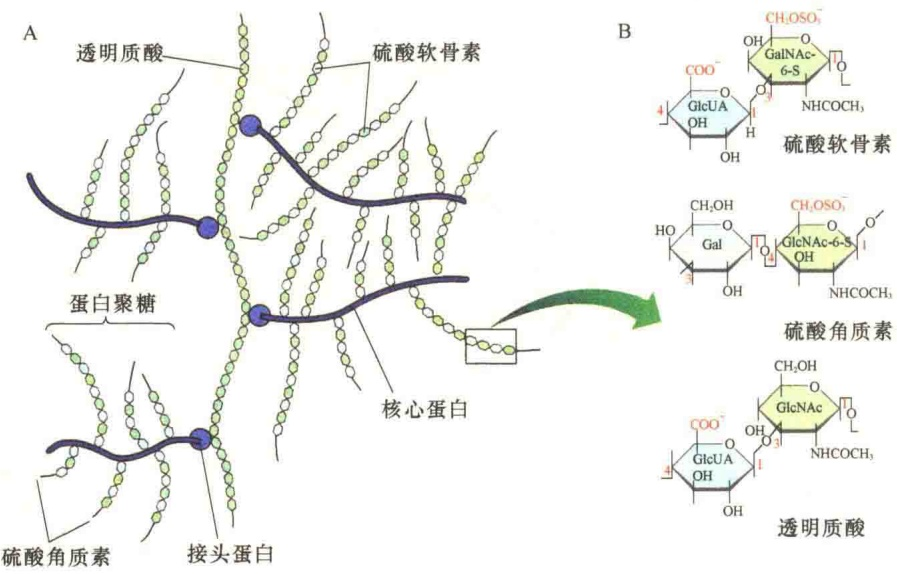

图 4-3 蛋白聚糖与糖胺聚糖的结构（引自 Becker et al., 2003）。A. 蛋白聚糖的结构；B. 糖胺聚糖中常见的重复二糖单位。

---

4 细胞环境与互作

105

4mm)，通过接头蛋白（linker protein）可与100多个聚集蛋白聚糖复合物结合，形成更大、更复杂的聚集蛋白聚糖聚集体（aggrecan aggregate）（图4-4）。透明质酸以这种方式在软骨的细胞外基质中创造了一个大的水合环境，而这种环境在低密度血管的组织中特别重要，因为这种环境有利于营养的扩散及废物的排除。

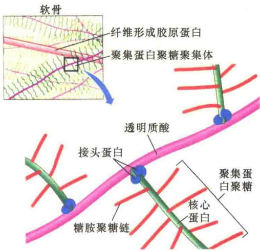

图 4-4 软骨中的蛋白聚糖存在方式（引自 Plopper, 2016）。糖胺聚糖与核心蛋白结合形成蛋白聚糖，多个蛋白聚糖与核心蛋白结合形成聚集蛋白聚糖。多个聚集蛋白聚糖通过接头蛋白与聚合的透明质酸糖连接形成聚集蛋白聚糖聚集体。聚集蛋白聚糖聚集体与纤维形成胶原蛋白一起吸水形成水合网络，起抗压与润滑作用。

透明质酸的结构相当简单，如同其他的糖胺聚糖一样，是由二糖组成的线性聚合物。透明质酸分子平均含有10 000个（可高达50 000）二糖分子，分子间通过β（1，4）键连接。因为二糖都是带负电的，所以它们能够与阳离子及水结合。

## 4.1.2.2 蛋白聚糖的功能

蛋白聚糖或透明质酸-聚集蛋白聚糖聚集体构成了细胞外基质的基础，由于它们是高度酸性的，且带负电荷，因此能够结合大量的阳离子，这些阳离子又可结合大量的水分子，这样，蛋白聚糖形成了多孔的、吸水的胶状物，如同包装材料，填充在细胞外基质中。蛋白聚糖的这种性质，使细胞表面具有较大的可塑性，从而具有抗挤压能力，对细胞起保护作用。

由于透明质酸以可溶的形式游离存在，所以在细胞外体液和滑液（synovial fluid）中透明质酸的浓度很高，其结果是提高了体液和滑液的黏度及润滑性。

单个的蛋白聚糖或聚集蛋白聚糖聚集体直接与胶原纤维连接形成动物细胞外的纤维网络（fiber network）结构（图 4-5）。不同类型的胶原纤维与不同类型的蛋白聚糖连接形成不同的纤维网络，对于提高细胞外基质的连贯性起关键作用。

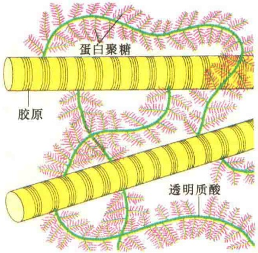

图 4-5 聚集蛋白聚糖聚集体与胶原纤维连接在细胞外基质中形成纤维网络（引自 Wolfe，1993）。

此外，蛋白聚糖还可作为细胞黏附的暂时性或永久性的位点。暂时性的黏附发生在胚胎发育中，对于单个细胞及细胞层的移动具有重要作用。另外，蛋白聚糖对于细胞分化也十分重要，同时也与细胞癌变有关。

不同组织的细胞外基质中蛋白聚糖的分布不同，分子质量也不尽相同（表 4-2）。

表 4-2 蛋白聚糖及分布

<table><tr><td>类型</td><td>核心蛋白相对分子质量</td><td>分布</td></tr><tr><td rowspan="3">硫酸软骨素</td><td>200 00~300 000(软骨中)</td><td rowspan="3">软骨、骨、皮肤、基膜中少量</td></tr><tr><td>45 000(骨中)</td></tr><tr><td>45 000和500 000(皮肤中)</td></tr><tr><td>硫酸角质素</td><td>45 000</td><td>骨、角膜</td></tr><tr><td>硫酸皮肤素</td><td>40 000~50 000</td><td>腱、原纤维结缔组织、皮肤和角膜中少量</td></tr><tr><td>硫酸乙酰肝素</td><td>30 000~200 000</td><td>基膜、角膜、神经组织</td></tr><tr><td>聚集蛋白聚糖</td><td>100 000~1000 000</td><td rowspan="2">软骨、骨(少量)、腱、主动脉平滑肌</td></tr><tr><td>聚集体</td><td></td></tr></table>

## 4.1.3 胶原和弹性蛋白

胶原（collagen）是细胞外基质中最重要的水不溶性纤维蛋白，是构成细胞外基质的结构蛋白，给细胞提供抗张力能力。弹性蛋白（elastin）是弹性纤维的主要成分，弹性纤维主要存在于韧带和脉管壁，赋予组织以弹性。

---

106

细胞生物学（第二版）

## 4.1.3.1 胶原的类型

胶原是多细胞生物中最为丰富的蛋白质，至少在500万年前就已经进化而成。胶原家族至少有29种不同类型的蛋白质，几乎所有的动物细胞都能合成并分泌至少一种胶原蛋白。不同类型的胶原有不同的化学机构和不同的免疫性能，是不同基因的表达产物。表4-3是目前已鉴定的部分胶原的类型、分布及突变表型。

表 4-3 胶原的类型、分布及突变表型

<table><tr><td>存在方式</td><td>类型</td><td>聚合形式</td><td>组织分布</td><td>突变表型</td></tr><tr><td rowspan="3">纤维形成(纤维状)</td><td>I</td><td>纤维</td><td>骨,皮肤,韧带,角膜,内部器官(占身体胶原的96%)</td><td>严重骨缺陷,骨折(成骨不全)</td></tr><tr><td>II</td><td>纤维</td><td>软骨,椎间盘,脊索,眼玻璃体</td><td>软骨缺陷,侏儒(软骨发育不良)</td></tr><tr><td>III</td><td>纤维</td><td>皮肤,血管,内部器官</td><td>脆性皮肤,疏松关节血管易于破裂(皮肤弹性过度综合征)</td></tr><tr><td rowspan="2">纤维形成(纤维状)</td><td>V</td><td>纤维(I型协同)</td><td>同I型</td><td>脆性皮肤,疏松关节血管易于破裂</td></tr><tr><td>XI</td><td>纤维(II型协同)</td><td>同II型</td><td>近视,失明</td></tr><tr><td>纤维结合</td><td>IX</td><td>与II型纤维侧向连接</td><td>软骨</td><td>骨性关节炎</td></tr><tr><td rowspan="2">网络形成</td><td>IV</td><td>片层网络</td><td>基膜</td><td>肾病(肾小球炎)</td></tr><tr><td>VII</td><td>锚定纤维</td><td>扁平层状上皮下方</td><td>皮肤起泡</td></tr><tr><td>穿膜</td><td>XVII</td><td>非纤维</td><td>半桥粒</td><td>皮肤起泡</td></tr><tr><td>蛋白聚糖核心蛋白</td><td>XVIII</td><td>非纤维</td><td>基膜</td><td>近视,脱落视网膜,脑积水</td></tr></table>

从表 4-3 可以看出，不同胶原卷曲螺旋可以形成各种不同的形态。根据它们组成的不同结构，胶原可分成五大类。

第一类:纤维形成胶原（fiber forming collagen），包括Ⅰ、Ⅱ、Ⅲ、V及XI型胶原，它们组装成束，为细胞提供刚性。

第二类:纤维结合胶原（fibril associated collagen），如IX型胶原，它们本身不形成纤维，但常与胶原纤维结合形成网。

第三类:网络形成胶原（network forming collagen），包括Ⅳ和Ⅶ型胶原。此类胶原虽然刚性较弱，但能够形成网，可为细胞提供全方位的支撑，如皮肤下的基膜。

以上三类胶原是大多数动物细胞中最主要的胶原。

第四类:穿膜胶原（transmembrane collagen），如XVII型胶原，参与半桥粒连接。

第五类:蛋白聚糖核心蛋白（proteoglycan core protein），如XVIII，参与基膜的组装。

VI型胶原也是细胞内极为丰富的一种胶原蛋白，几乎存在于所有类型的细胞，它具有很强的伸缩性，在电子显微镜下观察，VI型胶原呈现念珠（beads on a string）结构，故称为珠状纤维胶原（beaded filament collagen）。

图 4-6 显示的是几种类型的胶原在细胞内的组装形式及存在状态。

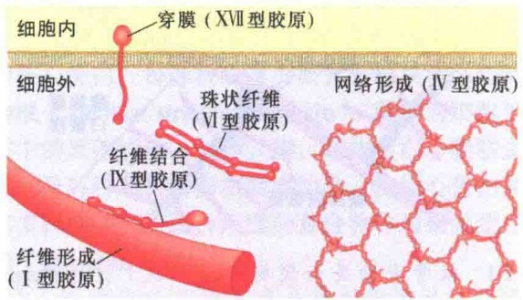

图 4-6 胶原亚基组装成不同的结构形式（引自 Plopper，2016）。图中特别显示了 I 型胶原组装成三股螺旋的纤维，其上结合有 IX 型胶原。IV 型胶原则组装成片层的网，参与基膜的组成。XVII 型胶原是穿膜蛋白，参与半桥粒连接。

## 4.1.3.2 胶原的结构、合成、装配与分泌

1）胶原的结构 胶原蛋白的基本结构单位是原胶原（tropocollagen），原胶原肽链的一级结构具有（Gly-X-Y）三肽重复单位，其中X和Y可以是任何一种氨基酸，但常为脯氨酸和羟脯氨酸。甘氨酸是三肽重复单位的必需成分，它的侧链很小，只有甘氨酸的氢原子能够位于三股螺旋的中央。这种三氨基酸重复序列能够使三条亚基紧紧包在一起，并促进形成长300nm、直径1.5nm的卷曲螺旋胶原。以300nm长的卷曲螺旋胶原为单位，通过相互间的N端与C端进行共价连接，形成胶原原纤维（collagen fibril）。胶原原纤维可进一步装配成胶原纤维（collagen fiber）（图4-7）。

不同类型的胶原，其三股螺旋的亚基组成是不同的，如纤维形成胶原的三股螺旋亚基组成是 $[\alpha1(\mathrm{I})]_{2}\alpha2(\mathrm{I})$ ；纤维结合胶原的三股螺旋亚基组成是 $\alpha1(\mathrm{IX})\alpha2(\mathrm{IX})\alpha3(\mathrm{IX})$ ；网络形成胶原的三股螺旋亚基组成是 $[\alpha1(\mathrm{IV})]_{2}\alpha2(\mathrm{IV})$ ；穿膜胶原的三股螺旋亚基组成是 $[\alpha1(\mathrm{XVII})]_{3}$ 。

---

4 细胞环境与互作

107

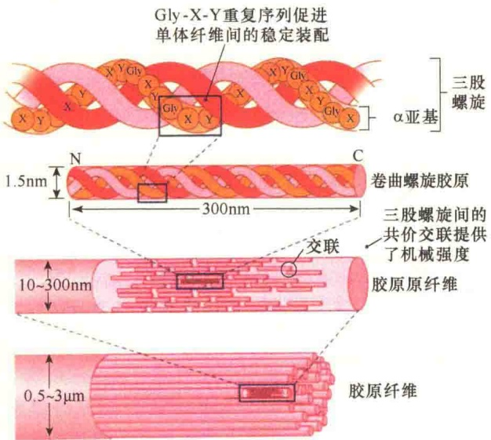

图 4-7 胶原纤维的结构（引自 Plopper，2016）。图的最下方是电镜下观察的胶原纤维。上方的四个部分是胶原纤维结构的分解图。动物组织中的胶原纤维（collagen fiber）是由胶原原纤维（collagen fibril）组成的，胶原纤维的直径为  $0.5 \sim 3 \mu m$ ，而胶原原纤维的直径为  $10 \sim 300 nm$ 。胶原原纤维是由原胶原（tropocollagen），即图中显示的卷曲螺旋胶原（collagen coiled coil）交联而成。每一个原胶原由三条螺旋卷曲而成，长为 300 nm，直径为 1.5 nm。

2）胶原的合成、装配与分泌 胶原蛋白是在膜附着核糖体上起始合成的，然后进入内质网，通过内质网和高尔基体的加工修饰及装配，最后分泌到细胞外基质中（图4-8）。

首先，编码胶原蛋白的 mRNA 在糙面内质网的核糖体上翻译出 N 端信号肽，即前肽（propeptide），在信号肽识别颗粒的引导下，信号肽引导胶原蛋白进入内质网，在内质网分子伴侣的帮助下进行正确折叠。然后进行脯氨酸、赖氨酸残基的羟基化修饰，形成羟脯氨酸及羟赖氨酸。这种羟基化修饰，保证了三螺旋亚基间适当形成氢键，有利于将三个亚基以卷曲螺旋拢到一起，同时进行 N- 连接的糖基化修饰。接下来是进行自我装配，并在三个前肽的氨基端与羧基端分别形成二硫键，而二硫键的形成促使三个前胶原的亚基正确形成三螺旋的卷曲螺旋。内质网形成管状的分泌泡将前胶原分泌出内质网，分泌泡再通过与顺面高尔基体融合，使前胶原运输到高尔基体。前胶原在高尔基体中进行 N- 连接、O- 连接糖基化糖的进一步修饰。在高尔基体中，前胶原两端的前肽在水解酶的作用下被切除，形成 300nm 的原胶原并被分泌到细胞外。在细胞外，原胶原通过 N 端与 C端的赖氨酸交联（图 4-9）进一步装配成胶原原纤维，进而装配成胶原纤维。

由原胶原装配成胶原原纤维的过程可简要概括为:原胶原中的赖氨酸侧链被赖氨酰氧化酶修饰，形成  $\varepsilon$ -醛（基）赖氨酸，被修饰的赖氨酸间形成共价交联，促进了原胶原装配成胶原原纤维。赖氨酰氧化酶是细胞外的酶，这一装配发生在原胶原分泌到细胞外进行的。胶原原纤维装配后便会成束装配成胶原纤维。

## 4.1.3.3 胶原的功能

胶原纤维有许多重要的功能，首先，胶原是细胞外基质中最重要的结构蛋白，决定细胞外基质的机械性质。某一特定组织的性能通常与胶原分子的三维结构有关。例如，腱起着连接肌肉和骨的作用，因此在肌肉收缩时必须能够承受巨大的拉力。腱具有细胞外基质，在细胞外基质中胶原纤维沿着腱的长轴平行排列，因此与拉力的方向平行。又如，角膜是一个特别的组织，它既要坚硬以便对眼球提供保护，但又必须是透明的以便光通过到达视网膜。角膜的厚厚中间层就是细胞外基质，其中含

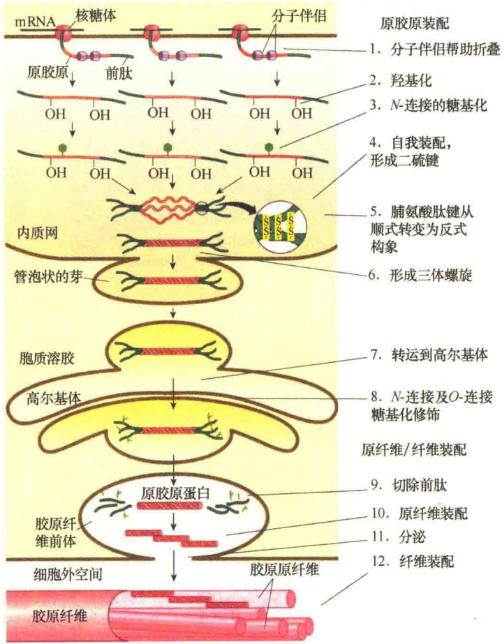

图 4-8 胶原的合成、加工、装配与分泌（引自 Plopper，2016）。

---

108

细胞生物学（第二版）

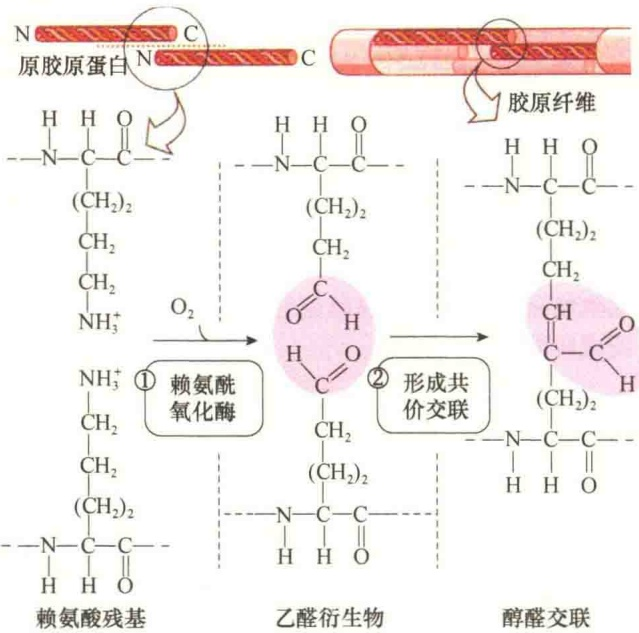

图 4-9 胶原纤维的装配（引自 Lewin et al., 2007）。赖氨酰氧化酶催化两个赖氨酸侧链形成  $\varepsilon$ -醛（基）赖氨酸，再经羟醛交联进行共价连接。

有相当短的胶原纤维，并组成不同的层。角膜基质的层次结构与胶合板相似，同一层中纤维是相互平行的，但与另一层的纤维却是垂直的（图 4-10），这种组织方式既赋予了这种娇嫩组织的强度，又提高了组织的透明度。

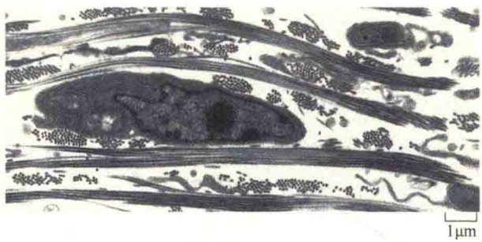

图 4-10 角膜基质的结构（引自 Karp，1996）。

如果编码胶原的基因发生突变，将导致胶原病（表 4-3）。若影响到胶原纤维的正确装配，皮肤和其他各种结缔组织就会因此降低强度而变得非常松弛。

胶原是骨、腱和皮肤组织中的主要蛋白，这些组织的细胞外基质不仅胶原含量高，而且刚性及抗张力大，构成了细胞外基质的附加结构。细胞外基质中的其他组分通过与胶原的结合，形成结构与功能的复合体。

另外，胶原具有促进细胞生长的作用，如肝细胞等在含有胶原的培养基上生长较快。一些实验证明，某种细胞经过特异的黏着蛋白的介导，可以粘连到特定类型胶原上；上皮细胞和内皮细胞经层粘连蛋白的介导，可与基膜中的Ⅳ型胶原粘连。

## 4.1.3.4 弹性蛋白

虽然胶原能够给细胞外基质以强度和韧性，但是对于某些组织来说还需要富有弹性，特别是血管、皮肤、肺、心脏等组织。血管的弹性对于维持适当的血压是十分重要的，这种弹性主要依赖于细胞外基质中的弹性纤维。弹性纤维如同橡皮带一样，它的长度能够伸展到正常长度的几倍，当收缩时又能恢复到原始长度。组织的弹性是通过改变散布在弹性纤维中胶原的数量来控制的。

弹性蛋白能够组装成弹性纤维（elastic fiber）。弹性纤维外面包有一层表面粗糙的微原纤维鞘（microfibrillar sheath），鞘内富含弹性蛋白。外鞘至少由10种不同的蛋白质压缩而成，其中有些蛋白质能够与细胞表面的整联蛋白受体结合。

像胶原蛋白一样，弹性蛋白也富含甘氨酸和脯氨酸，但是与胶原蛋白不同的是，弹性蛋白的羟基化程度不高，没有羟赖氨酸的存在。微原纤维鞘内的弹性蛋白分子间通过赖氨酸残基形成共价键进行相互交联，它们形成的交联网络可通过构型的变化产生弹性。弹性蛋白之所以十分稳定，并且具有很好的弹性，是因为弹性蛋白的结构非常特别。弹性蛋白基因编码两个非常不同的序列，一个是亲水区，另一个是疏水区，它们之间是间隔存在的，这种结构有利于伸展与松弛。装配成的微原纤维鞘内的弹性蛋白是不溶于水的（图4-11）。

弹性蛋白的合成与分泌通过共翻译转运途径进行，弹性蛋白纤维的最后装配是在细胞外完成的（图 4-12）。

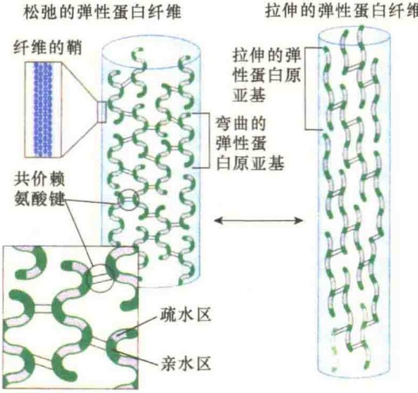

图 4-11 弹性纤维的结构（引自 Plopper，2016）。微原纤维鞘内的弹性蛋白交联成弹性纤维。交联网络中的每一个弹性蛋白分子都能以伸展或压缩两种构型存在，因此导致弹性蛋白纤维的紧缩和伸展。

---

4 细胞环境与互作

109

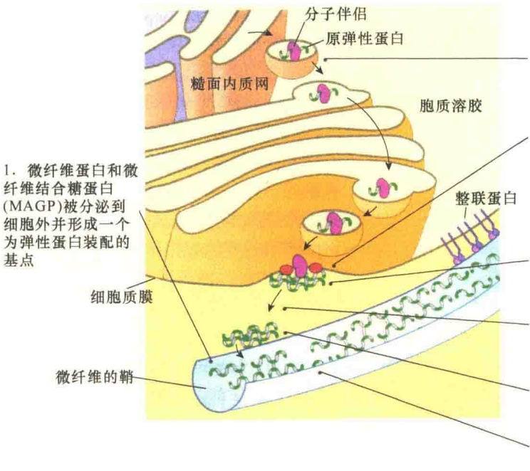

3. 分泌的原弹性蛋白保持与质膜结合，并装配成含有由赖氨酰氧化酶交联的纤蛋白复合物

4. 细胞表面的弹性蛋白复合物随着原弹性蛋白的加入越来越大  
5. 原弹性蛋白聚集物被转移到细胞外附着在整联蛋白受体的微纤维上  
6. 微纤维上的聚集物聚集形成大的复合物  
7. 在谷氨酰胺转移酶的作用下，聚集物与鞘共价结合，形成最终的纤维结构

图 4-12 弹性蛋白纤维的合成、分泌与装配（引自 Plopper，2016）。弹性蛋白纤维的合成、分泌与装配分为 7 个过程:①微纤维鞘蛋白合成并被分泌到细胞外，在细胞外酶的作用下装配成微纤维鞘；②弹性蛋白单体 [又称原弹性蛋白（tropoelastin）] 在糙面内质网合成，合成的弹性蛋白在内质网中与分子伴侣/受体蛋白复合物结合，在此过程中，分子伴侣防止弹性蛋白单体自身聚集；③当弹性蛋白单体被分泌到细胞表面时，在弹性蛋白结合蛋白的作用下，弹性蛋白被困在细胞表面，并在细胞外酶的作用下，弹性蛋白单体相互交联，产生小的、非组织化的纤维丛；④随着时间的延长，这些小的弹性蛋白纤维丛不断地交联、加长；⑤合成的弹性纤维聚集体不断被转移到细胞质膜外，并与微原纤维鞘结合；⑥进一步聚集与压缩，形成大的复合物；⑦聚集物进一步交联形成最终的纤维结构，并与鞘共价结合。

## 4.1.4 细胞外基质中的黏着蛋白

细胞外基质中的第三类成分是黏着蛋白，之所以将这些蛋白质称为黏着蛋白，是因为这些蛋白质起着将细胞外基质与细胞联系起来的桥梁作用。细胞外基质中的黏着蛋白包括纤连蛋白、层粘连蛋白等。

## 4.1.4.1 纤连蛋白

纤连蛋白（fibronectin，FN）属于非胶原糖蛋白，它是一类黏附性的糖蛋白，几乎所有动物的结缔组织都能表达纤连蛋白。在人体中，一个纤连蛋白基因通过可变剪接表达出至少27种不同纤连蛋白。这些蛋白质可分成两类:一类是可溶性的（即细胞质）纤连蛋白，存在于血浆和各种体液中，称为血浆纤连蛋白（血浆FN）；另一类以不溶的纤维，存在于细胞外基质、细胞之间及某些细胞表面，称为细胞纤连蛋白（细胞FN）。

1）FN 的结构 FN 是高分子质量的糖蛋白，含糖约 5%，是由两个亚基组成的二聚体，每个亚基的分子质量约 250kDa，各亚基在 C 端形成两个二硫键交联。血浆 FN 是二聚体，由两条相似的 A 链和 B 链组成，整个分子呈 V 形。细胞 FN 是多聚体，其不同来源的 FN 亚基结构相似，但并不相同。不同的亚单位均为同一基因的表达产物，只是转录后在 RNA 的剪接上有所不同，因而产生不同的 mRNA。另外，在翻译后的修饰上也有差异，FN 的每个亚单位的蛋白质组成若干个球形结构域，各结构域之间由对胰蛋白酶敏感的肽链连接，因此可通过胰蛋白酶的水解作用分离这些结构域从而研究它们的功能。每个 FN 亚基上有与胶原、细胞表面受体、血纤蛋白和硫酸蛋白多糖高亲和力结合的位点（图 4-13）。

用蛋白酶消化 FN 的细胞结合区（整联蛋白受体结构域），可以发现这一结构域中 Arg-Gly-Asp 三肽序列负责与细胞表面的结合，Arg-Gly-Asp 序列简称 RGD 序列，同样存在于细胞外基质和血液的其他类型的黏着蛋白序列中。RGD 序列有时又称 RGDS，最后一个 S 代表丝氨酸，表明细胞表面受体与 FN 的识别和结合也与丝氨酸有关。

---

110

细胞生物学（第二版）

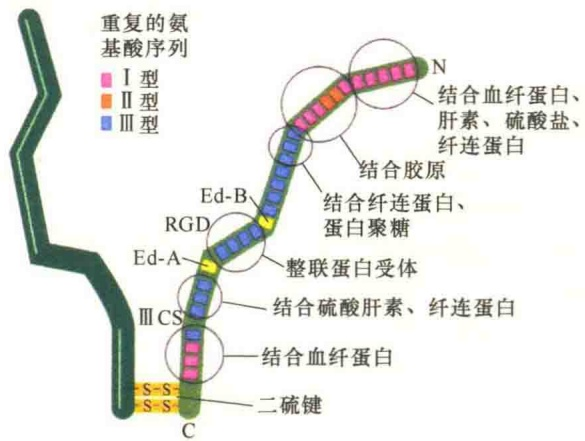

图 4-13 纤连蛋白的结构（引自 Plopper，2016）。两个纤连蛋白多肽通过靠近 C 端二硫键共价结合，每个多肽组成 6 个结构域，每个结构域由小的重复序列构成。其中整联蛋白受体结构域含有特征性的 RGD 序列，负责与细胞膜中整联蛋白粘连。

2）FN 的功能 FN 可与多种物质及细胞结合，执行多种功能。FN 最主要的功能是介导细胞的黏着。FN 可以与其在细胞膜上的受体结合，根据对受体的分析，发现受体的细胞外结构域有与 Arg-Gly-Asp-Ser 高亲和结合部位。由于 FN 具有同时与细胞外基质各类成分相结合的特点，并可促进细胞外基质其他成分的沉积，有人认为 FN 是细胞外基质的组织者。

在 FN 的分子上既有与胶原结合的结构域，又有与细胞结合的结构域。这样，FN 可以介导细胞外基质与细胞结合。

FN 能够影响细胞的迁移，一个突出的例子是胚胎发生早期神经脊细胞的迁移。在神经管形成时，

神经脊细胞从神经管的背侧迁移到胚胎各个区域，分化成神经节、色素细胞等不同类型的细胞。一般认为FN纤维为细胞的运动提供了轨道，这种推测也得到了实验的证明:将FN特异的抗体直接注射到正在发育的胚中，以此阻止细胞与FN的结合，这种处理影响了正常细胞的迁移，导致异常胚的发育。

FN 介导细胞的黏着和影响细胞的迁移对于细胞及机体的生命活动有重要的意义。FN 引导免疫系统的细胞移向受伤部位，促使伤口愈合。另外，FN 与癌细胞扩散也有密切的关系。在正常组织中，细胞是由多种多样的糖蛋白粘连起来，并约束在一个固定的位置上，主要是靠 FN 来维持其稳定状态。在这种情况下，癌细胞如果要转移，就必须先将结合在细胞之间的 FN 切断，或把它们消化掉，癌细胞才能游离出来自由活动，并通过血液或淋巴系统进行转移。

对劳氏肉瘤病毒（Rous saroma virus, RSV）的研究发现，癌基因合成一种蛋白质来激活FN水解酶的活性，可切断FN形成的网络。这种水解酶是正常细胞本身合成的，但没有活性，只有被外来物质激活后才能起作用。

## 4.1.4.2 层粘连蛋白

细胞外基质中另一个重要的黏着糖蛋白就是层粘连蛋白（laminin，LN），是基膜的主要结构成分。LN也广泛分布于脊椎动物和一些无脊椎动物，如昆虫和海胆中。在某些动物胚胎的十六细胞期就出现了LN。不过，不同来源的层粘连蛋白之间的同源性极低，表明它们的进化史很长。

1）LN 的基本结构 如同胶原，LN 也是由三条多肽亚基组装成三螺旋的卷曲螺旋。

LN 是基膜所特有的非胶原糖蛋白，分子质量为 820kDa，含 13%～15% 的糖，有 3 个亚单位，即重链（α 链,400kDa），以及 β（215kDa）、γ（205kDa）两条轻链。LN 在结构上呈现不对称的十字形，由 1 条长臂和 3 条相似的短臂构成。这 4 个臂均有棒状节段和球状的末端域。β 和 γ 短臂上有两个球形域，α 链上的短臂有 3 个球形结构域，其中有一个结构域同 IV 型胶原结合，第二个结构域同肝素结合，还有同细胞表面受体结合的结构域（图 4-14）。正是这些独立的结合位点使 LN 作为一个桥梁分子，介导细

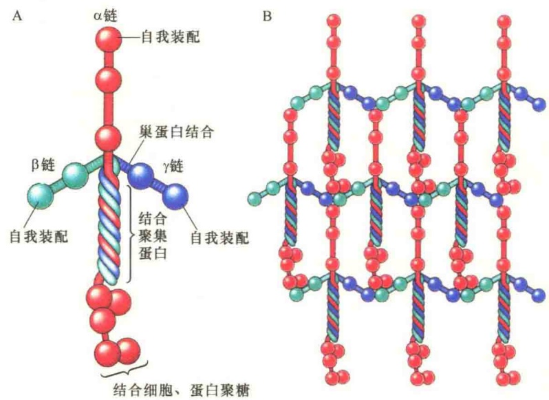

图 4-14 层粘连蛋白的结构（引自 Copper and Hausman，2013）。A. 单个层粘连蛋白由 3 条多肽链组成；B. 层粘连蛋白装配成网状结构。

---

4 细胞环境与互作

111

胞同基膜结合。与细胞外基质中其他糖蛋白不同的是，LN不会形成纤维结构，但可以形成网状结构。

2）LN 的功能 在基膜中，由于 LN 具有与 IV 型胶原、细胞表面及其他的蛋白聚糖结合的位点，所以 LN 的主要功能就是作为基膜的主要结构成分对基膜的组装起关键作用，在细胞表面形成网络结构并将细胞固定在基膜上。

LN 还有许多其他的作用，如在细胞发育过程中刺激细胞黏附、细胞运动。LN 还能够刺激胚胎中神经轴的生长，并促进成年动物的神经损伤后重生长和再生。如同纤连蛋白，细胞外的 LN 能够影响细胞的生长、迁移和分化。

## 4.1.5 细胞外基质与细胞的相互关系

细胞外基质是细胞分泌到细胞外的大分子物质。这些大分子物质之间的关系如何？它们反过来对细胞的生命活动有什么影响？

## 4.1.5.1 基膜

基膜（basal lamina, basement membrane）是一种复合的细胞外结构，通常位于上皮和内皮的基底面，是细胞外基质的特异区。典型的基膜厚约 50nm，有些基膜的厚度达 200nm。通常会形成基膜的组织和细胞有:①肌细胞和脂肪细胞的表面；②上皮组织

基底面的下方，如皮肤上皮的下表面，将上皮细胞与结缔组织分开（图4-15）；③血管内皮细胞的下表面。

基膜是由不同的蛋白纤维组成的网状结构，主要成分有 LN、IV 型胶原、巢蛋白（nidogen）、生腱蛋白（tenascin）、血小板反应蛋白（thrombospondin）、硫酸肝素糖蛋白等（图 4-16）。

LN 在基膜的形成中起重要作用，因为 LN 具有许多不同的结构域，其中具有与其他蛋白复合物结合的特殊位点。此外，LN 既能够与细胞表面受体结合，也能够与其他的

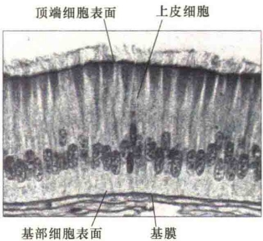

图 4-15 基膜（引自 Plopper，2016）。

LN 分子及同其他的糖蛋白（包括基膜中其他的一些成分）结合。更重要的是，LN 与 IV 型胶原结合形成分隔的交联网状结构。基膜通过 LN 与细胞表面受体紧密结合，将基膜与覆盖的细胞紧密结合起来（图 4-17）。由此看来，LN 不仅是基膜的主要成分，也是基膜的组织者，而 IV 型胶原则是基膜的网状框架。

基膜不仅对组织结构起支持作用，同时也是渗透性的障碍，调节分子和细胞的运动。在肾细胞中，基膜可以作为一种过滤器，允许小分子进入尿液，留下大分子的蛋白质。表皮细胞下的基膜一方面阻止结缔组织的细胞进入表皮，另一方面允许“防卫战士”——白细胞的移动。

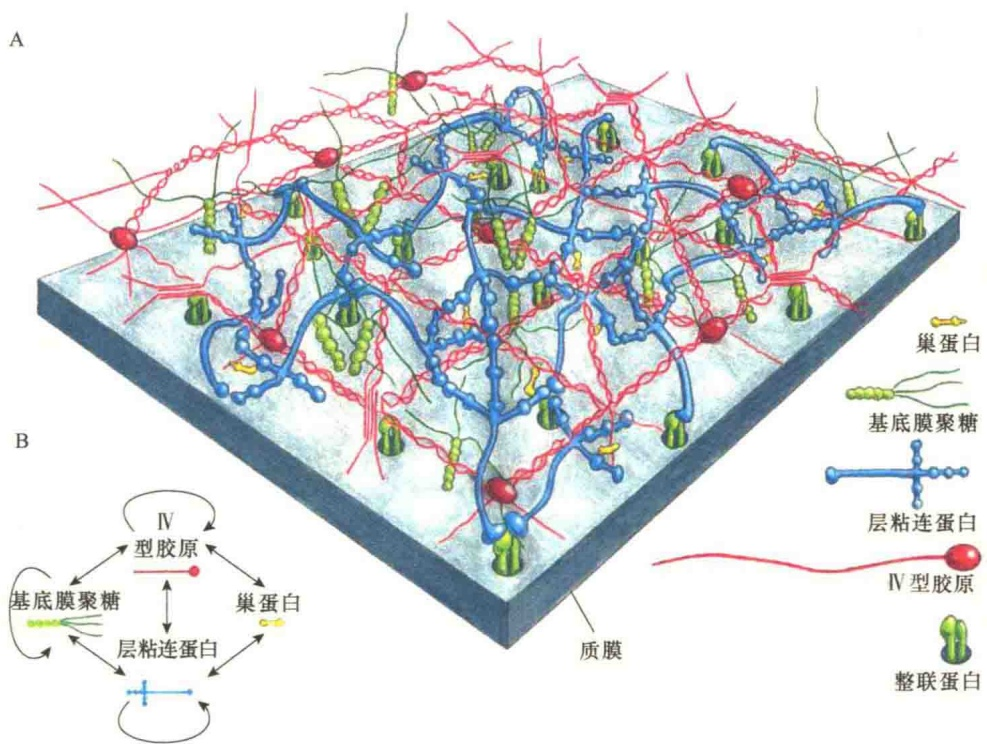

图 4-16 基膜的分子结构模型（引自 Alberts et al., 2015）。A. 基膜是由层粘连蛋白、Ⅳ型胶原和巢蛋白与串珠蛋白聚糖相互作用形成的。B. 双箭头表示可以直接相互结合的分子。

---

112

细胞生物学（第二版）

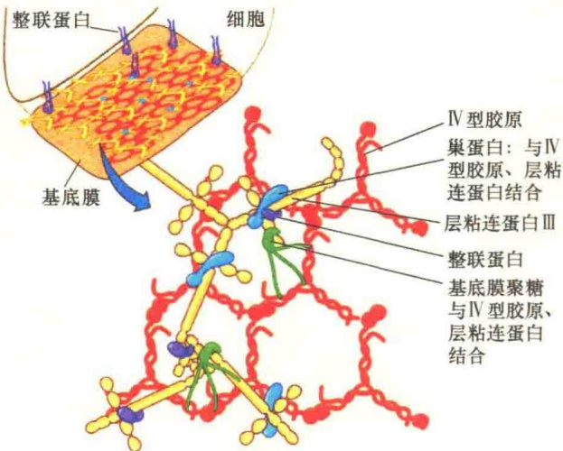

图 4-17 基膜中层粘连蛋白、胶原蛋白等的相互作用（引自 Plopper，2016）。Ⅳ型胶原与层粘连蛋白一起构成基膜的蛋白网络结构。

基膜对于细胞的迁移也有影响。研究发现基膜能够阻止某些转移癌细胞的入侵，这一点特别引起人们的兴趣。

## 4.1.5.2 整联蛋白

整联蛋白（integrin）属于整合蛋白家族，是细胞外基质受体蛋白，与其他的激素或信号分子受体不同的是，整联蛋白与配体的结合力较低，但浓度却比其他的受体高10～100倍。

1）整联蛋白的结构与功能 整联蛋白是一种穿膜的异质二聚体，它由两个非共价结合的穿膜亚基，即α亚基和β亚基所组成。共有18种α亚基和8种β亚基，组成24种不同的整联蛋白二聚体。每个亚基的细胞外部分是球形的头，露出脂双分子层约20nm。整联蛋白的α亚基和β亚基都是糖基化的，并通过非共价键结合在一起（图4-18）。

整联蛋白细胞外的头部能够与多种细胞外基质蛋白中短的氨基酸序列结合，包括胶原、纤连蛋白、层粘连蛋白等。整联蛋白不仅可通过细胞外结构域与细胞外基质蛋白结合，其细胞内部分可作为细胞骨架的锚定部位，如黏着斑与半桥粒。因此，整联蛋白在细胞组织的组建中具有重要作用。

整联蛋白与基质蛋白的结合需要二价阳离子，如  $Ca^{2+}$ 、 $Mg^{2+}$  等的参与。有些细胞外基质蛋白可被多种整联蛋白识别。

第一个被分离和鉴定的整联蛋白是纤连蛋白受体（fibronectin receptor）。分离是通过亲和层析进行的，因为纤连蛋白与细胞结合的结构域有特殊的三氨基酸序列，这样就很容易将这种受体蛋白分离出来。纤连蛋白受体有3个结构域（其中一个是穿膜区），也是一种钙依赖性蛋白质。该受体蛋白是一个二聚体，其α亚基是一条完整的140kDa的多肽链，由大、小两部分组成，小的是穿膜部分，大的是细胞外部分，两者之间通过二硫键相连，膜外部分折叠成二价阳离子结合区。β亚基的细胞外部分含有一个半胱氨酸富集重复区，各重复部分靠内部二硫键相连，β亚基的分子质量为100kDa。受体的头部能够通过对RGD序列的识别与纤连蛋白结合。受体的细胞内结构域有踝蛋白（talin）结合位点，踝蛋白结合后，再通过黏着斑蛋白与细胞内的骨架成分——肌动蛋白结合（图4-19）。

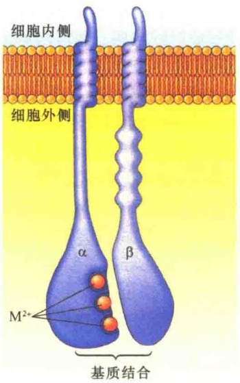

图 4-18 整联蛋白的结构（引自 Cooper and Hausman, 2004）。整联蛋白是由两个穿膜蛋白亚基组成的异质二聚体，两个亚基分别是  $\alpha$  亚基和  $\beta$  亚基。 $\alpha$  亚基可结合二价阳离子，用  $M^{2+}$  表示。基质结合结构域由  $\alpha$  亚基和  $\beta$  亚基共同组成。

由上可知，整联蛋白除了将细胞外基质与细胞连接之外，还将细胞外基质同细胞内的骨架网络连成一个整体，整联蛋白本身作为穿膜接头在细胞外基质和细胞内肌动蛋白骨架之间起双向联络作用，这就是整联蛋白所起的细胞黏附作用。此外，整联蛋白还具有将细胞外信号向细胞内传递的作用。

2）整联蛋白受体的类型 目前已经鉴定的整联蛋白约有20种，但只鉴定到17种不同的α亚基和8种β亚基。由于整联蛋白是异质二聚体，从理论上推测应该有100种以上的α亚基和β亚基配对的整联蛋白，实际上只发现20种，提示这些亚基出现在细胞表面的位置可能具有特异性。整联蛋白同细胞外基质中黏着蛋白的识别与结合分为两种类型:一类是同RGD区域结合，另一类则不需要RGD区域（表4-4）。

---

4 细胞环境与互作

113

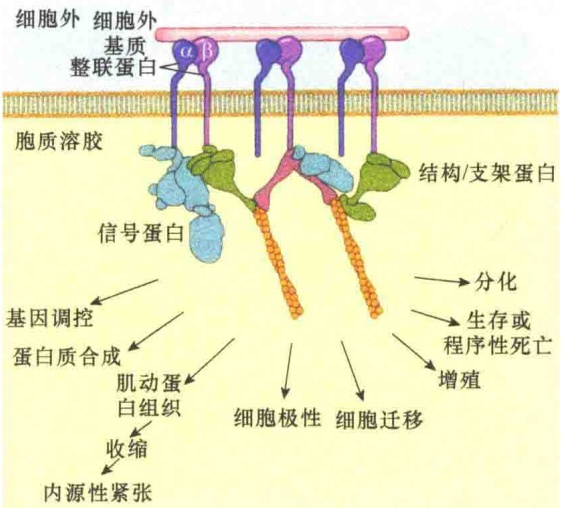

图 4-19 整联蛋白的功能（引自 Plopper，2016）。整联蛋白的 β 亚基含有 RGD 序列的结合位点，能够识别纤连蛋白及其他的细胞外基质物质。整联蛋白的两个亚基的细胞质端常常与细胞骨架的肌动蛋白相连。整联蛋白和肌动蛋白之间要通过其他一些蛋白质的介导才能连接起来，这些蛋白质包括黏着斑蛋白（vinculin）和踝蛋白。整联蛋白的细胞质结构域也与蛋白激酶相互作用，如黏着斑激酶（focal adhesion kinase, FAK）。整联蛋白与细胞外配体（如纤连蛋白、层粘连蛋白）的结合，能够激活这些蛋白激酶的活性，并开始信号转导的级联反应。

表 4-4 根据 RGD 序列的识别进行的整联蛋白受体的分类

<table><tr><td colspan="2">RGD识别</td><td colspan="2">非RGD识别</td></tr><tr><td>受体</td><td>主要配体</td><td>受体</td><td>主要配体</td></tr><tr><td> $\alpha_{3}\beta_{1}$ </td><td>纤连蛋白</td><td> $\alpha_{1}\beta_{1}$ </td><td>胶原</td></tr><tr><td> $\alpha_{5}\beta_{1}$ </td><td>纤连蛋白</td><td> $\alpha_{2}\beta_{1}$ </td><td>胶原</td></tr><tr><td rowspan="2"> $\alpha_{v}\beta_{1}$ </td><td>纤连蛋白</td><td></td><td>核纤层蛋白</td></tr><tr><td>血纤蛋白原</td><td> $\alpha_{3}\beta_{1}$ </td><td>胶原</td></tr><tr><td rowspan="4"> $\alpha_{11b}\beta_{3}$ </td><td>纤连蛋白</td><td></td><td>核纤层蛋白</td></tr><tr><td>血浆血管性血友病因子</td><td> $\alpha_{4}\beta_{1}$ </td><td>纤连蛋白</td></tr><tr><td>玻连蛋白</td><td></td><td>血管细胞黏附分子</td></tr><tr><td>血纤蛋白原</td><td> $\alpha_{6}\beta_{1}$ </td><td>层粘连蛋白</td></tr><tr><td rowspan="3"> $\alpha_{v}\beta_{3}$ </td><td>纤连蛋白</td><td> $\alpha_{L}\beta_{2}$ </td><td>细胞间黏附分子-1</td></tr><tr><td>血浆血管性血友病因子</td><td></td><td>细胞间黏附分子-2</td></tr><tr><td>玻连蛋白</td><td> $\alpha_{M}\beta_{2}$ </td><td>血纤蛋白原</td></tr><tr><td> $\alpha_{v}\beta_{5}$ </td><td>玻连蛋白</td><td></td><td>细胞间黏附分子-1</td></tr><tr><td> $\alpha_{v}\beta_{6}$ </td><td>纤连蛋白</td><td></td><td></td></tr></table>

3）RGD 序列与临床研究 大多数细胞外基质蛋白之所以能够与整联蛋白结合，是因为它们含有 RGD 序列。整联蛋白与 RGD 序列的识别与结合需要二价阳离子  $Mg^{2+}$  和  $Ca^{2+}$ ，以维持整联蛋白与配体结合的正确构型。

据估计，约有半数的整联蛋白含有RGD结合位点，相同的细胞外蛋白可以与不同的整联蛋白结合，同样会有同一个整联蛋白能够与多个不同的细胞外蛋白质结合。尽管功能上有重叠，但敲除小鼠实验表明，缺少了不同整联蛋白的亚基具有不同的表型，从而推测大多数整联蛋白具有特异性。

RGD 序列在细胞黏附中的重要性的发现，为临床研究和处理受体-配体相互作用开辟了新天地。病变的动脉中血块的形成能够阻塞血液向主要器官的流通是引起心脏病突发和休克的主要原因之一。血块的聚集始于血小板的聚集，而血小板的聚集需要血小板特异的整联蛋白（ $\alpha_{11b}\beta_{3}$ ）与可溶性的含有 RGD 序列的血蛋白，如血纤蛋白原（fibrinogen）、血浆血管性假血友病因子（von Willebrand factor）的相互作用，这些蛋白质作为接头将血小板聚集起来。动物实验表明，含有 RGD 的肽能够抑制血块的形成，这一发现使我们能够人工合成含有 RGD 序列的新临床治疗剂，这种治疗剂不是肽，但含有 RGD 序列，可以治疗血小板凝集。另外也可以制备特异的抗  $\alpha_{11b}\beta_{3}$  整联蛋白的抗体已用于临床治疗。

整联蛋白基因的突变会造成严重的疾病，具体见表 4-5。

表 4-5 部分整联蛋白的配体、分布，以及亚基突变与临床表现

| 整联蛋白 | 配体 | 组织分布 | $\alpha$亚基突变的表型 | $\beta$亚基突变的表型 |
| --- | --- | --- | --- | --- |
| $\alpha_{5}\beta_{1}$ | 纤连蛋白 | 普遍存在 | 胚胎死亡,血管、体节神经脊缺陷 | 早期胚胎死亡(植入时) |
| $\alpha_{6}\beta_{1}$ | 层粘连蛋白 | 普遍存在 | 重度皮肤疮,其他部位表皮缺陷 | 早期胚胎死亡(植入时) |
| $\alpha_{7}\beta_{1}$ | 层粘连蛋白 | 肌肉 | 肌营养不良,肌腱与连接缺陷 | 早期胚胎死亡(植入时) |
| $\alpha_{L}\beta_{2}$ | Ig超家族 | 白细胞 | 降低白细胞募集 | 白细胞黏附缺陷(LAD),炎症反应降低 |
| $\alpha_{11b}\beta_{3}$ | 纤连蛋白 | 血小板 | 出血,无血小板聚集(血小板病) | 出血,无血小板聚集,重度骨质疏松 |
| $\alpha_{6}\beta_{4}$ | 层粘连蛋白 | 上皮半桥粒 | 重度皮肤疮,其他部位表皮缺陷 | 重度皮肤疮,其他部位表皮缺陷 |

---

114

细胞生物学（第二版）

## 4.2 细胞识别与细胞黏附

在多细胞的生命有机体中，不同类型的细胞必须组成不同的组织，如脊椎动物中的肌肉组织、上皮组织、神经组织、结缔组织等。在细胞形成组织的过程中，需要在细胞与细胞之间建立某种联系，在不同组织之间也需要建立睦邻友好关系，才能维持整体生命活动的运行（图 4-20）。

相同组织的细胞要组成组织，需要分三步走:首先要相互识别；识别后要相互靠近，进行黏附；随着关系的进一步密切，可通过连接组成组织。细胞识别（cell recognition）指细胞对同种或异种细胞、同源或异源细胞、自己和异己分子的认识和鉴别。细胞黏附（cell adhesion）则是指相邻细胞或细胞与细胞外基质以某种方式黏附在一起，组成组织或与其他组织分开，这种黏附的方式比较松散。另外，从事件发生的次序来说，细胞识别在先，细胞黏附在后，识别是黏附的基础。就细胞组成组织而言，组织内各细胞间更为紧密的结合则是靠各种形式的连接。

## 4.2.1 细胞识别及细胞拣出

在多细胞生物中，单个细胞要组成精密的组织、器官及器官体系，首先必须具有相互识别的能力，然后通过黏附和连接将细胞组织起来。生物学家早在1907年就发现细胞具有相互识别的能力，从那以后，科学家们不断认识细胞间选择性地识别、黏附，对参与细胞识别和黏附的细胞表面分子的认识和了解也越来越深入。

## 4.2.1.1 细胞识别的特性

多细胞生物有机体中有三种识别系统:抗原与抗体的识别，酶与底物的识别，细胞之间的识别。抗原与抗体的识别属于免疫反应，酶与底物的识别属于催化反应，而细胞与细胞的识别反应最为复杂，不仅涉及组织的建立，也包括通过细胞表面受体与胞外信号分子的选择性相互作用，从而导致一系列生理生化反应的信号传递。无论是哪一种识别系统，都有一个共同的基本特性，就是具有选择性，或是说具有特异性。

细胞识别是细胞发育和分化过程中一个十分重要的环节，细胞通过识别和黏着形成不同类型的组织，由于不同组织的功能是不同的，所以识别本身就意味着选择。

为了研究细胞的识别和黏着，1907年Wilson通过实验研究了两种不同颜色的海绵细胞的行为。分别从黄色海绵和红色海绵中分离单细胞，然后将两种不同颜色的细胞类群混合在一起。但是，这两种类型的海绵细胞很快就各自分开聚集，红色海绵细胞聚集到一起，黄色海绵细胞也是如此，二者互不混淆。这是人类最早通过实验认识到细胞具有识别和选择性结合的能力。此后，在许多生物中都发现了细胞的识别和黏附，不仅是简单的多细胞生物，也包括复杂的、有各种组织分化的多细胞生物中不同组织的细胞都具有这种能力和特性。

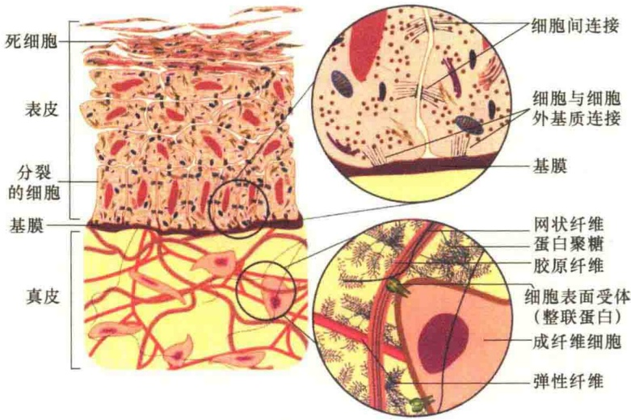

图 4-20 人上皮组织细胞与细胞之间、细胞与细胞外基质之间的相互作用（引自 Karp，2010）。上皮中的细胞相互之间具有特殊的连接结构，并且与细胞外基质也有特殊的接触方式。

有人用两栖类胚性细胞做实验，研究细胞的识别。分别用蛋白酶将外胚层和中胚层水解成单细胞，并分别标记上不同的颜色，然后将这两种细胞混合；在混合之初，它们混合得很好，但是随着时间的推移，外胚层的细胞移向外侧并聚集在一起，这也是它们在胚胎中的正确位置；来自中胚层的细胞移向内侧，这也是它们在胚胎中的正确位置。这两种游离的细胞迅速重新聚集成团后，同种细胞形成独立的聚合体，每种聚合体只含一种颜色的细胞，这种现象称为拣出（sorting out）。后来用三个胚层的细胞做实验，同样证明细胞的识别具有选择性，非同类的细胞不会混合聚集（图 4-21）。

---

4 细胞环境与互作

115

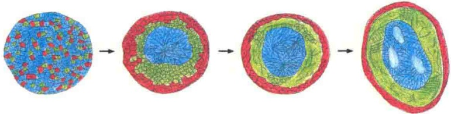

图 4-21 细胞识别与拣出实验证明（引自 Alberts et al., 2015）。实验中，将分散悬浮的中胚层、神经板、表皮细胞随机混合在一起，它们不仅能够相互识别，而且还会排列到胚胎期原来的位置，即神经管的细胞在内层，表皮细胞在外层，来自中胚层的细胞位于中间层。

## 4.2.1.2 细胞识别与拣出的分子基础

细胞拣出的分子基础是什么？研究发现钙黏着蛋白（cadherin）在发育过程中对细胞的拣出起关键作用。在胚胎发育过程中，特殊类型的钙黏着蛋白的表达，对于发育形成组织具有重要作用。通过离体培养的细胞研究表明，在细胞的同亲性结合（homophilic binding）及组织形成过程中，钙黏着蛋白具有决定作用。例如，一种离体培养的细胞系，称为L-细胞，不能表达钙黏着蛋白，因此，它们之间不能相互黏着。如果将编码E-钙黏着蛋白的基因转染L-细胞，可促使L-细胞相互识别与黏着（图4-22A）。如果将表达不同钙黏着蛋白的L-细胞混合在一起，它们能够相互识别与拣出并分离开。如果将能够表达同一种钙黏着蛋白，但是表达量不同的两种细胞混合在一起，它们也能相互拣出，即表达量高的与表达量低的分开聚集（图4-22B），据此推测表达量的差异也是细胞拣出的一种指标。

## 4.2.1.3 识别反应

细胞识别引起的细胞反应大致有三种类型:内吞、细胞黏附和信号反应。

红细胞衰老并被脾脏细胞吞噬是细胞识别后引起吞噬反应的典型例子。红细胞膜中糖脂的糖基除了与血型有关外，还决定着红细胞的寿命。血型糖蛋白含有大量的唾液酸，糖链末端唾液酸的存在状况与红细胞的寿命相关，可作为被吞噬的信号。红细胞寿命一般为3～4个月，然后在脾脏中被吞噬。用唾液酸酶处理分离的红细胞，除去红细胞中的唾液酸，然后将这种红细胞重新注入原来的动物体内，发现注入

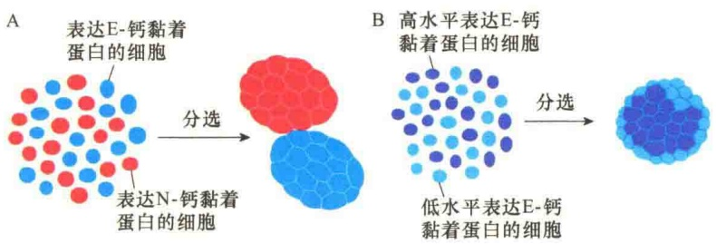

图 4-22 钙黏着蛋白依赖的细胞拣出（引自 Alberts et al., 2015）。培养的细胞根据表达的钙黏着蛋白的类型与水平进行拣出。A. 表达 E-钙黏着蛋白与表达 N-钙黏着蛋白的细胞拣出；B. 表达高水平的 E-钙黏着蛋白与表达低水平的 E-钙黏着蛋白的细胞拣出，可发现表达高水平的 E-黏着蛋白的细胞拣出能力更强，拣出后位于内部。

的红细胞很快在脾脏中被吞噬，而没有除去唾液酸的正常的红细胞则相安无事。究其原因，当唾液酸被除去之后，暴露出的半乳糖残基可能是红细胞衰老的标记被脾脏细胞识别并将之吞噬，这个例子既说明了细胞识别后的反应，又说明了糖在识别过程中的作用。

识别后的第二种反应则是发生黏附，包括细胞同细胞外基质的黏附、细胞与细胞的黏附，进一步发展就成为细胞连接。

识别后的第三种反应就是引起信号转导，发生一系列的生理生化反应，使细胞更好地适应环境。

## 4.2.2 细胞黏附的机制

在细胞识别的基础上，同类细胞发生聚集形成细胞团或组织的过程称为细胞黏附。它对于胚胎发育及成体的正常结构和功能都有重要的作用。在发育过程中，由于细胞间细胞黏附的强度不同，决定着细胞在内、中、外三胚层的分布。在器官形成过程中，通过细胞黏附，使具有相同表面特性的细胞聚集在一起形成器官。

## 4.2.2.1 细胞黏附分子

在细胞识别过程中，细胞的膜糖起重要作用，而引起细胞黏附的主要是膜蛋白。参与细胞黏附的分子称为细胞黏附分子（cell adhesion molecule, CAM）。

至今，已经发现了多种细胞黏附分子，如神经细胞黏附分子（neural cell adhesion molecule, NCAM）、神经胶质细胞黏附分子（neuroglia cell adhesion molecule, Ng-CAM）、肝细胞黏附分子（liver-cell adhesion molecule, L-CAM）。细胞间黏附分子（intercellular adhesion molecule, ICAM）是普遍存在的一种细胞间黏附分子，它的配体是白

---

116

细胞生物学（第二版）

细胞功能相关抗原1（leucocyte function-asso-ciated antigen 1, LFA-1）；而白细胞内皮细胞黏附分子（leucocyte endothelial cell adhesion molecule, LECAM）是白细胞内皮细胞中发现的细胞黏附分子。上述细胞黏附分子都是糖蛋白，在细胞外结构域都有与肽共价结合的糖基。根据细胞黏附分子的作用方式可分为三个家族:①免疫球蛋白超家族，如血管细胞黏附分子（vascular cell adhesion molecule, VCAM）、Ng-CAM和ICAM等；②钙黏着蛋白家族，如E-钙黏着蛋白、P-钙黏着蛋白、N-钙黏着蛋白；③选择蛋白家族，如LEU-CAM1（即是后来的L-选择蛋白）、E-选择蛋白、P-选择蛋白等。后两种家族的细胞

图 4-23 钙黏着蛋白、IgSF、整联蛋白和选择蛋白介导的细胞黏附（引自 Lodish et al., 2013）。

黏附分子是钙依赖性的，而免疫球蛋白超家族介导的多数是非钙依赖性的。

## 4.2.2.2 细胞黏附方式

经细胞黏附分子介导的细胞黏附可能有三种作用方式:①相邻两细胞表面由同种细胞黏附分子的相互介导黏附；②相邻两细胞表面由互补的细胞黏附分子的相互作用介导黏附，互补分子可同时存在于同一细胞或不同细胞；③中介分子（如凝集素）介导的与细胞表面黏附分子的互补作用。

参与细胞黏附的蛋白质有四个家族:①钙黏着蛋白；②免疫球蛋白超家族（immunoglobulin superfamily，IgSF）的某些成员；③整联蛋白家族中的某些成员；④选择蛋白。细胞黏附方式总结于图4-23。

钙黏着蛋白与 IgSF 能够介导同类细胞的黏着，这种黏着属于自我黏着，即同嗜性相互作用（hemophilic interaction）。而整联蛋白介导的是细胞与细胞外基质的黏着，这种黏着是非自我黏着，称为异嗜性相互作用（heterophilic interaction）。选择素介导的也是异嗜性黏着，只不过是细胞与细胞间的异嗜性黏着。

## 4.2.2.3 细胞黏着蛋白及介导的细胞黏附

根据细胞间的关系，可分为细胞与细胞的黏附、细胞与细胞外基质的黏附；若根据黏附中是否需要钙，可分为钙依赖性黏附与非钙依赖性黏附。无论何种黏附，都涉及黏着蛋白。

关于整联蛋白介导的细胞与细胞外黏附在细胞外基质部分已经介绍，下面重点讨论钙黏着蛋白、选择蛋白、IgSF介导的细胞黏附。

1）钙黏着蛋白介导的细胞-细胞间黏附 钙黏着蛋白是一个大的糖蛋白家族，介导钙依赖性的细胞黏着，并介导细胞外基质中的信号向细胞质中的传递。在大多数不同类型的细胞表面都发现了钙黏着蛋白，该家族的不同成员在体内的分布也有特异性。研究较为清楚的钙黏着蛋白是E-钙黏着蛋白、N-钙黏着蛋白、P-钙黏着蛋白。钙黏着蛋白超家族是主要的一类黏着蛋白，分布极为广泛（表4-6）。

表4-6 钙黏着蛋白超家族中某些成员及功能

| 黏着蛋白 | 细胞分布 | 连接功能 | 在小鼠中失活引起的表型 |
| --- | --- | --- | --- |
| E-钙黏着蛋白 | 表皮组织 | 黏着连接 | 胚泡期死亡;不能形成致密的胚 |
| N-钙黏着蛋白 | 神经元、心脏、肺、骨骼肌、成纤维细胞 | 黏着连接 | 胚胎因心脏缺陷而死亡 |
| P-钙黏着蛋白 | 胎盘、表皮、乳腺上皮细胞 | 黏着连接 | 腺体发育不正常 |
| VE-钙黏着蛋白 | 内皮细胞 | 黏着连接 | 血管发育不正常(内皮细胞程序性死亡) |

---

4 细胞环境与互作

117

钙黏着蛋白介导同类细胞间的相互黏着，主要是通过双方细胞表面的钙黏着蛋白相互作用，也就是同嗜性的细胞黏附，即所谓的“自我黏着”，并且通过基因工程方法得到证明。钙黏着蛋白介导的同类细胞的黏着能力能够很好地解释为什么同类细胞具有“拣出”功能，钙黏着蛋白是将细胞组成组织并维持成年生物体内的组织有序性的最关键的因素。钙黏着蛋白通常以二聚体的形式介导细胞黏附，这样介导的细胞黏附的结合力较强；不仅如此，钙黏着蛋白常常以成丛的二聚体介导细胞黏附（图4-24），如果仅以单体介导细胞黏附，结合力则很弱。

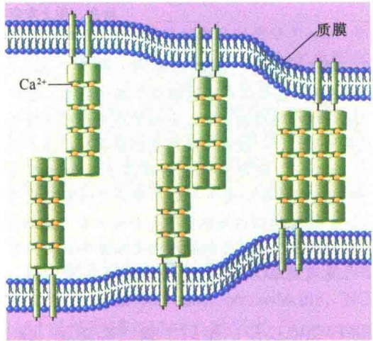

图 4-24 钙黏着蛋白介导的细胞黏附（引自 Karp，2010）。

钙黏着蛋白也是一个超家族的糖蛋白（图4-25），典型的钙黏着蛋白的细胞外部分含有5个同质重复的结构域（如E-钙黏着蛋白），两个结构域之间间隔的区域可与 $Ca^{2+}$ 结合。与 $Ca^{2+}$ 结合后，细胞外部分变得较为坚硬，并且与相邻细胞的钙黏着蛋白相互作用，从而介导进行黏着。非典型的钙黏着蛋白的细胞外结构域的数量可达30个之多。钙黏着蛋白的细胞内结构域也是多种多样的，表明与细胞内不同类型的配体作用，包括信号分子、介导与细胞骨架相连的衔接蛋白等。某些钙黏着蛋白，如T-钙黏着蛋白，不含穿膜区，这种钙黏着蛋白是通过糖基磷脂酰肌醇锚定到质膜上的。

2）选择蛋白介导的细胞黏附 选择蛋白（selectin）是膜整合糖蛋白的一个家族，它能够识别从另一个细胞表面伸展出来的特异的糖基团，并与之特异性结合，因此它也是细胞表面受体。选择蛋白有一个小的细胞质结构域、一个单次穿膜的结构域、一个大的细胞外片段，在这个片段上可分为几个结构域，包括最外端的具有凝集素作用的结构域（图 4-26）。

图 4-25 钙黏着蛋白超家族（引自 Alberts et al., 2015）

图4-26 选择蛋白的结构与功能（引自Karp，2010）。A.三种类型的选择蛋白。它们的细胞外结构域有一个类凝集素的结构域，能够识别糖蛋白寡糖链末端相似的糖配体（B）。C.糖配体的详细结构。末端的岩藻糖（fucose，Fuc）和唾液酸（sialic acid，SiA）对于选择蛋白的识别作用特别重要。N-乙酰葡萄糖胺（GlcNAc）常常被硫酸化。

---

118

细胞生物学（第二版）

已知有三种类型的选择蛋白:E-选择蛋白，在内皮细胞表达；P-选择蛋白，在血小板和内皮细胞表达；L-选择蛋白，在各种类型的白细胞中表达。这三种选择蛋白都是识别小的出现在某些糖蛋白或糖脂的四糖基团，选择蛋白与糖配体的结合是钙依赖性的。

选择蛋白是血管（循环）系统表皮细胞高度特异表达的表面受体，能够促进白细胞穿出血管（外渗作用，extravasation）进入炎症组织，进行免疫反应。这一任务十分艰巨。首先，白细胞必须克服血液流动的冲击力与血管内壁进行黏着。白细胞如何克服这一困难？答

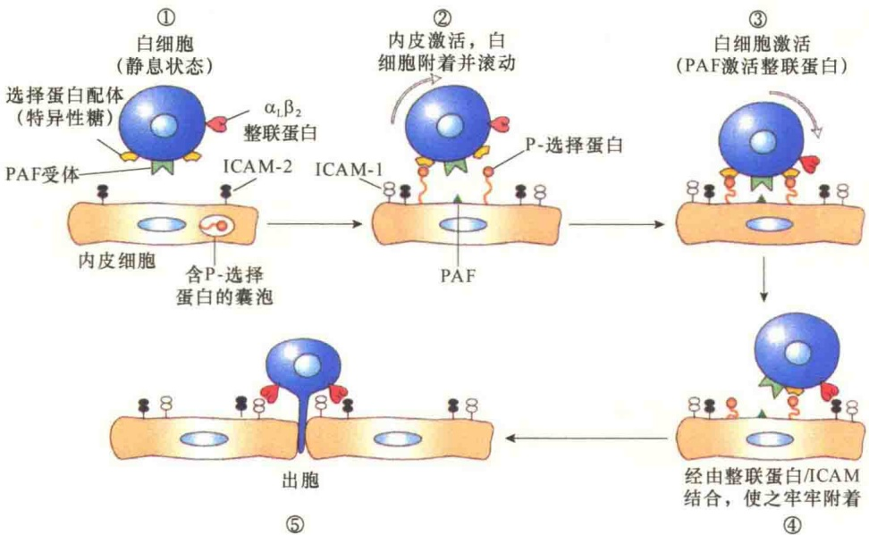

图 4-27 内皮细胞 - 白细胞相互作用:激活、结合、滚动与渗出（引自 Lodish et al., 2013）。①在没有炎症或感染时，血管中的白细胞与内皮细胞都处于静息状态。②从发炎的部位释放出炎症或感染信号，内皮细胞与白细胞均被激活，白细胞膜表面的选择蛋白受体与内皮细胞表面的选择蛋白相互识别并弱性结合；被激活的内皮细胞也引起血小板激活因子（platelet-activating factor, PAF）、ICAM-1 的合成，这两种因子被转运到内皮细胞表面。③ PAF 及其他一些位于内皮细胞表面的激活因子一起，诱导白细胞发生形态变化，并激活白细胞膜上的整联蛋白（ $\alpha_{L}\beta_{2}$ ）。④ 激活的白细胞整联蛋白与血管内皮细胞的细胞间黏附分子（如 ICAM-1、ICAM-2）紧密结合，使得白细胞与内皮细胞形成较为紧密的黏着。⑤ 白细胞渗出，进入炎症组织产生免疫反应。

案又似乎非常简单:采用“滚-停”式（rolling-stop）移动方式，这一方式需要选择蛋白介导，并借助于整联蛋白，使得白细胞在血管中的移动速度降低，以至于停下来。选择蛋白与整联蛋白受体协同作用，帮助白细胞渗出血管（图4-27）。

在白细胞渗出中关键的一步是白细胞与内皮细胞的识别和黏着。显然，选择蛋白末端类凝集素与内皮细胞表面的糖蛋白受体起重要作用。与钙黏着蛋白和整联蛋白一样，选择蛋白的作用也是钙依赖性的，需要细胞外钙离子的协助。

3）IgSF 介导的细胞黏附 20 世纪 60 年代发现的抗体是对免疫反应认识的一个里程碑。抗体是一类称之为免疫球蛋白（Ig）的蛋白质分子，是由一些相似的小结构域组成的多肽分子。在 Ig 的每个结构域中，都是由 70～110 个氨基酸组成的紧密折叠的结构。后来在很多不同种类的蛋白质中也都发现有类 Ig 结构域的存在，这些结构与 Ig 抗体一起构成了免疫球蛋白超家族（IgSF）。IgSF 的大多数成员是整合膜蛋白，存在于淋巴细胞的表面，参与各种免疫活动。它们中的某些整合蛋白参与非钙依赖性细胞之间的黏着。

大多数IgSF细胞黏附分子介导淋巴细胞与需要进行免疫反应的细胞（如巨噬细胞、淋巴细胞）间的黏附反应。然而，某些IgSF成员，如VCAM、NCAM和L1，在神经系统发育过程中，对于神经突起、突触形成等都有重要作用。像纤连蛋白，以及其他一些参与细胞黏附的蛋白质一样，IgSF细胞黏附分子含有几个相同的结构域（图4-28）。

IgSF黏着蛋白分子既能介导同嗜性的细胞黏附，又能介导异嗜性的细胞黏附，但多数是介导同嗜性的细胞黏附。如果介导同嗜性的细胞黏附，是非钙依赖性的；如果介导异嗜性的细胞黏附，则是钙依赖性的。一个细胞上的IgSF蛋白能够与另一细胞上相同或不同的IgSF蛋白结合介导细胞发生黏附。例如，一个细胞上的L1分子能够与另一细胞上的相同L1分子进行结合。另外，IgSF超家族也可通过与整联蛋白结合介导细胞黏附，如位于某些血管内皮细胞上的IgSF蛋白能够与靶细胞表面的整联蛋白 $\alpha_{4}\beta_{1}$ 结合从而介导细胞黏附。

4）非钙依赖性 NCAM 介导神经细胞间的黏附 前面已经讨论了钙黏着蛋白、整联蛋白介导的细胞黏附，都必须与细胞外钙离子结合才能促进细胞黏附。但并非所有的黏着蛋白都需要依赖钙离

---

4 细胞环境与互作

119

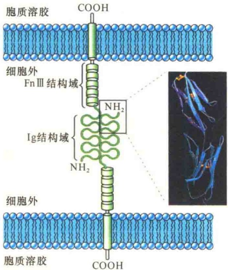

图 4-28 免疫球蛋白超家族细胞黏附分子 L1 介导的细胞黏附（引自 Karp，2010）。L1 是一种 IgSF 黏附分子，每种 L1 分子含有一个很小的细胞内结构域、一个穿膜片段、一个大的细胞外部分。在细胞外部分中有一个由几段纤连蛋白中类似片段装配成的 FnⅢ结构域，在 N 端有 6 个 Ig 结构域。L1 是神经胶质细胞黏附分子，在神经的发育过程中具有重要作用。在人类，L1 基因突变将是毁灭性的。

子，有一类非钙依赖性的黏着蛋白分子是神经细胞黏附分子（neural cell adhesion molecule, NCAM）。NCAM虽然能够与硫酸乙酰肝素（heparan sulfate）糖蛋白结合，但是主要功能是作为细胞-细胞黏附的受体。NCAM仅在神经细胞中表达。NCAM既在中枢神经组织中起作用，也在外周神经系统，尤其是在神经纤维中起作用。

神经系统表达三种不同的NCAM蛋白，是由同一基因经可变剪接而来的。NCAM-180与NCAM-140（数字表示千道尔顿）都是单次穿膜的膜蛋白，二者在细胞质部分的C端是不同的；而NCAM-120则通过GPI锚定在细胞质膜上。

NCAM 在内质网上合成，经过高尔基体的翻译后修饰，才被分泌到细胞质膜上。翻译后修饰，包括磷酸化、硫酸化及糖基化。但最重要的修饰是添加了一段长的、线性的唾液酸糖，称为聚唾液酸（polysialic acid, PSA）（图 4-29）。加上 PSA 后，使 NCAM 的形态和功能都发生了重大改变。因为唾液酸带负电，伸出到细胞外能够吸附阳离子，并能结合水，如同细胞外基质中的蛋白聚糖。

PSA 添加到 NCAM 的作用是调节了 NCAM 与受体的黏附作用。膜结合的 NCAM 主要与相邻细胞相同的 NCAM 受体黏附，虽然这种同嗜性作用的详细机制尚不清楚，但有一种观点认为:当两相邻细胞的 NCAM 受体的结构域完全重叠后可强化相邻细胞的黏附，但经 PSA 修饰的 NCAM 受体不会完全重叠，因而黏附较弱（图 4-30）。

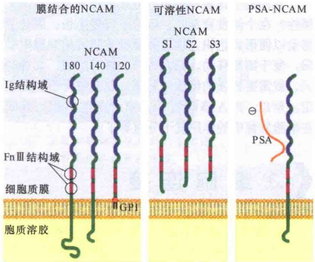

图 4-29 NCAM 的结构组成（引自 Plopper，2016）。神经细胞可表达膜结合的 NCAM、可溶性的 NCAM，以及 PSA-NCAM 蛋白。不同类型的 NCAM 细胞外部分都含有 Ig 结构域。NCAM 细胞外结构域能够添加 PSA 而被修饰（图中仅显示了 NCAM-140），PSA 在分泌过程中附着到 NCAM 的天冬酰胺残基上。

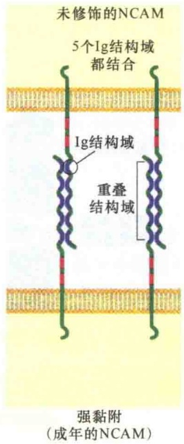

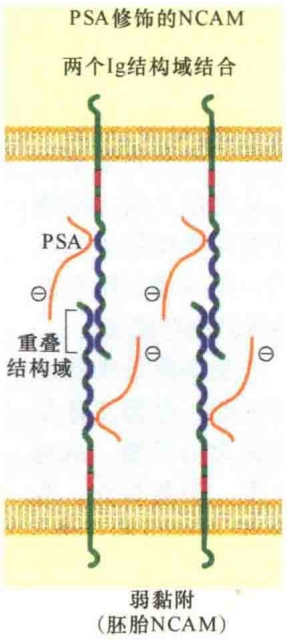

图 4-30 NCAM-NCAM 介导的细胞黏附（引自 Plopper, 2016）。两相邻细胞膜上未修饰的 NCAM 能够通过 5 个 Ig 结构域相互黏附从而介导两个细胞较强的黏附。而经 PSA 修饰的 NCAM 只能通过两个 Ig 结构域的相互作用进行细胞黏附，因而较弱。

---

细胞生物学（第二版）

相同的受体有两种不同强度的细胞黏附有何优越性？在个体发育期间，细胞不仅要生长，而且要移动以便形成组织。这就需要细胞间的相互黏附较弱，便于细胞移动。而在成熟的器官组织，如神经元，就需要较强的细胞间黏附，以便维持组织的稳定。所以，PSA修饰的NCAM介导的细胞间黏附在细胞发育中的作用就十分重要了。

## 4.3 细胞连接

多细胞生物建立组织的首要反应是相互识别和黏附，但是仅此不足以建立组织并维持组织的相对独立和长期稳定，细胞间还必须建立更为密切的联系。细胞间建立长期的组织上的联系通常需要较复杂的结构，这种结构称为细胞连接（cell junction）。

细胞连接是细胞间的联系结构，是细胞质膜局部区域特化形成的，在结构上包括膜特化部分、质膜下的胞质部分及质膜外细胞间的部分。细胞连接是多细胞有机体中相邻细胞之间通过细胞质膜相互联系、协同作用的重要基础。

## 4.3.1 细胞连接的概念和类型

细胞连接是指细胞表面的特化结构或特化区域，两个细胞通过这种结构连接起来。细胞的特型的连接:紧密连接（tight junction）、锚定连接（anchoring junction）、通讯连接（communicating junction）。每一种连接都具有独特的功能。这三种类型的细胞连接中，锚定连接最为复杂，根据锚定连接在连接中所涉及的细胞外基质和细胞骨架的关系又分为4种类型:桥粒、半桥粒、黏着带和黏着斑（图4-31）。

紧密连接（tight junction）是 Farquhar 和 Palade 在 1963 年发现的，又称不通透连接（impermeable junction）。

## 4.3.2 紧密连接

## 4.3.2.1 紧密连接的结构

紧密连接通常位于上皮顶端两相邻细胞间。图 4-32 是上皮两相邻细胞紧密连接的电子显微镜照片，从图中可见相邻两细胞的紧密连接处的细胞质膜紧紧结合在一起，几乎融合；在融合部位，两细胞间基本没有空隙，所以紧密连接部分完全封闭了连接处的溶质流通。

化区涉及细胞外基质蛋白、穿膜蛋白、胞质溶胶蛋白、细胞骨架蛋白等。从功能上看，细胞连接将同类细胞连接成组织，并与相邻组织的细胞保持相对稳定。

通过冰冻蚀刻电子显微镜术研究紧密连接时，发现紧密连接似网状的封闭线（sealing strand）将两细胞质膜缝合在一起，每一条封闭线都是一条长长的穿膜蛋白（图4-33）。构成封闭线的主要穿膜蛋白是密封蛋白（claudin）。小鼠实验表明，如果密封蛋白基因-1缺失，皮肤的上皮细胞将不能

细胞黏附是细胞连接的起始，细胞连接是细胞黏附的发展。从时间上看，黏附在先，连接在后。从结构上看，细胞黏附涉及的分子较少、范围局部、结构简单；而细胞连接涉及的蛋白分子较多、范围广、结构复杂，且结合的紧密程度高。

动物细胞有三种类

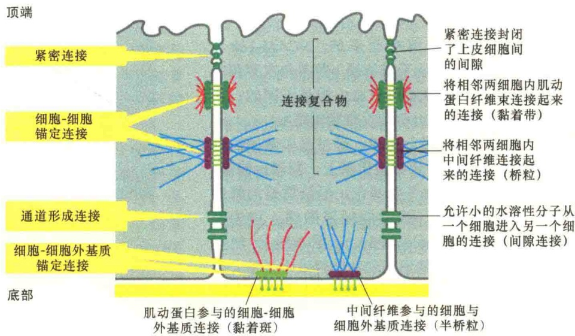

图 4-31 脊椎动物上皮细胞中发现的各种细胞连接及基本功能分类（引自 Alberts et al., 2015）。图中可见有 6 种连接:①紧密连接，②黏着连接（黏着带），③桥粒，④间隙连接，⑤半桥粒，⑥黏着斑。半桥粒与黏着斑是细胞与细胞外基质的连接，其他 4 种都是细胞间的连接。

---

4 细胞环境与互作

121

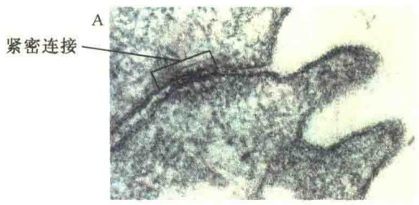

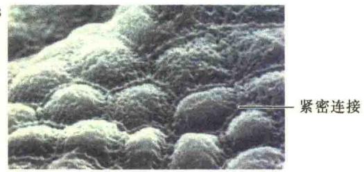

图4-32 紧密连接电镜图（引自Karp，2010）。A.上皮细胞切片观察到的紧密连接电镜照片；B.扫描电子显微镜观察的上皮顶部细胞周围的环状紧密连接。

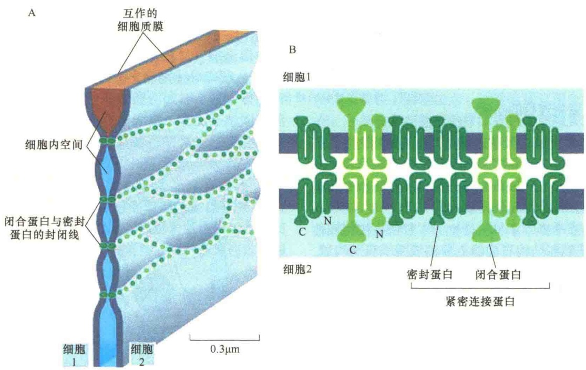

图 4-33 紧密连接模式图（引自 Alberts et al., 2015）。A. 封闭线将相邻两细胞结合在一起。封闭线是由穿膜蛋白穿过两细胞内部进行细胞的连接封闭产生的。B. 缝线的两种主要组成蛋白:密封蛋白与闭合蛋白。紧密连接的细胞外主要蛋白质是具有 4 个穿膜结构域的蛋白质家族。密封蛋白在连接中起主要作用，闭合蛋白起辅助作用。密封蛋白是紧密连接的结构蛋白，而闭合蛋白负责透性。这两种蛋白质的 N 端与 C 端都在细胞质侧，它们与支架蛋白相互作用，组成紧密连接的封闭缝线，并且与细胞质骨架-肌动蛋白相连接（图中未显示）。

形成紧密连接，结果新生鼠由于通过皮肤蒸发脱水，出生后一天之内即死亡。如果将原本不表达密封蛋白的细胞，如成纤维细胞，通过人工方法使其表达密封蛋白，也会形成紧密连接。紧密连接复合物中还含有另一个主要的蛋白质——闭合蛋白（occludin）。该蛋白质虽然不是紧密连接装配必需的蛋白质，但对于紧密连接的功能具有重要作用。紧密连接中还有第三种穿膜蛋白质——三叶霉素蛋白（tricellulin），该蛋白质可将细胞质膜封闭起来，防止在三细胞交汇处发生渗漏。

密封蛋白家族有很多成员，在人类中就有24种，它们以不同的组合在不同的上皮细胞中表达，赋予上皮特殊的透性。它们形成与细胞平行的孔，是一种选择性通道，能够让特殊的离子通过紧密连接障碍，从一个细胞外转移到另一个细胞外。例如，在肾的上皮细胞中发现一种特殊的密封蛋白，它允许  $Mg^{2+}$  在肾小管的细胞间通过，以便让尿液中  $Mg^{2+}$  进入血液。

紧密连接中的密封蛋白-闭合蛋白需要与支架蛋白（scaffold protein）组成复合物。紧密连接中的密封蛋白-闭合蛋白装配时需要细胞质膜内侧的一些黏着蛋白的帮助，紧密连接装配最关键的组织者是紧密连接（zonula occludens，ZO）蛋白。ZO 蛋白家族中有三个主要成员:ZO-1、ZO-2、ZO-3。ZO 蛋白是大的支架蛋白，为紧密连接的构建提供支撑。它们是由不同的蛋白质结合结构域组成的

---

122

细胞生物学（第二版）

线性结构，典型结构中含有 PDZ（PSD-95、Dlg 及 ZO-1）结构域，该结构域是一个长 80 个氨基酸的肽段，能够识别匹配蛋白的 C 端并与之结合。支架蛋白中有一个能与密封蛋白结合，还有可与闭合蛋白或细胞质肌动蛋白骨架结合的蛋白质（图 4-34）。不仅如此，支架蛋白复合物中的蛋白质也能够相互结合，从而在细胞内为紧密连接缝合线的装配提供支撑。

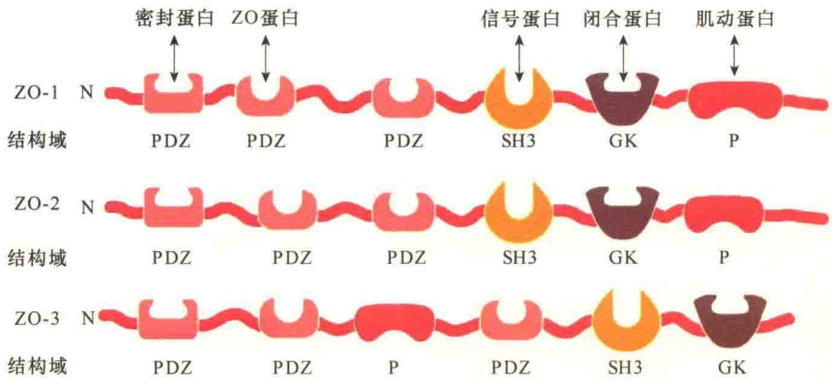

图 4-34 紧密连接的支架蛋白（引自 Alberts et al., 2015）。支架蛋白 ZO-1、ZO-2、ZO-3 集中位于紧密连接部位的质膜下方，每一个 ZO 蛋白含有多个蛋白结合结构域，包括 3 个 PDZ 结构域、一个 SH3 结构域、一个 GK 结构域，这些结构域如同一根绳上的珠子一样连接在一起。这些结构域不仅能够相互作用，也能与其他的蛋白质相互作用，为紧密连接的缝合线提供支撑。

## 4.3.2.2 紧密连接的功能

从功能上看，紧密连接除了连接细胞之外，还有两个作用:建立并维持细胞的极性，调节物质的穿细胞运输（transcellular transport）及细胞旁侧运输（paracellular transport）。

1）葡萄糖的穿细胞运输 紧密连接将极性细胞的质膜在结构与功能上分隔成两个膜结构域，即顶部（apical）与基部（basal）。顶部是上皮组织细胞朝向最外一侧质膜，基部是与顶部相反一侧的细胞质膜区。因此，紧密连接将上皮组织的细胞分成了表层与基底层，这就使得上皮细胞有了极性。这一结构特征在功能上有利于葡萄糖的穿细胞运输。图4-35是紧密连接在葡萄糖穿细胞运输中的作用。

2）调节细胞旁侧运输 紧密连接的第二个作用就是能够调节一些特殊离子在极性细胞层间的运输。紧密连接对细胞间隙的封闭作用不是绝对的。一些实验证明，紧密连接对小分子物质有一定的通透性，而且不同类型的上皮细胞紧密连接对离子的通透能力不同。例如，小肠上皮与膀胱上皮的紧密连接对离子的通透率可相差1万倍。由于离子是通过紧密连接调节的孔进行运输的，这种运输不经过细胞，而是在细胞的旁侧与细胞平行运输，故称为细胞旁侧运输。穿细胞运输与细胞旁侧运输都属于穿上皮运输（transepithelial transport）（图4-36）。

在上皮及内皮细胞层都有旁侧细胞运输。在旁侧细胞运输中，紧密连接被认为是一种“分子筛”（molecular sieve），对细胞外要通过上皮及内皮的分子进行过滤。并非所有的分子筛都是相同的，因为不同的组织有不同的分子需求。实际上，大小在4～40Å的分子能够自由通过紧密连接的孔，具体的大小，依据组织的不同而不同。

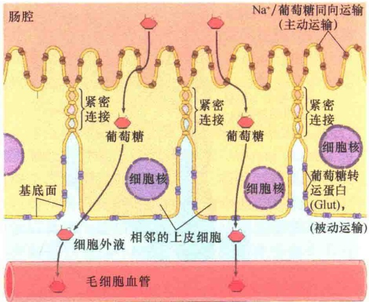

图 4-35 紧密连接在穿细胞运输中的作用（引自 Becker et al., 1996）。为简便起见，图中仅显示肠上皮组织的 4 个相邻细胞，通过相邻细胞间的紧密连接将上皮细胞分成顶层与基底。经消化后产生的葡萄糖进入肠腔后可通过  $Na^{+}$ /葡萄糖转运蛋白进入上皮组织细胞中，由于相邻细胞间除紧密连接外，没有其他部位进行相互接触，所以上皮细胞中的葡萄糖不能在相互间进行转运，而只能通过  $Na^{+}$ /葡萄糖转运蛋白转运的细胞外基质进入血液，并通过血液循环被其他组织的细胞吸收。在此过程中，紧密连接为葡萄糖的穿细胞转运提供了结构上的保障。

紧密连接对于离子及一些溶质的透过性物理障碍作用也是相当不同的。离子的运输是快速的，而一些溶质则需要几分钟乃至几小时才能通过紧密连接，原因是被选择的离子是直接穿过紧密连接的孔，而分子较大的溶质必须等待紧密连接“断熔”（短暂的断开）才能通过。

---

4 细胞环境与互作

123

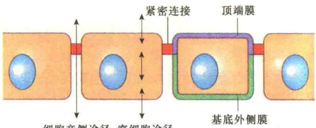

细胞旁侧途径 穿细胞途径

图 4-36 穿过上皮的穿细胞运输与细胞旁侧运输（引自 Lodish et al., 2013）。穿细胞运输需要细胞从一侧摄取分子，然后通过相关机制从相反一侧释放。旁侧运输是细胞外基质中的分子及离子通过渗透机制从紧密连接处穿过，不需要经过细胞。二者都是穿过上皮的运输。

紧密连接对离子的选择性透性，对于建立与维持表皮及内皮两侧的离子平衡十分重要。例如，如果因离子的选择性透性遭到破坏，使得表皮两侧的流动性平衡不能合理维持，鼠源胚胎则不能正常发育。同样，肾依靠适当的紧密连接的透性建立离子梯度，这种梯度对于体液与废液排除的调节是必要的。

此外，从紧密连接的支架蛋白复合物中看到，紧密连接与信号分子连接，提示紧密连接也参与细胞的信号转导。实际上，紧密连接的通透性也受细胞信号的调节。

在无脊椎动物中有一种分隔连接（septate junction），虽然构成的蛋白质不同（图 4-37），但所起的作用与紧密连接非常相似。

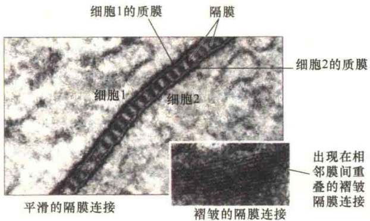

图 4-37 分隔连接（引自 Plopper，2016）。脊椎动物中两个相邻细胞间平滑的分隔连接看似是线性的壁，将相邻细胞既连接起来，又截然隔开。

## 4.3.3 锚定连接

大多数组织和器官都要受相邻细胞的机械力作用，这种机械力相当强，且有破坏性。为了维持组织结构的稳定性，组织内的细胞必须连接起来使组织具有一定的机械强度。在前面讨论细胞的6种黏着方式时，重点介绍了细胞质膜的受体问题，即受体蛋白如何与相邻细胞质膜的受体，或与细胞外基质中的相关蛋白发生作用并进行黏附的。如果细胞质膜受体参与细胞黏附时，受体的细胞质结构域与细胞骨架发生了关联，那么这种黏附关系就会进一步。由于细胞骨架的参与，黏附就发展成了连接。

黏附受体的细胞内结构域与细胞骨架之间需要一个支点，将受体蛋白的细胞内结构域与细胞骨架联系起来。研究发现，支点是由一些衔接蛋白组成的，由于衔接蛋白的种类众多，且可以相互作用，就会在细胞质膜内侧形成致密的细胞质斑（plaque），因此将这种连接称为斑形成连接（plaque-bearing junction）。实际上，由衔接蛋白组成的细胞质斑为受体蛋白细胞质结构域与细胞骨架的交汇提供了锚定位点。这种连接有两个重要的特点:一是在参与连接的穿膜蛋白的细胞质膜内侧形成了由衔接蛋白形成的、具有“黏性”的细胞质斑；二是这种黏性的细胞质斑既可为参与连接的穿膜蛋白在细胞内侧提供一个“锚定”的位点，又可为细胞内的骨架（肌动蛋白纤维或中间纤维）参与细胞连接提供“耦合点”。因此，这种连接既可称为“斑形成连接”（就本质而言），又可称为“锚定连接”（就表象而言）。由于多数作者将这种连接称为锚定连接（anchoring junction），故本书也统一用锚定连接。

锚定连接是动物各组织中广泛存在的一种细胞连接方式，通过黏着蛋白、整联蛋白、细胞骨架体系及细胞外基质的相互作用，将相邻两细胞连接在一起。根据参与连接的黏着蛋白是与肌动蛋白纤维还是中间纤维相连，以及是细胞-细胞间的连接还是细胞与细胞外基质的连接，将锚定连接分为黏着（黏着带、黏着斑）连接和桥粒（桥粒和半桥粒）连接两大类，共计4小类（表4-7）。

## 4.3.3.1 黏着连接

在锚定连接中，如果连接作用涉及细胞质中的骨架是肌动蛋白纤维，这种锚定连接方式就称为黏着连接（adherens junction, zonula adherens）。根据黏着连接涉及的是两个细胞间的连接还是细胞与细胞外基质的连接，又分为两种情况:如果涉及相邻两细胞间的连接，则称为黏着带（adhesion belt）；如果是细胞与细胞外基质相连，则称为黏着斑（focal adhesion）。

1）黏着带:“细胞-细胞”黏着连接黏着带连接位于上皮细胞紧密连接的下方，靠钙黏着蛋白与肌动蛋白相互作用将两个细胞连接起

---

124

细胞生物学（第二版）

表 4-7 锚定连接

| 连接类型 | 连接方式 | 膜受体蛋白 | 细胞外配体 | 细胞内骨架 | 胞内黏着斑蛋白 |
| --- | --- | --- | --- | --- | --- |
| 黏着带 | 细胞-细胞 | 钙黏着蛋白 | 相邻细胞的钙黏着蛋白 | 肌动蛋白纤维 | $\alpha$-联蛋白,$\beta$-联蛋白,桥粒斑珠蛋白($\gamma$-联蛋白),P120-联蛋白,黏着斑蛋白 |
| 黏着斑 | 细胞-ECM | 整联蛋白 | 细胞外基质蛋白 | 肌动蛋白纤维 | 踝蛋白,黏着斑蛋白,黏着斑蛋白激酶(FAK),桩蛋白,其他相关蛋白 |
| 桥粒 | 细胞-细胞 | 非典型钙黏着蛋白,桥粒黏蛋白,桥粒胶蛋白 | 相邻细胞的桥粒黏蛋白,桥粒胶蛋白 | 中间纤维 | 桥粒斑珠蛋白($\gamma$-联蛋白),亲斑蛋白,桥粒斑蛋白 |
| 半桥粒 | 细胞-ECM | $\alpha_{6}\beta_{4}$整联蛋白XVII胶原蛋白 | 细胞外基质蛋白 | 中间纤维 | 网蛋白,BP230 |

来（图 4-38）。黏着带处相邻细胞质膜的间隙为20～30nm，介于紧密连接和桥粒之间。

参与黏着带连接的主要蛋白是钙黏着蛋白和肌动蛋白。钙黏着蛋白是一种穿膜糖蛋白，属钙依赖性的细胞黏附分子，所以这种连接也是钙依赖性的。在黏着带连接中，钙黏着蛋白的细胞外结构域与相邻细胞质膜上另一个钙黏着蛋白的细胞外结构域相互作用形成“带”，使相邻细胞互相连接，但并不融合，保留有20～30nm的细胞间隙，看起来是很宽的带。钙黏着蛋白的细胞内结构域经细胞质膜内侧衔接蛋白（adaptor protein）介导与肌动蛋白纤维相连，衔接蛋白包括β-联蛋白（β-catenin）、α-联蛋白（α-catenin）等，其中β-联蛋白直接与钙黏着蛋白的细胞质端相连，然后通过α-联蛋白介导与肌动蛋白纤维相连。

黏着带的细胞质膜内侧的衔接蛋白将质膜的钙黏着蛋白与肌动蛋白纤维锚定在一起。据推测，在衔接蛋白周围可能还有其他能引起细胞信号转导的蛋白质，当钙黏着蛋白与肌动蛋白建立联系之后，信号转导蛋白通过某种方式引起细胞内其他一些应答。

2）黏着斑:“细胞-细胞外基质”黏着连接 黏着斑与黏着带的根本区别是:黏着斑是细胞与细胞外基质间的黏着连接（图4-39），而黏着带是细胞与细胞间的黏着连接。除了这一根本区别之外，还有其他一些不同:①参与黏着带连接的膜整合蛋白是钙黏着蛋白，而参与黏着斑连接的是整联蛋白，即细胞外基质受体蛋白；②黏着带连接实际上是两个相邻细胞膜上的钙黏着蛋白与钙黏着蛋白的连接，而黏着斑连接是整联蛋白与细胞外基

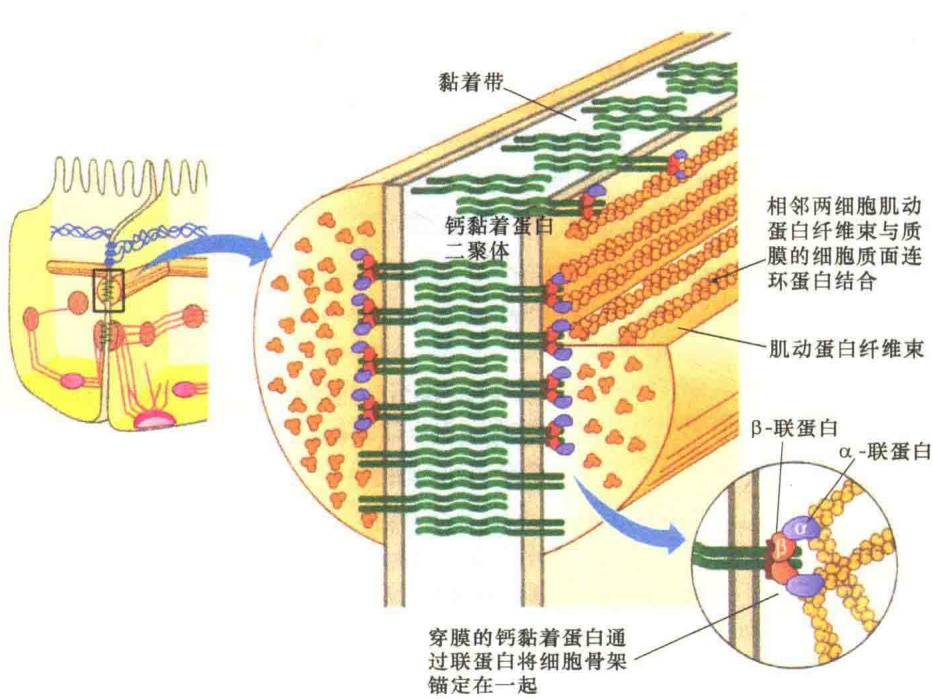

图 4-38 黏着带连接的结构（引自 Plopper，2016）。细胞黏附分子——钙黏着蛋白的细胞质部分通过衔接蛋白（如  $\alpha$ -联蛋白、 $\beta$ -联蛋白）与细胞骨架的肌动蛋白相连。两细胞间则是靠钙黏着蛋白的相互作用连接起来，中间有一个很宽的带。

质中纤连蛋白的连接，因整联蛋白是纤连蛋白的受体，所以黏着斑连接是通过受体与配体结合。

在黏着斑连接中，整联蛋白的细胞质部分同样要由衔接蛋白介导与细胞骨架的肌动蛋白纤维相连。不过细胞质膜内侧参与锚定的衔接蛋白与黏着带连接有所不同，它含有踝蛋白，这种蛋白质在其他的细胞质斑中是不存在的。

无论是何种黏着连接，都有三个基本特点:①都是钙依赖性的，因为钙黏着蛋白和整联蛋白的活性都受 $Ca^{2+}$ 的调节；②都要通过细胞质膜内侧衔接蛋白介导与细胞骨架的肌动蛋白相连；③无论

---

4 细胞环境与互作

125

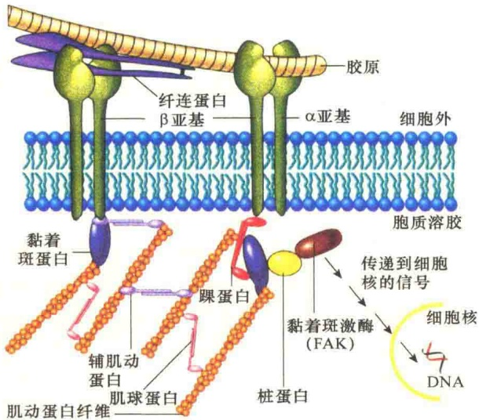

图 4-39 黏着斑连接（引自 Karp，2010）。整联蛋白被激活后，细胞外头部结构域与细胞外基质中的胶原、纤连蛋白相结合，细胞质结构域通过踝蛋白（talin）、黏着斑蛋白（vinculin）等衔接蛋白的介导与  $\alpha$ -肌动蛋白纤维相连，通过衔接蛋白的锚定作用强化了细胞外基质与细胞的关系。黏着斑蛋白可通过桩蛋白与黏着斑激酶（focal adhesion kinase，FAK）结合，引起细胞内的信号转导。

1）桥粒（完全桥粒）:细胞-细胞连接 桥粒（图4-40）是最常见的连接方式，主要出现在上皮组织，如皮肤和肠组织。桥粒连接的形态像圆盘，直径大约为 $1\mu \mathrm{m}$，桥粒连接能赋予组织机械强度。从形态上看，通过桥粒连接，两细胞间形成纽扣式的结构。桥粒连接处相邻细胞质膜间的间隙约 $30\mathrm{nm}$，锚定衔接处形成的细胞质斑的厚度为 $15\sim 20\mathrm{nm}$ 。从结构上看，桥粒连接也是通过钙黏着蛋白将两个相邻细胞结合起来。参与桥粒连接的钙黏着蛋白与黏着连接中的钙黏着蛋白在结构上有所不同。参与桥粒连接的钙黏着蛋白有两种类型，分别称为桥粒黏蛋白（desmoglein）和桥粒胶蛋白（desmocollin）。在细胞质膜的内表面有一致密的细胞质斑，其中有很多衔接蛋白作为锚定细胞骨架中间纤维的位点。锚定主要是通过细胞质斑中的衔接蛋白——桥粒斑蛋白（desmoplakin）介导的，桥粒斑蛋白也属于钙黏着蛋白。网状的中间纤维网络不通过中间纤维锚定到细胞骨架上，这种锚定连接方式就称为桥粒（desmosome），这是桥粒连接与黏着连接的根本区别。如同黏着连接，桥粒连接也分为两种情况:如果涉及的是相邻两细胞间的连接，则称为桥粒（即完全桥粒）；如果是细胞与细胞外基质相连，则称为半桥粒（hemidesmosome）。

是钙黏着蛋白还是整联蛋白，一旦与肌动蛋白相连，都会与某种信号分子发生联系，引起细胞的信号转导。由此看来，黏着连接的两个主要功能是:

①通过膜整合蛋白、细胞骨架的肌动蛋白纤维、细胞外基质黏连蛋白将细胞与细胞或细胞与细胞外基质连接起来；②通过膜整合蛋白与肌动蛋白相连，给细胞传递一种信号，然后通过细胞内的信号分子将信号放大。另外，钙黏着蛋白介导的细胞黏着连接与细胞黏附间既有联系，又有差别，联系是二者都与钙黏着蛋白有关，差别主要是黏着连接必然与细胞骨架有关，而钙黏着蛋白介导的细胞黏附则不然。

## 4.3.3.2 桥粒

在锚定连接中，如果细胞质膜受体蛋白是

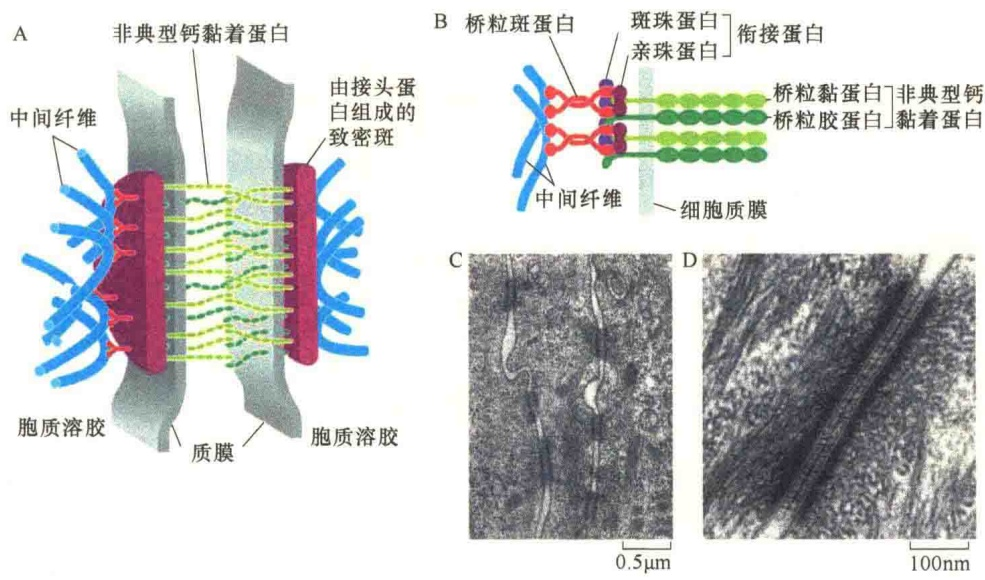

图 4-40 桥粒（引自 Alberts et al., 2015）。A. 桥粒的结构。在相互连接的两个细胞质膜的内侧面有一个致密的、由一些衔接蛋白组成的细胞质斑。一束角质蛋白中间纤维附着在每一细胞质斑的表面。穿膜的非典型钙黏着蛋白的细胞质结构域与细胞质斑结合，并通过非典型钙黏着蛋白的细胞外结构域与相邻细胞的非典型钙黏着蛋白的细胞外结构域相互作用，从而将两个细胞连接在一起。B. 构成桥粒的某些分子组成:桥粒黏蛋白和桥粒胶蛋白是非典型的钙黏着蛋白。它们的细胞质部分与桥粒斑珠蛋白（γ-联蛋白）、亲斑蛋白等衔接蛋白结合，再通过桥粒斑蛋白与中间纤维相连。C. 幼鼠皮肤中三个表皮细胞间的桥粒连接的电镜照片。D. C 图局部放大后见到的桥粒。

---

126

细胞生物学（第二版）

仅提供了将周围细胞连成一体的结构组成，同时还增加了细胞的机械强度。由此可见，钙黏着蛋白在维持上皮细胞组织的整体性方面具有重要作用。临床上有一种自我免疫症——天疱疮，就是丧失上皮细胞的桥粒连接而患上严重的皮肤水泡。

2）半桥粒:细胞-细胞外基质连接 在桥粒连接中，如果穿膜蛋白细胞外结构域不是与另一细胞的穿膜蛋白相连，而是与细胞外基质相连，形态上类似半个桥粒，这种连接称为半桥粒。与桥粒连接相比，半桥粒连接有两点不同:首先，参与连接的穿膜蛋白不是钙黏着蛋白而是整联蛋白；其次，整联蛋白的细胞外结构域不是与相邻细胞的整联蛋白相连而是与细胞外基质相连，已经从半桥粒中分离到  $\alpha_{6}\beta_{4}$  整联蛋白二聚体。半桥粒主要位于上皮细胞的基底面，作用是将上皮细胞与其下方的基膜连接在一起（图 4-41）。

0.3μm

图 4-41 半桥粒（引自 Karp，2010）。A. 表皮细胞基底面桥粒的电子显微镜照片。图中有几个半桥粒并清晰可见细胞内的中间纤维骨架。B. 半桥粒主要结构及其分子组成。在半桥粒连接处有两种穿膜蛋白。第一个穿膜蛋白是  $\alpha_{6}\beta_{4}$  整联蛋白，其细胞外头部与基膜中的层粘连蛋白相连，细胞内尾部锚定在含有网蛋白的细胞质斑中，而细胞质骨架中间纤维也锚定在细胞质斑中，从而将基膜、细胞质膜、细胞骨架结合起来。第二个穿膜蛋白是 BP180，帮助  $\alpha_{6}\beta_{4}$  整联蛋白进行细胞连接。

## 4.3.3.3 细胞黏附在细胞与环境互作中的作用

我们先讨论了由细胞黏附分子介导的4种不同的细胞黏附，后又讨论了由细胞黏附分子介导的4种锚定连接（黏着带、黏着斑、桥粒和半桥粒）。细胞黏附是经细胞识别后建立组织的初级反应，锚定连接为组织的建立提供了结构保障。

因此，锚定连接对于相对固定细胞、增强组织的强度具有重要作用。特别是细胞骨架的参与，使同一组织的细胞能够紧密地结合在一起。细胞中的中间纤维网络通过桥粒和半桥粒锚定在质膜上，加固了上皮细胞之间及上皮细胞与其下方结缔组织之间的联系。桥粒与半桥粒如同铆钉一样，对上皮及其下方结缔组织所承担的机械张力和剪切力起了分散作用。肌动蛋白是细胞皮质骨架的主要成分，这种骨架成分通过黏着带和黏着斑将相邻细胞的质膜或质膜与细胞外基质蛋白联系在一起，不仅增强了组织的机械强度（图 4-42），更重要的是形成了组织网络和组织整体。此外，锚定连接也参与细胞的信号转导。

图 4-42 细胞骨架在细胞连接中的重要性（引自 Alberts et al., 1994）。若无细胞骨架参与，在外力作用下，很容易将两个细胞拉开；当有细胞骨架相连时，可抵抗一定的外力作用，维持细胞组织的整体性。

---

4 细胞环境与互作

127

## 4.3.4 通讯连接

通讯连接是一种特殊的细胞连接方式，位于特化的、具有细胞间通讯作用的细胞。它除了有机械的细胞连接作用之外，还可以在细胞间形成电偶联或代谢偶联。动物细胞与植物细胞的通讯连接方式是不同的，动物细胞的通讯连接为间隙连接（gap junction），而植物细胞的通讯连接则是胞间连丝（plasmodesmata）。

## 4.3.4.1 间隙连接

间隙连接是1967年被发现的，是动物细胞第三种类型的连接方式。间隙连接存在于大多数脊椎动物、无脊椎动物细胞中，尤其在需要进行快速通讯的细胞中特别丰富，如神经细胞和肌细胞。

间隙连接是细胞表面的特化结构，它为相邻细胞中离子和小分子的流通打开了一个直接的通道，促进细胞-细胞间的运输（cell to cell transport）。在心肌细胞中，当发生肌收缩时，心肌细胞间的间隙连接能够促进电信号的传递。

间隙连接的主要结构是连接子（connexon）。所谓“间隙”，有两层含义:其一是在间隙连接处，相邻细胞质膜间有2～4nm的间隙；其二是相邻两细胞通过连接子对接形成通道，允许小分子的物质直接通过这种通道从一个细胞流向另一个细胞（图4-43）。

连接子是一种穿膜蛋白，每个连接子由6个相同或相似的连接蛋白（connexin）亚基构成。每个连接子长为17nm，环绕中央形成孔径约为1.5nm的水性通道。

间隙连接通道蛋白的组成是多种多样的，不同组织来源的连接子的分子质量大小有很大差别。连接子的大小虽然不同，但所有连接子的结构相同，即都有4个 $\alpha$ 螺旋的穿膜区和2个细胞外环。

人的基因组测序表明:人的细胞组织中至少有20种不同的连接蛋白，有很多细胞表达一种以上的连接蛋白，可以装配成同质寡聚连接子（heterooligomeric connexon），即连接子由6个相同的亚基组成；也可以装配成异质寡聚连接子（homo-oligomeric connexon），即连接子由多种亚基组成。这样，两个细胞间装配成的连接子，有可能是同质的，也有可能是异质的（图4-44）。

相邻两细胞分别用各自的连接子相互对接形成细胞间的通道，实验证明间隙连接能够允许分子质量在 1200Da 以下的分子通过。Loewenstein 将染料注入用间隙连接连起来的一排昆虫细胞中的一个，然后在光学显微镜下观察，发现染料很快从一个细胞移向下一个细胞，而且比预料的要快得多。这种染料是亲水性的，分子质量为300Da。他们还用类似的实验证明了离子能够自由通过间隙连接。在Loewenstein的实验中，能够自由通过间隙连接的最大分子是1200Da，这说明其他的一些小的信号分子，如cAMP和 $IP_{3}$ 等也能自由通过。

图 4-43 间隙连接的结构（引自 Becker et al., 2003）。相邻两细胞各提供一个连接子并对接，在两细胞质膜中形成圆柱形的通道。每个连接子由 6 个连接蛋白亚基构成环形结构，环形中央部分是一个直径为 2.5\~3nm 的水性通道。

图 4-44 间隙连接的连接子结构（引自 Alberts et al., 2015）。间隙连接的连接子由相邻两细胞共同组成，它们的组成可以是同质的，也可以是异质的。

Gilula 和他的同事们通过实验获得了第二信使自由通过间隙连接的直接证据。他们用了两种培养的细胞系:一种是卵巢细胞，这种细胞没有

---

128

细胞生物学（第二版）

去甲肾上腺素的受体，所以不会对去甲肾上腺素或其他的胆碱激素做出应答；另外一种是心肌细胞，具有去甲肾上腺素受体，并受该激素的刺激。当将这两种细胞放在一起培养时，它们很快通过间隙连接连成一体，加入去甲肾上腺素后，不仅心肌细胞做出了应答，卵巢细胞也做出了应答。这一结果说明卵巢细胞之所以能够对去甲肾上腺素做出反应，是从心肌细胞得到了第二信使的结果。

上述实验以及后来的一些实验都证明间隙连接不仅具有机械连接作用，还能在细胞间形成电偶联（electrical coupling）和代谢偶联（metabolic coupling）。电偶联在神经冲动信息传递过程中起重要作用，代谢偶联可使小分子代谢物和信号分子通过间隙连接形成的水性通道从一个细胞到另一个细胞。例如，cAMP 和  $Ca^{2+}$  等都可通过间隙连接从一个细胞进入到相邻细胞，因此，只要有部分细胞接收信号分子的作用，就可以使整个细胞群发生反应。同时，在偶联的细胞之间，可以“共享”营养物质。

对肿瘤细胞间隙连接的研究表明:恶性肿瘤细胞的通讯能力存在缺陷，当用一种皮肤致癌剂佛醇二酯加入人肿瘤细胞培养液中，细胞间电偶联的比例从90%下降到6%，除去佛醇二酯后，电偶联逐渐恢复。因此认为致癌剂起着抑制连接通讯作用。有理由推测，细胞间的通讯抑制使癌变中的细胞失去正常细胞的调控作用，这可能是癌变的一个重要因素。

在胚胎发育过程中，间隙连接介导的细胞通讯显得尤为重要。在胚胎发育的一定阶段，一部分细胞与另一部分细胞失去偶联，开始向各自特定的方向发展，而同一部分这群细胞则保持互相偶联，以协调的方式向同一方向发展，表现出整体性。有一种假说认为，在胚胎发育的一定阶段，某种小分子物质可以通过间隙连接从高浓度区域移到低浓度区域，从而在一群细胞之间建立一个平缓的浓度梯度。这种区域性的浓度向这群细胞提供了它们自身的“位置信息”，可以让它们按其在胚胎中的位置而调控其分化方向。

间隙连接的作用受细胞质中  $Ca^{2+}$  和  $H^{+}$ 浓度的调节。间隙连接在低  $Ca^{2+}$  浓度时开放，此时的细胞质处于静息状态；当  $Ca^{2+}$  浓度升高时，间隙连接的通道逐步缩小，当  $Ca^{2+}$  浓度达到  $10^{-5}$  mol/L 时，通道完全关闭。提高  $H^{+}$ 浓度，也就是将细胞质中 pH 从 7.0 降低到 6.8 或更低，间隙连接的通道也会关闭。间隙连接除了受  $Ca^{2+}$  和  $H^{+}$ 调节外，还受其他因素的调节。

## 4.3.4.2 胞间连丝

虽然植物细胞没有动物细胞所具有的特异性连接方式，又有着较厚的细胞壁，但是细胞壁并没有完全封闭细胞。植物细胞壁通常含有小的开口，叫胞间连丝，通过它，细胞间可以进行连接。在电子显微镜下见到的胞间连丝似乎是以一个狭窄的、直径30～60nm的圆柱形细胞质通道穿过相邻的细胞壁。胞间连丝中有连丝微管（desmotubule）通过，并认为它是由两个细胞的滑面内质网衍生而来的（图4-45）。

胞间连丝不仅使相邻细胞的细胞质膜、细胞质、内质网交融在一起，而且也是植物细胞间物质运输和信息传递的重要通道，它与动物细胞的间隙连接有许多相同之处。正常情况下它允许800Da

图 4-45 植物的胞间连丝（引自 Alberts et al., 2015）。A. 胞间连丝穿过植物细胞壁形成细胞质通道并将相邻细胞连接在一起。B. 胞间连丝通过连丝小管穿过两细胞壁与相邻细胞的滑面内质网相通。C. 水蕨（water fern）的胞间连丝切片的电子显微镜照片。两细胞质膜形成一个连续的孔，并且可看到两细胞的内质网及穿过两细胞的连丝微管。

---

4 细胞环境与互作

129

以下的分子渗透，也能让离子自由通过，它的活性同样受  $Ca^{2+}$  浓度的调节等，因此具有植物信号转导的作用。

与间隙连接不同的是，胞间连丝的孔能够扩张，允许大分子，包括蛋白质和 RNA 分子通过。这是 20 世纪 80 年代通过研究病毒经植物细胞的胞间连丝从一个细胞向另一个细胞扩散时发现的。此外，还发现病毒编码一种能够与植物细胞胞间连丝的壁相互作用的移动蛋白（movement protein），这种蛋白质能够增加胞间连丝孔的直径。后来的研究发现，植物能够自己合成移动蛋白介导细胞间的大分子运输。

我们分别讨论了细胞中三大类细胞连接，现将它们的功能、主要特点等总结于表 4-8。

表 4-8 细胞连接的方式与特点

| 连接类型 | 功能 | 特征 | 相关结构 |
| --- | --- | --- | --- |
| 紧密连接 | 封闭细胞空间 | 沿着嵴进行膜连接 | 穿膜连接蛋白 |
| 锚定连接 |  |  |  |
| 黏着带 | 细胞-细胞黏着连接 | 形成连续的黏着带 | 与肌动蛋白纤维相连 |
| 黏着斑 | 细胞-ECM黏着连接 | 形成局部的黏着点 | 与肌动蛋白纤维相连 |
| 桥粒 | 细胞-细胞黏着连接 | 形成局部的黏着点 | 与中间纤维相连 |
| 半桥粒 | 细胞-基膜黏着连接 | 形成局部的黏着点 | 与中间纤维相连 |
| 通讯连接 |  |  |  |
| 间隙连接 | 动物细胞间离子和分子的交换 | 连接子(具有3nm孔径的跨膜蛋白) | 两个细胞通过各自的连接子对接形成通道可能通过衔接与细胞骨架相连 |
| 胞间连丝 | 植物细胞间的物质交换 | 两细胞间形成直径为30~60nm通道 | 内质网穿过两细胞壁与肌动蛋白相连 |

## 4.4 植物的细胞外结构:细胞壁

植物与动物有一个很重要的不同，就是植物没有骨骼系统，但是植物细胞却有相当的强度。赋予植物细胞强度的，不是骨骼，而是植物的细胞壁（图 4-46）。植物细胞壁除了给整体植物提供机械强度之外，也保护细胞免遭渗透及机械损伤。另外，植物的细胞壁可以保护植物免受微生物，特别是真菌和细菌的侵染。坚硬的细胞壁对于植物的形态也有决定性的作用，若除去细胞壁，植物细胞就会失去其正常的形态。植物细胞壁是造成植物细胞与动物细胞性质上差异的主要因素，如植物细胞不能迁移，也不可能发育成动物细胞所具有的神经系统。

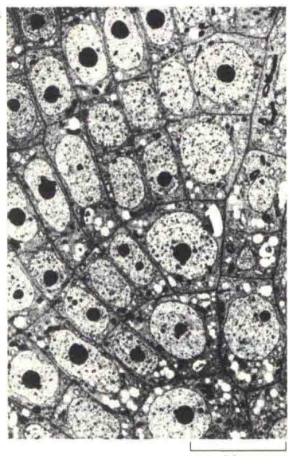

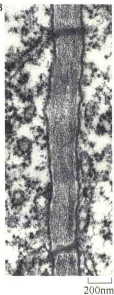

10μm

图 4-46 植物的细胞壁（引自 Alberts et al., 2015）。
A. 灯芯草根尖细胞的电镜照片，可见到细胞间的细胞壁。
B. 两相邻细胞间典型的细胞壁，图中所示两个较深的部分是穿过细胞壁的胞间连丝。

曾经有人把植物的细胞壁看成是相当惰性地包围在细胞外的细胞分泌物，现代的研究发现植物细胞壁是一个动态结构，能够进行很多活动。例如，与细胞壁有关的酶可将细胞外的营养转变成可通过细胞质膜进入细胞的小分子化合物；细胞壁也可以作为物质通透的障碍在代谢和分泌过程中起重要作用。

## 4.4.1 植物细胞壁的结构

植物有两种类型的细胞壁:初生细胞壁（primary cell wall）和次生细胞壁（secondary cell wall），它们是在不同阶段分泌合成的（图 4-47）。

细胞壁的分泌合成是逐步、分层次进行的，合成越早，最后离开质膜越远。首先形成的是中间层（middle lamella），其构成成分主要是果胶。果胶是相邻两细胞壁所共有的，并且起到将两个细胞连接在一起的作用。

分泌合成的第二个区带称为初生壁，是在细胞

---

130

细胞生物学（第二版）

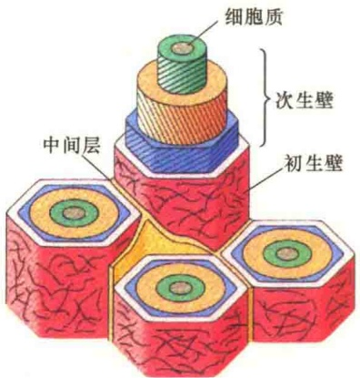

图 4-47 植物细胞壁的层次结构（引自 Kleinsmith and Kish, 1995）。某些植物的细胞壁只有初生壁；有些既有初生壁，也有次生壁。

生长时期形成的。初生壁的厚度为 100～200nm，与动物细胞的基膜相当。初生壁由纤维素、半纤维素、果胶和糖蛋白等松散组成。在初生壁中，果胶对于初生壁的弹性是十分重要的，使细胞在生长过程中进一步扩展。

次生壁是在细胞停止生长后分泌形成的，主要是增加细胞壁的厚度和强度。次生壁位于初生壁的内层，纤维素和木质素是次生壁的主要成分，但基本不含果胶，这使得次生壁非常坚硬。次生壁由几层纤维素微纤维组成，各自形成密集结实的层。

## 4.4.2 细胞壁的化学组成

细胞壁是由大分子构成的复杂的复合物，构成细胞壁的分子是由细胞壁所包围的细胞分泌出来的，从这种意义上来说，植物的细胞壁相当于动式图。

纤维素（cellulose）赋予植物初生壁的张力强度。每一个纤维素至少是由500个葡萄糖残基相互间通过氢键共价连接成线性类似丝带的结构，并通过链内的氢键使其保持稳定。此外，相邻纤维素分子间的氢键可使各纤维素分子平行排列，并形成约由16个纤维素链组成的束，组成束的纤维素链的极性相同。这种高度有序的晶体聚合体称之为纤维素微纤维（cellulose microfibril），约有几微米长。这种微纤维具有堪比钢一样的抗张强度（tensile strength）。微纤维的直径一般为5～15nm，长约几微米（图4-49）。

不同植物的细胞壁在组成、厚度等方面都有差异。例如，棉花的细胞壁几乎全是纤维素纤维构成的，而木本植物的细胞壁中纤维素仅占50%，某些植物幼苗的细胞壁中纤维素的含量不到1%。

虽然纤维素是细胞壁的关键成分，但是细胞壁不只是纤维素的集合体，还包括其他一些大分子，这些生物大分子大致分为4类:半纤维素、果胶、木质素、糖蛋白。

半纤维素（hemicellulose）是由几种不同类型的单糖构成的异质多聚体，这些糖是五碳糖和六碳糖，包括木糖、阿拉伯糖、甘露糖和半乳糖等。半纤维素木聚糖在木质组织中占总量的50%，它结合在纤维素微纤维的表面，并且相互连接，这些纤维构成了细胞相互连接的网络。

果胶（pectin）是由半乳糖醛酸和它的衍生物组成的具分支的多糖，带负电，类似动物细胞的糖胺聚糖，很容易形成水合胶。在细胞壁的中间层（middle lamella），果胶特别丰富。果胶在细胞壁中的作用主要是纤维间的填充物，将纤维素包埋在水

质。所不同的是，动物细胞的细胞外基质的主要成分是蛋白质分子；植物细胞壁的主要成分是多糖，其中最重要的是纤维素，它赋予植物细胞的硬度和强度，与动物细胞的细胞外基质中的胶原具有相似的作用。图4-48是植物细胞壁的主要化学组成及结构模

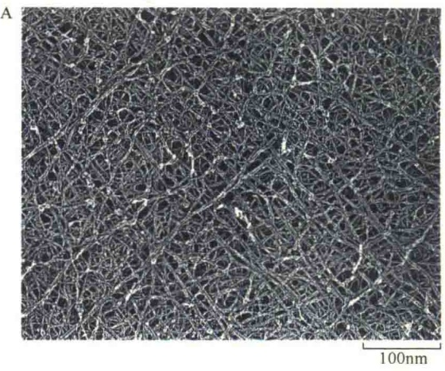

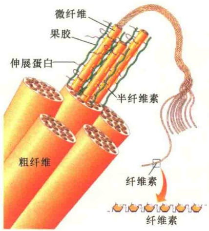

图 4-48 植物细胞壁的组成（引自 Karp，2010）。A. 洋葱细胞壁的纤维素微纤维与半纤维素交联的电镜照片，样品中除去了果胶聚合体。B. 植物细胞壁的结构组成。

---

4 细胞环境与互作

131

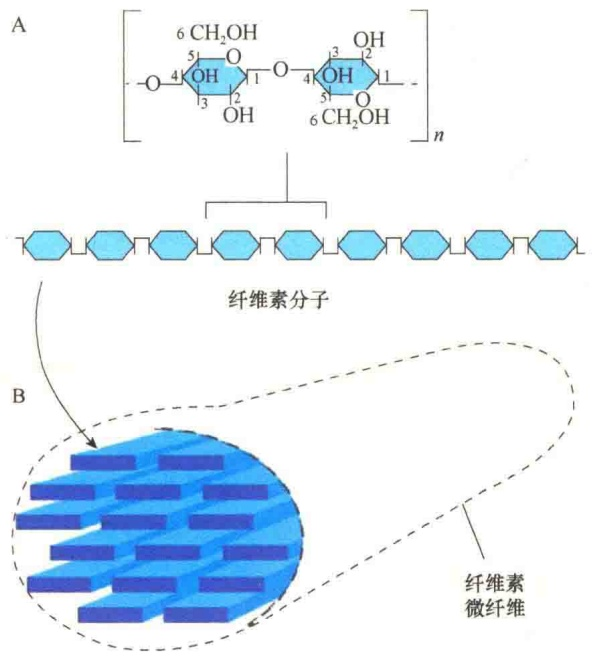

图 4-49 纤维素分子与纤维素微纤维（引自 Alberts et al., 2015）。A. 纤维素分子是由葡萄糖以 β（1→4）连接形成的链状多聚体；B. 由纤维素链组成纤维素微纤维。

合胶中。

木质素（lignin）是由聚合的芳香醇构成的一类物质，主要存在于木质组织中，其作用是通过形成交织网来硬化细胞壁。木质素主要存在于纤维素微纤维之间，具有抗压作用。在木本植物中，木质素占25%，是世界上第二位最丰富的有机物（纤维素是第一位）。

植物细胞壁中含有一些蛋白质，总量占细胞壁干重的5%。最重要的一种糖蛋白叫伸展蛋白（extensin），这种蛋白质与其他的相关蛋白一起，与纤维素等形成交叉网络，产生一种加固蛋白质-多糖复合物的力。有些蛋白质是酶，负责细胞壁的周转（turnover）和重建，特别是在生长期尤其如此。还有些蛋白质是穿膜的蛋白激酶，参与信号转导，这对于植物的免疫反应具有重要意义。

除了上述成分外，细胞壁中也有少量的脂，包括蜡质及其他的脂类。这些脂质常位于细胞壁的外表面，并且形成角质层，保护细胞免受损伤。细胞壁中还有矿物盐，如钙和钾等。

通过拟南芥的基因测序估计，大约有700个基因参与植物细胞壁的合成、装配与重建。

## 4.4.3 微管在纤维素微纤维装配中的作用

在植物细胞壁的纤维素微纤维装配过程中，微管（microtubule，MT）对于新合成的微纤维的定向具有引导作用。1963年，Ledbetter和Porter发现在形成细胞壁的质膜下有一层微管，后来的研究证实了这一发现，推测在细胞壁形成时，微管对于指导纤维素微纤维的方向具有重要作用（图4-50）。

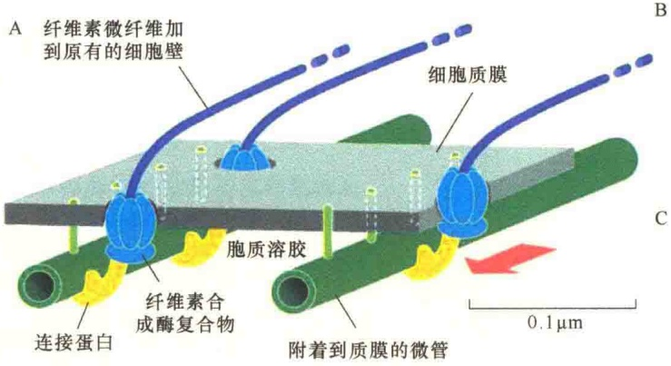

图 4-50 新合成的微纤维在微管指导下的定向（引自 Alberts et al., 2015）。A. 大的纤维素合成酶复合物是一类整合膜蛋白，在细胞质膜的外侧面连续合成纤维素微纤维。坚硬的微纤维的远端整合在细胞壁结构中，近端在合成酶的作用下沿着质膜不断合成延长。在质膜的胞质侧有微管的存在，并且纤维素微纤维通过连接蛋白与微管相连，因此，微管对微纤维具有定向指导作用。B～C. 显示皮质微管与质膜关联的两幅电子显微镜照片。B 是横切面照片，C 是纵切面照片，两幅照片都显示质膜与微管之间约有 20nm 的间隙，但连接分子不清楚。

---

细胞生物学（第二版）

## 本章小结

多细胞生命有机体中的细胞组成不同的组织，在这些组织中，通过细胞相互间以及细胞与细胞外环境的相互作用调节着细胞的迁移、生长及组织的三维结构。

动物是由多种类型的细胞组成的有机体，而且不同类型的细胞通常要组成固定的组织。在多数组织中，细胞要向细胞外分泌一群大分子，这些大分子在细胞间交织连接形成网状结构，将这种结构称为细胞外基质。

细胞外基质的组成可分为三大类:①蛋白聚糖，它们能够形成水性的胶状物；②结构蛋白，如胶原和弹性蛋白，它们赋予细胞外基质一定的强度和韧性；③黏着蛋白，如纤连蛋白和层粘连蛋白，它们促使细胞与基质结合。

细胞识别是指细胞对同种或异种细胞、同源或异源细胞、自己和异己物质的认识和鉴别。细胞黏附则是指相邻细胞或细胞与细胞外基质以某种方式黏附在一起，组成组织或与其他组织分开，这种黏附的方式比较松散。另外，从事件发生的次序来说，细胞识别在先，细胞黏附在后，识别是黏附的基础。介导细胞黏附的蛋白质有四类:整联蛋白、钙黏着蛋白、选择蛋白、免疫球蛋白超家族。

细胞在识别和黏附的基础上进行细胞连接。细胞连接有3种方式:紧密连接、锚定连接、通讯连接。比较复杂的是锚定连接，它又可分为4种连接方式:黏着带、黏着斑、桥粒、半桥粒。对它们的区别主要是根据连接蛋白与细胞骨架的关系，以及是细胞与细胞的连接，还是细胞与细胞外基质的连接。

植物细胞壁是由大分子构成的复杂复合物, 相当于动物细胞的细胞外基质。纤维素是细胞壁的主要成分, 此外还包括半纤维素、果胶、木质素、糖蛋白等。植物细胞壁不仅给整体植物提供机械强度, 还可保护植物免受微生物等的侵染, 以及植物形态决定等作用。

## 思考题

（1）如何从社会学的角度理解细胞环境与互作的意义？

（2）比较四类细胞锚定连接的特点与意义。

(3) 什么是透明质酸？其结构与功能有什么特点？

（4）间隙连接的渗透性（permeability）受 $\mathrm{Ca^{2+}}$ 的调节。你认为当细胞内的 $\mathrm{Ca^{2+}}$ 浓度高于正常值时，间隙连接是打开还是关闭？这种调节机制有什么优越性？

(5) 假定你合成了一段含有 RGD 模体 (motif) 的寡肽序列。当你将这种寡肽添加到已经通过纤连蛋白贴壁的成纤维细胞培养液中后, 对成纤维细胞的生长会有什么影响? 是如何发生的?