# 核糖体与蛋白质

6.1 核糖体的形态结构与 rRNA 基因

6.1.1 核糖体的形态结构与类型

6.1.2 核糖体 rRNA 基因扩增与染色体定位

6.1.3 核糖体 rRNA 基因的转录与加工

6.2 核糖体的装配

6.2.1 核糖体亚基的自我装配

6.2.2 原核生物核糖体重组实验

6.2.3 真核生物核糖体的装配

6.3 核糖体的功能——蛋白质合成

6.3.1 蛋白质合成的基本过程

6.3.2 核糖体的功能位点

6.3.3 tRNA及氨酰tRNA的合成

6.3.4 多聚核糖体

6.3.5 蛋白质合成抑制剂

6.4 蛋白质的折叠、修饰与降解

6.4.1 蛋白质折叠与分子伴侣

6.4.2 蛋白质的修饰与加工

6.4.3 蛋白酶体对蛋白质的降解

6.5 核酶

6.5.1 核糖体是一种核酶

6.5.2 具有切割功能的核酶

6.5.3 核酶与内含子的剪接

6.6 RNA编辑

6.6.1 RNA编辑对表达的调控

6.6.2 gRNA 介导的 mRNA 插入编辑

6.6.3 改变 mRNA 中单个核苷酸的 RNA 编辑

核糖体（ribosome）可谓是细胞中的“当家”细胞器，由于它参与细胞中蛋白质的合成，所以称为蛋白质合成机器。它的全称是核糖核蛋白复合体（ribonucleoprotein complex），即由核糖核酸与蛋白质组成的复合体。

核糖体的蛋白质合成功能是通过放射性标记实验发现的。将细胞与放射性标记的氨基酸短暂接触后进行匀浆，然后分级分离，发现在微粒体部分有大量新合成的放射性标记的蛋白质。后将微粒体部分进一步分离，得到核糖体和膜微粒，这一实验结果表明核糖体与蛋白质合成有关。

蛋白质是细胞各种结构，包括细胞核、细胞质膜、内质网、高尔基体、线粒体、叶绿体，细胞骨架，乃至鞭毛与纤毛的基本组成单位，蛋白质也是细胞一切功能的执行者，包括基因表达、信号转导、生长、分化等。

## 6.1 核糖体的形态结构与 rRNA 基因

核糖体最早是 Claude 于 20 世纪 30 年代后期用暗场显微镜观察细胞的匀浆物时发现的，当时称为微体（microsome），直到 20 世纪 50 年代中期，Palade 在电子显微镜下观察到这种颗粒的存在。当时 Palade 和他的同事研究了多种生物的细胞，发现细胞质中有类似的颗粒存在，尤其在进行蛋白质合成的细胞中特别多。后来 Siekevitz 用亚细胞组分分离技术分离了这种颗粒，并发现这些颗粒总是伴随内质网微粒体一起沉积。化学分析揭示，这种微粒富含核苷酸，随之命名为 ribosome，主要成分是:核糖体 RNA（rRNA），约占 60%；核糖体蛋白质（ribosomal protein），约占 40%。

---

188

细胞生物学（第二版）

## 6.1.1 核糖体的形态结构与类型

参与蛋白质合成的核糖体，基本组成为蛋白质与核糖体 RNA（rRNA），它们存在于细胞质中，可分为原核生物核糖体和真核生物核糖体。此外，在真核生物的细胞质、线粒体与叶绿体中都有核糖体，因此又分为细胞质核糖体和细胞器核糖体。细胞质核糖体参与核基因编码的蛋白质合成，而细胞器核糖体仅负责细胞器基因编码的蛋白质的合成。

## 6.1.1.1 核糖体是由大、小两个亚基组成的复合物

原核细胞的核糖体体积较小，沉降系数为70S，分子质量为 $2.5 \times 10^{3}kDa$ ，由50S和30S两个亚基组成；真核细胞的核糖体体积较大，沉降系数为80S，分子质量为 $3.9 \times 10^{3} \sim 4.5 \times 10^{3}kDa$ ，由60S和40S两个亚基组成（图6-1）。

图 6-1 核糖体的结构（引自 Cooper and Hausman，2013）。

虽然核糖体都是由大、小两个不同的亚基组成，但是这两个亚基并非都是结合在一起的，在不进行蛋白质合成时，它们是分开的，并且各自游离存在于细胞质中，只是在进行蛋白质合成时才结合在一起。

$Mg^{2+}$ 的浓度对于大、小亚基的聚合和解离有很大的影响。体外实验表明，70S核糖体在 $Mg^{2+}$ 的浓度小于1mmol/L的溶液中易解离；当 $Mg^{2+}$ 浓度大于10mmol/L时，两个核糖体通常形成100S的二聚体（图6-2）。

## 6.1.1.2 核糖体的类型

真核细胞中不仅有细胞质核糖体，而且还有叶

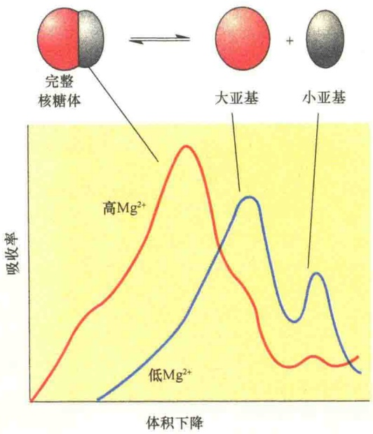

图 6-2 通过区带离心鉴定核糖体的亚基（引自 Kleinsmith and Kish，1995）。在  $Mg^{2+}$  浓度低时，完整的核糖体将分成大、小两个亚基。

绿体核糖体和线粒体核糖体。

在组成上，叶绿体中的核糖体与原核生物核糖体相同，但线粒体中核糖体的大小变化较大（表6-1）。

表 6-1 不同类型核糖体的大小比较

<table><tr><td>来源</td><td>完整核糖体</td><td>核糖体亚基</td><td>核糖体 RNA</td></tr><tr><td rowspan="2">细胞质(真核生物)</td><td>80S</td><td>60S(大亚基)</td><td>28S、5.8S、5S</td></tr><tr><td></td><td>40S(小亚基)</td><td>18S</td></tr><tr><td rowspan="2">细胞质(原核生物)</td><td>70S</td><td>50S(大亚基)</td><td>23S、5S</td></tr><tr><td></td><td>30S(小亚基)</td><td>16S</td></tr><tr><td rowspan="2">线粒体(哺乳动物)</td><td>55S~60S</td><td>45S(大亚基)</td><td>16S</td></tr><tr><td></td><td>35S(小亚基)</td><td>12S</td></tr><tr><td rowspan="2">线粒体(酵母)</td><td>75S</td><td>53S(大亚基)</td><td>21S</td></tr><tr><td></td><td>35S(小亚基)</td><td>14S</td></tr><tr><td rowspan="2">线粒体(高等植物)</td><td>78S</td><td>60S(大亚基)</td><td>26S、5S</td></tr><tr><td></td><td>45S(小亚基)</td><td>18S</td></tr><tr><td rowspan="2">叶绿体</td><td>70S</td><td>50S(大亚基)</td><td>23S、5S</td></tr><tr><td></td><td>30S(小亚基)</td><td>16S</td></tr></table>

在真核细胞中，核糖体进行蛋白质合成时，若是游离存在于细胞质中，称为游离核糖体；若是附着在内质网的表面，则称为附着核糖体。真核细胞含有较多的核糖体，每个细胞平均有 $10^{6}\sim10^{7}$ 个；而原核细胞中核糖体较少，每个细胞平均只有 $15\times10^{2}\sim18\times10^{3}$ 个。

---

6 核糖体与蛋白质

89

核糖体的大、小两个亚基都是由核糖体 RNA（rRNA）和核糖体蛋白质组成的，但原核生物和真核生物细胞质核糖体的大、小亚基在蛋白质和 RNA 的组成上有较大的差别。

典型的原核生物大肠杆菌核糖体是由50S大亚基和30S小亚基组成的。在完整的核糖体中，rRNA约占2/3，蛋白质约占1/3。50S大亚基含有36种不同的蛋白质和两种RNA，大rRNA沉降系数为23S，小rRNA沉降系数为5S。30S小亚基含有21种蛋白质和一个16S的rRNA。

真核细胞核糖体的沉降系数为 80S，大亚基为 60S，小亚基为 40S。在大亚基中，有大约 47 种蛋白质，另外有 3 种 rRNA，即 28S rRNA、5S rRNA 和 5.8S rRNA。小亚基含有大约 33 种蛋白质，一种 18S rRNA。

## 6.1.2 核糖体 rRNA 基因扩增与染色体定位

核糖体的组成成分是 rRNA 和蛋白质，所以编码核糖体的基因分为两类，一类是 rRNA 基因，另一类是核糖体蛋白质编码基因。在生活细胞中，特别是在活跃进行蛋白质合成的细胞中，需要大量的核糖体，这就意味着需要合成大量的 rRNA 和核糖体蛋白质。

## 6.1.2.1 编码 rRNA 基因的过量扩增

细胞为了满足大量需求的 rRNA，在进化过程中形成了一种机制:增加编码 rRNA 基因的拷贝数。在细胞中扩大 rRNA 基因的拷贝数有两种方式:第一种是在染色体上增加 rRNA 基因的拷贝数，如在 E. coli 的基因组中有 7 套 rRNA 基因，而典型的真核生物细胞含有几百到几千个 28S、18S 和 5.8S rRNA 基因的拷贝，5S rRNA 基因的拷贝数多达 50 000 个。

在需要大量合成核糖体的细胞中，增加RNA基因拷贝数的第二种方式是通过基因扩增（gene amplification）。研究者用两栖类的卵细胞（卵母细胞）研究发育过程中rRNA基因的扩增，发现两栖类卵母细胞在发育的早期，rRNA基因的数量扩增到1000多倍。基因扩增是通过形成几千个核进行的，每个核里含有几百个拷贝的编码28S、18S和5.8S的rRNA，最后卵母细胞中的这些rRNA的拷贝数几乎达到50万个，而在相同生物的其他类型细胞中，这些rDNA的拷贝数只有几百个。卵母细胞中有如此众多的rDNA拷贝，为卵细胞在受精后的发育过程中合成大量核糖体创造了条件（图6-3）。

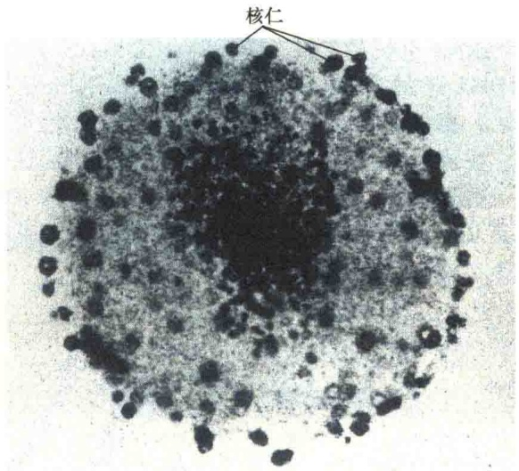

图 6-3 非洲爪蟾卵母细胞中 rRNA 的合成（引自 Karp, 2010）。卵母细胞中含有几百个核仁，每个核仁都含有扩增的 rDNA。

一般将编码 rRNA 基因的 DNA 称为 rDNA。

至于卵母细胞中 rRNA 基因扩增的机制，有人认为可能是通过从染色体上分离出来的环状 DNA 分子，这种环状 DNA 中含有 rRNA 基因，但是第一个含有 rRNA 基因的环状 DNA 是如何形成的尚不清楚。由于环状 DNA 的复制是通过滚环复制（rolling circle replication）的方式进行的，因而能够产生大量的 rRNA 基因。

## 6.1.2.2 真核生物 rRNA 基因的染色体定位

在真核生物染色体中，18S rRNA、5.8S rRNA 和 28S rRNA 基因是串联在一起的，每个基因被间隔区隔开，5S rRNA 基因位于不同染色体上。在人基因组中，18S rRNA、5.8S rRNA 和 28S rRNA 基因串联在一起，并分布在人的 13、14、15、21 和 22 号染色体上。在间期核中，所有这 5 条染色体 rRNA 基因区域转录时聚集在一起，形成一个核仁。

真核细胞核糖体的 5S rRNA 基因则是独立存在于一个或几个染色体上，拷贝数达几千个。在人的细胞中，该基因的拷贝有 24 000 个之多，它们串联排列在 1 号染色体接近末端处。

## 6.1.3 核糖体 rRNA 基因的转录与加工

## 6.1.3.1 18S rRNA、5.8S rRNA、28S rRNA 基因转录与加工

18S rRNA、5.8S rRNA 和 28S rRNA 基因首先

---

190

细胞生物学（第二版）

转录成一个 45S 的前 rRNA（pre-rRNA），大约是这 3 个 rRNA 总长的 2 倍。能够转录这 3 个前 rRNA 的 DNA 区域称为一个转录单位（transcription unit），意指它们有一个共同的转录起点和转录终点。在转录单位中除了这 3 个 rRNA 基因外，还包括一些间隔区。真核生物中参与 rRNA 基因转录的酶是 RNA 聚合酶 I。前 rRNA 在核仁中被酶剪切成 3 个 rRNA 产物，转录间隔区则被降解掉。

虽然所有真核生物的 18S rRNA、5.8S rRNA 和 28S rRNA 基因是相同的，并且在染色体上组成同一个转录单位，但是不同生物中的 18S rRNA、5.8S rRNA 和 28S rRNA 基因的转录起点和间隔区的长短并不完全相同（图 6-5）。

由于不同生物的 rDNA 转录起点不同、间隔区长短不同，所以前 rRNA 的大小不都是 45S，范围在 34S～45S 之间（表 6-2）。

表 6-2 不同种生物的前 rRNA

| 生物 | 前 rRNA 的沉降系数 |
| --- | --- |
| 果蝇 | 34S |
| 裂殖酵母 | 37S |
| 烟草 | 38S |
| 蛙 | 40S |
| 鸡 | 45S |
| 小鼠 | 45S |
| 人 | 45S |

前体的加工过程也十分复杂，通过 $^{3}$ H 标记的尿嘧啶和放线菌素 D 研究人的培养细胞前 rRNA 合成时发现:当人的细胞与 $^{3}$ H 标记的尿嘧啶共培养 25min 后，被标记 rRNA 的沉降系数是 45S，加入放线菌素 D 阻断 RNA 的合成后，标记的 45S rRNA 首先转变成 32S 的 rRNA，随着培养时间的延长，逐渐出现被标记的 28S rRNA、18S rRNA，根据这一研究结果推测出前 rRNA 的加工过程（图 6-4）。

图 6-4 45S 前 rRNA 的加工过程（引自 Karp, 2010）。在 rRNA 聚合酶 I 的作用下，将 18S rRNA、5.8S rRNA 和 28S rRNA 转录成 45S 的前体，然后通过一系列的切割加工形成成熟的 18S rRNA、5.8S rRNA 和 28S rRNA。其中，5.8S rRNA 通过互补碱基的氢键与 28S rRNA 结合在一起。

## 6.1.3.2 真核生物前 rRNA 的修饰

研究发现，真核生物的45S前rRNA在被剪切成18S rRNA、5.8S rRNA、5.8S rRNA之前要进行修饰，包括约有100多个位点被甲基化、100多个位点的尿苷转变成了假尿苷（pseudouridine）（图6-6）。

甲基化的主要部位在核糖第二位的羟基上，而假尿苷则是由尿苷异构化而成。前 rRNA 的修饰作用尚不十分了解，但有助于 rRNA 的折叠。实验证明前 rRNA 中被甲基化的部位在加工过程中并未被切除，而是一直保持在成熟的 rRNA 中。另外还发现，如果人为地阻断前 rRNA 的甲基化，前 rRNA 的成熟加工也被阻断，因此，推测前 rRNA 的甲基化对 rRNA 的加工具有指导作用。此外，前 rRNA 的修饰可能有利于 rRNA 的正确折叠，以及与别的分子正确地相互作用。

前 rRNA 的修饰位点是特异的，是由指导 RNA（guide RNA）通过碱基配对引导的，然后

---

6 核糖体与蛋白质

191

图 6-5 rRNA 转录单位（引自 Karp，2010）。图的上半部是正在转录的 rDNA 形成的刷状 rRNA；下半部是一个转录单位的转录物，并将蛙的 rRNA 转录单位与小鼠的转录单位进行比较。从图中可见:①基因间被可转录的间隔物隔开；②转录单位之间有非转录区；③不同生物的 rDNA 转录起点可能不同；④不同生物的 rDNA 各基因间的间隔序列长短不同。

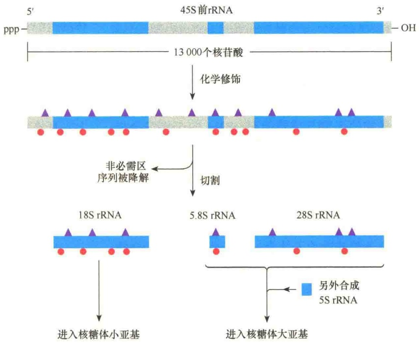

图 6-6 真核生物 45S 前 rRNA 在核仁中进行的化学修饰与切割（引自 Alberts et al., 2015）。圆点表示甲基化，三角形表示假尿苷。

由 RNA-修饰酶完成修饰；而前 rRNA 的特异性切割位点则由另一些指导 RNA 来引导。所有参与修饰与切割的指导 RNA 都位于一种 snoRNA（small nucleolar RNA）（图 6-7）之中。之所以称为 snoRNA，是因为它们属于在核仁中起作用的小分子 RNA。很多 snoRNA 都是由内含子编码的，特别是那些编码核糖体蛋白质基因的内含子。

## 6.1.3.3 5S rRNA基因的转录与加工

5S rRNA 是核糖体大亚基的一个组分，长度约为 120 个核苷。原核生物和真核生物的核糖体都有

5S rRNA，而且结构相似。真核生物的 5S rRNA 基因与其他 3 种 rRNA 基因不在同一条染色体上，它是由核仁以外的染色体基因转录的，然后转运到核仁内参与核糖体的装配。5S rRNA 基因的数量比 45S rRNA 转录单位多，人的 5S rRNA 基因有 500 个拷贝，并且在染色体上串联排列。非洲爪蟾的 5S rRNA 基因的排列研究得较为清楚:一个重复单位含有一个 5S rRNA 基因、一个不转录的假基因（pseudogene）（101bp 的 5S rRNA 基因的片段），每个重复单位间被不转录的间隔序列隔开，间隔序列的长度变化不定，最长达 400bp；基因转录的速度

---

192

细胞生物学（第二版）

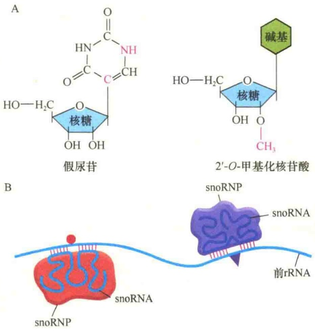

图 6-7 指导 RNA 介导对前 rRNA 的修饰（引自 Alberts et al., 2015）。A. rRNA 被修饰后形成两种新的化合物；B. snoRNP（核仁小核糖核蛋白，small nucleolar ribonucleoprotein）中指导 RNA 引导特异的位点进行修饰。

很快，产生过量的 5S rRNA，有些最后要被降解掉。

5S rRNA 基因是由 RNA 聚合酶Ⅲ转录的，原初转录物的 5' 端与成熟的 5S rRNA 的 5' 端完全相同。在某些生物中，3' 端通常含有多余的核苷酸，在加工时要被切除。所以，5S rRNA 只需要进行简单的加工，或者根本不需要进行加工。

在 3 种 RNA 聚合酶中，RNA 聚合酶Ⅲ通常与位于转录部分的启动子结合，而不是与转录起始位点上游的启动子结合；也就是说 RNA 聚合酶Ⅲ使用的是内部启动子，其他的两种酶使用的是上游启动子，实验也证明这种内部启动子的存在。有人将 5S rRNA 基因的 5' 端的上游序列完全除去，并不影响 5S rRNA 基因的转录。但是，如果将 5S rRNA 基因内部缺失一部分序列（从 50 位到 80 位缺失），RNA 聚合酶Ⅲ不仅不能转录这段 DNA，甚至不能结合上去（图 6-8）。如果将 5S rRNA 基因的内部启动子序列插入到基因组的其他部位，会使插入的部位形成一个新的转录起点。

有 3 个转录因子参与 RNA 聚合酶Ⅲ对 5S rRNA 基因的转录，其中转录因子 TFⅢA 是 5S rRNA 基因转录特异的，其他两种转录因子是 RNA 聚合酶Ⅲ转录其他基因时都需要的。

## 6.1.3.4 原核生物 rRNA 基因及转录与加工

虽然原核生物没有细胞核和核仁，但细菌核糖图 6-8 RNA 聚合酶Ⅲ转录 5S rRNA 基因启动子的鉴定（引自 Kleinsmith and Kish，1995）。将图中 5S rRNA 基因的 A 片段或 D 片段缺失，都不会影响 RNA 聚合酶Ⅲ的转录，但是将 B 片段或 C 片段缺失，都会影响 RNA 聚合酶Ⅲ的转录，表明 5S rRNA 基因的启动子位于 5S 基因内部的控制区。

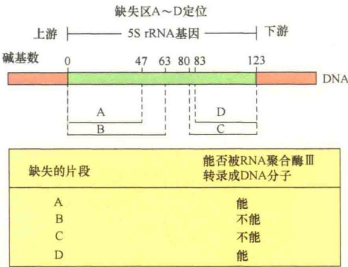

推论:序列 $47\sim 83$ 位为转录所必需

体的组织和结构与真核生物有许多相似之处。原核生物 rRNA 基因也是多拷贝的，并且也要被转录成一个前体，然后再经加工，成为成熟的 rRNA。但是，原核生物和真核生物的 rRNA 基因在组织结构上有一些重要的差异。首先表现在基因的重复次数上，真核生物的 rRNA 基因重复次数相当高，而原核生物的 rRNA 基因重复次数却很低，如 E. coli 只重复了 7 次。另一个差别是，在真核生物中编码 5S rRNA 的基因位于不同的染色体上，而细菌的 5S rRNA 基因与另外两种 rRNA 基因组成一个转录单位，它们在染色体上的排列顺序是:16S-23S-5S。

通过核酸酶Ⅲ（RNase Ⅲ）突变体的研究证明原核生物的3种rRNA位于同一个原初转录物中。在这种突变体中，3种rRNA位于同一条rRNA分子中，但是在正常的细胞中这3种rRNA是以3种独立的小分子存在的，这一研究结果也说明RNase Ⅲ是将16S-23S-5S前rRNA切割成单体的主要核酸酶。

在细菌中 RNase Ⅲ不是参与前 rRNA 加工唯一的酶，还需要其他一些核酸酶参与。实验证明，如果缺少其他一些酶，就不能得到正确大小的 rRNA。细菌中的 rRNA 转录单位除了转录 3 种 rRNA 外，同时也会产生几种 tRNA 分子。在 16S rRNA 和 23S rRNA 间可产生 2 个 tRNA，在 5S rRNA 基因的下游也会产生 1 个 tRNA。

与真核生物一样，细菌的 rRNA 也有甲基化，但比真核生物 rRNA 甲基化程度低。细菌的 rRNA 加工过程见图 6-9。

---

6 核糖体与蛋白质

193

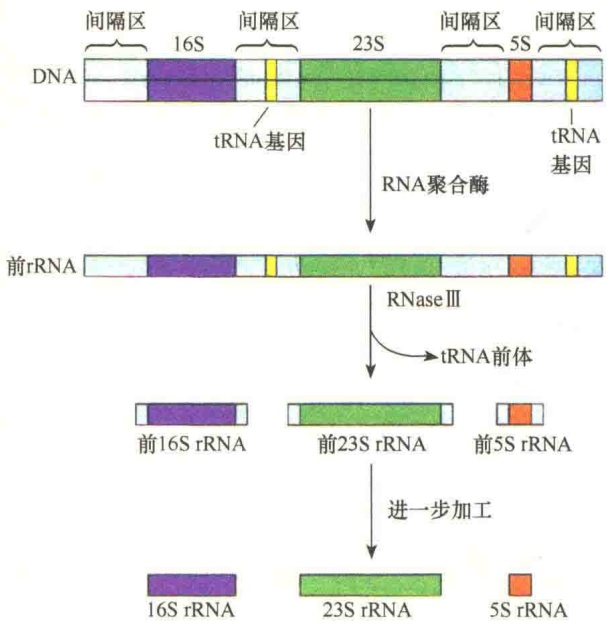

图 6-9 E. coli 前 rRNA 的转录与加工（引自 Kleinsmith and Kish, 1995）。

## 6.2 核糖体的装配

核糖体是自装配的细胞器，当蛋白质和 rRNA 合成加工成熟之后，就要开始装配核糖体的大、小两个亚基。真核生物核糖体亚基的装配地点在细胞核的核仁部位，原核生物核糖体亚基的装配则在细胞质中。

## 6.2.1 核糖体亚基的自我装配

关于原核生物核糖体装配的了解主要是通过体外实验获得的。

为了研究核糖体中蛋白质和 rRNA 的关系及装配机制，1968 年，Nomura 把拆开的大肠杆菌核糖体的 30S 小亚基的 21 种蛋白质与 16S rRNA 在体外混合后重新装配成 30S 小亚基，然后把重建的小亚基与 50S 大亚基及其他辅助因子混合后，进行蛋白质合成实验，发现重建的核糖体具有生物活性，能催化氨基酸掺入蛋白质多肽链中。这一实验表明，核糖体是一种自组装（self-assembly）的结构，即没有模板或亲体结构。但是在组装过程中，蛋白质的结合有先后之分:某些蛋白质必须先结合到 rRNA 上，其他蛋白质才能组装上去，即组装过程有先后顺序。

在核糖体重装配过程中，可以通过减去某一种蛋白质来验证该蛋白质在亚基装配及亚基中的作用。据此，可将30S亚基上的蛋白质分为3类:①开始装配所必需的蛋白质，它们先与rRNA特定区段结合，形成核糖体亚基的核心；②结合后可为后一批蛋白质提供结合位点的蛋白质；③非30S亚基形成所必需，但却是显示其活性所必需的蛋白质。

## 6.2.2 原核生物核糖体重组实验

所谓核糖体重组（ribosome recombination）是指将不同来源的核糖体大小亚基、不同亚基的rRNA或蛋白质重新组合，形成杂合的核糖体后研究其功能的实验方法。结果表明:①30S亚基的蛋白质只与16S rRNA结合；50S亚基的蛋白质只与23S rRNA结合，如果把30S亚基rRNA和50S亚基的蛋白质相混合，则不能装配成有功能的亚基。②从不同种细菌提取30S亚基的rRNA和蛋白质，可装配成有功能的30S亚基，这表明不存在种间差异。③原核生物核糖体与真核生物核糖体的亚基不同，由二者的rRNA和蛋白质重组后的核糖体没有功能。④大肠杆菌的核糖体与玉米叶绿体核糖体亚基重组后具有功能。⑤由于不同生物的线粒体核糖体大小不同，由55S到80S不等，而原核生物的核糖体基本稳定，所以线粒体的核糖体亚基与原核生物核糖体亚基相互重组形成的杂合核糖体没有功能。

## 6.2.3 真核生物核糖体的装配

真核生物核糖体的合成与装配比原核生物核糖体的合成与装配要复杂得多。编码核糖体亚基的蛋白质基因转录后在细胞核中加工成熟，随即运送到细胞质中合成蛋白质，再将合成的蛋白质送回细胞核的核仁中参与核糖体亚基的装配。组成核糖体亚基的18S rRNA、5.8S rRNA和28S rRNA基因在核仁中边转录边参与核糖体亚基的装配，5S rRNA却是在细胞核中转录后运送到核仁中参与核糖体亚基的装配。图6-10是关于人细胞中核糖体装配的示意图。按照这个模型，首先要合成与核糖体装配有关的蛋白质，这些蛋白质包括核糖体结构蛋白和与前rRNA加工有关的酶。它们都是在细胞质的游离核糖体上合成，然后迅速集中到细胞核，并在核仁区参与核糖体亚基的装配。

装配过程中，45S RNA、5S RNA 与蛋白质形成 80S RNA 颗粒，然后 80S 颗粒被降解成大、小两个颗粒，大颗粒为 55S，含有 32S 和 5S 两种 RNA，小颗粒含有 20S 的前 rRNA。然后，小颗粒

---

194

细胞生物学（第二版）

图 6-10 人细胞中核糖体装配的主要过程（引自 Kleinsmith and Kish, 1995）。根据该装配模型，从核 DNA 转录的 45S 前 rRNA 与蛋白质结合、甲基化、与 5S rRNA 结合形成 80S 核糖核蛋白颗粒。通过 RNA 的加工，将 80S 的颗粒转变成大小核糖体亚基，然后被运送到细胞质参与蛋白质的合成。

中的 20S 前 rRNA 被快速降解成 18S 的 rRNA，并运送到细胞质中，即是成熟的核糖体小亚基。55S 大颗粒中的 32S RNA 被加工形成 28S 和 5.8S 两种 rRNA 并与 5S rRNA 装配成成熟的大亚基后，被运送到细胞质中，这个过程比较慢。如果这时有 mRNA 与小亚基结合，大亚基即可结合上去形成完整的核糖体，并进行蛋白质的合成。

最早发现核仁与核糖体形成有关的是20世纪60年代初期Perry的研究工作。他用紫外微光束破坏活细胞的核仁，发现破坏了核仁的细胞丧失合成rRNA的能力，这一发现提示核仁与核糖体的形成有关。后来Perry又发现低浓度的放线菌素D能够抑制 $^{3}$ H-尿嘧啶掺入rRNA中，而不影响其他种类的RNA合成。显微放射自显影也显示放线菌素D能够选择性阻止核仁RNA的合成，表明核仁与rRNA的合成有关。

## 6.3 核糖体的功能——蛋白质合成

核糖体的功能是进行蛋白质的合成。蛋白质的合成，或称 mRNA 翻译是细胞中最复杂的合成活动。蛋白质的合成需要携带氨基酸的各种 tRNA、核糖体、mRNA、不同功能的蛋白因子、阳离子、GTP 等的参与。蛋白质的合成过程之所以复杂，是因为构成蛋白质的 20 种氨基酸要按照密码精确地掺入多肽中，不能有丝毫的差错。

## 6.3.1 蛋白质合成的基本过程

在核糖体上合成的只是蛋白质的一级结构，即多肽链。合成是从多肽链的 N 端开始，到 C 端结束。对于 mRNA 来说，合成的方向则是  $5'\rightarrow3'$  端。蛋白质的合成是一个极其复杂的过程，大约分为 5 个阶段（图 6-11）。

第一阶段:氨基酸激活（activation of amino acid）。对于蛋白质多肽的合成来说，一定会遇到两个基本的化学问题:一是氨基酸的羧基必须被激活，才能促进肽键的形成；二是新的氨基酸必须与 mRNA 中携带的密码信息建立一种有效的关联。在合成的第一阶段遇到的这两个问题是通过氨基酸与 tRNA 的结合解决的。至关重要的是，需要将正确的氨基酸结合到正确的 tRNA 上，这一反应是在胞质中完成的，而不在核糖体上。20 种氨基酸在 ATP 供能、 $Mg^{2+}$  介导下，通过氨酰合成酶的催化作用与各自特异的 tRNA 共价结合。

第二阶段:起始（initiation）。携带有多肽合成密码的 mRNA 与核糖体的小亚基结合，然后与起始氨酰 tRNA 结合，形成起始复合物。起始氨酰 tRNA 通过碱基配对，与 mRNA 的起始密码子 AUG 结合。该过程需要 GTP 及一些促进起始的蛋

---

6 核糖体与蛋白质

195

图 6-11 蛋白质合成概览（引自 Nelson and Junge, 2015）。蛋白质合成分为 5 个阶段:① 氨基酸激活:tRNA 的氨酰化；② 起始:氨酰 tRNA、mRNA 与核糖体小亚基结合，再结合上核糖体大亚基，形成起始复合物；③ 延伸:第二个氨酰 tRNA 结合上来，核糖体沿着 mRNA 移动，携带不同氨基酸的 tRNA 与匹配的密码子结合，催化肽键的形成；④ 终止与核糖体循环:转译到终止密码处终止，释放出核糖体，进入下一轮蛋白质合成；⑤ 折叠及翻译后加工。

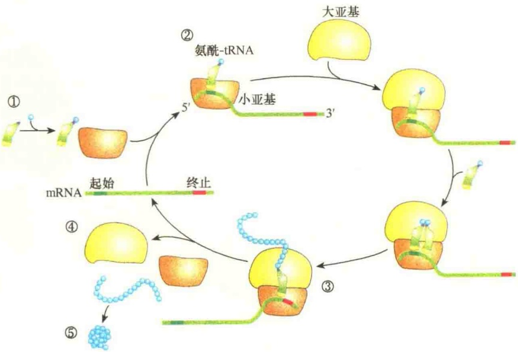

白因子的协助。

第三阶段:延伸（elongation）。一旦起始复合物形成，蛋白质的合成随即开始，此过程称为蛋白质合成的延伸。延伸涉及4个重复的步骤:①氨酰tRNA进入核糖体的A位点；②肽键形成；③转位；④脱氨酰tRNA释放。上述4步的循环，使肽链不断延长。在整个过程中，需要GTP和一些延伸因子的参与。

第四阶段:终止与核糖体循环（termination and ribosome recycling）。蛋白质合成的终止是指核糖体沿着 mRNA 移动，如果进入 A 位点的是终止密码子，由于没有与之匹配的反密码子而终止蛋白质的合成。一共有 3 种终止密码子:UAA、UAG、UGA，其中任何一种进入 A 位点都会终止蛋白质的合成，并导致多肽链从核糖体释放出来。

蛋白质合成的终止需要释放因子（release-factor，RF）的存在。细菌有3种终止释放因子:RF1、RF2、RF3。RF1能够识别UAA和UAG终止密码子；RF2识别终止密码子UAA和UGA；RF3虽不识别特异的终止密码子，但是能够增加其他因子的活性。真核细胞有两种释放因子:eRF1和eRF3，这两种因子共同作用，能够识别所有的终止密码子。研究表明，释放因子与tRNA非常相似，所以释放因子能够进入A位点直接与终止密码子相互作用。

第五阶段:折叠及翻译后加工（folding and posttranslation processing）。从核糖体上释放的仅仅是多肽，是不具有生物学功能的。所以，释放出的多肽必须经过折叠及适当的加工，才能行使生物学功能。一般的加工包括乙酰化、磷酸化、甲基化等。此外，还有可能切除一些氨基酸，或是添加一些氨基酸。正确的空间构型对于蛋白质的功能是十分重要的。虽然这些反应不是在核糖体上进行的，但仍属于蛋白质合成的一部分。

由上述蛋白质合成的 5 个阶段可知，蛋白质的合成除了核糖体、rRNA、tRNA、mRNA，还需要能源分子、离子，以及各种辅助蛋白的参与（表 6-3）。

表 6-3 大肠杆菌中蛋白质合成各阶段所需的组分

| 阶段 | 基本组分 |
| --- | --- |
| 1.氨基酸的激活 | 20种氨基酸,20种氨酰tRNA合成酶32种(或以上)tRNA,ATP,$Mg^{2+}$ |
| 2.起始 | mRNA,N-甲酰化$tRNA^{fMet}$mRNA中起始密码(AUG),30S核糖体亚基50S核糖体亚基,起始因子(IF-1、IF-2、IF-3)GTP,$Mg^{2+}$ |
| 3.延伸 | 有功能的70S核糖体(起始复合物)各种与密码子匹配的特异氨酰tRNA延伸因子(EF-Tu、EF-Ts、EF-G)GTP,$Mg^{2+}$ |
| 4.终止 | mRNA中的终止密码释放因子(RF-1、RF-2、RF-3、RRF)EF-G,IF-3 |
| 5.折叠与翻译后加工 | 分子伴侣与折叠酶(PPI,PDI)特异性的酶,辅助因子,以及其他与加工相关的酶和蛋白质 |

## 6.3.2 核糖体的功能位点

从蛋白质合成的过程看，蛋白质合成是由核糖体提供平台（“战场”），mRNA、tRNA、rRNA通力合作“会战”（图6-12），合力将mRNA中的密码翻译成相应的氨基酸，并以多肽链的形式提供给

---

196

细胞生物学（第二版）

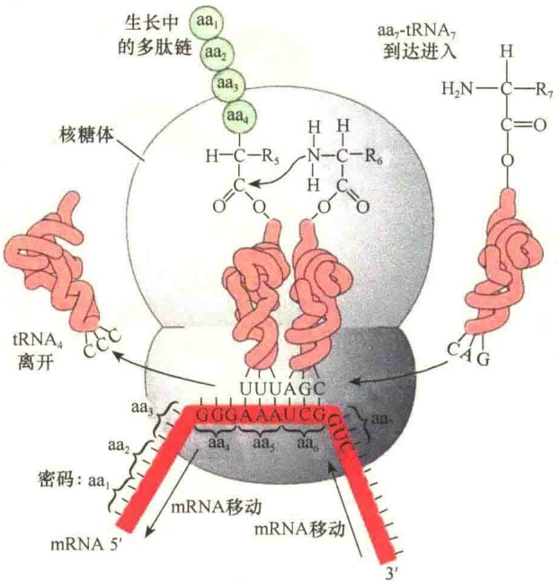

图 6-12 蛋白质合成中三种 RNA 的作用（引自 Lodish et al., 2013）。rRNA 是核糖体的组成部分，参与平台的构建。原核生物（如细菌）的核糖体有 3 种不同 rRNA，真核生物的核糖体有 4 种 rRNA；mRNA 是信使 RNA，其序列中有可翻译成蛋白质氨基酸的密码；tRNA 是搬运工，它可以与相应的氨基酸结合，并通过 tRNA 上的反密码子与 mRNA 中密码子配对，完成密码子的翻译。

细胞，催生成千上万个“英雄好汉”。

蛋白质合成是极其复杂又高度有序的过程。mRNA与核糖体的结合、氨酰tRNA的进入及卸载tRNA的退出都有各自的通道，也就是说，核糖体上有特异的功能位点，使得整个翻译过程有条不紊。

原核生物核糖体中有 4 种与 RNA 分子结合的位点，其中一个是与 mRNA 结合的位点，另外 3 个是与 tRNA 结合的位点（图 6-13）。

（1）A 位点（A site），即氨酰基位点，是与新掺入的氨酰 tRNA（aminoacyl-tRNA）结合的位点，又叫受位（entry site），主要位于大亚基。

（2）P位点（P site），即肽酰tRNA位点（peptidyl-tRNA site），又叫供位（donor site）或肽酰基位点，主要位于大亚基，是肽酰tRNA移交肽链后所占据的位置，即与延伸中的肽酰tRNA结合的位点。

（3）E位点（exit site）是脱氨酰tRNA（dea-minoacyl-tRNA）离开P位点到完全从核糖体释放出来的一个中间停靠点，只是作暂时的停留。当E位点被占据之后，A位点与氨酰tRNA的亲和力降低，防止了氨酰tRNA的结合，直到核糖体准备就绪，E位点腾空，才会接受下一个氨酰tRNA。

（4）mRNA 结合位点。蛋白质的起始合成，首先需要 mRNA 与小亚基的结合，推测在核糖体上必然有与 mRNA 结合的位点。原核生物与真核生物 mRNA 的 5' 端结构不同，真核生物 mRNA 的 5' 端有帽子结构，原核生物则没有，推测它们与核糖体的结合机制是不同的。

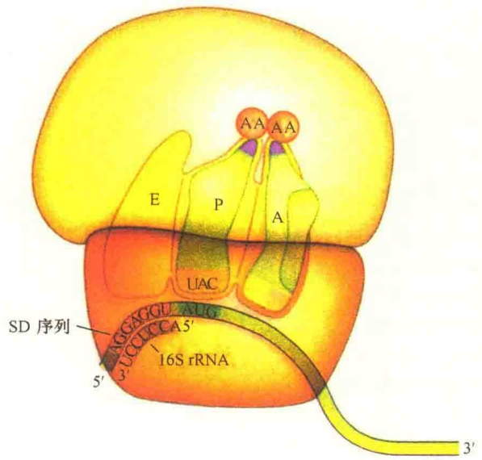

图 6-13 原核生物核糖体中与 RNA 结合的位点（引自 Nelson and Cox, 2013）。

在原核生物中，核糖体中与 mRNA 结合的位点位于 16S rRNA 的 3' 端。mRNA 中与核糖体 16S rRNA 结合的序列称为 SD 序列，它是 1974 年由 Shine 和 Dalgarno 发现的，故此命名。SD 序列是 mRNA 中 5' 端富含嘌呤的短核苷酸序列，一般位于 mRNA 起始密码子 AUG 上游 5～10 个碱基处，并且与 16S rRNA 3' 端序列互补。真核生物没有 SD 序列，mRNA 与核糖体小亚基的结合主要是依赖于 mRNA 5' 端甲基化帽子结构的识别。

另外，原核生物 mRNA 的 5' 端与真核生物 mRNA 的 5' 端结构不同，因此与核糖体的识别和结合机制也不同（图 6-14）。

## 6.3.3 tRNA及氨酰tRNA的合成

在蛋白质合成过程中，tRNA 具有重要作用，而这一重要作用与它的结构有关（图 6-15）。

tRNA 分子长 70～80 个核苷，在溶液中折叠成柄-环结构，类似三叶草，故称为三叶草结构。它有三个环，即 D-环、反密码环、T-环，还有 4 个由碱基配对而成的柄，在 3' 端有氨基酸接受臂。在 tRNA 的序列中有一些特殊的核苷，如次黄嘌呤核苷（inosine）、二羟尿苷、假尿苷等，这些特殊的核苷都是在 tRNA 合成后被修饰而成的。

有20种不同的tRNA用于转运20种不同的

---

6 核糖体与蛋白质

197

图 6-14 原核生物与真核生物 mRNA 的结构比较（引自 Watson et al., 2014）。A. 典型的细菌核糖体与 mRNA 的结合位点 mRNA 中的 SD 序列与核糖体 16S rRNA 3' 端互补。在 SD 序列的下游 5～10 个碱基处是起始密码子 AUG 或 GUG。B. 真核生物 mRNA, 5' 端有帽结构，不需要 SD 序列。RBS（ribosome binding site）为核糖体结合位点。

图 6-15 苯丙氨酸 tRNA 的结构（引自 Alberts et al., 2015）。
A. tRNA 三叶草形结构的碱基对；B. 三叶草；C. 作用时的模式。

氨基酸进行蛋白质合成。tRNA 的氨酰化是由氨酰 tRNA 合成酶催化完成的。细胞中有 20 种不同的氨酰 tRNA 合成酶，每一种氨酰 tRNA 合成酶识别一种特异的氨基酸。氨酰 tRNA 合成酶将氨基酸偶联到 tRNA 3' 端腺嘌呤的 2' 或 3' 羟基上，此过程需要 ATP 供能。在偶联反应中，氨基酸通过高能键与 tRNA 连接，该反应称为氨基酸的激活（图 6-16）。此时形成的键能可用于后来的肽键的

形成。

氨酰 tRNA 合成酶与相关联 tRNA 的识别主要是通过反密码环和受体臂的相互作用，有时 tRNA 的其他部分对识别也有帮助。氨酰 tRNA 合成酶与正确的 tRNA 结合是非常重要的，不仅如此，氨酰 tRNA 合成酶与正确的氨基酸结合也同样重要。为保证不出差错，氨酰 tRNA 合成酶本身具有校读机制。

## 6.3.4 多聚核糖体

在蛋白质合成过程中，同一条 mRNA 分子能够与多个核糖体结合，同时合成若干条蛋白质多肽链，结合在同一条 mRNA 上的核糖体就称为多聚核糖体（polysome 或 polyribosome）（图 6-17）。

20 世纪 60 年代有几个实验室先后发现了多聚核糖体。例如，Rich 的实验室采用未成熟的红细胞研究蛋白质合成时发现了多聚核糖体。他们将未成熟的红细胞与放射性物质进行短暂培养，以标记新合成的蛋白质，然后温和地破碎细胞，离心除去细胞核和线粒体，收集上清液，在上清液中含有核糖体。然后通过移动区带离心，发现除了 80S 的核糖体之外，还有 170S 的核糖体，而放射性的标记物主要存在于 170S 的核糖体上，因此推断在蛋白质合成时，核糖体可能是成串存在的。电子显微镜观察证实:80S 的核糖体是单个存在的，而 170S 的

---

198

细胞生物学（第二版）

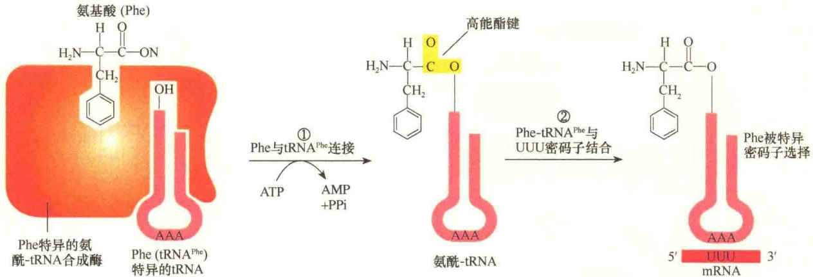

图 6-16 将核酸序列解码成氨基酸序列（引自 Lodish et al., 2013）。在蛋白质合成中，将 mRNA 中的核酸序列翻译成氨基酸序列，涉及两个步骤:①氨酰 tRNA 合成酶先与特异的氨基酸偶联，经由一个高能酯键与相应 tRNA 末端的腺嘌呤 2' 或 3' 羟基相连；②氨酰 tRNA 反密码环中的 3 个碱基序列通过配对规律与 mRNA 中对应的密码序列配对，从而对 mRNA 中的密码子进行解码。

图 6-17 电子显微镜观察的多聚核糖体（引自 Voet et al., 1995）。图中所示是蚕的丝心蛋白 mRNA 3' 端多聚核糖体，箭头所示是丝心蛋白多肽。

核糖体是由 4～6 个核糖体组成的多聚核糖体。

1）多聚核糖体的形成 在 mRNA 的起始密码子部位，核糖体亚基装配成完整的起始复合物，然后向 mRNA 的 3' 端移动，直至到达终止密码子处。当第一个核糖体离开起始密码子后，空出的起始密码子的位置足够与另一个核糖体结合时，第二个核糖体的小亚基就会结合上来，并装配成完整的起始复合物，开始蛋白质的合成。同样，第三个核糖体、第四个核糖体……依次结合到 mRNA 上（图 6-18）。根据电子显微照片推算，多聚核糖体中，每个核糖体间相隔约 80 个核苷酸。同一条 mRNA 被多个核糖体同时翻译成蛋白质，大大提高了蛋白质合成的速率，也减轻了细胞核进行基因转录和加工的压力。

2）多聚核糖体的意义 由于 mRNA 的寿命有限，合成后必须快速用于蛋白质的合成。在细菌中，mRNA 的转录与蛋白质的翻译是偶联的，其本身的速度就很快，而在真核生物中，转录的是 pre-mRNA，需要加工。为了提高 mRNA 的利用率，一个核糖体启动之后，第二个核糖体紧接着结合上

图 6-18 真核生物多聚核糖体及成环（引自 Alberts et al., 2015）。一条 mRNA 上有多个核糖体在进行多肽的合成。eIF4E 与 mRNA 5' 帽结合，eIF4G 同时与 eIF4E、poly-A-结合蛋白结合，从而使转译中 mRNA 成环。

---

6 核糖体与蛋白质

199

去，自然就提高了翻译的速率，提高了mRNA的利用率。另外，真核生物mRNA形成多聚核糖体后可快速成环，也有利于提高蛋白质合成速率，因为翻译终止释放出来的核糖体可以快速地与相对位置（mRNA 5'端）结合，启动下一轮的翻译。实际上，多聚核糖体的形成在提高了mRNA利用率的同时，又何尝不是提高了核糖体的使用率呢，真可谓“兵贵神速”，所以说生命活动是必须争分夺秒的！

## 6.3.5 蛋白质合成抑制剂

不同的蛋白质合成抑制剂具有不同的作用机制，它们是研究蛋白质合成机制的有用工具。

## 6.3.5.1 抗生素

抗生素（antibiotic）是主要的蛋白质合成抑制剂，如氯霉素、链霉素等。

不同的抗生素作用机制不同，如链霉素主要是抑制起始tRNA和非起始tRNA与核糖体的结合，导致肽链合成的提前终止。此外，链霉素也可引起遗传密码子的错读。例如，将链霉素加入正在用人工合成的polyU进行翻译的核糖体中，异亮氨酸、亮氨酸、丝氨酸、酪氨酸和苯丙氨酸都能掺入到新合成的多肽中。正常情况下，polyU只编码苯丙氨酸。有研究表明，在生活细胞中S12蛋白具有抗链霉素密码子错读的作用。另外，有些抗生素（如氯霉素）抑制50S大亚基肽酰转移酶的活性。

表 6-4 是一些常见的蛋白质及 RNA 合成抑制剂，图 6-19 是一些常见的蛋白质合成抑制剂的结构。

表 6-4 蛋白质及 RNA 合成抑制剂

<table><tr><td>抑制剂</td><td>影响效果</td></tr><tr><td colspan="2">仅作用于细菌</td></tr><tr><td>四环素(tetracycline)</td><td>与30S核糖体结合,阻断氨酰tRNA与核糖体的A位点结合</td></tr><tr><td>链霉素(streptomycin)</td><td>阻止起始、链延伸,诱发错配</td></tr><tr><td>氯霉素(chloramphenicol)</td><td>抑制50S核糖体亚基的肽酰转移酶的活性(阻止肽键的形成)</td></tr><tr><td>红霉素(erythromycin)</td><td>与50S亚基结合,抑制转位</td></tr><tr><td>利福霉素(rifamycin)</td><td>与RNA聚合酶结合,阻止RNA链的起始合成</td></tr><tr><td colspan="2">作用于细菌与真核</td></tr><tr><td>嘌呤霉素(puromycin)</td><td>通过与链生长端结合,引起新肽链的提前释放</td></tr><tr><td>放线菌素D(actinomycin D)</td><td>与DNA结合,阻断RNA聚合酶的移动(影响RNA合成)</td></tr><tr><td colspan="2">仅作用于真核</td></tr><tr><td>放线菌酮(cycloheximide)</td><td>阻止起始tRNA转位(tRNA从P位点释放)</td></tr><tr><td>茴香霉素(anisomycin)</td><td>阻止核糖体中肽酰转移酶的反应</td></tr><tr><td>α-鹅膏蕈碱(α-amanitin)</td><td>通过与RNA聚合酶II结合阻断mRNA的合成</td></tr></table>

图 6-19 几种常见的抑制蛋白质合成的抗生素（引自 Voet and Voet，1995）。

---

细胞生物学（第二版）

## 6.3.5.2 嘌呤霉素

嘌呤霉素（puromycin）是一种蛋白质合成抑制剂，它具有与tRNA分子末端类似的结构（图6-20），能够与氨基酸结合，代替氨酰化的tRNA与核糖体的A位点结合，并掺入到生长的肽链中。虽然嘌呤霉素能够与A位点结合，但是不能参与随后的任何反应，因而导致蛋白质合成的终止并释放出C端含有嘌呤霉素不成熟的多肽。

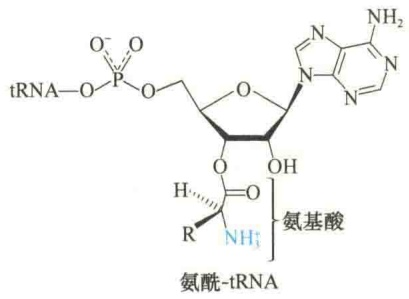

图 6-20 嘌呤霉素与苯丙氨酰 tRNA 3' 端结构的比较。

在蛋白质合成过程中，核糖体的 A 位点和 P 位点是两个极为重要的功能位点，它们的存在主要是通过嘌呤霉素的抑制实验研究证实的。

通过嘌呤霉素对蛋白质合成的抑制实验发现核糖体的 A 位点和 P 位点是两个独立的位点。实验分两组进行，在第一组实验中，将 P 位点结合有起始 tRNA 的核糖体与嘌呤霉素一起温育。在这种条件下，嘌呤霉素与核糖体结合，并且能够与起始 tRNA 相互作用（图 6-21A）。在第二组实验中，将 P 位点结合有起始 tRNA 的核糖体先与氨酰 tRNA 一起温育，使之形成肽键，然后再加入嘌呤霉素，此时加入的嘌呤霉素既不能与核糖体结合，也不能与二肽酰 tRNA 相互作用（图 6-21B），但是在反应体系中加入 GTP 和延伸因子 G 后，嘌呤霉素则能与核糖体结合。根据这两组实验结果可以判断核糖体中的 A、P 是各自独立的两个位点（图 6-21）。

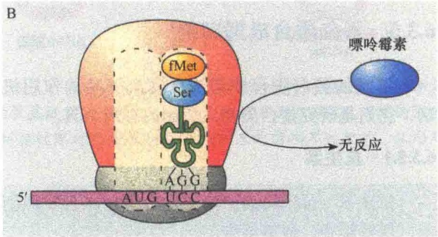

图 6-21 用嘌呤霉素证明核糖体的 A、P 是两个独立存在的位点（引自 Kleinsmith and Kish，1995）。A. 在第一组实验中，只有起始 tRNA 占据 P 位点，如果 A 位点是一个独立位点的话，此时的 A 位点就是空闲的，嘌呤霉素当然能够结合上去；如果 A 位点与 P 位点是同一位点，那么嘌呤霉素就不能与核糖体结合，实验结果是嘌呤霉素能够结合。B. 在第二组实验中，由于 A 位点已经被占据，嘌呤霉素无法与 A 位点结合，只有加入延伸因子和 GTP 后，使 A 位点腾空，嘌呤霉素才能结合到核糖体上。因此，根据这两组实验结果可以断定 A、P 是两个独立的功能位点。

## 6.4 蛋白质的折叠、修饰与降解

蛋白质是细胞功能的执行者，所以蛋白质的合成是细胞中最重要的合成事件。但是在核糖体上合成的仅是蛋白质的一级结构——多肽，要想行使功能，必须要折叠成高级结构。另外，蛋白质不仅是细胞各结构的组成部分，也是各细胞器功能的实现者，所以它要被准确地运送到“岗”。再者，蛋白质的寿命是有限的，再加上细胞周期的关系，一些蛋白质的“出场”时间是受限的，如何对“延时”蛋白质及时清理，也是考验细胞的智慧。

## 6.4.1 蛋白质折叠与分子伴侣

蛋白质是氨基酸的聚合体，有不同的大小与形态。它们的三维结构的不同是由多肽链的长度及氨

---

6 核糖体与蛋白质

201

基酸不同造成的。由于蛋白质的不同形态与不同化学性质，因而具有不同功能。虽然蛋白质各自具有不同的功能，但还是可以分成不同的功能大类。例如，结构蛋白（structure protein）与细胞的空间结构、形态有关；支架蛋白（scaffold protein）指导蛋白质组装成特异功能的平台；酶蛋白行驶催化功能；膜运输蛋白行驶细胞的运输功能等。总之，蛋白质的形态结构与功能是统一的，形态是多样的，功能也是多样的（图6-22）。

图 6-22 蛋白质的装配与功能概览（引自 Lodish et al., 2013）。A. 蛋白质具有四个层级结构。一级结构是线性多肽；二级结构是多肽链折叠成螺旋或片层。在二级结构基础上，包装成三维形态，即三级或超分子的结构；再进一步组装成多聚体的结构，即四级结构。B. 蛋白质行驶多种功能，包括将基因组包装成三维形态、细胞器的组建、膜构建，还参与信号传递、催化反应等。

## 6.4.1.1 蛋白质折叠

由上可知，蛋白质的形态决定功能（form follows function），因此，多肽合成之后必须快速折叠成高级结构（图6-23），才可快速发挥作用。蛋白质折叠成的高级结构，通常是 $\alpha$ 螺旋或 $\beta$ 片层构型。其实，蛋白质折叠（protein folding）也有利于防止蛋白质由于相互粘连聚集成为水不溶的“蛋白质团”而丧失功能。折叠的另一个好处是可防止水解酶的攻击。要知道，细胞中的“明枪暗箭”是很多的，做好安全防范，才能更好地生存。

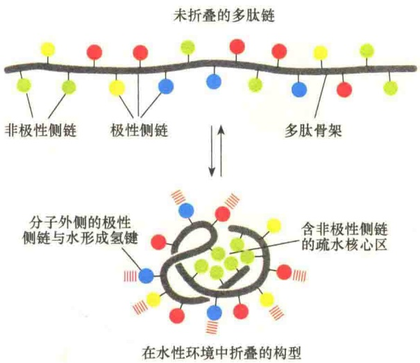

图 6-23 蛋白质折叠成一个致密的构型（引自 Alberts et al., 2015）。极性氨基酸侧链倾向位于蛋白质的外侧，便于与水作用。非极性氨基酸被包在内侧，形成疏水的核。

## 6.4.1.2 分子伴侣在蛋白质折叠中的作用

蛋白质的折叠并非自主行为，虽然决定如何折叠的是蛋白质的氨基酸序列，但需要帮手，或者需要指导者，细胞中具有这一功能的分子称为分子伴侣（chaperone或molecular chaperone），其本质也是蛋白质。分子伴侣在细胞中广泛存在（无论是细菌，还是人），而且结构上也高度同源，作用机制也基本相同。分子伴侣作用时需要ATP，利用ATP水解释放的能量帮助新生蛋白质折叠。分子伴侣最早是Ron Laskey及其同事提出的，用于描述一种细胞核蛋白（核质蛋白）。这种蛋白质是组蛋白与DNA装配成核小体所必需的。因此，分子伴侣的主要特点是帮助装配自身又不成为装配体的一部分，后来这一概念扩大到在所有装配中起作用的蛋白质，包括参与蛋白质折叠的蛋白质。

分子伴侣又称伴侣分子，它与蛋白质底物的短片段结合，以稳定未折叠的蛋白质或是让其部分折叠，以防止底物蛋白聚集或被降解。例如，Hsp70、Hsp90就是此类分子伴侣。图6-24是Hsp70帮助新生蛋白质折叠的示意图。

Hsp70 作用时需要 ATP，并能将 ATP 水解，所以，Hsp70 具有 ATP 酶的活性，也是一种 ATPase。Hsp70 帮助折叠的蛋白质不仅仅是新生的蛋白质，也包括细胞内因不良环境造成的折叠不正常的蛋白质，进行“救死扶伤”。

---

202

细胞生物学（第二版）

图 6-24 分子伴侣 Hsp70 家族介导的蛋白质折叠（引自 Alberts et al., 2015）。这类分子伴侣工作较早，核糖体上合成的新生肽露出一小段就被 Hsp70 分子伴侣所识别并与之结合，在一组小分子 Hsp40（未显示）的协同下，ATP 与 Hsp70 结合，然后将 ATP 水解成 ADP，帮助靶蛋白折叠后离开。若是折叠不正确，重新进行折叠。

有一种分子伴侣称为伴侣蛋白（chaperonin），这种分子伴侣会形成一个折叠“工作室”，让被折叠的蛋白质进入室内的适宜环境，经过一段时间过程进行合适的折叠，Hsp60家族就属于此类伴侣蛋白。

对于分子质量大的蛋白质的折叠，Hsp70 家族是“无能为力”的，需要另一个家族，即 Hsp60 家族。因此，Hsp60 家族是介导较大蛋白质正确折叠的分子伴侣。Hsp60 家族是巨型圆桶状的结构，由两个低聚体的环构成。有两类不同的伴侣蛋白，它们在结构、定位及作用机制等方面稍有不同。Ⅰ类伴侣蛋白是在原核生物、叶绿体、线粒体中发现的，由两个环构成，每个环上有7个亚基构成的盖。细菌中的Ⅰ类伴侣蛋白称为GroEL/GroES，它参与10%的蛋白质的折叠。Ⅱ类伴侣蛋白是在真核生物及古细菌中发现的，每个环上有8～9个同质或异质的亚基构成的盖。图6-25是伴侣蛋白GroEL/GroES帮助蛋白质折叠的示意图。

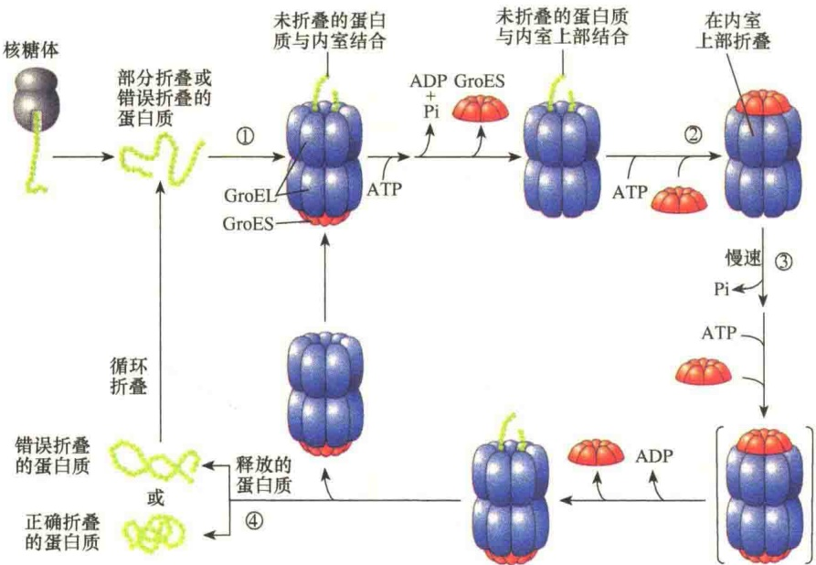

图 6-25 原核生物伴侣蛋白 GroEL 介导的蛋白质折叠（引自 Lodish et al., 2013）。①部分折叠或错误折叠的蛋白质进入伴侣蛋白的折叠室，第二个折叠室被 GroES 盖封闭了，每个环中 7 个 GroEL 亚基结合 7 个 ATP，水解 ATP 释放 ADP，使底部的 GroES 盖与桶脱离转而与伴侣蛋白顶部结合，同时补充 ATP。②被折叠的蛋白质在伴侣蛋白桶内随着 ATP 的水解，缓慢循环折叠。③诱导 ATP 结合，同时诱导 GroES 盖与另一个环结合；结合后引起 GroES 盖与 ADP 和含肽的环结合，然后打开上盖，释放 ADP、蛋白质。④如果释放的蛋白质折叠正确，就会进入细胞发挥作用，若折叠不正确，则需重新进入伴侣蛋白进行重折叠。

## 6.4.1.3 蛋白质酶促折叠——二硫键的形成

蛋白质多肽中半胱氨酸间二硫键的形成对于稳定蛋白质的折叠具有重要作用，蛋白质二硫化异构酶（protein disulfide isomerase，PDI）催化二硫键的形成（图 6-26）。对于含有多个半胱氨酸的蛋白

---

6 核糖体与蛋白质

203

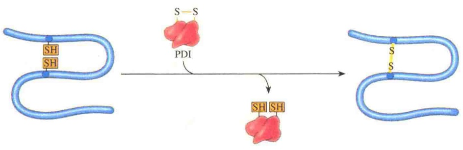

图 6-26 PDI 催化蛋白质二硫键的形成（引自 Cooper and Hausman, 2013）。

质而言，PDI 可催化它们快速形成二硫键，形成稳定的折叠。二硫键通常在分泌蛋白、膜蛋白中较为常见，因为胞质溶胶中含有还原剂维持半胱氨酸的还原状态（—SH），从而阻止了二硫键的形成。在真核细胞中，二硫键的形成是在内质网中发生的，而内质网是一种氧化的环境，PDI 也是内质网中最为丰富的蛋白质，PDI 通过催化蛋白质二硫键的形成，维持了蛋白质的构型的稳定，因而也是内质网中关键的分子伴侣。

## 6.4.2 蛋白质的修饰与加工

细胞内蛋白质要正确行使功能，除了正确的折叠外，还需进行适当的修饰，如甲基化、羟基化、酰基化、糖基化等。此外，二硫键的形成、蛋白质的切割等也是合成后加工处理的。

## 6.4.2.1 蛋白质的共价修饰

在蛋白质氨基酸残基中发现大约有500种不同类型的共价修饰，被修饰的基团包括磷酰基（phosphoryl）、乙酰基（acetyl）、腺苷酰基（adenylyl）、尿苷酰（uridylyl）、甲酰基（methyl）、豆蔻酰（myristoyl）等。图6-27是某些酶促的修饰反应。

蛋白质的化学修饰对于细胞的生命活动是十分重要的。例如，细胞核中组蛋白常见的化学修饰有甲基化、乙酰化、磷酸化、泛素化，这些修饰对于维持染色体的结构、促进基因表达及其他的一些功能都是十分重要的。又如，蛋白质的磷酸化对于调节蛋白质的活性、信号转导都是至关重要的。

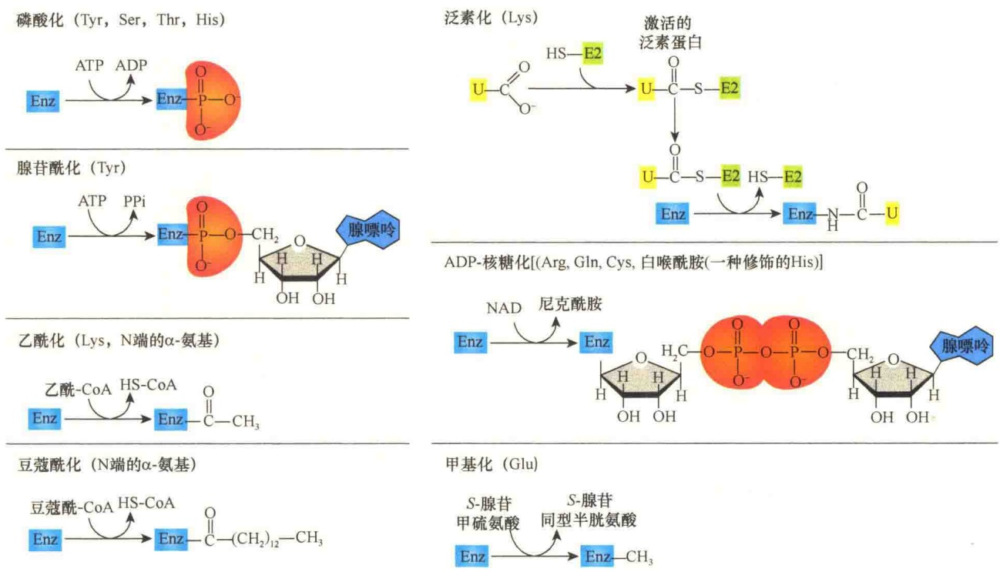

图 6-27 蛋白质的某些酶促的修饰反应（引自 Cox et al., 2012）。Enz 表示酶。

---

204

细胞生物学（第二版）

## 6.4.2.2 蛋白质的糖基化

很多蛋白质，特别是真核细胞中的蛋白质合成之后要添加糖，这种修饰称为糖基化（glycosylation），经糖基化的蛋白质称为糖蛋白（glycoprotein）。虽然细胞核与细胞质中有一些糖基化的蛋白质，但一般而言，被糖基化的蛋白质常是分泌蛋白或细胞表面蛋白。糖蛋白中的糖对于蛋白质在内质网中的折叠、蛋白质定向转运、细胞-细胞相互识别都具有重要作用。大多数糖蛋白根据糖与蛋白质结合的方式不同而被分为N-连接与O-连接两类（图6-28）。

在 N-连接的糖蛋白中，糖是与蛋白质多肽链中的天冬酰胺氨基中 N 原子相连，在 O-连接的糖蛋白中，糖则是与蛋白质多肽链中丝氨酸或苏氨酸羧基的 O 原子相连。参与这两种链接的糖分别是 N-乙酰葡萄糖胺（N-acetylglucosamine）及 N-乙酰半乳糖胺（N-acetylgalactosamine）。此外，在某些蛋白质肽链中的色氨酸也可以与甘露糖通过 C—C 键连接。

## 6.4.2.3 蛋白质的磷酸化

蛋白质的磷酸化修饰是细胞内蛋白质（酶）活性调节最为重要的调节方式。蛋白质的磷酸化是一种共价修饰，但是这种共价修饰是可逆的，有利于蛋白质进行活性状态的快速转换，适应细胞对环境作出快速反应。

蛋白质的磷酸化是由蛋白激酶（protein kinase）催化的，大多数蛋白激酶都是将 ATP 上的磷酸基团转移到蛋白质的丝氨酸、苏氨酸、酪氨酸残基的羟基上。在真核细胞中蛋白激酶是一个很大的蛋白家族，大约有2%的真核基因编码蛋白激酶。大多数蛋白激酶磷酸化丝氨酸、苏氨酸、酪氨酸残基，因此它们分别被称为蛋白质丝氨酸/苏氨酸激酶（protein serine/threonine kinase）或蛋白质酪氨酸激酶（protein tyrosine kinase）。蛋白质（酶）被磷酸化后多数成为活性状态，若蛋白质（酶）的磷酸化基团被蛋白磷酸酶（protein phosphatase）除去，则又恢复到非活性状态（图6-29）。

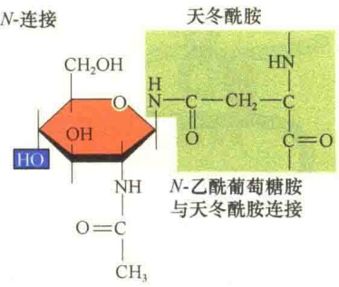

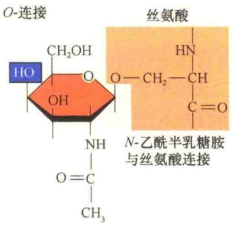

图6-28 蛋白质的 $N$ -连接与 $O$ -连接的糖基化。

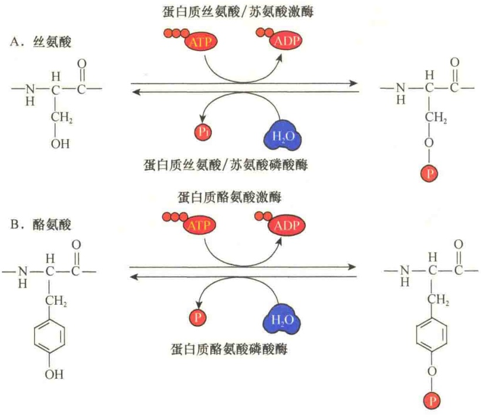

图6-29 蛋白激酶与磷酸酶的作用（引自Cooper et al., 2013）。A. 丝氨酸/苏氨酸蛋白激酶及其磷酸酶，丝氨酸/苏氨酸蛋白激酶将丝氨酸或苏氨酸残基磷酸化，相应的磷酸酶则是将丝氨酸或苏氨酸残基上的磷脱去。B. 蛋白质酪氨酸激酶及其磷酸酶，蛋白质酪氨酸激酶将酪氨酸残基磷酸化，磷酸酶则是将酪氨酸残基上的磷脱去。

---

6 核糖体与蛋白质

205

## 6.4.2.4 蛋白质的切割

蛋白质多肽链的切割，或称酶解（proteolysis），是很多蛋白质成熟的重要步骤。最熟知的例子是将一些多肽链N端的起始甲硫氨酸切除。氨基端的酶解修饰在很多蛋白质的穿膜转运，蛋白质掺入质膜，进入溶酶体、线粒体、叶绿体等都具有重要作用。另外，在信号引导的蛋白质定位中，信号序列完成引导后也要被切除，这样才能保证蛋白质“到岗”后不易“跳槽”。

还有一些蛋白质，包括一些酶，合成时是以前体存在的，只有经过切割，除去一部分才能被激活。例如，胰岛素是以很长的前体多肽合成的，必须经过酶解才具有生物活性。活性胰岛素的形成要经过两次切割:胰岛素的起始前体，即前胰岛素原（preproinsulin），其氨基端含有信号序列，将合成的多肽引导到内质网的腔；进入内质网的腔后，信号序列被切除，产生第二前体，称为胰岛素原（proinsulin），再经过切割，切除间隔的肽段，形成成熟的胰岛素（图6-30）。

细胞内有很多蛋白质合成后是以前体形式存在的，通过切割以后才有活性，如一些消化酶、凝血中的蛋白质，以及动物细胞中涉及细胞程序性死亡的胱天蛋白酶等。

## 6.4.3 蛋白酶体对蛋白质的降解

细胞中蛋白质寿命差异很大，有些寿命短的只有几分钟（如细胞周期中调节各阶段的蛋白质），有些寿命长的与个体同寿（如眼睛中的晶体蛋白），蛋白质寿命的长短由蛋白质降解的速率控制。

蛋白质降解有两个重要的作用。首先，蛋白质降解有利于及时清理有毒性的、折叠不正确或装配不正确的蛋白质，也包括因基因突变合成的不正确的蛋白质、细胞代谢或应急反应（如热休克）损伤的蛋白质。还有，经分子伴侣多次折叠仍不正确的蛋白质也要被及时降解清理。蛋白质降解的第二个作用就是为了适应细胞生理状态的变化，不得不“忍痛割爱”，将一些健康的蛋白质降解，如细胞周期中不同阶段的蛋白质如不及时降解，就不能顺利进入下一阶段。

真核细胞中有几种降解蛋白质的途径，其中最主要的降解途径是溶酶体，它降解的主要是衰老或有缺陷的细胞器。它可以通过吞噬、自噬作用降解被吞入溶酶体中的蛋白质。蛋白质降解的另一个重要途径是蛋白酶体进行的细胞质蛋白降解。

蛋白酶体（proteasome）是降解蛋白质的巨型分子机器，它可以影响细胞的很多生命活动，包括细胞周期的进程、基因转录、DNA修复、细胞程序性死亡、细胞识别、外源生物的感染，以及错误折叠蛋白质的清理等。在典型的哺乳动物细胞中大约有30 000个蛋白酶体。

蛋白酶体约由 50 种蛋白质亚基组成，分子质量为  $2 \times 10^{6} \sim 2.4 \times 10^{6}$  Da，有一个 20S 圆桶状的核心体，核心体的两端各有一个 19S 的帽复合物，调节 20S 核心体的催化活性（图 6-31A、B）。当核心

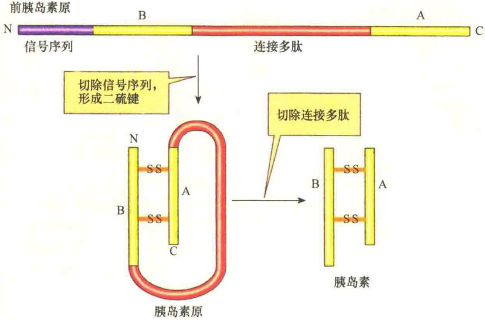

图 6-30 胰岛素的酶解加工（引自 Cooper et al., 2013）。成熟的胰岛素分子含有两个多肽链（A 与 B），它们之间通过二硫键相连。原初合成的前体多肽（前胰岛素原）的 N 端含有一个信号肽，引导前体肽进入内质网后被切除，再经过第二次切除中间序列，成为成熟的胰岛素。

体与一个或两个帽结合时，称为26S复合物（若是结合两个帽则稍大些，称为30S）。19S的帽子含有16～18个亚基，其中6个能够水解ATP，为核心体的催化反应提供能量。通过酵母的遗传研究，发现细胞中若是没有蛋白酶体，细胞将无法生存。

蛋白酶体 20S 的催化核有两个内环，各由 7 个 β 亚基组成，有 3 个活性位点，核心内室的直径约为 1.7nm；另外有两个外环，各由 7 个 α 亚基组成，每个亚基控制着底物的进入。

蛋白酶体能够彻底降解大多数蛋白质，这是因为在β亚基中有三个作用位点，能够切割疏水、酸性、碱性的底物。多肽底物必须将直径调整到约1.3nm，以便通过外环进入核。26S蛋白酶体通常仅允许未折叠

---

206

细胞生物学（第二版）

的蛋白质进入，其打开的程度由19S帽通过所消耗ATP的多少进行调节，19S帽也参与同底物的选择性结合并参与底物的解折叠。蛋白质在蛋白酶体中最后降解成2～24个氨基酸残基长度的小肽被释放出来，最终被细胞质中的多肽酶水解成单个的氨基酸被再利用。

虽然蛋白酶体具有强大的蛋白质降解能力，但是，它们并不能识别哪些蛋白质要被降解，哪些不能被降解，因此需要有一种机制去识别不正常的蛋白质或要被进行数量调整的蛋白质。也就是说，被降解的蛋白质先要被带上标记，然后才能被蛋白酶体所识别降解。

一种由 76 个氨基酸残基组成的多拷贝的蛋白质——泛素（ubiquitin，Ub）能够识别要被降解的蛋白质。从酵母到人的细胞中发现的泛素都是高度保守的，它识别要被降解的蛋白质并与之共价结合，从而使被降解的蛋白质带上标记以便让蛋白酶体降解。这一过程称为泛素化（ubiquitination），涉及三个反应步骤。

（1）泛素激活酶（ubiquitin-activating enzyme）E1的激活:将泛素添加到泛素激活酶上，该过程需要ATP。

（2）将泛素分子转移到泛素结合酶（ubiquitin-conjugating enzyme）E2的半胱氨酸残基上。

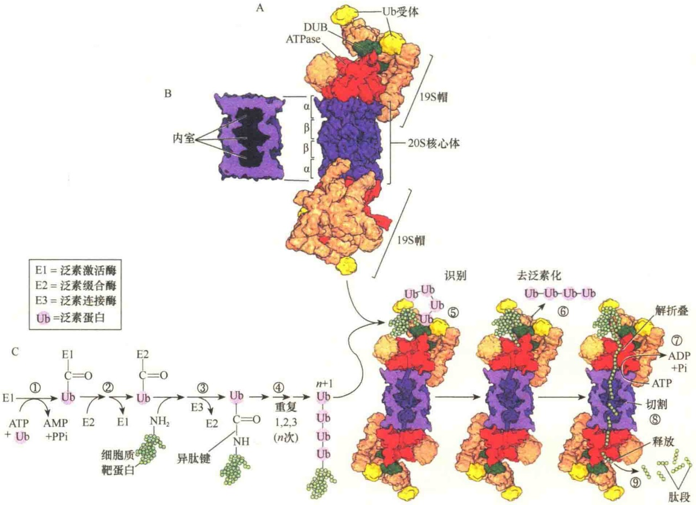

图 6-31 蛋白酶体对蛋白质的降解作用（引自 Lodish et al., 2016）。A. 26S 蛋白酶体具有圆柱形结构，在 20S 核心体的一端或两端有一个 19S 的帽。19S 帽有 19 个不同的亚基（以多种颜色显示），包括 6 个 AAA-ATPase 亚基（Rpt1～Rpt6，红色），它们组装成异六聚体环，两个泛素（Ub）受体（Rpn10 和 Rpn13，黄色），以及一种由去泛素酶（deubiquitinating enzyme，DUB，Rpn11，绿色）与其进化相关的对应物 Rpn8 形成的异二聚体；此外，19S 帽内含有支架和其他蛋白质（tan），两个 19S 帽面向相反的两侧。20S 的核心体由 4 个七聚体环（约 110 Å 直径 × 160 Å 长）叠加而成，组成七聚体环的亚基是 α（外环），或者是 β（内环）（蓝色）。B. 20 核心体的剖视图，显示内室。蛋白质分解发生在由 β 环形成的核心的中心内腔。C. 蛋白质通过多聚泛素化带上被蛋白酶体降解的标记，并送入蛋白酶体被降解。①酶 E1 通过与依赖于 ATP 的泛素（Ub）分子的结合而激活；②E1 将结合的 Ub 分子转移到 E2 的半胱氨酸残基上；③泛素连接酶（E3）将 E2 上结合的 Ub 分子转移到靶蛋白质的侧链赖氨酸残基的—NH₂ 上形成异肽键；④多次重复①～③步，在靶蛋白质上形成一个多聚泛素链；⑤多聚泛素化靶蛋白质被蛋白酶体 19S 帽中的 Ub 受体识别；⑥Ub 基团被去泛素酶去除；⑦ATP 水解，六聚体 ATPase 亚基（红色）将靶蛋白质解折叠，并通过六聚体中的一个孔将已解折叠的蛋白质转移到 20S 核心体蛋白质降解室；⑧蛋白质被切割降解成短肽；⑨释放出降解的蛋白质片段。

---

6 核糖体与蛋白质

207

（3）将与E2结合的泛素C端第76位甘氨酸羧基与靶蛋白的赖氨酸侧链的氨基形成共价键，该反应是由泛素-蛋白连接酶（ubiquitin-protein ligase）E3催化的。这种类型的键称为异肽键（isopeptide bond）。在连接酶的连续作用下，不断将新的泛素通过其C端甘氨酸羧基经由异肽键结合到前一个泛素第48位赖氨酸上，形成与靶蛋白共价连接的多聚泛素链（图6-31）。

当多聚泛素链达到 4 个或更多个泛素连接后，26S 蛋白酶体的 19S 帽能够识别泛素化标记的靶蛋白（有时需要一些相关蛋白的帮助），并将其解折叠、转入蛋白酶体进行降解（图 6-31C）。

蛋白酶体对蛋白质的降解需要通过泛素的介导，所以又将之称为泛素降解途径。蛋白酶体对蛋白质的降解作用分为两个过程:一是对被降解的蛋白质进行标记，由泛素完成；二是蛋白酶解作用，由蛋白酶体催化。

## 6.5 核酶

核酶（ribozyme）一词用于描述具有催化活性的 RNA，即化学本质是核糖核酸（RNA），却具有酶的催化功能。核酶的作用底物可以是不同的分子，有些作用底物就是同一 RNA 分子中的某些部分。核酶的功能很多，有的能够切割 RNA，有的能够切割 DNA，有些还具有 RNA 连接酶、磷酸酶等活性。与蛋白质酶相比，核酶的催化效率较低，是一种较为原始的催化酶。

## 6.5.1 核糖体是一种核酶

核糖体是合成蛋白质的机器，它的构成成分的2/3是rRNA，只有1/3是蛋白质。一系列的研究发现，rRNA是核糖体的核，而核糖体蛋白质起稳定rRNA核的作用。不仅如此，rRNA本身具有酶的活性。

在蛋白质合成过程中，肽键的形成是由肽酰转移酶（peptidyl transferase）催化的。它催化核糖体A位点tRNA上末端氨基酸的氨基与P位肽酰-tRNA上氨基酸的羧基间形成肽键。其结果使A位点的氨酰-tRNA上的多肽延长了一个氨基酸，而P位点的氨酰-tRNA形成脱氨酰-tRNA（图6-32）。

多年来一直把催化氨基酸间肽键形成的反应看成是由核糖体蛋白质酶催化完成的，但不能确定是何种蛋白质。Harry Noller 和他的同事分别在 1972 年、1992 年发表了两项研究结果，证明核糖体 rRNA 在蛋白质合成中具有催化作用:1972 年的论文是通过改变 rRNA 中的碱基，使核糖体失去活性；1992 年的论文是除去核糖体中的蛋白质，发现除去蛋白质的核糖体仍具有肽酰转移酶的活性。

1992年发表的研究论文的策略是用去垢剂、蛋白酶、苯酚除去核糖体中的蛋白质，而不使

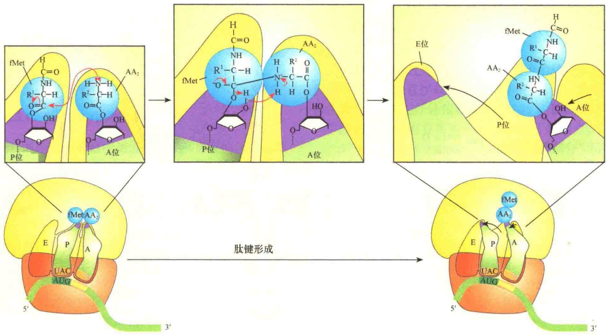

图 6-32 核糖体 A 位点和 P 位点氨基酸间肽键的形成（引自 Nelson and Cox, 2013）。

---

208

细胞生物学（第二版）

rRNA 降解或变性。为了检查除去蛋白质的核糖体是否能够合成蛋白质，Noller 和他的同事们使用了一个简化的肽酰转移酶反应体系，在反应系统中仅加有处理的 50S 核糖体，而不加起始与延伸因子，另外加 [$^{35}$S] 甲硫氨酸（便于检测），以及嘌呤霉素。用这种简化的反应体系，研究者发现水生栖热菌（Thermus aquaticus，一种嗜热菌，认为 RNA 比较稳定）的 50S 核糖体能够保留肽酰转移酶的活性，甚至用蛋白酶 K、SDS 及苯酚等处理嗜热菌 50S 亚基，即将所有的蛋白质都破坏后，仍然具有肽酰转移酶的活性（图 6-33）。

后来的实验证明，即使用蛋白酶 K 或 SDS 等处理常温的 E. coli 的 50S 核糖体，同样具有肽酰转移酶的活性。与此不同的是，用核酸酶处理核糖体 50S 亚基，将 rRNA 降解后，肽酰转移酶的活性也随之消失。这些结果提示是 rRNA 而不是蛋白质催化肽键形成。

图 6-33 50S 核糖体中 rRNA 肽酰转移酶活性证明（引自 Cox et al., 2012）。用 SDS、蛋白酶 K 或苯酚处理栖热水生菌的核糖体，然后用片段反应检测肽酰转移酶的活性，再通过电泳及放射自显影检测反应产物  $\left[^{35}\mathrm{S}\right]$  fMet-嘌呤霉素。结果显示，即使 SDS、蛋白酶 K、苯酚同时处理，都不会影响  $\left[^{35}\mathrm{S}\right]$  fMet-嘌呤霉素的形成。

## 6.5.2 具有切割功能的核酶

上面讨论的核糖体核酶是催化蛋白质合成中肽键形成的核酶，有些核酶还具有水解酶的活性，参与前体 RNA 加工。

## 6.5.2.1 RNase P 是具有切割功能的核酶

tRNA 的原初转录物只是一种前体形式，其 5' 端、3' 端及中间一个小环都要经过加工剪接，此外还要对某些序列进行修饰，才能成为成熟的 tRNA。早期认为 5' 端和 3' 端部分序列的切除分别是由核糖核酸酶 P（ribonuclease P，RNase P）和核糖核酸酶 D（ribonuclease D，RNase D）催化的，它们都是蛋白质酶。后来发现 RNase P 是 RNA 和蛋白质的复合体，含有一个单链 RNA 分子，长度为 377 个核苷酸，结合一个分子质量为 20kDa 的多肽（119 个氨基酸残基）。1983 年，Sidney Altman 及其同事分离了复合体中的 RNA，并证明分离的 RNA 具有催化切割 tRNA 的能力（图 6-34），推测蛋白质则起间接的作用，可能是维持 RNA 结构的稳定。他们的研究证明了 RNase P 是一种具有切割功能的核酶。

## 6.5.2.2 四膜虫 28S rRNA 前体的自我剪接

在大多数真核生物的 rRNA 加工中，从前 rRNA 中切除的序列都是间隔区（spacer）而不是内含子。所谓间隔区，就是位于编码基因间的序列而不是位

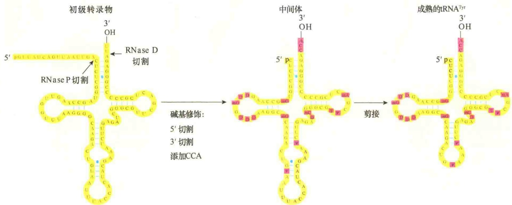

图 6-34 细菌与真核生物 tRNA 的加工（引自 Nelson and Cox，2013）。图中显示的是酵母 tRNA $^{Tyr}$ 被加工的主要过程:5' 端由核酶 RNase P 切割，3' 端由蛋白质酶切割，并在 3' 端加上 CCA，同时还要对某些碱基进行修饰。

---

6 核糖体与蛋白质

209

于基因内的序列。但是在某些原生动物，如四膜虫的编码核糖体大亚基26S rRNA（相当于高等生物的28S rRNA）的基因中，有一个414个碱基的内含子（intron）。所谓内含子，是基因内的间隔序列，它不出现在成熟的RNA分子中，也就是说在转录后要通过加工被切除。与内含子相对应的是外显子（exon），即最后出现在成熟RNA中的序列。1981年，Thomas R. Cech和他的同事在研究四膜虫的26S前rRNA加工去除基因内含子时获得一个惊奇发现:内含子的切除反应发生在仅含有核苷酸和纯化的26S前rRNA而不含有任何蛋白质催化剂的溶液中，可能的解释是:内含子切除是由26S前rRNA自身催化的，而不是蛋白质。为了证明这一发现，他们将编码26S前rRNA的DNA克隆到细菌中并在无细胞系统中转录成28S前rRNA分子。结果发现这种人工制备的26S前rRNA分子在没有任何蛋白质催化剂存在的情况下，切除了前体分子中的内含子，这种现象称为自剪接（self-splicing）。

这一发现之后不久，在酵母和真菌的线粒体前mRNA和前tRNA加工、叶绿体的tRNA和前rRNA加工、某些细菌病毒的前mRNA加工中都发现了自剪接现象。Thomas R.Cech与Sidney Altman因发现RNA催化剪接共同获得1989年诺贝尔化学奖。

## 6.5.3 核酶与内含子的剪接

由于真核生物的大多数基因中有内含子的存在，所以，转录产物是以前 rRNA、前 tRNA 和前 mRNA 的形式存在的，这些内含子都要通过加工被切除后才能得到成熟的 rRNA、tRNA 或 mRNA。虽然这些 RNA 中内含子切除的机制各不相同，但都涉及核酶的作用。

## 6.5.3.1 hnRNA中内含子的剪接

真核生物的结构基因中一般都含有内含子，转录后，从前 mRNA 中将内含子切除，然后将外显子重新连接成一个成熟的 mRNA 的过程称为 RNA 剪接（RNA splicing）。

核剪接（nuclear splicing）是指发生在细胞核中的剪接，主要是对 hnRNA 中内含子的剪接。这种剪接有三个主要特点:一是在前 mRNA 中内含子与外显子间有特征性序列，即 GU-AG 规则；二是剪接过程中需要 snRNA 参与，并要形成剪接体；三是要形成套索结构。

1）GU-AG 规则（GU-AG rule） 前 RNA 中参与内含子剪接的两个特殊位点，即在内含子和外显子交界处有两个相当短的保守序列:5'端为GU，3'端为AG，称为GU-AG规则。GU-AG规则主要适用于（或是全部）真核生物基因的剪接位点，说明内含子的切除有一共同的机制。应指出的是，这种保守性不适用于线粒体、叶绿体和酵母tRNA基因转录后的加工。

2）剪接体（spliceosome）在剪接过程中形成的剪接复合物称为剪接体，剪接体的主要组成是蛋白质和核小RNA（small nuclear RNA，snRNA）。复合物的沉降系数为50S～60S，它是在剪接过程的各个阶段随着snRNA的加入而形成的。也就是说在完整的前mRNA上形成的一个剪接中间体。

剪接体的装配与核糖体的装配相似，依靠RNA-RNA、RNA-蛋白质、蛋白质-蛋白质三个方面的相互作用，可能比核糖体更复杂，要涉及snRNA的碱基配对、相互识别等。

剪接体中有 5 种类型的核小 RNA，分别是 U1、U2、U4、U5、U6（由于这些小 RNA 富含尿嘧啶，故称为 U），这些 RNA 的大小为 50～200 个核苷酸，每个小分子 RNA 与 6～10 个蛋白质分子组成复合物，称为核内小核糖核蛋白颗粒（small nuclear ribonucleoprotein particle snRNP），snRNP 在剪接反应中起核心作用。U1、U2 和 U5 snRNP 均是独立存在，U4 与 U6 snRNA 组成复合体。

剪接体装配的第一步是 U1 与 pre-mRNA 剪接点的结合。5' 位点的识别涉及 U1 5' 端序列与 5' 剪接位点序列的配对。随着 U1 的结合，U2 snRNP 通过类似配对的原则与分支点 A 结合，随之是 U4/U6 和 U5 snRNP 的结合，形成剪接体，其中 U5 是与剪接点的 5' 端结合。

snRNA 不仅仅通过与剪接点、支点的结合形成剪接体，它们也直接催化 pre-mRNA 的剪接，最后将切成的两个外显子连接起来（图 6-35），因此剪接体中的 snRNA 具有自剪接（self splicing）的能力。

3）套索的形成和释放 内含子的剪接分为两个主要的阶段。第一阶段是从内含子的5'端开始切割，将左边的外显子与右边的内含子-外显子分开，左边的外显子是一个线性分子，右边的内含子-外显子形成一个套索（lariat）结构；在套索结构中，内含子的5'端与内含子右侧一个碱基相连形成一个环。第二阶段是在剪接位点的3'端切割，释放套索中的内含子，同时右边的外显子与左边的外显子连接起来，切割和连接反应不是独立的，而是协同进行的。

## 6.5.3.2 I型、Ⅱ型内含子的剪接

根据内含子自剪接作用机制不同，分为I型内

---

210

细胞生物学（第二版）

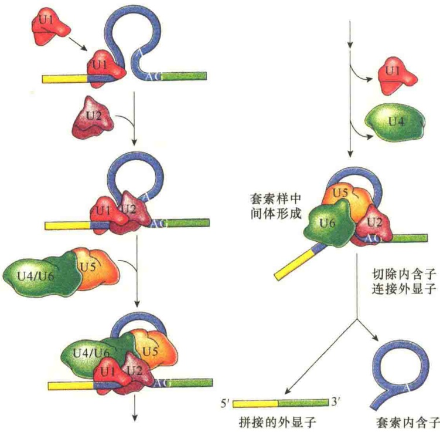

图 6-35 剪接体的装配与内含子的剪接（引自 Cooper and Hausman, 2016）。剪接体装配的第一步是 U1 snRNP 与 5' 端剪接位点（splice site, SS）结合，接着是 U2 snRNP 与支点结合，然后是预装配的复合物 U4/U6 及 U5 snRNP 进入剪接体。U1、U4 与剪接体分离，U6 催化套索样中间体（lariat-like intermediate）的形成，然后将含有内含子的套索释放，并将外显子连接起来。

含子和Ⅱ型内含子。Ⅰ型内含子存在于某些生物的细胞核、线粒体和叶绿体中编码rRNA、mRNA和tRNA的基因中；Ⅱ型内含子一般存在于真菌、藻类，以及植物的线粒体和叶绿体mRNA的初级转录物中，所以Ⅰ型内含子比Ⅱ型内含子更普遍。

I 型内含子（group I intron）是一类具有酶催化功能的内含子，转录成 RNA 后，可以自剪接。此类内含子转录后可以形成 9 个由碱基配对形成的特定二级结构，分别命名为 P1～P9，其中 P1 和 P7 是保守的。I 型内含子的自我剪接需要鸟苷（guanosine）作为辅助因子，不过鸟苷不是作为能源，而是作为附着基团暂时性与 RNA 结合。鸟苷与剪接位点的 5' 端结合，并与内含子的 5' 端形成一个磷酸二酯键，同时在上游外显子形成 3'-OH 基，接着，新形成的 3'-OH 基与 3' 剪接点结合，将两个外显子连接起来，释放出内含子。

从结构上看，Ⅱ型内含子（group II intron）的6个结构域可形成发夹环，结构域5与6之间只间隔3个碱基，结构域6参与转酯作用。Ⅱ型内含子同样具有自剪接的功能，它的剪接位点类似于核编码结构基因的内含子，并同样遵从GU-AG规则。Ⅱ型内含子的剪接又不完全与核内含子的剪接相同，它不需要剪接体，但要形成一个套索的中间体。Ⅱ型内含子自剪接的第一步通过内含子中的一个腺苷与

5'剪接点反应从而将5'剪接点切开，并形成一个套索中间体。第二步是将内含子的3'剪接点切开，两个外显子相连，释放套索结构。

I型与Ⅱ型内含子都是自剪接，图6-36是I

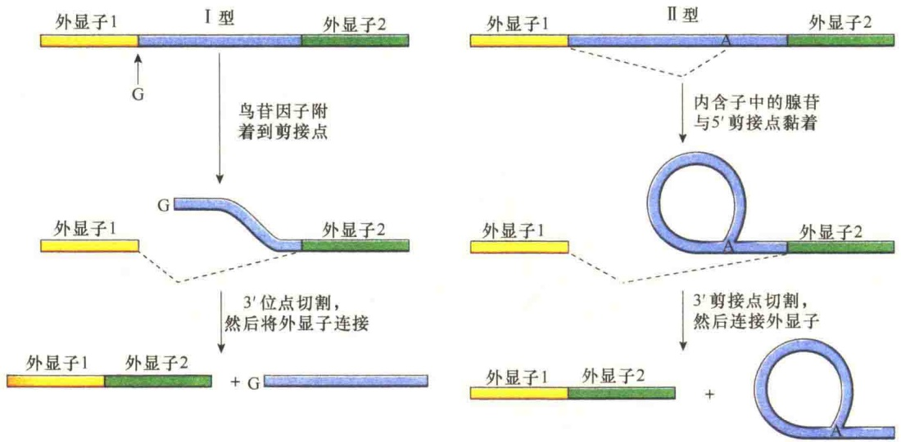

图 6-36 I 型内含子、Ⅱ型内含子自我剪接（引目 Cooper et al., 2013）。在 I 型内含子剪接中，剪接反应的第一步，在鸟苷（G）的引导下，在内含子的 5' 端剪接点进行切割，生成一种线性的、内含子 5' 端结合有 G 的中间体。在Ⅱ型内含子的剪接中，剪接反应的第一步是通过内含子内的腺苷反应进行 5' 剪接点切割，形成套索中间体。I 型内含子和Ⅱ型内含子剪接的第二步都是在 3' 端剪接点进行切割，然后进行外显子的连接。

---

6 核糖体与蛋白质

211

型内含子和Ⅱ型内含子自剪接的比较。

核酶的发现在生命科学中具有重要意义，在进化上使我们有理由推测早期遗传信息和遗传信息功能体现者是一体的，只是在进化的某一进程中蛋白质和核酸分别执行不同的功能。核酶的发现为临床的基因治疗提供了一种手段，具有重要的应用前景。

## 6.6 RNA 编辑

RNA 编辑（RNA editing）是指在 mRNA 水平上改变遗传信息的过程。RNA 编辑是通过比较成熟的 mRNA 与相应基因的编码信息时发现的，成熟的 mRNA 序列中有几种意想不到的变化，包括:U→C、C→U 的改变；U 的插入或缺失；多个 G 或 C 的插入等。RNA 编辑最早是在线粒体编码基因中发现的，后来在植物的叶绿体、哺乳动物的核基因中都有发现。

## 6.6.1 RNA编辑对表达的调控

由于 RNA 编辑是基因转录后在 mRNA 中插入、缺失或替换核苷酸而改变 DNA 模板来源的遗传信息，翻译出多种氨基酸序列不同的蛋白质，因此，RNA 编辑的结果不仅扩大了遗传信息，而且使生物能更好地适应生存环境。有些基因的主要转录产物必须经过编辑才能有效地起始翻译，或产生正确的可读框（ORF），如在锥虫动质体 ATPase-6 的前 mRNA 中，需要向导 RNA 通过碱基配对在其 3' 区增添 447 个尿苷并删除 28 个尿苷才能形成成熟的 mRNA；此外，多头绒泡菌（Physarum polycephalum）基因组中存在 ATP合成酶  $\alpha$  亚基的隐蔽基因，其转录产物中有 54 处在插入单个的 C 后，才能形成成熟 mRNA 的正确可读框。这些 C 大多插入于嘌呤-嘧啶二核苷酸（RY）的 3' 侧，且有 78% 的插入在密码子的简并位上，因此有 88% 的 RYC 密码子是通过编辑产生的。由此提示 RNA 编辑是基因表达的一种重要调控机制。

## 6.6.2 gRNA 介导的 mRNA 插入编辑

锥虫线粒体的细胞色素氧化酶亚基Ⅱ的基因与人类基因相比，在相当于编码第170位氨基酸处有一个移码突变；然而在其基因转录产物中却由于4个U的插入恢复了相应的ORF，因而能够合成相应功能的蛋白质。研究发现，指导RNA（guide RNA，gRNA）在锥虫线粒体的细胞色素氧化酶亚基Ⅱ基因的mRNA编辑中起重要作用。gRNA长度为60～80个核苷酸，是由单独的基因转录的，具有3'寡聚U的尾巴，中间有一段与被编辑mRNA精确互补的序列，5'端是一个锚定序列，它与预编辑的mRNA序列互补。在编辑时，形成一个编辑体（editosome），以gRNA内部的序列作为模板进行转录物的校正，同时产生编辑的mRNA。有趣的是，gRNA的3'端oligo U尾竟是被添加的U的供体（图6-37）。

## 6.6.3 改变 mRNA 中单个核苷酸的 RNA 编辑

载脂蛋白 B（apolipoprotein B，apoB）基因的 mRNA 是通过单个碱基修饰的 RNA 编辑合成不同蛋白质的最好例子。人的载脂蛋白有两种表达形式:apoB-48 和 apoB-100。该基因的序列在肝、肠

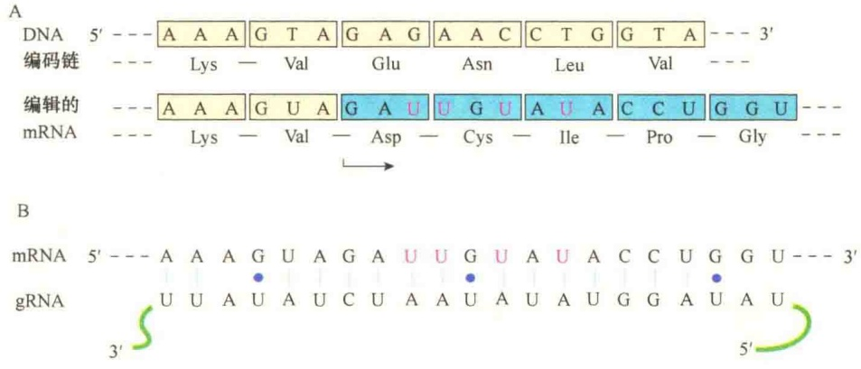

图 6-37 gRNA 指导 Prytanosoma brucei 线粒体细胞色素氧化酶亚基Ⅱ基因转录物的编辑（引自 Nelson and Cox, 2013）。A. 4 个 U 的插入；B. 在编辑过程中，gRNA 的模板作用。

---

212

细胞生物学（第二版）

组织细胞中是相同的，但产物不同。在肝细胞中，产物为4536个氨基酸残基的肽，即apoB-100；但在肠细胞中，产物为只含2152个氨基酸残基的apoB-48，缺失了apoB-100的N端与低密度脂蛋白（LDL）受体结合的结构域。原因是在肠细胞转录的mRNA进行了RNA编辑，即将2153位的谷氨酰胺的密码子CAA中的C编辑成为U，形成一个终止密码子——UAA（图6-38），结果使蛋白质的合成提前终止，合成一个新的分子质量约为 250kDa 的蛋白质。通过 RNA 编辑，使 apoB 基因在不同的组织中起不同作用:apoB-100 蛋白在肝组织中的作用是在血液循环中运输固醇脂，而 apoB-48 蛋白在肠中的作用是吸收食物中的脂。

将 mRNA 中 C 转变成 U，是由与载脂蛋白相关的胞苷脱氨酶催化的，该酶仅存在于肝细胞中。

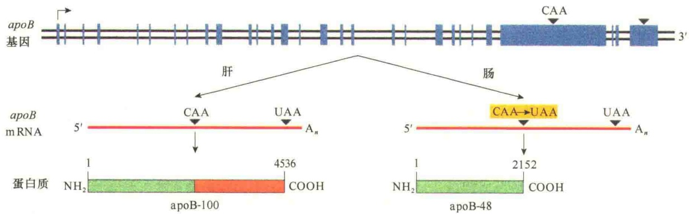

图 6-38 载脂蛋白 mRNA 的编辑（引目 Lodish et al., 2013）。在人的肝细胞中，未编辑的 mRNA 翻译成由 4536 个氨基酸组成的 apo-B100 的蛋白质。在人的肠组织中，mRNA 因为被编辑，导致 C 变成了 U，产生了一个终止密码，导致翻译提前终止，这样合成的蛋白质 apo-48 仅有 2152 个氨基酸。

## 本章小结

核糖体是细胞内一种核糖核蛋白颗粒，含有 rRNA 和核糖体蛋白质。核糖体可分为真核生物核糖体和原核生物核糖体，前者有细胞质核糖体、线粒体核糖体和叶绿体核糖体 3 种类型。核糖体均由大小两个亚基组成，进行蛋白质合成时才结合在一起。原核生物核糖体沉降系数为 70S，由 50S 大亚基（含 36 种不同的蛋白质，以及 23S 和 5S rRNA）和 30S 小亚基（含 21 种蛋白质及 16S rRNA）组成；真核生物核糖体沉降系数为 80S，由 60S 大亚基（含大约 47 种蛋白质及 28S、5S 和 5.8S rRNA）和 40S 小亚基（含大约 33 种蛋白质及 18S rRNA）组成。

核糖体的生物发生包括蛋白质和 rRNA 的合成、核糖体亚基的组装等。真核生物的 18S、5.8S、28S rRNA 基因组成一个转录单位，转录成一个 45S 的前体。原核生物的 16S、23S、5S rRNA 基因组成一个转录单位。真核生物核糖体亚基在核仁中装配，原核生物核糖体亚基在细胞质中装配。

核糖体的功能是进行蛋白质的合成，分为氨基酸激活、起始、延伸、终止与核糖体循环、折叠及翻译后加工5个阶段。

核糖体上合成的仅是蛋白质的一级结构，合成后必须进行正确折叠。分子伴侣在蛋白质折叠中起重要作用，蛋白质也可通过酶促进行折叠。

细胞内合成的蛋白质除了折叠成合适的构型外，还需进行适当的修饰，如甲基化、羟基化、酰基化、糖基化等。

有些蛋白质还需要经过切割除去不需要的序列才能起作用，或者经切割后才能折叠装配成正确的构型。

蛋白酶体是降解蛋白质的巨型分子机器，能够彻底降解大多数蛋白质，对于保持细胞内蛋白质的更新及维持活力十分重要。

核酶是具有催化活性的 RNA。核剪接涉及核酶的作用，具有 GU-AG 规则、装配成剪接体、形成套索结构三个特点。Ⅰ、Ⅱ型内含子的剪接机制完全不同。

---

6 核糖体与蛋白质

213

RNA 编辑是指在 mRNA 水平上改变遗传信息的过程，涉及指导 RNA 的作用。

## 思考题

(1) 核糖体是如何装配的? 从经济意义上考虑, 大量的核糖体蛋白质进入细胞核, 在核仁中装配核糖体亚基似乎不够合理, 你如何看?

（2）请举例说明 RNA 编辑及其意义。

（3）Ⅰ型和Ⅱ型内含子在进行自我剪接时的主要区别是什么？

（4）泛素如何介导细胞内的蛋白质降解？

(5) 一般认为, 从核糖体上释放出新生肽链, 就意味着蛋白质合成结束。但为什么将从核糖体上释放出的蛋白质多肽的折叠与修饰归为蛋白质合成的第五个阶段?