# 线粒体与过氧化物酶体

7.1 线粒体概述

7.1.1 线粒体的发现与功能研究

7.1.2 线粒体的形态结构

7.1.3 线粒体的化学组成和各部分特性

7.2 线粒体蛋白的靶向转运

7.2.1 蛋白质分选与转运

7.2.2 线粒体蛋白的转运

7.3 线粒体的功能——氧化磷酸化作用

7.3.1 真核细胞中的氧化作用

7.3.2 呼吸链与电子传递

7.3.3 氧化磷酸化:ATP 形成机制

7.4 线粒体的遗传、融合与分裂

7.4.1 线粒体的遗传

7.4.2 线粒体的融合与分裂

7.5 过氧化物酶体

7.5.1 过氧化物酶体的发现及所含酶类

7.5.2 过氧化物酶体的功能

7.5.3 过氧化物酶体的生物发生

俗话说:“人是铁，饭是钢，不吃饭，软叮当”，说的是食物对生命活动的重要。那么，食物如何使人变成“钢”的呢？细胞中的线粒体起关键作用！

细胞中涉及能量代谢的细胞器主要是线粒体与叶绿体；过氧化物酶体虽然不参与 ATP 的合成，但可促进有毒物质的解毒，对线粒体具有氧调节作用。

## 7.1 线粒体概述

线粒体（mitochondrion）是1850年被发现、1898年被命名的，是细胞氧化磷酸化和形成ATP的主要场所，有细胞“动力工厂”（power plant）之称。另外，线粒体有自身的DNA和遗传体系，但线粒体基因组的基因数量有限，因此，线粒体只是一种半自主性的细胞器。

## 7.1.1 线粒体的发现与功能研究

线粒体是能够在光学显微镜下进行观察的显微结构，它具有渗透性，在低渗溶液中会膨胀，而在高渗溶液中能够收缩。

人们对线粒体的研究有一个多世纪的历史。1850年，德国生物学家Kölliker首次系统地研究了线粒体，发现在肌细胞的细胞质中存在着一种规则排列的颗粒，并且从肌细胞中分离到这些颗粒，发现将它们放置在水中能够膨胀，为此推测这种颗粒是由半透性的膜包被的。很快，在其他一些组织的细胞中也发现了这种颗粒，并起了很多不同的名称。1898年，有人首次将这种颗粒命名为线粒体，意思是“类似线状的颗粒”（thread-like granule），并很快被大家所接受。

1900 年，Michaelis 在线粒体的功能研究方面取得了突破性的进展。他用染料 Janus green 对肝细胞进行染色，这种染料将线粒体染成绿色。当细胞消耗氧之后，线粒体的颜色逐渐消失了，当时已经了解这种颜色的变化是颜料的氧化还原状态改变的结果，从而提示线粒体具有氧化还原反应的作用。1913年，Warburg从细胞匀浆质中分离了线粒体，并发现它能够消耗氧。但是，这些发现当时并没有引起生物学家足够的重视，因为人们普遍认为线粒体的作用主要是参与分化细胞遗传特性的转变。

人们真正注意线粒体在能量代谢中的作用是分离纯化方法的发展和线粒体独立功能的研究。在20世纪40年代早期，Claude开创了细胞组分分离技术，能够将线粒体与其他细胞组分分开。但他所用的是盐法，而盐会破坏线粒体的作用，所以用这种方法分离的线粒体看不到有关Krebs循环及呼吸链的成分。1948年，Hogeboom、Schneider和Palade等终于分离到具有生物活性的线粒体，他们采用的分离介质是蔗糖而不是盐，因此不会破坏线粒体。分离方法上的突破，使得Kenedy和Lehninger证明了线粒体具有Krebs循环、电子传递、氧化磷酸化的作用，从而证明了线粒体是真核生物进行能量转换的主要场所。

## 7.1.2 线粒体的形态结构

线粒体的直径一般为  $0.5 \sim 1.0 \mu m$ ，在长度上变化很大，一般为  $1.5 \sim 3 \mu m$ ，长的可达  $10 \mu m$ ，人的成纤维细胞的线粒体则更长，可达  $40 \mu m$ 。

在不同类型的细胞中线粒体的数目相差很大，但在同一类型的细胞中数目相对稳定。有些细胞中只有一个线粒体，有些则有几十、几百，甚至几千个线粒体。在代谢活跃的细胞中，线粒体的数量多，如肝细胞中有500～1000个。代谢率低，耗能少的细胞中线粒体数目少，如精子细胞、淋巴细胞等一般少于100个。细胞在不同的功能状态下，线粒体的数目也会变化，如唾液腺细胞在分泌活动旺盛时线粒体的数目增多，红细胞成熟时则没有线粒体。

A

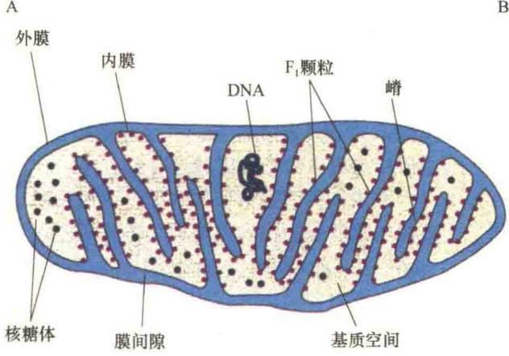

## 7.1.3 线粒体的化学组成和各部分特性

一般情况下，植物细胞的线粒体数目比动物细胞的少，这是因为植物细胞的叶绿体代替了线粒体的某些功能。

线粒体是由外膜、内膜、膜间隙及基质4个

在多数细胞中，线粒体均匀分布在整个细胞质中，但在某些细胞中，线粒体的分布是不均一的，有时线粒体聚集在细胞质的边缘。在细胞质中，线粒体常常集中在代谢活跃的区域，因为这些区域需要较多的ATP，如肌细胞的肌纤维中有很多线粒体。另外，在精细胞、鞭毛、纤毛和肾小管细胞的基部都是线粒体分布较多的地方。

线粒体由内、外两层彼此平行和高度特化的膜包围而成，内外膜都是典型的单位膜。线粒体外膜（outer membrane，OMM）起界膜作用，线粒体内膜（inner membrane，IMM）向内皱褶形成嵴（crista），嵴上有一些颗粒朝向线粒体基质，这些颗粒称为 $F_{1}$ 颗粒（ $F_{1}$ particle），似把手状。线粒体的外膜和内膜将线粒体分成两个不同的区室:一个是膜间隙（intermembrane space，IMS），是两个膜之间的空隙；另一个是线粒体基质（matrix），它是由内膜包裹的空间（图7-1）。

图 7-1 线粒体形态结构（引自 Kleinsmith and Kish, 1995）。A. 线粒体结构模式图；B. 线粒体的电子显微镜照片。

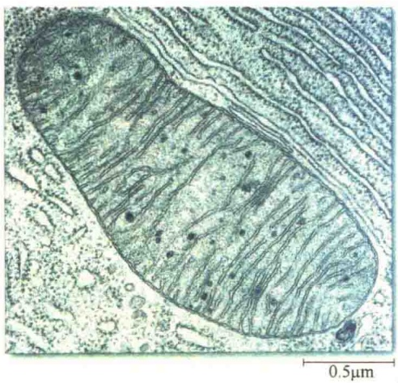

部分所组成，由于各部分的作用不同，因此，不仅在化学组成上不尽相同，而且具有不同的形态特性。

## 7.1.3.1 线粒体的化学组成

经过对线粒体各结构组分的生化分析，发现线粒体的化学组分主要是蛋白质、脂类、水分等。

蛋白质占线粒体干重的 $65\% \sim 70\%$ 。线粒体的蛋白质分为水溶性和脂溶性的，水溶性的蛋白质主要是基质的酶和膜的外周蛋白；脂溶性的蛋白质是膜整合蛋白，有很多具有酶活性。

线粒体的脂类只占干重的20%～30%。在线粒体的脂类中多数是磷脂，占总脂的3/4以上。其中，卵磷脂、脑磷脂占多数；还有一定数量的心磷脂，但胆固醇的含量较低。含丰富的心磷脂和较少的胆固醇是线粒体在组成上与细胞其他膜结构的明显差别。

线粒体内、外膜在化学组成上的主要区别是脂类和蛋白质的比例不同，内膜上的脂类与蛋白质的比值低（0.3:1），外膜中的比值较高（接近1:1）。

从线粒体中已分离出 120 多种酶，组成几十种不同的酶系（如三羧酸循环酶系、氧化磷酸化酶系等），每种酶系至少有 2000 个重复，有规则地排列在线粒体的不同部位。

## 7.1.3.2 线粒体各部分的特性和功能

组成线粒体的 4 个部分，在能量转换过程中分别起不同的作用，各部分功能的差异主要是化学组成的差异，特别是蛋白质和酶分布的差异（表 7-1）。

表 7-1 线粒体各部分蛋白质的分布

| 外膜 | 膜间隙 | 内膜 | 基质 |
| --- | --- | --- | --- |
| 细胞色素b | 腺苷酸激酶 | NADH脱氢酶 | 丙酮酸脱氢酶 |
| NADH-细胞色素 | 核苷 | 琥珀酸脱氢酶 | 脂肪酸β氧化酶 |
| 还原酶 | 二磷酸激酶 | 细胞色素氧化酶 | Krebs循环酶系 |
| 单胺氧化酶 | 单磷酸激酶 | 细胞色素c | DNA聚合酶 |
| 脂酰辅酶A合酶 |  | ATP合酶 | RNA聚合酶 |
| 磷酸甘油酰基转移酶 |  | $F_0F_1$复合物 | 核糖体 |
| 核苷二磷酸激酶 |  | 转运蛋白 | 转移RNA |
| 孔蛋白 |  | 醌 |  |
| 磷脂:蛋白质=0.9:1 |  | 磷脂:蛋白质=0.3:0.7 |  |
| 心磷脂:磷脂=0.03:0.97 |  | 心磷脂:磷脂=0.22:0.78 |  |

1）外膜 线粒体最外的一层全封闭的单位膜结构，是线粒体的界膜，厚6～7nm，平整光滑。构成外膜的脂与蛋白质（酶）的含量几乎相等。

外膜含有孔蛋白，当孔蛋白通道打开时最大可允许 5000Da 的分子通过，由于 ATP、NAD、辅酶 A 等的分子质量都小于 1000Da，所以这些分子都能自由通过外膜。由于外膜的通透性非常高，使得膜间隙中的环境几乎与胞质溶胶相似。

外膜含有一些特殊的酶类，如参与色氨酸降解、脂肪酸链延伸的酶，表明外膜不仅参与膜磷脂的合成，同时对那些将在线粒体基质中进行彻底氧化的物质先进行初步分解。外膜上含有单胺氧化酶（monoamine oxidase），这种酶能够终止胺神经递质（如降肾上腺素和多巴胺）的作用。在早期的细胞学研究中，将单胺氧化酶视为线粒体外膜的标志酶。

2）内膜 位于外膜的内侧，包裹线粒体基质的一层单位膜结构，厚5～6nm。由于内膜要建立 $H^{+}$ 的质子梯度，驱动ATP的合成，所以内膜的通透性较低，一般不允许离子和大多数带电的小分子通过，为线粒体行使正常的功能提供了保证。相对于外膜而言，内膜对于大多数核苷、糖及小的离子都是不通透的。这些物质的运输要借助于膜上的一些载体蛋白。

内膜的蛋白质与脂的比例相当高，并且含有大量的心磷脂（cardiolipin），约占磷脂含量的20%。心磷脂与离子的不可渗透性有关。

线粒体内膜通常要向基质折褶形成嵴，嵴的形成使内膜的表面积大大增加。嵴有两种排列方式:一是层状（lamellar），二是管状（tubular）。在高等动物细胞中主要是层状的排列，多数垂直于线粒体长轴；在原生动物和植物中常见的是管状排列。线粒体嵴的数目、形态和排列等在不同种的细胞中差别很大。一般需要能量多的细胞，不仅线粒体多，而且线粒体嵴的数目也多。

线粒体内膜的嵴上有许多排列规则的颗粒，称为线粒体基粒，每个基粒间相距约10nm。基粒又称偶联因子1（coupling factor 1），简称 $F_{1}$ ，实际是ATP合酶（ATP synthase），又叫 $F_{0}F_{1}$ -ATP酶复合体，是一个多组分的复合物。

内膜的酶类比外膜复杂得多，主要有两大类。第一类是运输酶类，因为内膜不仅要进行各种代谢产物和中间产物的运输，还要运输磷酸、钙离子，以及核苷酸、谷氨酸、鸟氨酸等。第二类是电子传递和ATP合成的酶类，这是线粒体内膜的主要成分，参与电子传递和ATP的合成。

内膜是线粒体进行电子传递和氧化磷酸化的主要部位，在电子传递和氧化磷酸化过程中，线粒体将氧化过程中释放出来的能量转变成 ATP。

3）膜间隙 线粒体内膜和外膜之间的间隙，宽6～8nm，其中充满无定形的液体，含有可溶性的酶、底物和辅助因子。由于外膜通透性很强，而内膜的通透性又很低，所以膜间隙中的化学成分很多，几乎接近胞质溶胶。膜间隙中也有一些酶类，如腺苷酸激酶（adenylate kinase）、二磷酸核苷激酶等，其中腺苷酸激酶的功能是催化ATP分子末端磷酸基团转移到AMP，生成2分子ADP。

4）线粒体基质 内膜和嵴包围着的线粒体内部空间是线粒体基质。基质中的酶类最多，与三羧酸循环、脂肪酸氧化、氨基酸降解等有关的酶都存在于基质之中。其中有些酶系组成网状结构，与内膜内侧有一定的连接，这样有利于这些酶促反应所形成的 NADH 转移到内膜的电子传递链上。此外还含有 DNA、tRNA、rRNA，以及线粒体基因表达的各种酶和核糖体。

由于线粒体各部分结构的化学组成和性质的不同，它们的功能各异（表 7-2）。

表 7-2 线粒体各部分的功能

| 部位 | 功能 |
| --- | --- |
| 外膜 | 磷脂的合成;脂肪酸链去饱和;脂肪酸链延伸 |
| 内膜 | 电子传递;氧化磷酸化;代谢物质运输 |
| 膜间隙 | 核苷的磷酸化 |
| 基质 | 丙酮酸氧化;TCA 循环;脂肪的 β 氧化;DNA 复制;RNA 合成;蛋白质合成 |

## 7.2 线粒体蛋白的靶向转运

线粒体本身的遗传信息有限，由线粒体 DNA 编码的蛋白质大约只有 13 种，而线粒体执行功能（包括结构）时，需要上百种蛋白质，其中绝大多数都是核基因编码，在细胞质的游离核糖体上合成后转运到线粒体（表 7-3）。

表 7-3 细胞质中合成的某些线粒体蛋白

| 线粒体部位 | 蛋白质 |
| --- | --- |
| 基质 | $F_1$-ATPase: α亚基(植物除外)、β亚基、γ亚基和δ亚基(某些真菌),RNA聚合酶,DNA聚合酶,核糖体蛋白,柠檬酸合成酶,TCA酶系,乙醇脱氢酶(酵母),鸟氨酸氨基转移酶(哺乳动物) |
| 内膜 | ADP-ATP逆向转运蛋白,磷酸-OH-逆向转运蛋白,细胞色素c氧化酶亚基4、5、6、7,$F_0$-ATPase,$CoQH_2$-细胞色素c还原酶复合物亚基1、2、5(Fe-S)、6、7、8 |
| 膜间隙 | 细胞色素c,细胞色素c过氧化物酶,细胞色素$b_2$,$CoQH_2$-细胞色素c还原酶复合物亚基4(细胞色素$c_1$) |
| 外膜 | 孔蛋白 |

## 7.2.1 蛋白质分选与转运

真核生物的细胞是高度有序的结构，蛋白质是各种结构的主要成分。除线粒体与叶绿体能够合成有限的、供自己需要的蛋白质外，核基因编码的蛋白质都是在细胞质核糖体上合成的，因此，细胞质核糖体合成的蛋白质必须通过一定的机制定位到相应的细胞器或功能部位。

蛋白质分选（protein sorting）是指将新合成的蛋白质从群体中“挑出来”，然后通过特殊的机制将其“送上岗”。蛋白质寻靶（protein targeting）是蛋白质通过其携带的信号找到“东家”。其实，寻靶的过程是被包含在蛋白质转运过程之中的，分选、寻靶与转运是新合成的蛋白质被正确定位的一个连续的过程，涉及信号序列、受体及转运途径。

细胞质核糖体上合成的蛋白质是如何被分选与转运的呢？

## 7.2.1.1 蛋白质分选与转运途径

细胞质中的核糖体在合成蛋白质时有两种可能的存在状态:一种是在蛋白质合成的全过程一直保持游离状态（实际上是与细胞骨架结合在一起的），这种核糖体称为游离核糖体（free ribosome）；另一种情况是核糖体在合成蛋白质的初始阶段处于自由状态，但随着肽链的合成，核糖体被引导到内质网上与内质网膜结合在一起，这种核糖体称为附着核糖体（membrane-bound ribosome）。由于这两种核

糖体上合成的蛋白质在细胞内的去向是不同的，因此，它们的转运途径也是不同的，分别称为翻译后转运（post-translational translocation）和共翻译转运（cotranslational translocation）（图 7-2）。

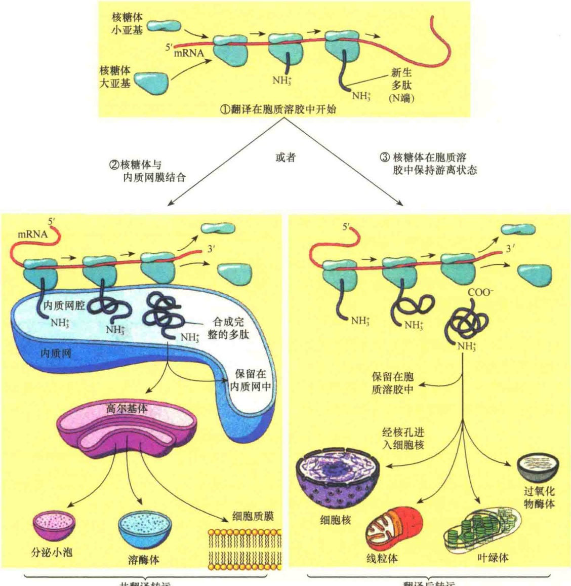

图 7-2 蛋白质共翻译转运与翻译后转运（引自 Becket et al., 1996）。①核基因编码的蛋白质在细胞质的游离核糖体上起始合成。②N 端具有信号肽序列的肽链被引导到内质网上，导致核糖体与内质网结合，新生的蛋白质进入共翻译转运途径；附着核糖体合成的蛋白质经内质网、高尔基体进行转运，运输的目的地包括内质网、高尔基体、溶酶体、细胞质膜、细胞外基质等。③N 端不含信号肽序列的新生肽 mRNA 仍与游离核糖体一起直至完成蛋白质合成；游离核糖体上合成的蛋白质的去向有胞质溶胶、细胞核、叶绿体、线粒体、过氧化物酶体等。

1）共翻译转运 附着核糖体上合成的蛋白质，在它们进行翻译的同时就开始了转运，主要是通过定位信号，一边翻译，一边进入内质网，然后再进行进一步的加工和转移。由于这种转运定位是在蛋白质翻译的同时进行的，故称为共翻译转运。在附着核糖体上合成的蛋白质通过信号序列介导将核糖体引导到内质网后，经过连续的膜系统转运分选才能到达最终的目的地。共翻译途径又称为分泌途径（secretory pathway），是基于膜泡的转运(vesicle-based trafficking) (图 7-2②)。

2）翻译后转运 由于游离核糖体上合成的蛋白质必须等蛋白质完全合成并释放到胞质溶胶后才能被转运，所以将这种转运方式称为翻译后转运。游离核糖体合成的蛋白质在细胞内的定位，由前体蛋白本身具有的导向信号决定。不同类型的导向信号可以引导蛋白质定位到特定的细胞器，如线粒体、叶绿体、细胞核和过氧化物酶体等（图7-2③）。由于在游离核糖体上合成的蛋白质在合成释放之后需要通过肽序列中的信号寻找目的地，因而是一种基于信号的寻靶（signal-based targeting）。

## 7.2.1.2 靶向序列与信号序列

无论是在游离核糖体上合成的蛋白质还是在附着核糖体上合成的蛋白质，它们的转运都是由信号引导的，这种信号一般存在于蛋白质的N端，这就是蛋白质的定位信号，而定位信号也是基因中的编码序列。由于游离核糖体合成的蛋白质与附着核糖体合成的蛋白质的信号序列不同，导致运输机制也不同。为了便于区别它们，将游离核糖体上合成的、位于新生肽N端的信号统称为靶向信号（targeting signal）或靶向序列（targeting sequence）。由于这一段序列是氨基酸组成的肽，所以又称为前导肽（leading peptide）或转运肽（transit peptide）。将附着核糖体上合成的、位于新生肽N端具有信号作用的序列称为信号肽（signal peptide）或称为信号序列（signal sequence）。

## 7.2.2 线粒体蛋白的转运

构成线粒体的蛋白质主要是核基因编码的，少量是线粒体基因编码的，但无论是核基因还是线粒体基因编码的蛋白质，都要转运定位。由于线粒体有4个组成部分，其中有两层膜，所以转运到线粒体基质的、由细胞质核糖体合成的蛋白质必须穿过两层膜障碍。

## 7.2.2.1 线粒体蛋白转运的实验证明

(2) 需要受体。由于被转运的蛋白质需要穿过 (或插入) 线粒体膜, 转运肽首先需要与线粒体膜上的受体识别, 然后才能进行转运。

(1) 蛋白质要解折叠。蛋白质在合成时为了防止降解, 需要立即折叠形成空间结构, 但是在靶向转运时, 必须解折叠, 运入线粒体之后再重新折叠。

端一段20～50个氨基酸残基的肽链，通常带正电荷的碱性氨基酸（特别是精氨酸和赖氨酸）含量较为丰富，如果它们被不带电荷的氨基酸取代就不起引导作用，说明这些氨基酸对于蛋白质的定位具有重要作用。这些氨基酸分散于不带电荷的氨基酸序列之间。靶向序列中不含有或基本不含有带负电荷的酸性氨基酸，并且有形成两性α螺旋的倾向。靶向序列的这种特征性的结构有利于穿过线粒体的双层膜。不同的靶向序列之间没有同源性，说明靶向序列与识别的特异性有关，而与二级或高级结构无太大关系。线粒体的靶向序列引导蛋白质寻靶时，具有以下6个显著特点。

（3）从转运通道进入。线粒体的内外膜转运蛋白要形成瞬时转运通道。

（4）需要能量。转运肽引导的蛋白质转运是一个耗能过程，既要消耗 ATP，又要膜电位的驱动。

（5）需要转运肽酶。由于转运肽只是起蛋白质转运的引导作用，而非蛋白质的永久结构，所以当蛋白质到达目的地后，转运肽要被切除，这一过程是由转运肽酶（transit peptidase）催化的。

通过示踪研究发现酵母线粒体蛋白合成之后存在于胞质溶胶中，后来逐渐进入线粒体各部位。通过无细胞系统进一步证明了这一结果（图 7-3）。

（6）需要分子伴侣的帮助。在线粒体蛋白的转运过程中，需要分子伴侣的参与，包括细胞质中的

首先在无细胞系统中合成酵母线粒体蛋白，然后将合成的蛋白质分成两组:一组直接加入胰蛋白酶；另一组先加入线粒体，然后再用胰蛋白酶处理，发现加入线粒体的一组蛋白质对胰蛋白酶具有抗性，而不加线粒体的一组蛋白质被胰蛋白酶水解。由于胰蛋白酶是水溶性的酶，不能进入线粒体，所以对胰蛋白酶的抗性说明线粒体蛋白进入了线粒体从而得到保护。

## 7.2.2.2 线粒体靶向序列的一般特性

线粒体靶向序列是新生蛋白质N分子伴侣及线粒体基质中的分子伴侣，帮助转运的蛋白质解折叠、进入线粒体后再折叠。分子伴侣可作为 ATPase，水解 ATP 获取驱动蛋白转运所需的能。

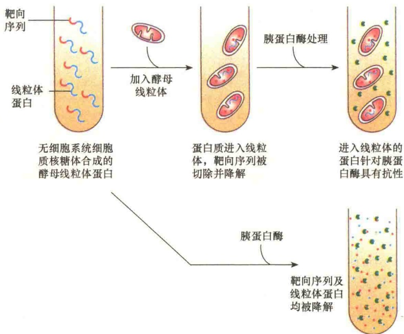

图 7-3 线粒体蛋白前体转运的实验证明（引自 Lodish et al., 2000）。

## 7.2.2.3 线粒体蛋白质转运器

线粒体蛋白的转运除了需要靶向序列，还需要线粒体膜受体，由于这些受体主要起转运线粒体蛋白质的作用，所以称之为蛋白质转运器（protein translocator），亦称为蛋白质转位体。

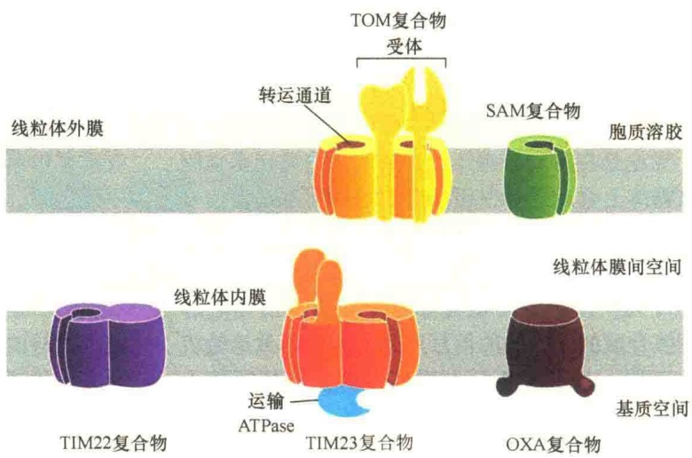

图 7-4 线粒体膜蛋白质转运器（引自 Alberts et al., 2015）。线粒体膜中的 TOM、TIM、SAM、OXA 都是由多亚基装配成蛋白质转运器，帮助线粒体各组分蛋白质进行准确定位。与 TIM23 复合物结合的运输 ATPase 是一种线粒体 Hsp70，可水解 ATP，并利用 ATP 水解释放的能量驱动蛋白质通过运输通道。

线粒体膜中识别信号的受体不是单一存在的，而是组成多亚基的复合物，存在于线粒体外膜的称为 TOM 复合物（mitochondria

outer complex, TOM complex), 而存在于内膜的称为 TIM 复合物 (mitochondria inner complex, TIM complex)。TOM 复合物主要由 TOM20、TOM22、TOM40 三种蛋白质构成，TOM20/TOM22 起识别作用，而 TOM40 则作为外膜的通道。TIM 复合物由 TIM23、TIM17、TIM50 三种蛋白质构成，其中 TIM23 作为运输通道。

所有需要进入线粒体的蛋白质都需 TOM 复合物。它先将信号序列转运进入膜间隙，并帮助穿膜蛋白插入外膜。线粒体外膜中 β 桶蛋白特别丰富，若是此类蛋白质进入外膜，则要借助于另一个转运蛋白——SAM 复合物（sorting and assembly machinery complex, SAM complex），将其折叠成合适的构型定位在外膜中。TIM23 复合物将某些可溶性的蛋白质转运到线粒体基质，并帮助穿膜蛋白插入内膜，包括一些将 ADP、ATP 及磷酸输入与输出的蛋白质。还有一些位于线粒体内膜与外膜中的 OXA 复合物（OXA complex），可介导由线粒体合成的蛋白质插入内膜，有时也帮助由其他复合物转运到线粒体基质的蛋白质插入到线粒体内膜。图 7-4 是位于线粒体膜中的几种类型的转运蛋白。

## 7.2.2.4 线粒体基质蛋白的转运

线粒体基质蛋白（mitochondrial matrix protein），除极少数外，都是在细胞质游离核糖体上合成，然后通过基质靶向序列（matrix-targeting sequence）引导转运进来的。图 7-5 是细胞质中的蛋白质进入线粒体基质的运输路线，不仅需要靶向序列，还需要分子伴侣、线粒体膜受体等。

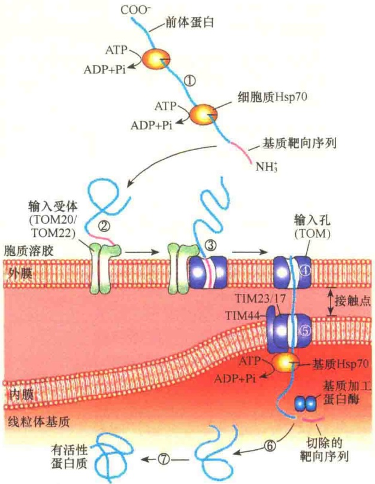

图 7-5 蛋白质进入线粒体基质（引自 Lodish et al., 2016）。①胞质溶胶中合成的线粒体基质前体蛋白通过与 Hsp70 结合维持未折叠或部分折叠状态；②前体蛋白与线粒体外膜输入受体结合；③线粒体前体蛋白被转运到通用运输孔；④转运器蛋白逐渐将前体蛋白向内转运；⑤进入内膜运输通道，被基质分子伴侣 Hsp70 结合，通过水解 ATP 驱动前体蛋白质向基质转运，靶向序列被切除；⑥某些蛋白质经过折叠，形成正确的构型；⑦某些蛋白质需要在分子伴侣的帮助下进一步折叠。

线粒体蛋白质在胞质溶胶中合成之后，水溶性的线粒体前体蛋白以非折叠的形式直接与线粒体膜受体相互作用。有些线粒体基质蛋白前体需要与分子伴侣蛋白Hsp70结合，有些则不需要与分子伴侣结合。输入过程从与线粒体外膜输入受体（import receptor）结合开始，在此过程中，由TOM20/TOM22识别、鉴定N端的靶向序列，并介导进入外膜运输通道。结合有分子伴侣的线粒体前体蛋白依靠分子伴侣水解ATP驱动转运并防止蛋白质聚集沉淀。TOM40复合物是线粒体外膜的通道，已知的各种线粒体前体蛋白都是经过该复合物穿过外膜，所以将之称为通用运输孔（general import pore）。穿过外膜后，线粒体前体蛋白经内膜的TIM23/TIM17复合物构成的通道进入线粒体基质，在此过程中，线粒体基质Hsp70与前体蛋白结合，并利用ATP水解的能量促进线粒体蛋白转运。线粒体前体蛋白进入线粒体基质后，前体蛋白的靶向序列被转运肽酶切除。切除了靶向序列的蛋白质经折叠后成为活性蛋白质并发挥生物学作用。

## 7.2.2.5 线粒体膜间隙蛋白的转运

线粒体膜间隙蛋白的转运有两条路径。第一条路径需要两个靶向序列，如细胞色素 $b_{2}$ ，它的前体蛋白在N端有两个不同的靶向序列，这两个序列最终都会被切除。最前面的为基质靶向序列（matrix-targeting sequence），作用是将线粒体蛋白引导到线粒体基质。该序列在线粒体基质中被基质蛋白酶切除。另一个靶向序列叫膜间隙靶向序列（intermembrane space targeting sequence），是一种疏水的片段，可阻止蛋白质完全穿过内膜（图7-6A）。前体蛋白质被阻止在内膜后，膜蛋白通过侧向扩散，脱离TIM23/TIM17，然后在一种膜蛋白酶的作用下，将疏水片段切开，将可溶性片段释放到膜间隙。第二条路径不需要任何基质靶向序列，而是直接通过一个膜间隙靶向序列将前体蛋白引导到TOM40转运蛋白，并被转运到膜间隙（图7-6B）。

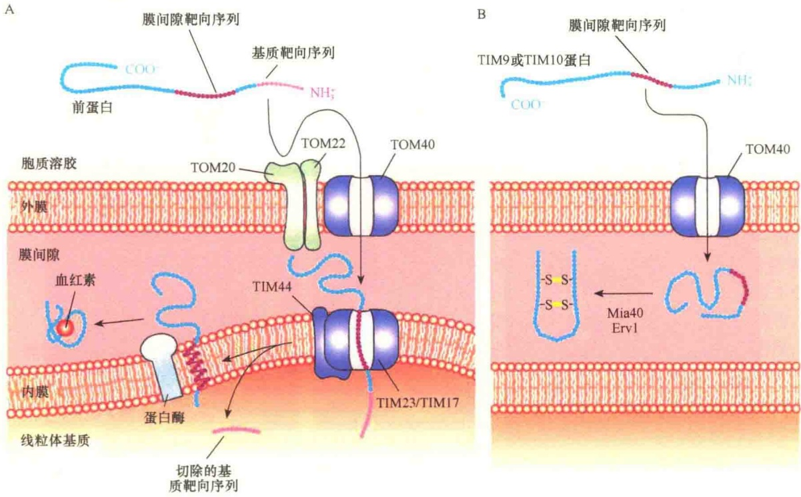

图 7-6 线粒体膜间隙蛋白的两种转运路径（引自 Lodish et al., 2016）。A. 线粒体前体蛋白有两个靶向序列，首先在基质靶向序列的引导下穿过外膜的 TOM 复合物通道，然后插入内膜的 TIM23/TIM17 复合物通道；由于第二个靶向序列——膜间隙靶向序列通过 TIM 复合物时是疏水性的，因而被阻滞在 TIM 通道内；随后，基质靶向序列被切除，阻滞在内膜中的蛋白质经侧向扩散与 TIM 复合物脱离，内膜中的蛋白酶将阻滞在内膜中的间隙靶向序列切除，蛋白质进入膜间隙。图中显示的是细胞色素 $b_{2}$ 的转运。B. 含有膜间隙靶向序列的 TIM9 或 TIM10 前体蛋白，在间隙靶向序列的引导下，直接通过 TIM40 通道进入线粒体膜间隙。一旦进入线粒体膜间隙，立即进行折叠并形成二硫键，防止被反向运出线粒体。二硫键的形成是由 Erv1、Mia40 共同完成的。

## 7.2.2.6 线粒体内膜蛋白的转运

有三条不同路径引导线粒体内膜蛋白的转运。细胞色素氧化酶亚基 CoxVa 的寻靶就是第一条路径的典型例子。CoxVa 前体蛋白的 N 端含有被外膜受体 TOM20/TOM22 识别的线粒体基质靶向序列，该序列能够通过外膜的通用运输孔及内膜的 TIM23/TIM17 通道进入线粒体基质；CoxVa 前体蛋白含有一个疏水的停止转移锚定序列（stop transfer anchor sequence），该序列介导 CoxVa 蛋白锚定在内膜上。当基质靶向序列穿过内膜后，被停止转移锚定序列锚定在内膜上，此时，基质靶向序列被基质中蛋白水解酶切除。随后，停止转移锚定序列介导前体蛋白侧向扩散进入线粒体内膜，成为线粒体内膜的组成成分（图 7-7A）。

第二条路径是在前体蛋白中含有线粒体基质靶向序列和被内膜蛋白Oxa1识别的靶向序列。在该路径的运输中，线粒体前体蛋白通过基质靶向序列进入线粒体基质，在线粒体基质中，基质靶向序列被切除，其后的Oxal-靶向序列被内膜中的Oxal识别并介导到内膜中（图7-7B）。此过程中或许有其他膜蛋白相助。

第三条路径涉及内膜多次穿膜蛋白的转运，如ATP/ADP逆向协同转运蛋白就是此种运输。当输入蛋白的内部序列被外膜中由TOM70/TOM22构成的第二个运输受体识别时，输入蛋白通过通用运输孔穿过外膜（图7-7C）。然后，输入蛋白被转移到位于内膜的第二个转运复合物，该复合物由TIM22、TIM18、TIM54三种蛋白质组成。输入蛋白转移到TIM22/TIM18/TIM54复合物需要线粒体膜间隙中的两种小蛋白——TIM9与TIM10的协助，这两种小蛋白属于膜间隙的分子伴侣，它们通过与输入蛋白的疏水区结合，以防止它们在膜间隙的水性环境中聚集形成不溶的聚集物。最后，由TIM22/TIM18/TIM54复合物将内膜蛋白的多个疏水片段整合到内膜中形成多次穿膜的内膜蛋白。

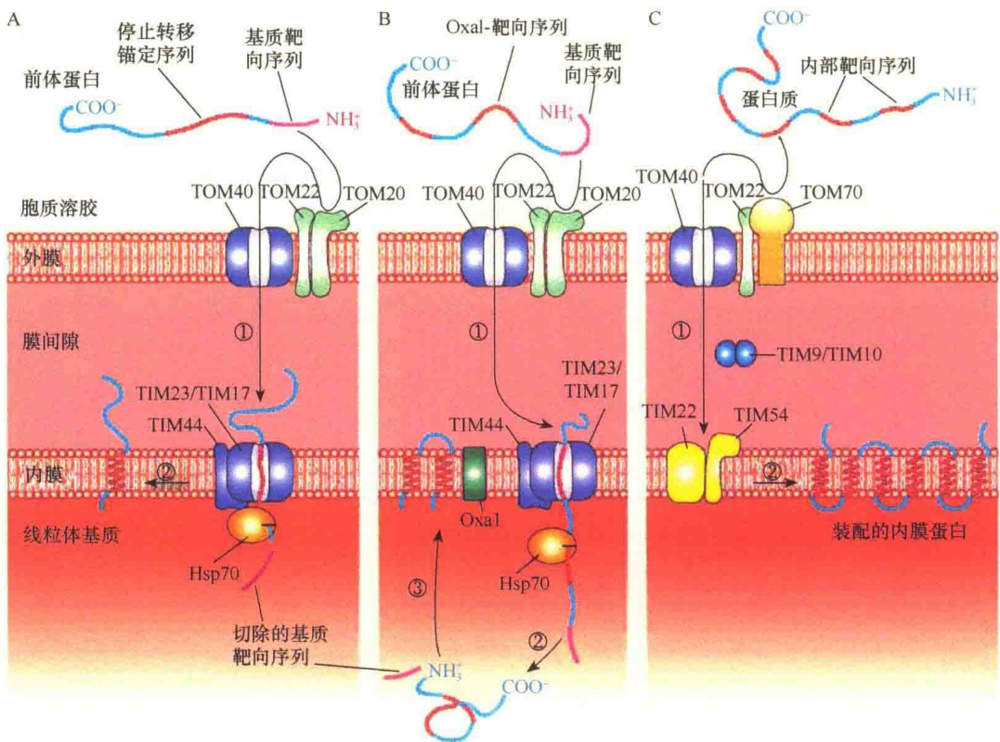

图 7-7 线粒体内膜蛋白转运的三条路径（引自 Lodish et al., 2016）。具有不同靶向序列的线粒体内膜蛋白通过不同的路径转运到内膜。A. 含有一个靶向序列:①在基质靶向序列的引导下，输入蛋白通过外膜运输通道，穿过内膜时，停止转移锚定序列将蛋白质锚定在内膜；②基质靶向序列被切除后，停止转移锚定序列通过侧向扩散进入线粒体内膜。B. 该路径中的前体蛋白含有线粒体基质靶向序列和被内膜蛋白 Oxa1 识别的靶向序列:①线粒体前体蛋白通过基质靶向序列进入线粒体基质，在线粒体基质中，基质靶向序列被切除；②Oxa1-靶向序列被内膜中的 Oxa1 识别并介导到内膜中。C. 仅含有内部锚定序列的内膜蛋白:①通过外膜通用运输孔进入线粒体内膜；②在线粒体膜间隙分子伴侣的协助下，输入蛋白被内膜的 TIM22/TIM18/TIM54 复合物整合到内膜中，成为多次穿膜的内膜蛋白。

## 7.2.2.7 线粒体外膜蛋白的转运

线粒体外膜使用与革兰氏阴性菌相同的外膜蛋白定位的方式。线粒体外膜含有丰富的孔蛋白，而孔蛋白是细菌质膜中的β桶结构蛋白，本身具有物质运输作用。TOM复合物仅介导具有α螺旋结构的蛋白质定位到线粒体外膜，而不能将具有β桶结构的孔蛋白介导整合到膜的脂双层。代之的是，孔蛋白以未折叠的形式被TOM转运到线粒体膜间隙，在那里，它们与特异的分子伴侣进行短暂的结合，以防止孔蛋白聚集（图7-8）。然后，孔蛋白与外膜的SAM复合物结合，由SAM复合物介导孔蛋白插入外膜并进行正确折叠。SAM复合物的一种核心亚基与帮助细菌孔蛋白β折叠的外膜复合物的蛋白同源。线粒体孔蛋白折叠与细菌孔蛋白折叠的保守途径，也为线粒体的内共生起源提供了一种思考。

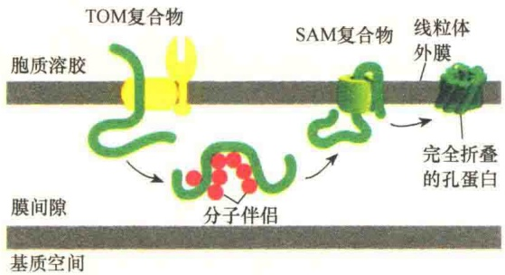

图 7-8 线粒体外膜和内膜蛋白的定位（引自 Alberts et al., 2015）。

## 7.3 线粒体的功能——氧化磷酸化作用

线粒体是真核生物氧化代谢的部位，是糖、脂肪和氨基酸最终氧化放能的场所，最终氧化的共同途径是三羧酸循环和呼吸链的氧化磷酸化。

## 7.3.1 真核细胞中的氧化作用

葡萄糖和脂肪酸是真核细胞能量的主要来源，细胞通过对葡萄糖的代谢获取能量。葡萄糖（或糖原）在正常有氧的条件下，氧化后，产生 $CO_{2}$ 和水，这个总过程称为糖的有氧氧化（aerobic oxidation），又称细胞氧化或生物氧化。

葡萄糖进入细胞后先在细胞质中通过酵解作用生成丙酮酸，如果没有氧，丙酮酸经过发酵生成乳酸；如果有氧存在，丙酮酸进入线粒体基质，经过三羧酸循环、电子传递和氧化磷酸化，最后生成ATP和水。整个反应分为4个阶段（图7-9）。

## 7.3.1.1 三羧酸循环

乙酰 CoA 一旦形成，立即进入线粒体基质的循环氧化途径，即三羧酸循环（tricarboxylic acid cycle, TCA cycle），又称 Krebs 循环、柠檬酸循环（图 7-10）。

参与 TCA 循环的酶有很多种，除琥珀酸脱氢酶是结合在内膜上以外，其他的酶都存在于线粒体基质。循环开始，由乙酰 CoA 和草酰乙酸缩合成有 3 个羧基的柠檬酸，柠檬酸经一系列反应，一再氧化脱羧，经酮戊二酸、琥珀酸，再降解成草酰乙酸。每循环一次，仅用去 1 分子乙酰基中的二碳单位，最后生成 2 分子 CO₂、1 分子 GTP、4 分子 NADH（连同丙酮酸脱羧形成乙酰 CoA 时产生的 1 分子 NADH 在内）和 1 分子 FADH₂，总反应为:

$$
\begin{array}{r l} & {\mathrm{乙酰} \mathrm{CoA} + 2 \mathrm{H} _ {2} \mathrm{O} + \mathrm{FAD} + 3 \mathrm{NAD} + \mathrm{GDP} + \mathrm{Pi} \longrightarrow} \\ & {2 \mathrm{CO} _ {2} + \mathrm{FADH} _ {2} + 3 \mathrm{NADH} + 3 \mathrm{H} ^ {+} + \mathrm{GTP} + \mathrm{HS-CoA}} \end{array}
$$

## 7.3.1.2 辅酶在能量传递中的作用

富含能量的糖类和脂肪酸能够通过氧化反应释放出能量。根据定义，在反应中释放电子是氧化，获得电子是还原，氧化和还原反应总是同时发生的:氧化的底物释放出的电子被另一个分子接收，而接收电子的底物则被还原。因此，氧化还原反应涉及电子从一种底物向另一种底物传递。在生物氧化中，电子传递常常与氢原子的传递同时进行。假定反应: $XH_{2}+Y\longrightarrow X+YH_{2}$ ，在这一反应中，要从底物 $XH_{2}$ 中脱去2个氢原子，并转移到底物Y，每个氢原子含有1个电子，所以转移2个氢原子就要将2个电子从底物 $XH_{2}$ 转移到底物Y。底物 $XH_{2}$ 失去2个电子是氧化的结果，与此相反，底物Y得到2个电子则是还原。由此看来，被氧化的底物是电子供体，被还原的底物则是电子受体。

在葡萄糖氧化过程中使用了两种辅酶:NAD（nicotinamide adenine dinucleotide，烟酰胺腺嘌呤二核苷酸）和FAD（flavin adenine dinucleotide，黄素腺嘌呤二核苷酸），它们的还原型分别是NADH和 $FADH_{2}$ （图7-11和图7-12）。

## 7.3.1.3 苹果酸-天冬氨酸穿梭

TCA 循环产生的净平衡产物是  $FADH_{2}$  和 NADH，它们都含有在 TCA 循环中底物氧化释放的电子，总共 5 对电子（连同丙酮酸转变成乙酰 CoA 时释放的

图 7-9 线粒体利用葡萄糖与脂肪酸产生 ATP 的 4 个阶段（引自 Lodish et al., 2016）。阶段Ⅰ:在胞质溶胶中，糖酵解产生丙酮酸和 NADH；如果是脂肪酸，则先被转变成脂酰 CoA。阶段Ⅱ:丙酮酸或脂酰 CoA 在膜运输蛋白的帮助下进入线粒体基质，在基质中产生 NADH 和乙酰 CoA。在糖酵解过程中产生的 NADH，将它的高能电子提供给线粒体内膜的化合物。乙酰 CoA 通过 TCA 循环，产生 NADH 和 FADH₂。阶段Ⅲ:生成的 NADH 和 FADH₂ 进行氧化，分子中释放出的电子通过内膜中的电子传递链，最终传递给分子氧（O₂）。阶段Ⅳ:氧化中释放的能量被用于 ATP 的合成，主要是通过 ATP 合酶完成的。

图 7-10 TCA 循环（引自 Lodish et al., 2016）。

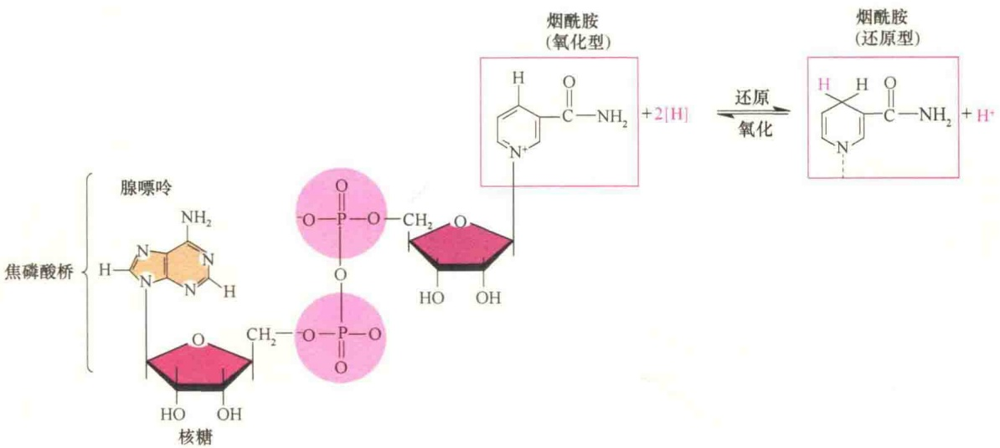

图7-11 辅酶 $\mathrm{NAD^{+}}$ 的结构及其氧化与还原。

图7-12 辅酶FAD的结构及其氧化与还原。

1 对电子），这些电子可用于 ATP 的合成。另外，葡萄糖在胞质溶胶中进行糖酵解时也有 NADH 的形成，但是线粒体膜不能将胞质溶胶中的 NADH 运入线粒体参与电子传递。虽然胞质溶胶中形成的 NADH 自身不能进入线粒体，但可通过另外的方式将其电子转移到线粒体并参与电子传递:将电子还原成小分子的代谢物，这些小分子的代谢物能够通过苹果酸-天冬氨酸穿梭（malate-aspartate shuttle）进入线粒体，然后在线粒体中将 NAD$^{+}$还原成 NADH（图 7-13）。所以，线粒体用于 ATP 合成的电子不仅有来自线粒体内部的，也有来自胞质溶胶糖酵解过程形成的

NADH。这一机制也确保了细胞质中 NADH 及时转变为  $NAD^{+}$ ，有利于胞质中的有机物质氧化释放的能量的储存与利用。

## 7.3.2 呼吸链与电子传递

呼吸链（respiratory chain）又称电子传递链，是线粒体内膜上一组酶复合体，其功能是进行电子传递、 $H^{+}$ 的传递及氧的利用，产生 $H_{2}O$ 和ATP。

在三羧酸循环中，乙酰 CoA 中的 2 个碳被完全氧化生成 2 分子  $CO_{2}$  释放出来。此过程释放的

图 7-13 苹果酸-天冬氨酸穿梭（引自 Lodish et al., 2013）。①在胞质溶胶中，苹果酸脱氢酶将胞质溶胶中 NADH 的电子转移给草酰乙酸，生成苹果酸。②线粒体内膜中一种反向转运蛋白将苹果酸输入线粒体基质，同时将线粒体基质中的  $\alpha$ -酮戊二酸运到胞质溶胶，与苹果酸进行交换。③线粒体苹果酸脱氢酶将苹果酸转变成草酰乙酸，将线粒体基质中的 NAD⁺ 还原成 NADH。④线粒体基质中的转氨酶将谷氨酸中的一个氨基添加到草酰乙酸上，将不能直接穿过内膜的草酰乙酸转变成天冬氨酸，在此过程中谷氨酸转变成了  $\alpha$ -酮戊二酸。⑤通过第二个反向转运蛋白将天冬氨酸转运到胞质溶胶，与谷氨酸进行交换。⑥胞质溶胶中转氨酶将天冬氨酸转变成草酰乙酸、将  $\alpha$ -酮戊二酸转变成谷氨酸，完成循环。通过苹果酸-天冬氨酸穿梭，巧妙地将胞质溶胶中的 NADH 转移到线粒体基质中。

大部分能量都储存在辅酶（NADH 和  $FADH_{2}$ ）分子中，直接产生的能量（ATP）很少。只有将这些还原型的辅酶氧化成氧化型的辅酶，才能将能量释放出来。该过程涉及电子从 NADH 或  $FADH_{2}$  传递到氧，最后生成水，氧化型的  $NAD^{+}$ 和  $FAD^{+}$ 又可参与三羧酸循环:

$$
\begin{array}{r l} & {\mathrm{NADH+1/2O_2} \longrightarrow \mathrm{NAD^+ + H_2O+能量}} \\ & {\mathrm{FADH_2+1/2O_2} \longrightarrow \mathrm{FAD^+ + H_2O+能量}} \end{array}
$$

如果上述反应将能量一次性释放的话，由于能量太高不仅不能全部收集和储存，还会使细胞受到损伤，因此如何确保 NADH 及  $FADH_{2}$  在氧化过程中释放的能量能够有效收集，并成功用于 ATP 的合成，考验着细胞的“智慧”。

NADH 及  $FADH_{2}$  在氧化过程中不仅会释放出自由能，而且会释放出电子、 $H^{+}$ ，也就是说，在 NADH 及  $FADH_{2}$  的氧化过程中，不仅要收集能量，而且也要妥善安置释放出来的电子和  $H^{+}$ 。有趣的是，在细胞生命的进化过程中，细胞巧妙地在线粒体内膜中构建了一条呼吸链，利用 NADH 及  $FADH_{2}$  在氧化过程中释放的能量，“雇用”一系列递氢体和电子载体在传递电子的同时将释放出的  $H^{+}$  传递到线粒体膜间隙，构建  $H^{+}$ 质子库；最后通过  $H^{+}$ 质子经线粒体内膜中“ATP 合酶”向线粒体基质回流，进行 ADP 的磷酸化，高效地将 NADH 及  $FADH_{2}$  在氧化过程中释放的能量用于 ATP 的合成，实际上，能量储存在 ATP 的高能磷酸键中。电子通过呼吸链的流动称为电子运输或电子传递，而将 ADP 转变成 ATP 称为磷酸化，伴随氧化进行的磷酸化就称为氧化磷酸化。

## 7.3.2.1 电子载体

在电子传递过程中，与释放的电子结合并将电子传递下去的物质称为电子载体（electron carrier）。参与传递的电子载体有4种，即黄素蛋白、细胞色素、铁硫蛋白和辅酶Q（coenzyme Q, CoQ）。在这4种电子载体中，除了辅酶Q外，接受和提供电子的氧化还原中心都是与蛋白质相连的辅基（图7-14）。

1）黄素蛋白（flavoprotein） 黄素蛋白是由一条多肽结合一个辅基组成的酶类，结合的辅基可以是 FAD 或 FMN，它们是维生素  $B_{2}$  的衍生物，每个辅基能够接受和提供 2 个质子及 2 个电子（图 7-14A）。

2）细胞色素（cytochrome） 细胞色素是含有血红素辅基（图7-14B）的一类蛋白质。血红素基团是由卟啉环结合一个铁原子（铁原子位于环的中央）构成的。与 $NAD^{+}$ 和 $FAD^{+}$ 不同，在氧化还原过程中，血红素基团的铁原子可以传递单个的电子而不必成对传递。血红素中的铁通过 $Fe^{3+}$ 和 $Fe^{2+}$ 两种状态的变化传递电子。在还原反应时，铁原子由 $Fe^{3+}$ 状态转变成 $Fe^{2+}$ 状态；在氧化反应中，铁由  $Fe^{2+}$  转变成  $Fe^{3+}$  。电子传递链中至少有 5 种类型的细胞色素:a、 $a_{3}$ 、b、c 和  $c_{1}$ ，它们间的差异在于血红素基团中取代基和蛋白质氨基酸序列的不同。

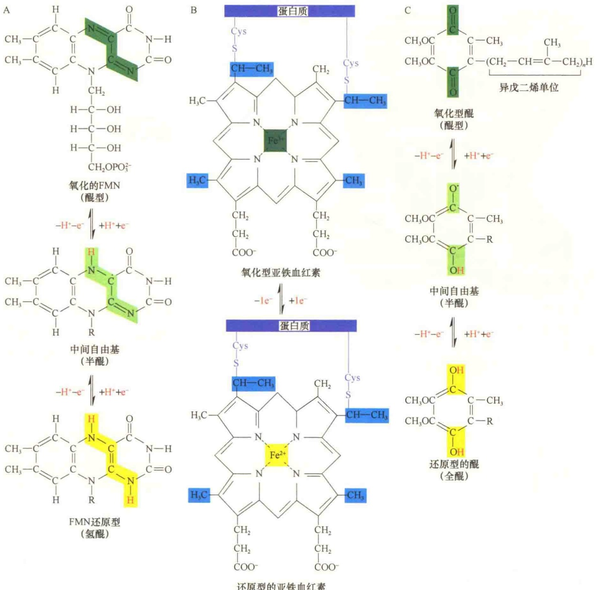

图 7-14 三种电子载体的氧化与还原结构（引自 Karp，2010）。A. NADH 脱氢酶的 FMN（黄素单核苷酸）；B. 细胞色素 c 的血红素基团；C. 泛醌（辅酶 Q）。

3）辅酶Q（CoQ）或泛醌（ubiquinone，UQ）（图7-14C） 泛醌是一种脂溶性的分子，含有长长的疏水链，由五碳类戊二醇构成。CoQ的氧化还原分两步进行:先接收1个电子，得到部分还原，称为半醌（UQH）；再得到1个电子，成为完全还原的醌，称为全醌（$\mathrm{UQH_2}$）；全醌失去1个电子是部分氧化，称为半醌；2个电子全部失去，即完全氧化则称为氧化型的醌。

## 4）铁硫蛋白（iron-sulfur protein，Fe/S protein）

铁硫蛋白是含铁的蛋白质，也是细胞色素类蛋白质。在铁硫蛋白分子中央结合的不是血红素而是铁和硫，称为铁-硫中心（iron-sulfur center）。最常见的是在蛋白质的中央含有4个原子，其中2个是铁，另外2个是硫，称为[2Fe-2S]；或在蛋白质的中央含有8个原子，其中4个是铁，另外4个是硫，称为[4Fe-4S]，并且通过硫与蛋白质的半胱氨酸残基相连（图7-15）。在铁硫蛋白中尽管有多个铁原子的存在，但整个复合物一次只能接收1个电子、传递1个电子，并且也是靠 $\mathrm{Fe}^{3+}$ 、$\mathrm{Fe}^{2+}$ 状态的循环变化传递电子。

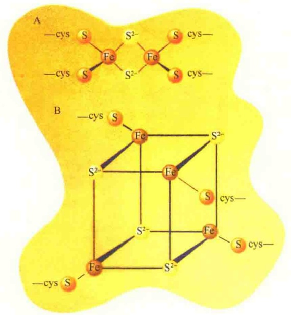

图 7-15 铁硫中心（引自 Karp，2010）。A. [2Fe-2S]-铁硫中心结构；B. [4Fe-4S]-铁硫中心结构。

## 7.3.2.2 氧化还原电位与载体排列顺序

在线粒体内膜的呼吸链中，不同电子载体的排列顺序怎样？又是如何确定的？由于不同的还原剂具有不同的电子传递电位，而氧化与还原又是偶联的，如  $NAD^{+}$  和 NADH。它们的差别主要是电子数量不同，所以二者间就有一个电位差，即氧化还原电位（oxidation-reduction potential, redox potential）。构成氧化还原的成对离子或分子，称为氧化还原对或氧还对（redox pair）。氧还电位可在标准条件下测定，即标准氧化还原电位（standard oxidation-reduction potential,  $E_{0}^{\prime}$ ）。标准氧化还原电位的值越小，提供电子的能力越强。所谓标准条件是指 1mol/L 反应浓度、25℃、pH7.0 和 1 个大气压条件下测得的氧还电位，用伏特（V）表示。因此，只要分别测定电子载体的氧化还原电位，再进行比较，可初步推断它们在呼吸链中的排列顺序。

根据测得的标准氧化还原电位，按氧还电位的大小可排出电子载体在呼吸链中的位置（图 7-16）。

图 7-16 中每一个载体都是从呼吸链中上一个载体获得电子被还原，而上一个载体由于失去电子被氧化，因此电子是从一个载体传向另一个载体，直至最终的受体被还原为止。在该呼吸链中的最终的受体是  $O_{2}$ ，接受电子后生成水。

## 7.3.2.3 呼吸链的组成和排列

呼吸链中的4种电子载体在线粒体内膜中不是单一存在，而是与其他的蛋白质组成复合物。当破坏了线粒体内膜后，能够从4种不同的复合物中分离出各种载体。这4种复合物是不同的、不对称的穿膜蛋白复合物，分别被命名为复合物Ⅰ、Ⅱ、Ⅲ和Ⅳ。在这4种复合物中都没有细胞色素c和CoQ，这两种呼吸链的成分独立存在于线粒体膜中。CoQ溶于膜的脂双层，而细胞色素c是膜外周蛋白，因此，CoQ和细胞色素c是在膜内或沿着膜在大的、非移动的复合物间传递电子。一旦电子进入一个大的多蛋白复合物中，电子就按既定的途径传递。

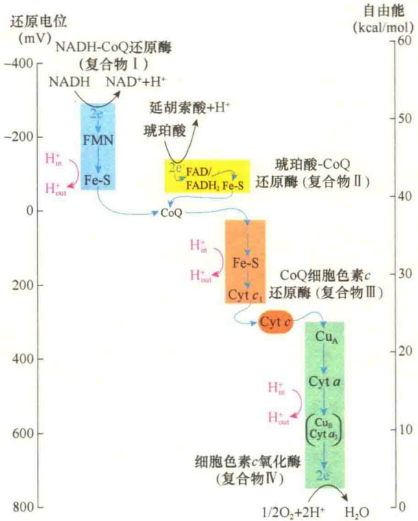

图 7-16 电子传递链中几种电子载体的氧还电位（引自 Lodish et al., 2013）。图中给出各电子载体近似的氧还电位，并标出了电子对沿呼吸链向分子氧传递形成的自由能，垂直箭头线表示产生的能量足够驱使质子穿过线粒体内膜，其后可为 ATP 合成提供能量。

组成呼吸链的4种复合物又都是由几种不同的蛋白质组成的多蛋白复合物（表7-4，图7-17），功能是参与氧化还原作用。由于这些复合物在线粒体内膜中不停地移动，所以它们没有稳定的结构。

1）复合物Ⅰ（complex I） 复合物Ⅰ又称NADH脱氢酶（NADH dehydrogenase）或NADH-CoQ还原酶复合物，功能是催化1对电子从NADH传递给CoQ，它是线粒体内膜中最大的蛋白复合物，是穿膜蛋白，也是呼吸链中了解最少的复合物。哺乳动物的复合物Ⅰ含有43种不同的亚基，总分子质量约 850kDa。其中有 7 个亚基都是疏水的穿膜蛋白，由线粒体基因编码。复合物 I 含有黄素蛋白（FMN）和至少有 6 个铁硫中心。一对电子从复合物 I 传递时伴随着 4 个质子被传递到膜间隙。

表 7-4 线粒体呼吸链中 4 种复合物的性质

<table><tr><td rowspan="2">序号</td><td rowspan="2">名称</td><td rowspan="2">多肽亚基数</td><td rowspan="2">辅基</td><td colspan="2">电子传递</td><td rowspan="2">转运质子数(每对电子)</td></tr><tr><td>接收自</td><td>传递给</td></tr><tr><td rowspan="2">I</td><td>NADH CoQ氧化还原酶</td><td>43</td><td>1个FMN</td><td>NADH</td><td>CoQ</td><td>4</td></tr><tr><td>NADH脱氢酶</td><td></td><td>6~9个Fe/S中心</td><td></td><td></td><td></td></tr><tr><td rowspan="2">II</td><td rowspan="2">琥珀酸-CoQ氧化还原酶(琥珀酸脱氢酶)</td><td rowspan="2">4</td><td>1个FAD</td><td rowspan="2">琥珀酸(经由酶结合的FAD)</td><td rowspan="2">CoQ</td><td rowspan="2">0</td></tr><tr><td>3个Fe/S中心</td></tr><tr><td rowspan="3">III</td><td rowspan="3">CoQ-细胞色素c氧化还原酶(细胞色素 $b/c_1$ 复合物)</td><td rowspan="3">11</td><td>2个细胞色素b</td><td rowspan="3">CoQ</td><td rowspan="3">细胞色素c</td><td rowspan="3">4</td></tr><tr><td>1个细胞色素 $c_1$ </td></tr><tr><td>1个Fe/S中心</td></tr><tr><td rowspan="3">IV</td><td rowspan="3">细胞色素c氧化酶</td><td rowspan="3">13</td><td>1个细胞色素a</td><td rowspan="3">细胞色素c</td><td rowspan="3">氧( $O_2$ )</td><td rowspan="3">2</td></tr><tr><td>1个细胞色素 $a_3$ </td></tr><tr><td>2个Cu中心(具有细胞色素 $a_3$ 的Fe/Cu中心)</td></tr></table>

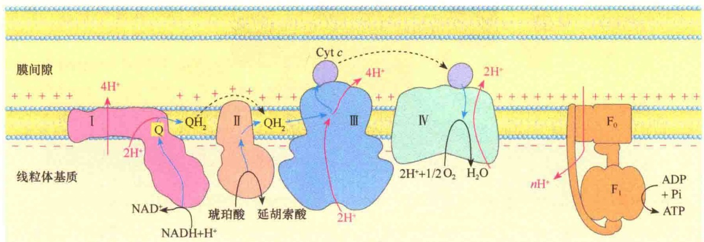

图 7-17 线粒体内膜电子传递复合物的排列及质子与电子传递示意图（引自 Nelson and Cox，2013）。呼吸链由 4 个含有电子载体的复合物及另外 2 个独立存在的电子载体组成，进入呼吸链的电子可以来自 NADH 或 FADH$_{2}$。电子可以从复合物 I 或复合物 II 传递给 UQ，然后进一步传递给复合物 III，经由细胞色素 c 传递给复合物 IV，最后传递给 1/2 O$_{2}$，生成水。

2）复合物Ⅱ（complex Ⅱ） 复合物Ⅱ又称为琥珀酸脱氢酶（succinate dehydrogenase）或琥珀酸-CoQ酶复合物，功能是催化电子从琥珀酸传递给CoQ，由4个亚基组成，其中有2个多肽组成琥珀酸脱氢酶，并且是膜结合蛋白，总分子质量为140kDa。复合物Ⅱ参与的是低能电子传递途径，将琥珀酸的电子经FAD传给CoQ。复合物Ⅱ传递电子时不伴随氢的传递。

3）复合物Ⅲ（complex Ⅲ） 复合物Ⅲ又称$\mathrm{CoQH_{2}}$ -细胞色素 $c$ 还原酶复合物，由11个亚基组成，总分子质量为 $250\mathrm{kDa}$ 。含1个细胞色素 $c_{1}$ 、1个细胞色素 b（有两个血红素基团）、1 个铁硫蛋白。其中，细胞色素 b 由线粒体基因编码。复合物Ⅲ催化电子从 CoQ 向细胞色素 c 传递，并且每传递一对电子，同时传递 4 个  $H^{+}$ 到膜间隙。

4）复合物Ⅳ（complex Ⅳ） 复合物Ⅳ又称细胞色素c氧化酶（cytochrome c oxidase），由13个亚基组成，总分子质量为160kDa。复合物Ⅳ是以二聚体的形式存在，它的亚基Ⅱ含有2个Cu离子（称为 $Cu_{A}$ ），亚基Ⅰ含有2个血红素基团（1个a、1个 $a_{3}$ ）和1个Cu离子（称为 $Cu_{B}$ ）。主要功能是将电子从细胞色素c传递给 $O_{2}$ 分子，生成 $H_{2}O$ : $4Cyt c^{2+} + O_{2} + 4H^{+} \longrightarrow 4Cyt c^{3+} + 2H_{2}O$ 。每传递1对电子，要从线粒体基质中摄取4个质子，其中2个质子用于水的形成，另外2个质子被穿膜转运到膜间隙。

由于线粒体中需要经呼吸链氧化和电子传递

的主要是 NADH，而  $FADH_{2}$  较少，可将呼吸链分为主、次呼吸链（图 7-18）:①主呼吸链由复合物 I、Ⅲ和Ⅳ构成，从 NADH 来的电子依次经过这 3 个复合物，进行传递；②次呼吸链由复合物Ⅱ、Ⅲ、Ⅳ构成，来自 FADH₂ 的电子不经过复合物 I。

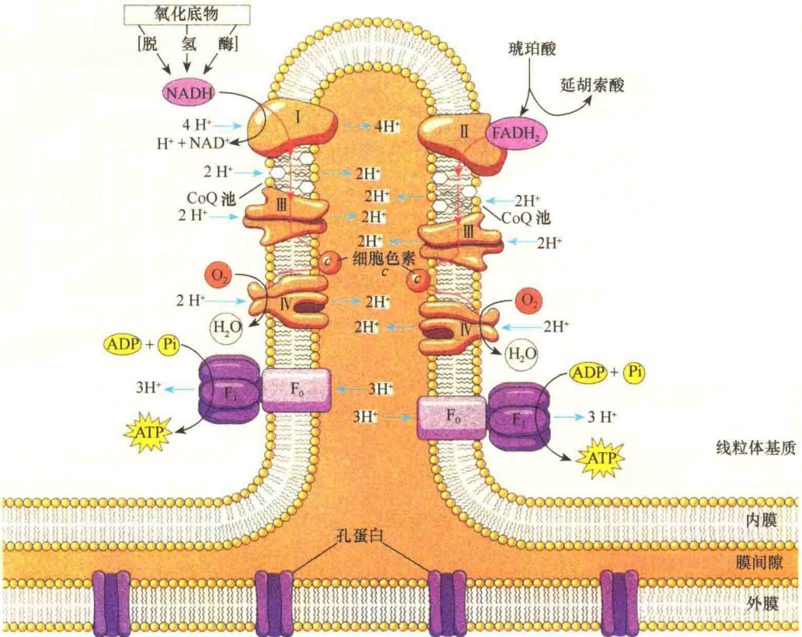

图 7-18 线粒体内主、次呼吸链（引自 Becker et al., 2003）。呼吸链复合物 I～IV 是线粒体内膜的整合蛋白复合物。NADH 氧化释放的电子经复合物 I、III、IV 传递，同时它们又将基质中的 H⁺ 传递到膜间隙；而 FADH₂ 氧化释放的电子经复合物 II、III、IV 传递，但是复合物 II 不参与 H⁺ 传递。由于在 TCA 循环中产生的 NADH 的数量远多于 FADH₂，NADH 氧化释放的电子与 H⁺ 的量大，所以，将复合物 I、III、IV 称为主呼吸链，II、III、IV 称为次呼吸链。

## 7.3.2.4 递氢体与电化学梯度的建立

组成呼吸链的成员中除了电子载体外，有些还具有将质子穿膜传递到膜间隙的作用，将能够传递氢质子的复合物称为递氢体。质子从线粒体基质穿膜传递到线粒体膜间隙是一种耗能的过程，递氢体利用电子在呼吸链中传递时释放的自由能完成递氢过程。实际上，正是呼吸链中的递氢体通过对质子的穿膜传递，将 NADH 和  $FADH_{2}$  在氧化过程中释放出来的自由能转变成势能，这种势能可进一步用于 ATP 的合成。

质子穿过内膜向膜间隙的转运也是一种电生成（electrogenesis），即电压生成的过程。因为质子穿膜转运使得膜间隙积累了大量的质子，建立了质子梯度，由于膜间隙质子梯度的建立，使内膜两侧发生两个显著的变化:一是线粒体膜间隙产生大量的正电荷，而线粒体基质产生大量的负电荷，使内膜两侧形成电位差；二是因两侧氢离子浓度的不同而产生pH梯度（ $\Delta pH$ ），这两种梯度合称为电化学梯度（electrochemical gradient）。线粒体内膜两侧电化学梯度的建立，能够形成质子动势（proton motive force， $\Delta p$ ），只要有合适的条件即可转变成化学能储存起来。

膜间隙对质子梯度的维持，主要是靠内膜的高度不通透性，否则，由于质子的扩散使得质子回流到线粒体基质，从而流失自由能。而内膜恰恰是高度不通透性的，递氢体转运到膜间隙的质子得以维持，也就维持了质子移动的力，可用于ATP的合成。

## 7.3.3 氧化磷酸化:ATP形成机制

氧化磷酸化（oxidative phosphorylation）是指在活细胞中伴随着呼吸链的氧化作用所发生的能量

转换和ATP的形成过程。

## 7.3.3.1 氧化磷酸化偶联位点

早在20世纪30年代，Belitzer首先提出电子传递与ATP合成偶联的假设。他在体外测定肌组织制备物合成ATP与氧消耗比值时发现，呼吸链每传递1对电子，至少可合成2个ATP。

后来有人发现 P/O 比值（形成的 ATP 数与每个还原氧的比值）接近 3，也就是说可合成 3 分子 ATP。根据对呼吸链中不同复合物间氧化还原电位的研究，发现复合物 I、Ⅲ、Ⅳ 每传递 1 对电子，释放的自由能都足够合成 1 分子 ATP，因此将复合物 I、Ⅲ、Ⅳ 看成是呼吸链中电子传递与氧化磷酸化偶联的 3 个位点。

上述 ATP 合成的数量和偶联位点得到实验的支持。如将分离的线粒体内膜小泡与抗霉素（antimycin）一起温育，由于抗霉素阻止电子通过细胞色素  $b-c_{1}$ （复合物Ⅲ），NADH 释放的电子只能传递到 CoQ，其结果是，每传递 1 对电子只合成 1 分子 ATP。因此可以推论复合物 I 是 ATP 合成的偶联位点。用同样的方法证明复合物Ⅲ和复合物Ⅳ也都是 ATP 合成与电子传递偶联位点。

如果以  $FADH_{2}$  作为电子供体，则只有两个 ATP 合成偶联位点，因为  $FADH_{2}$  提供的电子是经复合物Ⅱ、Ⅲ和Ⅳ传递的，而复合物Ⅱ不能作为 ATP 合成的偶联位点，所以只有两个偶联位点，这就意味着由  $FADH_{2}$  作为电子供体时，只能合成 2 分子的 ATP。

## 7.3.3.2 ATP合酶的结构和功能

线粒体 ATP 合酶（ATP synthase）是由多种蛋白质组成的复合物，可分为两个主要的亚复合物（subcomplex），即  $F_{1}$  和  $F_{0}$ ，它们各自含有多种蛋白质组分（图 7-19）。ATP 合酶的别名很多，如  $F_{0}F_{1}$  复合物（ $F_{0}F_{1}$  complex）、 $F_{0}F_{1}$ -ATP 合酶（ $F_{0}F_{1}$ -ATP synthase）、 $F_{0}F_{1}$ -ATP 酶（ $F_{0}F_{1}$ -ATPase）、 $F_{0}F_{1}$ -ATPase 复合物（ $F_{0}F_{1}$ -ATPase complex）等。ATP 合酶也可以看成是内膜中的第 5 种复合物。

$F_{0}$  含有三种不同类型内膜整合蛋白，分别命名为 a 亚基、b 亚基、c 亚基。在细菌与酵母的线粒体中，组成  $F_{0}$  的亚基数量是  $a_{1}b_{2}c_{10}$ ，但是在其他真核细胞中，c 亚基的数量有所变化，通常在 8～15 之间。但无论是在何种情况下，c 亚基都会在膜的平面形成圈饼形的环，称 c 环（c ring）。1 个 a 亚基与 2 个 b 亚基紧紧地连在一起，但都不与 c 环相连。

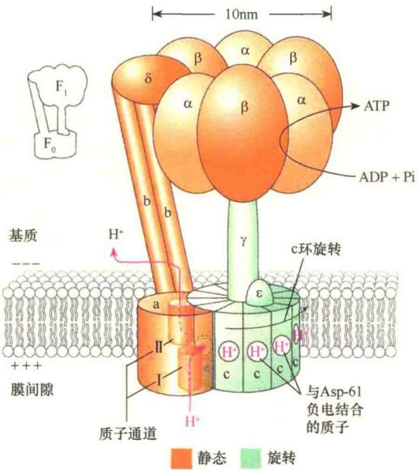

图 7-19 细菌质膜中 ATP 合酶结构（引自 Lodish et al., 2016）。

$\mathrm{F}_{1}$ 亚复合物由5种不同的多肽构成，其中 $\alpha$ 、 $\beta$ 各3分子，合起来共由9个多肽组成，即 $\alpha_{3}\beta_{3}\gamma \delta \varepsilon$ 。正常情况下，$\mathrm{F}_{1}$ 与 $\mathrm{F}_{0}$ 在线粒体内膜上是紧密结合在一起的。 $\mathrm{F}_{1}$ 复合物的 $\gamma$ 亚基的底部以螺旋的形式插入到 $\mathrm{F}_{0}$ 复合物c亚基的中央部分，并紧紧结合在一起。因此，当 $\mathrm{F}_{0}$ 的c亚基的环旋转时，杆状的 $\mathrm{F}_{1}\gamma$ 亚基也会一起旋转。$\mathrm{F}_{1}$ 的 $\varepsilon$ 亚基紧紧地附着在 $\gamma$ 亚基上，同时也会与 $\mathrm{F}_{0}$ 复合物的c亚基结合。$\mathrm{F}_{1}$ 复合物的 $\alpha$ 、 $\beta$ 亚基构成了 $\mathrm{F}_{1}$ 的球形头部，并以交替的形式构成六聚体，即 $\alpha \beta \alpha \beta \alpha \beta$ 或者写成（$\alpha \beta$)₃，并被一个长长的 $\gamma$ 亚基顶在头上。$\mathrm{F}_{1}$ 的 $\delta$ 亚基与 $\mathrm{F}_{1}\alpha$ 永久性结合在一起，也可以与 $\mathrm{F}_{0}$ 的b亚基结合。这样，$\mathrm{F}_{0}$ 的a、b亚基与 $\mathrm{F}_{1}$ 的 $\delta$ 亚基、$(\alpha \beta)_{3}$ 六聚体形成一种牢牢锚定在线粒体内膜中的坚固结构。杆状的b亚基可作为一个“定子”（stator），防止在静息状态下，$\mathrm{F}_{1}\delta$ 亚基顶上的 $(\alpha \beta)_{3}$ 六聚体自由移动，因为 $(\alpha \beta)_{3}$ 六聚体只能与 $\mathrm{F}_{0}$ 的c环一起移动，并在ATP合成中发挥重要作用。

当 ATP 合酶被嵌在膜中时，伸向细胞质侧（线粒体基质面）的  $F_{1}$  可作为一个“把手”（knob），当  $F_{1}$  与膜分开时，在没有  $F_{0}$  的情况下， $F_{1}$  能够催化 ATP 水解，此时的  $F_{1}$  被称为  $F_{1}$ -ATPase。也就是说，该酶在细胞中参与 ATP 的合成，一旦将之与  $F_{0}$  分离，离开膜后就变成 ATP 水解酶了。因此将它称为 ATP 合酶。表 7-5 是大肠杆菌  $F_{0}F_{1}$  合酶亚基的组成及功能。

表 7-5 大肠杆菌 ${\mathrm{F}}_{0}{\mathrm{\;F}}_{1}$ 合酶亚基的组成及功能

<table><tr><td>亚复合物</td><td>亚基</td><td>相对分子质量</td><td>数量</td><td>功能</td></tr><tr><td rowspan="3"> $F_0$ </td><td>a</td><td>30 000</td><td>1</td><td>质子通道</td></tr><tr><td>b</td><td>17 000</td><td>2</td><td>与 $F_0$ 、 $F_1$ 连接在一起的定子的杆</td></tr><tr><td>c</td><td>8 000</td><td>10</td><td>可以带动 $F_1\gamma$ 亚基转动环</td></tr><tr><td rowspan="5"> $F_1$ </td><td>α</td><td>52 000</td><td>3</td><td>促进β亚基的作用</td></tr><tr><td>β</td><td>55 000</td><td>3</td><td>ATP合酶的催化部位</td></tr><tr><td>δ</td><td>19 000</td><td>1</td><td>将 $α_3β_3$ 环锚定到 $F_0$ 的定子杆</td></tr><tr><td>γ</td><td>31 000</td><td>1</td><td>将能量从 $F_0$ 旋转传送到 $F_1$ </td></tr><tr><td>ε</td><td>15 000</td><td>1</td><td>将γ亚基锚定到 $F_0$ 的 $c_{10}$ 环</td></tr></table>

## 7.3.3.3 化学渗透偶联假说

关于氧化磷酸化的偶联机制，先后提出过几种假说，如化学偶联假说（chemical coupling hypothesis）和构象偶联假说（conformational coupling hypothesis），这些假说由于证据不足没有得到公认。

英国生物化学家 Mitchell 于 1961 年提出了化学渗透偶联假说（chemiosmotic coupling hypothesis）解释氧化磷酸化的偶联机制。该学说认为:在电子传递过程中，伴随着质子从线粒体基质向膜间隙转移，形成穿膜的氢离子梯度，产生了势能，这种势能驱动了氧化磷酸化反应（提供了动力），合成了 ATP。这一学说有大量的实验证明，得到了公认，Mitchell 也因此获得了 1978 年诺贝尔化学奖。化学渗透偶联假说可以很好地说明线粒体内膜中电子传递、质子动势的建立、ADP 磷酸化的关系（图 7-20）。

图 7-20 ATP 合成的化学渗透机制（引自 Nelson and Cox, 2013）。在线粒体中，电子自动通过膜结合的载体（呼吸链）移动，最后传递给  $O_{2}$ 。在此过程中，呼吸链中的递氢体将  $H^{+}$ 转运到线粒体膜间隙，导致膜间隙中的  $H^{+}$ 浓度升高，造成与线粒体基质中的浓度梯度差；同时由于  $H^{+}$ 浓度升高，膜间隙与线粒体基质的电位差提高，也就形成了电化学梯度。为了消除这种差别，只有将膜间隙中的  $H^{+}$ 通过 ATP 合酶渗透回线粒体基质，此时的 ATP 合酶就会合成大量的 ATP。

## 7.3.3.4 ATP合酶合成ATP的机制

ATP 合酶合成 ATP 的分子机制的研究一直是研究的热点。被多数人接受的 ATP 合酶合成 ATP 的模型是结合变构机制（binding-change mechanism）。按照这一机制，当质子“居高临下”通过  $F_{0}$  流动时，释放的能量直接驱动了 c 环及与其相连的  $\gamma$  和  $\varepsilon$  亚基的转动。 $\gamma$  亚基作为凸轮（cam），或者一个非对称的旋转杆，由于它的底部镶嵌在 c 环的中央，顶部又顶着六聚体的  $(\alpha\beta)_{3}$ ，所以， $\gamma$  亚基的转动也就带动了  $(\alpha\beta)_{3}$  的转动。但旋转时会引起  $\alpha\beta$  复合物构型的改变，有 3 种不同的构型，对 ATP 和 ADP 具有不同的结合能力:① O 型（open），即开放的状态，几乎不能结合 ATP，与 ADP、Pi 结合的能力也很弱；② L 型（loose），即松散型，与 ADP 和 Pi 结合的能力较强，但是不能与 ATP 结合；③ T 型（tight），即紧密型，与 ADP 和 Pi 的结合很紧并能自动反应形成 ATP。 $\gamma$  亚基每旋转  $120^{\circ}$ ，导致  $\beta$  亚基的构型发生一次变化，旋转  $360^{\circ}$ ，完成一次从 O 到 T 的循环，而构型的不同导致与 ATP/ADP/Pi 结合的改变（图 7-21）。

现已了解，当质子通过  $F_{0}$  流入线粒体基质时， $F_{1}$  中便合成了 ATP，而这个合成过程是完全可逆的。当质子经  $F_{0}$  流出时， $F_{1}$  便会水解 ATP。质子流经  $F_{0}$  部分与在  $F_{1}$  部分中 ATP 的合成 / 水解这两个过程可能是通过  $F_{0}$  与  $F_{1}$  间共轴旋转相偶联。由于在  $F_{1}$  内部的旋转运动可合成 / 水解 ATP，因此  $F_{1}$ -ATP 酶被认为是一种分子螺旋发动机。

体外实验为结合变构机制提供了支持。1997年，两位日本科学家获得γ亚基带动αβ亚基旋转的直接证据。他们设计了一个十分精巧的实验系统来观察单个酶分子催化细胞中一个正常反应的逆反应。首先，他们制备了一个“工程版”的ATP合酶的 $F_{1}$ 部分，由3个α亚基、3个β亚基、1个γ亚基组成（ $\alpha_{3}\beta_{3}\gamma$ ）（图7-22）。然后将这种多肽复合物头部固定到盖玻片上，并将一段短的、经荧光标记的肌动蛋白纤维附着在γ亚基的顶部。将这种制备复合物与ATP一起温育时，由于ATP的水解驱动了复合物旋转，用荧光显微镜可观察到转动。在此实验的基础上，后来设计的多种实验都检测到细胞中 $F_{1}$ 通过旋转合成ATP，从而证明结合变构机制的正确性。

图7-21 利用ADP和Pi合成ATP的结合变构机制（引目Lodish et al., 2016）。3个β亚基随着γ亚基的转动，构型发生变化，与ATP/ADP/Pi的结合力也发生变化。γ亚基每转动120°，3个β亚基都要发生构型改变并引起相应的反应。①γ亚基向右转动120°引起的构型改变:β₁亚基的构型由O型转变为L型，与ADP和Pi的结合加强；β₂亚基的构型由T型变成O型，与ATP结合力微弱，致使ATP脱离；β₃亚基的构型由L型变成T型，与ADP和Pi的结合更加紧密。②γ亚基第一次转动引起的反应:L型的β₁亚基与ADP和Pi的结合力加强；O型的β₂亚基开始与ADP和Pi结合；紧密结合在β₃亚基上的ADP和Pi形成ATP。③γ亚基第二次向右转动120°引起的构型改变:β₁亚基的构型由L型变成T型，与ADP和Pi的结合更为紧密；β₂亚基的构型由O型变成L型，与ADP和Pi的结合力加强；β₃亚基的构型由T型变成O型，与ATP的结合力丧失。④γ亚基第二次向右转动引起的反应:紧密结合在T型β₁亚基中的ADP和Pi形成了ATP，L型β₂亚基与ADP和Pi的结合更为紧密，O型β₃亚基开始与ADP和Pi结合。⑤γ亚基第三次向右转动120°引起的构型改变:β₁亚基的构型由T型变成O型，丧失与ATP的结合能力；β₂亚基的构型由L型变成T型，与ADP和Pi的结合更加紧密；β₃亚基的构型由O型变成L型，与ADP和Pi的结合力加强。⑥γ亚基第三次旋转120°引起的反应:O型的β₁亚基开始与ADP和Pi结合；与β₂亚基紧密结合的ADP和Pi形成了ATP，L型的β₃亚基与ADP和Pi的结合更加紧密。γ亚基经过3次旋转，完成了一次循环，共生成3个ATP。

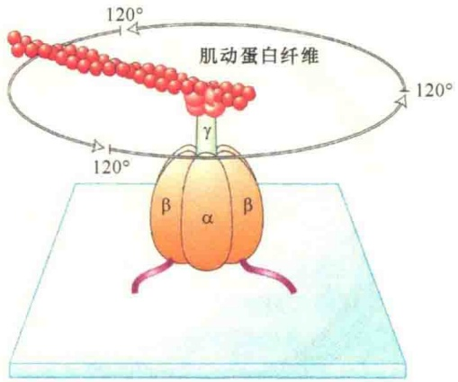

图 7-22  $F_{1}$  和  $\gamma$  旋转的体外实验示意图（引自 Lodish et al., 2016）。实验中对  $F_{1}$  进行人工改造，使之带上组氨酸（每个亚基一个），由于组氨酸能够与覆盖有金属还原剂（Ni 复合物）的玻片结合，因此可使  $F_{1}$  固定到这种玻片上。通过人工的方法将  $\gamma$  结合上一条荧光标记的肌动蛋白纤维，然后在供给 ATP 的情况下用荧光显微镜观察  $\gamma$  亚基的转动。

## 7.4 线粒体的遗传、融合与分裂

## 7.4.1 线粒体的遗传

线粒体是半自主性的细胞器，它除了有自己的遗传物质线粒体DNA外，还有蛋白质合成系统（核糖体、mRNA、rRNA、tRNA），但是，它的遗传信息量不足，仍然要受控于核的遗传信息，也就是说，线粒体中的蛋白质只有少数几种是线粒体基因编码的，大多数线粒体蛋白质还是由核基因编码，所以线粒体的生物合成涉及两个彼此分开的遗传系统。

## 7.4.1.1 线粒体的起源

关于线粒体的起源普遍接受的是内共生学说（endosymbiotic hypothesis）。该学说认为线粒体来源于细菌，即细菌被真核生物吞噬后，在长期的共生过程中，通过演变，形成了线粒体（图 7-23）。

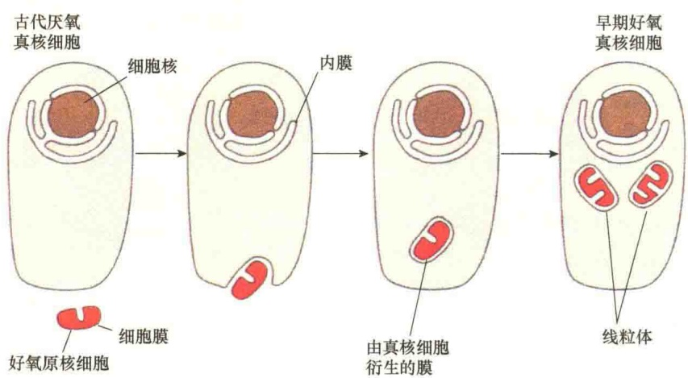

图 7-23 线粒体起源的内共生途径（引自 Alberts et al., 2015）。远古始祖细胞（一种古生菌）吞噬了一种线性的能够进行 ATP 合成的古生菌，开始了共生关系。现今，在所有真核生物的基因组中都可以发现细菌和古生菌双重遗传的明确证据。

该学说认为:线粒体祖先原线粒体（一种可进行三羧酸循环和电子传递的革兰氏阴性菌）被原始真核生物吞噬后与宿主间形成共生关系。在共生关系中，原线粒体可从宿主处获得更多的营养，而宿主可借用原线粒体具有的氧化分解功能获得更多的能量。

现有的关于线粒体 DNA、核糖体，以及 tRNA 等相关研究结果都支持内共生学说。该学说推测早期独立生存的细菌具有氧化磷酸化的酶促反应机制，并预测现代细菌具有与现代真核生物类似的呼吸链。研究结果证明，好氧菌能够将与 NAD 连锁的电子传递与  $O_{2}$  联系起来，并能与细胞质中的 ADP 磷酸化相偶联。而且，电子载体在将电子传递给  $O_{2}$  的同时将质子向外转位穿过质膜。在大肠杆菌的质膜中有  $F_{0}F_{1}$  复合物，而且， $F_{1}$  突出在胞质溶胶，催化质子通过  $F_{0}$  时利用 ADP 与 Pi 合成 ATP。

## 7.4.1.2 线粒体的基因组

线粒体有自己的遗传系统，与细胞核是分开存在的，而且具有自己的特点。具有与线粒体基因组最为相似的生物是  $\alpha$ -变形杆菌（ $\alpha$ -proteobacteria），该菌大约编码 7000 个蛋白质。一种类似于  $\alpha$ -变形杆菌的细胞中的寄生虫 Rickettsia prowazekii 具有更小的基因组，含有大约编码 850 个蛋白质的基因。如同线粒体，Rickettsia prowazekii 在真核细胞内能够增殖，但是与线粒体不同的是，它能够转录与翻译大多数自身基因组的基因。

线粒体 DNA（mtDNA）是双链环状分子，并且有多个拷贝。不同物种线粒体基因组的大小变化很大。人及大多数动物细胞中的线粒体基因组都较小，约 16kb；而酵母中的线粒体基因组较大，约有 80kb；植物的线粒体基因组更大，甚至超过 200kb。但是，大的线粒体基因组中有非编码的序列存在。例如，拟南芥的线粒体 DNA 有 370kb，但是仅编码 31 个蛋白质。

人的线粒体基因组编码 13 种涉及电子传递与氧化磷酸化的蛋白质（图 7-24）。这些基因都是在线粒体中转录并在线粒体的核糖体上翻译的。人的

线粒体 DNA 还编码线粒体核糖体的 16S、12S 的 rRNA，以及 22 种 tRNA。16S、12S 的 rRNA 是人及酵母线粒体核糖体的组分；而细菌有 3 种 rRNA，即 23S、16S 和 5S。植物也编码自身线粒体的 5S rRNA。此外，植物与原生动物的线粒体在输入与利用由核基因编码及线粒体基因组编码的 tRNA 方面也有所不同。动物线粒体所需的 tRNA 都是由线粒体基因编码。与由线粒体编码的 rRNA、tRNA 不同的是，核基因编码所有转录、翻译所需的蛋白质，包括线粒体 RNA 聚合酶、核糖体蛋白质，以及转译因子。

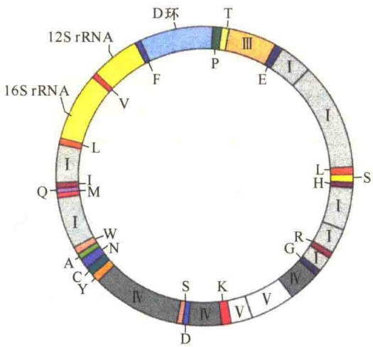

图 7-24 人线粒体基因组（引自 Cooper and Hausman，2013）。人线粒体含有 13 个蛋白质编码基因，分别是复合物 I、Ⅲ、Ⅳ或 V 的组成成分。基因组含有 12S rRNA、16S rRNA 及 22 种 rRNA 的基因。D 环是复制起点，并且含有启动子。

人的线粒体基因中没有发现内含子，但在酵母线粒体，至少在两个基因中发现有内含子，如细胞色素氧化酶复合物亚基I蛋白基因中就有9个内含子。

## 7.4.1.3 线粒体密码

线粒体使用核基因的通用密码，但也有些例外（表 7-6）。

表 7-6 线粒体中特殊遗传密码

<table><tr><td rowspan="2">密码子</td><td rowspan="2">通用密码</td><td colspan="4">线粒体密码</td></tr><tr><td>哺乳动物</td><td>果蝇</td><td>酵母</td><td>植物</td></tr><tr><td>UGA</td><td>终止</td><td>色氨酸</td><td>色氨酸</td><td>色氨酸</td><td>终止</td></tr><tr><td>AUA</td><td>异亮氨酸</td><td>甲硫氨酸</td><td>甲硫氨酸</td><td>甲硫氨酸</td><td>异亮氨酸</td></tr><tr><td>CUA</td><td>亮氨酸</td><td>亮氨酸</td><td>亮氨酸</td><td>苏氨酸</td><td>亮氨酸</td></tr><tr><td>AGA、AGG</td><td>精氨酸</td><td>终止</td><td>丝氨酸</td><td>精氨酸</td><td>精氨酸</td></tr></table>

线粒体的蛋白质合成基本上属于原核类型，具有原核生物蛋白质合成的特点。mRNA 的转录和翻译是在同一时间、同一地点进行，蛋白质合成的起始 tRNA 与原核生物的相同。蛋白质合成对药物的敏感性与细菌一样。例如，氯霉素可抑制线粒体的蛋白质合成，而不抑制细胞质的蛋白质合成；放线菌酮可抑制细胞质蛋白质的合成而不抑制线粒体蛋白质的合成。

## 7.4.1.4 线粒体基因突变与疾病

线粒体是细胞内非常重要的细胞器，它不仅是细胞的“发电厂”，也参与细胞的衰老与死亡。细胞色素c是程序性细胞死亡的内部信号，而线粒体基因突变的不断积累导致细胞衰老。

由于线粒体独立于细胞核，所以线粒体遗传属于母系遗传。与细胞核不同的是，线粒体中对 DNA 的错误修复能力远不及细胞核。由于线粒体的数量多，而且线粒体的基因组又是多拷贝，所以线粒体基因突变的影响较为缓慢，有一个积累的过程。

线粒体基因突变会引起相关的疾病，有一些是因线粒体基因突变降低了ATP的合成引起的。某些类型的组织与细胞，如神经元、骨骼肌与心肌、胰腺的β细胞，如果ATP合成能力下降，将会对它们产生巨大影响。熟知的例子是莱伯遗传性视神经吞噬（Leber's hereditary optic neuropathy, LHON）、肌性癫痫和粗红纤维（myoclonus epilepsy and ragged red fiber, MERRF）这两种由线粒体基因突变引起的疾病。图7-25是相关的基因突变位点。

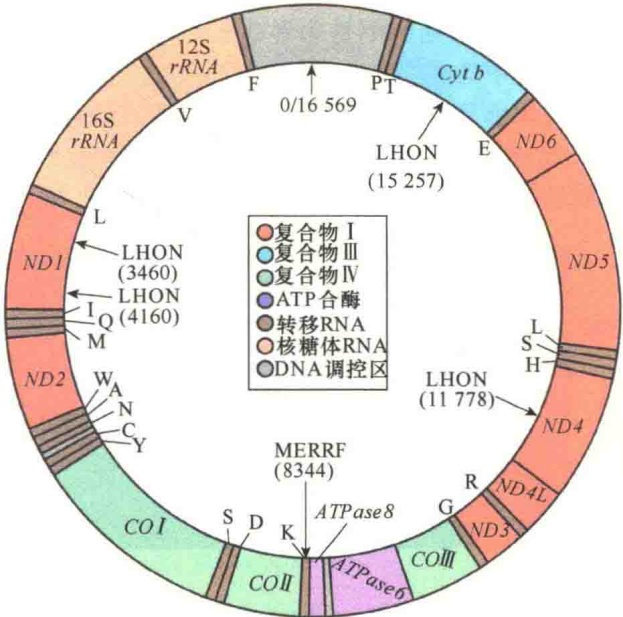

图 7-25 人的线粒体 DNA 突变（引自 Nelson and Cox, 2013）。图中标出了基因组中编码复合物 I-NADH 脱氢酶的基因（ND1\~ND6）、编码复合物 III 的细胞色素 b 的基因（Cyt b）、编码细胞色素氧化酶亚基（复合物 IV）的基因（CO I\~CO III），以及编码 ATP 合酶的两个亚基的基因（ATPase6、ATPase8）。另外还标示了两种 RNA 编码区。箭头指向的是 LHON 和 MERRF 两种疾病的基因突变。括号中的数字是指改变的核苷酸位置，单字母表示的是编码的氨基酸。不同颜色显示不同的基因功能区。

LHON 是一种罕见的疾病，它会影响中枢神经系统，包括视神经，并导致成年前双目失明。引起这种疾病的根本原因是线粒体复合物 I 的 ND4 基因中一个碱基的突变，该突变导致精氨酸密码变成了组氨酸密码，影响了电子从 NADH 向泛醌的传递。虽然这些线粒体仍然能够从来自琥珀酸的电子传递中合成部分 ATP，但是合成的 ATP 的量不足以支持神经元的活性，最严重的结果是损伤了视觉神经，导致失明。复合物Ⅲ中的细胞色素 b 编码基因的单碱基突变，也会导致 LHON。

MERRF 病是由线粒体基因组中编码赖氨酸特异的 tRNA（tRNA $^{Lys}$ ）基因突变所引起的。该疾病的主要特征是肌肉不可控的颤抖，根源是与该 tRNA 相关的蛋白质合成缺陷。具有 MERRF 病的个体骨骼肌纤维中有不正常形态的线粒体，有时似

有晶体结构。

除了线粒体基因突变导致线粒体疾病外，1100多个为线粒体蛋白编码的核基因突变也会导致线粒体疾病。

## 7.4.2 线粒体的融合与分裂

线粒体在细胞中是非常动态的结构。荧光标记活细胞中的线粒体，发现在很多不同类型的细胞中线粒体都是动态的，它们之间常常相互融合（合并）或分裂（断开），从而形成管状，有时会产生网状结构（图 7-26）。

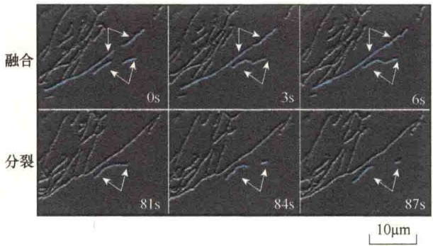

图 7-26 荧光蛋白标记的正常鼠胚成纤维细胞线粒体的融合与分裂（引自 Lodish et al., 2016）。用适时手持荧光显微镜（time-lapse fluorescence microscopy）观察到荧光蛋白标记的正常鼠胚成纤维细胞线粒体的融合与分裂的动态过程。可见到 4 个线粒体发生融合（上半部分），一个线粒体发生断裂（下半部分）。

当单个的线粒体发生融合时，线粒体的内、外两层膜都要发生融合，而且膜间隙及线粒体基质的成分也要发生混合。一组共4个进化上保守的GTP水解酶（GTPase）在线粒体的融合与分裂中起关键作用。这4种GTPase分别是线粒体融合蛋白1（mitofusion 1，MFN1）、线粒体融合蛋白2（mitofusion 2，MFN2）、OPA1及DRP1。这4种蛋白质都是GTPase马达蛋白家族成员（图7-27）。

线粒体融合与分裂有什么意义？对此有很多说法。首先，线粒体融合可为细胞提供更为同质的线粒体群体。假如某些线粒体的成分有部分缺失或丢失，可通过融合重新分配共享线粒体的组分。其次，通过对相关基因突变导致融合机制缺失的细胞及生物的研究发现，线粒体融合对维持线粒体在细胞内的适当定位、合适的形态、线粒体DNA的分布，以及线粒体完整的电子传递功能等方面都具有作用。

线粒体分裂同样具有重要意义。例如，当细胞分裂时，线粒体随着细胞一起分裂就特别重要，因为分裂的线粒体可进入不同的子细胞。线粒体能够以细胞内的微管、微丝为轨道，在马达蛋白的作用下被运送到合适的部位。此外，线粒体分裂为线粒体的质量控制提供了调控手段:在分裂时，可以将有缺陷的线粒体片段从健康的线粒体网络中剔除。对一部分受损伤较大的线粒体网络或功能紊乱的线粒体，通过分裂可以将这些线粒体剔除。

细胞具有识别线粒体网络中受损伤的及功能紊乱的线粒体片段的能力，它们将这些线粒体从网络中剔除后，能够用膜将它们包起来，并将其运送给溶酶体进行降解。线粒体的自我销毁作用称为线粒体自噬（mitophagy），是细胞自噬机制的一部分。

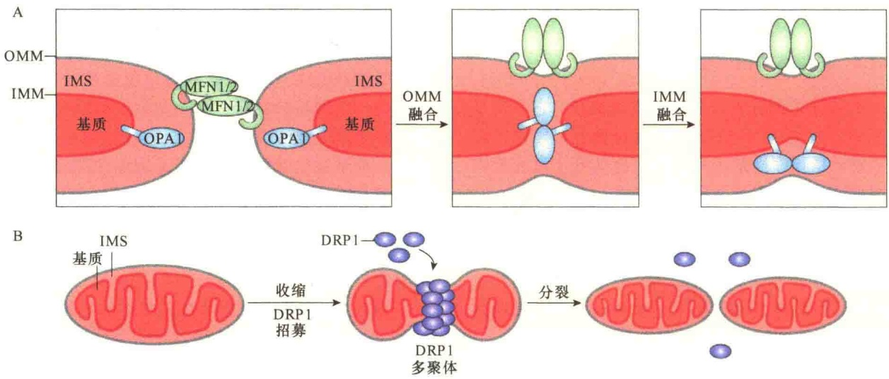

图 7-27 GTPase 介导线粒体的融合与分裂（引自 Lodish et al., 2016）。A. MFN1/2 介导线粒体外膜融合，OPA1 介导线粒体内膜融合。B. DRP1 被招募到线粒体的分裂处，通过收缩驱动线粒体分裂。

## 7.5 过氧化物酶体

1954 年，在电子显微镜下检查肾小管时发现一种膜结合的颗粒（图 7-28），直径为 0.1～1.0mm。

由于不知道这种颗粒的功能，将它称为微体（microbody）。后来发现微体有两种类型:过氧化物酶体（peroxisome）和乙醛酸循环体（glyoxysome），后者只在植物中发现。大多数人的细胞含有100～1000个过氧化物酶体。

过氧化物酶体是由一层单位膜包裹的囊泡，通过

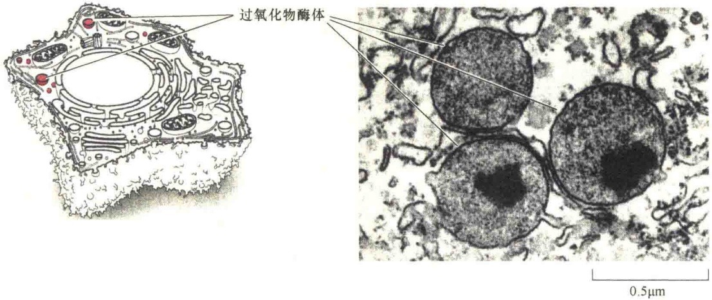

图 7-28 过氧化物酶体的电子显微镜照片（引自 Cooper and Hausman，2013）。图示大鼠肝细胞的三个过氧化物酶体，两个含有致密区，是尿酸氧化酶的晶核。

常比线粒体小。过氧化物酶体普遍存在于真核生物的各类细胞中，但在肝细胞和肾细胞中数量特别多。过氧化物酶体的主要酶类是过氧化氢酶，它的作用主要是将过氧化氢（$\mathrm{H}_2\mathrm{O}_2$）水解。$\mathrm{H}_2\mathrm{O}_2$ 是氧化酶催化的氧化还原反应中产生的细胞毒性物质，氧化酶和过氧化氢酶都存在于过氧化物酶体中，从而对细胞起保护作用。

## 7.5.1 过氧化物酶体的发现及所含酶类

## 7.5.1.1 过氧化物酶体的发现

过氧化物酶体、溶酶体都是 de Duve 和他的同事们发现的，发现的过程很简单，但是实验的设计却给我们以极大的启发。

de Duve 和他的同事通过梯度离心分离到溶酶体之后，通过对溶酶体酶的研究，发现至少有一种酶与溶酶体的酶性质不同:尿酸氧化酶（urate oxidase）不是酸性水解酶，尽管这种酶在离心分布时与溶酶体的酶相似。进一步研究发现在差速离心中，尿酸氧化酶与溶酶体的酶的沉降行为稍有不同。这些发现促使 de Duve 决定对该酶探个究竟，因为他猜测该酶有可能来自其他的细胞器。

通过等密度梯度离心技术，de Duve 等终于获得尿酸氧化酶是一种新细胞器的酶的线索。通过蔗糖密度梯度离心，发现尿酸氧化酶存在的密度区是 $1.25\mathrm{g/cm}^3$ ，而线粒体和溶酶体分别是 $1.19\mathrm{g/cm}^3$ 和 $1.20\sim 1.24\mathrm{g/cm}^3$ ，由于密度差异太小，而溶酶体酶自身的密度范围又很宽，如何将尿酸氧化酶与溶酶体的酶分开？他们根据一次偶然的实验观察，设计了一个很好的方法:用一种去垢剂TritonWR1339注射小鼠，这种去垢剂在细胞内主要积累在溶酶体中，并使溶酶体的浮力密度降低到$1.1\sim 1.14\mathrm{g/cm}^3$ ，这样就可以将尿酸氧化酶与溶酶体和线粒体离心后分离开。部分收集尿酸氧化酶样品，经分析，收集的尿酸氧化酶的样品中还含有过氧化物酶和D-氨基酸氧化酶，后来发现的几种酶都与 $\mathrm{H}_2\mathrm{O}_2$ 的形成和分解有关。由于新发现的细胞器与过氧化氢有关，故命名为过氧化物酶体。

通过酸性磷酸酶和过氧化氢酶的释放实验也证明过氧化物酶体与溶酶体是两种不同的细胞器。首先分离能够释放酸性磷酸酶和过氧化氢酶的膜性细胞器，然后用去垢剂（毛地黄皂苷）破坏细胞器使之释放酸性磷酸酶和过氧化氢酶。如果这两种酶定位于同一种细胞器中，那么只要该细胞器破裂就会同时释放出这两种酶，实验结果是要加10倍量的去垢剂才能释放过氧化氢酶（图7-29），这就说明

溶酶体和过氧化物酶体是两种不同的细胞器，这两种细胞器的膜对去垢剂的耐受性是不同的。

图 7-29 酸性磷酸酶和过氧化氢酶释放实验（引自 Kleinsmith and Kish, 1995）。

## 7.5.1.2 过氧化物酶体的酶类

过氧化物酶体在肝及肾细胞中极为丰富，植物的种子及叶中也很多。所有的过氧化物酶体都含有过氧化氢酶，约占过氧化物酶体总蛋白的15%。过氧化物酶体含有丰富的酶类，目前已知的有40余种，主要是氧化酶、过氧化氢酶和过氧化物酶（表7-7）。

表 7-7 过氧化物酶体中发现的主要酶类

| 酶 | 鼠肝 | 植物种子 | 植物叶 |
| --- | --- | --- | --- |
| 过氧化氢酶 | + | + | + |
| 尿酸氧化酶 | + | + | + |
| D-氨基酸氧化酶 | + | + | - |
| L-氨基酸氧化酶 | ± | + | - |
| L-α-羟酸氧化酶 | + | + | + |
| 乙醇酸氧化酶 | + | + | + |
| 脂肪酸β-氧化酶 | + | + | - |
| 柠檬酸合成酶 | - | + | - |
| 顺乌头酸酶 |  | + | - |
| 异柠檬酸裂解酶 | - | + | - |
| 马来酸合成酶 | - | + | - |
| 马来酸脱氢酶 | - | + | + |
| 乙醛酸还原酶 | + | - | + |
| 乙醛酸转氨酶 | - | - | + |

注:+表示存在，-表示不存在；空白表示未测。±表示有些有，有些无。

1）氧化酶（oxidase） 过氧化物酶体含有的氧化酶包括尿酸氧化酶、D-氨基酸氧化酶、L-氨基酸氧化酶和L-α-羟基酸氧化酶等。氧化酶约占过氧化物酶体酶总量的一半。各种氧化酶作用于不同的底物，其共同特点是氧化底物的同时，将氧还原成过氧化氢: $RH_{2}+O_{2}\longrightarrow R+H_{2}O_{2}$ 。

2）过氧化氢酶（catalase） 过氧化氢酶是过氧化物酶体的标志酶，这是因为所有过氧化物酶体都含有过氧化氢酶，约占过氧化物酶体酶总量的40%。过氧化氢酶的作用是将过氧化氢还原成水: $2H_{2}O_{2}\longrightarrow O_{2}+2H_{2}O$ 。

## 7.5.2 过氧化物酶体的功能

因为氢的过氧化物是有毒的，似乎认为过氧化物酶体的功能就是防止产生过氧化氢，对细胞起保护作用。事实上，过氧化物酶体不仅仅是将过氧化氢水解，还有其他一些重要功能。

1）使毒性物质失活 这种作用是过氧化氢酶利用过氧化氢氧化各种底物，如酚、甲酸、甲醛和乙醇等，氧化的结果使这些有毒性的物质变成无毒性的物质，同时也使 $H_{2}O_{2}$ 进一步转变成无毒的 $H_{2}O$ 。这种解毒作用对于肝、肾特别重要。例如，人们饮入的酒精几乎有一半是以这种方式被氧化成乙醛的，从而解除了酒精（乙醇）对细胞的毒性作用。

2）对氧浓度的调节作用 过氧化物酶体中的氧化酶都是利用分子氧作为氧化剂，催化如下的化学反应: $RH_{2}+O_{2}\longrightarrow R+H_{2}O_{2}$ 。

这一反应对细胞内氧的水平有很大的影响。例如，在肝细胞中，有20%的氧是由过氧化物酶体消耗的，其余的在线粒体中消耗。在过氧化物酶体中氧化产生的能量以产热的方式消耗掉，而在线粒体中氧化产生的能量贮存在ATP中。线粒体与过氧化物酶体对氧的敏感性是不一样的，线粒体氧化所需的最佳氧浓度为2%左右，增加氧浓度并不提高线粒体的氧化能力。过氧化物酶体与线粒体不同，它的氧化率是随氧张力增强而成正比地提高（图7-30）。因此，在低浓度氧的条件下，线粒体利用氧的能力比过氧化物酶体的强，但在高浓度氧的情况下，过氧化物酶体的氧化反应占主导地位，这种特性使过氧化物酶体具有使细胞免受高浓度氧的毒性作用。

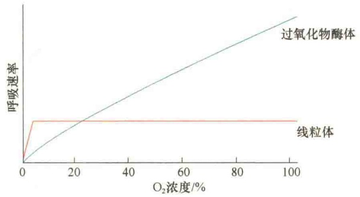

图 7-30 过氧化物酶体和线粒体中氧浓度与呼吸速率的关系（引自 Kleinsmith and Kish，1995）。

3）脂肪酸的氧化 动物细胞的过氧化物酶体中有氧化脂肪酸的酶类。动物组织中有25%～50%的脂肪酸是在过氧化物酶体中氧化的，其他则是在线粒体中氧化的。另外，由于过氧化物酶体中有与磷脂合成相关的酶，所以过氧化物酶体也参与脂的合成。

4）含氮物质的代谢 在大多数动物细胞中，尿酸氧化酶对于尿酸的氧化是必需的。尿酸是核苷酸和某些蛋白质降解代谢的产物，尿酸氧化酶可将这种代谢废物进一步氧化去除。另外，过氧化物酶体还参与其他的氮代谢，如转氨酶（aminotransferase）催化氨基的转移。

5）过氧化物酶体在植物中的作用 第一是在种子发芽时，将脂肪酸转变成糖碳水化合物为种子的生长提供能量；第二是参与光呼吸（参见本书第8章相关内容）。

## 7.5.3 过氧化物酶体的生物发生

通常将细胞器的增殖称为生物发生（biogenesis）。过氧化物酶体是一种小的、由单层膜包裹的细胞器。过氧化物酶体不同于线粒体，它没有DNA，也不含核糖体，构成过氧化物酶体的所有蛋白质都是核基因编码，并运输到过氧化物酶体的膜或过氧化物酶体的腔中。但是，过氧化物酶体却能随着细胞的生长与分裂同步进行生长与分裂，这一切是如何发生的呢？

## 7.5.3.1 过氧化物酶体生物发生途径

过氧化物酶体的生物发生曾经被认为是与内体、溶酶体类似的方式。后来，大多数研究者认为，过氧化物酶体的生物发生只是通过已有的过氧化物酶体分裂进行的。最新的证据表明，过氧化物酶体的生物发生既有与溶酶体生物发生类似的途径，也有通过预先存在的过氧化物酶体分裂而产生的途径，或者是两种途径的结合。图7-31是关于过氧化物酶体是如何增殖及新的过氧化物酶体是如何产生的示意图。参与过氧化物酶体生物发生的蛋白质统称为过氧化物酶体生成蛋白（peroxin），如Pex1、Pex2、Pex5、Pex19等。

## 7.5.3.2 过氧化物酶体基质蛋白的靶向信号

大多数过氧化物酶体基质蛋白的羧基端都有一个三氨基酸序列（Ser-Lys-Leu）作为过氧化物酶体靶向信号，将这种信号称为 PTS1（peroxisome targeting signal 1）。少数过氧化物酶体的蛋白质是由氨基端的 9 个氨基酸序列引导定位，这种定位信号称为 PTS2（peroxisome targeting signal 2）。PST1 和 PST2 由不同的受体识别，与线粒体、叶绿体、

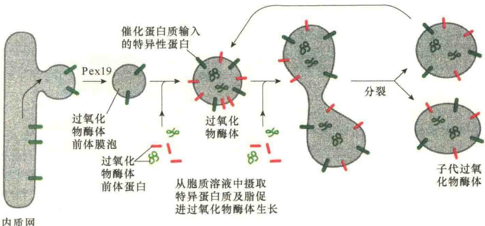

图 7-31 过氧化物酶体生物发生的示意图（引自 Alberts et al., 2015）。从内质网产生过氧化物酶体前体膜泡，推测膜泡膜中的两个过氧化物酶体的膜蛋白分别是 Pex3、Pex16。在 Pex19 及其他一些尚不清楚的蛋白质的帮助下，内质网选择性地将只有过氧化物酶体的蛋白质包入前体膜泡中，形成的过氧化物酶体前体膜泡可以相互或与预先存在的过氧化物酶体进行融合。过氧化物酶体的膜含有输入蛋白受体及蛋白质转运器，能够从胞质溶胶中摄取过氧化物酶体所需的蛋白质，也包括输入蛋白受体及蛋白质转运器的新拷贝。据推测，过氧化物酶体生长所需的脂类也是通过脂运输蛋白转运来的，也包括预先存在的过氧化物酶体提供的脂类。

ER 蛋白定位转运不同，过氧化物酶体蛋白质在转运时不必解折叠，靶向信号也不会在蛋白质转运后被切除。图 7-32 是 PST1 介导的过氧化物酶体基质蛋白的转运示意图。

图 7-32 PTS1 介导的过氧化物酶体基质蛋白的转运（引自 Lodish et al., 2016）。①大多数过氧化物酶体的基质蛋白的 C 端都有一个 PTS1 的靶向序列，该序列能够与细胞质受体 Pex5 结合。②Pex5-过氧化物酶体基质蛋白复合物进一步与定位在过氧化物酶体膜上的两个受体蛋白 Pex14 结合形成多亚基的复合物。③过氧化物酶体基质蛋白-Pex5 与 Pex14 装配成复合物之后，过氧化物酶体基质蛋白与 Pex5 解离，被释放到过氧化物酶体基质中。④释放了基质蛋白的 Pex5 被位于过氧化物酶体膜中的 Pex2、Pex10 和 Pex12 泛素化。⑤泛素化的 Pex5 在 ATPase 酶蛋白 Pex1、Pex6 的作用下从过氧化物酶体的膜上脱离下来，该过程需要 ATP 水解供能。重新进入胞质溶胶的 Pex5 开始新的循环。

过氧化物酶体中含量最高的过氧化氢酶蛋白的 C 端具有 PST1 靶向序列，就是通过上述机制进入过氧化物酶体基质的。少数过氧化物酶体基质蛋白，如硫解酶（thiolase）的前体蛋白的靶向序列位于 N 端，它们与细胞质中不同的受体蛋白结合，但是，输入过氧化物酶体的机制与 PST1 介导的转运是相同的。

## 7.5.3.3 过氧化物酶体膜蛋白的转运

细胞质中游离核糖体不仅为过氧化物酶体合成基质蛋白，也为过氧化物酶体合成膜蛋白，不过，过氧化物酶体膜蛋白与过氧化物酶体基质蛋白的转运机制是不同的。过氧化物酶体的膜蛋白具有膜靶向信号（mPTS），能够被细胞质中水溶性的受体Pex19识别并结合。Pex19-过氧化物酶体膜蛋白复合物被过氧化物酶体膜中的Pex3/Pex16识别，然后在Pex19的介导下，过氧化物酶体的膜蛋白插入过氧化物酶体的膜中，Pex19进入胞质溶胶执行新的膜蛋白识别与转运任务（图7-33）。

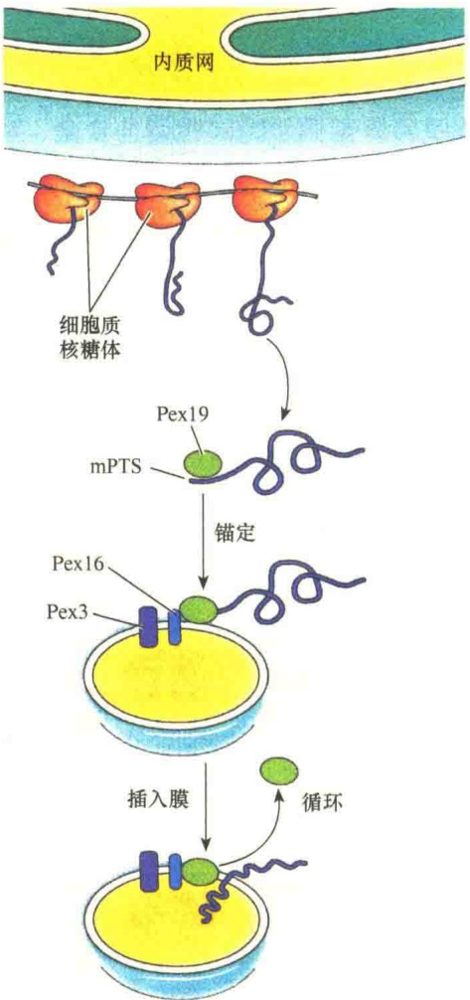

图 7-33 来自细胞质的过氧化物酶体膜蛋白的转运（引自 Cooper and Hausman，2016）。在细胞质游离核糖体上合成的过氧化物酶体的膜蛋白具有可被细胞质中受体蛋白 Pex19 识别的信号（mPTS）。然后，Pex19-靶蛋白复合体与过氧化物酶体膜中的 Pex3/Pex16 结合，Pex19 介导靶蛋白插入膜并在膜脂双层中装配成蛋白复合物。

## 7.5.3.4 过氧化物酶体的生长与分裂

从上面的讨论中可以看到，过氧化物酶体的生物发生可以“从无到有”（图 7-34A），即由内质网通过出芽产生含有过氧化物酶体的膜泡，至于新生的膜泡上有多少种过氧化物酶体的膜蛋白及基质蛋白，仍不清楚。一般认为，从内质网上产生的膜泡仅是一个空壳（ghost），但可以肯定在膜泡的膜上至少有两种作为膜受体的过氧化物酶体的膜蛋白Pex3和Pex16，是它们招募Pex19，导致过氧化物酶体膜泡的形成。

膜泡形成之后，可以相互融合，通过可溶性的受体（Pex5、Pex19）不断将细胞质游离核糖体合成的过氧化物酶体的基质蛋白、膜蛋白转运到过氧化物酶体。不仅如此，胞质溶胶中的脂运输蛋白将内质网合成的磷脂不断运送到过氧化物酶体的膜中，满足不断生长的过氧化物酶体的需要。此外还要从细胞中摄取血红素，保证氧化酶的活性。

除了上面所说的过氧化物酶体从无到有的生成之外，过氧化物酶体也可以通过分裂进行繁衍（图 7-34B）。当过氧化物酶体生长到成熟时即可通过分裂产生新的小过氧化物酶体。新生的过氧化物酶体又通过前述的机制不断从细胞质中摄取蛋白质等，逐渐长大。

据研究，过氧化物酶体中有一类检测蛋白，能够检测过氧化物酶体是否成熟，目前已知 Pex11 与过氧化物酶体的成熟分裂相关。

过氧化物酶体与人类某些疾病密切相关。主要是编码定位于过氧化物酶体的酶的基因发生突变导致酶活性丧失；或是运输酶蛋白的受体发生突变，导致这些酶定位于胞质而不能进入过氧化物酶体。最典型的导致人类疾病的例子是 Zellweger 综合征（脑肝肾综合征），患这种病的儿童的寿命不过 10 岁。研究表明，至少有 10 种基因的突变会导致该病的发生，这些基因突变的结果都是影响了过氧化物酶体蛋白的转运，其中一个突变影响了受体对 PST1 的识别。

A

图 7-34 新的过氧化物酶体形成的两种途径（引自 Cooper and Hausman，2016）。A. 由内质网产生的膜泡开始从无到有的形成新的过氧化物酶体。B. 通过成熟过氧化物酶体的分裂产生新的过氧化物酶体。

## 本章小结

线粒体是细胞内氧化磷酸化和合成 ATP 的主要场所，是细胞的 “动力工厂”。

线粒体有内、外两层膜，外膜含有孔蛋白，通透性高。内膜通透性较低，通常向基质折褶形成嵴，嵴上有许多规则排列的基粒。内膜上有许多参与运输、合成、电子传递和ATP合成的酶类。内、外膜之间有膜间隙，其化学组成接近胞质溶胶。线粒体基质中含有与三羧酸循环、线粒体DNA合成等相关的酶类。

线粒体的绝大多数蛋白质由核基因编码，在细胞质游离核糖体上合成后通过转运肽转运到线粒体中，转运过程需要受体、消耗能量及分子伴侣的帮助等。

线粒体是真核生物氧化代谢的部位。糖酵解生成的丙酮酸进入线粒体基质，经过三羧酸循环生成 $FADH_{2}$ 和NADH，再进入呼吸链进行氧化磷酸化，最后生成ATP和水。呼吸链上的电子载体有黄素蛋白、细胞色素、铁硫蛋白和辅酶Q。主呼吸链由复合物Ⅰ、Ⅲ、Ⅳ构成，传递氧化NADH释放的电子；次呼吸链由复合物Ⅱ、Ⅲ、Ⅳ构成，传递氧化 $FADH_{2}$ 释放的电子。呼吸链通过3个氧化磷酸化偶联位点，即复合物Ⅰ、Ⅲ、Ⅳ建立质子动势，驱动ATP合酶合成ATP。英国生化学家Mitchell于1961年提出化学渗

透偶联假说，结合变构机制证实化学渗透偶联假说的正确性。

线粒体是一种半自主性的细胞器，具有有限的遗传物质及蛋白质合成系统等。线粒体通过分裂进行增殖。内共生学说是普遍接受的线粒体起源的学说。

线粒体是一种动态的细胞器，相互之间不断发生融合与分裂。融合可以提高细胞质系统的同质性；分裂不仅有助于剔除受损伤的线粒体片段，而且可以扩大线粒体的数量，并可随细胞的分裂进入子细胞。

过氧化物酶体是由一层单位膜包裹的囊泡，不含 DNA，但含 40 余种酶类，主要是氧化酶、过氧化氢酶和过氧化物酶。过氧化物酶体具有解毒、调节氧浓度、氧化脂肪酸、进行含氮物质代谢等功能。

过氧化物酶体的生物发生既有与溶酶体生物发生类似的途径，也有通过预先存在的过氧化物酶体分裂而产生的途径。

线粒体与过氧化物酶体的基因突变都会导致严重的疾病。

## 思考题

(1) 线粒体内膜具有典型细胞膜的所有特征, 同时还有几个与其在氧化磷酸化中的作用密切相关的特异性。这些特异性是什么? 它们对内膜的功能有何贡献?

(2) 描述下列线粒体突变将给线粒体基质蛋白的前体带来怎样的变化: ① TOM22 信号受体的突变; ② TOM70 信号受体的突变; ③ 基质中 Hsp70 的突变; ④ 基质信号肽酶的突变。

(3) 假定你已经确鉴定了一种新的突变细胞系, 它的过氧化物酶体没有功能。请问你如何设计实验来确定突变体是膜蛋白或基质蛋白发生了插入, 还是装配方面的缺陷?

(4) 线粒体在肝细胞的胞质中是自由移动的, 而心肌细胞中的线粒体则相对固定在相邻肌纤维之间的位置。请问它们的位置差异具有什么样的生理意义?

(5) 相对而言, 科学家难以用实验手段研究完整线粒体中的呼吸链。然而, 当用超声波破坏线粒体后, 可以分离出功能性的亚线粒体囊泡, 这些亚线粒体囊泡是由破裂的线粒体的嵴外翻封闭而成。在这些囊泡中, 原先面对线粒体基质的膜蛋白现在暴露在周围的介质中。你认为这样的排列对电子传递和 ATP 合成的研究有什么帮助?