# 叶绿体与光合作用

- 8.1 质体与叶绿体
- 8.1.1 前质体与质体
- 8.1.2 叶绿体的形态、大小与数量
- 8.2 叶绿体的结构
- 8.2.1 叶绿体被膜的结构及特性
- 8.2.2 类囊体
- 8.2.3 叶绿体基质
- 8.3 叶绿体蛋白的转运
- 8.3.1 叶绿体基质蛋白的转运
- 8.3.2 类囊体蛋白的转运
- 8.4 光合作用
- 8.4.1 光合作用的四个阶段与特点
- 8.4.2 光吸收
- 8.4.3 电子传递
- 8.4.4 线性及循环式电子传递途径
- 8.4.5 光合磷酸化
- 8.4.6 暗反应
- 8.4.7 过氧化物酶体在光合作用中的作用
- 8.5 叶绿体的遗传和起源
- 8.5.1 叶绿体的遗传
- 8.5.2 叶绿体的起源
- 8.6 叶绿体与线粒体的结构与功能的比较

光合作用是自养生物利用光能将碳进行还原的过程。在真核自养生物中，捕获光能的反应只能发生在特殊的细胞器——叶绿体中；而在原核自养生物中，相应的反应发生在质膜上。植物通过光合作用将光能转变成化学能的过程主要是在植物细胞的叶绿体中进行的。叶绿体（chloroplast）是植物细胞所特有的能量转换细胞器，其功能是进行光合作用，即利用光能同化二氧化碳和水，合成糖，同时产生分子氧。

由于叶绿体的体积大且具有绿色，所以它是光学显微镜下发现的第一个细胞内的结构。17世纪，光学显微镜发明不久，列文虎克就在藻类中观察到了叶绿体；到了1800年，在各种植物的叶中都鉴定到叶绿体。将叶绿体置于低渗溶液中会膨胀破裂，表明叶绿体也是由半透性的膜包裹的细胞器。

## 8.1 质体与叶绿体

## 8.1.1 前质体与质体

虽然叶绿体是植物细胞特有的细胞器，但并非所有的植物细胞都具有叶绿体，如高等植物中的分生组织细胞就缺少叶绿体，但是它们具有一些小的细胞器，称为前质体（proplastid）。前质体的直径约为1μm，或更小一些，它是由双层膜包被着未分化的基质（stroma）所组成。植物中的前质体在发育过程中随着所处的位置及接受光的多少，分化成功能各异的质体（plastid）。所以，质体是植物细胞中一类膜性细胞器的总称，这类细胞器都是由共同的前体——前质体分化发育而来（图8-1）。

根据质体是否含有叶绿素及功能的不同，可将其分为叶绿体、白色体、有色体、蛋白质体、油质体、造粉体等。

图 8-1 前质体的分化途径（引自 Cooper and Hausman, 2016）。

## 8.1.2 叶绿体的形态、大小与数量

高等植物中的叶绿体为球形、椭圆形或卵圆形，为双凹面。有些叶绿体呈棒状，中央区较细小而两端膨大（图8-2），充满叶绿素和淀粉粒。在同一物种的不同细胞内叶绿体的形态变化较大，但在同一种组织的细胞内比较稳定。叶绿体的大小变化很大，高等植物叶绿体通常宽2～5μm、长

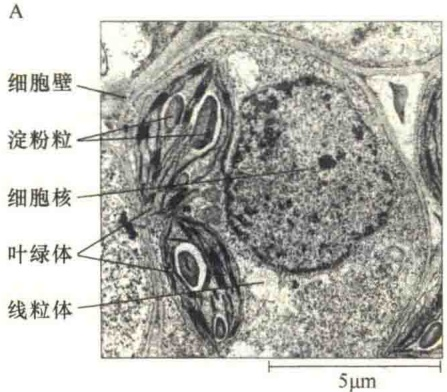

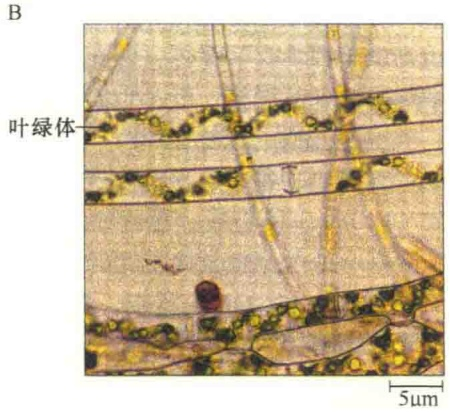

图 8-2 植物细胞中叶绿体的电子显微镜照片（引自 Jeff et al., 2012）。A. 植物叶细胞中的叶绿体；B. 海藻细胞中的叶绿体。

5～10μm。对于特定的细胞类型来说，叶绿体的大小相对稳定，但受遗传和环境的影响，如多倍体细胞内的叶绿体就比单倍体细胞的要大些。同一种植物生长在不同的环境中，其大小也不相同。

不同植物中叶绿体的数目相对稳定，大多数高等植物的叶肉细胞含有几十到几百个叶绿体，可占细胞质体积的40%。叶绿体的数目因物种、细胞类型和生理状况而异，藻类植物通常只有一个巨大的叶绿体，其形态有螺旋状、星状，依据细胞的形态而定。例如，丝状绿藻含有一个螺旋带形的巨大叶绿体，而紫球藻细胞中含有一个巨大的球形叶绿体，其内膜小泡平行排列而不堆积形成基粒。

## 8.2 叶绿体的结构

叶绿体由叶绿体被膜（chloroplast envelope）、类囊体（thylakoid）和叶绿体基质（chloroplast stroma）组成。叶绿体的结构比较特殊，它含有3种不同的膜（外膜、内膜和类囊体膜），以及3种彼此分隔的区室（膜间隙、叶绿体基质和类囊体腔）。

## 8.2.1 叶绿体被膜的结构及特性

叶绿体的外膜和内膜合称为被膜。叶绿体的外膜和内膜都是连续的单位膜，每层膜的厚度为6～8nm，内、外两膜间有2～10nm宽的间隙，称为膜间隙。与线粒体不同的是，叶绿体的内膜并不向内折成嵴（图8-3），但在某些植物中，内膜可皱褶形成相互连接的泡状或管状结构，称为周质网（peripheral reticulum），这种结构的形成可增加内膜的表面积。

内膜含有较多的膜整合蛋白，因此内膜的蛋白

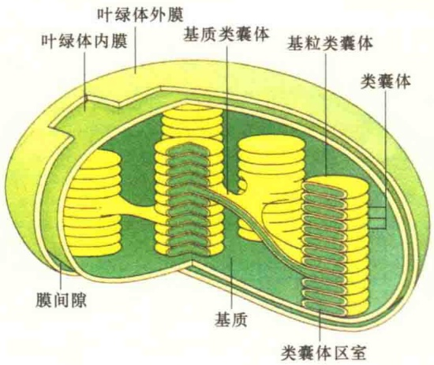

图 8-3 叶绿体的膜与区室（引自 Wolfe，1993）。

质与脂的比值比外膜的高。

内膜上的蛋白质大多是与糖脂、磷脂合成有关的酶类。研究结果表明，叶绿体的被膜不仅是叶绿体脂合成的场所，也是整个植物细胞脂合成的主要场所。这一点与动物细胞有很大的不同:在动物细胞中，脂类的合成主要是在滑面内质网上进行的。内膜中发现的另一类蛋白质是转运蛋白，这也与线粒体一样，由于外膜通透性大，物质的选择性运输任务就自然落在了内膜上。

膜间隙将叶绿体的内外膜分开，间隔2\~10nm。由于外膜的通透性大，所以膜间隙的成分几乎与胞质溶胶的一样。尚不了解在膜间隙中有哪些蛋白质的存在。

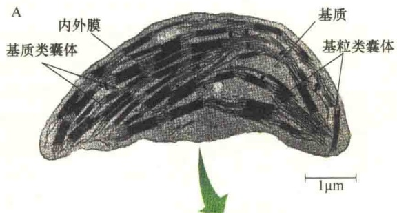

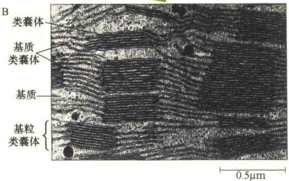

## 8.2.2 类囊体

与线粒体不同，叶绿体基质中有第三种膜结构系统，称为类囊体，它是由内膜发展而来的、膜封闭的扁平小囊。类囊体是叶绿体内部组织的基本结构单位，上面分布着许多光合作用色素，是光合作用的光反应场所。

## 8.2.2.1 类囊体的结构

叶绿体中的类囊体有两种类型:基粒类囊体（granum thylakoid）和基质类囊体（stroma thylakoid）（图8-3和图8-4）。

图 8-4 基粒类囊体和基质类囊体的立体结构（引自 Jeff et al., 2012）。A. 猫尾草（Phleum pratense）叶绿体的透射电镜照片。B. 叶绿体的三维结构。C. 叶绿体模式图。D. 两种类型的类囊体模式图。

叶绿体中圆盘状的类囊体常常相互堆积在一起形成柱形颗粒，叫基粒（granum），看起来似一叠硬币。每一个叶绿体中含有40～80个基粒。将构成基粒的类囊体称为基粒类囊体，或称为堆积类囊体（stacked thylakoid）。基粒类囊体的直径为0.25～0.8μm，厚0.01μm，一个基粒由5～30个基粒类囊体所组成，最多的可达上百个。

通常基粒中的类囊体会延伸出网状或片层结构并与相邻的基粒类囊体相通，连接两个相邻基粒类囊体的片层结构称为基质类囊体，也有称为非堆积类囊体（unstacked thylakoid）。基质类囊体是非常大的扁平囊泡结构，能够将多个甚至所有的单个基粒类囊体连接起来。

基本上，所有参与光合作用的色素、光合作用所需的酶类、参与电子传递的载体，以及将电子传递与质子泵和 ATP 合成偶联的蛋白质都定位在类囊体膜上。

由类囊体膜封闭的区室称为类囊体腔（thylakoid lumen），类囊体腔与叶绿体基质是分隔的，它在电化学梯度的建立和 ATP 的合成中起重要作用。

## 8.2.2.2 类囊体膜的化学组成

类囊体的膜在两个方面表现出独特的性质:一是类囊体膜上有伸向基质的柄状结构，称为  $CF_{1}$  颗粒；二是相互堆积形成基粒。类囊体膜的化学组成也比较特别，如细胞质膜中的主要脂类成分——磷脂在类囊体膜上只占5%\~20%，而在线粒体的膜上占90%，内质网膜上的磷脂也有80%。类囊体膜上的脂主要是含半乳糖的一些糖脂和具有光吸收功能的脂类色素。脂类中的脂肪酸主要是不饱和的亚麻酸，约占87%，因此，类囊体膜的脂双层流动性特别大。此外，类囊体膜上的蛋白质与脂的比值很高，这是因为类囊体膜有很多电子载体、酶和一些参与光合作用的色素结合蛋白。

类囊体膜的蛋白质分为整合蛋白和外周蛋白两类。外周蛋白在类囊体膜的叶绿体基质面较多；整合蛋白镶嵌在脂双层中，如质体蓝素、细胞色素等。

## 8.2.3 叶绿体基质

叶绿体内膜与类囊体之间的区室，称为叶绿体基质。在电子显微镜下观察可见到基质中有一些细微颗粒，其中最多的是淀粉颗粒。这种颗粒是用于储存光合作用所产生的糖。另外还有一些含脂的沉积物称为质体球（plastoglobule），这种小球的产生与类囊体的破裂有关，当新类囊体形成时，老的类囊体破裂，可减少类囊体的数量和体积，由此推测质体球可作为类囊体脂的储备库。基质中含有大量的可溶性蛋白质，其中RuBP羧化酶占可溶性蛋白质总量的60%。此外，基质中还含有 $CO_{2}$ 固定反应的所有酶类。叶绿体基质中还有核糖体、DNA和RNA等。叶绿体DNA编码约100余种多肽，涉及叶绿体DNA的复制、转录和翻译。基质是光合作用固定 $CO_{2}$ 的场所。

## 8.3 叶绿体蛋白的转运

虽然叶绿体基因组为自身编码的蛋白质较线粒体的多，但约有3000种或95%的叶绿体蛋白质是由核基因编码的，这些蛋白质是在细胞质游离核糖体上合成，然后被转运到叶绿体，并定位到叶绿体的不同部位起作用。由于叶绿体是三膜三空间结构，所以，叶绿体蛋白质的分选转运要比线粒体蛋白分选转运复杂。

## 8.3.1 叶绿体基质蛋白的转运

大多数进入叶绿体的蛋白质都是通过 N 端一段由 30～100 个氨基酸残基构成的、称之为转运肽（transit peptide）的信号序列引导的，转运肽能够引导叶绿体蛋白质穿过叶绿体的外膜与内膜。进入到叶绿体基质后，转运肽将被水解切除（图 8-5）。

图 8-5 叶绿体基质蛋白的转运（引自 Cooper and Hausman, 2016）。具有 N 端转运肽的蛋白质被引导复合物（guidance complex）所识别，并将之引导到叶绿体外膜的 TOC 复合物。通过外膜时，需要位于膜间隙的 Hsp70 相助，并需要消耗 ATP；而 TOC 复合物在转运叶绿体蛋白质时，也需要水解 GTP。一旦穿过外膜，转运肽就会引导蛋白质穿过内膜的 TIC 复合物，但在穿过内膜 TIC 复合物时需要 Hsp93 的帮助，并消耗 1 分子 ATP。在叶绿体基质中，转运肽要被叶绿体基质加工蛋白酶（stromal processing peptidase, SPP）切除。

叶绿体基质蛋白的转运与线粒体基质蛋白的转运相比，共同点是:都需要解折叠，都需要分子伴侣的帮助，都需要外膜与内膜通道复合物，都需要消耗能源分子；但也有不同，如在能量的消耗上，线粒体基质蛋白转运时需要ATP与膜间隙中$\mathrm{H^{+}}$ 的电化学梯度，而叶绿体中，$\mathrm{H^{+}}$ 的电化学梯度在类囊体，故叶绿体基质蛋白质在穿膜时需要水解GTP供能。

另外，植物细胞中既有线粒体，又有叶绿体，而它们的核基因编码的蛋白质都是在细胞质中游离核糖体合成的，所以在这两种细胞器的外膜和内膜中的蛋白质转运器具有不同的识别功能。

## 8.3.2 类囊体蛋白的转运

类囊体蛋白包括类囊体膜蛋白和类囊体腔蛋白，由叶绿体前体蛋白转运而来。定位于类囊体膜或腔的蛋白质除了要有叶绿体基质信号序列外，还须有插入类囊体膜或穿过类囊体膜的信号序列。因此，类囊体蛋白的转运分为两步:首先，类囊体前体蛋白需要穿过叶绿体的双层膜，进入到叶绿体基质，然后再整合到类囊体的膜或是转运到类囊体的腔内成为类囊体蛋白。

为了将类囊体蛋白质顺利转运到类囊体的相应部位，类囊体前体蛋白的N端有两段疏水的信号序列:第一段信号序列引导类囊体前体蛋白通过叶绿体的双层膜进入叶绿体基质，叶绿体基质中的水解酶将第一段信号序列水解后，裸露出的第二段信号序列引导类囊体前体蛋白插入类囊体的膜或进入类囊体的腔（图8-6）。

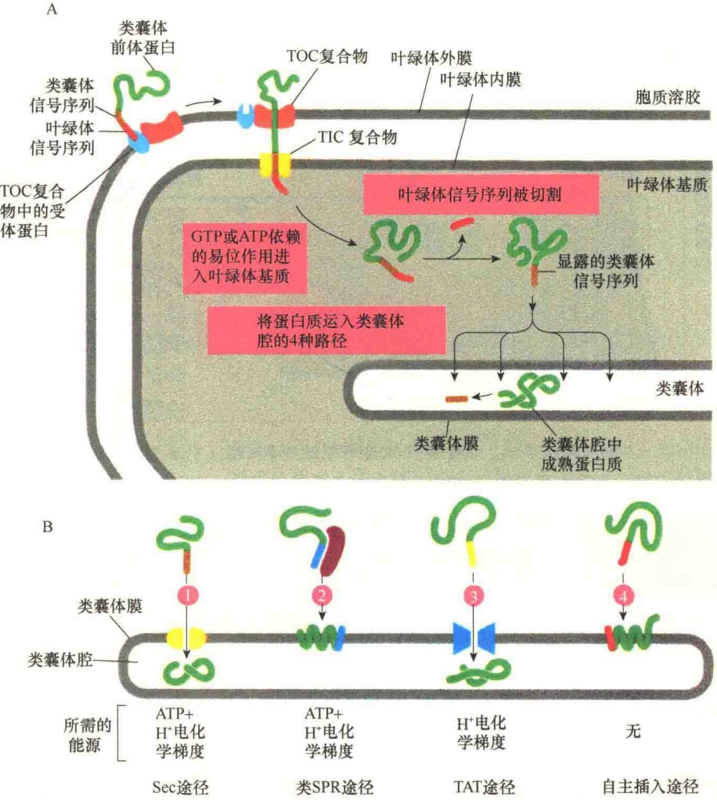

图 8-6 叶绿体前体蛋白转运进入类囊体示意图（引自 Alberts et al., 2015）。A. N 端含有叶绿体信号序列及类囊体信号序列的前体蛋白。首先由叶绿体信号序列引导前体蛋白穿过外膜的 TOC 与内膜的 TIC 进入叶绿体基质，过程与穿过线粒体相似，只不过叶绿体的 TOC、TIC 的组成与线粒体不同。B. 进入叶绿体基质的蛋白质可以通过以下 4 种方式中的一种定位到类囊体的膜或是类囊体基质中:① Sec 途径，即使用的类囊体膜的通道成分是细菌膜通道 Sec 蛋白的同系物；②类 SRP 途径，该途径要借助于 SRP 的同系物；③ TAT（twin arginine translocation）途径，该途径中，信号序列里有两个精氨酸特别关键；④自主插入途径（spontaneous insertion pathway），这一途径可能不需要任何蛋白质的帮助。

## 8.4 光合作用

叶绿体的主要功能是进行光合作用（photosynthesis），它是绿色植物利用叶绿素吸收光能、固定 $CO_{2}$ ，并与 $H_{2}O$ 同化成有机物，同时释放出氧的反应过程。

18世纪末就已经知道光合作用能够将水和$\mathrm{CO}_{2}$转变成有机物和氧，并很快确定了光合作用的反应式:$6\mathrm{CO}_{2}+6\mathrm{H}_{2}\mathrm{O}+\text{光}\longrightarrow\mathrm{C}_{6}\mathrm{H}_{12}\mathrm{O}_{6}+6\mathrm{O}_{2}+\text{化学能（674000kcal）。}$

## 8.4.1 光合作用的四个阶段与特点

如果仅从所涉及的化学反应来看，光合作用可分为四个阶段:第一阶段，光吸收、高能电子的产生、 $O_{2}$ 的形成；第二阶段，电子转运、质子动力的形成；第三阶段:ATP的合成；第四阶段:碳固定、碳水化合物的合成（图8-7）。

若根据光合作用过程中对光的需要与否来分，可将光合作用分为两个阶段，即光反应和暗反应（light and dark reaction）。光反应是对光的吸收，并产生氧；暗反应涉及  $CO_{2}$  的固定（图 8-8）。

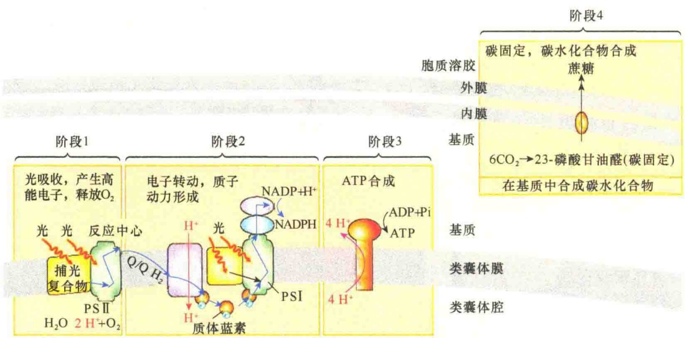

图 8-7 光合作用的四个阶段（引自 Lodish et al., 2016）。

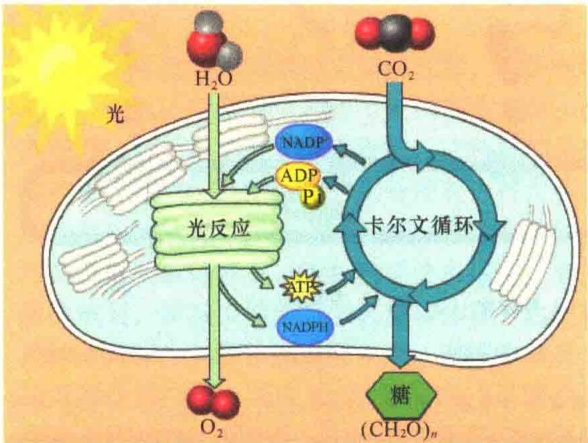

图8-8 光合作用的两个阶段:光反应与暗反应。

光反应又称为光合电子转移反应（photosynthetic electron-transfer reaction）。在反应过程中，来自太阳的光能使绿色生物的叶绿素产生高能电子，从而将光能转变为电能；同时，叶绿素从水光解中获得电子，并将 $\mathrm{H^{+}}$ 质子从叶绿体基质传递到类囊体腔，建立电化学质子梯度。光反应的最后一步是高能电子经电子传递链转移给 $\mathrm{NADP^{+}}$ ，使其被还原成NADPH，光反应的场所是类囊体。概括地说，光反应是通过叶绿素等光合色素分子吸收光能，并将光能转化为化学能，形成ATP和NADPH的过程。光反应包括光能吸收、电子传递、光合磷酸化三个主要步骤。

光合作用的最终目的是固定  $CO_{2}$ ，并将之转变为糖，而这一阶段是不需要光驱动的，故此称为暗反应，实际上是  $CO_{2}$  固定反应，简称碳固定反应（carbon-fixation reaction）。在这一反应中，叶绿体利用光反应产生的 ATP 和 NADPH 这两种高能化合物分别作为能源和还原的动力将  $CO_{2}$  固定，使之转变成碳水化合物。碳固定反应开始于叶绿体基质，结束于细胞质基质。

## 8.4.2 光吸收

光吸收是光化学反应的第一步，主要是固定光子（photon），它是光线中携带能量的粒子。一个光子能量的多少与波长相关，波长越短，能量越高。

光吸收是光反应中最初的反应，又称原初反应，是指叶绿素分子从被光激发至引起第一个光化学反应为止的过程，包括光能的吸收、传递和转换，即光能被捕光色素分子吸收，并传递至作用中心，在作用中心发生最初的光化学反应，使电荷分离，从而将光能转变为电能的过程。

## 8.4.2.1 光合作用色素

色素（pigment）是含有特定化学基团的分子，这些化学基团能够吸收可见光谱中特定波长的光。能够吸收光的色素称为捕光色素（light-harvesting pigment）或光吸收色素（light-absorbing pigment），此类色素位于类囊体的膜上，只具有吸收聚集光能的作用，而无光化学活性，故此又称为天线色素。

植物中进行光合作用的主要色素是叶绿素，它是一类含脂的色素家族，位于类囊体膜，并且赋予植物绿色。叶绿素吸收的光主要是蓝色和红色而不是绿色光，它在光合作用的光吸收中起核心作用。

叶绿素分子由两部分组成:核心部分是一个卟啉环（porphyrin ring），其功能是光吸收；另一部分是一个很长的脂肪烃侧链，称为叶绿醇（phytol），叶绿素用这种侧链插入到类囊体膜。与含铁的血红素基团不同的是，叶绿素卟啉环中含有一个镁原子。叶绿素分子通过卟啉环中单键和双键的改变来吸收可见光。

植物含有几种类型的叶绿素，它们之间的差别在于烃侧链的不同。叶绿素a存在于能进行光合作用的真核生物和蓝细菌中（图8-9）。大多数能进行光合作用的细胞还有第二种类型的叶绿素，即叶绿素b或叶绿素c。在高等植物和绿藻的细胞中含有叶绿素b，而在其他一些类型的细胞中含有叶绿素c。不同类型的叶绿素对光的吸收也是不同的，如叶绿素a最大的吸收光的波长在420～663nm，叶绿素b的最大吸收波长范围在460～645nm。当叶绿素分子位于叶绿体膜上时，由于叶绿素与膜蛋白的相互作用，会使光吸收的特性稍有改变。

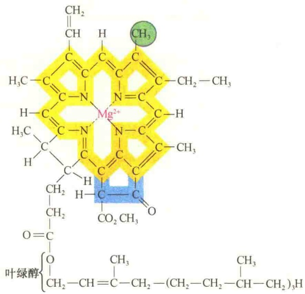

图 8-9 叶绿素 a 的结构（引自 Lodish et al., 2016）。

除了叶绿素之外，类囊体还含有其他一些相关色素，帮助叶绿素提高对光吸收的效率，这类色素主要是类胡萝卜素（carotenoid），也是一种含脂的分子家族，类胡萝卜素吸收紫色和蓝色光（400～500nm）。

另一类帮助叶绿素进行光吸收的色素是藻胆素（phycobilin），存在于红藻和蓝细菌中。这些色素分子之所以能够帮助叶绿素提高光的吸收，主要是吸收了一些叶绿素不能吸收的杂色光，起了过滤作用（图8-10）。同时，这些色素吸收的光能也能转移给叶绿素，与叶绿素分子吸收的光能一起进入光合作用途径。

## 8.4.2.2 光合单位与反应中心

1932年加州理工学院的Robert Emerson和

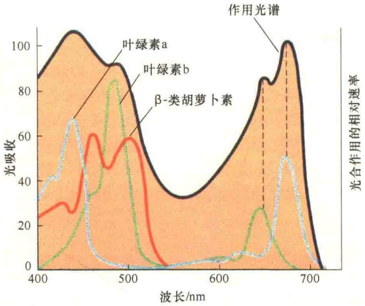

图 8-10 光合作用的作用光谱（引自 Lodish et al., 2016）。图中的作用光谱是指不同波长光对植物叶光合作用的影响；吸收光谱是三种色素联合起来的吸收光谱，三种不同色素的吸收光谱用不同颜色的线表示。

William Arnold 通过绿藻悬浮物实验发现，绿藻在光合作用中每固定 1 个  $CO_{2}$  分子（或者说每释放 1 分子  $O_{2}$ ）需要 2500 个叶绿素分子，也就是说 2500 个分子的叶绿素吸收的光能才能用于 1 分子  $CO_{2}$  的固定，但是这一发现并没有说明固定 1 分子的  $CO_{2}$  到底需要吸收多少光子。后来发现每固定 1 分子  $CO_{2}$，需要消耗 8 个光子，由此推算固定 1 个光子大约需要 300 个分子的叶绿素。

后来的研究揭示，几百个叶绿素分子集合在一起组成一个光合单位（photosynthetic unit），在光合单位中，只有一个成员——反应中心叶绿素（reaction-center chlorophyll）将电子转移到电子受体。尽管大多数色素分子不能将光能转变为化学能，但是它们要参与光能的吸收，这些色素分子组成一个捕光天线（light-harvesting antenna），它们捕获光子并快速地将能量（称为激发能 excitation energy）传递给反应中心的色素分子。

激发能从一个色素分子向另一个色素分子传递，对分子间的距离非常敏感。天线中的叶绿素分子间距离非常近（不到1.5nm），它们都是通过非共价键与整合膜蛋白保持合适的方向，这些膜肽能够保持叶绿素分子定向排列以有利于能量传递。能量在天线色素分子间的传递有一个“规则”:能量只能向需要相等或较少能量的分子传递，换句话说，能量只能向吸收相同或较长波长（低能）光的色素分子传递，这样保证能量被最大限度地传递到反应中心的叶绿素分子，使其比任何相邻的叶绿素分子吸收的长波长的光都多。据估计，光能从被吸收的位点开始传递到光反应中心色素约耗时 $200 \times 10^{-12}s$ ，由光吸收激发的电子一旦到达反应中心，电子就能被传递给受体（图8-11）。

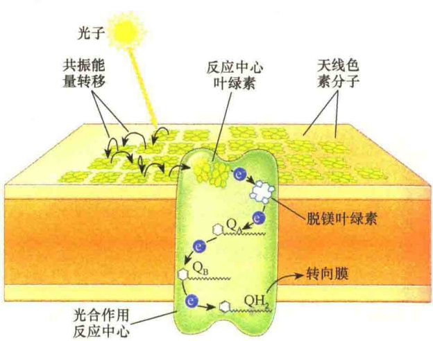

图 8-11 光合中心的组织结构及激发能转移（引自 Cooper and Hausman，2013）。光合中心（photocenter）由几百个天线色素分子构成，它们吸收光子并将光能转移给中心叶绿素。反应中心叶绿素将激发的电子传递给电子传递链中的受体——脱镁叶绿素（pheophytin），从而将高能电子转运进入电子传递链。

## 8.4.2.3 光系统Ⅱ与光系统Ⅰ

白质组成的复合物——光合系统（photosystem）中。有两种类型的光系统，分别称之为光系统Ⅱ和光系统Ⅰ。

光合作用中的光吸收反应是发生在由色素-蛋

光系统Ⅱ复合物（photosystem II complex，PS II complex）是类囊体膜的一种光合作用单位，它含有捕光复合物和光反应中心。捕光复合物Ⅱ（light-harvesting complex Ⅱ，LHC Ⅱ）又称捕光叶绿素-蛋白质复合物，或天线复合物（antenna complex），含有类囊体膜的叶绿素总量的40%～60%，该复合物的作用是吸收光能并将光能传递到反应中心。

PS II 的光反应中心由一对叶绿素组成的二聚体构成，习惯称之为  $P_{680}$ ，其中，P 代表色素（pigment），680 表示该二聚体吸收的最强光的波长。为了便于比较，将光系统 I 的光反应中心称为  $P_{700}$ ，其中 700 是光系统 I 吸收的最强光的波长。

当阳光撞击到类囊体的膜时，能量被PSⅡ、PSⅠ的中心色素所吸收，并传递到各自的反应中心，反应中心快速将吸收的光能传递到外侧轨道，进而传递给初级电子受体（primary electron acceptor）。失去电子后，PSⅡ、PSⅠ中心色素则携带正电荷，分别用 $P_{680^{+}}$ 、 $P_{700^{+}}$ 表示，此时的电子受体则携带负电荷。光系统中带电状态的分离是光反应的基本特性，即光能转变成化学能，这样，带正电荷的反应中心可吸引电子，而带负电荷的受体则作为电子供体，其结果是，每一个光系统中的电性分离，建立了电子沿特殊载体流动的级梯（图8-12）。

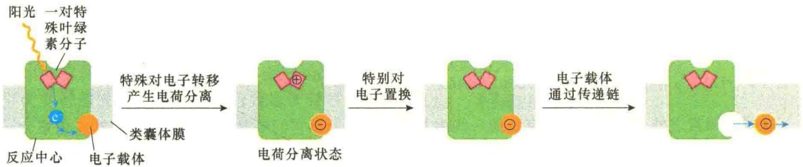

图 8-12 光合反应中心电荷分离简要过程（引自 Alberts et al., 2015）。在反应中心，被捕获的光能用于产生高能电子，这些电子保持在膜的可移动的电子载体中，然后将光能逐渐转变成化学能。当一个光子被反应中心的一对特别的叶绿素分子吸收并将一个电子敲出叶绿素时，即开始了将光能转变成化学能的过程。电子被结合在另一侧膜表面的移动电子载体（橙色）吸收。反应中心内嵌入了一组中间载体，为来自特殊叶绿素对的电子提供传递路径（未显示）。带正电的叶绿素离子与带负电的电子载体之间的物理距离可维持电荷分离状态的短暂稳定，在此期间，叶绿素离子作为强氧化剂，从合适的化合物（如水）中摄取一个电子，然后电子载体扩散离开反应中心，成为一个强大的电子供体，将其电子转移到电子传递链上。

## 8.4.3 电子传递

电子传递，又称电子转移（electron transfer）或电子流（electron flow），是光反应的第二步。在光吸收过程中，光反应中心的叶绿素分子被激发释放了一个电子成为高能电子，这一过程仅仅完成了光能向电能的转换，接下来的问题就是如何使高能电子的自由能储备起来，同时使光反应中心的叶绿素分子获得低能电子以补充失去的电子，恢复静

息状态。这一过程涉及水的光解和电子传递，还涉及两对偶联氧化还原: $O_{2}-H_{2}O$ 、 $NADP^{+}-NADPH$ 。其中， $H_{2}O$ 作为原初电子供体， $NADP^{+}$ 作为最终电子受体；水被光解释放电子的同时还释放 $O_{2}$ 和 $H^{+}$ ，因此伴随电子传递的同时也会建立 $H^{+}$ 质子电化学梯度，以供ATP的合成。

## 8.4.3.1 光合电子传递链

在光合作用中电子传递中有三个源头与流向:从 $\mathrm{H}_2\mathrm{O}$ 流向PSⅡ，从PSⅡ流向PSI，从PSI流向 $\mathrm{NADP^{+}}$ 。不仅如此，在电子传递中还需要其他几种电子载体，才能组成一条顺畅的电子传递链（图8-13）。

图8-13 光合作用中的Z形电子传递链及氧还电势的变化（引自Alberts et al., 2015）。该传递链中除了水、PSⅡ、PSⅠ外，还有质体醌、质体蓝素、细胞色素 $b_{0}/f$ 、Fd等。由于各电子载体在电子传递链中的氧还电势的不同，呈现Z字形。PSⅡ将来自水的电子传递给PSⅠ，而PSⅠ则通过铁氧还蛋白-NADP⁺还原酶（ferredoxin-NADP⁺reductase）传递给NADP⁺。净电子流是两个光系统协同将来自水的电子流向NADP⁺，同时产生了NADPH及电化学质子梯度。形成的质子梯度可用于ATP的合成。

光合电子传递链（photosynthetic electron transfer chain）是由一系列的电子载体构成的，与线粒体呼吸链中电子载体的作用基本相似。但二者不同的是，线粒体呼吸链中的载体位于内膜，将来自NADH和 $FADH_{2}$ 的电子传递给氧，释放出的能量用于ATP的合成；而光合作用的电子载体位于类囊体膜上，将来自 $H_{2}O$ 的电子传递给 $NADP^{+}$，并且这是一个吸热的过程而不是放热的过程。

与线粒体的呼吸链一样，光合作用的电子传递链中的电子载体也是细胞色素、铁氧还蛋白、黄素蛋白和醌等。

1）细胞色素 植物细胞有几个特殊的细胞色素参与光合作用的电子传递。其中主要的两种是细胞色素 $b_{6}$ 和细胞色素f，它们的吸收波长都已非常清楚，一个为563nm，另一个为553nm。细胞色素f属于细胞色素c的一种，中等电位型，细胞色素 $b_{6}$ 是低等电位型。

2）质体蓝素（plastocyanin，PC）一种含铜的蛋白质，氧化型呈蓝色，吸收光谱为600nm。在还原状态时蓝色消失，传递电子时靠 $Cu^{2+}\rightarrow Cu^{+}$ 的状

态循环。

3）质体醌（plastoquinone，PQ或Q）质子和电子载体，与线粒体的电子传递链的泛醌一样，也是通过醌和醌醇循环来传递电子和氢质子，但质体醌与泛醌的结构是不同的（图8-14）。

与线粒体的电子传递链的电子载体需组成复合物一样，光合作用中的电子载体也要组成复合物。在光合作用的电子传递链上一般有3种复合物，其中两种是光系统（光系统Ⅱ和光系统Ⅰ）的组成部分，另一种是细胞色素 $b_{6}/f$ 复合物（cytochrome $b_{6}/f$ complex，Cyt $b_{6}/f$）。

20 世纪 50 年代后期从植物叶中分离了一种铁硫蛋白，发现将这种铁硫蛋白加入到分离的叶绿体中能够增强 NADP $^{+}$ 的还原能力。后来将这种蛋白质称为铁氧还蛋白（ferredoxin），含有一个氧化还原的位点，该位点有两个与硫结合的铁原子。如同其他的铁硫蛋白，铁氧还蛋白也是通过 Fe $^{3+}$ → Fe $^{2+}$ 的循环传递电子；在氧化状态，对波长在 420nm 和 463nm 处的光有较强的吸收作用。

Cyt  $b_{6}/f$  复合物是类囊体膜上可分离出来的复合物，它由 4 个多肽组成，即

细胞色素f、细胞色素 $b_{6}$ 、铁硫蛋白和一个分子质量为17kDa的多肽，前3个都是电子载体。细胞色素f属c型细胞色素，与线粒体的细胞色素 $c_{1}$ 关系密切，该复合物位于基质面，功能是参与电子传递。

## 8.4.3.2 水的裂解:PSⅡ中氧的产生与电子流

PSⅡ中经光化学氧化的反应中心叶绿素 $P_{680}^{+}$ ，是极强的生物氧化剂，它的氧还电位为+1.1V，足以将水裂解（水的氧还电位是+0.82V），产生 $O_{2}$ 和 $H^{+}$ 。

图 8-14 质体醌的氧化和还原状态（引自 Karp，2010）。

水的氧化为 PSⅡ中  $P_{680^{+}}$  的还原提供了电子。水的氧化是由 3 个复合物协同催化完成的，这 3 种复合物分别位于类囊体的膜及类囊体的腔面。放氧复合物（oxygen-evolving complex）含有 4 个锰离子，这 4 个锰离子通过氧原子桥连接在一起，并结合有一个  $Ca^{2+}$ 、一个  $Cl^{-}$ （图 8-15）。用浓盐溶液处理可将这 4 个锰离子连同另外 3 个外周蛋白质除去，并使之丧失氧释放的能力，但不影响光吸收及电子传递的起始。

在水光解反应（water splitting reaction）中，每裂解2分子的 $H_{2}O$ ，释放4个电子、1分子 $O_{2}$ 和4个 $H^{+}$ : $2H_{2}O\longrightarrow O_{2}+4H^{+}+4e^{-}$ ，这一反应又称为水的光解作用（photolysis）。

值得注意的是, 2 分子水的光解释放 1 分子氧, 同时释放出了 4 个电子, 而 $\mathrm{P}_{680^{+}}$ 一次只能接受一个电子, 如何解释这种现象?

水的光解是由含锰的蛋白质复合物介导的。该复合物中4个锰（Mn）与PSⅡ的D1蛋白紧密地靠在一起。已知锰可以多种氧化状态（+2～+5价）存在。光谱研究表明，绑定在氧释放复合物中的Mn以5种不同的氧化状态进行循环: $S_{0}\sim S_{4}$ 。在一次S循环中，有2个 $H_{2}O$ 分子被裂解，产生4个质子，释放1个 $O_{2}$ （图8-16）。

从水裂解中释放的4个电子经由Mn离子传递，每次传递一个，连续4次传递给相邻的酪氨酸侧链，进而传递给反应中心的 $P_{680^{+}}$ ，从而补充了因光吸收而失去的电子，使反应中心的叶绿素还原到  $P_{680}$ 。从  $H_{2}O$  中释放的  $H^{+}$ 则留在类囊体的腔中。

图 8-15 PSⅡ中的电子流与氧的产生（引自 Lodish et al., 2013）。PSⅡ反应中心含有两个整合蛋白质，分别称为 D1 和 D2，以及一对特别的叶绿素（ $P_{680}$ ）。在该反应中心的类囊体腔面膜上结合着一些电子载体，形成放氧复合物。在放氧复合物中另有 3 个外在蛋白质（相对分子质量为 33kDa、23kDa 和 17kDa）、4 个锰离子、1 个钙离子、1 个氯离子，这些离子参与  $H_{2}O$  的裂解、维持环境中  $O_{2}$  的高比值。D1 多肽中的酪氨酸 161（Y161）可促进 Mn 产生的电子去氧化反应中心的叶绿素（ $P_{680^{+}}$ ），使之还原到基态（ $P_{680^{*}}$ ）。

图 8-16 Mn 的电子传递与水的光解（引自 Karp，2010）。S 表示 Mn 基团的正电荷数。

## 8.4.3.3 电子从PSⅡ向PSI传递

上面讨论了电子从水分子传递到 PSⅡ中的  $PQ_{B}$ ，那么电子是如何从 PSⅡ传递到 PSⅠ的呢？

$\mathrm{PQ_B}$ 类囊体基质中获得2个 $\mathrm{H^{+}}$ ，被还原成$\mathrm{PQH_2}$ ， $\mathrm{PQH_2}$ 是一种脂溶性的分子，并且是可动的分子，在脂双层中通过扩散进行移动。它的结构和功能与线粒体呼吸链中的辅酶Q相似。在光合作用中， $\mathrm{PQH_2}$ 中的2个电子能够传递给Cyt $b_{6} / f$ 复合物，同时将2个氢质子释放到类囊体的腔，由于 $\mathrm{PQH_2}$ 在Q循环中，传递2个电子，同时要转运 $4\mathrm{H^{+}}$ ，除了释放自身携带的 $2\mathrm{H^{+}}$ 外，还将类囊体基质中的  $2H^{+}$ 转移到类囊体的腔，所以这一过程实际上是将  $H^{+}$ 进行了跨膜转运，有利于质子梯度的建立。Cyt  $b_{6}/f$  复合物接受电子后，经  $b_{6} \rightarrow FeS \rightarrow f$ ，再传递给另一个可动的水溶性电子载体——质体蓝素（PC），这是一种含铜的蛋白质，位于类囊体膜的腔面，然后再传递给 PS I 反应中心色素  $P_{700^{+}}$ （图 8-17）。

图 8-17 电子在 PSⅡ与 PSⅠ之间的传递（引自 Karp, 2010）。

## 8.4.4 线性及循环式电子传递途径

光反应的最终目的是要为暗反应中碳固定提供足够的 NADPH 和 ATP。叶绿素通过光吸收捕获了大量的光能，并逐步转变成化学能，如何将这些化学能转变成 NADPH 和 ATP？

由于在光合作用的电子传递链中有两个光系统，它们都能吸收光能进行光反应，所以会形成两个高峰，通常用 Z 字形图来表示电子传递过程。根据电子的最后去向，分为两种方式:线性电子传递途径（linear electron transfer pathway）和循环式电子传递途径（cyclic electron transfer pathway）。

## 8.4.4.1 线性电子传递途径

线性电子传递又称为非循环式电子传递（non-cyclic electron transfer pathway）。在这种方式中，需要两个光反应系统共同参与，电子从水开始，经PSⅡ、质体醌（PQ）、细胞色素 $b_{6}/f$ 、质体蓝素（PC）、PSⅠ、铁氧还蛋白（Fd），最后传递给NADP $^{+}$ （图8-18）。

可以将线性电子流分为4个阶段:①电子从PSⅡ的 $P_{680}$ 传递给PQ，生成 $PQH_{2}$ ；②水光解释放的电子经Mn传递给PSⅡ的 $P_{680^{+}}$ ；③电子从 $PQH_{2}$ 经细胞色素 $b_{6}/f$ 传递给PC，即电子从PSⅡ传递给PSI；④电子经 $P_{700^{+}}$ 传递给Fd，最后在铁氧还蛋

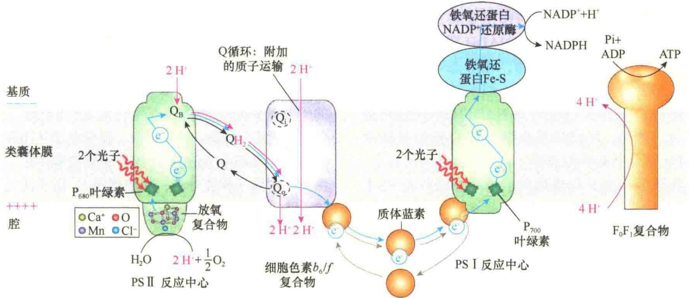

图 8-18 光合作用中线性电子传递途径（引自 Lodish et al., 2013）。在非循环式电子传递途径中，电子的最终受体是 NADP $^{+}$ ，电子供体来自光解的水。

白-NADP $^{+}$ 还原酶的作用下，电子被 NADP $^{+}$ 接收。

该途径的主要特点是需要 PSⅡ、PSⅠ 共同作用，产物除了 NADH 外，还有  $O_{2}$ ，同时在类囊体腔中建立  $H^{+}$ 质子动势，可用于 ATP 的合成。

## 8.4.4.2 循环式电子传递途径

在线性电子传递途径中，被传递的电子经过两个光系统接力合作，最终被NADP $^{+}$ 接收，并将

NADP $^{+}$ 还原成 NADPH。在循环式电子传递途径中，PS I 反应中心吸收光子后产生的高能电子传递给 Fd 之后，不是进一步传递给 NADP $^{+}$ ，而是传递给细胞色素 b $_{6}$ /f 复合物，再经 PC 又回到 PS I，形成了闭路循环（图 8-19）。

在高等植物中，有两种形式的循环式电子传递途径控制着 ATP : NADPH 的比值。主要途径是 PGR5-PGRL1 依赖性途径（PGR5-PGRL1- dependent pathway），该途径保证了光合作用效率，并防范胁迫。次要途径是NADH脱氢酶样复合物依赖性途径（NADH-dehydrogenase-like complex-dependent pathway），可能的作用是胁迫应答，并作为 $\mathrm{H}_2\mathrm{O}_2$ 介导的调节靶标。NADH脱氢酶样复合物是非常大的多蛋白复合物，在形态与组成上都与线粒体复合物I非常相似。线粒体复合物I的作用是在Q还原成 $\mathrm{QH_2}$ 时对NADPH或NADH进行氧化，然而，NADH脱氢酶样复合物似乎缺少NADPH氧化所必需的亚基。

图 8-19 光合作用中循环式电子传递途径（引自 Lodish et al., 2016）。在循环式电子传递中，光能被 PS I 用于循环式转运电子从而产生质子动力与 ATP，而不是用于氧化水及产生 NADPH。高能电子经由 PS I 的铁氧还蛋白或是传递给 PGR5-PGRL1 异源二聚体，或是传递给 NADH-脱氢酶样复合物，这两种方式最终都是将质体 Q 还原成  $QH_{2}$ 。 $QH_{2}$  又将电子传递给细胞色素  $b_{6}/f$ ，再传递给质体蓝素，最后又回到 PS I。

在循环式电子传递期间，通过光吸收在PSI中产生的高能电子及光电运输（photoelectric transport）经由PSI的铁氧还蛋白亚基或是被传递给PGR5-PGRL1异源二聚体，或是被传递给NADH-脱氢酶样复合物。有证据显示，这两种电子受体是各自独立的，分别通过LHC亚基的介导与PSI结合形成超复合物。这两种电子受体都将Q还原成 $QH_{2}$ ，然后经由Q循环将质子与电子传递给细胞色素 $b_{6}/f$ 复合物。在细胞色素 $b_{6}/f$ 复合物（也可能在NADH-脱氢酶样复合物）的作用下，质子穿过类囊体的膜进入类囊体的腔。最后，质体蓝素将电子从细胞色素 $b_{6}/f$ 复合物传回到PSI完成循环。在循环式电子流中产生的质子动力在 $F_{0}F_{1}$ 复合物（ATP合酶）的作用下，驱动ATP的合成，因此提高了ATP:NADPH的值。

循环式光合磷酸化的产物仅为 ATP，无 NADPH和分子氧。循环式光合磷酸化占光合磷酸化的10%～20%，特别是NADP⁺不足时，所占的比例增大，因此它对光反应中产生的ATP和NADPH的比例具有调节作用。由于NADP⁺接收电子被还原时，需要同时从叶绿体基质中摄取一个H⁺，如果基质中NADP⁺浓度不高，或NADPH的浓度过高，说明NADPH与ATP的比例失调，需要加以调整。调整的机制是将电子回传给细胞色素 $b_{6}/f$ 复合物。细胞色素 $b_{6}/f$ 复合物是一种质子泵，得到电子从而有足够的自由能将基质中的H⁺跨膜传递到类囊体腔，使类囊体腔中质子梯度升高；高浓度的H⁺质子通过 $CF_{0}-CF_{1}$ ATP合酶的H⁺通道返回叶绿体基质，从而促进了ATP的合成，其结果是，调整了光反应中ATP和NADPH的比值，有利于 $CO_{2}$ 的固定。因此循环式电子流对光合作用具有重要的调节作用，主要是调节光反应中合成的ATP与还原的NADPH的比值，因为在暗反应中，固定 $CO_{2}$ 时既需要ATP也需要NADPH，二者间应有一个合适的比例，保持平衡。

实际上，植物通过循环式电子流对不良环境进行胁迫调控，如在干旱、高光、低  $CO_{2}$  及 NADPH 浓度过高（或  $NADP^{+}$ 浓度不足）等环境下，植物需要产生更多的 ATP，而不是 NADPH，为此，主要通过 PS I 去建立  $H^{+}$ 质子动势合成 ATP。

由此看来，PSⅡ、PSⅠ有明确的分工:PSⅡ主要是为光合作用的暗反应提供足够的NADPH与ATP；而PSⅠ有两方面的作用，一是协助PSⅡ为

暗反应提供足够的化学能，二是吸收有限的光能，用于建立  $H^{+}$ 质子梯度，合成为细胞代谢所需的 ATP，此外还有调节 ATP 与 NADPH 的平衡作用。

## 8.4.5 光合磷酸化

从总体上讲，光合作用是一种转变能量并贮存能量的过程，即将光能转变为化学能并贮备起来的过程。首先要吸收光子，利用光能将水分子中处于非常低的自由能的电子驱动转移到自由能非常高的NADPH中。在光合作用的光反应中，除了将一部分光能转移到NADPH中暂时贮存外，还要利用在电子传递中建立起来的 $H^{+}$ 质子动势合成ATP，将光合作用与ADP的磷酸化偶联起来，即光合磷酸化（photophosphorylation）。它同线粒体的氧化磷酸化的主要区别是:氧化磷酸化是由高能食物分子（如糖、脂肪）氧化驱动的，而光合磷酸化是由光子驱动的。光合磷酸化同样需要建立电化学质子动势、ATP合酶，其机制也可用化学渗透偶联假说来解释。

## 8.4.5.1 电子传递与 $\mathrm{H}^{+}$ 质子梯度的建立

线粒体内膜在进行电子传递的同时建立了 $H^{+}$ 质子梯度。在叶绿体进行的光反应中，类囊体的膜在进行电子传递的同时，会在类囊体膜两侧建立 $H^{+}$ 质子梯度。类囊体膜两侧 $H^{+}$ 质子梯度的建立主要有三种因素。①水的光解。在释放4个电子、1分子 $O_{2}$ 的同时，释放4个 $H^{+}$ 。水的光解是在类囊体的腔中进行的，所以水的光解导致类囊体腔中 $H^{+}$ 浓度的增加。②细胞色素 $b_{6}/f$ 复合物具有质子泵的作用。当 $P_{680}$ 将电子传递给PQ时，从基质中摄取了2个 $H^{+}$，形成 $PQH_{2}$，传递4个电子，则要从基质中摄取4个 $H^{+}$ 。当 $PQH_{2}$ 将电子传递给细胞色素 $b_{6}/f$ 复合物时，2分子 $PQH_{2}$ 的4个 $H^{+}$ 全被泵入类囊体的腔，叶绿体腔中 $H^{+}$ 浓度降低的同时，类囊体腔中 $H^{+}$ 浓度进一步提高。③当电子最后传递给 $NADP^{+}$ 时，需从基质中摄取2个 $H^{+}$ 将 $NADP^{+}$ 还原成NADPH，这样又降低了基质中的 $H^{+}$ 浓度，其结果使类囊体膜两侧建立了 $H^{+}$ 质子梯度（proton gradient）。

## 8.4.5.2 $\mathrm{CF_0 - CF_1}$ ATP合酶

叶绿体中合成ATP的酶称为ATP合酶（ATP synthase）或 $\mathrm{CF_0 - CF_1}$ ATP合酶。C表示叶绿体（chloroplast），以示与线粒体ATP合酶的区别。$\mathrm{CF_0 - }$ $\mathrm{CF_1}$ ATP合酶是一种大的（ $400\mathrm{kDa}$ ）酶复合体，由$\mathrm{CF_0}$ 和 $\mathrm{CF_1}$ 两部分组成（图8-20）。 $\mathrm{CF_1}$ 是一个大的多亚基复合体，它在膜的基质侧，与整合在膜中的$\mathrm{CF}_{0}$ 相连。 $\mathrm{CF}_{1}$ 由5种不同肽链组成，包括3个 $\alpha$ 、3个 $\beta$ 、1个 $\gamma$ 、1个 $\delta$ 、1个 $\varepsilon$ 。 $\mathrm{CF}_{0}$ 可能由4种不同肽链组成，包括1个a、1个b、1个 $b^{\prime}$ 、14个c。在复合体中 $\mathrm{CF}_{0}$ 形成了供质子通过的一个跨膜通道，由旋转的c肽将内腔中的质子运输到基质，$\mathrm{CF}_{1}$ 的功能是合成ATP，催化位点主要位于 $\beta$ 链，其他一些链可能有调节功能。

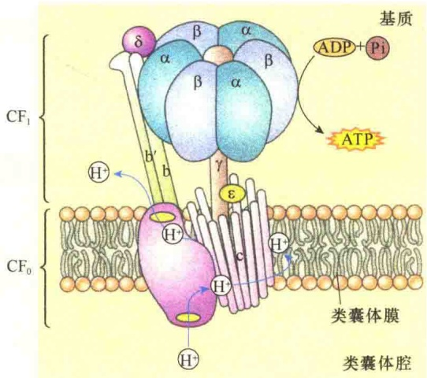

图 8-20 叶绿体 ${\mathrm{{CF}}}_{0} - {\mathrm{{CF}}}_{1}\mathrm{{ATP}}$ 合酶结构示意图 (引自 Taiz and Zeiger, 2015)。

## 8.4.5.3 质子梯度偶联电子传递与光合磷酸化

在光合作用的光反应中，伴随电子传递在类囊体膜两侧建立了  $H^{+}$ 质子梯度，形成了电化学动势，同时在类囊体膜中有 ATP 合成装置，这样，电化学动势就能将自由能用于合成 ATP（图 8-21）。

光合磷酸化的机制与线粒体的氧化磷酸化相似，同样可用化学渗透学说来说明。在电子传递和ATP合成之间，起偶联作用的是膜内外间存在的质子电化学动势。类囊体膜进行的光合电子传递与光合磷酸化需要4个穿膜复合物参加:PSⅡ、细胞色素 $b_{6}/f$ 复合物、PSⅠ和ATP合酶，由3个可动的分子（质子）——质体醌、质体蓝素和 $H^{+}$ 质子将这4个复合物在功能上连成一体，即完成电子传递、建立质子梯度、合成ATP和NADPH。

不过，PSⅡ、细胞色素 $b_{6}/f$ 复合物、PSⅠ和ATP合酶在类囊体上定位是不对称的，即PSⅡ、细胞色素 $b_{6}/f$ 复合物、PSⅠ这三个复合物朝向类囊体腔，从而将 $H^{+}$ 从叶绿体基质运向类囊体的腔；而ATP合酶的定位是朝向叶绿体基质，从而将 $H^{+}$ 从类囊体腔运向叶绿体基质，在此过程中，将势能用于ATP的合成。

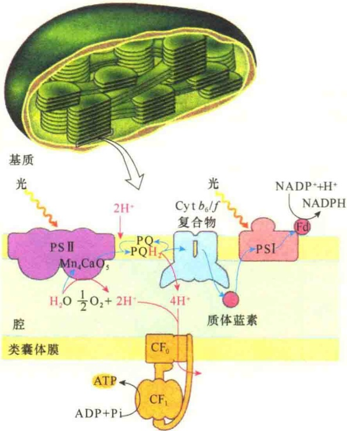

图 8-21 光合磷酸化与质子、电子回路（引自 Nelson and Junge, 2015）。

## 8.4.6 暗反应

光合作用的第二阶段是进行  $CO_{2}$  的固定，叶绿体利用光反应产生的 NADPH 和 ATP 的化学能将  $CO_{2}$  还原合成糖。由于这一过程不需要光，故称为暗反应（dark reaction），它在叶绿体基质中进行。

## 8.4.6.1 卡尔文循环

20 世纪 50 年代，美国加州大学伯克利分校的卡尔文（Calvin）和他的同事们一起研究  $CO_{2}$  是如何被固定，又是如何结合到有机分子中的，使用的是  ${}^{14}C$  示踪和双向纸层析技术，研究的材料开始是植物叶片，后来用小球藻。

将小球藻培养在含有未标记  $CO_{2}$  的密闭容器中，然后将标记的  $CO_{2}$  注入培养基，培养适当时间后，将培养的藻浸入热的乙醇中。这种处理有3种作用:杀死细胞、终止酶的作用、提取溶解的分子。然后将提取物点在层析纸上进行双向纸层析，最后通过放射自显影分析放射性斑点并与已知的化学成分进行比较。通过反复多次实验研究，查清了  $CO_{2}$  被固定和糖合成的途径，即卡尔文循环（Calvin cycle）。

在卡尔文的实验中，发现标记的  $CO_{2}$  转变成有机物的速度很快，几秒钟之内在层析纸上就有放射性的斑点。经测定，斑点中的化学成分是磷酸甘油酸（phosphoglycerate，PGA），是糖酵解的中间体。卡尔文根据这一发现推测: $CO_{2}$  与一个二碳物质共价连接形成了三碳的 PGA。由于被鉴定到的第一个中间体是三碳分子， $CO_{2}$  的这种固定途径称为  $C_{3}$  途径（ $C_{3}$  pathway），将通过这种途径固定  $CO_{2}$  的植物称为  $C_{3}$  植物（ $C_{3}$  plant）。最终的研究结果发现， $CO_{2}$  固定的  $C_{3}$  途径是一个循环过程，称为  $C_{3}$  循环（ $C_{3}$  cycle），由于这一循环是卡尔文发现的，故又称卡尔文循环（图 8-22）。卡尔文循环可分为 3 个阶段:羧化、还原和 RuBP 的再生。

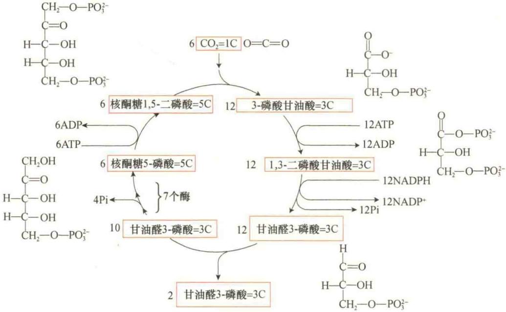

图 8-22 卡尔文循环（改自 Lodish et al., 2013） $^{4}$

1）羧化 后来的研究发现， $CO_{2}$  并不是先与一个二碳的分子共价连接，其受体是一个五碳糖，即核酮糖 -1,5-二磷酸（ribulose-1,5-bisphosphate, RuBP）。所以  $CO_{2}$  在被还原之前，在 RuBP 羧化酶（ribulose-1,5-bisphosphate carboxylase, Rubisco）的催化下，以 RuBP 作为  $CO_{2}$  受体，首先被固定形成羧基，然后裂解形成 2 分子的 3-磷酸甘油酸。

2）还原 3-磷酸甘油酸被还原成甘油醛3-磷酸。在此过程中，3-磷酸甘油酸首先在磷酸甘油酸激酶的催化下被ATP磷酸化形成1,3-二磷酸甘油酸，然后在甘油醛磷酸脱氢酶的催化下被NADPH还原成甘油醛-3-磷酸（glyceraldehyde-3-phosphate，GAP）。这是一个吸能反应，光反应中合成的ATP和NADPH主要是在这一阶段被利用。还原反应是光反应和暗反应的连接点，一旦 $CO_{2}$ 被还原成甘油醛3-磷酸，光合作用便完成了储能过程。

3）RuBP 的再生 由于 RuBP 是  $CO_{2}$  的受体，所以参与  $CO_{2}$  固定的 RuBP 必须迅速被还原，以便进行再循环。

利用已生成的甘油醛 3-磷酸经一系列的相互转变最终再生成核酮糖 5-磷酸，然后在磷酸核酮糖激酶的作用下，发生磷酸化作用生成 RuBP，再消耗一个 ATP。

综上所述，三碳循环是靠光反应形成的 ATP 及 NADPH 作为能源，推动  $CO_{2}$  的固定、还原，每循环一次只能固定一个  $CO_{2}$ ，循环 6 次，才能把 6 个  $CO_{2}$  分子同化成一个己糖分子:

$$
\begin{array}{c} 6 \mathrm{CO} _ {2} + 1 8 \mathrm{ATP} + 1 2 \mathrm{NADPH} \longrightarrow \\ \mathrm{C} _ {6} \mathrm{H} _ {1 2} \mathrm{O} _ {6} + 1 8 \mathrm{ADP} + 1 8 \mathrm{Pi} + 1 2 \mathrm{NADP} ^ {+} \end{array}
$$

实际上，通过卡尔文循环，将  $CO_{2}$  转变成葡萄糖通常需要消耗 18 分子的 ATP 和 12 分子的 NADPH。六碳糖的合成是在胞质溶胶中进行的，叶绿体通过光合作用合成的甘油醛 3-磷酸作为六碳糖合成的原料被交换转运到胞质溶胶中，通过缩合反应，2 分子的 GAP 合成 1 分子的 1,6-二磷酸果糖，然后再进一步转变成葡萄糖。

## 8.4.6.2 光呼吸

在黑暗的条件下，植物也进行线粒体呼吸（mitochondrial respiration），将底物氧化成  $CO_{2}$ ，并将  $O_{2}$  转变成  $H_{2}O$ 。植物中有另外一种呼吸过程:消耗  $O_{2}$ ，产生  $CO_{2}$ ，这一过程是由光驱动的，将这一过程称为光呼吸（photorespiration）。在光条件下，光呼吸降低了光合作用的效率，因为光呼吸氧化光合作用中产生的还原型的碳原子，同时消耗了大量的能量。

Rubisco（RuBP羧化酶）除了作为羧化酶催化将 $CO_{2}$ 添加到核酮糖-1,5-二磷酸，生成2分子3-磷酸甘油酸外，也可作为加氧酶，利用分子氧催化核酮糖-1,5-二磷酸裂解成3-磷酸甘油酸和2-磷酸乙醇酸（图8-23）。

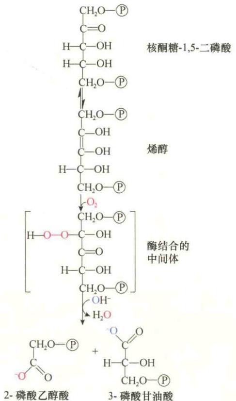

图 8-23 Rubisco 的氧化酶活性（引自 Nelson and Cox, 2013）。Rubisco 将  $O_{2}$  而不是  $CO_{2}$  添加到核酮糖 -1.5 二磷酸上，形成的中间体极不稳定，裂解成 3-磷酸甘油酸（3-phosphoglycerate）和 2-磷酸乙醇酸（2-phosphoglycolate）。

Rubisco 与氧的亲和力比与二氧化碳的亲和力低得多，所以 RuBP 的氧化反应要比羧化反应慢。可以推测，一般情况下这种氧化作用对羧化反应不构成威胁，但是当  $CO_{2}$  的浓度很低而  $O_{2}$  的浓度很高时， $O_{2}$  就要取代  $CO_{2}$  作为 Rubisco 的底物。将叶或藻类细胞置于  $CO_{2}/O_{2}$  低的气体环境中，发现 RuBP 每发生 2～3 个羧化反应就要发生一次氧化反应。

## 8.4.6.3 $\mathrm{C_4}$ 植物

某些植物在进化过程中形成了一种特别的机制克服光呼吸对光合作用的影响。由于光呼吸是在低 $CO_{2}$ 的情况下发生的，这些植物通过一种特别的代谢途径在进行光合作用时维持高 $CO_{2}$ 浓度，降低呼吸作用。具有这种性质的植物包括甘蔗、玉米和一些热带草本植物。

1965 年，Kortschak 报道，甘蔗吸收  ${}^{14}CO_{2}$  后，放射性首先出现在四碳骨架中，而不是出现在磷酸甘油酸中。进一步分析发现，这些四碳物质是  $CO_{2}$  与磷酸烯醇式丙酮酸（PEP）结合的结果，因此发现了  $CO_{2}$  固定的第二种途径，简称  $C_{4}$  途径（ $C_{4}$  pathway）。利用这种途径固定  $CO_{2}$  的植物称为  $C_{4}$  植物。不同植物的  $C_{4}$  途径有所差异，但有一个共同的功能，就是将高浓度的  $CO_{2}$  传递给卡尔文循环。

$C_{3}$  植物叶细胞的光合作用发生在叶肉细胞中。与  $C_{3}$  植物不同的是， $C_{4}$  植物的叶中有两种不同类型的光合作用细胞:叶肉细胞（mesophyll cell）和维管束鞘细胞（bundle sheath cell）。 $C_{4}$  植物中  $CO_{2}$  的固定是在叶肉细胞中进行的，被固定的  $CO_{2}$  在维管束鞘细胞中释放，这种细胞位于叶组织的内层，卡尔文循环系统位于维管束鞘细胞中（图 8-24）。

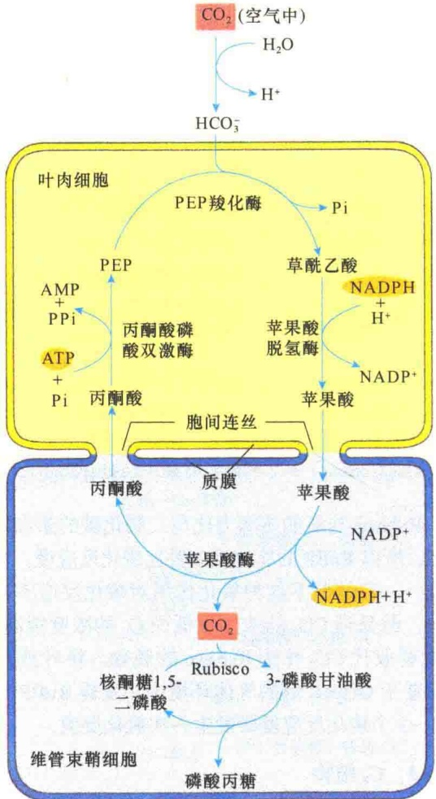

图 8-24  $C_{4}$  植物碳的碳吸收（引自 Nelson and Cox，2013）。在  $C_{4}$  植物中，卡尔文循环发生在维管束鞘细胞，位于组织的内层。 $C_{4}$  植物利用叶肉细胞固定  $CO_{2}$ ，然后在维管束鞘细胞中释放，保证了  $CO_{2}$  高浓度进入卡尔文循环。

在  $C_{4}$  植物中， $CO_{2}$  的固定反应是在叶肉细胞的胞质溶胶中进行的，在磷酸烯醇式丙酮酸羧化酶的催化下将  $CO_{2}$  连接到磷酸烯醇式丙酮酸（PEP）上，形成四碳酸——草酰乙酸（oxaloacetic acid）。草酰乙酸被转变成其他的四碳酸（苹果酸和天冬氨酸）后运输到维管束鞘细胞，在维管束鞘细胞中被降解成  $CO_{2}$  和丙酮酸， $CO_{2}$  在维管束鞘细胞中进入卡尔文循环。由于 PEP 羧化酶的活性很高，所以转运到叶肉细胞中的  $CO_{2}$  浓度很高，大约是空气中的 10 倍。这样，即使在恶劣的环境中，也可保证高  $CO_{2}$  浓度，降低光呼吸作用对光合作用的影响。

## 8.4.6.4 CAM植物

在  $C_{4}$  植物中，由 PEP 羧化酶在一种类型的细胞中固定  $CO_{2}$ ，然后在另一种类型的细胞中将固定的  $CO_{2}$  释放出来供卡尔文循环时再固定。某些生长在干热环境中的植物，用直接的方式提高  $CO_{2}$  固定效率，而不需要两种不同类型的细胞参与。例如，肉质植物（succulent）含有厚厚的肉叶，主要是由叶肉细胞组成的，其对  $CO_{2}$  的固定方式很特别，并最早发现于景天科（Crassulaceae）植物，所以将  $CO_{2}$  的这种代谢类型称为景天科酸代谢（crassulacean acid metabolism，CAM）。

同其他植物一样，CAM 植物的叶中也有许多气孔，能够打开和关闭以控制叶中废气和空气的交换。当天气炎热和干燥时，CAM 植物遇到在白天如何获得足够  $CO_{2}$  的问题:如果打开气孔吸收  $CO_{2}$ ，就会损失过多的水分到炎热的空气中。为了解决这一问题，CAM 植物主要是在夜间打开气孔，因为夜间空气凉爽、湿度高。

CAM 植物也是通过 PEP 羧化酶固定  $CO_{2}$ ，固定反应发生在胞质溶胶中，产生大量的四碳酸——苹果酸。夜间形成的苹果酸暂时贮存在叶肉细胞的中央液泡中，到了白天，气孔关闭，PEP 羧化酶暂时失活，苹果酸从液泡扩散到胞质溶胶中，然后被裂解释放  $CO_{2}$ ，进入卡尔文循环。到了夜间，气孔又打开，PEP 羧化酶被激活，开始新的循环。CAM 植物与  $C_{4}$  植物相似之处在于  $CO_{2}$  需要固定两次，不同之处是 CAM 植物不需要两种类型的细胞协同工作。

## 8.4.7 过氧化物酶体在光合作用中的作用

过氧化物酶体在植物细胞中有两个特别重要的作用。

第一，种子中过氧化物酶体负责将贮存的脂肪酸转变成碳水化合物，这不仅为种子的生长提供能量，而且为植物种子发芽生长提供初始物质。这种作用是通过一系列称之为乙醛酸循环（glyoxylate cycle）的反应过程进行的（图8-25）。乙醛酸循环是一种改良的三羧酸循环。在乙醛酸循环中，过氧化物酶体又被称为乙醛酸循环体（glyoxysome）。

图 8-25 乙醛酸循环（引自 Cooper and Hausman，2016）。植物可将脂肪酸经由乙醛酸循环合成糖，是一种改良的三羧酸循环。在乙醛酸循环中，由脂肪酸产生的乙酰 CoA 与草酰乙酸（oxaloacetic acid）结合，形成柠檬酸（citric acid），柠檬酸进一步转变成异柠檬酸（isocitrate），此时的异柠檬酸不需像三羧酸循环那样经过两次脱羧形成琥珀酸（succinate），而是直接转变成琥珀酸与乙醛酸。乙醛酸与另 1 分子乙酰 CoA 形成苹果酸，再经草酰乙酸合成糖。

第二，植物叶片中的过氧化物酶体参与光呼吸，为光合作用提供副产品。我们知道，植物在光合作用的卡尔文循环中，利用光能将  $CO_{2}$  固定并转化成碳水化合物。卡尔文循环的第一步是将  $CO_{2}$  加到一个五碳糖上，生成 2 分子三碳的 3-磷酸甘油酸。然而，参与该反应的酶（Rubisco）有时将  $O_{2}$  而不是  $CO_{2}$  添加上去，催化核酮糖 1,5-二磷酸裂解成 3-磷酸甘油酸和 2-磷酸乙醇酸。这是一种副反应，产生的磷酸乙醇酸不是有用的代谢物。因此，磷酸乙醇酸进一步被转变成乙醇酸，然后被转运到过氧化物酶体，在过氧化物酶体中被氧化，生成甘氨酸。甘氨酸被转移到线粒体，在线粒体中 2 分子的甘氨酸缩合成 1 分子的丝氨酸，同时失去 1 分子  $CO_{2}$  和 1 分子的  $NH_{3}$ 。生成的丝氨酸又回到过氧化物酶体，被转变成甘油酸（glycerate）。最后甘油酸被转运到叶绿体，重新进入卡尔文循环（图 8-26）。上述过程表明，过氧化物酶体对于降低光呼吸带来的危害、提高碳的利用具有重要的作用。

图 8-26 过氧化物酶体在光呼吸中的作用（引自 Nelson and Cox，2013）。在光合作用期间， $CO_{2}$  经卡尔文循环被转变成糖，反应的第一步是将  $CO_{2}$  添加到五碳糖——核酮糖 1,5-二磷酸上。但是，起催化反应的酶有时会错误地将  $O_{2}$  分子而不是  $CO_{2}$  添加到核酮糖 1,5-二磷酸上，这样产生的产物是二碳的磷酸乙醇酸（phosphoglycolate），磷酸乙醇酸可转变成乙醇酸（glycolate），并被转移到过氧化物酶体，在过氧化物酶体中被氧化转变成甘氨酸。随后，甘氨酸被转移到线粒体，并在线粒体中转变成丝氨酸。丝氨酸又重新回到过氧化物酶体，并转变成甘油酸（glycerate）。

## 8.5 叶绿体的遗传和起源

叶绿体与线粒体一样，也是半自主性细胞器(semiautonomous orga-nelle)。叶绿体也有自己的DNA，它的生长和增殖受核基因组及自身的基因组两套遗传系统的控制。

## 8.5.1 叶绿体的遗传

与线粒体一样，叶绿体含有自身的遗传系统，如同线粒体基因组，叶绿体基因组也是环状的，并且每个叶绿体中有多个拷贝，不同的是，叶绿体基因组较大，而且更复杂。叶绿体基因组大小范围为120～160kb，约含150个基因。

已经完成了几种植物叶绿体基因组的测序，也鉴定了细胞器的一些基因。叶绿体基因组中含有编码涉及叶绿体基因表达的 RNA 和蛋白质的基因，并编码一些在光合作用中起作用的功能蛋白。

虽然叶绿体具有自身的遗传物质和进行蛋白质合成的全套机构，但是组成叶绿体的各种蛋白质成分是由核 DNA 和叶绿体 DNA 分别编码的。也就是说，叶绿体的生长和增殖是由核 DNA 及叶绿体 DNA 共同控制的。

叶绿体的自主性表现在:叶绿体不仅有自己的DNA，还有自己的核糖体，同原核生物的一样都是70S，实验证明，缺少叶绿体核糖体的突变体不能合成叶绿体基因组编码的蛋白质。

虽然叶绿体有自己的DNA，但是信息量有限，只能起部分控制作用。而大部分叶绿体的蛋白质是核基因编码的，有些是叶绿体基因和核基因共同编码的。例如，RuBP羧化酶的8个大亚基是由叶绿体基因编码的，而8个小亚基是由核基因编码，在细胞质中合成后转运到叶绿体。

## 8.5.2 叶绿体的起源

关于叶绿体的起源，也与线粒体一样，有两种学说，但普遍接受内共生学说，认为叶绿体的祖先是蓝藻或光合细菌，在生物进化过程中被原始真核细胞吞噬，共生在一起进化成为今天的叶绿体（图 8-27）。

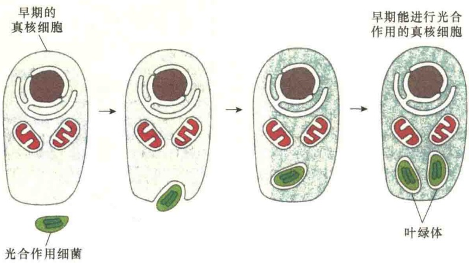

图 8-27 叶绿体的起源（引自 Alberts et al., 2015）。叶绿体的起源被认为是光合作用细菌与已经含有线粒体的早期真核生物共生而来。

## 8.6 叶绿体与线粒体的结构与功能的比较

与线粒体相比，叶绿体是由外膜、内膜和类囊体膜3种不同类型的膜将其内部分隔成3个不同的区室:膜间间隙、叶绿体基质和类囊体腔。因此，叶绿体是一种特别的膜性细胞器（图8-28）。

在功能上，线粒体是有机物氧化的场所，同时将释放出的自由能转变成可利用的化学能贮存在ATP的高能磷酸键上，这一过程是通过氧化磷酸化完成的。而叶绿体是光能的捕获者和高能有机物的制造者，光能的捕获和转化是通过光合作用完成的。二者功能虽然不同，但都是通过电子传递和建立 $H^{+}$ 质子梯度，实现能量转换的。

在质子梯度建立方面，二者有许多相似之处，也有一些差别。在叶绿体中， $H^{+}$ 是从叶绿体基质图 8-28 叶绿体与线粒体的比较（Alberts et al., 2015）。线粒体和叶绿体的膜及区室在结构组成和功能上都有所不同，如线粒体内膜除了作为线粒体界膜之外，主要功能是电子传递和合成 ATP。从结构上看，线粒体内膜向内折叠成嵴，ATP 合酶位于嵴上。而叶绿体的内膜只是稍向内折形成小管或小泡结构，且表面光滑。叶绿体内膜是脂合成的场所，是叶绿体的界膜。

泵向类囊体腔，叶绿体基质中的 pH 是 8.0，建立  $H^{+}$ 质子梯度后，类囊体腔中的 pH 下降到 5.5。在线粒体中， $H^{+}$ 是从线粒体基质泵向膜间隙。线粒体基质的 pH 是 7.9，建立  $H^{+}$ 质子梯度后，膜间隙中 pH 为 7.4（图 8-29）。氧化磷酸化和光合磷酸化除了在  $H^{+}$ 质子梯度建立方面的一些差别之外，还有其他一些不同（表 8-1）。

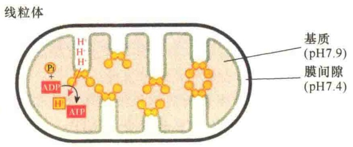

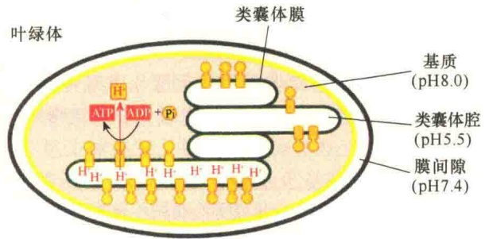

图 8-29 线粒体和叶绿体中 ATP 合酶的定向及  $H^{+}$ 的流向（引自 Alberts et al., 2015）。

表 8-1 氧化磷酸化与光合磷酸化的比较

<table><tr><td>项目</td><td>氧化磷酸化</td><td>光合磷酸化</td></tr><tr><td rowspan="2">细胞器部位</td><td>线粒体</td><td>叶绿体</td></tr><tr><td>线粒体内膜</td><td>类囊体膜</td></tr><tr><td>电子传递系统</td><td>呼吸链</td><td>PSI、PSII</td></tr><tr><td>电子供体</td><td>NADH或 $FADH_2$ </td><td> $H_2O$ 的光解</td></tr><tr><td>电子终受体</td><td>1/2  $O_2$ </td><td> $NADP^+$ </td></tr><tr><td>传递电子对</td><td>1对</td><td>1对</td></tr><tr><td>造成的 $H^+$ 质子浓度差</td><td>膜间间隙(高)/基质(低)</td><td>类囊体腔(高)/基质(低)</td></tr><tr><td>电子跨膜次数</td><td>3次</td><td>2次</td></tr><tr><td>偶联因子</td><td> $F_0-F_1 ATP$ 合酶</td><td> $CF_0-CF_1 ATP$ 合酶</td></tr><tr><td>机制</td><td>化学渗透</td><td>化学渗透</td></tr><tr><td>偶联因子定位取向</td><td>向内朝向基质</td><td>向外朝向基质</td></tr><tr><td> $H^+$ 质子流向</td><td>向外流向膜间隙</td><td>向内流向类囊体腔</td></tr><tr><td>产生ATP所需的 $H^+$ </td><td>2个 $H^+$ </td><td>3个 $H^+$ </td></tr></table>

## 本章小结

叶绿体由叶绿体被膜、类囊体和基质组成。类囊体分为基粒类囊体和基质类囊体，是光合作用光反应的场所。

叶绿体的主要功能是进行光合作用，分两个阶段进行。

光合作用的第一阶段是光反应，包括光能的吸收、电子的传递、光合磷酸化3个主要过程。

进行光吸收的功能单位是光系统，它由捕光复合物和光反应中心复合物组成，被吸收的光能在色素分子之间传递。

光反应的第二步是电子传递。在此过程中，$\mathrm{H}_{2} \mathrm{O}$ 是原初电子供体，$\mathrm{NADP}^{+}$ 是最终电子受体。电子载体位于类囊体膜上，包括细胞色素、铁氧还蛋白、$\mathrm{NADP}^{+}$ 还原酶、质体蓝素、$\mathrm{NADP}^{+}$、细胞色素 $b_{6} / f$ 复合物等。

电子传递复合物包括光系统Ⅰ、光系统Ⅱ和细胞色素 $b_{6}/f$ 复合物。其中，光系统Ⅱ又由捕光复合物Ⅱ、PSⅡ反应中心复合物和水裂解放氧复合物组成，光系统Ⅰ由捕光复合物Ⅰ和PSⅠ反应中心复合物组成。电子传递有循环式和非循环式两种途径。

叶绿体光合磷酸化的机制与线粒体的氧化磷酸化的相似。在电子传递过程中，类囊体膜两侧建立质子动力势，通过  $CF_{0}-CF_{1}ATP$  合酶合成 ATP。

光合作用的第二阶段是 $\mathrm{CO}_{2}$ 的固定, 即暗反应, 在叶绿体基质中进行。光呼吸是一种依靠光来消耗 $\mathrm{O}_{2}$ 、释放 $\mathrm{CO}_{2}$ 的作用。光呼吸的结果是降低了光合作用的效率。

叶绿体是半自主性细胞器，其基因组为环状，编码部分叶绿体所需的蛋白质和RNA，叶绿体的大多数蛋白质由核基因编码并通过信号序列转运而来。

叶绿体由前质体分化来，并通过分裂而增殖。

## 思考题

（1）何谓前质体？其会分化成哪些功能各异的质体？

(2) 什么是类囊体？它的蛋白质是如何定位的？

(3) 如何理解 “叶绿体从捕获光能到糖类的合成，都是集体智慧的结晶” 这一说法？

（4）什么是线性与循环式电子传递链？各有什么特点？

（5）什么是光呼吸？过氧化物酶体在光呼吸中有什么作用？

（6）比较叶绿体与线粒体在 ATP 的合成中的异同。