# 细胞核与染色体

## 12.1 核被膜

12.1.1 核被膜的结构

12.1.2 核被膜的功能

12.2 核孔复合体的运输作用

12.2.1 核孔复合体运输的一般特点

12.2.2 信号与受体

12.2.3 蛋白质与RNA的核运输机制

## 12.3 分子伴侣

12.3.1 分子伴侣的发现及特点

12.3.2 分子伴侣的功能和作用机制

## 12.4 染色质

12.4.1 染色质 DNA

12.4.2 组蛋白与非组蛋白

12.4.3 染色质的基本结构——核小体

## 12.5 染色体

12.5.1 染色质压缩成染色体

12.5.2 中期染色体的形态结构

12.5.3 巨型染色体

12.6 核仁与核基质

12.6.1 核仁

12.6.2 核基质与核骨架

细胞核（cell nucleus）是细胞内储存遗传物质的场所。除了成熟的红细胞和植物成熟的筛管没有细胞核外，真核生物的细胞都有细胞核。细胞核主要有两个功能:一是通过遗传物质的复制和细胞分裂保持细胞世代间的连续性（遗传）；二是通过基因的选择性表达，控制细胞的活动（图 12-1）。

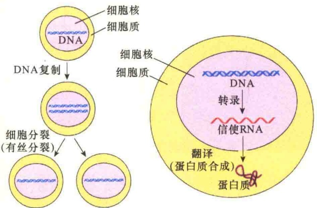

A. 遗传信息在细胞世代间传递 B. 细胞内的遗传信息:遗传信息表达

图 12-1 细胞的遗传信息流（引自 Jeff et al., 2012）。图中显示的是真核细胞核的作用。原核细胞没有真正的细胞核，但同样通过 DNA 的复制与细胞分裂保持世代间的稳定，以及通过基因表达控制细胞的生命活动。A. 细胞世代间的遗传信息流。上一代细胞通过核内 DNA 的复制及细胞核与细胞质的分裂，进行细胞世代间的信息流。B. 细胞内的遗传信息流。遗传物质在细胞核内转录，在细胞质中表达成蛋白质，参与细胞的生命活动。

一般教科书上见到的细胞核通常是球形的，位于细胞中央的一个大型膜包被的细胞器。实际上，在不同类型的细胞中，细胞核的形态、大小和位置是不同的，通常是球形，但也有长形、扁平和不规则的形态。典型的细胞核的体积为细胞体积的5%～10%，但在某些情况下，细胞核的体积占细胞总体积的80%或更多。细胞核大小的变化是由细胞核所含有的DNA，以及细胞生理状态决定的。

---

370

细胞生物学（第二版）

细胞核的直径范围从  $1 \mu m$  到几百微米不等，平均为  $5 \sim 15 \mu m$ 。细胞核在细胞中的位置也是多变的，并不都是位于细胞的中央。一般来说，一个细胞只有一个细胞核，有些特殊的细胞含有多个细胞核。例如，脊椎动物的骨骼肌细胞，这种细胞很长，可达几个微米，甚至几个厘米，其中含有几十个甚至几百个独立的细胞核。

在细胞间期观察到典型的真核生物细胞核的结构有三个主要组成部分（图 12-2）。①由双层膜组成的核被膜，它将细胞核物质与细胞质分开，核被膜上有孔，内核膜下有核纤层。②一个或多个球形的核仁，这种结构与核糖体的合成有关。③似液态的核质（nucleoplasm），它是细胞核内除了核仁以外的空间部分，其中含有可溶性的核物质，包括DNA纤维，当它展开存在于细胞核中时称为染色质，组成致密结构时称为染色体；多种RNA、蛋白质分子，以及为细胞核提供骨架网络的核基质（nuclear matrix）等。

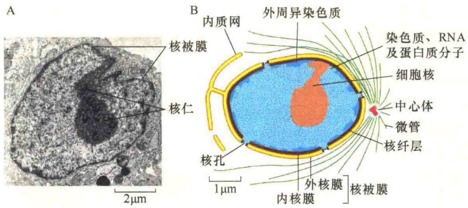

图 12-2 间期细胞核的形态结构（引自 Alberts et al., 2015）。A. 人的成纤维细胞切片观察的细胞核。B. 核外膜与内质网相连，核旁有一个中心体，是微管生长的地方。

原核生物没有真正的细胞核，而只有拟核（nucleoid）。在细胞水平上，原核和真核有三个方面的主要差别。①核膜:真核细胞有核膜；原核细胞没有核膜，称之为拟核。②核仁:真核细胞有核仁，原核细胞无核仁。③核内遗传物质的存在状态:真核细胞内DNA与组蛋白结合，有染色体结构；近年发现原核DNA也同蛋白质结合，但无染色体结构。

## 12.1 核被膜

真核生物的细胞核是在细胞周期的间期才能见到的细胞内的结构，此时的染色质被膜包被，因此，核被膜（nuclear envelope，NE）是细胞核的界膜，它将细胞核的内溶物与细胞质分隔开来，并为细胞核提供结构框架。两层核膜可作为障碍物，阻止细胞分子在细胞质与细胞核之间自由通过，以便维持细胞核作为细胞内的特殊区室，行驶独特的功能。细胞核与细胞质之间的唯一通道是核膜上的核孔，它能够调控细胞质与细胞核之间的分子交换，并且能够选择性运输蛋白质与RNA，这不仅保证了细胞核内组分的特殊性，同时也调节了基因表达。

## 12.1.1 核被膜的结构

核被膜是细胞核的界膜，对 DNA 具有保护作用。但是，由于细胞核是细胞内的“首脑机关”，要不断地发出“指令”，所以，细胞核被膜的结构既要确保核内遗传物质的安全，又要保证细胞核与细胞质之间的物质与信息交流畅通。

## 12.1.1.1 基本结构

核被膜的基本结构包括外核膜、内核膜、核周隙、核孔复合物和核纤层5个部分（图12-3）。

核被膜由内、外两层核膜组成，外核膜与内核膜相连，表面附有大量的核糖体颗粒。内核膜面向核质；内、外核膜间有15～30nm的透明腔，称为核周隙，膜上有孔。

1）外核膜（outer nuclear membrane）外核膜面向细胞质基质，常附有核糖体，有些部位与内质网相连，因此在形态和性质上与内质网相似。实际上，外核膜可以看成是内质网膜的一个特化

区。另外，细胞骨架成分，包括微管、肌动蛋白丝和

图 12-3 间期细胞核的染色质及核被膜（引自 Cooper and Hausman, 2004）。

---

12 细胞核与染色体

371

中间纤维常常与外核膜相连，起着固定细胞核并维持细胞核适当形态的作用。

2）内核膜（inner nuclear membrane） 内核膜面向核基质，与外核膜平行排列，其表面没有核糖体颗粒。

3）核纤层（nuclear lamina） 在与核质相邻的核膜内表面有一层网络状蛋白质，叫核纤层，对核被膜起支撑作用。

核纤层位于内核膜的下方。在某些细胞中，核纤层在内核膜的内侧形成连续的网层，而有些细胞中的核纤层蛋白则形成一片片的网状结构。（图 12-4）。

图 12-4 非洲爪蟾（Xenopus laevis）卵母细胞的核膜下方核纤层网状结构（引自 Cooper and Hausman, 2016）。

核纤层由三种分子质量为 60～80kDa 的核纤层蛋白亚基 A、B、C 纤维装配而成。核纤层蛋白属于细胞骨架中的中间纤维，但仅存在于细胞核。如同细胞质中间纤维，核纤层蛋白纤维可以相互结合，组装成高级结构（图 12-5）。

核纤层并非独立于内核膜，而是与内核膜结合在一起的。结合的方式有两种:一种方式是通过翻译后在 C 端半胱氨酸残基上添加脂，实际上这是一种 C 端半胱氨酸残基的异戊二烯化作用；另一种方式则是与核纤层蛋白 B 亚基的受体结合（图 12-6）。

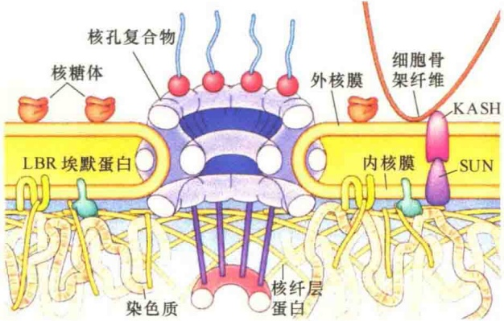

图 12-6 核纤层与内核膜的结合（引自 Cooper and Hausman, 2016）。内核膜含有几种整合膜蛋白，如埃默蛋白（emerin）、核纤层蛋白 B 受体（lamin B receptor, LBR），以及 SUN 蛋白等，这些蛋白质都能与核纤层相互作用。SUN 蛋白还能与外核膜中 KASH 蛋白结合，形成一个连接复合体。此外，核纤层通过埃默蛋白、LBR 与染色质结合，使染色质在内核膜上有了“依靠”。

4）核周隙（perinuclear space）又称核周间隙，是两层核膜之间的间隙，宽15～30nm，其中充满不定形物质。由于外核膜与糙面内质网相连，所以核周隙常与内质网的腔相通。

## 12.1.1.2 核被膜的特殊结构:核孔复合体

核被膜的一个重要功能是运输作用。但是，在核膜中没有运输蛋白，所有的大分子及蛋白质的选择性运输都是通过核孔进行的。

核被膜上有许多孔，称为核孔（nuclear pore），是细胞核膜上沟通核质与胞质的开口，由内、外两

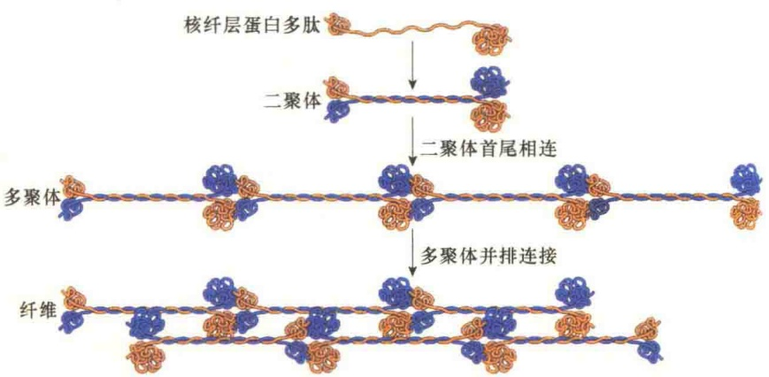

图 12-5 核纤层装配（引自 Cooper and Hausman, 2016）。首先，两条核纤层多肽通过  $\alpha$  螺旋区形成二聚体；然后，二聚体通过首尾相连形成线性多聚体；最后，线性多聚体间通过侧面相连，形成高度有序的结构。

层膜的局部融合而成，核孔的直径为80～120nm。一个典型的哺乳动物的核膜上有3000～4000个核孔，相当于每平方微米的核膜上有10～20个。一般来说，合成功能越旺盛的细胞，核孔的数量就越多，如非洲爪蟾的一个卵细胞就有1000万个核孔。核孔并非仅是一个空的孔，而是由一组蛋白质颗粒以特定的方式排布形成的立体结构，被称为核孔复合体（nuclear pore complex, NPC）（图12-7）。

研究发现，NPC的结构十

---

372

细胞生物学（第二版）

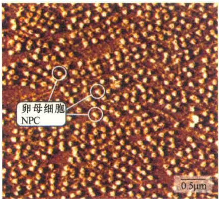

图 12-7 非洲爪蟾卵母细胞核被膜的核孔复合体（引自 Cooper and Hausman, 2016）。从非洲爪蟾卵母细胞核被膜的表面可见到大量的核孔复合体。

分复杂（图 12-8）。电子显微镜照片揭示 NPC 是一个围绕中央通道的 8 对称圆柱形结构，含有多个环与辐条，在核孔处，内核膜与外核膜融成一体，至于融合的机制尚不清楚。核孔的中央部分有 8 个环形辐条（spoke）装配成的辐条环（spoke ring），在辐条环的细胞质面有胞质环（cytoplasmic ring），并且在胞质环上有伸向细胞质的胞质丝（cytoplasmic filament）；在辐条环的核质面有核质环（nucleoplasmic ring），在核质环上有 8 条伸向核质的纤丝，形成核篮（nuclear basket）。核质环伸向核质形成篮似的核笼形结构，由于核孔的结构像鱼笼，所以有人称之为鱼笼模型。

图 12-8 核孔复合物的结构模型（引自 Plopper，2016）。核孔是由 8 个辐条连接核质环与胞质环装配成的复合结构。辐条环围绕中央通道进行装配。左侧是示意图，右侧是电镜照片。

2018 年，美国研究人员首次获得酵母 NPC 的近乎完整的三维结构，他们使用一种新的整合建模（integrative modeling）方法确定了核孔复合物的 552 个蛋白质在通道内的位置，这个通道的形状有点像带有 8 个主辐条的货车车轮，这些主辐条将核心支架连接到更灵活的中央通道区域上。

## 12.1.2 核被膜的功能

核被膜是真核生物和原核生物之间的重要区别，具有十分重要的作用。

## 12.1.2.1 基因表达的时空隔离

在原核生物中，基因表达是连续进行的，即mRNA的转录和蛋白质的翻译相偶联（图12-9），主要是因为原核生物的基因转录物无须经过剪接；真核生物的结构复杂，而且大多数基因都有内含子，转录后需要经过复杂的加工，所以核膜的出现为基因表达提供了时空隔离的屏障，便于DNA在核内活动的多样性和DNA转录形成RNA的多样性，从而导致细胞的多样性。

图 12-9 真核生物细胞核对基因表达的时空隔离（引自 Plopper，2016）。原核细胞没有细胞核，基因的转录与蛋白质合成相偶联，真核细胞的基因转录在细胞核，蛋白质合成在细胞质。

## 12.1.2.2 保护性屏障

细胞核是在进化过程中形成的。在细胞的遗传信息储存量越来越丰富、由遗传信息所指导的代谢规模越来越大的情况下，有必要将携带遗传信息的

---

12 细胞核与染色体

373

染色质与细胞的其他部分隔离开来。核膜的出现，为细胞遗传信息的保存、复制、传递及发挥其对细胞代谢和发育的指导作用创造了特定的微环境，使细胞核处于微环境中，提高了上述各项活动的效率；避免直接受细胞内其他各种生命活动干扰，并防止细胞中这个指挥中心的功能轻易地随环境条件的变化而变化，以保持其相对的稳定性，这些都是核膜出现的进化意义。

## 12.1.2.3 染色体的定位和酶分子的支架

核膜是染色体和酶分子的支架及固着部位。每一条染色质通过其端粒部分与核膜连在一起，形成各自的染色体领域（chromosome territory），每个染色体领域的直径大约 $2\mu \mathrm{m}$ 。染色质这种分布，使之多而不乱，保证了有序性（图12-10）。另外，核内的一些酶是以膜蛋白的形式存在的，这就有利于核内生化反应的区域化，从而提高了催化反应的效率。

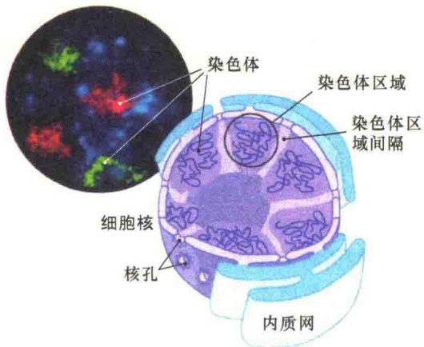

图 12-10 通过荧光反应显示单个染色体在细胞核中占据不同领域（引自 Plopper，2016）。

## 12.2 核孔复合体的运输作用

核被膜虽然将基因组与细胞质分隔开来，将DNA转录与蛋白质合成进行了时空隔离，但是，核内的DNA复制与转录加工等生命活动都需要蛋白质的参与，同时，所需的能源及各种必需品都要从细胞质中运进来；此外，细胞核内加工成熟的各类RNA也需要从细胞质中运到细胞质中发挥作用。更重要的是，核糖体的大小亚基都是在细胞核内装配的，这涉及核糖体蛋白质的输入及核糖体亚基的输出问题。因此，核被膜必须具有精妙绝伦的运输机构与机制，确保运输畅通。物质进出细胞核的唯一通道就是NPC，也就是说NPC的功能就是

进行物质运输。

## 12.2.1 核孔复合体运输的一般特点

NPC 进行的物质运输是细胞内最为复杂的运输。既有主动运输，又有被动运输；既有从细胞质向细胞核的运输，又有从细胞核向细胞质的运输。

## 12.2.1.1 主动运输与双向运输

1965 年，Feldherr 将各种不同大小的金颗粒注射到变形虫的细胞质中，然后检查这些颗粒进入细胞核的情况。结果发现，金颗粒很快进入了细胞核，但体积越大，进入的速度就越慢，大于 10nm 的金颗粒进不了细胞核，由此推测，NPC 可作为水性的运输通道，允许小分子的物质自由扩散出入细胞核。

大多数的蛋白质与 RNA 都是通过主动运输出入细胞核的。主动运输需要通过核孔复合体对运输物质的识别及孔径的调节。像核糖体亚基这样大的复合物也能够通过核孔运输，这说明 NPC 的孔径是可调节的。主动运输所需要的能量，由 ATP 及 GTP 提供。

NPC 运输的另一个重要特点就是双向性。由于真核生物细胞中的基因表达是时空隔离的，所以，NPC 不仅要将 RNA、组装好的核糖体亚基从细胞核转运到细胞质，同时也要将染色质结构的维持、DNA 复制和转录所需的酶，以及帮助 DNA 装配的一些蛋白质从细胞质运进细胞核，这些蛋白质均是在细胞质的游离核糖体上合成的（图 12-11）。

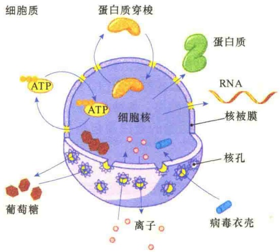

图 12-11 NPC 的运输作用（引自 Plopper，2016）。

## 12.2.1.2 NPC运输的选择性

由于细胞核在细胞生命活动中的特殊作用，不

---

细胞生物学（第二版）

难想象，通过 NPC 进出细胞核的生物分子一定是严格控制的。推测所有能够出入细胞核的生物分子一定持有特别的“通行证”。总体上说，出入细胞核的是两大类分子:RNA 与蛋白质，研究表明它们带有特殊的信号。

1）RNA的核输出 在生理状态下，RNA的输出需要信号标识。在RNA聚合酶Ⅱ指导下合成的RNA（mRNA和snRNA），当其5'端具有 $m^{7}GpppG$ 帽子结构时，即被定位于细胞质；若无帽子结构，则定位在细胞核。将游离的、具有帽子结构的类似物 $m^{3}GpppG$ 二核苷酸向核内进行连续注射，发现可抑制新转录的具有 $m^{7}G$ 帽子的U1 snRNA的核输出；而注入 $m^{7}GPPPG$ 却没有这种效应，说明5'端 $m^{7}G$ 帽子结构对于mRNA及U1 snRNA的核输出具有信号标识作用，这种现象称为帽结合活性（cap binding activity，CBA）。在细胞核中由RNA聚合酶Ⅱ合成的U1 snRNA、U2 snRNA、U4 snRNA和U5 snRNA在合成之后立即在5'端加上 $m^{7}G$ 的帽子结构，然后这些加工过的snRNA被运输到细胞质中与相应的蛋白质组装成snRNP，再运回到细胞核参与RNA的剪接。但是，由RNA聚合酶Ⅲ合成的U6 snRNA的5'端没有 $m^{7}G$ 的帽子结构，只有一个三磷酸核苷，所以它不会被运送到细胞质中。后来有人将RNA聚合酶Ⅲ的启动子与U1 snRNA连接起来，转录成的U1 snRNA也不能被运送到细胞质（图12-12）。

2）蛋白质的核输入与输出 由于蛋白质是在细胞质核糖体上合成的，所以，细胞核的生命活动所需的蛋白质都是来自细胞质。实际上，通过NPC进入细胞核的蛋白质不仅量大，而且种类繁多，大体分为三类:核蛋白（nuclear protein）、参与NPC运输的运输蛋白，以及核糖体蛋白质。核蛋白是指在细胞质中合成，然后运输到核内起作用的一类蛋白质，如各种组蛋白、DNA合成酶类、RNA转录和加工的酶类、各种起调控作用的蛋白因子等。参与NPC运输的蛋白质包括核输入蛋白和核输出蛋白，它们在运输中可在细胞核与细胞质间进行穿梭。核糖体结构蛋白由于需要到细胞核中与rRNA汇聚装配成核糖体亚基，所以需要经过NPC的运输作用进入细胞核，装配成核糖体的亚基后再运回到细胞质参与蛋白质的合成。上述三类蛋白质的氨基酸序列中都有特殊的入核或出核信号标识。

## 12.2.2 信号与受体

我们已经知道线粒体蛋白、叶绿体蛋白、过氧化物酶体蛋白，以及内质网蛋白的转运与定位都需要信号序列介导，并需要相应的受体。同样，NPC运输的蛋白质也要有信号介导，以及与信号序列识别与结合的受体。

## 12.2.2.1 核定位信号

能够引导蛋白质进入细胞核的信号称为核定位信号（nuclear localization signal，NLS），是另一种形式的信号肽，具有以下特征:①在多数核蛋白中，NLS由一个或两个富含正电荷的赖氨酸和精氨酸的短序列（4～8个氨基酸）组成；②这种信号肽序列可以位于多肽序列的任何部分，通常会在蛋白质表面形成一个环或斑；③NLS的作用是帮助核蛋白进入细胞核，由NPC来鉴别；④NLS是蛋白质的永久性部分，在进入细胞核后，并不被切除，可以反复使用，有利于细胞分裂后核重建时蛋白质重新输入核；⑤在任何复合物中，只要复合物中有一个亚基带有NLS，该复合物就能整体进入到细胞核。

NLS 的种类很多，第一个被确定的 NLS 序列的蛋白质是 SV40 的 T 抗原（分子质量为 92kDa），它在细胞质中合成后很快积累在细胞核中，是病毒 DNA 在核内复制所必需的蛋白质。其野生型的信号肽序列为 Pro-Pro-Lys-Lys-Lys-Arg-Lys-Val，即使单个氨基酸突变所产生的突变型 NLS（Pro-Pro-Lys-Thr-Lys-Arg-Lys-Val）也能阻止这种蛋白质进入细胞核而

图 12-12 U1 snRNA 从细胞核向细胞质运输需要 5' 帽子结构的实验证明（引自 Lodish et al., 1995）。

停留在细胞质中（图 12-13）。如果将这种信号接到非核蛋白的随机 Lys 的侧链上，则非核蛋白也能转变成核蛋白。

SV40 病毒的 T 抗原只含有一段短序列作为 NLS，称为单信号；而有些核蛋白则有两段序列构成 NLS，称为二重信号，如核质蛋白（图 12-14）。

---

12 细胞核与染色体

375

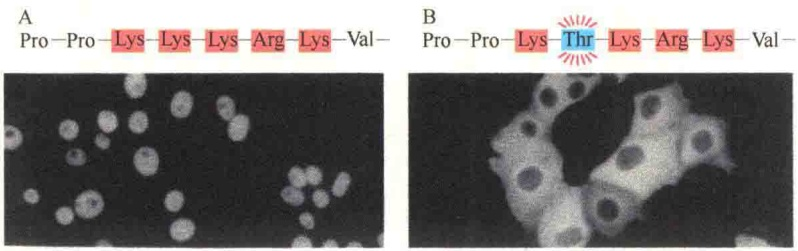

图 12-13 NLS 的功能证明（引自 Alberts et al., 2015）。免疫荧光照片显示含具有正常及突变 NLS 的 SV40 病毒 T 抗原在细胞中的定位。A. 具有正常 NLS 的 T 抗原出现在细胞核。B. NLS 突变后的 T 抗原停留在细胞质中。

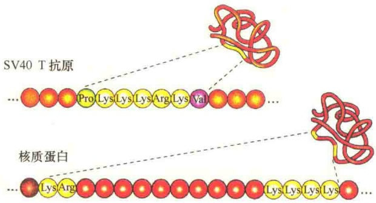

图 12-14 NLS（引自 Cooper and Hausman，2016）。SV40 T 抗原具有一段序列作为 NLS，核质蛋白则有两段序列作为 NLS。

## 12.2.2.2 核输入受体

仅有 NLS 的蛋白质自身不能通过核孔复合体，它必须与水溶性的核输入受体（nuclear import receptor）结合才可穿过核孔复合体进入细胞核。核输入受体又称为输入蛋白（importin），是由相关的基因家族编码的，分布在胞质溶胶中。不同的核输入受体能够识别带有不同 NLS 的货物蛋白并将其转运到细胞核（图 12-15A）。核输入受体并非都是直接与核输入蛋白结合，而是需要一个衔接蛋白在核输入蛋白的 NLS 与核输入受体间形成一个桥，才能被转运（图 12-15B）。

核输入受体是可溶性的细胞质蛋白，不仅能够与 NLS 结合，也能与位于核孔通道中央的核孔蛋白中无定型结构域部分的苯丙氨酸-甘氨酸重复片段结合，并借此逐渐移动，转运进入细胞核。

## 12.2.2.3 核输出信号与核输出受体

细胞核内的一些大分子，如核糖体亚基、RNA等的输出细胞核也需要依赖于选择性的运输系统。这一系统需要核输出信号（nuclear export signal，NES）作为核内物质输出细胞核的信号，同时也需要核输出受体（nuclear export receptor），核输出受体又称输出蛋白（exportin）。核输出受体是细胞核中能够识别核输出信号并与之结合的蛋白质，它同时能够与核孔复合物结合，以此帮助核内物质通过核孔复合体输出到细胞质。

在结构上，一些核输出受体与核输入受体是密切相关的，它们是由相同的核运输受体（nuclear transport receptor）基因编码的。核运输受体又称核周蛋白（karyopherin）。在酵母中有14个基因编码核周蛋白，动物中编码核周蛋白的基因数量更多。表12-1是部分核周蛋白的作用。

图 12-15 核输入受体（引自 Alberts et al., 2015）。A. 不同的核输入受体与不同的 NLS 及货物蛋白结合。B. 货物蛋白 4 通过核输入衔接蛋白与核输入受体形成复合物。核输入衔接蛋白在结构上与核输入受体相关，并能识别货物蛋白中的 NLS。核输入衔接蛋白也含有一个 NLS，并通过 NLS 与核输入受体结合。不过，只有当核输入衔接蛋白与货物蛋白结合后，核输入衔接蛋白中的 NLS 才会裸露出来并与核输入受体结合。

表 12-1 部分核周蛋白的作用

<table><tr><td>核周蛋白</td><td>运输的物质</td></tr><tr><td colspan="2">核输入</td></tr><tr><td>输入蛋白(Kapα/Kapβ1二聚体)</td><td>含有碱性氨基酸核定位信号的蛋白质(如核质蛋白)</td></tr><tr><td>核内小核糖核蛋白输入蛋白/Kapβ1</td><td>snRNP(U1,U2,U4,U5)</td></tr><tr><td>转运蛋白/Kapβ2</td><td>mRNA结合蛋白,核糖体蛋白</td></tr><tr><td>输入蛋白7/Kapβ1二聚体</td><td>组蛋白1,核糖体蛋白质</td></tr><tr><td colspan="2">核输出</td></tr><tr><td>Crm1</td><td>富含亮氨酸核输出信号的蛋白质核内小核糖核蛋白输入蛋白,snRNA,核糖体亚基</td></tr><tr><td>CAS</td><td>Kapα</td></tr><tr><td>输出蛋白-1</td><td>tRNA</td></tr><tr><td>输出蛋白-2</td><td>miRNA</td></tr></table>

---

376

细胞生物学（第二版）

## 12.2.3 蛋白质与RNA的核运输机制

## 12.2.3.1 核运输中的RanGTPase

在核孔运输中，一种单体 G 蛋白 Ran 起重要作用。如同其他的 GTPase 一样，Ran 也是一种分子开关，能够以两种状态存在:Ran-GDP 或 Ran-GTP。两种 Ran 特异的调节蛋白触发 Ran 的两种状态的改变:一种细胞质 GTPase 激活蛋白（GTPase-activating protein，GAP）触发 GTP 水解，将 Ran-GTP 转变成 Ran-GDP；而鸟苷交换因子（guanine exchange factor，GEF）促使 GDP 转换成 GTP，从而将 Ran-GDP 转换成 Ran-GTP。由于 Ran-GAP 定位于细胞质，而 Ran-GEF 定位于细胞核，并且与染色质结合在一起，因此细胞质中仅有 Ran-GDP，细胞核中含有 Ran-GTP（图 12-16）。由此可见，Ran-GTPase 的作用是控制着蛋白质经核孔运输的方向。

## 12.2.3.2 蛋白质的核输入机制

根据上面的讨论，可以推测蛋白质入核的运输机制:当细胞质中的输入蛋白识别一个含有 NLS 的货物蛋白并与之结合后，开始了核输入之旅。货物蛋白 / 输入蛋白复合体与核孔复合体的细胞质纤维结合，然后经过与 NPC 通道的中央蛋白相互作用后，逐渐向细胞核转运；货物蛋白 / 输入蛋白一旦进入细胞核，Ran-GTP 立即与输入蛋白结合，由于 Ran-GTP 的结合，改变了输入蛋白的构型，从而将货物蛋白从复合物中释放到细胞核（图 12-17）。

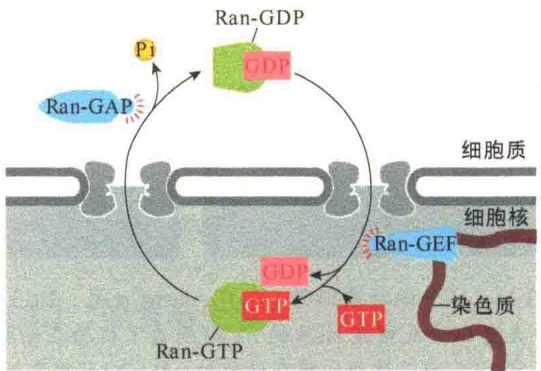

图 12-16 Ran-GDP 与 Ran-GTP 的空间隔离（引自 Alberts et al., 2015）。

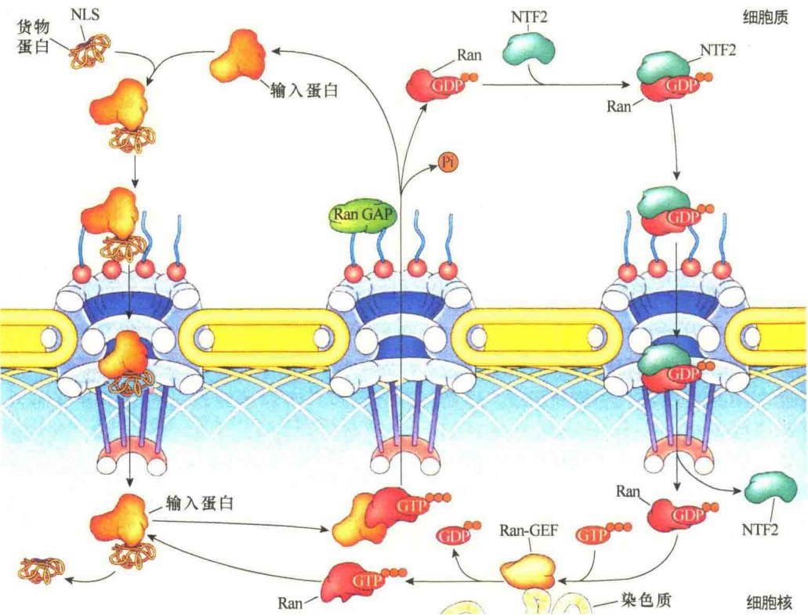

图 12-17 蛋白质经 NPC 输入到细胞核（引自 Cooper and Hausman，2106）。货物蛋白的 NLS 被输入蛋白识别后即开始了运输过程。货物蛋白 / 输入蛋白复合体与 NPC 的细胞质纤维结合，并逐渐穿过核孔进入细胞核。细胞核中的 Ran-GTP 与输入蛋白结合，导致输入蛋白的构型发生变化，释放出货物蛋白。输入蛋白与 GTP 结合形成输入蛋白-Ran-GTP 复合物后，通过核孔复合物返回到细胞质。输入蛋白-Ran-GTP 进入细胞质后，结合在 NPC 体细胞质纤维上的 GTPase 激活蛋白（Ran GAP）将输入蛋白-Ran-GTP 中的 GTP 水解，形成 Ran-GDP，并释放出输入蛋白。释放的输入蛋白开始新的运输作用，而 Ran-GDP 与其受体核转运因子 2（nuclear transport factor 2，NTF2）结合，并一起进入细胞核。结合在染色质上的 Ran-GEF 激发 Ran-GDP 中的 GDP 与 GTP 交换，形成 Ran-GTP，从而维持细胞核中较高浓度的 Ran-GTP，为蛋白质的核输入提供保障。

---

12 细胞核与染色体

377

## 12.2.3.3 蛋白质的核输出

通过核输入，一些蛋白质进入了细胞核并在细胞核中“成就事业”，但有些蛋白质要返回到细胞质。更有一些蛋白质，因“工作”需要，在细胞核与细胞质之间来回穿梭。细胞核中的货物蛋白需要进入细胞质，必须有核输出信号，输出信号是富含亮氨酸的序列。核输出信号被输出蛋白识别，并结合成复合物；此外，还需要与Ran-GTP结合，在Ran-GTP的指导下通过NPC，从而将货物蛋白运送到细胞质中（图12-18）。

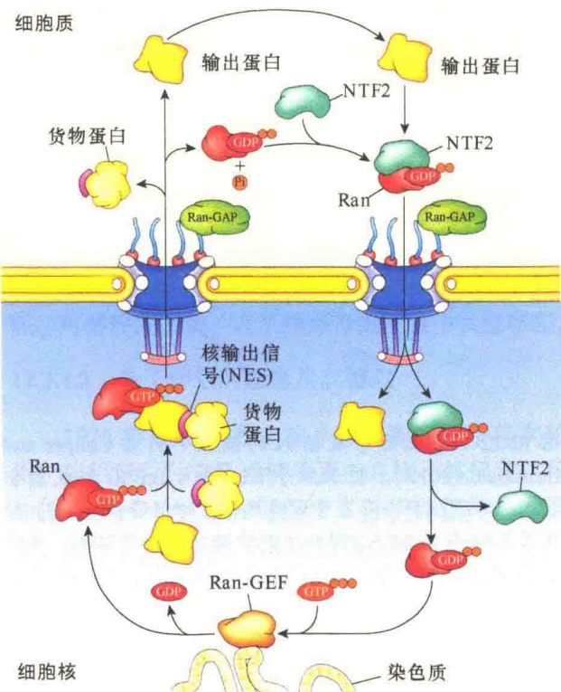

图 12-18 蛋白质的核输出（引自 Cooper and Hausman, 2106）。具有核输出信号的货物蛋白、输出蛋白、Ran-GTP 在细胞核中形成复合物并通过 NPC 输出到细胞质。由于结合在 NPC 细胞质纤维上的 Ran-GAP 的作用，Ran-GTPase 被激活，GTP 被水解成 GDP，形成 Ran-GDP，释放出货物蛋白，输出蛋白-Ran-GDP 重新返回到细胞核。由于结合在染色质上的 Ran-GEF 的作用，Ran-GDP 与 GTP 交换，重新形成 Ran-GTP。

## 12.2.3.4 RNA的核输出

细胞核内输出到细胞质的两类主要物质是各种RNA和核糖体亚基。输出的RNA中，mRNA是最多也是最重要的。mRNA的输出机制与蛋白质的输出机制有很大的不同，它不需要核运输蛋白，也不需要Ran蛋白（图12-19）。在pre-mRNA通过核孔运输到细胞质的整个运输过程中，至少需要有20种以上的蛋白质参与。在参与mRNA运输的蛋白质中，包括一种不同的mRNA输出复合物，它被招募到pre-mRNA上进行剪接及聚腺苷酸化。运输的方向是由附着在NPC细胞质面的RNA解旋酶介导的。RNA解旋酶在细胞质面对运输的mRNA进行重塑，并将结合在mRNA上的运输复合物去除，最终将mRNA释放到细胞质并阻止mRNA重回到细胞核。

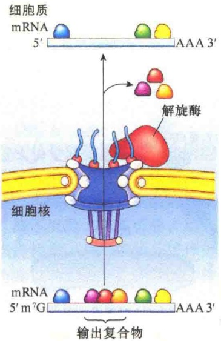

图 12-19 mRNA 的输出（引自 Cooper and Hausman, 2016）。mRNA 加工之后，被输出蛋白复合体结合，并介导通过核孔向细胞质的转运。结合在 NPC 细胞质面的解旋酶将 mRNA 释放到细胞质，输出蛋白复合物则留在细胞核。

与 mRNA 不同，miRNA、tRNA 及 rRNA 都是在细胞质中起作用的分子，都需要通过运输进入细胞质，只不过 rRNA 是装配成核糖体亚基后运入细胞质的。很多非编码 RNA，包括参与 pre-mRNA 剪接的 snRNA、参与 rRNA 加工的 snoRNA，都是在细胞核内起作用的，按理是不需要转运的。但是 snRNA 比较特别，它被转录后先要由输出蛋白 Crn1 将其运输到细胞质，在细胞质中，snRNA 与一些蛋白质结合形成 snRNP，然后，snRNP 蛋白被称为核内小核糖核蛋白输入蛋白（snurportin）的蛋白质所识别，进而将 snRNP 运回到细胞核（图 12-20）。

HIV 病毒属于 RNA 病毒，其基因组中有一个基因编码 Rev 蛋白。由于该蛋白质既有核定位信号，又有核输出信号，所以它能在细胞核与细胞质之间来回穿梭。该蛋白质的功能是从细胞核中识别并结合 HIV 病毒的 RNA，并通过核运输蛋白 Crm1 运送到细胞质（图 12-21）。这种穿梭运

---

378

细胞生物学（第二版）

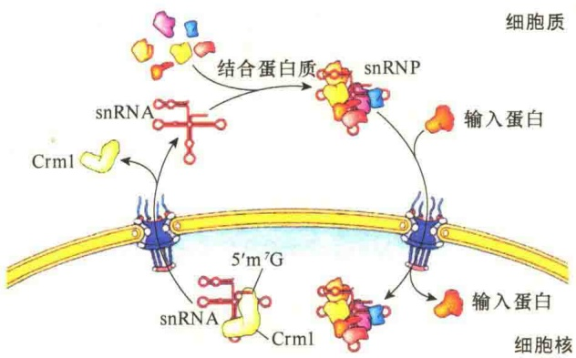

图 12-20 snRNA 输出与输入细胞核（引自 Cooper and Hausman, 2016）。小分子的核 RNA（snRNA）先被输出蛋白 Crml 运输到细胞质，在细胞质里，snRNA 与蛋白质结合形成 snRNP，然后被输入蛋白识别并运回到细胞核。

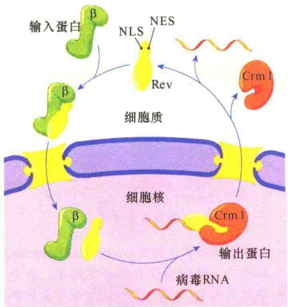

图 12-21 HIV 病毒的 Rev 蛋白穿梭与 HIV 病毒 RNA 的核输出（引自 Plopper，2016）。

输，确保了病毒 RNA 运送到细胞质参与成熟病毒颗粒的装配。

## 12.2.3.5 核蛋白输入的调控

由于蛋白质是在细胞质中合成的，虽然细胞核控制着遗传信息的转录，但细胞转录调控需要的蛋白质需经核孔运输到细胞核，从基因表达调控来说，控制转录因子进入细胞核的速度及数量也是基因表达调控的机制之一。

调控转录因子进入细胞核有多种方式，其中一种就是将转录因子的核定位信号遮盖起来，即由细胞质中的一个蛋白质识别并与核定位信号结合，从而阻止了转录因子与核运输蛋白结合而滞留在细胞质中。一个熟知的例子就是转录因子NF-κB，它在哺乳动物细胞中受细胞外各种信号的诱导激活（图 12-22）。在没有被激活的细胞中，NF-κB 被细胞质中的一种抑制蛋白（IκB）抑制，抑制的方法就是与 NF-κB 的核定位信号结合，从而阻止了 NF-κB 进入细胞核。一旦被信号激活，IκB 被磷酸化，进一步被泛素蛋白酶体所降解，从而裸露了 NF-κB 核定位信号，使得 NF-κB 得以进入细胞核，启动靶基因的转录。图 12-22 中显示的另一个例子，就是直接将核定位信号序列旁侧序列磷酸化。Pho4 是酵母的一种转录因子，合成后，在核定位信号相邻的一个丝氨酸残基磷酸化，由于该位点的磷酸化，从而干扰了核定位信号，阻止了 Pho4 进入细胞核。

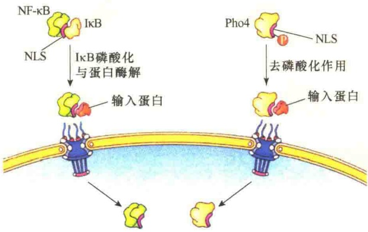

图 12-22 转录因子核输入的调控（引自 Cooper and Hausman，2016）。转录因子 NF- $\kappa$ B 与 I $\kappa$ B 结合成复合物，以非活性状态存在于细胞质中；抑制蛋白（I $\kappa$ B）封闭了 NF- $\kappa$ B 的 NLS，因此不能被输入蛋白所识别。当有细胞外信号转导时，I $\kappa$ B 磷酸化后被降解，NF- $\kappa$ B 显露出入核信号，从而被输入蛋白输入细胞核。图中显示的酵母转录因子 Pho4 的运输是通过磷酸化与去磷酸化进行调控:入核信号被磷酸化，则失去信号作用；当有信号转导时，入核信号去磷酸化后可被核输入蛋白识别，并被运输到细胞核。

## 12.3 分子伴侣

在本书的第6章及其他相关章节中多次提到分子伴侣，由于第一个分子伴侣是在细胞核中发现的，为此，本章特设立一节，对分子伴侣进行较为系统的介绍。分子伴侣在细胞内作用十分广泛，它们参与生物大分子的折叠、组装、转运及降解，也在抗原的呈递、遗传物质的复制和转录、构型的确立、细胞自噬等活动中起作用，但它们都有一个特点——“助人为乐”，自身并不发生任何变化，也不会成为反应产物的一部分。

---

12 细胞核与染色体

379

## 12.3.1 分子伴侣的发现及特点

## 12.3.1.1 第一个被发现的分子伴侣:核质蛋白

第一个被发现具有分子伴侣功能的蛋白质是核质蛋白（nucleoplasmin），它在细胞核中通过降低组蛋白的正电荷，帮助组蛋白和DNA形成正常的核小体（nucleosome），其本身并不成为核小体的组成成分。

核质蛋白是 Laskey 等于 1978 年在非洲爪蟾卵的浸出液中发现的。这种蛋白质在细胞质中合成后就通过核定位信号运送到细胞核，它们对于 DNA 与组蛋白组成核小体是必不可少的，否则 DNA 与组蛋白在组装过程中就会沉淀，因而不能形成正常的核小体。核质蛋白的作用在于既能促进组蛋白与 DNA 的相互作用，又能避免 DNA 与组蛋白间因强静电吸引而形成非特异结合的不溶性聚合物，但它本身并不参与核小体的组成。

核质蛋白是一种大分子（165kDa）五聚体的耐热、可溶性蛋白质，在爪蟾卵母细胞核中大量存在。

## 12.3.1.2 分子伴侣的概念及其特点

1978 年 Laskey 等在核小体装配实验中首次使用 “伴侣蛋白” 来描述核质蛋白在核小体组装过程的作用。1991 年 Ellis 等提出了分子伴侣的基本概念，即分子伴侣是由不相关的蛋白质组成的一个家系，它们介导其他蛋白质的正确装配，但自己不成为最后功能结构中的组分。

这个概念有三个特点。①凡具有这种功能的蛋白质都称为分子伴侣，因此，不同类别的分子伴侣，在结构上可能完全不同。②作用机制是不清楚的，故用了“介导”二字。“介导”二字可理解为:通过催化的或非催化的方式，加速或减缓组装的过程，传递组装所需要的空间信息，也可能抑制组装过程中不正确的副反应。③分子伴侣一定不是最终组装完成的结构的组成部分，但不一定是一个分离的实体。组装的含义比较广，主要是指帮助新生肽的折叠，还帮助新生肽成熟为活性蛋白，包括穿膜定位、亚基组装等。

## 12.3.1.3 分子伴侣的分布与分子内伴侣

分子伴侣的分布很广，从细菌到人、动物和植物，在细胞质、线粒体、叶绿体和内质网中都有存在。目前已鉴定分子伴侣较多，常见的分子伴侣有:帮助核小体组装和去组装的核质蛋白，帮助正确折叠、运输的 HSP60，帮助去折叠、运输及寡聚物去组装的 HSP70，帮助封闭结合位点的 HSP90，帮助细菌膜运输的 sce B 蛋白，冷激蛋白等。分子伴侣中最大的一类是热休克蛋白（heat shock protein，HSP）。热休克蛋白不仅在热刺激条件下表达，在其他条件下，包括植物在冻害期，种子在萌发期和成熟期，哺乳动物的大脑、肌肉及生殖细胞在分裂、分化时期均有相应的 HSP 的表达，且不同机体在同样胁迫条件下产生不同的 HSP。

分子伴侣一定不是最终组装完成的结构组成部分，但不一定就是一个独立的实体，如一些蛋白水解酶的前序列及一些核糖核蛋白体加工前的部分对于这些酶的折叠和成熟是必需的，具有与分子伴侣类似的功能，但在蛋白质折叠完成后被降解，因此将其称为分子内分子伴侣（intramolecular chaperone，IMC）。

这些位于信号肽和成熟蛋白之间的前序列，不仅能抑制酶原蛋白的活性，还作为分子伴侣帮助酶原蛋白折叠。去除前序列，剩余部分便会形成稳定的中间物，既不沉淀，也不折叠；加入前序列，才能折叠成活性构型。与一般的分子伴侣相比，分子内伴侣具有高度的专一性，通过水解作用释放，不需要 ATP。

根据机制不同，IMC 可分为两类:第一类 IMC 引导成熟肽折叠为具有空间结构的蛋白质；第二类 IMC 协助成熟肽的多聚化而使其获得生物学功能。

## 12.3.1.4 分子伴侣家族的结构特点

分子伴侣家族在结构上具有一些共同特点。

1）家族成员具有高度保守性 其中，Hsp70家族由一类高度保守的蛋白质组成，广泛分布于真核生物和原核生物中。在果蝇、酵母、鸡、哺乳动物、锥虫和细菌等生物细胞中检测发现，甚至在具有最远亲缘关系的真核生物中的Hsp70的序列一致性也达到了50%。而原核生物的分子伴侣DnaK与真核生物的分子伴侣Hsp70同源性也高达50%。Hsp70家族成员提供ATP结合位点的N端序列具有极高的保守性，而与底物蛋白质结合的C端序列变异性则很高，保证可与不同的蛋白质结合；Hsp60家族中大肠杆菌细胞质分子伴侣GroEL与真核生物线粒体基质分子伴侣cpn60的同源性达到60%。

2）家族成员结构上具有相似性 GroEL/GroES 是大肠杆菌中十分重要的分子伴侣，“Gro”取自“生长”（growth）之意，最初发现该蛋白质是某些细菌病毒生长所必需，因而得名。据推测，大肠杆菌中有 10%～15% 的蛋白质的折叠需

---

380

细胞生物学（第二版）

要 GroEL/GroES 的协助（见图 6-25）。在热激条件下，高达 30% 的蛋白质需要 GroEL/GroES 的帮助。Hsp60 与大肠杆菌中的 GroEL/GroES 是同一个家族，也是桶状结构。在线粒体基质中也有 Hsp60，负责将进入线粒体基质的蛋白质再折叠。

3）组成型表达 分子伴侣的家族成员大部分在体内为组成型表达，在胁迫条件下会被进一步诱导。Hsp60、Hsp70、Hsp90在细胞内含量丰富，正常情况下GroEL可占细胞总蛋白质含量的1%～2%，热胁迫下最高可达10%～15%。也有例外，如Hsp70家族成员Hsp72只是胁迫产物，正常情况下在细胞中含量很低，这与它们在细胞中所起的作用有关。

## 12.3.2 分子伴侣的功能和作用机制

在第6章中已经介绍了分子伴侣在蛋白质多肽这种酸性可溶蛋白在核中带负电，它只与组蛋白结合，不与 DNA 或其他装配好的核小体结合。目前认为核质蛋白的负电荷中和组蛋白上的正电荷，降低组蛋白电性，减少 DNA 和组蛋白因离子作用引起的错误装配。

折叠、加工（二硫键形成）中的一些作用，本节讨论分子伴侣其他一些作用。

## 12.3.2.1 参与线粒体/叶绿体蛋白质的转运

真核细胞中线粒体和叶绿体蛋白是由核基因和细胞器基因共同编码的。核基因编码的蛋白质是在细胞质游离核糖体上合成，然后转运到叶绿体或线粒体。特别是在线粒体的生物合成中，Hsp70 和 Hsp60 协同作用的结果是使线粒体蛋白定位后保持结构的完整和行使正确功能。Hsp70 在蛋白前体进入线粒体之前，使它们保持穿膜和对 Hsp60 的感受态；线粒体 Hsp70 则防止进入的蛋白质发生错误折叠，而线粒体 Hsp60 则是促进这些蛋白质正确折叠和组

核小体是一个动态结构，在 DNA 的复制与转录时，虽然核小体不被完全解体，但是也要发生部分解体重塑，以便 DNA 顺利进行复制或转录。这一过程是由依赖于 ATP 的染色质重塑复合物（ATP-dependent chromatin remodeling complexe）催化的。在此过程中，为保护组成核小体的组蛋白八聚体不被完全解体，需要组蛋白分子伴侣协助（图 12-23）。在核小体重塑过程中，核小体的组蛋白在组蛋白分子伴侣的帮助下，以两种方式重塑。一种是由分子伴侣用两种新的组蛋白二聚体替换原有的组蛋白二聚体；第二种就是由分子伴侣用新合成装配的组蛋白八聚体核心替换原有的八聚体。

## 12.3.2.2 参与核小体的装配与重塑

装成寡聚体构象，完成整个运输装配过程。需要说明的是，参与线粒体蛋白质转运的细胞质分子伴侣的作用不是介导蛋白质折叠，而是阻止线粒体蛋白折叠，以便让线粒体蛋白在分子伴侣的“护送”下顺利通过线粒体的运输通道定位到相应的部位（见图7-5）。叶绿体蛋白的转运机制与线粒体相似。

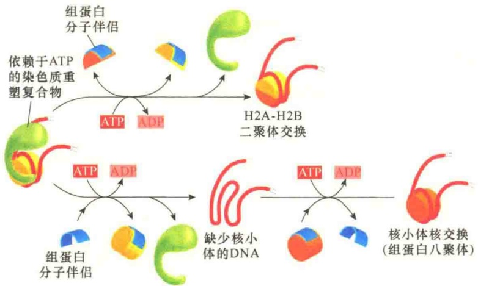

图 12-23 依赖于 ATP 的染色质重塑复合物催化的核小体的去除与组蛋白的交换（高度简化示意图）（引自 Alberts et al., 2015）。通过不同分子伴侣家族特异成员的协助，某些染色质重塑复合物能够将 H2A-H2B 从核小体中移出，用另一个含有不同二聚体的组蛋白（如 H2A-H2B）取代（图的上半部分）。另外的重塑复合物附着到染色质的特异位点，在染色质分子伴侣协助下，将组蛋白八聚体完全移去，并换上一个新的核小体（图的下半部分）。

分子伴侣在核小体（nucleosome）的装配中起重要作用。核质蛋白是第一个被确定的分子伴侣，

## 12.3.2.3 内质网中错误折叠蛋白质的输出降解

由于蛋白质是细胞生命活动的功能执行者，所以，细胞对蛋白质进行质量控制是非常重要的。细胞中存在蛋白质的质量控制系统，通过新合成蛋白质的正确折叠及组装，以及对错误折叠或聚集的蛋白质进行重折叠或降解，确保细胞生命活动的正常进行。

对翻译后进行转运的蛋白质的质量控制发生较早，新生肽刚刚“露芽”，分子伴侣就开始进行

---

12 细胞核与染色体

381

“呵护”，而共翻译转运的蛋白质，对其新生蛋白质的质量控制主要发生在内质网中。分子伴侣在蛋白质质量控制中的作用十分重要，包括 Bip 蛋白、钙连蛋白等。

并非内质网中所有错误折叠的蛋白质都能被“拯救”，对那些“无可救药”的错误折叠的蛋白质必须尽快清除，办法就是将错误折叠的蛋白质及时转运到细胞质进行降解。

从内质网中特异性选择要被降解的错误折叠的蛋白质是一项极具挑战性的工作:错误折叠的蛋白质，以及未折叠的亚基需要被降解，但是，折叠正确的新合成蛋白质，以及折叠中间体是不能被降解的。判断的标准就是根据 N-连接的寡糖的变化，它可以作为测量蛋白质在内质网中度过时间长度的计时器。内质网中有一种甘露糖苷酶，它能够对核心寡糖链中特异的甘露糖进行缓慢修剪，从而会产生一种新的寡糖结构，这种结构能够被内质网腔中反向转运装置（retrotranslocation apparatus）中的凝集素所识别。正确折叠的蛋白质由于在内质网中滞留的时间短，在靶标甘露糖苷显露之前就已经离开了内质网，所以不会被降解。

内质网腔中错误折叠的蛋白质除了被凝集素识别外，还能被分子伴侣、二硫键异构酶所识别，并与之结合形成复合物。分子伴侣的作用是防止错误折叠的蛋白质聚集，二硫键异构酶的作用是打开二硫键，将蛋白质多肽“拉直”，减小体积，便于通过运输通道。

内质网膜中多亚基的蛋白质转运通道能够将内质网膜或内质网腔蛋白质转运到细胞质。所有的通道蛋白复合物中都含有E3泛素蛋白连接酶，将经过通道进入细胞质的不正确折叠的蛋白质带上泛素标记。转运中需要细胞质AAA-ATPase的协助，将转运的蛋白质拉到细胞质，这一过程需要消耗ATP。同时，需要N-聚糖酶将蛋白质中的寡聚体彻底清除。在泛素标签的引导下，被清除了多聚糖的、错误折叠的蛋白质快速进入蛋白酶体被降解（见图9-28）。

## 12.3.2.4 应激反应

分子伴侣中除少数成员外，大部分成员均可被高温或低温，以及乙醇、亚砷酸盐、重金属等非温度因素诱导合成，它们使生物体逆境耐受力大大增强。大肠杆菌中 DnaK 基因缺失严重地降低了细胞在 30℃ 的生长速度，在 40℃ 则生长完全被抑制。野生型的大肠杆菌在 42℃ 条件下预处理 5min 将明显提高菌株在 50℃ 条件下的存活率。酵母 Hsp104基因突变体暴露在  $50^{\circ}$ C 下几分钟，其死亡的速率是野生型细胞的 100～1000 倍，同时这种突变体对乙醇的耐受力只有野生型的 1/1000。用人类组成型表达的 Hsp70 基因转化的鼠细胞和猴细胞，明显提高了耐热能力。热激后的果蝇属（Drosophila）生物组成型表达的 Hsp70 可以加快核形态的恢复，对脊椎动物进行微注射 Hsp70 可使 mRNA 在短时热激条件下存活能力提高。热处理主要是破坏 mRNA、rRNA 合成和蛋白质的合成与降解。由此可见，分子伴侣在热激反应中的作用首先是恢复细胞转录和翻译的机能。

## 12.4 染色质

染色质（chromatin）最早是1879年Flemming提出的用以描述核中染色后强烈着色的物质，现在认为染色质是细胞间期细胞核内能被碱性染料染色的物质，主要是由DNA和蛋白质组成的复合物。

染色体（chromosome）是细胞在有丝分裂和减数分裂过程中由染色质聚缩而成的棒状结构。染色体和染色质在化学本质上没有差异，只是在构型上不同，是遗传物质在细胞周期不同阶段的不同表现形式。

## 12.4.1 染色质DNA

除少数 RNA 病毒外，DNA 几乎是所有生物遗传信息的携带者，是遗传信息的一级载体。在真核生物中，每个 DNA 分子都被包装到染色体中，一个生物储存在单倍体染色体组中的总遗传信息称为该生物的基因组（genome）。

## 12.4.1.1 DNA 的螺旋结构

染色质的化学本质是 DNA。DNA 是双螺旋结构，在构型上，主要是 Watson 和 Crick 提出的右手双螺旋 DNA，即 B 型 DNA（图 12-24）。

## 12.4.1.2 DNA结构中稳定遗传的功能序列

DNA 是遗传物质，它的稳定遗传依赖于复制和分离的准确性。真核生物进行有丝分裂和减数分裂时，首先要进行染色体复制，然后均等分配到两个子细胞中。根据近年来的研究发现，要达到这个目的，在染色体上必须具有三个功能单位，即复制起点（replication origin）、着丝粒（centromere）和端粒（telomere）（图 12-25）。

---

382

细胞生物学（第二版）

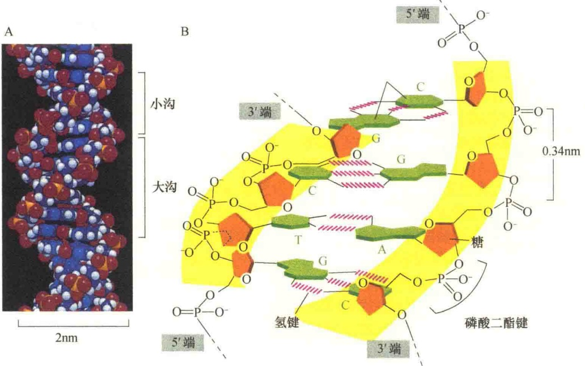

图 12-24 DNA 螺旋及 4 种碱基对（引自 Alberts et al., 2015）。A. B 型 DNA 结构模型。B. 双螺旋中的分子排列。

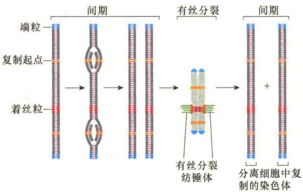

图 12-25 有丝分裂中真核染色体复制与正确分离所需的三种 DNA 序列（引自 Alberts et al., 2015）。每条染色体具有多个复制起点、一个着丝粒和两个端粒。图中间部分显示的是复制成熟的有丝分裂染色体，着丝粒外侧的动粒与纺锤体微管相连，着丝粒将复制好的姐妹染色单体维系在一起。两个端粒在染色体的两端形成了两个特别的帽结构，维持染色体稳定。

## 1）复制起点序列（replication origin sequence）

其是顺式作用元件的一种，是染色体正常起始复制所必需。所有的复制起点的DNA均有一段保守序列:200bp-A（T）TTTAT（C）A（G）TTTA（T)-200bp。真核生物染色体上有多个复制起点，上、下游各200bp左右的序列是维持复制功能所必需。

2）CEN 序列（centromere sequence）即着丝粒序列，是真核生物在有丝分裂和减数分裂时，两个姐妹染色单体附着的区域，含有11个高度保守的碱基序列:-TGATTTCCGAA-。其功能是形成着丝粒，均等分配两个子代染色单体。

3）TEL 序列（telomere sequence） 即端粒序列。端粒是线性染色体两端的特殊序列，这种序列广泛存在于原生动物、真菌、植物和哺乳动物的染色体中，并且在序列组成上十分相似，富含 G，且由短的基本序列随机串联重复而成。

端粒是染色体的重要部分，它保证了染色体的完全复制；同时在染色体的两端形成保护性的帽结构，使染色体的 DNA 免受核酸酶及其他不稳定因素的破坏和影响。另外，端粒的形成使染色体的末端不会与其他染色体末端融合。

## 12.4.2 组蛋白与非组蛋白

## 12.4.2.1 组蛋白的类型和性质

细胞核中的 DNA 不是独立存在的，而是与组蛋白装配成核小体，从而构成染色质的基本单位。

组蛋白（histone）是真核生物染色体的基本结构蛋白，是一类小分子碱性蛋白质，有5种类型:H1、H2A、H2B、H3、H4。它们富含带正电荷的碱性氨基酸，能够与DNA中带负电荷的磷酸基团相互作用。表12-2所列为小牛胸腺的5种组蛋白的性质。

---

12 细胞核与染色体

383

表 12-2 小牛胸腺 5 种主要类型的组蛋白

| 类型 | 赖氨酸/% | 精氨酸/% | 氨基酸数/个 | 分子质量/kDa |
| --- | --- | --- | --- | --- |
| H1 | 29 | 1 | 215 | 23.0 |
| H2A | 11 | 9 | 129 | 14.0 |
| H2B | 16 | 6 | 125 | 13.8 |
| H3 | 10 | 13 | 135 | 15.3 |
| H4 | 11 | 14 | 102 | 11.3 |

组蛋白的基因非常保守。亲缘关系较远的种属中，4种组蛋白（H2A、H2B、H3、H4）氨基酸序列都非常相似，如海胆组织H3的氨基酸序列与来自小牛胸腺H3的氨基酸序列间只有一个氨基酸的差异，小牛胸腺H3的氨基酸序列与豌豆H3也只有4个氨基酸不同。不同生物的H1序列变化较大，在某些组织中，H1被特殊的组蛋白所取代。例如，成熟的鱼类和鸟类的红细胞中H1被H5所取代，精细胞中则由精蛋白代替组蛋白。染色质中的组蛋白与DNA的含量之比为 $1:1$ 。

## 12.4.2.2 组蛋白的功能分类

5种组蛋白在功能上分为两组。一组是核小体组蛋白（nucleosomal histone），包括H2A、H2B、H3和H4，这4种组蛋白分子质量较小（102～135个氨基酸残基），它们的作用是将DNA分子盘绕成核小体。它们没有种属及组织特异性，在进化上

十分保守，特别是 H3 和 H4 是所有已知蛋白质中最为保守的。H1 属于另一组组蛋白，它不是核小体的核心组蛋白，在构成核小体装配中起连接作用，并赋予染色质以极性。H1 有一定的组织和种属特异性。H1 的分子质量较大，有 215 个氨基酸残基，在进化上也较不保守。

## 12.4.2.3 组蛋白的化学修饰

虽然组蛋白分子的氨基酸序列是高度保守的，但在组蛋白的分子结构中也会见到一些变化。例如，H1能够以多种形式存在，每一种形式中的氨基酸都有一定的变化。大多数细胞中都有部分组蛋白的某些碱性氨基酸侧链被磷酸化、乙酰化或甲基化及ADP的核糖化等修饰（图12-26），这些修饰中和了侧链的正电荷或使侧链带负电。

构成核小体核心的4种组蛋白的氨基酸侧链常常会发生一些共价修饰，包括赖氨酸的乙酰化，赖氨酸的单、二或三甲基化，以及丝氨酸的磷酸化。修饰的位点大多数在组蛋白N端的尾部，也有20多个位点的修饰是发生在核小体的球形核心部位。

组蛋白发生的所有的修饰作用都是可逆的，这些修饰的酶与去修饰的酶都是高度特异的，如一套不同的组蛋白乙酰化酶将特异的赖氨酸位点乙酰化后，另一套不同的组蛋白去乙酰化酶复合物可以将这些位点去乙酰化。又如，一套不同的甲基化酶将亮氨酸侧链甲基化后，另一套不同的去甲基化酶将甲基化位点的甲基脱除。进行组蛋白侧链氨基酸残基修饰的酶会在细胞生活史的特定时期被招募到核小体，在大多数情况下起招募作用的是转录调节蛋白。组蛋白N端尾部修饰会对染色质的功能及与其他蛋白质的相互作用产生影响。组蛋白的修饰是严格调控的，因为修饰会对细胞产生重要的影响。例如，组蛋白的尾端赖氨酸残基能够在酶的作用下发生可逆的乙酰化与去乙酰化，当乙酰化时，赖氨酸的ε-氨基团的正电荷被中和了，如果是H4的16位的赖氨酸发生这种情况，将会影响染色体的30nm纤维的形成；如果是H4的其他位点的赖氨酸被乙酰化，则有可能对核酸酶变得敏感而遭降解。又如，组蛋白H3尾部一个特异的赖氨酸发生了三甲基修饰，则吸引了异染色质特异的蛋白质HP1，从而使该部位变成异染色质并逐渐扩大。更

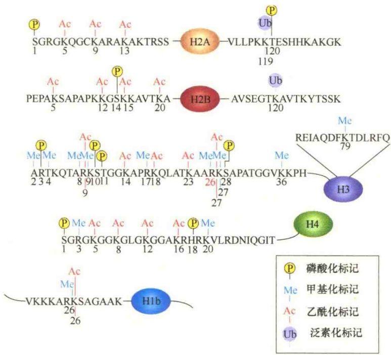

图 12-26 人的组蛋白翻译后修饰作用（引自 Lodish et al., 2013）。人的组蛋白翻译后的 N 端的尾部区常见 4 种类型的修饰:磷酸化、甲基化、乙酰化与泛素化，这些修饰都是可逆的。

---

384

细胞生物学（第二版）

常见的是，通过招募的蛋白质与修饰的组蛋白协同作用，决定何种基因何时进行表达，同时也会对其他的染色质的功能产生影响。因此，组蛋白的修饰调节着染色体的凝缩、DNA复制、转录、基因表达等一系列的功能。

## 12.4.2.4 组蛋白的突变体

真核生物除了含有4种高度保守的组蛋白外，还有少量突变的组蛋白，它们也参与组蛋白的装配。除了H4外，其他4类组蛋白都能产生突变组蛋白（图12-27）。主要的5类组蛋白是在细胞周期的S期合成的，并且装配到子代核小体中，而突变的组蛋白是在整个间期合成的，因此可以插入到已经装配的染色质中。其机制是借助于组蛋白分子伴侣，在染色质重塑中插入染色质。组蛋白突变体H3.3、CENP-A可取代H3装配到核小体中。突变体H2AX、H2AZ、macroH2A可取代H2A装配到核小体。

## 12.4.2.5 非组蛋白

非组蛋白（nonhistone）是指细胞核中组蛋白以外的蛋白质。非组蛋白不仅包括以DNA作为底物的酶，也包括作用于组蛋白的一些酶，如组蛋白甲基化酶。此外还包括DNA结合蛋白、组蛋白结合蛋白和调控蛋白，其中最丰富的一类是高速泳动族蛋白（high mobility group protein, HMG protein）。由于非组蛋白常常与DNA或组蛋白结合，所以在染色质或染色体中也有非组蛋白的存在，如染色体骨架蛋白。

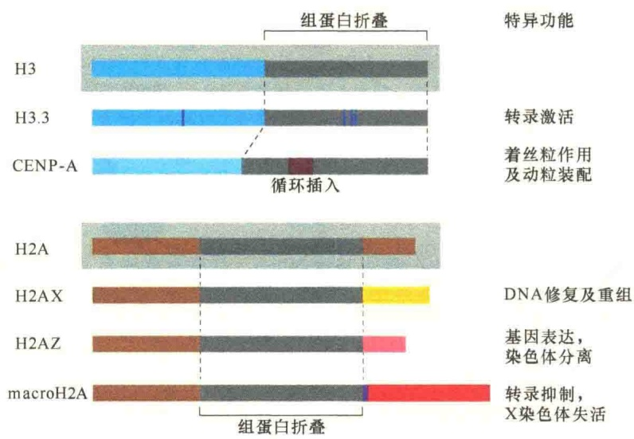

图 12-27 野生型 H3、H2A 组蛋白与 H3、H2A 组蛋白突变体的结构比较（引自 Alberts et al., 2015）。图中所列的 5 种突变体都改变了组蛋白原有的功能。

非组蛋白是一类不均一的蛋白质，约有500多种不同的组分。非组蛋白所含酸性氨基酸超过碱性氨基酸，故呈酸性，带负电荷。另外，非组蛋白常常是被磷酸化的。由于非组蛋白具有调控作用，所以它们是异质性的，具有组织特异性和发育阶段的特异性，且在活性染色质中的含量要比在非活性染色质中的含量高。有些非组蛋白是特异的转录调控因子，参与基因的选择性转录表达。

非组蛋白在整个细胞周期中都能合成，在细胞质中合成后就被转移到细胞核。

非组蛋白在作用时具有以下特性:①能识别特异的 DNA 序列，识别的信息来源于 DNA 核苷酸序列本身，识别位点存在于 DNA 双螺旋的大沟部分；②识别与结合靠氢键和离子键，而非共价键；③在不同的基因组文库之间发现这些序列特异性结合蛋白所识别的 DNA 序列在进化上是保守的。

组蛋白在各种类型细胞中的浓度基本是相同的，而非组蛋白在不同的细胞中不仅种类而且浓度也不相同，正是非组蛋白的差异调节着不同的基因表达。非组蛋白中有些是酶，有些是反式作用因子，有些则是结构蛋白，因此非组蛋白的功能也就十分广泛，如参与染色体的构建、启动 DNA 的复制、调控基因的表达等。

## 12.4.3 染色质的基本结构——核小体

染色质是真核生物细胞中 DNA 与组蛋白组成的线性复合物，由于 DNA 太长，需要以组蛋白为

核心缠绕，DNA 与组蛋白缠绕形成的小体称为核小体。

## 12.4.3.1 核小体的结构特点

在20世纪70年代初期，科学家用非特异性的核酸酶处理染色质，发现大多数DNA都会形成长度为200bp的片段。如果用同样的核酸酶处理裸露的DNA，产生随机大小的DNA片段（图12-28B）。据此推测染色体DNA中除了某些位点外，都得到了保护，使核酸酶不能随机切割，并推测这种保护作用与DNA结合的蛋白质有关。1974年，美国哈佛大学的Kornberg根据这些结果及其他的研究进展，提出DNA和组蛋白组成重复的亚单位——核小体（nucleosome）的

---

12 细胞核与染色体

385

概念。

核小体是染色质的基本结构单位，由200个左右碱基对的DNA和5种组蛋白结合而成。其中4种组蛋白（H2A、H2B、H3、H4）各2分子组成八聚体的小圆盘，是核小体的核心结构。146个碱基对的DNA在小圆盘外面绕 $1\frac{3}{4}$ 圈。每1分子的H1与DNA结合，锁住核小体DNA的进出口，起稳定核小体结构的作用（图12-28A）。两相邻核小体之间以连接DNA（linker DNA）相连，连接区DNA的长度变化不等，因不同的种属和组织而异，但通常是60bp。

用低离子浓度的溶液（如 0.7% NaCl）处理染色质，可选择性地除去组蛋白 H1。用电子显微镜观察盐处理的染色质时，可见到核小体核心颗粒和连接区 DNA 是分开的，似念珠结构（beads on a string）（图 12-28C）。

近年来，通过 X 射线晶体衍射法对核小体的结构有了深入的了解。8 个组蛋白组成 4 个异源二聚体:2 个 H2A-H2B 二聚体和 2 个 H3-H4 二聚体。2 个 H3-H4 二聚体相互结合在中央形成四聚体。2 个 H2A-H2B 二聚体位于 H3-H4 四聚体的外侧。4 个异源二聚体中的每一个二聚体都与约 30 个碱基对结合。组蛋白与 DNA 的结合可通过两种键介导:① DNA 骨架中带负电的磷酸与组蛋白中带正电的赖氨酸和精氨酸之间的离子键；② DNA 骨架和多肽骨架或侧链氨基酸之间的氢键。

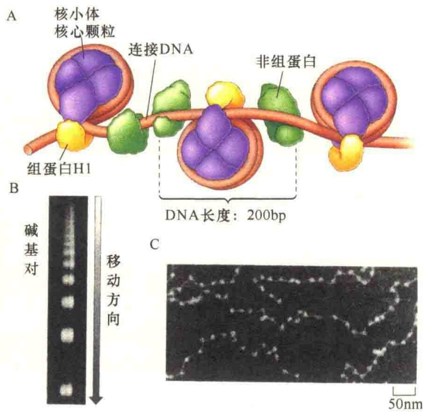

图 12-28 核小体结构（引自 Cooper and Hausman, 2016）。

A. 核小体结构示意图。细胞核 DNA 缠绕在核小体颗粒的核心组蛋白上，H1 组蛋白在核小体中起封闭作用。非组蛋白结合在核小体间的连接 DNA 上。

B. 用微球菌核酸酶部分消化染色体得到的 DNA 片段凝胶电泳图。核小体之间的连接 DNA 特别敏感，所以，染色质的有限消化，产生的片段对应于 200bp 片段的倍数，电泳时形成梯形带型。

C. 电子显微镜看到的染色质“念珠”形态。

## 12.4.3.2 核小体结构的动态性:染色质重塑

由于染色质 DNA 在间期要进行 DNA 的复制与转录，DNA 复制时，需要为新合成的 DNA 装配新的核小体八聚体组蛋白的核，DNA 转录时，核小体组蛋白的核需要与 DNA 松开，便于 RNA 聚合酶进行转录。因此不难想象，核小体结构一定是处于动态之中的，其结构与位置常常发生变化。但是，由于核小体的核心组蛋白与 DNA 结合得十分紧密，要将其松开并非易事。

前面讨论过分子伴侣参与核小体的核心组蛋白的部分及完整替换，起催化作用的是依赖于ATP的染色质重塑复合物。细胞正是依靠依赖于ATP的染色质重塑复合物的催化作用，不断调整核小体的结构，既保证了DNA复制及基因转录的顺利进行，又稳定了核小体的结构。

细胞内有很多不同种类的依赖于 ATP 的染色质重塑复合物，在复合物中含有可水解 ATP 的亚基，该亚基同时与核心组蛋白及弯曲在组蛋白上的 DNA 结合，利用 ATP 水解产生的能量，将 DNA 从核心组蛋白上移开，重塑复合物将暂时性改变核小体的结构，使得 DNA 不再与组蛋白核紧紧结合在一起。通过对 ATP 的反复水解，推动核小体沿 DNA 双螺旋移动，因此，重塑复合物能够催化核小体滑动（nucleosome sliding）。通过对核小体组蛋白核的移动，露出相应部位的 DNA 为其他的蛋白质所作用（图 12-29）。此外，某些重塑复合物与组蛋白分子伴侣协同作用，将核小体的组蛋白核进行部分或全部替换（见图 12-23）。

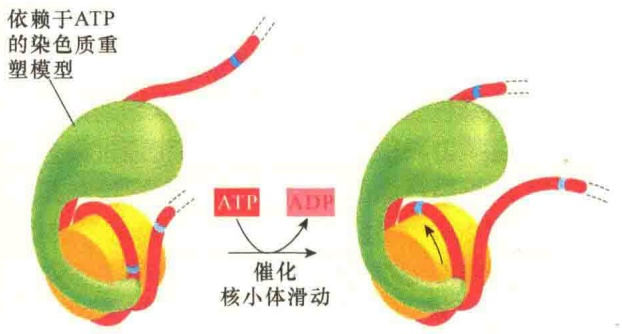

图 12-29 依赖于 ATP 的染色质重塑复合物催化的核小体滑动（引自 Alberts et al., 2015）。

---

386

细胞生物学（第二版）

## 12.4.3.3 核小体与基因转录起始

当一个基因被转录激活时，涉及启动子区核小体组蛋白的乙酰化、染色质重塑，转录的起始是转录信号与受体、组蛋白乙酰转移酶、染色质重塑复合物共同激活的过程（图 12-30）。

## 12.4.3.4 常染色质与异染色质

根据染色体在分裂期与间期的染色不同，将染色质分为常染色质（euchromatin）和异染色质

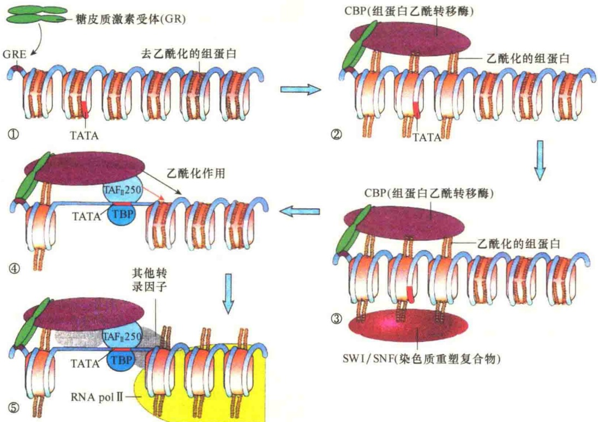

图 12-30 转录激活子启动子区结合后发生的事件（引自 Karp，2010）。①染色体中一段 DNA 因与乙酰化的组蛋白结合而处于抑制状态。②转录因子，糖皮质激素受体（glucocorticoid receptor，GR）与 DNA 序列中的糖皮质激素应答元件（glucocorticoid response element，GRE）结合，并招募可促进转录预起始复合物装配的辅助激活蛋白 CBP（CREB-binding protein）的结合。CBP 包含一个具有组蛋白乙酰转移酶（histone acetyltransferase，HAT）活性的亚基。这些酶将乙酰 CoA 供体的乙酰基转移到特定赖氨酸残基的氨基上。这样，TATA 盒上游和下游核小体核心颗粒的组蛋白被乙酰化。③乙酰化的组蛋白招募 SWI/SNF（一种染色质重塑复合物）。CBP 与 SWI/SNF 共同作用改变了染色质的结构，使之成为较为开放的状态。④另外两个蛋白 TAFⅡ250/TBP 结合到 TATA 盒区，TAFⅡ250 也具有乙酰转移酶的活性，可解开更多的核小体，从而促进了转录的起始。⑤启动子区维持乙酰化，RNA 聚合酶与启动子结合，转录开始。

## ( heterochromatin )。

在有丝分裂完成之后，大多数高度压缩的染色体要转变成间期的松散状态。但是，大约有10%的染色质在整个间期仍然保持压缩状态，将这种染色质称为异染色质，而将回复到松散状态的染色质称为常染色质。异染色质和常染色质可通过染色进行观察，间期染色深的是异染色质，染色浅的是常染色质（图12-31A）。异染色质含有的组蛋白H3，其第9位或第27位的赖氨酸通常是被甲基化修饰的；而常染色质含有的组蛋白H3，其第9位和第14位赖氨酸通常是被乙酰化的。少数组蛋白H3的赖氨酸4是被甲基化的，第10位的丝氨酸是磷酸化的（图 12-31B）。

异染色质又被分为两类:组成性异染色质和兼性异染色质。

组成性异染色质（constitutive heterochromatin）是指各种类型细胞中在整个细胞周期内都处于凝缩状态的染色质。组成性异染色质含有高度重复的随体DNA，分布于大多数染色体的着丝粒区、端粒和次缢痕处，呈现C带染色。组成性异染色质的DNA主要是高度重复顺序，含有的基因相当少。事实上，当一个有活性的基因通过转座或转位，移动到组成性异染色质区，通常要失去活性，这种现象称为位置效应（position effect），因

---

12 细胞核与染色体

387

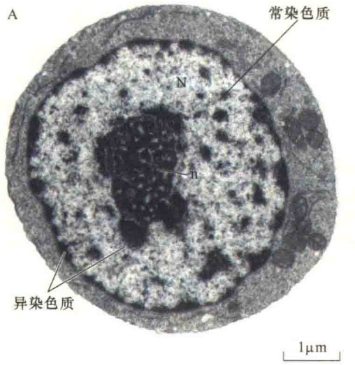

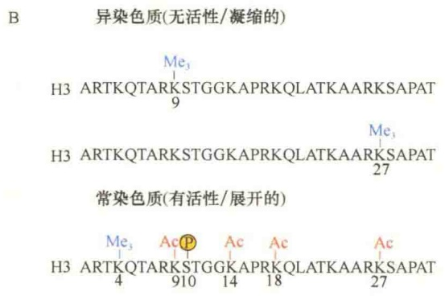

图 12-31 异染色质与常染色质（引自 Lodish et al., 2013）。A. 骨髓干细胞超薄切片的电子显微镜照片，图中的 N 和 n 分别表示细胞核和核仁，核仁外染色深的区域是异染色质。B. 常染色质与异染色质 H3 组蛋白的末端修饰的比较。

此认为组成性异染色质区含有抑制邻近基因表达的成分。

兼性异染色质（facultative heterochromatin）是指在一定的细胞类型或一定的发育阶段呈现凝缩状态的异染色质。在一定时期的特种细胞的细胞核内，原来的常染色质可转变成兼性异染色质。

## 12.5 染色体

细胞分裂时，核内染色质凝缩而成的线状结构，对碱性染料染色很深，故名染色体（chromosome）。它是染色质经多级压缩包装而成，是染色质的高级结构，仅在细胞分裂时才出现。

## 12.5.1 染色质压缩成染色体

## 12.5.1.1 染色体的四级包装

人的细胞平均含有60亿碱基对的DNA，分布在46条染色体上，每个碱基对的长度是0.34nm，60亿碱基对的DNA加起来有2m长。另外，细胞内还结合有大量的水（每个碱基对结合6分子水），直径只有10μm的细胞核如何能够容下2m长的水溶性DNA？染色质以核小体作为基本结构逐步进行包装压缩，经30nm染色质纤维、超螺线管，最后压缩包装成染色体，总共经过四级包装。

1）从 DNA 到核小体 核小体的装配是染色体装配的第一步。一个核小体的直径是 10nm，由 200 个碱基对的 DNA 组成，每个碱基对长度为 0.34nm，一个核小体伸展开来的长度是 70nm，由此推算，DNA 包装成核小体，大约压缩为原先的 1/7。

2）从核小体到螺线管（solenoid） 核小体通过自身形成螺旋的方式形成致密的、外径为30nm的管状结构，称螺线管，又称30nm染色质纤维。从完整的细胞中常常可分离到10nm的核小体纤维和30nm纤维，只要改变提取液的盐浓度即可将二者分开。至于核小体如何形成螺线管，曾提出几种假设，图12-32所示是较为公认的模型。在染色质制备物中不会形成30nm的染色质纤维，因为在这种制备物中，组蛋白H1被去除了，提示H1介导了30nm染色质纤维的形成，如果加入H1，又可形成螺线管。从核小体到螺线管压缩为原先的1/6。

## 3）从螺线管到超螺线管（supersolenoid）

30nm 的染色质纤维进一步螺旋化，形成一系列的螺旋域（coiled domain）或环（loop），这些环附着在支架（scaffold）蛋白上，螺旋域的直径是 300nm（图 12-33A）。然后，螺旋环进一步形成超螺旋环（supercoiled loop）或超螺旋域，此时的直径为 700nm（图 12-33B），每个环估计含有 50～100kb DNA，推测染色质环仍然是基因协同表达的功能单位。典型的超螺旋环的开头和结尾都是 A-T 富集序列并与核骨架或核基质蛋白结合在一起，其中包括 II 型拓扑异构酶，推测该酶调节 DNA 的超螺旋程度。DNA 从螺线管到超螺线管估计又压缩为原先的 1/40。

4）从超螺线管到染色体 超螺线管进一步

---

388

细胞生物学（第二版）

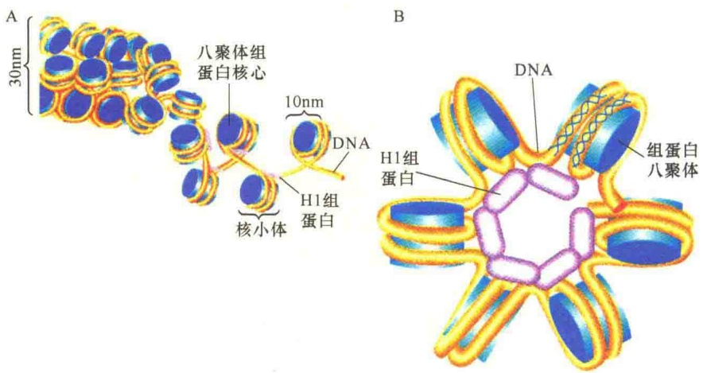

图 12-32 染色质 30nm 螺线管（引自 Griffiths et al., 2012）。核小体螺旋装配成直径为 30nm 螺线管，每一螺旋由 6 个核小体组成，并呈规则排列。A. 侧面观察核小体包装成 30nm 螺线管。B. 从端部观察的每一螺旋中 6 个核小体的排列。

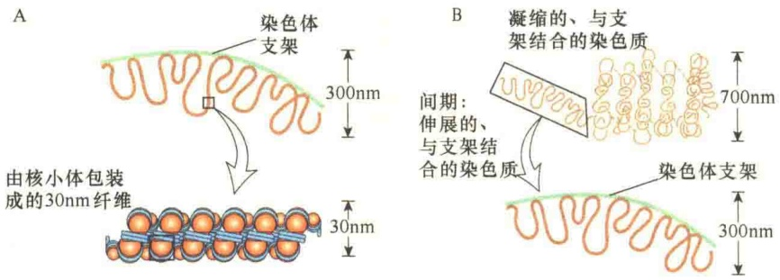

图 12-33 从螺线管到超螺线管的包装（引自 Lodish et al., 2000）。30nm 的染色质纤维沿染色体骨架蛋白形成直径为 300nm 的放射环（A），然后进一步压缩成直径为 700nm 的超螺线管（B）。

螺旋化，形成直径为 $1\sim 2\mu \mathrm{m}$ ，长度为 $2\sim 10\mu \mathrm{m}$ 的中期染色体，从超螺线管到染色体大约压缩为之前的 1/5。由此推算，DNA 经核小体到染色体，总共压缩为原先的 1/8400。

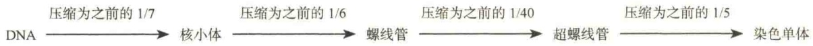

将 DNA 经由核小体包装成染色体的基本过程见图 12-34。关于 DNA 包装的一些细节问题目前尚不清楚，如在 DNA 包装成染色体的过程中，组蛋白 H1 的分子中有 5 个不同的丝氨酸残基的磷酸化，这种磷酸化的作用有待进一步研究。

至于 DNA 包装成染色体的比例，一般为 10 000 倍左右，因有丝分裂期的  $1 \mu m$  长度的染色体通常含有 1 cm 长度的 DNA。据此推算，DNA 包装压缩比为 10 000:1。这也是一种粗略的估计，不同的染色体在压缩时可能有所差异，如人的最长的 1 号染色体中的 DNA 总长为  $88\ 000 \mu m$ ，压缩成的染色体长为  $10 \mu m$ ，共压缩为之前的 1/8800。

## 12.5.1.2 SMC蛋白维持压缩的染色体结构

在真核生物的染色质压缩包装中，除了组蛋白外，还有一类蛋白质是十分重要的，这就是染色体结构维持蛋白（structural maintenance of chromosome, SMC）。SMC 蛋白的初级结构含有 5 个不同的结构域（图 12-35）。

各类生物的细胞中都有 SMC 蛋白家族的存在，真核生物有两种主要类型:黏连蛋白（cohesin）与凝缩蛋白（condensin）（图 12-36）。

黏连蛋白的作用是负责将刚刚复制的姐妹染色单体的 DNA 链维系在一起，不让它们分开

---

12 细胞核与染色体

389

DNA

核小体

30nm纤维

图 12-34 真核染色体的包装（引自 Nelson and Cox，2013）。

图 12-35 SMC 蛋白的结构（引自 Nelson and Cox, 2013）。单体 SMC 蛋白有 5 个结构域（A）:其氨基端（N 端）与羧基端（C 端）都是球形结构域，并且，N 端与 C 端结构域都含有与 ATP 结合的位点，中间是一个铰链结构域，通过两个  $\alpha$  螺旋连接结构域，将 N 端、C 端与铰链连接起来。SMC 蛋白通常以二聚体形式存在（B），每一个单体的两个  $\alpha$  螺旋结构域相互扭曲旋转，两个单体的铰链连接起来，整个二聚体形成一个 V 形结构。在 V 形的游离端，两个 N 端与两个 C 端各形成一个完整的 ATP 水解位点。

图 12-36 黏连蛋白与凝缩蛋白的结构（改自 Alberts et al., 2015）。A. 黏连蛋白由 4 个亚基组成的复合物:Smc1、Smc3、Scc1、Scc3。Smc1 与 Smc3 形成一个二聚体，头部具有 ATPase 结构域。另外两个亚基 Scc1、Scc3 与头部结构域相连接，形成一个封闭的环状结构。B. 凝缩蛋白是由 5 个亚基组成的复合物，结构上与黏连蛋白相似。Smc2、Smc4 形成一个二聚体的 V 形结构，在 ATPase 的头部有另外 3 个亚基（CAP-G/CAP-H/CAP-D2）与之结合，形成一个封闭的环。

(图 12-37)，这种连接对于在有丝分裂时确保姐妹染色单体的正确分离是极为重要的。试想 S 期合成的姐妹染色体若不被黏连蛋白圈起来，在有丝分裂时还能及时将它们召集到一起吗？可见细胞多么富有远见！

凝缩蛋白则是协助染色质压缩包装成染色体，使细胞顺利进入有丝分裂。凝缩蛋白与DNA结合，使DNA围绕核小体进行弯曲，便于染色质从核小体压缩成超级螺旋管的染色体（图12-38）。

---

390

细胞生物学（第二版）

图 12-37 黏连蛋白的作用（改自 Alberts et al., 2015）。黏连蛋白是具有 4 个亚基的复合物。A. 两个 Smc 亚基:Smc1 与 Smc3。它们都是螺旋-卷曲的结构，并且在一端都具有 ATPase 结构域。B. 另外两个亚基是 Scc1 与 Scc3，它们与 Smc 的头部结构域 ATPase 相结合，形成一个环状结构。C. 黏连蛋白环将复制的姐妹染色单体圈套在一起，直至有丝分裂。

图 12-38 凝缩蛋白在染色体压缩中可能的作用（引自 Nelson and Cox, 2013）。最初，染色体在 Smc 蛋白的铰链处弯曲，进而形成一个内部的 Smc 环。ATP 与 Smc 的头部结合，在弯曲的 DNA 处形成一个超螺旋的环。再经过头-头部相互作用与重排，形成玫瑰花形压缩的 DNA，进而压缩成染色体。图中显示的是两个近代模型。

## 12.5.2 中期染色体的形态结构

在细胞周期的有丝分裂中期，染色体的形态结构比较稳定，所以，一般所描述的染色体的形态结构都是中期染色体（图 12-39）。

图 12-39 中期染色体的扫描电镜照片（引自 Lodish et al., 2013）。染色体已经复制完成，形成两个姐妹染色单体。每个单体各有两个端粒，着丝粒位于中间的收缩处（主缢痕），还可见一些次缢痕。

染色体有种属特异性，随生物种类、细胞类型及发育阶段的不同，染色体在数量、大小和形态上存在着差异。大多数生物的体细胞具有12～50条染色体。例如，果蝇有8条染色体，而人的染色体为2n=46条。染色体的长度为0.2～50μm，一般为1～10μm。

## 12.5.2.1 着丝粒和动粒

着丝粒（centromere）是染色体中连接两个染色单体，并将染色单体分为短臂（p）和长臂（q）的结构。由于着丝粒处的染色质较细、内缢，又叫主缢痕（primary constriction）。此处DNA具高度重复，为碱性染料所深染。着丝粒有两个基本功能:第一个是在有丝分裂前将两条姐妹染色单体结合在一起；第二个功能是为动粒装配提供结合位点。着丝粒含有结构性异染色质，人的染色体着丝粒含有大约170bp的重复DNA（称为α卫星DNA），随机重复的次数达2000～30000次。

动粒（kinetochore）是由着丝粒结合蛋白在有丝分裂期间特别装配起来的、附着于主缢痕外侧的圆盘状结构，内层与着丝粒结合，外层与动粒微管结合。每一个中期染色体含有两个动粒，位于着丝粒的两侧（图 12-40）。

通过对酵母着丝粒的研究发现，酵母着丝粒区具有突变的核小体组蛋白，因此赋予着丝粒独特的性质，并在染色质上形成显著的标记。在整个细胞间期，着丝粒一直被埋在特殊的着丝粒染色质的深处，直到有丝分裂时，着丝粒才介导纺锤体与

---

12 细胞核与染色体

391

之附着，并将染色单体的 DNA 分开。着丝粒染色质含有突变的 H3 组蛋白，称为 CENP-A（centromere protein-A），再加上其他的一些蛋白质将核小体包装成特别密集的列阵，最后形成动粒，这种特别的结构是有丝分裂纺锤体附着所必需的。

在裂殖酵母中，大约 125 个核苷酸对的 DNA 序列就可以构成一个着丝粒。尽管该序列很小，但足以让十多个蛋白质，包括 CENP-A 组蛋白 H3 突变体在该 DNA 序列上装配特异的核小体组蛋白的核。附着在酵母着丝粒上的其他蛋白质可介导一个独立的纺锤体微管与之结合（图 12-41）。

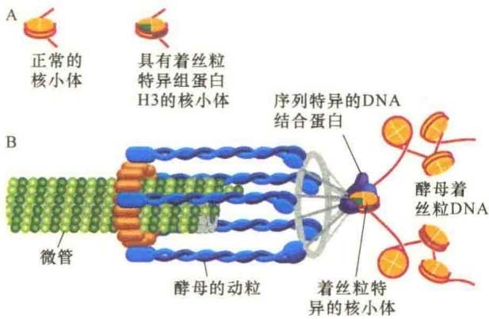

图 12-41 简约的着丝粒结构模型（引自 Alberts et al., 2015）。A. 裂殖酵母着丝粒中具有着丝粒特异的组蛋白 H3 突变的核小体，核小体中 CENP-A 取代了正常的 H3 组蛋白。B. 突变的组蛋白介导其他一些蛋白质装配成动粒。酵母的动粒较小，一般只能捕获一条纺锤体微管，而人具有很大的着丝粒，能够形成大的动粒，可捕获多条纺锤体微管。

## 12.5.2.2 次缢痕与核仁组织区

次缢痕（secondary constriction）是染色体上的一个缢缩部位，由于此处部分的 DNA 松解，形成核仁组织区，故此变细。它的数量、位置和大小是某些染色体的重要形态特征。每种生物染色体组中至少有一条或一对染色体上有次缢痕。

核仁组织区（nucleolar organizing region, NOR）是细胞核特定染色体的次缢痕处，含有rRNA基因的一段染色体区域，与核仁的形成有关，故称为核仁组织区。核仁是NOR中的基因活动而形成的可见的球体结构。具有核仁组织区的染色体数目依不同细胞种类而异，人有5对染色体，即13、14、15、21、22号染色体上有核仁组织区。

图 12-40 有丝分裂中的着丝粒与动粒（引自 Alberts et al., 2015）。
A. 着丝粒区与动粒。B. 后期微管与染色单体动粒附着的电镜图。

## 12.5.2.3 端粒与端粒酶

端粒（telomere）是真核细胞染色体末端的特殊结构。人的端粒由6个碱基重复序列（TTAGGG）和结合蛋白组成。端粒的功能是保持线性染色体的稳定，即不环化、不黏合、不被降解。端粒酶（telomerase）是细胞中负责端粒延长的一种酶，属于逆转录酶，可将端粒DNA加至真核细胞染色体末端。该酶自身含有一个RNA分子，可作为延长DNA末端合成的模板，合成的方向是 $5'\rightarrow3'$ （图12-42）。

## 12.5.2.4 核型

核型（karyotype）又叫染色体组型，是指染色体组在有丝分裂中期的表型，是染色体数目、大小、形态特征的总和。在对染色体进行测量计算的基础上，进行分组、排列、配对，并进行形态分析的过程叫核型分析。图12-43是通过染色体涂染（chromosome painting）技术——一种改良的荧光原位杂交（fluorescence in situ hybridization，FISH）获得的人染色体核型。

## 12.5.3 巨型染色体

某些生物的细胞中，特别是在发育的某些阶段，可以观察到一些特殊的染色体，它们的特点是体积巨大，细胞核和整个细胞体积也大，所以称为巨大染色体（giant chromosome），包括多线染色体和灯刷染色体。

## 12.5.3.1 多线染色体

核内 DNA 多次复制产生的子染色体平行排列，并通过同源染色体配对，紧密结合在一起，从而阻

---

392

细胞生物学（第二版）

图 12-42 端粒合成（引自 Alberts et al., 2015）。图中显示的是真核生物染色体的末端（端粒）重复序列的合成反应。亲代 DNA 链的 3' 端通过以 RNA 为模板的 DNA 合成来延伸，然后再通过 DNA 聚合酶 α（该酶含有一个 DNA 引物酶亚基）合成互补链。

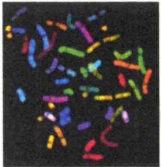

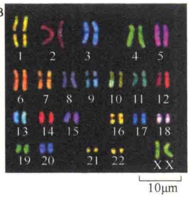

图 12-43 人的男性染色体核型（引自 Lodish et al., 2013）。
A. 用染色体涂染技术鉴定的人的染色体。
B. 涂染染色体经计算机处理排列出的正常男性的染色体核型。

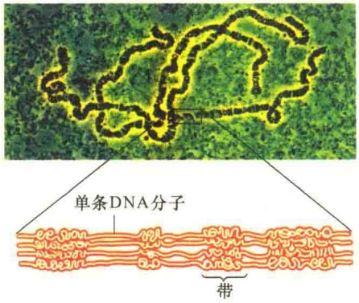

图 12-44 果蝇幼虫唾液腺多线染色体（引自 Karp, 2010）。光学显微镜下观察的果蝇唾液腺染色体，观察到染色体上约有几千个不同的、染色很深的带，这些带是不同的基因位点。

止了染色体纤维进一步凝缩，形成体积很大的、由多条染色体组成的结构叫多线染色体（polytene chromosome）。多线化的细胞处于永久间期，体积也相应增大，它存在于双翅目昆虫的幼虫组织内，如唾液腺、气管等。

多线染色体来源于核内有丝分裂（endomitosis）。对幼虫果蝇唾液腺细胞的染色体分析发现比其他类型的细胞中的染色体粗100倍。在幼虫发育期间，这些细胞停止了分裂，但体积不断增大，DNA继续进行复制，以维持细胞的高分泌活性。复制的DNA链并不分开而是平行排列，产生的巨型染色体中所含DNA链是正常染色体的1024倍（图12-44）。

在光镜下观察染色的多线染色体，可见一系列交替分布的带和间带（interband）。同一种属中的不同个体间多线染色体的带型基本一致，但不同种果蝇的多线染色体的带型差别很大。后来发现带型与基因有关，不仅如此，多

线染色体的带在遗传分析中有重要作用，如比较不同种多线染色体的带型可进行进化的研究。另外，多线染色体并非是细胞内的惰性结构，而是动态的，含有很多在发育的特定阶段形成胀泡（puff）的区域，是DNA转录成RNA的结果。

## 12.5.3.2 灯刷染色体

灯刷染色体（lampbrush chromosome）是卵母细胞进行第一次减数分裂时，停留在双线期的染色体。它是一个二价体，含4条染色单体，由轴和侧丝组成，形似灯刷（图12-45）。染色体轴由染色粒（chromomere，是指染色质凝缩而成的颗粒）轴丝构成，每条染色体轴长 $400\mu m$ ，从染色粒向两侧伸出两个相类似的侧环，伸出的环是对称的，一个平均大小的环约含100kb DNA。

灯刷染色体的形态与卵子发生过程中营养物储备是密切相关的。大部分 DNA 以染色粒形式存在，没有转录活性；而侧环是 RNA 转录活跃的区域，一个侧环往往是一个大的转录单位，有的是由几个转录单位构成的。灯刷染色体侧环上的 RNA 主要是 mRNA，mRNA 与蛋白质结合形成无活性的 RNP 颗粒，这些颗粒储存在卵母细胞中，以便受精之后使用。与 DNA 结合并储存起来的蛋白质主要是转录因子，如 FRGY2，在卵母细胞生长过程中可选择性地调节基因表达。

---

12 细胞核与染色体

393

图 12-45 灯刷染色体的形态结构（引自 Kleinsmith and Kish, 1995）。灯刷染色体在染色粒轴丝上间隔形成侧环，环是成对的，但是由不同的染色质产生，环上还有 RNA 覆盖。

灯刷染色体除了具有合成和储存的作用外，对于卵子发生期的核糖体合成有重要作用。在卵子发生的生长期，需要大量的核糖体；细胞核必须将大量的核糖体RNA供给细胞质体积已经很大的卵母细胞，这势必给细胞核中核糖体基因的转录带来沉重的负担。为缓解这一问题，需要选择性地扩增rRNA基因，其结果是rRNA基因的拷贝数成千倍地增加，这就相当于增加了核仁的数量。

## 12.6 核仁与核基质

大多数真核生物细胞核的一个显著特点就是有一个大的球形的核仁存在，是细胞内核糖体亚基装配的部位。此外，细胞核中有类似于细胞质骨架的纤维网络，即核基质（nuclear matrix）。

## 12.6.1 核仁

## 12.6.1.1 核仁的形态

核仁（nucleolus）呈圆形或卵圆形，无界膜包

被，是由多种组分形成的一种网状结构。

核仁的大小、形状和数目随生物的种类、细胞类型及细胞代谢状态而变化。蛋白质合成旺盛、代谢活跃的细胞，如分泌细胞、卵母细胞的核仁大，可占核体积的25%。不具蛋白质合成能力的细胞，如休眠的植物细胞，其核仁很小。大多数细胞只含有1\~2个核仁，但也有少数细胞含有几十个乃至几千个核仁（图12-46）。

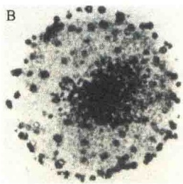

图 12-46 单核仁、多核仁与异染色质（改自 Cooper and Hausman，2013）。A. 异染色质与核仁。长箭头所指是单个核仁，短箭头所指是细胞核内的异染色质。B. 爪蟾卵母细胞核中进行 rRNA 扩增的多个核仁，有时多达几千个，满足细胞核内积累的  $10^{12}$  个核糖体。

## 12.6.1.2 核仁的基本结构

从形态上看，核仁是由三个球形的区域构成:纤维中心、致密纤维组分、颗粒区。①纤维中心（fibrillar center, FC）呈浅染区，位于核仁的中央部位，直径2\~3nm，能被RNA酶消化，由DNA和RNA组成。②致密纤维组分（dense fibrillar component, DFC）位于浅染区周围，直径为5\~10nm，含有正在转录的RNA分子。③颗粒区（granular component, GC）呈致密的颗粒，直径为15\~20nm，位于周边，代表已合成的核糖体前体颗粒。图12-47是人的成纤维细胞超薄切片的电镜照片。

## 12.6.1.3 核仁的功能

核仁是细胞合成核糖体的工厂，涉及 rRNA 的转录加工和核糖体大小亚基的装配。

核仁中的 rRNA 是由专一的 RNA 聚合酶 I 转录的。真核细胞中，rRNA 基因存在于特定的染色体上，并且有恒定的拷贝数。

每个 rRNA 基因转录单位由 RNA 聚合酶 I 转录，产生相同的初始转录物——前 rRNA。负责前 rRNA 加工的酶是 RNase，在人的 45S rRNA 前体上有 110 多个甲基化位点，这些甲基化的核苷酸序列全部进入加工后成熟的 rRNA 分子中。据此认为，这些甲基化位点可能是加工过程中酶的识

---

394

细胞生物学（第二版）

图 12-47 人成纤维细胞中核仁的电子显微镜照片（引自 Alberts et al., 2008）。A. 完整的细胞核。B. 正在进行 rRNA 基因转录的核仁，显示了三个不同的区域。

别标记。

实际上，核仁中 rRNA 的合成、加工与核糖体的装配是同步进行的。核糖体亚基的装配是一个十分复杂的过程。研究表明，30min 内，首先是核糖体小亚基在核仁中成熟产生，很快出现在细胞质中；而 28S rRNA、5.8S rRNA 和 5S rRNA 组装成

大亚基需要 1h。图 12-48 是核糖体亚基在核仁中的装配与运输。

60S 核糖体亚基的输出需要受体运输蛋白，根据对酵母突变体的研究，发现 60S 核糖体亚基的受体蛋白是 Crm1。Crm1 不能直接与 60S 亚基结合，需要一种称为 Nmd3 的衔接蛋白介导。此外，60S 核糖体亚基的输出至少还需要另外两个受体:Mtr2/Mex67。40S 的核糖体亚基的输出受体也是 Crm1，但不需要衔接蛋白 Nmd3。无论是 60S 亚基还是 40S 亚基的输出，都需要 Ran-GTP。

由于核糖体是合成蛋白质的机器，只要控制了核糖体的合成和装配，就能有效地控制细胞内蛋白质的合成速度，调节细胞生命活动的节奏。因此，从某种意义上说，核仁实际上调控着蛋白质的合成。

## 12.6.2 核基质与核骨架

组成染色质纤维的 DNA 和蛋白质占细胞核总质量的 80%\~90%，因此推测只要去除细胞核内的染色质纤维，细胞核就会解体。令人惊讶的是，1974 年 Berezney 和 Coffey 首次用 DNase 和去垢剂处理细胞核，除去了 95% 的核物质后，剩下的竟是水不溶的纤维网络，这种结构称为核基质。

## 12.6.2.1 核骨架的结构与化学组成

由于一开始不知道细胞核内有蛋白质纤维的存在，所以核基质就成为细胞核内除染色质及核仁外所有物质的总称，后来在核内发现了蛋白质纤维，并发现细胞核内的蛋白质纤维与细胞质骨架在结构组织与功能上有相似之处，从而将其称为细胞核骨架。此时，核基质自然被理解为核骨架，即核基质与核骨架混同，其概念可以互用。

严格地说，核基质与核骨架的概念是不同的，核基质包括细胞核内的

液体（核液）和蛋白质纤维两个部分；细胞核骨架（nuclear skeleton）是细胞核内所有由蛋白质组成的纤维网络结构，包括染色体装配支架、与内核膜相连的核纤层。核骨架通过内、外核膜穿膜蛋白的连接作用，与细胞质骨架连成一个整体（图 12-49）。

图 12-48 核糖体亚基在核仁中装配与运输（引自 Plopper，2016）。细胞质中合成的核糖体蛋白质输入细胞核后，与核仁中转录加工的 pre-rRNA 装配成 90S 的前体核糖体，进一步加工形成大小不同的两个核糖体前体亚基:pre-40S 与 pre-60S。经核孔转运到细胞质后，加工成成熟的 40S 与 60S 两个亚基，参与蛋白质的合成。

---

12 细胞核与染色体

395

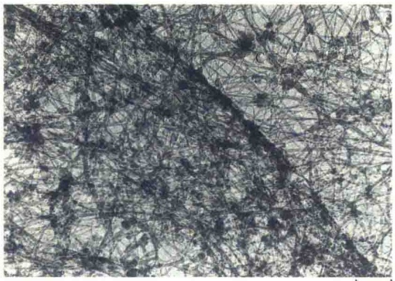

图 12-49 细胞质与细胞核骨架网络（引自 Karp, 2010）。用高盐和 DNase 去除了 DNA，并用去垢剂抽提的鼠成纤维细胞的电子显微镜局部照片所显示的细胞骨架网络结构。C 表示细胞的细胞质区域，N 表示细胞核。可见细胞核与细胞质间有明显的界限，C 区是细胞质骨架，N 区是细胞核骨架。

核骨架主要是由一些目前还不太了解的蛋白质纤维组成，在纤维装配时也不像细胞质骨架那样有序，但是，在核骨架蛋白纤维形成时，RNA似乎具有重要作用，因为当用去垢剂、DNase和高盐处理细胞后可得到不溶性的蛋白质纤维，若是再加上RNase处理抽提细胞就不再有蛋白质纤维了。

前面讨论的 DNA 由 30nm 染色质纤维包装成超螺线管时，染色质要在蛋白质骨架上形成放射环结构，后来发现这种蛋白质骨架中有拓扑异构酶的存在，推测该酶也是核基质的组成成分。

核纤层的化学本质是中间纤维蛋白，有一定的结构。

## 12.6.2.2 核骨架的功能

由蛋白质纤维组成的核基质分布在整个细胞核内，参与和支持 DNA 的各种功能，包括 DNA 复制、转录、加工、接收外部信号及维持染色质的结构等，作用方式主要是提供作用位点。

1）染色体装配支架 在染色体包装时需要非组蛋白作为染色体支架（chromosome scaffold）。在间期，染色质以30nm纤维的形式存在于细胞核中，这需要在染色体骨架上将核小体10nm纤维进行压缩。为了证明染色体骨架的存在，可分离有丝分裂前的染色体，并用溶液溶解组蛋白和大多数主要的非组蛋白，然后在电子显微镜下观察，可见一完整的染色体框架（framework）或支架（scaffold）（图12-50A）。推测染色体支架是细胞核中的核基质蛋白。当细胞进入有丝分裂前期时，非组蛋白的染色体骨架形成中心轴，染色质通过染色质结合蛋白在染色体支架上进一步压缩包装，形成放射环（图 12-50B）。

图 12-50 染色体装配支架及放射环（引自 Karp，2010）。
A. 用除去了大多数组蛋白和非组蛋白后剩下的染色体支架。
B. 染色质沿染色体支架轴形成放射环。

采用不同荧光标记的探针与人的间期细胞DNA进行原位杂交证实了染色质纤维环的存在。实验中，探针的使用是一个关键，这些探针的作用位点最好是靠近推测的特定DNA序列，即支架结合区[(scaffold-associated region, SAR)，又称基质结合区（matrix-associated region, MAR)]。SAR是位于转录的活性基因两端（或放射环两端）的DNA序列，富含AT。SAR中含有拓扑异构酶Ⅱ的作用位点。通过SAR与拓扑异构酶结合，从而将染色质锚定于核骨架上，并形成染色质纤维环（图12-51）。原位杂交分析染色质放射环的原理是:由于各探针在活性DNA上作用位点间的距离都在几百万碱基对，如果这些位点都在同一个放射环上，那么杂交后显示的距离就很近。

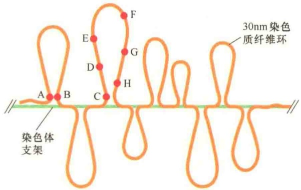

图 12-51 间期染色质纤维环的实验证明（引自 Lodish et al., 2000）。图中的 A～H 表示不同的探针，其中 A 和 B 的杂交位点在同一个环，其他的在另一相同环内。

2）核内酶促反应装置及锚定 细胞核内重要的生命活动是DNA复制、RNA转录、RNA加工，这些活动都需要有工作的平台，如DNA复制需要有复制小体（replisome），RNA转录需要有RNA

---

396

细胞生物学（第二版）

聚合酶Ⅱ全酶（holoenzyme）复合物，RNA的剪接需要形成剪接体（spliceosome）。研究揭示，这些酶促反应装置都是附着在蛋白质纤维上（图12-52），细胞核内的蛋白质纤维显然就是核骨架了。这就意味着，当复制、转录、剪接发生时，这些蛋白质的酶促装置被锚定在核骨架，核酸就可以沿着反应复合物进行移动。

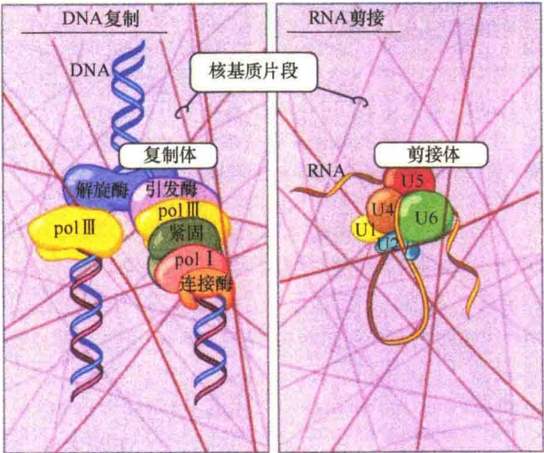

图 12-52 核内酶促反应装置的锚定（引自 Plopper, 2016）。核基质为酶促反应装置提供锚定位点，使得各种酶促反应装置互不干扰。图中显示的 DNA 复制时形成的复制体与转录过程中形成的剪接体分别锚定在不同区域的核基质中，保持了它们各自的独立性。

3）核纤层在核膜结构维持与重建中的作用 核纤层位于内核膜的下方，是一种纤维网络，为细胞核提供结构支持。核纤层是由核纤层蛋白单体组装起来的多聚体纤维。组装的第一步是由两个核纤层蛋白多肽链通过各自的α螺旋区相互缠绕形成螺旋化的螺旋（coiled coil）；第二步是二聚体通过头-尾连接形成长的多聚体；第三步是多聚体之间通过侧向连接形成核纤层。核纤层蛋白可以通过两种方式与内核膜相连:第一种方式是在核纤层蛋白翻译后在C端的一个半胱氨酸残基上添加脂，然后通过脂锚定的方式将核纤层蛋白结合到内核膜；第二种方式是核纤层蛋白与内核膜的膜蛋白结合，结合的内核膜蛋白将核纤层蛋白组织成为网络结构，并介导与内核膜结合。

核纤层蛋白装配成核纤层纤维网络后附着在内核膜上，成为膜骨架，极大地增强了核膜的机械强度，实际上为细胞核的形态与功能提供了结构支持（structural support）。细胞核内的染色质通常要组成大的染色体环，核纤层为染色质提供锚定位点，从而介导了染色体环的形成。

在有丝分裂前期，细胞核需要拆除，核孔复合物与核纤层都需要去装配，而核被膜则被片段化。在细胞核拆除过程中，至少有部分核孔蛋白及核纤层蛋白被有丝分裂激活的周期蛋白依赖性激酶磷酸化。此时，某些NPC蛋白与核输入受体结合在一起，这些蛋白质在以后的细胞核重建中起重要作用。与核孔复合物解离的核被膜蛋白、核纤层蛋白，以及染色质散布在整个细胞中。通过对细胞核膜的拆除，染色质与细胞质之间的“隔离墙”解体，使得不再与膜或染色体结合的核蛋白完全与细胞质蛋白质混合在一起。在有丝分裂后期，核膜片段与分离开的子染色体重新装配成新的细胞核（图12-53）。此外，在核孔运输中发挥了关键作用的Ran-GTPase，在有丝分裂与细胞核的重建过程中也具有重要作用。

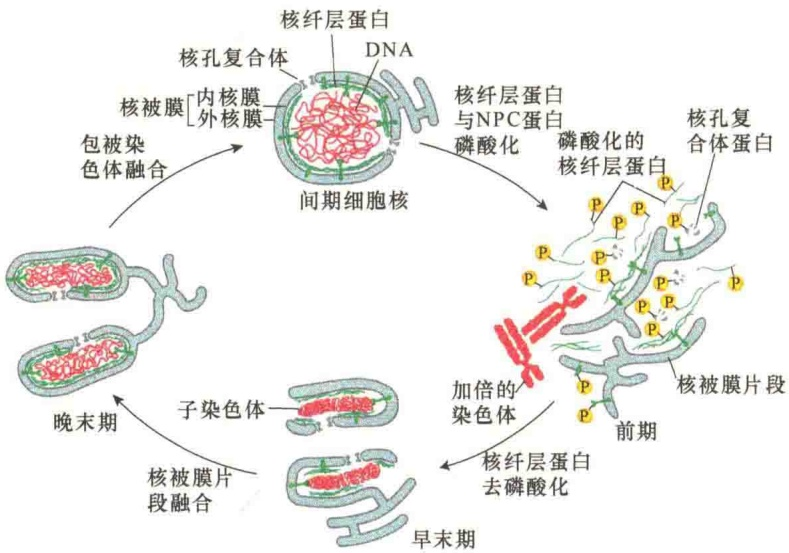

图 12-53 有丝分裂中核被膜与核纤层的解离和重建（引自 Alberts et al., 2015）。核纤层蛋白的磷酸化，触发核纤层的去装配。核纤层的去装配引起核被膜的断裂。核纤层蛋白的去磷酸化，则触发相反的过程，即核被膜的重建。某些核孔蛋白、内核膜蛋白发生类似的磷酸化与去磷酸化循环。在核被膜的重装配过程中，还涉及其他一些蛋白质的去磷酸化。核被膜的重新装配是从单个凝缩的染色体开始的，即核被膜片段先将单个凝缩的子代染色体包裹起来，最后融合成新的细胞核。

---

12 细胞核与染色体

397

## 本章小结

细胞核是细胞的遗传机构，主要有两个功能:一是通过遗传物质的复制和细胞分裂保持细胞世代间的连续性；二是通过基因的选择性表达，控制细胞的活动。

真核生物的细胞核被双层的核被膜包裹着，核被膜由外核膜、内核膜、核周隙、核孔复合体和核纤层5个部分组成。

核孔复合物的结构是一个围绕中央通道的8对称圆柱形结构，核孔的中央部分有8个辐条环，在辐条环的细胞质面有胞质环，在辐条环的核质面有核质环，在核质环上有8条伸向核质的纤维，形成核篮。核孔复合体具有选择性运输作用，核蛋白进入细胞核须由核定位信号（NLS）及输入受体介导，且要有一种小GTP结合蛋白的帮助。输出需要有输出信号、输出受体等。各种RNA的输出都是由输出受体介导的。

第一个被发现的分子伴侣是核质蛋白，它介导核小体的组装。分子伴侣的功能有:帮助蛋白质折叠和装配、帮助蛋白质的转运和定位、参与应激反应、参与染色体重塑、参与内质网中蛋白质的质量监控等。

染色质是细胞间期细胞核内能被碱性染料染色的物质，由 DNA 和蛋白质组成。染色体是由染色质压缩包装而成的棒状结构，是中期染色质的表现形式。组蛋白是真核生物染色体的基本结构组分，有 H1、H2A、H2B、H3、H4 5 种类型。其中，H2A、H2B、H3、H4 为核小体核心组蛋白；H1 在构建核小体时起连接作用。组蛋白的某些氨基酸侧链常会被磷酸化、乙酰化或甲基化修饰，这些修饰对保护、稳定和调控遗传物质的功能起重要作用。根据染色反应不同，染色质分为异染色质与常染色质，异染色质通常没有转录活性。

核小体是染色质的基本结构, 由 146 个碱基对的 DNA 在八聚体的组蛋白外绕了 $1 \frac{3}{4}$ 圈, H1 位于核小体 DNA 的进出口处, DNA 经过 4 级包装形成染色体。

着丝粒又称主缢痕，动粒是装配在着丝粒外侧的蛋白结构，细胞分裂时提供与纺锤体微管结合的位点。

某些生物在发育过程中，某些组织的细胞会出现巨大染色体，包括多线染色体和灯刷染色体。

核仁由纤维区、颗粒区、核仁染色质、基质四部分组成。它是一种动态结构。核仁的主要功能是合成rRNA、装配核糖体，也在一定程度上控制着蛋白质合成的速度。

核骨架是细胞核内由蛋白质组成的纤维结构，包括核纤层。主要功能是维持细胞核的空间结构、为染色体压缩提供支架、为细胞核内酶促反应机器提供锚定位点、维持核膜的稳定及重建等。

## 思考题

（1）为什么真核细胞需要细胞核作为独立的区室，而原核细胞没有核膜也能生存？

(2) 什么是核纤层? 结构上有哪些特点? 有哪些生物学功能?

(3) 核孔复合体最重要的功能是物质运输, 也是细胞内最为复杂的运输, 简述核孔复合物的运输有哪些特点。

（4）何谓分子伴侣？举例说明分子伴侣的重要性。

（5）什么是染色体结构维持蛋白？结构上有什么特点？有什么作用？