13.1 细胞周期时相及研究方法

13.1.1 细胞周期的时相及细胞类型

13.1.2 细胞周期各时相的合成活动

13.1.3 细胞进程与同步化研究

13.2 细胞周期调控

13.2.1 细胞周期调控系统

13.2.2 有丝分裂促进因子的发现与鉴定

13.2.3 裂殖酵母细胞周期调控

13.2.4 芽殖酵母的细胞周期调控

13.2.5 哺乳动物细胞周期的控制

13.2.6 CDK与细胞周期调控

13.2.7 细胞周期关卡

13.3 有丝分裂

13.3.1 有丝分裂过程

13.3.2 有丝分裂机制

13.4 减数分裂

13.4.1 减数分裂I与减数分裂Ⅱ的形态变化

13.4.2 减数分裂过程中的遗传重组及其机制

13.4.3 减数分裂与有丝分裂的比较及意义

生长和增殖是生物的基本特性，无论是单细胞的生物还是多细胞的生物，每个细胞都必须进行生长和分裂。细胞通过分裂形成的新细胞必须具有与亲代细胞相似的遗传性，因此，细胞分裂的前提是遗传物质的复制、各种细胞器及生物大分子的倍增与细胞体积的增大。细胞通过分裂，将复制的遗传物质均等地分配到两个子细胞中，保证了细胞遗传的稳定。

## 13.1 细胞周期时相及研究方法

人们习惯于用“周期”一词来思考生物学过程，包括生命周期、代谢周期、生理周期。生命是从一代向下一代传递的连续过程，因此是一个不断更新、不断从头开始的过程。就一代细胞而言，细胞的生命开始于产生它的母细胞的分裂，结束于它的子细胞的形成，或是细胞的自身死亡。通常将通过细胞分裂产生的新细胞的生长开始到下一次细胞分裂形成子细胞结束为止所经历的过程称为细胞周期（cell cycle）（图13-1）。在这一过程中，细胞的遗传物质复制并均等地分配给两个子细胞。

## 13.1.1 细胞周期的时相及细胞类型

细胞周期是一个相当复杂的过程，不同类型的细胞周期持续的时间不完全相同，且细胞的分裂状态也各不相同。

## 13.1.1.1 细胞周期的时相

根据光学显微镜所观察到的细胞分裂时的活动，将细胞周期分为两个主要的时期:有丝分裂期（mitotic phase）和间期（interphase）。有丝分裂期简称为 M 期（M phase）。

M 期包括细胞的核分裂和胞质分裂两个过程。在有丝分裂的过程中，复制的染色体被分配到两个子细胞核中；胞质分裂则是将整个细胞一分为二，形成两个子细胞。M 期所持续的时间较短，一般为 30～60min；分裂间期的时间跨度较长，根据细胞的类型和所处的条件不同而不同，有几小时、几天、几周或更长。

间期实际上是新细胞的生长期，根据新细胞从开始生长起到分裂前止的分裂间隔期中的生理和生化变化，可分为 $G_{1}$ 期（gap1 phase）、S期（synthetic phase）、 $G_{2}$ 期（gap2 phase）。细胞周期所持续的时间一般为12～32h；人的细胞周期约为24h，其中分裂期0.5h， $G_{1}$ 期9h，S期10h， $G_{2}$ 期4.5h。

不同生物的细胞周期时间是不同的，同一系统中不同细胞的细胞周期时间也有很大的差异。一般说来，S期、 $G_{2}$ 期、M期的时间变化较小，而 $G_{1}$ 期持续时间的差异可能很大。例如，小鼠食管和十二指肠上皮细胞同属于消化系统，但它们的细胞周期时间却明显不同，分别为115h和15h。这种差异主要是由 $G_{1}$ 期的不同造成的，因为食管上皮细胞的 $G_{1}$ 期长达103h，而十二指肠上皮细胞的 $G_{1}$ 期仅为6h。由此看来，细胞周期的长短主要取决于 $G_{1}$ 期的长短。

卵受精后产生的胚胎细胞周期比较特别，不仅短（30min或以下），而且没有 $G_{1}$ 期与 $G_{2}$ 期，仅有M期与S期，并且都非常之短（图13-2）。

与快速分裂的早期胚胎细胞相反，成年动物的某些细胞会停止分裂（如神经细胞），还有一些细胞处于停止分裂状态，只是在有需要的情况下才进行分裂，如因细胞损伤或死亡，需要产生新细胞

进行取代或补充。此类细胞包括皮肤的成纤维细胞、某些内部器官（如肝细胞）等。这些停止分裂的细胞脱离了 $G_{1}$ 期，处于一个相对静止的时期—— $G_{0}$ 期，在该时期，细胞保持代谢活性，但不再进行增殖。某些 $G_{0}$ 期的细胞在合适的环境信号的召唤下重新进入细胞周期，但有些类型的细胞，包括成年动物中大多数分化的细胞则是永久性脱离了细胞周期，不再进行分裂。

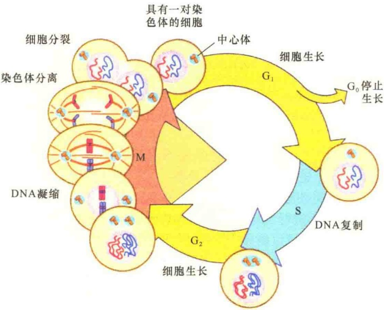

图 13-1 细胞周期及染色体行为（引自 Lodish et al., 2013）

## 13.1.1.2 细胞周期和细胞类群

在正常的情况下，一个完整的细胞周期应包括4个时相，细胞沿着 $G_{1}\rightarrow S\rightarrow G_{2}\rightarrow M$ 期的路线运转，通过M期，母细胞一分为二产生两个子细胞。但在细胞社会中，不仅细胞彼此分工不同，分裂行为也有所差异。根据细胞的分裂行为，可将真核生物细胞分为以下三类。

1）持续分裂细胞又称周期性细胞，即在细胞周期中连续运转的细胞。肌体内某些组织需要不断地更新，组成这些组织的细胞就必须通过不断分裂产生新细胞。此类细胞的分裂周期非常正常，有丝分裂的活性很高。例如，性细胞（包括卵母细胞和精原细胞）不断地产生配子；造血干细胞不断地产生红细胞和白细胞；上皮基底层细胞通过分裂不断补充表面老化死亡的细胞；植物的根茎尖端细胞通过分裂进行生长等。这些类型的细胞都是具有正常周期的持续分裂细胞。

图 13-2 胚胎细胞周期（引自 Cooper and Hausman，2016）。在早期细胞胚胎周期中，卵细胞质（egg cytoplasm）快速分裂成小细胞。此时细胞不会生长，缺少  $G_{1}$  期、 $G_{2}$  期，只有短的 S 期与 M 期。

2）终端分化细胞 即永久性失去了分裂能力的细胞，它们不可逆地脱离了细胞周期，但保持了生理活性机能。这些细胞都是高度特化的细胞，如哺乳动物的红细胞、神经细胞、多形性白细胞、肌细胞等，这些细胞一旦分化，就永远保持这种不分裂状态直到死亡。

3） $G_{0}$  细胞又称休眠细胞，暂时脱离细胞周期，不进行 DNA 复制和分裂，也称静止细胞群。但这类细胞可在某些条件的诱导下重新开始 DNA 合成，进行细胞分裂。例如，外科手术切除部分肝组织后可以诱导肝细胞进行细胞分裂，淋巴细胞可通过与抗原的相互作用诱导增殖。

在胚胎发育早期（卵裂期），所有的细胞均为周期性细胞，以后随着发育成熟，某些细胞进入了 $G_{0}$ 期，某些细胞分化后丧失分裂能力。到成体时，只有少数细胞处于增殖状态，它们的增殖仅作为补充丢失的细胞，或对外界信号的应答。

## 13.1.2 细胞周期各时相的合成活动

在细胞周期的不同阶段中，生化合成反应是不同的。

1） $G_{1}$ 期  $G_{1}$ 期是从有丝分裂完成到DNA复制前的一段时期，又叫合成前期。此期主要合成rRNA、蛋白质、脂类和糖类。在 $G_{1}$ 期的后期，DNA合成酶的活性大大增加。

$G_{1}$ 期进入S期与S期激活因子有关。如将S期和早 $G_{1}$ 期细胞融合，S期细胞可以诱导 $G_{1}$ 期细胞提前进入S期，表明早 $G_{1}$ 期细胞尚未出现S期激活因子。

2）S期 S期即DNA合成期（DNA synthesis phase）。细胞周期中S期是最重要的一个时期，在此期，除了DNA合成外，同时还会合成组蛋白，DNA复制所需的酶都在这一时期合成。

组蛋白的合成主要是在 S 期。在 S 期，组蛋白的 mRNA 水平可增加 50 倍。也就是说，DNA 的合成和组蛋白的合成在时间上是同步的，在密度上是相应的，从而使新合成的 DNA 得以及时包装成核小体。另外，推测组蛋白具有 DNA 复制延长因子的作用，没有组蛋白，DNA 的复制就会停止。

此外还发现 DNA 复制时，不同的序列复制先后顺序不同，具有时序性，即常染色质复制在先，异染色质在后；能转录的 DNA 先复制，不能转录的 DNA 后复制；GC 含量高的 DNA 复制在先，AT 含量高的在后。

3） $G_{2}$ 期  $G_{2}$ 期是DNA合成的后期。在这一时期，主要是大量合成ATP、RNA、蛋白质，包括微管蛋白和促成熟因子等，为有丝分裂做准备。

4）分裂期 分裂期包括核分裂和胞质分裂，并形成两个子细胞的过程。这一时期的主要特点是染色体凝缩，并且在纺锤体的作用下，两个姐妹染色单体被均等地分配到两个子细胞。虽然M期在整个细胞周期中的时间很短，但过程很复杂，分为有丝分裂与胞质分裂两个阶段，而有丝分裂又分为5个时期（图13-3）。

## 13.1.3 细胞进程与同步化研究

细胞各不同时相的生化合成活动是随着细胞生命的进程而变化。如同人类社会，在细胞群体中并非都是整齐划一的处于同一个时期，因此，研究细胞进程及获得同步化的细胞十分重要。

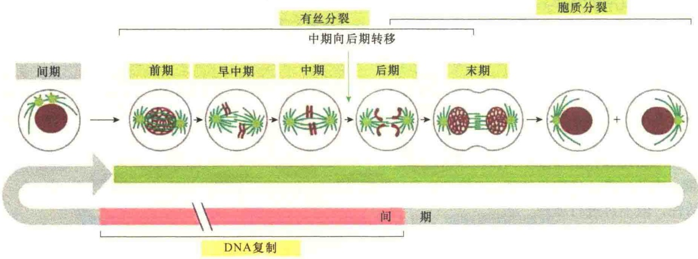

图 13-3 真核细胞分裂期的主要事件（引自 Alberts et al., 2015）。在显微镜下很容易观察到真核细胞有丝分裂与胞质分裂，包括有丝分裂的 5 个过程。

## 13.1.3.1 细胞进程的研究

在细胞学的研究中，如何知道细胞处于细胞周期的哪一个阶段？最简单的方法就是在显微镜下观察。培养的哺乳动物细胞中隆起且变圆的细胞就是处于有丝分裂的细胞（图 13-4A）；如果是芽殖酵母，在显微镜下更容易观察，通过其大小的变化就可以推测处于细胞周期的哪一个阶段（图 13-4B）。

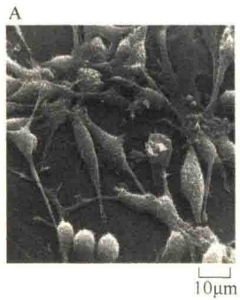

图 13-4 显微镜下观察培养细胞的进程（引自 Alberts et al., 2015）。A. 培养的大鼠成纤维细胞的扫描显微镜照片。左下部位隆起变圆的就是进行有丝分裂的细胞。B. 芽殖酵母的形态:未出芽的是  $G_{1}$  期细胞，根据形态推测其他一些细胞是 S 期、M 期细胞。

在培养的哺乳动物细胞群体中，所有的细胞都在快速增殖，但不是同步的。一般而言，在非同步培养的细胞群体中有30%～40%的细胞是处于S期，可以通过免疫荧光标记进行分析，也可以通过对DNA含量测定推测细胞所处的时期。可用与DNA结合的荧光染料处理细胞后，用流式细胞仪（flow cytometer）快速检测DNA的含量，若DNA的量加倍，则细胞处于S期。还可以用流式细胞仪测定非同步生长的细胞群体的DNA含量，推测细胞的 $G_{1}$ 、S和 $G_{2}+M$ 期的长度（图13-5）。

## 13.1.3.2 细胞同步化研究

通过细胞的体外培养和分析，发现处于细胞周期不同阶段的细胞，其形态学和生化特点有所不同，对辐射、药物、病毒的感染、酶诱导的敏感性也都有差异。由于M期较短，在一个培养的群体中，无论何时检查，只看到极少数细胞处于分裂状态。为了研究细胞周期不同阶段的生化特性，必须获得细胞周期一致性的细胞，这就是细胞的同步化（synchronization），同步化的细胞都处于细胞周期的同一个时相。

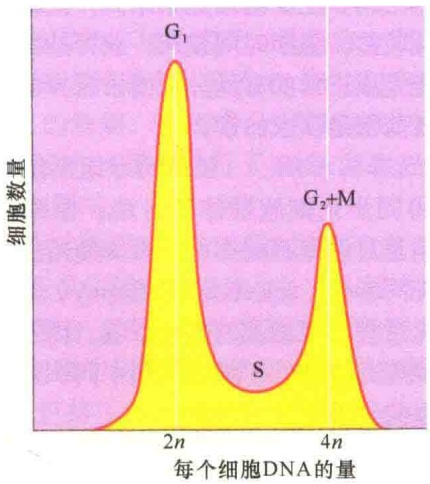

图 13-5 流式细胞仪分析检测的非同步生长的细胞群体中各个时期的细胞数及 DNA 含量（引自 Lodish et al., 2013）。检测的结果揭示了该群体中处于 G₁ 期、S 期，以及 G₂ 期 + M 期细胞的数量与 DNA 含量。

细胞同步化分为自然同步化和人工同步化。

自然同步化是自然界存在的现象，在动物、植物细胞都有发现，它们不受人为条件的干扰，因而有可能在接近自然的条件下进行观察，但自然同步化的细胞群体受到诸多条件的限制，对结果有很大的影响。人工同步化是利用细胞培养的方法，用各种理化因素处理获得同步化生长的细胞，常用的细胞人工同步化的方法分为选择同步化、诱导同步化或者两者的结合。

1）诱导同步法 诱导同步法（induction synchrony）是通过控制培养条件，将非同步培养中的所有或大部分细胞暂时性地阻止在细胞周期的某个阶段，最终使所有细胞达到同步化生长。常用的方法有改变温度、添加代谢抑制剂等，将细胞阻止在细胞周期的某一阶段。

（1）胸腺嘧啶阻断技术。高浓度的胸腺嘧啶能够阻断DNA合成所需的核苷酸的合成。因此，将细胞群体培养在具有高浓度的胸腺嘧啶的培养液中时，非同步化的细胞能够正常地通过 $G_{1}$ 期，但到达S期时，因DNA的合成被阻断，这些细胞不能顺利通过S期进入 $G_{2}$ 期。经过对S期的短暂阻断，再改变胸腺嘧啶的浓度，解除抑制，所有的细胞都开始DNA的合成，即获得处于同步生长的细胞。

(2) 中期阻断法。某些药物可抑制微管的聚合, 因而抑制有丝分裂器的形成, 将细胞阻断在有丝分裂的中期。与 DNA 合成阻断法相比, 中期阻

断法获得的同步生长的细胞频率高，但此种阻断法的可逆性较差，阻断时间较长，获得的细胞中的一部分不能完成正常的有丝分裂而出现异常分裂。常用的阻断药物是秋水仙素。

2）选择同步法 虽然诱导阻断法是广泛使用的获得同步化细胞群体的方法，但这种方法的主要缺陷是对细胞有副作用，因为使用的是毒性物质。选择同步化（selection synchrony）的方法可克服同步化过程中对细胞的毒性影响，因为选择同步化是用物理方法将处于细胞周期中同一阶段的细胞从非同步的群体中分离出来。

（1）有丝分裂选择法。该法根据细胞在细胞周期不同阶段的生理变化设计的一种方法。单层培养于细胞培养瓶内的非同步化的细胞群体中，处于对数期增殖的细胞分裂活跃，分裂指数高，分裂细胞变圆、隆起，与培养器的黏着性降低。此时轻轻摇动，M期的细胞就会脱离器皿壁而悬浮于培养液中，其他阶段的细胞则不会脱落。倾出培养液储存于4℃保存，再向培养瓶中加入37℃新鲜培养液继续培养，经1～2h，再如同上法收集M期的细胞。每1～2h摇动并收集细胞，最后集中所收集的培养液，离心后，可获得一定数量的M期的同步化细胞。此法的优点是不受药物的影响，同步化程度高；不足之处是分离的细胞少，操作烦琐。

（2）细胞沉降分离法。该法是另一种选择同步化的方法，主要用于悬浮培养的细胞。由于细胞在其周期过程中体积逐渐增大，所以处于细胞周期不同阶段的细胞体积不同。细胞在某一离心力场中的沉降速度与其半径平方成正比，因此可用沉降法分离因所处周期时相不同导致大小不同的细胞。此法也可用于贴壁生长的细胞，但因同一时相的细胞大小并非都是一致的，故用此法获得的细胞的同步化程度有限。

## 13.2 细胞周期调控

细胞周期的研究不仅是基础细胞生物学的重要研究课题，而且对于癌症的研究也有十分重要的意义，癌实际上是破坏了细胞分裂调控能力的一种疾病。

美国科学家 Hartwell、英国科学家 Hunt 和 Nurse 因发现了细胞周期关键分子的调节作用获得 2001 年诺贝尔生理学或医学奖。Hartwell 的主要贡献是发现了控制细胞周期的 “START” 基因，

Hunt 的主要贡献是发现了细胞周期的关键调节物质 CDK（cyclin-dependent kinase，周期蛋白依赖性激酶），Nurse 的主要贡献是发现了调节 CDK 功能的 cyclin（细胞周期蛋白）。

## 13.2.1 细胞周期调控系统

多年来，人们一直认为，细胞周期的活动像是骨牌运动，细胞一旦进入 $G_{1}$ 期，就会自动进入S期、 $G_{2}$ 期、M期，并不知道细胞是否有一个周期调控系统，也不知道细胞周期的各个阶段是否有各自独立的控制机制。直到20世纪80年代后期，鉴定到细胞控制系统中的一个关键蛋白质，才认识到细胞周期进程并非是骨牌运动，而是受一个由蛋白质组成的细胞周期控制系统（cell cycle control system）调控的，确保细胞周期健康有序地进行，包括DNA的复制、染色体的分离。

从原理上讲，细胞周期调控系统像是一个计时器（timer），触发细胞周期按顺序启动相关过程。除了早期胚胎细胞分裂的细胞周期比较特殊外，大多数细胞的周期调控系统都是通过信息控制的，也就是细胞周期的上一个事件的信息将会对下一个事件产生影响。图 13-6 是简化的细胞周期调控示意图。

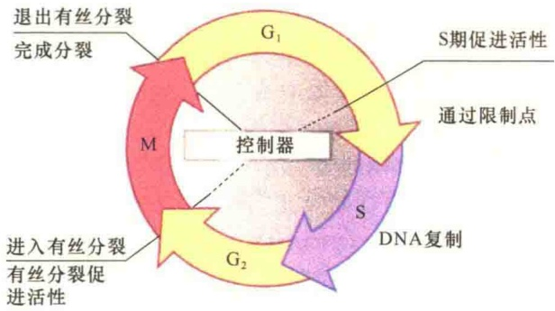

图 13-6 细胞周期控制系统（引自 Plopper et al，2015）。细胞周期中的基本事件及控制，如 DNA 复制、有丝分裂、胞质分裂都是通过中央的细胞周期控制系统控制的。中央控制系统如同一个顺时针移动的指针，当它到达某一位置时触发一个反应。

## 13.2.2 有丝分裂促进因子的发现与鉴定

实际上，细胞周期的控制系统是一个典型的生化操作装置，这种装置由一套相互作用的蛋白质组成，正是这些蛋白质间的相互作用，调控细胞周期的进程。

## 13.2.2.1 细胞融合实验

细胞周期的控制有两个主要事件:一是对DNA复制起始的控制，发生在 $G_{1}$ 期和S期之间；二是对染色体凝缩的控制，发生在 $G_{2}$ 期和M期之间。1970年，Colorado大学的Rao和Johnson通过一系列的细胞融合实验打开了认识细胞周期中这两个事件的大门。

Rao 和 Johnson 想知道在细胞质中是否含有影响细胞周期活性的调节因子，他们用处于细胞周期不同阶段的同步化的细胞进行融合，看看结果会有什么不同。首先他们将同步培养的  $G_{1}$  期的 HeLa 细胞与 S 期的大鼠 Kangaroo PtK2 细胞进行融合，其目的是想了解  $G_{1}$  期的细胞中是否含有阻断 S 期细胞核中 DNA 复制的因子，还是在 S 期的细胞质中含有促进  $G_{1}$  期细胞 DNA 复制的因子。他们发现， $G_{1}$  期的细胞质受到 S 期细胞质的激活，开始了 DNA 复制，这一实验结果表明，正在进行复制的细胞的细胞质中含有促进  $G_{1}$  期细胞进行 DNA 复制的起始因子。与此相反，他们将 S 期的细胞与  $G_{2}$  期的细胞进行融合，发现  $G_{2}$  期的细胞核不能再启动 DNA 的复制，这表明，S 期细胞质中的 DNA 复制起始因子对于已进行了 DNA 复制的  $G_{2}$  期的细胞核没有作用。

其他一些融合细胞实验得到了更有意义的结果。例如，将处于分裂期的细胞与处于细胞周期其他阶段的细胞融合，M期的细胞质总是能够诱导非有丝分裂的细胞中的染色质凝缩，将这种现象称为超前凝聚染色体（prematurely condensed chromosome, PCC）。由于 $G_{1}$ 期、S期和 $G_{2}$ 期细胞中染色质的复制状态不同，PCC的结果也不相同，如与M期细胞融合的 $G_{1}$ 期的染色体为单线状，S期染色体为粉末状， $G_{2}$ 期染色体为双线状（图13-7）。至于为什么S期的细胞与M期的细胞融合、超前凝聚染色体呈粉末状，其原因是正在复制的DNA易受损伤，是DNA断裂的结果。

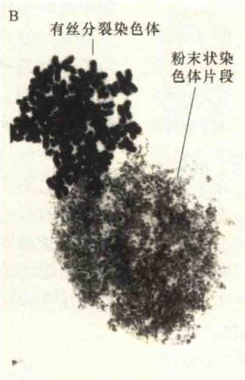

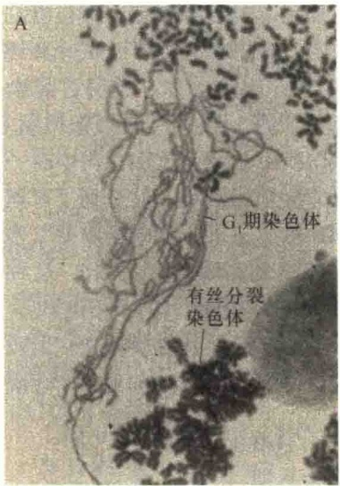

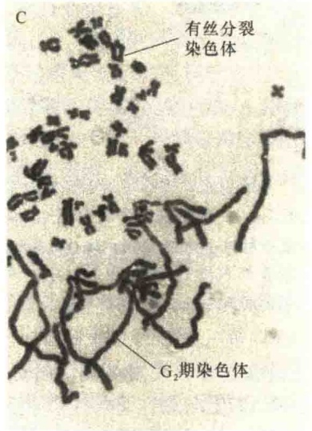

图 13-7 染色体超前凝聚实验（引自 Karp，2010）。将同步化培养的 M 期 HeLa 细胞分别与大鼠 Kangaroo PtK2 间期不同阶段同步化的细胞融合，产生形态各异的超前凝聚的染色体。A.  $M + G_{1}$ ; B.  $M + S$ ; C.  $M + G_{2}$ 。

## 13.2.2.2 促成熟因子的发现

染色体超前凝聚实验的结果，让人们有理由相信:处于 M 期的细胞中一定有一种使染色质由松散状态凝缩成染色体的物质，将这种物质称为扩散因子（diffusible factor）。

虽然细胞融合实验揭示了促进染色质凝缩的扩散因子的存在，但没有证明这些因子的化学本质是什么。为了进一步研究促使  $G_{1}$  期细胞 DNA 复制及诱导细胞提前进入有丝分裂的扩散因子的本质，用蛙和无脊椎动物的卵母细胞及早期的胚进行了一系列的实验。一些动物的受精卵特别适合作为细胞周期的研究材料，因为这些卵细胞特别大，如蛙的卵细胞的直径可达1mm，并且在受精后进行快速胚胎发育，通过细胞周期进行分裂，产生许多小细胞。在每个细胞周期之间， $G_{1}$ 期和 $G_{2}$ 期很短，或没有 $G_{1}$ 期和 $G_{2}$ 期，但是都有S期和M期。在受精卵的发育早期，没有新基因的转录，因为胚胎早期发育阶段所需的mRNA和大多数蛋白质都是在卵母细胞形成时就合成好了并被包装在成熟的卵细胞中。另外，在早期的细胞分裂周期中，细胞也不会生长，所有的细胞都是通过对称分裂形成两个小细胞。

通过对非洲爪蟾（Xenopus laevis）卵细胞成熟的研究，使得诱导细胞有丝分裂扩散因子化学本质的鉴定有了突破性进展。从成年的雌性蛙的卵巢中取出卵母细胞，然后在体外用孕酮（progesterone）进行处理，让卵母细胞经过减数成熟（meiotic maturation），即诱导处于 $G_{2}$ 期的卵母细胞经减数分裂Ⅰ到减数分裂Ⅱ（图13-8A）；或者从减数分裂Ⅱ的卵细胞取出约5%的细胞质，并将其注入处于 $G_{2}$ 期的卵母细胞同样可诱导 $G_{2}$ 期卵母细胞经减数分裂Ⅰ进入减数分裂Ⅱ（图13-8B）。

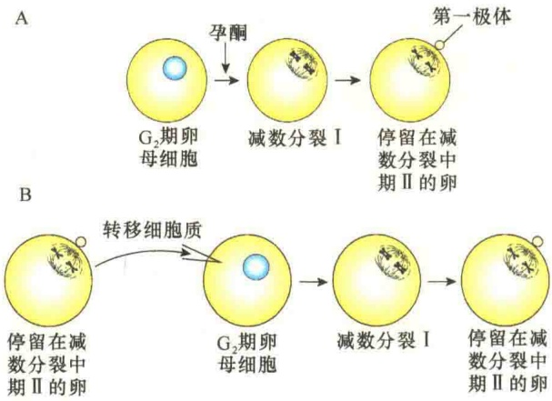

图 13-8 孕酮刺激非洲爪蟾卵母细胞分裂（引自 Lodish et al., 2007）。A. 孕酮刺激非洲爪蟾  $G_{2}$  期的卵细胞进入 M 期，形成纺锤体并成功分裂。B. 用非洲爪蟾 M 期的卵细胞质注射非洲爪蟾  $G_{2}$  期的卵母细胞，促使卵母细胞进入 M 期，引起核破裂，并形成纺锤体。

上述实验中，发现孕酮注射  $G_{2}$  期细胞，可诱导细胞进入减数分裂，而来自  $G_{2}$  期卵细胞中的细胞质，同样可使卵母细胞进入减数分裂，提示  $G_{2}$  期卵细胞的细胞质中有类似孕酮作用的因子存在。这是首次发现在 M 期的细胞中有促进细胞分裂的因子存在，由于当时对这种因子的化学本质和作用机制都不清楚，只是简单地称为 M 期促进因子，后来称为促成熟因子（maturation promoting factor，MPF）。

用微注射系统分析卵母细胞成熟的不同时期MPF的活性，研究者发现未处理的 $G_{2}$ 期卵母细胞本身就有较低的MPF活性，但用孕酮处理可诱导MPF促进细胞进入减数分裂Ⅰ。当细胞进入减数分裂Ⅰ与减数分裂Ⅱ之间的间期，MPF的活性下降，但细胞进入减数分裂Ⅱ，MPF的活性又上升。

虽然 MPF 最初是在蛙细胞中发现的，后来发现在所有分析过的有丝分裂细胞中都有 MPF 的活性。例如，从处于有丝分裂的哺乳动物中提取细胞质，通过微注射注入处于 $G_{2}$ 期爪蟾卵母细胞，可诱导爪蟾卵母细胞经减数分裂为成熟的卵，这一结果表明哺乳动物有丝分裂的体细胞含有类似蛙的MPF活性的细胞质因子。这一发现也证明哺乳动物体细胞的MPF控制有丝分裂。实验还表明，将从有丝分裂的哺乳动物细胞中抽取的细胞质注入哺乳动物间期细胞，会诱导细胞核解体，染色质凝缩，内质网片段化。由此认为，有丝分裂的细胞质中有一种扩散因子，可促进细胞进入有丝分裂，这就解释了为什么将M期的细胞与 $G_{1}$ 期细胞融合，会导致 $G_{1}$ 期染色质凝缩。在这些实验的基础上，将MPF定义为有丝分裂促进因子（mitosis promoting factor）。

## 13.2.2.3 有丝分裂周期蛋白的鉴定

在海胆（sea urchin）的早期胚细胞中第一次鉴定到有丝分裂周期蛋白。同蛙胚一样，海胆的早期胚细胞是同步发生的，并同步进入有丝分裂。实验中将同步化的受精的海胆卵细胞培养在有放射性氨基酸的培养液中，每10min取样一次分离纯化蛋白质，然后通过SDS-凝胶电泳、放射自显影进行蛋白质分析。结果发现，经过几轮细胞周期之后，放射性标记的蛋白质的量稳定增加。其中有一种蛋白峰在有丝分裂的早期特别高，但是到了有丝分裂后期就急剧下降，然后在下一个细胞周期又慢慢积累直到有丝分裂前达到高峰（图13-9），这种蛋白质后来被命名为细胞周期蛋白B（cyclin B）。由于该蛋白质的浓度峰值在有丝分裂期最高，所以，该蛋白质又称为有丝分裂周期蛋白（mitotic cyclin）。

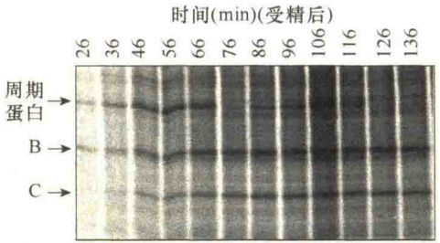

图 13-9 SDS-凝胶放射自显影检测海胆卵细胞受精后蛋白质合成的变化（引自 Lodish et al., 2007）。海胆的卵细胞与海胆精细胞同步受精后，加入  ${}^{35}$ S-甲硫氨酸，温育 26min 后开始取样，每隔 10min 取样一次，用 SDS-凝胶分析样品中新合成蛋白质的含量。由于受精后，细胞要快速分裂，并且在每次分裂间都有一个简短的间期，所以大多数蛋白质，如 B 与 C 的浓度持续升高，而周期蛋白在 76min 后突然降低，86min 后又开始上升，在 106min 的峰值最高，126min 时又开始下降。

研究者用基因工程技术从海胆中分离了细胞周期蛋白 B 的 cDNA 克隆，然后用这种 cDNA 作探针从非洲爪蟾中分离了同源的细胞周期蛋白 B 的 cDNA 克隆，最后用周期蛋白 B 制备的抗体证明了非洲爪蟾中 MPF 的一个亚基的确是细胞周期蛋白 B。

由于 MPF 的纯化工作困难，所以对它的分离纯化研究了好几年，直到 1988 年才用柱层析从蛙卵中纯化了 MPF。

1988 年，James Maller 实验室从蛙卵中分离纯化了 MPF，还有几个实验室同时对 MPF 进行了分子鉴定，结果表明，这种保守的细胞周期调节因子是由两个关键的亚基——周期蛋白依赖性激酶 1（CDK1）与细胞周期蛋白 B 组成的二聚体（图 13-10）。CDK1 是一种催化亚基，它能够将磷酸基团从 ATP 转移到特定底物的丝氨酸和苏氨酸残基上，这种蛋白激酶被称为细胞 CDK1。周期蛋白 B 是调节亚基，对 CDK1 的活性进行调节。

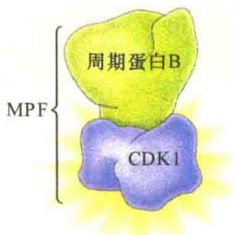

图 13-10 细胞周期蛋白-CDK 复合物的组成（引自 Cooper and Hausman, 2004）。

MPF 蛋白激酶亚基不能单独起作用，它需要与细胞周期蛋白结合才有功能，而且 MPF 的活性与细胞周期蛋白一样在细胞周期中呈现周期性变化（图 13-11）。

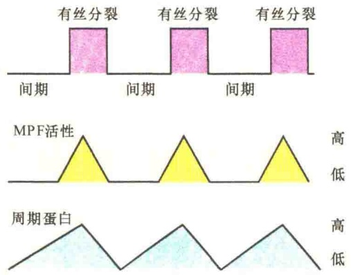

图 13-11 在细胞周期中细胞周期蛋白和 MPF 的波动（引自 Karp，2010）。蛙胚细胞发生同步分裂时，早期发育的周期性变化。上部是有丝分裂和分裂间期的周期变化；中间曲线是 MPF 活性的周期性变化；下部曲线是控制 MPF 激酶相对活性的周期蛋白浓度的周期性变化。

当细胞周期蛋白的浓度降低时，蛋白激酶由于缺少与之结合的效应物而失活。当细胞周期蛋白的浓度上升时，蛋白激酶被激活，促使细胞进入有丝分裂。这些结果表明:①细胞周期的进程依赖于一种酶的激活，而这种酶的唯一活性是使其他蛋白质磷酸化；②酶的活性受一种亚基的控制，它的浓度在细胞周期的不同阶段是不同的。

## 13.2.3 裂殖酵母细胞周期调控

通过非洲爪蟾卵细胞提取物的实验分析对细胞周期的控制有了一定认识，特别是发现了MPF及其活性调节。裂殖酵母（Schizosaccharomyces pombe）是低等真核生物，有完整的细胞周期。通过对裂殖酵母的研究，人们对细胞周期的控制有了更深的了解。

## 13.2.3.1 裂殖酵母的细胞周期

裂殖酵母在生长时，其杆状细胞逐渐伸长，进入有丝分裂时从中间分裂开来，产生两个大小相等的子细胞（图 13-12）。大多数哺乳动物细胞的生长期是  $G_{1}$  期，而裂殖酵母细胞的生长期在  $G_{2}$  期，酵母细胞进入有丝分裂时需要协调好 DNA 的复制与细胞体积之间的关系，因此，裂殖酵母细胞的有丝分裂必须经过严格地调控，确保有丝分裂与细胞生长之间的协调。

## 13.2.3.2 裂殖酵母的细胞周期突变体

根据对裂殖酵母的生长与有丝分裂所需体积的研究，不难推测:若细胞生长过快，而 DNA 复制不完全，细胞有可能只生长而不分裂，此时的细胞形态就会异常；反之，若是 DNA 复制过快，而细胞生长不足，导致体积不够，细胞也不会进入有丝分裂，细胞形态也会异常。由于酵母是单细胞的真核生物，可以用基因突变的方法获得相应的突变，从而深入研究酵母细胞中参与细胞周期蛋白的调控机制。

裂殖酵母的温度敏感突变体（temperature-sensitive mutant）是一种条件突变，这种突变体在非允许的温度下培养，细胞的长度十分异常，因此很容易进行识别。已经分离了很多与细胞周期相关的温度敏感突变体，可分成两类:一类是 cdc 突变，这类突变在非允许的温度下培养，会滞留在细胞周期的某个阶段，结果会形成特别长的细胞，因为这类突变不能进入有丝分裂期，滞留在间期，所以能够继续生长；另一类是 wee 突变，这类突变长

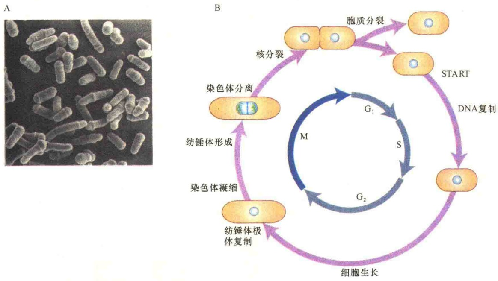

图 13-12 裂殖酵母的细胞周期（引自 Lodish et al., 2013）。A. 非同步化的裂殖酵母细胞扫描照片。B. 裂殖酵母细胞周期的主要过程。START 是裂殖酵母重要的限制点。

得特别小，导致细胞不能分裂。

裂殖酵母中几个温度敏感的 cdc 基因的隐性突变使得裂殖酵母在周期中不能进入 M 期，由于生长没有停止，所以比正常的酵母细胞长很多（图 13-13）。这些基因中的一个显性突变，命名为  $cdc2^{D}$ ，使酵母出现 wee 表型。一般来说，隐性表型是因为缺少野生型的功能蛋白所致，而显性表型是因为增加了一些蛋白质功能，导致调节失常。野生型裂殖酵母细胞中的同源基因命名为  $cdc2^{+}$ 。

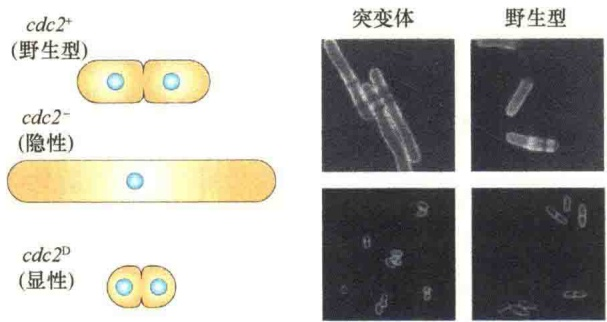

图 13-13 裂殖酵母 cdc2 突变的表型（引自 Lodish et al., 2007）。 $cdc2^{+}$ 是野生型，正常分裂； $cdc2^{-}$ 是隐性突变，产生特长的表型； $cdc2^{D}$ 是显性突变，产生 wee 表型，即因细胞特小不能分裂。

对分离的 $cdc2^{-}$ 突变体的研究发现，该突变体没有 Cdc2 蛋白的活性，细胞不能进入有丝分裂，表明 Cdc2 蛋白是裂殖酵母进入有丝分裂的一个关键调节因子。通过基因工程克隆了 cdc2 基因，序列分析表明该基因编码一个分子质量为 34kDa 的蛋白质，该蛋白质又称为 P34 $^{cdc2}$ 。

后来在裂殖酵母中分离了另一个 cdc 基因，命名为  $cdc13^{+}$ ，该基因的产物 Cdc13 蛋白也是裂殖酵母进入有丝分裂必需的。序列分析表明该基因编码的蛋白质与非洲爪蟾和海胆的周期蛋白 B 同源。以后的研究还揭示 Cdc13 蛋白和 Cdc2 蛋白能够形成异质二聚体，并且具有蛋白激酶的活性。此外研究还发现，不仅 Cdc2 的蛋白激酶的活性随裂殖酵母的周期变化而变化，Cdc13 蛋白的浓度也随 Cdc2 蛋白活性的波动而波动。根据这些发现，可以肯定地说，裂殖酵母的 Cdc2-Cdc13 相当于非洲爪蟾的 MPF。

## 13.2.3.3 裂殖酵母MPF的活性调控

通过对其他一些 cdc 和 wee 突变体的研究，发现裂殖酵母的 MPF 活性还受其他一些基因编码产物的影响。例如，温度敏感突变体  $cdc25^{-}$  在非允许的温度下也不能进入有丝分裂，此外，Cdc25 蛋白的超表达，将会缩短  $G_{2}$  期，使未成熟的酵母提前进入有丝分裂期；另一种突变体  $wee1^{-}$  也会造成酵母体积不够大就提前进入有丝分裂，而 Wee1 蛋白的过量表达则延长  $G_{2}$  期，形成长的酵母细胞（图 13-14）。根据这些发现，推测 Cdc25 蛋白激活裂殖酵母的 MPF 活性，而 Wee1 蛋白抑制裂殖酵母的 MPF 活性。

进一步的研究发现裂殖酵母 MPF 的活性调节是相当复杂的，涉及多种蛋白激酶及 Cdc2 蛋白亚基上两个位点的磷酸化与去磷酸化。Cdc2 蛋白亚基上有两个磷酸化的位点，一个是激活型的磷酸化位点，另一个是抑制型的磷酸化位点。独立存在的 Cdc2 蛋白激酶是无活性的，与周期蛋白 Cdc13 结合后，仍然没有活性。此时的复合物成为两种蛋白激酶的底物:第一种是 Wee1 激酶，它使 Cdc2 亚基上的抑制位点 Tyr15（Y15）残基磷酸化，抑制 MPF 的活性；第二种是 Cdc2 活化蛋白激酶（Cdc2-activating kinase, CAK），可以使 Cdc2 蛋白亚基中激活型的关键位点 Thr161（T161）残基磷酸化，这种磷酸化最大限度地激活了 MPF 的活性；但是，只要 Tyr15 残基是磷酸化的，Cdc2-Cdc13 复合物就没有活性。这种无活性的 MPF 称为前 MPF（pre-MPF）。要使 MPF 具有活性，需要 Cdc25 蛋白的作用，该蛋白质具有蛋白磷酸酶的活性，能够将 Tyr15 的磷酸基团去除从而将 MPF 激活，诱导细胞从 G₂ 期进入 M 期（图 13-15）。不过，Wee1 蛋白和 Cdc25 蛋白的活性

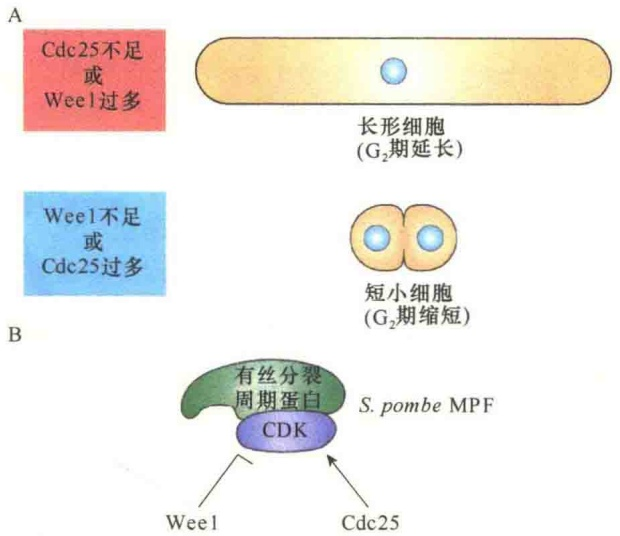

图 13-14 cdc25 和 wee1 基因的突变对裂殖酵母表型和 MPF 活性的影响（引自 Lodish et al., 2007）。A. Cdc25 不足、Wee1 过量与 Cdc25 过量、Wee1 不足，其细胞的表型相反。B. Cdc25 对 MPF 具有激活作用，Wee1 对 MPF 具有抑制作用。

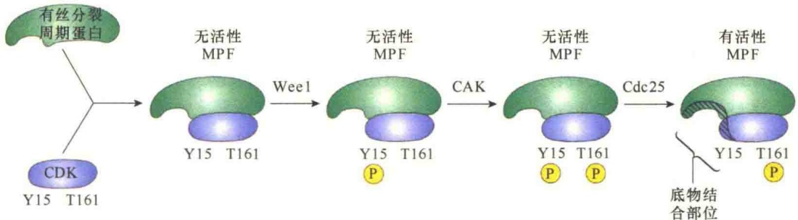

图 13-15 裂殖酵母周期中 MPF 的活性调控（引自 Lodish et al., 2007）。有丝分裂周期蛋白（Cdc13）与周期蛋白依赖性激酶（CDK）相互作用形成 MPF。有丝分裂周期蛋白（Cdc13）与 CDK（Cdc2）结合，此时因 CDK 中的 T161 未被磷酸化，因而没有活性。Weel 激酶将 CDK 中的 Y15 残基磷酸化，该位点磷酸化起抑制作用，此时的 MPF 仍无活性。CAK 激酶将 T161 磷酸化，由于受到 Y15 位点磷酸化的抑制作用，此时的 MPF 仍无活性，但环境合适时，激活的 Cdc25 磷酸酶将 Y15 的抑制性磷脱去，此时的 MPF 被激活。

是相互竞争的，如果细胞生长得不够大，Wee1 的活性就强，有利于 MPF 的磷酸化；若细胞生长得够大，就有利于脱磷酸，促进细胞进入 M 期。

需要特别强调的是，裂殖酵母的细胞周期调控相对较为简单，因为裂殖酵母只有一种周期蛋白和一种周期蛋白依赖性激酶，裂殖酵母的MPF主要是调控细胞的有丝分裂，因此将裂殖酵母的MPF称为裂殖酵母细胞周期的“引擎”。

## 13.2.4 芽殖酵母细胞周期调控

在裂殖酵母的细胞周期中，控制的点是细胞能否进入 M 期。由于裂殖酵母的 S 期比较短， $G_{2}$  期比较长，又因为  $G_{2}$  期是细胞生长期，所以裂殖酵母能否进入 M 期，关键的决定因素是细胞是否足够大，因此，裂殖酵母监控的重点在  $G_{2}$  期。与裂殖酵母不同，大多数脊椎动物细胞是否进行分裂，决定的因素是  $G_{1}$  期。因为大多数细胞一旦进入了 S 期，只需几小时就能进入 M 期进行有丝分裂。芽殖酵母（Saccharomyces cerevisiae）的增殖方式与大多数脊椎动物细胞相似，其  $G_{1}$  期较长，而 S 期、 $G_{2}$  期都较短（图 13-16）。所以，芽殖酵母是研究细胞调控进入 S 期的最好材料。

芽殖酵母是以出芽的方式进行增殖的，通过出芽形成的子细胞比母细胞小得多，它必须长到足够大才能进行分裂。当芽殖酵母在  $G_{1}$  期生长到足够大时，一些可导致进入S期的基因进行程序性表达。如果将处于 $G_{1}$ 期的细胞在它的体积尚未达到足够大时从营养丰富的培养基上转移到营养贫乏的培养基上，这些细胞继续维持在 $G_{1}$ 期，并缓慢生长直至达到足够的体积才进入S期。但是，一旦 $G_{1}$ 期的细胞体积达到足够大，就会启动细胞周期，即进入S期、通过 $G_{2}$ 期，完成有丝分裂。即使将体积生长到足够大的芽殖酵母细胞从营养丰富的培养基上转移到营养贫乏的培养基上，也不能阻止细胞周期的进程。

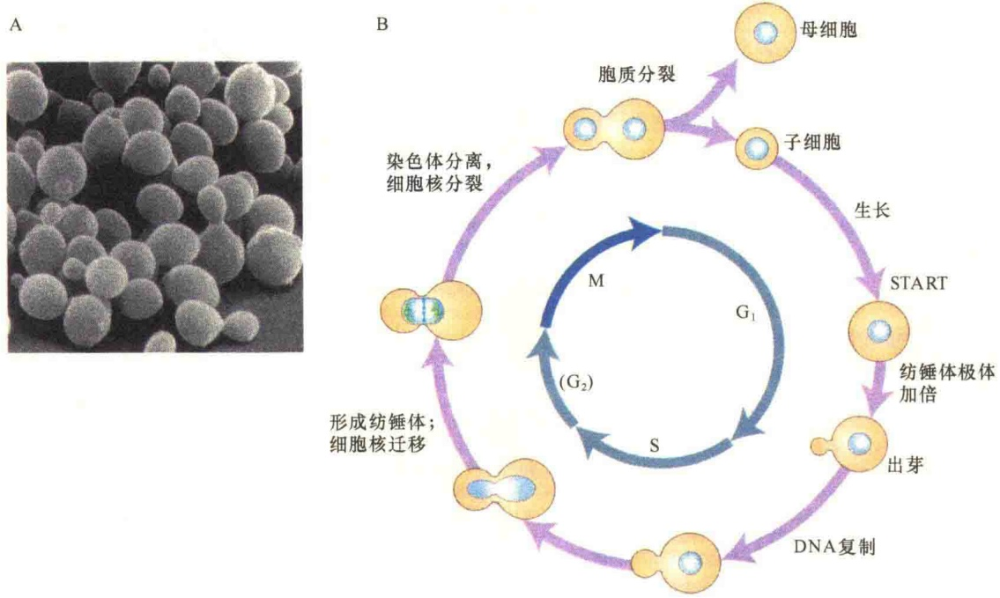

图 13-16 芽殖酵母的细胞周期（引自 Lodish et al., 2007）。A. 非同步生长芽殖酵母电镜照片。B. 芽殖酵母细胞周期的主要过程，可见 $G_{1}$ 期较长。

## 13.2.4.1 芽殖酵母的Cdc28蛋白

在芽殖酵母中获得一个温度敏感 cdc28 突变体(temperature-sensitive cdc28 mutant)，该突变体含有一个温度敏感突变的基因，命名为 cdc28，编码的蛋白质为 Cdc28，该基因功能相当于裂殖酵母的 cdc2。cdc28 基因突变成温度敏感型就不会出芽，将其控制的  $G_{1}$  期的点称为 START（起点）（图 13-17）。

根据对分离的野生型 cdc28 基因的序列分析推测，Cdc28 蛋白与已知的蛋白激酶同源。将 cdc28 基因转入 E.coli，然后从 E.coli 中分离 Cdc28 蛋白，发现其具有蛋白激酶的活性。实际上，芽殖酵母中的 Cdc28 蛋白是第一个被分离的具有蛋白激酶活性的细胞周期蛋白。从裂殖酵母中克隆的 cdc2 $^{+}$ 基因与 cdc28 基因是高度同源的，而 Cdc2 蛋白和 Cdc28 蛋白在功能上是相似的，芽殖酵母的 Cdc28 蛋白能够与裂殖酵母的  $cdc2^{-}$  的突变型互补。由此看来，裂殖酵母与芽殖酵母都有一种细胞周期蛋白依赖性的蛋白激酶，它们能够相互替代。

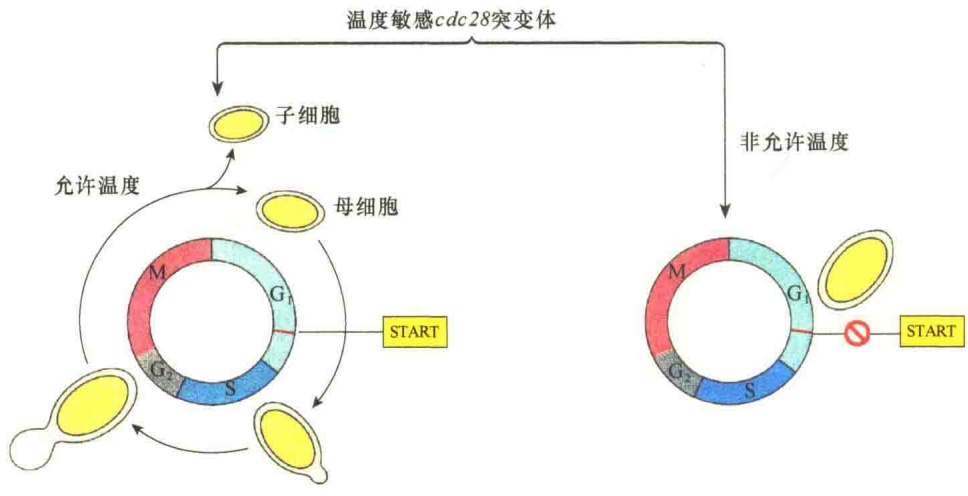

图 13-17 芽殖酵母 cdc28 突变体的特性（引自 Cooper and Hausman，2013）。芽殖酵母温度敏感 cdc28 突变体在允许的温度下能够正常分裂，但在非允许的温度下细胞周期将被阻断在 START 点。

## 13.2.4.2 $\mathrm{G}_{1}$ 周期蛋白与S期促进因子

到20世纪80年代后期，已经很清楚地了解到促有丝分裂因子（MPF）是由两个亚基组成的:一个是细胞周期蛋白依赖性激酶（CDK）；另一个是有丝分裂期的细胞周期蛋白，它可以激活催化亚基。与此相似的是，芽殖酵母含有S期促进因子（S phase-promoting factor，SPF），它能够将DNA合成所需的蛋白质磷酸化并进行调节。与MPF相似的是，SPF也是异质二聚体:一个是Cdc28蛋白，另一个是在 $G_{1}$ 期起作用的细胞周期蛋白。

Cdc28 蛋白是芽殖酵母的周期蛋白依赖性激酶，又称为  $G_{1}$ -CDK，是芽殖酵母基因组编码的唯一一种周期蛋白依赖性激酶，它的失活将使细胞停留在  $G_{1}$  期，并且不能启动 DNA 复制。所以，保持  $G_{1}$ -CDK 的活性状态是细胞进入 S 期的必要条件。根据对有丝分裂促进因子的研究，人们推测，芽殖酵母很可能含有一个 S 期促进因子。

为了证明芽殖酵母的  $G_{1}$  期有 SPF 的存在，研究者希望找到一个基因，当该基因高水平表达时，能够抑制某些温度敏感型 cdc28（cdc28 $^{ts}$ ）突变体。这种方法的基本原理是:某些 cdc28 突变体是温度敏感的，这样，在非允许温度下突变的 Cdc28 蛋白与  $G_{1}$  周期蛋白的亲和力降低。在这种情况下，如果  $G_{1}$  周期蛋白的浓度足够高，它能够与突变的 Cdc28 蛋白形成足够的 SPF，促使细胞在非允许温度下进入 S 期。研究者们通过基因工程方法分离到两个  $G_{1}$  周期蛋白基因:CLN1 和 CLN2，它们能够按预测的方式抑制 cdc28 突变（图 13-18）。后来，研究者又分离鉴定了一个显性的  $G_{1}$  周期蛋白基因 CLN3，它是在野生型细胞中起作用的细胞周期蛋白基因。

## C. 用高拷贝 $\mathrm{G}_1$ 周期蛋白质质转化的 $cdc28^{\mathrm{ts}}$ 细胞

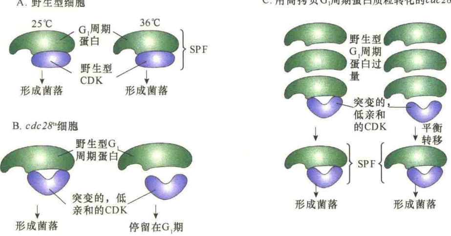

图 13-18 芽殖酵母 ${\mathrm{G}}_{1}$ 周期蛋白基因的鉴定(引自 Lodish et al., 2007)。A. 野生型细胞能够产生高亲和力的 Cdc28 蛋白, 这种蛋白质在 ${25}^{ \circ  }\mathrm{C}$ 和 ${36}^{ \circ  }\mathrm{C}$ 下与 ${\mathrm{G}}_{1}$ 周期蛋白结合形成 SPF。B. 某些 $cdc28^{ts}$ 突变体表达的 Cdc28 蛋白与 ${\mathrm{G}}_{1}$ 周期蛋白的亲和力低,在允许温度(25℃)能够形成足够的 ${\mathrm{{Cdc28}}}^{\mathrm{{ts}}} - {\mathrm{G}}_{1}$ 周期蛋白(SPF),能生长并形成菌落；但是在非允许温度 (36℃),不会形成 SPF、不会形成菌落。C. 用携带有 ${\mathrm{G}}_{1}$ 周期蛋白基因的高拷贝克隆载体转化 $cdc28^{ts}$ 细胞,在 ${36}^{ \circ  }\mathrm{C}$ 下形成三种类型的菌落:一种含有野生型的 cdc28 基因,另外两种含有基因 CLN1 和 CLN2,这两个基因编码的产物与有丝分裂周期蛋白同源。在由 CLN1 和 CLN2 基因转化的细胞中,由于 ${\mathrm{G}}_{1}$ 周期蛋白的浓度很高,在 ${36}^{ \circ  }\mathrm{C}$ 下能够形成足够的 SPF,促使细胞进入 S 期,并进行有丝分裂。

## 13.2.4.3 芽殖酵母 SPF 的活性调节

通过基因敲除（gene knockout）实验表明，如果突变体带有三种  $G_{1}$  周期蛋白中的任何一种，都能在营养丰富的培养基上生长。研究还发现，如果

$G_{1}$  周期蛋白超量，将会降低处于  $G_{1}$  期的细胞数，这就说明  $G_{1}$  周期蛋白-CDK 复合物的浓度提高可促进细胞通过 START 进入 S 期。然而，当三种  $G_{1}$  周期蛋白都缺乏时，细胞就滞留在  $G_{1}$  期。这些结果表明芽殖酵母进入 S 期需要一种  $G_{1}$  周期蛋白杂

合二聚体，即 SPF 的存在。

在芽殖酵母中，当S期周期蛋白-CDK异二聚体（SPF）在 $\mathrm{G}_{1}$ 期后期积累时，它们立即被Sic1蛋白结合而失活。Sic1是一种抑制蛋白，属于周期蛋白依赖性激酶抑制蛋白（cyclin-dependent kinase inhibitor，CKI），该蛋白质在有丝分裂期末及 $\mathrm{G}_{1}$ 期早期表达。由于 Sic1 特异性抑制 S 期、M 期 CDK，而不抑制  $G_{1}$  期 CDK、 $G_{1}/S-CDK$  复合物，因此 Sic1 是 S 期的抑制剂。 $G_{1}/S-CDK$  将 Sic1 磷酸化（Sic1 至少有 6 个位点被磷酸化），磷酸化的 Sic1 被蛋白酶体降解。一旦 Sic1 被降解，S 期周期蛋白-CDK 复合体就会诱导 DNA 复制（图 13-19）。

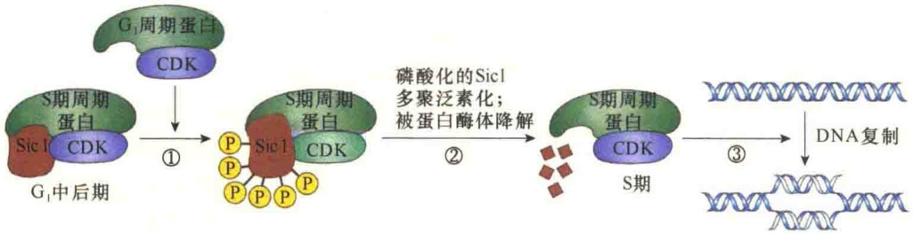

图 13-19 芽殖酵母通过对 S 期抑制蛋白 Sic1 的蛋白酶解的调节进行 S 期的控制（引自 Lodish et al., 2013）。 $G_{1}$  期开始积累 S 期周期蛋白 -CDK 复合物，但是其活性受 Sic1 的抑制。这种抑制作用阻止了 DNA 复制，直至细胞完成了  $G_{1}$  期所有事件。①装配的  $G_{1}/S-CDK$  在  $G_{1}$  期末将 Sic1 磷酸化；②磷酸化的 Sic1 被多聚泛素化，从而被蛋白酶体降解；③激活的 S-CDK 招募并激活与 DNA 复制相关的蛋白质，启动 DNA 复制。

## 13.2.4.4 芽殖酵母与裂殖酵母细胞周期调控的比较

裂殖酵母和芽殖酵母在细胞周期进程的调控中都只有一种CDK，前者是Cdc2，后者是Cdc28；二者控制的主要时期是不同的，裂殖酵母主要是控制从 $\mathrm{G}_2$ 期进入M期，由MPF调控；芽殖酵母主要是控制从 $\mathrm{G}_1$ 期进入S期，由SPF调控。裂殖酵母不仅只有一种CDK，而且也只有一种细胞周期蛋白，即Cdc13；而芽殖酵母细胞周期不同阶段受多种周期蛋白调控蛋白激酶活性，除Cln1、Cln2、Cln3三种 $\mathrm{G}_1$ 周期蛋白外，还有Clb1、Clb2、Clb3、Clb4、Clb5和Clb66种周期蛋白。芽殖酵母的9种周期蛋白分为5组，与CDC形成复合物在细胞周期进程中先后起调节作用（图13-20）。

## 13.2.5 哺乳动物细胞周期调控

在多细胞的真核生物发育和生长过程中精确控制细胞的周期是决定组织大小和形态的关键。细胞的生长与分裂是受复杂的信号网络控制的，大多数细胞都是在细胞周期的  $G_{1}$  期转入  $G_{0}$  状态。某些分化的细胞，如成纤维细胞和淋巴细胞等能够在诱导条件下重新进入细胞周期进行分裂，但神经细胞不会再进入细胞周期进行分裂。

## 13.2.5.1 哺乳动物细胞周期中的限制点

哺乳动物细胞体外培养时，需要添加多肽生长因子促进细胞的分裂。如果缺少生长因子，就会被阻止在  $G_{0}$  状态；一旦在培养基中添加了生长因子，这些细胞在 14～16h 后进入 S 期，再过 6～8h，完成余下的细胞周期过程。因此推测，阻止细胞从  $G_{0}$  状态进入 S 期间有一个限制点（restriction point），若将这些细胞在完全通过限制点之前从含有生长因子的培养基转移到没有生长因子的培养基上，这些细胞不能进入 S 期，也不能完成细胞周期。但是，细胞一旦通过了限制点，这些细胞就能够进入 S 期并完成其后的细胞周期过程。限制点是哺乳动物细胞控制  $G_{1}$  期进入 S 期的调节点，相当于酵母的 START，限制点受生长因子调控（图 13-21）。

图 13-20 控制芽殖酵母细胞周期进程的细胞周期蛋白 -CDK 复合物的作用（引自 Lodish et al., 2007）。芽殖酵母只有一种 CDK，但是在细胞周期的不同阶段，受不同时期合成的周期蛋白 -CDK 调控。

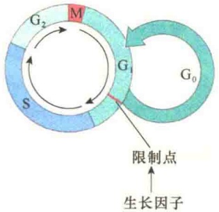

图 13-21 生长因子调节动物细胞周期（引自 Cooper and Hausman, 2016）。

## 13.2.5.2 多种CDK和多种周期蛋白的协同

在裂殖酵母和芽殖酵母的细胞周期调控中，都是由单一的CDK调节的，而哺乳动物的细胞周期受一个小分子（30～40kDa）CDK家族的调节。在哺乳动物细胞周期中起作用的有9种CDK，依据它们被发现的先后顺序分别被命名为CDK1、CDK2、CDK3……其中CDK1、CDK2、CDK4、CDK6这4种CDK在细胞周期进程中的调控作用研究得比较清楚。它们与不同的细胞周期蛋白结合，共同促进不同细胞周期进程的转换。CDK4、CDK6是 $G_{1}$ 期CDK，促进细胞进入细胞周期；CDK2属于 $G_{1}/S$ 期与S期CDK；CDK1是有丝分裂CDK。由于历史原因，从酵母细胞周期调控研究命名的细胞周期蛋白依赖性激酶的名称与脊椎动物细胞周期研究对细胞周期蛋白依赖性激酶的命名是不同的，根据细胞周期进程，更为通俗的名称分别是 $G_{1}$ 期CDK、 $G_{1}/S$ 期CDK、S期CDK、有丝分裂CDK（表13-1，图13-22）。

表 13-1 哺乳动物细胞中的周期蛋白与 CDK 的名称和作用

| CDK | 周期蛋白 | 功能 | 属性名称 |
| --- | --- | --- | --- |
| CDK1 | 周期蛋白A,周期蛋白B | 有丝分裂 | 有丝分裂CDK |
| CDK2 | 周期蛋白E,周期蛋白A | 进入细胞周期S期 | $G_{1}/S$期CDK;S期CDK |
| CDK4 | 周期蛋白D | $G_{1}$进入细胞周期 | $G_{1}$期CDK |
| CDK6 | 周期蛋白D | $G_{1}$进入细胞周期 | $G_{1}$期CDK |

## 13.2.6 CDK与细胞周期调控

通过对裂殖酵母、芽殖酵母及哺乳动物细胞周期调控研究，揭示细胞周期控制系统中最关键蛋白质分子就是 CDK。CDK 必须与不同周期蛋白结合形成复合物才能在细胞周期进程中起调控作用。此外，CDK 还受激活性与抑制性磷酸化（activating and inhibitory phosphorylation）的调控。

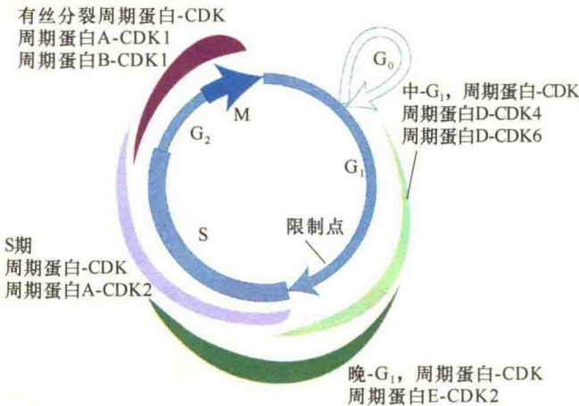

图 13-22 哺乳动物细胞周期调控的模式图（引自 Lodish et al., 2007）。处于静息状态的  $G_{0}$  细胞在生长激素的诱导下进入细胞周期，在不同的阶段受不同的细胞周期蛋白-CDK 的调控。

## 13.2.6.1 周期蛋白-CDK复合物

CDK 的活性随着细胞周期进程上升与下降，从而影响细胞内与细胞周期主要事件相关蛋白质的磷酸化状态。例如， $G_{2}/M$  期转换的 CDK 活性的提高，会提高控制染色质凝缩、核被膜断裂、纺锤体装配，以及其他与有丝分裂相关的蛋白质的磷酸化。CDK 活性的周期性变化是由细胞内的一些酶与蛋白质复合物控制的，其中最重要的就是细胞周期蛋白。因为周期蛋白在细胞内的浓度是随细胞周期的变化而变化，而周期蛋白依赖性激酶的浓度则是恒定的，所以，细胞周期蛋白水平的周期性变化导致周期蛋白-CDK 复合物（cyclin-CDK complex）在细胞周期特定阶段进行周期性装配与激活，从而调控细胞周期进程（图 13-23）。

根据细胞周期进程，将细胞周期蛋白分为4类，它们在细胞周期的不同阶段与CDK结合，并行使功能。

1） $G_{1}$  周期蛋白  $G_{1}$  周期蛋白帮助激活  $G_{1}/S$  周期蛋白，促进细胞通过  $G_{1}$  期的 START。

2） $G_{1}/S$ 周期蛋白 $G_{1}/S$ 周期蛋白在 $G_{1}$ 后期激活CDK，触发细胞通过START，确保细胞正式进入细胞周期。 $G_{1}/S$ 周期蛋白的浓度水平在S期急剧下降。

3）S 周期蛋白 S 周期蛋白在细胞通过 START 后快速与 CDK 结合，并帮助触发染色体复制。S 周期蛋白浓度水平持续上升直至有丝分裂。

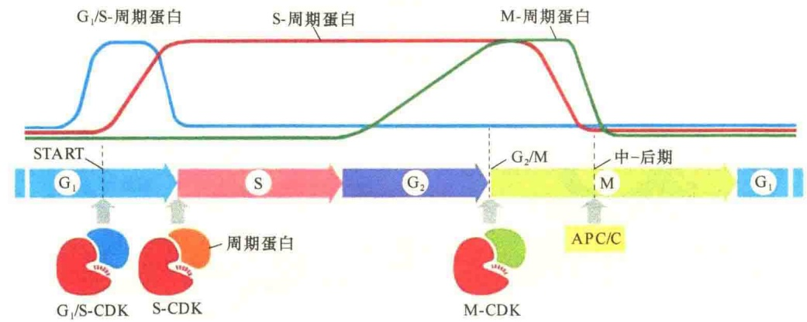

图 13-23 细胞周期控制系统中周期蛋白-CDK 复合物（引自 Alberts et al., 2015）。细胞周期中三种主要周期蛋白的浓度各有不同的振幅，而 CDK（图中未显示）的浓度维持不变，并且超过周期蛋白的浓度。在 G₁ 后期，G₁/S 周期蛋白的水平升高导致 G₁/S-CDK 复合物的形成，促进细胞通过 START 点。在 S 期开始时，形成 S-CDK 复合物，并触发 DNA 复制、启动 M 期的初始阶段事件。G₂ 期形成 M-CDK，但是处于非活性状态，这些复合物在 G₂ 期结束时被激活，并触发 G₂/M 期转换，进入 M 期。一种独立的调节复合物 -APC/C 启动有丝分裂中期与后期的转换。

S 周期蛋白也参与调控早期有丝分裂的某些事件。

4）M 周期蛋白 M 周期蛋白激活那些在  $G_{2}/M$  期转换中发挥作用的 CDK。M 周期蛋白的浓度水平在有丝分裂中期滑落。

大多数真核细胞都需要  $G_{1}$  周期蛋白帮助激活  $G_{1}/S$  周期蛋白，促进细胞通过  $G_{1}$  期的 START，仅有少数真核细胞不需要  $G_{1}$  周期蛋白。其他三类周期蛋白是所有真核生物细胞都需要的。

在裂殖酵母细胞中只有一种 CDK 与一种周期蛋白相互作用。在芽殖酵母细胞中只有一种 CDK 与 9 种不同的周期蛋白结合，通过与不同周期蛋白的结合启动不同的细胞时相进程。在脊椎动物细胞中有 4 种 CDK，其中 2 种与 G₁ 周期蛋白相互作用，1 种与 G₁/S 周期蛋白、S 周期蛋白相互作用，1 种与 S 周期蛋白、M 周期蛋白相互作用。表 13-2 总结了脊椎动物与芽殖酵母中主要的周期蛋白与 CDK。

表 13-2 哺乳动物细胞细胞周期蛋白与周期蛋白依赖性激酶

<table><tr><td rowspan="2">周期蛋白-CDK复合物</td><td colspan="2">脊椎动物</td><td colspan="2">芽殖酵母</td></tr><tr><td>周期蛋白</td><td>匹配 CDK</td><td>周期蛋白</td><td>匹配 CDK</td></tr><tr><td> $G_1$ -CDK</td><td>周期蛋白  $D^*$ </td><td>CDK4,CDK6</td><td>Cln3</td><td>CDK 1**</td></tr><tr><td> $G_1/S$ -CDK</td><td>周期蛋白 E</td><td>CDK2</td><td>Cln1,Cln2</td><td>CDK1</td></tr><tr><td>S-CDK</td><td>周期蛋白 A</td><td>CDK2,CDK1**</td><td>Clb5,Clb6</td><td>CDK1</td></tr><tr><td>M-CDK</td><td>周期蛋白 B</td><td>CDK1</td><td>Clb1,Clb2,Clb3,Clb4</td><td>CDK1</td></tr></table>

\* 哺乳动物细胞中有三种 D 型周期蛋白:D1，D2，D3。

\*\*CDK1 即裂殖酵母、脊椎动物中 Cdc2，芽殖酵母中的 Cdc28。

CDK与周期蛋白三维结构研究揭示，在缺少周期蛋白时，CDK蛋白的活性位点被一个蛋白质环占据了一部分，像是一块石头堵住了洞穴的入口（图13-24A），周期蛋白的结合可导致蛋白质环离开活性位点，恢复CDK酶的部分活性（图13-24B）。当另一个独立存在的激酶——CDK-激活激酶（CAK）将CDK活性位点附近的一个氨基酸磷酸化，周期蛋白-CDK复合物才会具有完全的活性。CAK将CDK特定位点的磷酸化，引起CDK的构型改变，因此进一步激活CDK（图13-24C）。

## 13.2.6.2 CDK活性的抑制

在细胞周期中，周期蛋白水平的升降主要是由 CDK 活性决定的。而 CDK 的活性在细胞周期的不同阶段具有不同的调控机制。在激酶的活性位点上有一对位点，它们的磷酸化可抑制周期蛋白-CDK 复合物的活性。这些位点的磷酸化是由 Wee1 蛋白激酶催化的，磷酸化后则对 CDK 的活性起抑制作用。经 Wee1 磷酸化的位点可被磷酸酶 Cdc25 去磷酸化，而去磷酸化则提高 CDK 的活性（图 13-25）。这一调控机制对于有丝分裂期 M-CDK 活性的调控特别重要。

CDK 抑制蛋白（CDK-inhibitor protein，CKI）与周期蛋白-CDK 复合物结合，可抑制 CDK 的活性。周期蛋白-CDK-CKI 复合物的三维结构研究揭示 CKI 的结合引起 CDK 活性位点结构的重排，导致 CDK 失活（图 13-26）。细胞使用 CKI 主要是协助调控细胞周期早期 G₁/S 和 S-CDK 的活性。

## 13.2.6.3 CDK的蛋白酶解与细胞周期转换

细胞通过对细胞周期蛋白依赖性激酶的磷酸化作用，驱动细胞通过START及 $G_{2}/M$ 期转换，但是，细胞进程中的有丝分裂中期向后期的转换则是通过对蛋白激酶的降解驱动的。细胞有丝分裂中期向后期转换的关键因子是后期促进复合物（anaphase-promoting complex/cyclosome, APC/C），该复合物是一种泛素连接酶（E3）。

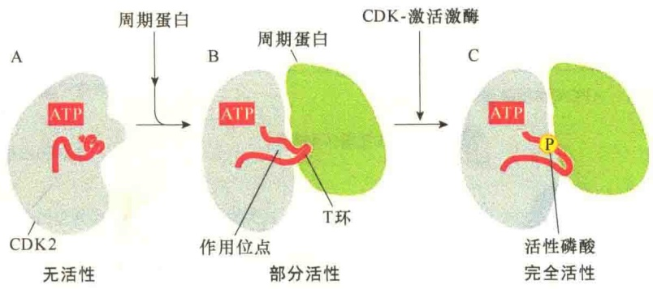

图 13-24 CDK 激活的结构基础（引自 Alberts et al., 2015）。此图是通过 X 射线晶体学鉴定的人 CDK2 和周期蛋白 A 的三维结构。图中标明了 ATP 结合的部位。A. 在非活性状态，没有周期蛋白结合，活性位点被一个称为 T 环（T-loop）的蛋白质区堵住了。B. 由于周期蛋白的结合，导致 T 环移出活性位点，致使 CDK2 具有部分活性。C. CAK 将 T 环的苏氨酸残基磷酸化，改变了 T 环的状态，从而进一步将 CDK2 激活。

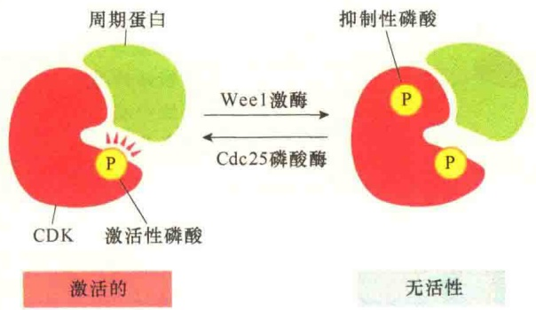

图 13-25 磷酸化对 CDK 活性的调节（引自 Alberts et al., 2015）。蛋白激酶 Wee1 将 CDK 中活性位点上方相邻的两个位点磷酸化后，抑制了 CDK 的活性。磷酸酶 Cdc25 将 Wee1 磷酸化的两个磷酸脱磷酸后，激活周期蛋白-CDK 复合物的活性。为简便起见，只显示了 Weel 磷酸化的一个位点。

图 13-26 CKI 对周期蛋白-CDK 复合物的活性抑制（引自 Alberts et al., 2015）。根据 CKI p27 结合人 CDK2 和周期蛋白 A 的三维结构 X 射线结晶学绘制的示意图。p27 是一种 CKI，能够与周期蛋白-CDK 复合物中的两个成员结合，破坏了 CDK 的活性位点。p27 还能插入到 CDK 中的 ATP 结合位点，进一步抑制了酶的活性。

APC/C 催化两种主要类型的蛋白质泛素化及降解。第一种是分离酶抑制蛋白（securin），该蛋白质在有丝分裂早期维持姐妹染色单体的配对连锁中起保护作用。分离酶抑制蛋白在有丝分裂中期的降解激活了姐妹染色体分离的酶，促进细胞周期进入有丝分裂后期。APC/C 催化降解的第二种主要的靶蛋白是 S 周期蛋白与 M 周期蛋白，这些周期蛋白的降解导致细胞中大多数 CDK 的失活。随着这些 CDK 的失活，一些在 S 期及早有丝分裂期被 CDK 磷酸化的蛋白质在后期细胞中被各种磷酸酶去磷酸化。CDK 靶蛋白的去磷酸化则是完成 M 期进程所必需，包括顺利完成有丝分裂的最后过程及胞质分裂。APC/C 的活性自有丝分裂期中段被激活起，一直维持到 G₁ 期，以确保该段时期内 CDK 的失活。当 G₁/S-CDK 在 G₁ 后期被激活时，APC/C 失活，周期蛋白又在下一个细胞周期中进行积累。

参与细胞周期调控的还有另一个泛素连接酶SCF，该酶在细胞内有很多作用，但是在细胞周期中的主要功能是将 $G_{1}$ 后期的某些CKI蛋白泛素化，帮助调控S-CDK的活性及DNA的复制。SCF也负责S期初期的 $G_{1}/S$ 周期蛋白的降解。

APC/C、SCF都是多亚基组成的复合物，并且亚基间有很大的相关性，但是它们的调控机制是不同的。APC/C在细胞周期中的活性改变主要缘于与其结合的活性亚基的活性变化:有丝分裂中期是Cdc20亚基，而从晚期有丝分裂向早 $\mathrm{G}_{1}$ 期行进则是Cdh1亚基。这些亚基帮助APC/C识别靶蛋白。与APC/C不同，SCF的活性依赖于一种称为F盒蛋白（F-box protein）的底物结合亚基，F盒蛋白

有很多不同类型。而且，SCF 的活性在整个细胞周期都是恒定的。SCF 的泛素化作用受靶蛋白磷酸化状态的调控，因为 F 盒亚基仅能识别磷酸化的蛋白质（图 13-27）。

A. APC/C控制的蛋白酶解

B. SCF控制的蛋白酶解

图13-27 在细胞周期期间APC/C、SCF蛋白酶解调控（引自Albertset al., 2015）。A. 在有丝分裂中，APC/C与Cdc20结合而激活。激活的APC/C可识别M周期蛋白及其他一些靶蛋白中特殊的氨基酸残基。在E1和E2的帮助下，APC/C将靶蛋白进行多聚泛素化，多聚泛素化的靶蛋白被蛋白酶体识别并降解。B. 泛素连接酶SCF的活性依赖于底物结合亚基:磷酸化的靶蛋白（如图中CDI）能够被特异的F盒蛋白亚基所识别，进而被多聚泛素化并被蛋白酶体降解。

## 13.2.6.4 细胞周期是一个由蛋白质控制的调控网络

从上面的讨论中可清楚地看出，细胞周期调控系统是由周期蛋白依赖性激酶、周期蛋白及各种不同的激活与抑制蛋白组成的生化开关控制的网络。表 13-3 总结了参与细胞周期调控的主要的蛋白质。

表 13-3 参与细胞周期调控的主要蛋白质

<table><tr><td>通用名称</td><td>功能与组分</td></tr><tr><td colspan="2">修饰CDK的蛋白激酶与蛋白质磷酸酶</td></tr><tr><td>CAK激酶</td><td>磷酸化CDK中一个磷酸化位点,激活CDK</td></tr><tr><td>Wee1激酶</td><td>磷酸化CDK中的抑制位点,抑制CDK</td></tr><tr><td>Cdc25磷酸酶</td><td>除去抑制CDK的磷酸,激活CDKS;哺乳动物有三个家族成员(Cdc25A、CdcB、CdcC),主要涉及有丝分裂起始的Cdk1的活性调控</td></tr><tr><td>Cdc14磷酸酶</td><td>激活Cdh1去降解有丝分裂周期蛋白</td></tr><tr><td colspan="2">CDK抑制蛋白(CKI)</td></tr><tr><td>Sic1(芽殖酵母)</td><td>在G1期抑制CDK的活性;G1期末被CDK1磷酸化后结构被破坏</td></tr><tr><td>p27(哺乳动物)</td><td>在G1期抑制G1/S-CDK与S-CDK的活性;当细胞发生终端分化时帮助细胞退出细胞周期;被CDK2磷酸化后触发SCF对其泛素化</td></tr><tr><td>p21(哺乳动物)</td><td>当DNA发生损伤时抑制G1/S-CDK与S-CDK的活性</td></tr><tr><td>p16(哺乳动物)</td><td>在 $G_1$ 期抑制 $G_1$ -CDK的活性;在癌细胞中常常是失活的</td></tr><tr><td>INK4</td><td>与 $G_1$ -CDK结合并抑制其活性</td></tr><tr><td>Rb</td><td>与E2F结合,阻止多种细胞周期基因的转录</td></tr><tr><td colspan="2">泛素连接酶及其激活子</td></tr><tr><td>APC/C</td><td>催化那些退出有丝分裂期的调节蛋白的泛素化,包括分离酶抑制蛋白、S周期蛋白与M周期蛋白;APC/C的活性受激活亚基Cdc20或Cdh1的结合调节</td></tr><tr><td>Cdc20</td><td>在所有的细胞中作为APC/C的激活亚基;在有丝分裂中期向后期转换中触发APC/C初始活性,诱导B型周期蛋白降解,启动后期</td></tr><tr><td>Cdh1</td><td>APC/C激活亚基,维持APC/C在分裂后期及整个 $G_1$ 期活性</td></tr><tr><td>SCF</td><td>催化参与 $G_1$ 期调控的调节蛋白的泛素化,包括某些CKI(如芽殖酵母中的Sic1,哺乳动物中的p27);这些作用都需要靶蛋白先进行磷酸化</td></tr></table>

在真核生物的细胞周期中，CDK、周期蛋白、细胞周期中的抑制蛋白，以及泛素连接酶及其激活子等众多蛋白质的协同作用，保证了细胞周期的正常运行（图 13-28）。

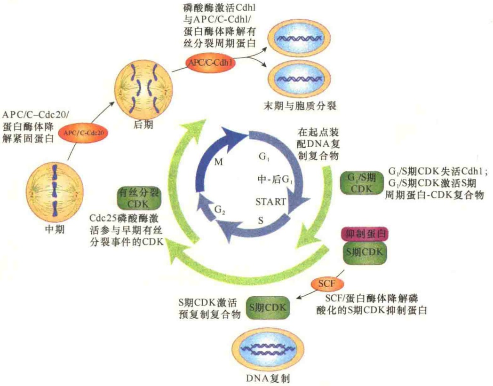

图 13-28 真核生物细胞周期的主要事件（引自 Lodish et al., 2013）。细胞周期分别由依赖于细胞周期蛋白的 G₁ 期、S 期和有丝分裂期的蛋白激酶复合物所控制。这些蛋白激酶复合物都是由一个调节性的细胞周期蛋白亚基和一个催化性的依赖于细胞周期蛋白的蛋白激酶亚基所组成。在有丝分裂后期，CDK 复合物都是通过对一些特异底物，包括 S 期抑制物、后期抑制物及有丝分裂细胞周期蛋白的泛素化，并利用蛋白酶体将这些底物降解，进而调节细胞周期。

## 13.2.7 细胞周期关卡

细胞周期的进程十分有序，是基因有序表达的结果。与细胞分裂有关的基因称为细胞分裂周期（cell division cycle, cdc）基因。这些基因表达的有序性，受到一些控制系统的监测。例如，酵母细胞在 DNA 合成开始的稍前部位有启动点，在哺乳类细胞中称为 R 点或限制点，亦称为关卡（check point）。这些关卡严格地监视着细胞周期事件的发生、发展过程是否严格按程序进行。例如，DNA 损伤未修复前不能进入 S 期，S 期 DNA 合成未完成不能进入 M 期，如果 M 期的纺锤体和染色体连接不正常则不能进入后期，正是这一套监控系统保证了细胞周期的正常进行。

## 13.2.7.1 细胞周期关卡途径

细胞的监理机制（surveillance mechanism）是由关卡途径（checkpoint pathway）进行管控的。通过关卡的管控，确保了在上一个细胞周期没有完成之前不能启动下一个细胞周期的事件。关卡途径由感应器（sensor）、信号级联反应（signaling cascade）和效应物（effector）组成。感应器监测特殊的细胞事件，信号级联反应负责“通风报信”，效应物则“叫停”细胞进程，并激活必要的修复途径（图13-29）。

由关卡途径监控的细胞周期事件包括细胞生长、DNA复制、DNA损伤、动粒与有丝分裂纺锤体的附着（图13-30）。关卡途径的监控确保了细胞的正常分裂，特别是确保了子代细胞具有完整的染色体。各种关卡途径的功能是通过调控周期蛋白-CDK复合物中的蛋白激酶的活性实现的:不同的蛋白激酶调控周期蛋白的合成与降解、CDK抑制位点的磷酸化、调控使周期蛋白-CDK复合物失活的CKI的合成与稳定，以及对APC/C泛素蛋白连接酶的调控等。

在典型的细胞周期中，控制系统是通过细胞周期的关卡来进行调节的。控制系统至少有三个关卡: $G_{1}$  关卡（靠近  $G_{1}$  末期）、 $G_{2}$  关卡（在  $G_{2}$  期结束点）、中期关卡（在中期末）。在每一个关卡，由细胞所处的状态和环境决定细胞能否通过此关卡进入下一阶段（图 13-31）。

## 13.2.7.2 细胞周期中 DNA 损伤关卡

除了上述三个主要的细胞周期关卡外，还有一个重要的细胞周期关卡是DNA损伤关卡（DNA damage checkpoint）。在细胞周期中对DNA质量的监控是最为重要的，因为细胞的内外环境中的一些物理与化学因素随时都有可能对DNA造成损伤，对DNA损伤若不能及时监测与修复，后果极为严重。所以，细胞对DNA损伤的监控是全周期的，一旦监测到DNA损伤，无论在细胞周期的哪个时相，都要立即停止进程，启动修复机制。

图 13-29 关卡途径三部分的协同作用（引自 Plopper et al., 2015）。感应器感受到 DNA 损伤，发出 DNA 损伤信号，经放大后传递给效应物，停止细胞进程，启动修复机制进行修复。

在 DNA 损伤关卡中，细胞周期的阻断是由两个蛋白激酶，即 ATRATM 介导的，这两种蛋白激酶在 DNA 受到损伤时被激活，并立即启动 DNA 损伤应答:一方面中止细胞周期，另一方面激活 DNA 修复，在某些情况下，甚至启动细胞程序性死亡机制。

ATM 与 ATR 分别作为两类识别 DNA 损伤或未复制 DNA 复合物的组分（图 13-32）。ATR 是被

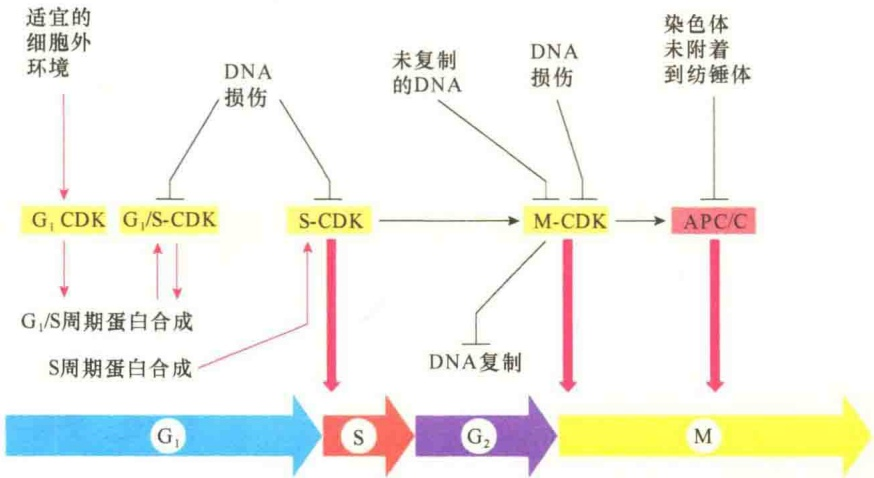

图 13-30 细胞周期调控系统概览（引自 Alberts et al., 2015）。图中显示细胞周期进程中影响周期蛋白-CDK 复合物活性的限制性环境因素，包括合适的外部环境与内部环境。在内部环境中，DNA 的损伤、DNA 的复制完成程度、染色体与纺锤体的附着等是主要的监控关卡。

图 13-31 细胞周期关卡及调节信息（引自 Alberts et al., 2015）。图中显示  $G_{1}$  关卡、 $G_{2}$  关卡、中期关卡三个关卡控制的主要事件。

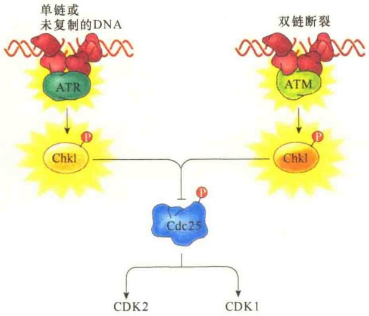

图 13-32 细胞周期中止在 DNA 损伤关卡（引自 Cooper and Hausman，2016）。识别损伤 DNA 复合物中 ATR 与 ATM 蛋白激酶被激活，ATR 被单链或未复制 DNA 激活，而 ATM 主要是被断裂的双链所激活。激活的 ATR 与 ATM 激酶分别将 Chk1、Chk2 磷酸化，并将它们激活。激活的 Chk1、Chk2 将磷酸酶 Cdc25 磷酸化并将其失活。失活的 Cdc25 不能激活 CDK2、CDK1，致使细胞周期暂时中止在 DNA 损伤关卡。

单链或未复制的 DNA 链激活，而 ATM 是被双链 DNA 断裂所激活。一旦被 DNA 损伤激活，ATR 与 ATM 分别将关卡蛋白激酶 Chk1、Chk2 磷酸化并激活。激活的 Chk1 与 Chk2 通过将 Cdc25 磷酸化从而抑制 Cdc25 的活性或诱导 Cdc25 降解，最终导致细胞周期中止。Cdc25 磷酸酶是 CDK2、CDK1 激活所必需的，因为 Cdc25 磷酸酶在细胞周期调控中，通过除去 CDK2 与 CDK1 上抑制性的磷酸而控制细胞周期进程。如果 DNA 损伤导致 CDK2 失活，细胞就会中止在 G₁ 期和 S 期；若是导致 CDK1 的失活，细胞就会中止在 G₂ 期。

在哺乳动物细胞中，p53蛋白在细胞DNA损伤的监测与控制中发挥关键作用。p53蛋白可被ATM及Chk2磷酸化，磷酸化的p53蛋白非常稳定（若不磷酸化则会快速降解），其结果导致DNA损伤的细胞内p53蛋白的浓度快速升高。p53蛋白是一种转录因子，高浓度的p53蛋白可诱导CDK抑制蛋白p21的合成。p21蛋白抑制CDK-周期蛋白E或CDK-周期蛋白A的活性，从而将DNA损伤的细胞周期中止在DNA损伤关

图 13-33 p53 蛋白中止细胞周期进程的作用（引自 Cooper and Hausman，2016）。在哺乳动物细胞周期调控中，p53 蛋白监测并中止 DNA 损伤的细胞周期进程。p53 蛋白可被 ATM、Chk2 磷酸化，磷酸化的 p53 蛋白稳定性提高，导致 DNA 损伤细胞中 p53 蛋白的浓度水平提高，p53 蛋白激活编码 CDK 抑制蛋白 p21 的基因表达。p21 蛋白抑制了 CDK-周期蛋白 E 或 CDK-周期蛋白 A 复合物的活性，从而中止了细胞周期。

卡（图 13-33），这样有利于细胞对损伤的 DNA 进行修复，若无法修复，则进入程序性死亡。若编码 p53 蛋白的基因发生了突变，导致 p53 蛋白对 DNA 损伤监测能力的丧失，不能有效地将细胞周期中止在 DNA 损伤关卡，损伤的 DNA 能够进行复制并进入到子细胞。损伤 DNA 的遗传会提高基因组的不稳定性与突变的频率，增加了癌变的机会。

## 13.3 有丝分裂

细胞分裂（cell division）是细胞增殖的方式。细胞有两种主要的分裂方式:有丝分裂（mitosis）和减数分裂（meiosis）。细胞通过有丝分裂产生两个含有相同全套染色体的子细胞，通过减数分裂产生在遗传上有变异的单倍体细胞，用于有性生殖。

## 13.3.1 有丝分裂过程

有丝分裂是细胞周期的分裂期（M期）进行的分裂活动。在这个时期，通过纺锤丝的形成和运动，把在S期已经复制好的DNA平均分配到两个子细胞，以保证遗传的连续性和稳定性。由于这一时期的主要特征是出现纺锤丝，故称为有丝分裂。

通常有丝分裂是指完全的细胞分裂，包括核分裂（karyokinesis, nuclear division）和胞质分裂两个过程，一般在核分裂之后随之发生胞质分裂（图 13-34）。

## 13.3.1.1 核分裂各阶段的特征变化

M 期持续的时间很短，但形态变化很大，根据形态变化的特征，通常将核分裂分为前期、前中期、中期、后期和末期。

1）前期（prophase） 前期是有丝分裂的第一期，该期的主要特征是染色质凝缩成由完全相同的两条染色单体连接而成的具有明显特征的染色体。另外，核仁消失、核被膜解体、细胞质中出现纺锤体也是前期的特征。

前期发生的主要事件有4种:染色质的凝缩、分裂极的确定、核仁的消失和核被膜片段化。染色质凝缩是前期开始的第一个特征，实际上是染色质的螺旋化、折叠和包装过程。一对中心体移向相对的两侧，确定分裂极。前期末，核仁缩小消失，核被膜片段化，染色体分散于胞质之中。

2）前中期（prometaphase）核被膜解体后，细胞即进入前中期，此时期的主要事件是纺锤体（spindle）的装配。纺锤体是由微管装配而成的，功能是在有丝分裂期间将两套染色体均等分开。纺锤体微管的装配起始于中心体。

核周围的纺锤体侵入细胞核的中心区，一部分纺锤体微管的自由端最终结合到动粒上，形成动粒微管。前中期的特征是染色体剧烈运动，个别染色体剧烈地旋转、振荡、徘徊于两极之间，并被纺锤体“捕获”:一侧纺锤体微管的自由端捕获一条染色体的一侧动粒，接着另一侧纺锤体的自由端捕获该染色体另一侧的动粒，这一过程是随机发生的。

3）中期（metaphase） 当两极的纺锤体微管分别与染色体两侧的动粒结合形成动粒微管之后，即进入中期。染色体在纺锤体动粒微管的作用下，逐渐移向纺锤体的中心区，最终整齐排列在纺锤体赤道（spindle equator）。染色体移向赤道，是纺锤体动粒微管相互作用的结果，并且是染色体由不稳定状态向稳定状态转变的过程（图 13-35）。

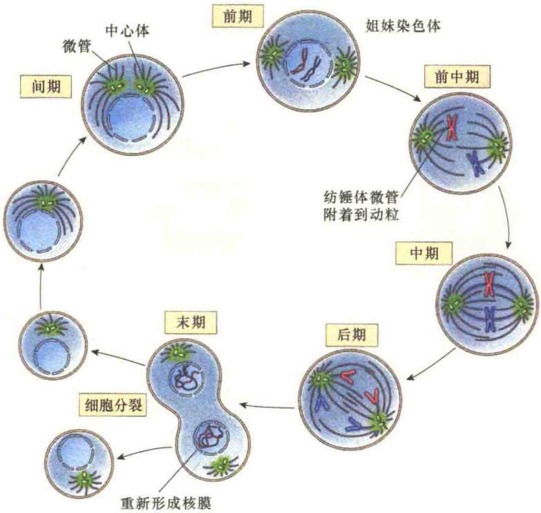

图 13-34 动物细胞有丝分裂过程（引自 Cooper and Hausman，2016）。在前期，染色质发生凝缩，中心体移向细胞核相反的两侧，启动有丝分裂纺锤体的装配；核被膜断裂，纺锤体微管附着到染色体。在前中期，染色体在两个中心体间来回移动，逐渐移到细胞的中央，直至完全线性排列在细胞的中间位置，即进入中期。在后期，姐妹染色单体分离并移向相反的两极；后期重新形成核被膜、染色体去凝缩，最后通过胞质分裂形成两个子细胞。

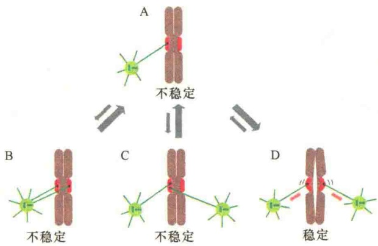

图 13-35 动粒与纺锤极附着的几种方式（引自 Alberts et al., 2015）。A. 来自一极的单个纺锤体微管与姐妹染色单体的一个动粒结合。B. 来自一极的两个纺锤体微管分别与一对姐妹染色单体的两侧动粒结合。C. 来自两极的两个纺锤体微管与染色单体同一侧的动粒结合。D. 来自两极的两个纺锤体微管分别在一对姐妹染色单体的两侧与动粒结合。前三种结合是不稳定的，最后一种是稳定的。

4）后期（anaphase）在两侧纺锤体微管的作用下，将排列在赤道板上的姐妹染色单体断开并拉向两极的时期为后期。在后期的开始阶段，每一对姐妹染色体的着丝粒在纺锤体微管的作用下发生断裂，进而造成染色单体分开并移向两极。几乎所有的姐妹染色单体都同时分裂。因此，这一时期的主要特点是:着丝粒分开，染色单体移向两极。

5）末期（telophase） 后期结束，染色单体平均分配到纺锤体的两极，核被膜小泡重新包围两组染色体，相互融合形成完整的核被膜，并在两极重新形成新的细胞核，此即末期。该期的主要特点是:染色体解螺旋形成细丝，出现核仁和核被膜。

## 13.3.1.2 中心体的复制

有丝分裂需要中心体中的中心粒产生纺锤体（见图11-9），并且，中心体对于确定细胞分裂极具有重要作用。经细胞分裂产生的子代动物细胞只有一个中心体，因此在细胞进入细胞周期伊始，就必须进行中心体的复制，并且在有丝分裂期复制成完整的两个中心体。中心体的复制从 $G_{1}$ 期进入S期开始。 $G_{1}/S-CDK$ 触发细胞进入细胞周期，同时也启动了中心体的复制。中心体复制时，其中的两个中心粒分开，各自合成一个新的中心粒，新合成的两个中心体一起维持在细胞核的一侧，直至进入有丝分裂才分离，并各自移向一极（图 13-36）。由此看来，中心体的复制是与染色体的复制同步进行的，也必然有监控保障机制。实验证明，若阻断了染色体复制，也同时阻断了中心体的复制。

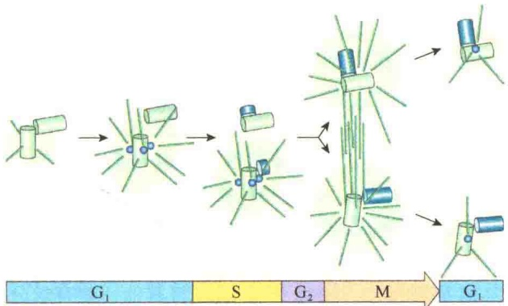

图 13-36 中心粒复制（引自 Lodish et al., 2016）。中心体含有一对中心粒及中心粒基质。在  $G_{1}$  期的某一点，一对中心粒开始分离（约几微米）。S 期，子代中心粒在各自的母体中心粒旁以直角形式开始生长。到  $G_{2}$  期，每个中心粒完成长度生长，此时的子代中心粒维持在一个中心体中。进入 M 期，分裂成两个成熟的中心体。

## 13.3.1.3 胞质分裂

M期的主要目的是进行核分裂，将复制的染色体均等分配到两个子细胞，在此期间也要涉及细胞中其他物质的分配，包括将细胞膜、细胞骨架、细胞器及可溶性蛋白质等分配给两个子细胞，这是通过胞质分裂（cytokinesis），即将细胞质一分为二完成的。胞质分裂通常开始于有丝分裂后期，由MPF的失活所触发，直到两个新细胞核形成后才结束。动物细胞的胞质分裂装置是肌动蛋白装配成的收缩环（contractile ring），通过肌球蛋白与肌动蛋白纤维的滑动模型，使肌动蛋白收缩环紧缩，最终将细胞质一分为二（图13-37）。

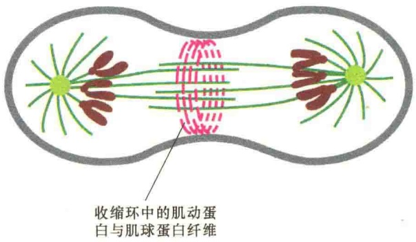

图 13-37 胞质分裂（引自 Alberts et al., 2015）。

## 13.3.2 有丝分裂机制

有丝分裂的核心问题是如何将遗传物质均等分配给两个新产生的子细胞，整个过程中的所有活动都是围绕这一核心问题进行的。具体事件包括有丝分裂的启动、染色质的凝缩、核被膜解体、纺锤体的形成、染色体的分离等。

## 13.3.2.1 M-CDK对有丝分裂早期事件的调控

研究表明，有丝分裂涉及多种细胞结构发生翻天覆地的变化，最终导致整个细胞结构的重新组织。这些事件的发生都是缘于CDK1/周期蛋白B蛋白激酶（MPF）的激活。CDK1/周期蛋白B作为M期转换的“操盘手”，通过将其他一些有丝分裂蛋白激酶激活，或是直接对某些结构重建所需的蛋白质磷酸化进行M期的调控（图13-38）。

实际上，极光激酶 A（Aurora kinase A）、极光激酶 B、极样激酶（Polo-like kinase，Plk）家族与 CDK1 被进入 M 期的信号协同激活。极光激酶、极样激酶与 CDK1 形成一个正反馈环（positive feedback loop）:CDK1 激活极光激酶，极光激酶激活极样激酶，极样激酶激活 CDK1。这些酶都被激活后在有丝分裂中发挥多种作用。

间期染色质凝缩成有丝分裂细胞中体是有丝分裂中的关键事件，它关系到在有丝分裂中染色体能否被正确地分离。高度凝缩的染色体是不会转录的，所以染色质凝缩时，就会停止转录。尽管染色质凝缩的详细机制尚不清楚，但有一点是清楚的:染色质的凝缩是由凝缩蛋白复合物驱动的。染色体结构维持蛋白复合物（SMC）在真核染色质的凝缩中起关键作用。

极样激酶是双极性有丝分裂纺锤体（bipolar mitotic spindle）正常装配所必需，部分原因是它能够将那些参与有丝分裂早期极纺锤体分离的蛋白质磷酸化。极光激酶家族中的极光激酶B在染色质凝缩中发挥重要作用，极光激酶A则帮助调控姐妹染色单体与纺锤体的附着。

## 13.3.2.2 周期蛋白B-CDK1的正反馈调控

我们讨论了裂殖酵母 MPF 的激活机制，高等真核生物中 M-CDK 的激活与酵母的 MPF 激活机制相似，但更为复杂。

高等真核生物 M-CDK 是有丝分裂的主要控制者，所以其对 M-CDK 的活性调节至关重要。实际上，细胞周期中对 M-CDK 的调控是十分严密而又精细的。

M-CDK 的活性是随着细胞周期蛋白（在脊椎动物中是周期蛋白 B）的积累而逐渐开始的。在胚性细胞周期中，M-周期蛋白在整个细胞周期中是恒定合成的，周期蛋白的积累导致间期细胞中蛋白质的高度稳定。但是，在大多数细胞类型中，M-周期蛋白的合成在  $G_{2}$  期与 M 期比较高。随着细胞周期逐渐靠近有丝分裂，M-周期蛋白水平提高，导致相应的 M-CDK 积累。虽然在 M-CDK 复合物中，CDK 上的活性位点已经被 CDK 激活激酶（CAK）磷酸化了，但是，CDK 上另外两个相邻的位点被蛋白激酶 Wee1 进行了抑制性的磷酸化，从而使 CDK 处于抑制状态。因此，当细胞到达  $G_{2}$  期末时，已经储备了大量的 M-CDK，只不过此时的 M-CDK 复合物中的 CDK 激酶的活性位点因受到抑制性磷酸化的作用而处于“临战”状态。

那么，何时、通过何种方式将这些待命的、一触即发的 M-CDK 激活？最关键的因素有两个，一是磷酸酶 Cdc25 被激活，它能够将 M-CDK 中抑制性的磷酸去除；二是激酶 Wee1 的活性被抑制，这就进一步保证了 M-CDK 活性的提高。图 13-39 是关于脊椎动物细胞周期蛋白 B-CDK1 的调控机制示意图。在该调控机制中，有丝分裂信号（细胞体积与营养等）被有丝分裂激酶感知后，激活的极样激酶 (Plk) 启动了周期蛋白 B-CDK1 的反馈调节。磷酸酶 Cdc25 受双重激活:一是先被极样激酶 (Plk) 轻度激活，激活的磷酸酶 Cdc25 通过脱磷酸作用将 CDK1 激活；二是被激活的 CDK1 可以进一步将磷酸酶 Cdc25 激活，加快周期蛋白 B-CDK1 的抑制位点的脱磷酸，使更多的周期蛋白 B-CDK1 被激活，加快了有丝分裂的进程。有意思的是，激活

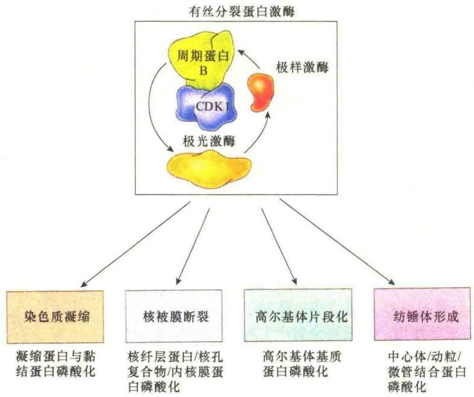

图 13-38 有丝分裂蛋白激酶（引自 Cooper and Hausman，2016）。有丝分裂蛋白激酶 CDK1、极光激酶及极样激酶在 M 期形成一个正反馈激活环，激活的蛋白激酶通过将一系列相关蛋白质磷酸化，诱导染色质凝缩、核被膜断裂、高尔基体片段化及纺锤体形成。

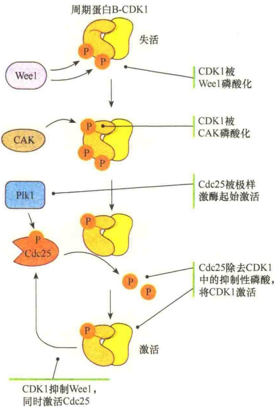

图 13-39 周期蛋白 B-CDK1 活性反馈调控（引自 Plopper，2016）。随着周期蛋白 B 浓度的逐渐升高，与 CDK1 结合形成周期蛋白 B-CDK1 复合物。接着，Wee1 将 CDK1 两个相邻的抑制性位点磷酸化、CDK1 的活性位点被 CAK 磷酸化、此时的周期蛋白 B-CDK1 复合物没有活性。至 G₂ 期末，磷酸酶 Cdc25 被极样激酶（Plk）轻度激活，激活的磷酸酶 Cdc25 将 CDK1 抑制位点脱磷酸，从而将 CDK1 激活。激活的 CDK1 可以进一步激活磷酸酶 Cdc25、抑制 Wee1 的活性进行反馈调节，让更多的周期蛋白 B-CDK1 激活，从而加快有丝分裂的进程。

的周期蛋白 B-CDK1 不仅能激活磷酸酶 Cdc25，还能够抑制 Wee1 的活性。周期蛋白 B-CDK1 能够对其自身的激活剂与抑制剂产生作用，表明周期蛋白 B-CDK1 在有丝分裂中具有正反馈调节作用。

## 13.3.2.3 核被膜的断裂与高尔基体的片段化

在细胞间期，染色质被核被膜包围在细胞核内。为了让复制完全的染色体在有丝分裂中与纺锤体相互作用并分配给两个子细胞，核被膜必须解体。在核被膜解体过程中，主要是核纤层蛋白的磷酸化直接导致核纤层的去聚合。

脊椎动物细胞中有三种类型的核纤层蛋白（A、B、C）。核纤层蛋白A和C是由同一个转录单位编码的，通过可变剪接形成不同的mRNA。它们在肽链上的差别是:核纤层蛋白A的C端比核纤层蛋白C的C端多133个氨基酸残基。核纤层蛋白B是由另一个转录单位编码的，通过转录后的修饰，在羧基端添加了疏水的异丙基，添加的脂肪酸帮助核纤层蛋白B插入到核被膜的内脂层。三种类型的核纤层蛋白都以二聚体的形式存在，有球形的头和尾部结构域，以及一个杆状的α螺旋中心。这些核纤层蛋白二聚体以头-头、尾-尾相接的方式形成核纤层。

M-CDK一旦在 $G_{2}$ 期结束时被激活，将对三种核纤层蛋白中特殊的丝氨酸残基进行磷酸化（图13-40），磷酸化作用导致核纤层网络去聚合。磷酸化的核纤层蛋白A和C被释放出来进入胞质溶胶中，而磷酸化的核纤层蛋白B由于异丙基的作用仍然与核被膜相连。核纤层以断裂的方式解体，导致核被膜破裂形成小膜泡。

M-CDK 的磷酸化作用也参与了内质网和高尔基体破裂形成小囊泡，主要是通过对 GM130 的磷酸化。GM130 是介导 COPI 包被蛋白小泡着陆高尔基体所必需的蛋白质，它的磷酸化阻止了 COPI 包被蛋白小泡着陆高尔基体并与之融合，进而使高尔基体和内质网断裂成片段。

## 13.3.2.4 有丝分裂纺锤体与马达蛋白

有丝分裂的中心任务是染色体的分离。在所有真核细胞中，染色体的分离都是依靠有丝分裂纺锤体（mitotic spindle）及一套精巧的作用机制。纺锤体是一种双极性排列的微管，它们的功能是在有丝分裂后期将姐妹染色单体拉开，并将两套染色体分离到细胞相反的两端，然后将它们包裹进入子细胞核。M-CDK 在有丝分裂初期触发了纺锤体的装配。

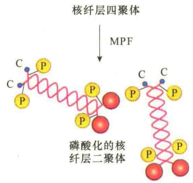

图 13-40 磷酸化作用导致核纤层断裂（引自 Lodish et al., 2013）。图的上部是核纤层网络结构。中间部分显示的是核纤层螺旋二聚体结构。大圆点表示 N 端，小圆点是 C 端。底端部分是 M-CDK 对 N 端、C 端特异的丝氨酸残基的磷酸化导致核纤层纤维的断裂，进而导致核被膜的破裂。

纺锤体是有丝分裂器（mitotic apparatus）的核心装置，它从中心粒形成各种双极性微管，包括动粒微管（kinetochore microtubule）、两极连接微管（interpolar microtubule）、星体微管（astral microtubule）等（图13-41），这些微管在有丝分裂后期协同将两套染色体均等分开，确保子细胞能够获得整套完整的染色体。

在纺锤体的装配与功能发挥中都有马达蛋白的参与，发挥作用的部位包括动粒、染色体的臂、纺锤体的极，以及极交互纺锤体微管。另外，有的马达蛋白只在一个部位起作用，有些马达蛋白在多个部位起作用（图 13-42）。

## 13.3.2.5 前中期染色体捕获与会集

有丝分裂中期的主要特点是让所有复制加倍的染色体能够“一字”排列到赤道板（metaphase plate），涉及纺锤体动粒微管对染色体的捕获，以及通过马达蛋白与动粒微管的动态变化将染色体定向引导到赤道板。

动粒是在早中期开始装配的，并且每一个姐妹染色单体的着丝粒处各装配一个，姐妹动粒附着部位各自朝向相反的一极。

动粒是纺锤体微管在染色体上的附着部位，是由蛋白质装配起来的复合物，分为三个部分:内板（inner plate）、外板（outer plate）、纤维冠（fibrous corona）（图13-43）。内板主要由三类着丝粒蛋白（centromere protein）组成，包括CENP-A、CENP-C、CENP-G。内板是动粒装配的组织者，并起稳定动粒的作用。组成外层的蛋白质主要是CENP-E、CENP-F、CENP-I等，主要功能是与微管结合，并为染色体的移动提供极向的力。动粒最外侧的部分是纤维状的冠，构成纤维冠的蛋白质包括CENP-E、马达蛋白等。纤维冠的功能是捕获微管。

前中期装配的动粒是如何捕获纺锤体微管的？由于从纺锤体的极形成的微管是高度动态的，动粒对微管的捕获有可能是通过微管的侧向，也有可能是通过微管的末端（图 13-44A 中步骤 1A，1B）。微管被动粒捕获后，通过降低微管去聚合的速率，使微管趋于稳定。研究发现，在此过程中，Ran-

图 13-41 动物细胞中期有丝分裂纺锤体（引自 Alberts et al., 2015）。有三种类型的有丝分裂纺锤体微管:①动粒微管是两极生长的微管，正端分别与一侧的动粒结合；②两极连接微管是来自两极微管的正端分别越过了中期板，并有部分交互重叠；③星体微管是由中心体生长出较短的放射性微管，其正端是自由的。动粒微管与极交互微管都有马达蛋白的结合。

双极性马达蛋白:与相邻的两个相同极性微管结合位于染色体臂上的马达蛋白将染色体推向细胞的极

位于动粒上的马达蛋白抓住微管，并通过去聚合微管，将染色体拉向细胞极

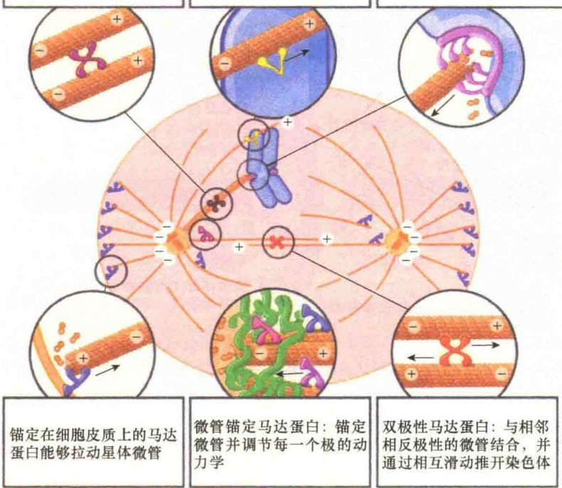

锚定在细胞皮质上的马达蛋白能够拉动星体微管

微管锚定马达蛋白:锚定微管并调节每一个极的动力学

双极性马达蛋白:与相邻相反极性的微管结合，并通过相互滑动推开染色体

图 13-42 有丝分裂相关微管马达蛋白（引自 Plopper et al., 2015）。通过马达蛋白与纺锤体微管的相互作用产生染色体移动的力。

在有丝分裂后期，为了将姐妹染色单体分开，首先要解决的问题是如何将束缚姐妹染色体的黏连蛋白解开，或是将其“切开”。黏连蛋白是在S期DNA复制时结合上去的，目的是防止新合成的两个子代染色单体分离，这种连锁作用确保了姐妹染色单体共同行动直至一起排列到中期的赤道板上。细胞进入有丝分裂后期，黏连蛋白完成了历史使命，需要将其移除，因为此时的黏连蛋白成为染色

## 13.3.2.6 姐妹染色单体的分离

已复制染色体一侧的动粒一旦与微管附着，与动粒结合的马达蛋白就会牵引复制染色体向纺锤体的极移动，并最终到达纺锤体微管的极（图13-44A中步骤2）。由于此染色体的另一个动粒是闲置的，因此可捕获来自相反极的纺锤体微管，从而将微管拉向相反的一极（图13-44A中步骤3）。染色体两侧动粒都结合有纺锤体的染色体称为双定向（bi-oriented）染色体，此时的染色体两侧都捕获有微管，因此受到来自两侧动粒微管的拉力，处于“惊惶不安”的状态。当有一个或少数几个染色体处于双向平衡状态时（位于赤道板），其他染色体会以此为“参照”逐渐移到纺锤体的中央部位，染色体的这种定向是由驱动蛋白-7（即CENP-E）介导的（图13-44A中步骤4）。

双定向的染色体向赤道板移动的过程称为染色体中板集合（chromosome congression），在此过程中，双定向的染色单体对来回振荡（oscillate），最终到达赤道板。染色体振荡涉及几种微管马达蛋白与微管装配与去装配调节蛋白的协同作用，逐渐将染色单体对排列到赤道板上（图 13-44B）。调节蛋白位于动粒上，但不是动粒的组成成分。

GTP 也有重要作用。

图 13-43 脊椎动物动粒的结构组成（引自 Plopper et al., 2015）。

单体分离的障碍。

由于黏连蛋白是由 Smc1、Smc3 组成的环，并由 Scc1 将它们锁定在一起，所以，要解除黏连蛋白对姐妹染色单体分离的阻碍作用，必须将 Scc1 这把锁解开，这一任务是由 APC/C 发动的。

在有丝分裂后期初始阶段，M-CDK 触发了 Cdc20 与无活性的 APC/C 结合，从而将 APC/C 激活。激活的 APC/C 将抑制分离酶（separase）的分离酶抑制蛋白泛素化而降解（图 13-45）。

## 13.3.2.7 染色体分离的两个阶段:后期 A 与后期 B

随着后期黏连蛋白的降解，通过有丝分裂纺锤体产生的力将姐妹染色单体拉向细胞相对的两极，这一过程称为染色体分离（chromosome segregation）。染色体的后期分离可分为两个独立而又重叠的阶段:后期A（anaphase A）和后期B（anaphase B）。后期A起始于染色体极向移动（poleward movement），这一过程伴随着动粒微管的逐渐缩短。后期B是纺锤体极分离（spindle pole segregation），它开始于子染色单体已经分开并且已离开了一段距离（图13-46）。

后期 A 的染色体极向移动依赖于两种力的作用:第一种力是由微管在动粒部位的去聚合，导致与动粒结合的驱动蛋白“背着”子染色体向纺锤体极移动，通过驱动蛋白与微管的作用产生拉力将染色体单体逐渐拉向细胞的两侧（图13-47A1）；第二种力是由微管流（microtubule flux）产生的，这是一种微管向纺锤体极的极向移动，是通过动粒微管负端去聚合及极驱动蛋白与动粒微管相互作用产生的拉力（图13-47A2）。

后期 B 的纺锤体极分离依赖于马达蛋白驱动（motor protein driven）机制，该机制中马达蛋白产生两种力，驱动纺锤体极向细胞两端移动。首先，正端走向的双极性驱动蛋白在两极连接微管的正端重叠区将微管进行交联，由于极微管在正端添加微管二聚体进行聚合延长，使两极的极微管产生重叠带延长，双极性的驱动蛋白通过向负端移动保持重叠区的长度恒定，因

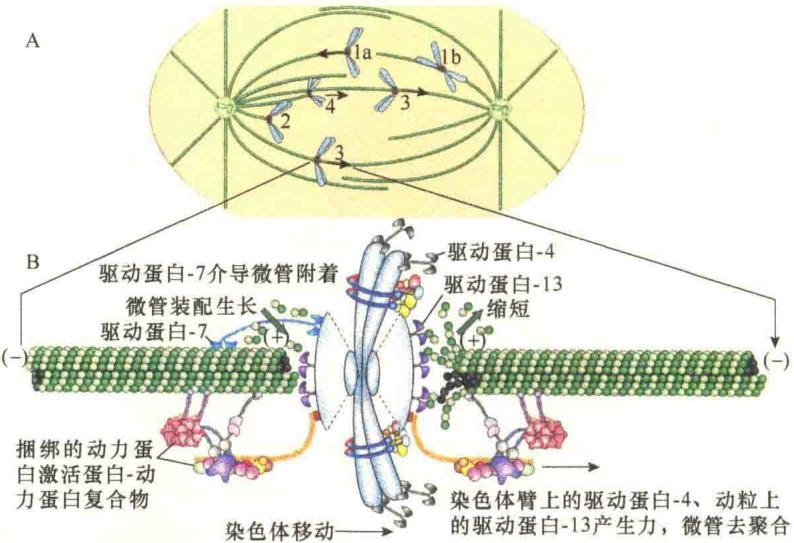

图 13-44 前中期染色体捕获及会集（引自 Lodish et al., 2016）。A. 已经复制加倍的染色体两侧的姐妹动粒都被两极的纺锤体捕获，成为双极性染色体，在驱动蛋白及调节蛋白的协同作用下，通过微管的聚合与去聚合，染色体来回振荡，被逐渐集合到赤道板。B. 显示图 A 中 3 染色体通过左侧一极纺锤体微管的聚合产生的推力，以及右侧一极微管去聚合产生的拉力，逐渐向赤道板移动。

图 13-45 黏连蛋白降解的调控（引自 Lodish et al., 2013）。切割黏连蛋白复合物 Scc1 亚基的分离酶在进入后期前是受到双重抑制的:一方面，与分离酶抑制蛋白结合在一起；另一方面，被 M-CDK 进行了磷酸化。当所有的动粒都与纺锤体结合，并且纺锤体装置装配正确而又有序时，Cdc20 与 APC/C 结合并将其激活，激活的 APC/C 通过将分离酶抑制蛋白泛素化而降解。随着分离酶抑制蛋白的降解、M-CDK 活性下降导致分离酶去磷酸化，分离酶恢复活性并将 Scc1 降解，解除了枷锁的姐妹染色单体可被动粒微管拉向两极。

图 13-46 后期姐妹染色单体被分开的两个过程:后期 A 与后期 B（引自 Plopper et al., 2015）。

而产生了将纺锤体推向两极的推力（图 13-47B1）。其次，将星体微管锚定在细胞皮层的动力蛋白通过星体微管的去聚合产生的拉力将纺锤体极拉向细胞的一侧（图 13-47B2）。

## 13.3.2.8 胞质分裂机制

一旦染色体分离到细胞的两极，随即通过胞质分裂产生两个子细胞。所以胞质分裂既是有丝分裂的最后一个过程，也是新细胞形成的开始过程。在大多数细胞中，在有丝分裂之后紧接的是胞质分裂，但也有极少数细胞，如早期果蝇的胚胎细胞及某些动物的肝细胞等在有丝分裂中是没有胞质分裂的，因为这些细胞需要很多细胞核。

图 13-47 后期染色体运动与纺锤体极的分离（引自 Lodish et al., 2013）。后期 A 的染色体运动是由驱动蛋白在动粒（A1）与纺锤体极（A2）等两个部位微管的不断收缩所产生的两种力驱动的。在这两个部位，由于驱动蛋白将动粒微管的正端锚定在动粒、负端锚定在纺锤体极，微管的去聚合导致染色体向纺锤体极运动。后期 B 的纺锤体极分离也是两个方面的力驱动的:一种是双极性驱动蛋白在反向平行极微管间的滑动产生的推力（B1），另一种是由位于细胞皮层的动力蛋白与星体微管产生的拉力（B2）。

在动物细胞的胞质分裂中最先看到的现象是在细胞表面出现卵裂沟（cleavage furrow），卵裂沟快速加深直至分成两个细胞（图 13-48）。

A

B

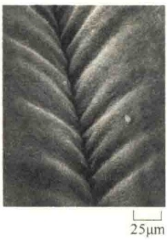

图 13-48 胞质分裂的形态变化（引自 Alberts et al., 2015）。
A. 在较低倍数下，蛙卵细胞的胞质卵裂沟扫描电镜照片。
B. 在较高倍数下，蛙卵细胞的胞质卵裂沟的扫描电镜照片。

如同染色体的分离，胞质分裂不仅需要有丝分裂纺锤体，同时也需要装配新的结构:中间体（midbody）与收缩环（contractile ring）（图13-49）。中间体是后期形成的，其中有大量平行的微管束，这些微管束位于分离染色体之间，属于纺锤体微管。收缩环是由肌动蛋白纤维、肌球蛋白Ⅱ纤维，以及其他一些结构与调节蛋白装配起来的一种动态结构，有丝分裂后期，在细胞质膜的下方开始装配收缩环。

有丝分裂纺锤体如何确定胞质分裂的细胞部位？也就是说，收缩环装配的位点是如何确定的？据推测，有三种可能的机制，对于大多数细胞而言，这三种可能的机制会联合使用。第一种是星体刺激模型（astral stimulation model）:按此模型，星

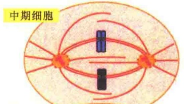

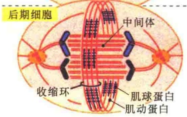

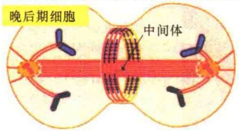

图 13-49 胞质分裂中间体与收缩环（引自 Plopper et al., 2015）。胞质分裂中间体是一个大的微管结构，它是在有丝分裂后期，由聚集在分离染色体之间的微管束所形成。与此同时，在分裂细胞的中间部位由肌动蛋白纤维、肌球蛋白Ⅱ纤维等形成一个紧密的带，中间体决定环的位置，便于将细胞一分为二。

体微管携带有沟诱导信号，该信号主要是确定细胞皮质装配收缩环的位置，即两个纺锤体极中部部位。第二种可能的机制是中央纺锤体刺激模型（central spindle stimulation model）:该模型认为，中央纺锤体产生了诱导在细胞皮层特异部位形成沟的信号。极微管的中央重叠部分结合很多信号蛋白，包括可以刺激Rho A的蛋白质；通过果蝇突变体的研究，发现这些蛋白质缺陷将不能进行胞质分裂。第三种可能的机制假设在某些类型的细胞中，星体微管可以促进细胞皮层肌动蛋白-肌球蛋白束局部松弛，这种机制称为星体松弛模型（astral relaxation model）。在纺锤体赤道部位的皮层松弛十分轻微，因此促进了在该位点进行皮层收缩。例如，在线虫早期胚胎细胞中，丧失了星体微管则导致整个细胞皮层的收缩活性提高，这一结果支持了星体松弛模型。图13-50是这三种可能的模型示意图。

如同染色体分离，胞质分裂也分为几个过程。第一是在细胞皮质确定收缩环装配的部位，该反应发生在后期的初始阶段，收缩环装配部位的确定，也就确定了细胞的分裂面。第二是在确定部位进行收缩环的装配，随着收缩环的装配，环不断进行收缩。第三是收缩环收紧，形成卵裂沟。第四是将中间体切断，分裂成两个子细胞。收缩环的收缩过程是肌球蛋白介导的肌动蛋白纤维不断滑动的结果。

高等植物细胞的胞质分裂与动物细胞的胞质分裂完全不同，这是因为植物细胞有坚硬的细胞壁。植物细胞的胞质分裂不是靠肌动蛋白收缩环，而是靠细胞内新细胞壁的形成。新细胞壁的位置精确地决定了子细胞与相邻细胞的位置和关系。在新细胞壁形成过程中，携带有细胞壁前体物质的高尔基体膜泡（其内充满细胞壁基质所需的多糖和糖蛋白），沿着微管运向有丝分裂的中期板，并相互融合形成大的、由膜包裹的、圆盘状结构，其内含有的多糖装配成新细胞壁基质，称为早期细胞板（early cell plate)，并不断向两侧扩大直到与原有的细胞质膜结合，同时也将细胞质分成两半（图 13-51）。

## 13.3.2.9 核重建机制

胞质分裂之后，必须在子细胞中进行核重建，欲重建核，首先要重建核被膜。片段化的核被膜如何重新建立？通过对非洲爪蟾卵细胞提取物的研究和对各种生物温度敏感突变体的分析发现:核被膜的重建需要一些特异蛋白质的去磷酸化，这些蛋白质的磷酸化作用可能与MPF有关。在细胞周期的后期，当细胞周期蛋白B被降解之后，MPF很快失活，但一些磷酸酶很快激活并将核纤层蛋白脱磷酸，导致核被膜的重建。

核重建是核解体的相反过程。后期末，子代染色体已经分成相等的两组，分别移到了纺锤体的两极。在有丝分裂的末期，前期核解体时形成的核被膜小泡此时又围绕染色体聚集和融合形成两个子代细胞核被膜（图 13-52）。在核被膜重建过程中，同样要重新装配核孔复合体。此外，前期磷酸化的核纤层蛋白经去磷酸化后重装配成核纤层。

核被膜重建之后，由于核解体而散布在细胞质中的核蛋白通过核定位信号经由核孔的选择输入进新的细胞核中。有了核被膜和核蛋白，染色体进行去凝缩，一些 rRNA 基因首先开始转录，一个生机盎然的细胞踏上了新的细胞周期之旅。

## 13.4 减数分裂

在细胞进行有丝分裂过程中，产生的两个子细胞含有来自亲代细胞的相同数目的染色体。因此，有丝分裂是细胞增殖，产生具有相同遗传特性的细胞群体的过程。在有性生殖的生物中，有性生殖是通过两个配子的融合产生新的生物个体的过程，这两个配子一个来自父本（雄配子），另一个来自母本（雌配子），配子是通过减数分裂（meiosis）产生的。

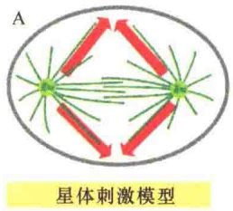

图 13-50 胞质分裂收缩位点确定的三种可能机制（引自 Alberts et al., 2015）。图中显示的是后期纺锤体微管产生的信号对收缩位置影响的三种现代模型。需要说明是，任何单一的模型都不能解释所有观察到的现象，或许卵裂沟的确定需要这三种模型共同作用。

减数分裂是生殖细胞产生配子的分裂，包括两次连续的减数分裂，形成4个单倍体的子细胞。相继的两次分裂分别称为减数分裂Ⅰ和减数分裂Ⅱ。在减数分裂Ⅰ与减数分裂Ⅱ之间有一个很短的间隔期，但此间隔期不进行DNA的合成，因而也不发生染色体的复制。由于细胞核分裂了两次，而染色体只是在减数分裂前的间期复制了一次，所以细胞经过减数分裂导致染色体组数目减少一半（图 13-53）。

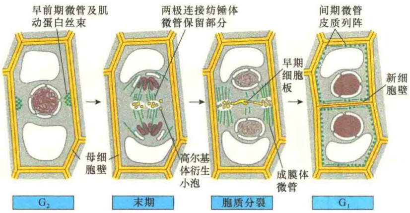

图 13-51 高等植物细胞胞质分裂的特征（引自 Alberts et al., 2015）。在 M 期之前，由微管束和肌动蛋白丝束在皮质层建立一个分裂面。染色体分离后末期刚开始，在细胞内侧、原有纺锤体的赤道处起始新细胞壁的装配:保留至末期的有丝分裂纺锤体的两极连接微管形成成膜体（phragmoplast），作为细胞壁填充料的高尔基体膜泡沿着微管转运至成膜体，相互融合成为新的细胞壁组分，并不断向外延伸达到细胞质膜及原有的细胞壁。细胞质膜与膜包围的新细胞壁融合，将两个子细胞分开。

图 13-52 核被膜的重建（引自 Cooper and Hausman，2004）。随着胞质分裂，核被膜小泡也与染色体一起分进子细胞。在子细胞中，核被膜小泡围绕染色体的表面形成包裹染色体的小泡。紧接着，染色体核被膜小泡相互融合，形成包裹有所有染色体的细胞核。在此过程中，要重新组装核孔复合体。

## 13.4.1 减数分裂Ⅰ与减数分裂Ⅱ的形态变化

减数分裂Ⅰ的核心目标是同源染色体的分离，有两个主要特点:①一对同源染色体分开之前要进行配对，此时的DNA会发生交换和重组；②在染色体组中，同源染色体的分离是随机的，也就是说染色体组要发生重组合。减数分裂Ⅰ分为前期Ⅰ、中期Ⅰ、后期Ⅰ与末期Ⅰ4个时期。减数分裂Ⅱ的核心目标是将一对同源染色体的4个姐妹染色单体分开，使其各进入一个子

细胞，因此，通过连续的两轮分裂，使染色体组减半，产生4个单倍体的子细胞。

## 13.4.1.1 前期I的形态变化

前期Ⅰ变化最为复杂，呈现许多减数分裂的特征性变化，如持续时间长、细胞核显著增大、同源染色体进行配对和交换等。该期可分为细线期、偶线期、粗线期、双线期、终变期等（图13-54）。

1）细线期 细线期（leptotene stage）又称凝缩期（condensation stage），此期在光学显微镜下可逐渐见到染色体，染色质在凝缩前已复制，但仍呈单条细线状，看不到成双的染色体。在电子显微镜下，可观察到此期的染色体是由两条染色单体构成的。

2）偶线期 偶线期（zygotene stage）又称配对期（pairing stage）。此期的主要特点是染色质进一步凝缩，同源染色体（homologous chromosome）发生配对，称为联会（synapsis），并形成联会复合体（synaptonemal complex，SC）。

3）粗线期 粗线期（pachytene stage）又称重组期（recombination stage）。该阶段开始于同源染色体联会之后，染色体明显变粗、变短，结合紧密，此期染色体形态是一个明显的四分体。

4）双线期 双线期（diplotene stage）的染色体长度进一步变短，SC因发生去组装而逐渐消失，紧密配对的同源染色体相互分开，而在非姐妹染色单体之间的某些部位上，可见其相互间有接触点，称为交叉（chiasma）（图13-55）。交叉被认为是粗线期交换发生的细胞形态学证据，其数目取决于物种类型及染色体长度，如人类平均每对染色体的交叉数为2\~3个；若染色体较长，则其交叉也较多。

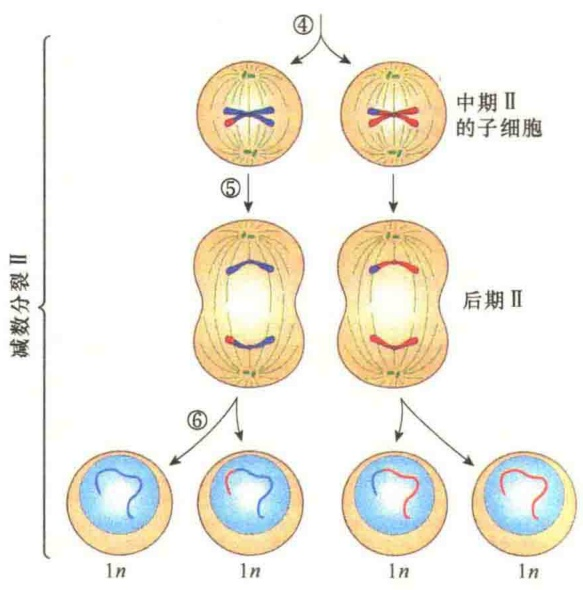

图13-53 减数分裂过程（引自Lodish et al., 2013）。减数分裂经过连续的两次分裂，产生4个单倍体的配子。

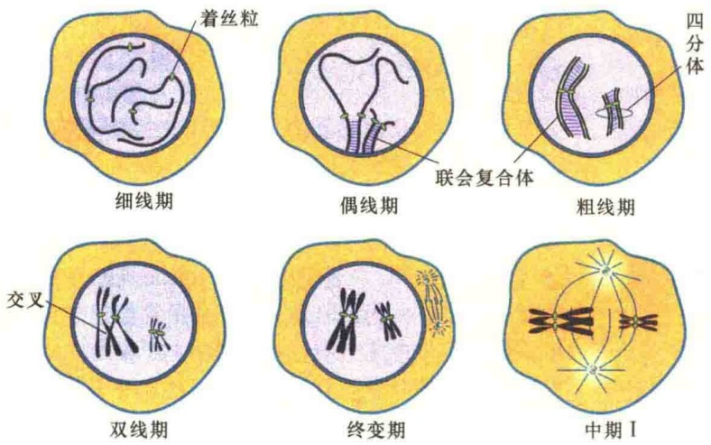

图 13-54 前期 I 的染色体行为（引目 Karp，2010）。

5）终变期 终变期（diakinesis）又称再凝缩期（recondensation stage），是前期Ⅰ的最后一个阶段，此期染色质又被包装压缩成染色体。双线期结束，染色体变成紧密凝缩状态，大多数核仁消失，四分体均匀地分布在核中。染色体交叉逐步向染色体端部移动，称为端化（terminalization）。最后四分体只靠端部交叉使其结合在一起，姐妹染色单体通过着丝粒连接在一起。

当前期Ⅰ即将结束时，像有丝分裂一样，中心粒已经加倍，中心体移向两极并形成纺锤体，核被膜破裂和消失，标志着前期Ⅰ的结束。

## 13.4.1.2 中期Ⅰ至末期Ⅰ的形态变化

中期Ⅰ至末期Ⅰ的形态变化比前期Ⅰ要简单。

1）中期Ⅰ 纺锤体侵入核区，分散于核中的四分体开始向中部移动；此时四分体上有4个动粒，一侧纺锤体只和同侧的两个动粒相连，最后染色体排列在赤道板上。

在大多数真核生物中，中期Ⅰ仍然能够见到排列在中期板上同源染色

体的交叉，实际上，交叉能够将同源染色体作为二价体结合在一起。在人和其他脊椎动物中，每对同源染色体至少有一个交叉，较长的染色体通常有2～3个交叉。推测可能有一种机制保证最短的染色体也有一个交叉。

2）后期Ⅰ 进入后期Ⅰ后，同源染色体在两极纺锤体的作用下分开，并逐渐移向两极。由于每条染色体仍含有两条染色单体，因而每个极仍含有两套染色体。不同的同源染色体对向两极的移动是随机的、独立的，所以父方、母方来源的染色体此时会发生随机组合，即染色体组的重组，这种重组有利于减数分裂产物的基因组变异。

A

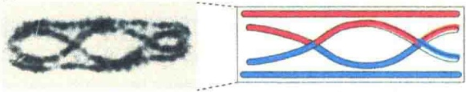

C

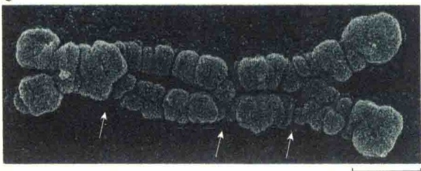

图 13-55 双线期的染色体交叉（引自 Karp，2010）。A 和 B.光学显微镜下的蝗虫减数分裂前期Ⅰ中见到的双线期发生的交叉。C.沙漠蝗虫减数分裂Ⅰ的双线期扫描电镜照片，可见到三个交叉（箭头所指）。

3）末期Ⅰ及分裂间期 在末期Ⅰ，每一个极接受一套随机组合的染色体组，但在自然界中，有两种类型的末期Ⅰ，一种是没有明显可见的染色体去凝缩，另一种是完全逆转到间期核的状态。后者染色体要去凝缩、重新形成核被膜。两次减数分裂之间的时期称为分裂间期（interkinesis），是一个极短的时期。在动物中，处于分裂间期的细胞被称

## 13.4.2 减数分裂过程中的遗传重组及其机制

两极的纺锤体微管结合。在后期Ⅱ，两个动粒分开，姐妹染色单体被拉向两极。在末期Ⅱ，染色体完全移到两极，开始去凝缩，并重新形成核被膜。

在减数分裂过程中发生了两种方式的遗传重组:同源染色体间的交换重组和同源染色体分离时染色体组的重组。

## 13.4.2.1 同源染色体间的交换重组

同源染色体间的交换重组发生在减数分裂 I 的前期 I，是在同源染色体配对形成联会复合体时发生的。

1）联会与联会复合体 联会是在减数分裂的偶线期两条同源染色体侧面紧密靠近并进行配对的现象。联会时的配对是特异的，可以同时发生在同源染色体分散的几个点上。电子显微照片揭示，染色体联会伴随一种复杂的结构——联会复合体的形成。

SC 是一种梯状结构（图 13-56），两侧各有一个沿姐妹染色单体的长轴，并且相互平行。是什么原因将两条长轴拉到一起？一种可能的解释就是靠一种大的蛋白质机器，叫重组复合体（recombination complex），它在同源物的断裂处进行装配，在同源区附近与配对的 DNA 序列结

为次级精子细胞或次级卵细胞，因为它们只含有一套染色体，所以是单倍体；由于两个姐妹染色单体没有分开，实际上它们携带两套基因组。

## 13.4.1.3 减数分裂Ⅱ的形态变化

通过分裂间期即进入减数分裂Ⅱ，减数分裂Ⅱ的染色体行为与有丝分裂相似。减数分裂Ⅱ分为前期Ⅱ、中期Ⅱ、后期Ⅱ、末期Ⅱ，最后形成4个单倍体细胞。

如果在末期Ⅰ重新形成了核被膜，则在前期Ⅱ要将核被膜解体，重新进行染色质凝缩。在中期Ⅱ，染色体排列在赤道板，姐妹染色单体中的动粒被

图 13-56 联会复合体的结构（引自 Alberts et al., 2015）。每一个同源染色体围绕一个长轴组织起来，当一对同源的长轴通过杆状的横向纤维连接起来时，就形成了联会复合体。每一条同源的长轴都与将姐妹染色单体控制在一起的黏结蛋白复合物相互作用，从而成为一个整体。

合，并以这种方式形成突触状结构。同源物这种突触前排（presynaptic alignment）形成之后就是联会，在联会中两条平行的长轴通过横向纤维（transverse filament）紧密连接起来形成联会复合体。

2）染色体重组:交换与交叉 在同源染色体联会期间，同源染色体要发生断裂和重接，在此过程中发生同源染色体间的交换，随着双线期的进行，交叉开始远离着丝粒，并逐渐向染色体臂的端部移动（图13-57），称为交叉端化（terminalization）。交叉是交换的结果，因为交换是在联会时发生的，即同源染色体紧密结合在一起时发生的，无法观察，所以观察到交叉时，同源染色体已经完成了交换并开始分离了。

图 13-57 同源染色体联会时的交换和交叉（引自 Kleinsmith and Kish, 1995）

## 13.4.2.2 染色体组的重组

生殖细胞在形成配子时，染色体要减半，由二倍体生成单倍体。二倍体中的两套染色体组分别来自双亲，但是在形成单倍体时，染色体组要进行重组合，也就是说在新形成的单倍体的生殖细胞中，每一套染色体组中既含有母本的染色体，又含有父本的染色体，它们是随机组合的，这样形成的配子基因型既不同于父本又不同于母本，而是一种新的组合，这是生物界遗传重组的主要方式。

染色体组的重组发生在减数分裂Ⅰ的中期Ⅰ，此时染色体组中的每对同源染色体由于配对，所以在中期Ⅰ的赤道板上的排列就有两种可能的方式（图13-58），这样，在一套基因组中由于染色体在赤道板上排列的随机性，就会有不同的自由组合方式，也就是重组。由于重组是随机的，重组的结果不一定都是有利的，需经过自然选择。

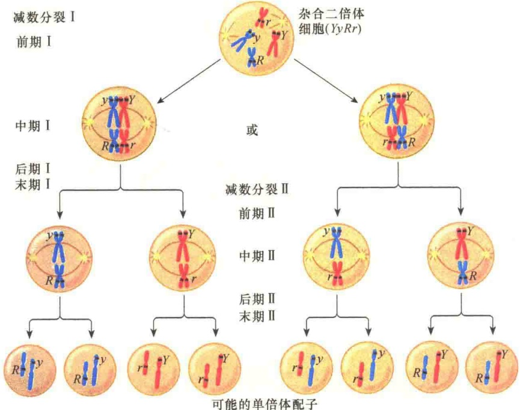

图 13-58 减数分裂中染色体组的自由组合(引自 Jeff et al., 2012)。简便起见，假定只有两对染色体的基因组，在中期 I，在赤道板上就有两种可能的排列，左侧是亲组合，右侧是重组合。

## 13.4.3 减数分裂与有丝分裂的比较及意义

## 13.4.3.1 减数分裂与有丝分裂的比较

减数分裂与有丝分裂的共同点都是通过纺锤体与染色体的相互作用进行细胞的分裂，但二者之间有许多差异（图13-59）。①有丝分裂是体细胞的分裂方式，减数分裂是生殖细胞产生配子的过程（生殖细胞也有有丝分裂）。②有丝分裂是一次细胞周期，DNA复制一次，分裂一次，染色体由 $2n\rightarrow 2n$ ；减数分裂是两次细胞周期，DNA复制一次，细胞分裂两次，染色体由 $2n\to n$ 。③有丝分裂中，每条染色体独立活动；在减数分裂中，染色体要配对、联会、交换和交叉。④有丝分裂之前，经DNA合成，进入 $G_{2}$ 期后才进行有丝分裂；减数分裂之前，DNA合成时间很长，一旦合成，即进入减数分裂期， $G_{2}$ 期短或没有。

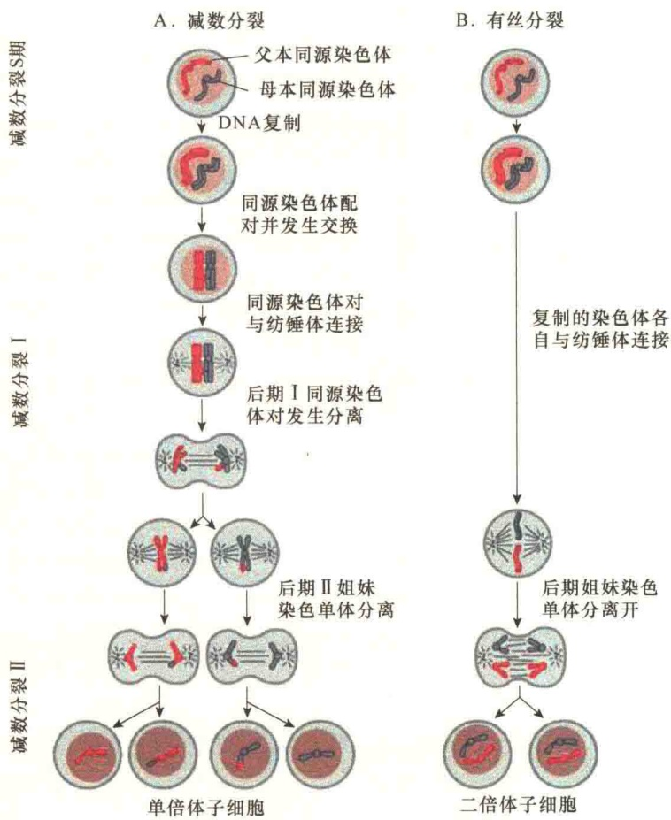

图 13-59 有丝分裂与减数分裂的比较（引自 Alberts et al., 2015）。

## 13.4.3.2 减数分裂的生物学意义

有性生殖是生物在长期进化历程中较无性生殖更为进步的一种繁殖方式。雌雄配子的融合，把不同遗传背景的父母双方的遗传物质结合在一起，其结果既稳定了遗传，又添加了诸多新的遗传变异，大大增强了生物对千变万化环境的适应能力。然而，如果没有一种机制使精卵细胞染色体数减少

一半，那么精卵细胞的融合将使染色体数倍增下去，细胞的体积也就不断地膨胀，细胞将不能适应环境而遭淘汰。减数分裂保证了生殖细胞在细胞周期中染色体的单倍化，然后通过受精作用还原为二倍体。没有减数分裂，有性生殖将是不可能的。

减数分裂保证了有性生殖生物在世代交替中染色体数目的恒定，生成配子时先减半成单倍体（n）；合子形成时，又恢复为二倍体（2n）。

减数分裂也是遗传变异产生的主要原因。在生物进化过程中，如果没有遗传变异，生物就不能适应环境的变化，就会失去长期生存的能力。在减数分裂过程中，有两种方式发生遗传重组:第一种是通过亲代染色体在单倍体细胞中的自由组合，产生的配子所含的染色体在组成上既有父本的也有母本的；第二种方式是同源染色体配对时发生DNA交换，这种遗传重组过程产生的单个染色体中既有父本的也有母本的基因，既有基因间的重组，也有基因内的重组。减数分裂就是通过这样两种机制产生遗传上独特的4个单倍体细胞，每个细胞都含有新重组的遗传信息。

## 本章小结

生长和生殖是生物的基本特性，通常将通过细胞分裂产生的新细胞的生长开始到下一次细胞分裂形成子细胞结束为止所经历的过程称为细胞周期，在这一过程中，细胞的遗传物质复制并均等地分配给两个子细胞。

将细胞周期分为两个主要的阶段:有丝分裂期（M期）和分裂间期。间期是细胞生长期，可分为 $G_{1}$ 期、S期、 $G_{2}$ 期。M期是细胞分裂期，分为核分裂与胞质分裂两个阶段。

通过染色体超前凝聚实验发现有促进染色质凝缩的因子，孕酮注射实验证明处于  $G_{2}$  期的蛙卵母细胞中有类似于孕酮的因子。通过对酵母的研究，发现了 MPF 与 SPF:MPF 是促进  $G_{2}$  期裂殖酵母细胞进入有丝分裂的因子，称为有丝分裂促进因子；SPF 是促进芽殖酵母通过  $G_{1}$  期进入 S 期的因子，MPF 与 SPF 都是由周期蛋白与周期蛋白激酶组成的异二聚体。

哺乳动物细胞周期调控较为复杂，受多种 CDK 和周期蛋白的调控，包括多种 CDK 与多种周期蛋白。真核生物细胞周期调控系统是由周期蛋白依赖性的蛋白激酶、周期蛋白，以及各种不同的激活与抑制蛋白组成的生化开关控制的网络。

细胞的生存机制由关卡途径进行监测。通过关卡的管控，确保在上一个细胞周期没有完成之前不能启动下一个细胞周期的事件。DNA损伤关卡在整个周期内对DNA进行监控，一旦发现DNA损伤，立即停止周期进程。

有丝分裂是细胞周期的分裂期（M期）进行的分裂活动。在这个时期，通过纺锤体的形成和运动，将在S期已经复制好了的DNA平均分配到两个子细胞，以保证遗传的连续性和稳定性。这一时期的主要特征是出现纺锤体。

有丝分裂包括核分裂和胞质分裂两个过程，一般在核分裂之后随即发生胞质分裂。M期持续的时间很短，但形态变化很大，根据形态变化的特征，通常将核分裂分为前期、前中期、中期、后期和末期。

减数分裂是生殖细胞产生配子的分裂，包括两次连续的分裂，形成4个单倍体的子细胞。相继的两次分裂分别称为减数分裂Ⅰ和减数分裂Ⅱ。由于细胞核分裂了两次，而染色体只是在减数分裂Ⅰ前的间期复制了一次，所以细胞经过减数分裂导致染色体数目减少一半。

减数分裂Ⅰ可分为前期Ⅰ、中期Ⅰ、后期Ⅰ、末期Ⅰ。减数分裂Ⅱ可分为前期Ⅱ、中期Ⅱ、后期Ⅱ、末期Ⅱ。减数分裂是遗传重组产生的主要原因，重组的两个事件分别发生在前期Ⅰ和后期Ⅰ。

## 思考题

（1）何谓细胞同步化？如何获得同步化的细胞？

（2）何谓早熟染色体凝聚？

（3）裂殖酵母 MPF 与芽殖酵母的 SPF 有什么不同？

（4）什么是关卡途径？DNA损伤关卡是如何工作的？

（5）前中期染色体是如何被捕获并集中到赤道板的？

（6）什么机制确保细胞周期是单向行进的而不会可逆行进？这些机制的分子基础是什么？