## 细胞衰老、死亡与癌

## 15.1 细胞衰老

15.1.1 衰老的概念

15.1.2 Hayflick界限与细胞的寿命

15.1.3 细胞衰老的特征

15.1.4 细胞衰老的理论

## 15.2 细胞死亡

15.2.1 多细胞有机体中细胞数量和质量的控制

15.2.2 细胞凋亡及其形态特征

15.2.3 细胞凋亡的基因调控机制

15.2.4 细胞生存与死亡调控的意义

## 15.3 癌

15.3.1 癌的特性及发育

15.3.2 癌的遗传学基础

15.3.3 癌的预防与治疗

“生、老、病、死”是生命的四重奏。人类自出生总要经过生长、发育、成熟、衰老直至死亡的几个阶段，这是生命的必然规律。生命是物质的，人体是由细胞组织起来的。组成细胞的化学物质在运动中不断受到内外环境的影响而发生损伤，致使人体内某些细胞不断地衰老与死亡。例如，红细胞成熟后担负着为各组织细胞输送氧气（ $O_{2}$ ）、带走二氧化碳（ $CO_{2}$ ）的任务，历经“千辛万苦”，“积劳成疾”，随时大量死亡与更新，因此，细胞的衰老与死亡是新陈代谢的自然规律。

癌症是威胁人类健康的主要疾病之一。癌症与其他疾病的根本区别在于，癌是由一个细胞的变化引起的，与细胞的生长、发育、分化和凋亡有着十分密切的关系。研究癌变的细胞生物学机制是防癌、治癌的基础。

## 15.1 细胞衰老

在生物机体内大多数细胞都要经历未分化到分化、分化到衰老、衰老至死亡的历程。因此，细胞总体的衰老反映了机体的衰老，而机体的衰老是以总体细胞衰老（cellular aging, cell senescence）为基础。

## 15.1.1 衰老的概念

人的生理寿命应该是多大岁数呢？按照生物学原理，哺乳动物的寿命是其生长期的5～7倍，人的生长期是用最后一颗牙齿长出来的时间（20～25岁）来计算的，因此人的寿命最短100岁，最长175岁，公认人的寿命正常应该是120岁。

为了调查人类寿命到底有没有天然极限，美国纽约爱因斯坦医学院遗传学家 Jan Vijg 领导的研究小组对“人类死亡率数据库”进行了分析。这个数据库的数据覆盖38个国家。研究人员分析发现，1920年，85岁老年人的存活率提升最快；到1950年前后，90岁老年人的存活率提升最快；1980年，99岁老年人的存活率提升最快；但这个数值达到99岁之后，就进入了一个“平台期”，仅在缓慢小幅提升。也就是说，1980年之后，尽管医学技术还在不断进步，99岁以上老人与疾病和衰老抗争的“胜算”没有太大改观。法国、日本、美国和英国这4个“超级人瑞”人数最多的国家，在20世纪70年代至90年代早期，最长寿者的死亡年龄快速上升，也就是说最长寿者的存活年限不断延长。但到了20世纪90年代中期，这个数字也进入“平台期”，稳定在114.9岁左右。因此，有人据此认为，人类的寿命存在一个天然极限，这个数值约为115岁。

Jan Vijg 教授提出的 115 岁上限的观点也遭到国际上多个研究团队的质疑。哥本哈根大学助理教授 Maarten P. Rozing 是其中一篇质疑文章的通讯作者，他不仅不相信存在一个限制人类寿命长度的“生物钟”，而且认为衰老越来越可能被人类所逆转。加拿大麦吉尔大学教授 Siegfried Hekimi 在质疑文中提出一种根据统计得出的相反的假设，人类寿命会持续稳步走高，到 2300 年最高寿命者也许能活到 150 岁。

习惯上将“衰”与“老”合起来使用，即衰老。其实“衰”与“老”是有差别的。“老”是指年龄超过某一界限，而“衰”是指功能或体力衰退，通常讲的“未老先衰”，就是这个意思。老年人由于年龄大，通常都有“衰”的表现，所以，当谈到“老”，就自然想到“衰”。

科学研究表明，现代人类面临着三种衰老。第一种是生理性衰老，是指随着年龄增长所出现的生理性退化，这是一切生物的普遍规律。第二种是病理性衰老，即由于内在的或外在的原因使人体发生病理性变化，使衰老现象提前发生，这种衰老又称为早衰。第三种是心理性衰老。心理活动是生理活动更高级的物质运动形式，人类由于各种原因，常常产生“未老先衰”的心理状态而影响机体的整体功能，这就是心理衰老的表现。

衰老（senescence，aging）是机体在退化时期生理功能下降和紊乱的综合表现，是不可逆的生命过程，人的衰老与细胞的衰老相关联。

细胞衰老是客观存在的，与新陈代谢一样，细胞衰老是细胞生命活动的客观规律。对多细胞生物而言，细胞的衰老和死亡与机体的衰老和死亡是两个不同的概念，机体的衰老并不等于所有细胞的衰老，但是细胞的衰老是与机体衰老紧密相关的。

## 15.1.2 Hayflick界限与细胞的寿命

细胞与生物体一样，有一定的寿命，体内总有细胞不断地衰老与死亡，同时又由细胞的增殖与新生进行补充。这不仅发生在胚胎发育过程中，在成年体内的各组织器官中也有细胞的死亡。

## 15.1.2.1 Hayflick界限

1961 年，Hayflick 首次报道了体外培养的人成纤维细胞（human fibroblast）具有增殖分裂的极限。他利用来自胚胎和成体的成纤维细胞进行体外培养，发现胚胎的成纤维细胞分裂传代 50 次后开始衰退和死亡（图 15-1），而来自成年组织的成纤维细胞只能培养 15～30 代就开始死亡。

A

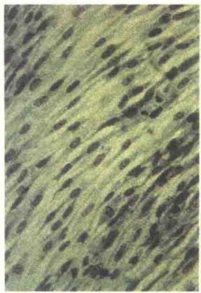

B

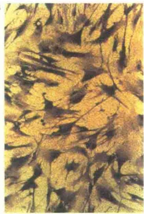

图 15-1 体外培养的年轻和年老的人成纤维细胞的显微形态（引自 Kleinsmith and Kish，1995）。A. 只分裂了几代的年轻成纤维细胞，呈现薄层、细长的形态。B. 分裂了 50 次的老的成纤维细胞，开始衰退，并很快死亡。

实验中，他们还从患有 Wermer 综合征（一种早老症）的儿童身上分离成纤维细胞进行体外培养，发现其只能传 2～10 代。Hayflick 等还发现，动物体细胞在体外可传代的次数，与物种的寿命有关。例如，Galápagos 龟的最高寿命是 175 岁，它的细胞在体外培养时能分裂 100 次；而小鼠的寿命只有几年，所以从小鼠分离的细胞在体外分裂的次数不超过 30 次（图 15-2）。

Hayflick 的实验表明，健康人的成纤维细胞，在体外培养条件下，即使条件适宜，细胞也不能无限制地进行分裂，即使是机体中可以终生分裂的细胞，在体外培养时也有分裂次数的极限，即使给予丰富的营养、生长因子和足够的生长空间也是如此。此外，细胞的分裂能力与个体的年龄有关。例如，从 40 岁个体获取的成纤维细胞在培养过程中只能分裂 40 次而不是 80 次，这是细胞衰老所致，也就是说细胞的衰老控制着细胞的分裂次数，进而控制着细胞的数量，这就是 Hayflick 界限。这种在体外培养的细胞增殖传代的能力，反映了细胞在体内的衰老状况。因此许多科学家认为多细胞个体的衰老始于细胞的衰老，对体外培养细胞有限寿命的观察和研究，有助于人们了解机体衰老过程的某些规律。

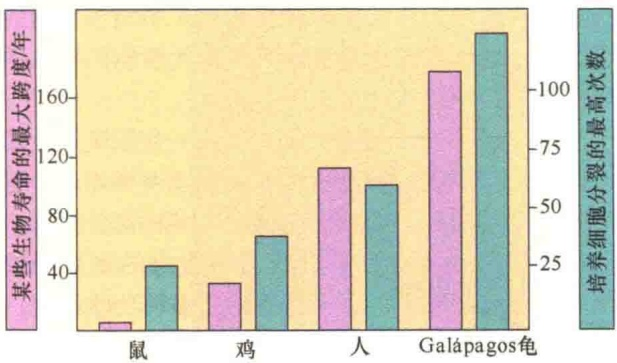

图 15-2 物种的寿命与体外培养时细胞传代次数的关系（引自 KIeinsmith and Kish，1995）。长寿物种的细胞体外培养的代数比短寿物种的细胞代数多，表明细胞的衰老是由生物本身的程序决定的。

## 15.1.2.2 细胞的寿命

各类细胞本身的寿命很不一样，一般而言，能够保持持续分裂能力的细胞是不容易衰老的。分化程度高又不分裂的细胞寿命却是有限的。表 15-1 列出了成年小鼠各类细胞的寿命。

表 15-1 成年小鼠各类细胞的寿命

| 接近或等于动物自身寿命的细胞 | 缓慢更新(长于30天,短于动物的平均寿命)的细胞 | 快速更新(少于30天)的细胞 |
| --- | --- | --- |
| 神经元 | 肾上腺皮质细胞 | 皮肤表皮细胞 |
| 肾上腺髓质细胞 | 肾皮质细胞 | 口腔和胃肠道上皮细胞 |
| 骨细胞 | 唾液腺细胞 | 红细胞和白细胞 |
| 肌细胞 | 胰脏腺泡细胞及胰岛细胞 | 角膜上皮细胞 |
| 胃酶原细胞 | 胃壁细胞 |  |
| 脂肪细胞 | 肝细胞 |  |
| 肾髓质细胞 |  |  |

从表 15-1 可以看出，第一类细胞的寿命接近于动物的整体寿命，如神经元、脂肪细胞、肌细胞等。一般认为此类细胞在机体出生后，便不再分裂增殖，数量也不会增加，只是随着机体的生长，体积可以增大；而后随着机体的衰老，体积又行缩小，甚至死亡。因此，细胞数量也随年龄的增大而逐渐减少，表现为机体失去皮下脂肪、肌肉松弛萎缩、脑功能衰退等。第二类是缓慢更新的细胞，其寿命比机体的寿命短，如肝细胞、胃壁细胞等。肝细胞通常不分裂，但终生保留分裂能力，如部分切除肝后，剩余的肝细胞即能进行旺盛的同步分裂。第三类是快速更新的细胞，如皮肤的表皮细胞、红细胞和白细胞等，它们在正常情况下终身保持分裂能力。机体中这三类寿命不同的细胞，分工合作，组成统一的整体。一般说来，某些细胞的大量死亡不至于使机体死亡，只有当与个体生命休戚相关的细胞，如神经细胞、心肌细胞大量死亡时，才造成对生命的威胁。

## 15.1.3 细胞衰老的特征

细胞衰老过程是细胞生理与生化反应发生变化的过程，主要表现是细胞对环境变化适应能力和维持细胞内环境恒定能力的降低。细胞生理生化变化必然反映在细胞形态结构和功能上的变化。

2013年，国际著名生物学杂志《细胞》召集了一组研究人员，从不同方面研究衰老，试图从生物学角度总结人类衰老过程中身体发生的变化。5年后，研究团队完成了论文《衰老的特征》，从人类衰老的过程中归纳出9个衰老特征。

1）DNA 复制发生错误 DNA 是细胞的指令手册，随着年龄的增长，DNA 复制的过程可能会出错——部分 DNA 可能被拼错，部分 DNA 可能被意外插入或删除，而这些错误有时难以被修复。随着时间的推移，如果 DNA 指令变得不清楚或发生错误，就可能破坏细胞，甚至使其癌变。在老年人的人体组织中，科学家观察到许多细胞积累了大量的遗传损伤。如果研究人员能找到修复 DNA 的机制，他们就能改善甚至可能延缓衰老的进程。

2）基因表达出错 人体 DNA 的某些部分会被解读并转化为身体特征，哪些基因最终得到表达，是由细胞中的一组蛋白质控制的，这一过程被称为“表观遗传调节”。由于这一机制的存在，皮肤细胞与脑细胞即使使用了相同的 DNA，却表达出不同的形态和功能。

随着年龄的增长，与 DNA 结合的蛋白质变得更松散、更不准确，基因开始在不该表达的时候表达出来，或因出错而 “沉默”。这意味着一些必要的蛋白质没有被制造出来，而有害的、不必要的蛋白质却被制造出来了。例如，如果一个无意的错误导致抑制肿瘤的基因 “沉默”，细胞就会不可控制地发生癌变。

通过在小鼠身上的实验，科学家发现，逆转该类型的基因表达错误可以改善小鼠因衰老产生的神经效应，如记忆障碍等。

3）染色体端粒缩短 端粒是每条 DNA 链末端的保护帽，一些科学家把它们比作鞋带末端防止磨损的塑料带头。端粒的主要作用在于维持染色体的完整性。

在细胞进行分裂的同时，端粒会进行染色体的复制，每复制一次，端粒就会缩短一点，一旦端粒消耗殆尽，细胞就无法再继续进行分裂，进而人体组织会出现衰老，并可能导致癌症和心血管病等疾病的发生。也就是说，端粒越短，说明人体的衰老程度越严重。

4）蛋白质退化失能 在我们的细胞中，蛋白质可以不断产生，它们控制着细胞内几乎所有的功能。但蛋白质必须定期更新，因为随着时间的推移，它们会逐渐失去效力。随着年龄的增长，我们的身体失去了清除旧蛋白质的能力，随着无用的蛋白质的积累，它们就会堆积起来，变得有害。无用蛋白质积累是造成阿尔茨海默病的主要原因之一，一种叫做淀粉样蛋白的蛋白质聚集在大脑中，导致神经细胞的损失，临床上常表现为记忆障碍、失语、执行功能障碍及行为改变等。

5）衰老细胞“拒绝死亡” 当细胞经受压力并被破坏时，它们有时会停止分裂并对抗死亡，变成科学家所说的“僵尸细胞”，并可能会感染周围的其他细胞，并将炎症扩散到全身，这些细胞也被称为衰老细胞。随着年龄的增长，衰老细胞会不断累积。衰老生物学理论认为，机体的衰老伴随着细胞的衰老。同样，细胞衰老也是机体衰老的重要诱因——衰老细胞被怀疑是释放衰老信号的罪魁祸首。

科学家发现，如果设法用药物清除衰老细胞，可能使组织恢复活力，甚至延缓机体的衰老。

6）线粒体功能失调 在细胞中，线粒体可将氧气和食物转化为能量。然而，随着生物体及其细胞的衰老，这些“微型发电厂”可能会变得越来越低效和功能失调。当它们不能正常工作时，会改变氧气的形态，从而对 DNA 和蛋白质造成损害。

2018年6月发表在《自然》杂志上的一项研究表明，科学家们能够通过恢复小鼠线粒体的功能来延缓衰老。

7）新陈代谢失调 随着年龄的增长，细胞在检测体内的葡萄糖或脂肪含量时变得越来越不准确，因此一些脂肪和糖不能得到适当的处理。衰老细胞积累过多的脂肪不是因为老年人摄入了太多的脂肪，而是因为细胞不能正常地消化脂肪。

一旦新陈代谢失调，可能会导致胰岛素分泌缺陷或IGF-1通路受损，而这些因素常会导致糖尿病产生。这就是为什么糖尿病在老年人中相当普遍的原因——老年人的身体不能再正常代谢他们摄入的所有食物。

8）组织停止修复和更新 在一定程度上，几乎所有的组织都会进行更新，但是随着年龄增长，更新的速度会变慢，这也是组织损伤积累的部分原因。

干细胞是一类具有自我复制能力的多潜能细胞，在一定条件下，它可以分化成多种功能细胞；在许多组织中，它们充当内部修复系统，补充受损或死亡的细胞。然而，随着人类年龄的增长，干细胞会耗尽，活性降低，这就意味着它们不能快速分裂，致使原本应该得到更新的组织实际上并没有得到更新。

9）细胞之间无法交流 为了保证身体机能正常运转，细胞必须不断地相互交流，它们通过血液和免疫系统传递信号。但随着我们的身体变老，细胞的交流能力也随之变差，一些细胞变得反应迟钝，逐渐变成引起炎症的衰老细胞。由这些衰老细胞产生的炎症进一步阻断了健康细胞之间的交流。由于细胞无法交流，导致免疫系统无法有效清除病原体和衰老细胞。

## 15.1.4 细胞衰老的理论

半个世纪以来，科学家们致力于分析研究衰老发生的原因及导致衰老变化的机制，提出了众多有关衰老起因的观点或学说，如遗传程序论（genetic program theory）、体细胞突变论（somatic mutation theory）、错误成灾论（error catastrophe theory）、自由基理论（free radical theory）、线粒体损伤论（mitochondrial damage theory）等。近几年，又有衰老基因（senescence gene）和衰老相关基因（senescence-associated gene）的研究报道。由于衰老是一个十分复杂的生命现象，又受到多种因素包括环境因素和体内因素的影响，任一角度的阐述都难以使衰老机制得到圆满解释，因而目前仍未形成较为一致的论点。

## 15.1.4.1 衰老的基因程序理论

衰老的基因程序理论认为衰老是遗传上的程序性过程，是受特定基因控制的。一切生理功能的启动和关闭都是按照一定程序进行的。有一个程序存在于生物体的基因组中，生物体的生长、发育、老化和死亡都由这一程序控制（图 15-3）。

这一理论有三个方面的证据支持。第一，Hayflick的细胞培养实验是这一理论的实验基础。另外，太平洋沿岸的马哈鱼也是这一理论典型的生

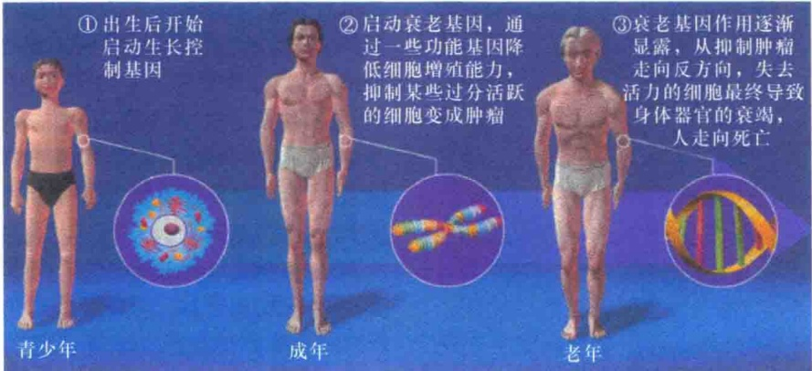

图15-3 衰老基因对衰老的影响。

物体。这种鱼在迁徙到产卵地，产卵后几周就死亡了，这期间鱼的鼻、口、背和皮肤上出现明显的形态改变，这些变化使组织广泛退化。第二，研究人员发现人从30岁开始，人体各种器官的功能有1%的减退，包括肺功能、心脏功能、肌功能和听力等。第三，早老症（progeria）也提供了一些少数基因影响和控制整个衰老过程的证据。如具有早老症的儿童很早就会脱发、满面皱纹、严重关节炎等，一个小孩看起来像是一位老者（图15-4）。

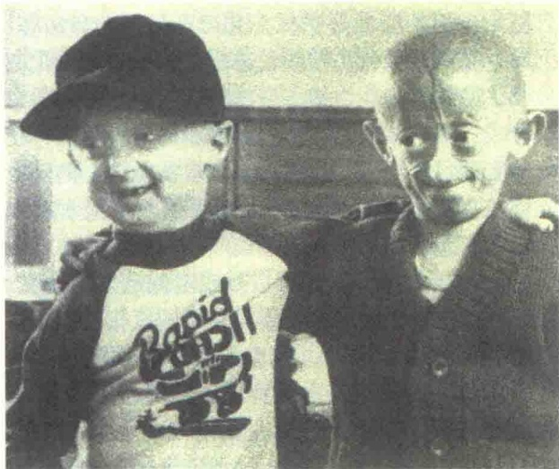

图 15-4 两个早老症患儿（引自 Starr and Taggart，2001）。左边是一个患早老症的 9 岁儿童，右边是一个患早老症的 8 岁儿童。

也有很多例子不符合甚至反对基因程序理论，最突出的例子是饮食对蜜蜂寿命的影响，蜂王可活6年之久，而工蜂只能活3\~6个月。它们寿命的不同不是由于昆虫遗传基因不同。它们的基因组是相同的，寿命不同仅仅是因为在幼虫期是否喂食蜂王浆，蜂王浆可使蜜蜂的寿命提高大约20倍。

另外，端粒缩短论和线粒体损伤论都支持衰老的基因程序理论。

## 15.1.4.2 衰老的损伤积累理论

衰老的损伤积累理论认为，衰老是由于修复和维持总是低于无限存活的需求而出现的损伤积累。损伤的积累可以通过细胞成分的磨损和撕裂的方式或合成错误的方式出现，这些错误包括DNA复制错误、蛋白质合成错误。最有代表性的理论是错误成灾理论，它是指细胞大分子合成错误成灾。意思是说，细胞里的核酸和蛋白质在生物合成中如果由于某些原因发生差错，当变质的非功能蛋白质达到一定水平时，出现完全丧失功能的“错误灾难”。这些差错会得到积累，并迅速扩大，引起代谢功能大幅度降低，导致衰老。从衰老的大鼠细胞中分离出了一些变质的非功能或活性很低的SOD。人类在60岁以后很容易得白内障，90%晶状体蛋白发生交联和聚合。在老年人红细胞中也分离出不正常蛋白，这可能不是由于转录和翻译错误造成的，而可能是修复功能下降使被损伤的蛋白质没有及时取代造成的。另一个原因可能是组织中水解不正常蛋白质的能力随年龄增加而减弱了。

## 15.1.4.3 细胞衰老的端粒假说

人类染色体末端普遍存在端粒结构，但各类细胞端粒长度各有差异，一般体细胞的端粒比生殖细胞短。人类染色体端粒是由250～1500个进化上高度保守的TTAGGG重复序列组成，是由端粒酶催化合成的。Harley等发现人体内成纤维细胞端粒每年缩短14～18bp，而外周血淋巴细胞则每年缩短33bp。正常人二倍体成纤维细胞在体外培养时随代数的增加，细胞中的端粒以一定速率缩短，DNA每复制一次，端粒就缩短一段。人体血细胞与皮肤细胞端粒长度也随增龄而相应缩短。因此，端粒记录着细胞的年龄并预示它死亡的时限。精细胞和肿瘤细胞（如HeLa细胞）的端粒远较体细胞长，且很稳定，不会因年龄的增长而缩短。端粒的稳定性由端粒酶维持。精细胞和 HeLa 细胞含有较高的端粒酶活性；体细胞端粒酶活性极低，呈抑制状态。人体细胞端粒长度随年龄增加而缩短，但鼠的成纤维细胞则无增龄变化。因此端粒长度可能是人类种族特异性的衰老生物学标志。

Harley 于 1990 年提出细胞衰老端粒假说。他认为由于端粒酶的存在，生殖细胞的端粒相当稳定，不会衰老。高度分化的体细胞由于端粒酶活性处于抑制状态，细胞分裂时 DNA 不完全复制而引起端粒 DNA 的少量丢失，不能靠端粒酶补偿，所以随着细胞分裂次数的增加，端粒不断缩短。由于端粒的缩短，靠近染色体两端的基因就有可能随端粒的缩短而缺失，引发染色体畸变，使突变发生。当端粒缩短到一定程度（临界长度）时引发了 Hayflick 极限，细胞不再分裂。少数细胞由于端粒酶被激活，端粒获得修复，从而越过临危点成为永生化细胞。这一假说从一个侧面阐明衰老机制和癌变原因。

## 15.1.4.4 细胞衰老的线粒体损伤论

Cortopassi 和 Amteim 用聚合酶链反应（PCR）检查发现，成人心脏、肌肉和脑的线粒体有 DNA 片段低水平的丢失，胎脑和胎心则无此现象。衰老期间人体线粒体 DNA 出现异常，而且阿尔茨海默病患者脑组织线粒体中 DNA 损伤甚为多见。此外，老年糖尿病亦与线粒体 DNA 的损伤有关等。

人线粒体常见的 DNA 片段丢失为 5.0kb、7.0kb 和 3.6kb。线粒体 DNA 的片段丢失现象随增龄而增加，且男性高于女性。Cooper 等测定 21 岁人骨骼肌线粒体基因组 5.0kb 片段（8470～13 477 核苷酸之间）丢失率仅为十万分之一，78 岁时上升到 5000 分之一。此外，还发现在正常老年人心血管组织中存在 7.4kb 片段（8649～16 084 核苷酸间）的丢失，其丢失频率随增龄而增加。

研究发现老龄人各种 mtDNA 缺失突变存在突变“热点”，即缺失突变的缺失片段 5' 端和 3' 端断裂位点的侧翼具有 4～13bp 同向重复序列，如 5kb 常见缺失的侧翼为 13bp 的 5' 端 ACCTCCCTCACCA 重复序列。动物实验也证实 mtDNA 有随年龄增加，其丢失频率升高的现象。

实际上，mtDNA 的损伤缺失与自由基有极大的关系，mtDNA 是细胞中活性氧等自由基损伤的敏感靶标。

## 15.1.4.5 自由基理论

自由基（free radical）是指那些在原子核外层轨道上具有不成对电子的分子或原子基团。所谓未成对电子，就是指那些在原子或分子轨道中未与其他电子配对而独占一个轨道的电子。例如，AB 两个原子各提供一个电子通过共价键形成一个分子 A:B，这两个电子是配对的；如果在化学反应中发生了均裂，A 和 B 各带走一个电子，它们就是未成对电子，A·和·B 就称为自由基。

自由基的种类很多。活性最强的是氧中心自由基，简称氧自由基，包括  $\cdot O_{2}$ （超氧自由基）、 $\cdot OH$ （羟自由基）和  $H_{2}O_{2}$ 。

在正常条件下，自由基是在机体代谢过程中产生的。此外，空气污染、辐射、某些化学物质等都可影响自由基的产生。具有自由基的分子是一类高度活化的分子。当这种分子与其他物质反应时，力图得到电子，而对细胞及组织产生十分有害的生物效应。

自由基由于活性强，容易与细胞内的生物大分子发生反应，这种反应是掠夺式的，使生物大分子发生伤害。①自由基与核酸分子中的碱基发生加成反应，OH·等加到碱基（胸腺嘧啶 $C_{6}$ 或 $C_{5}$ 、腺嘌呤 $C_{8}$ ）的双键上，被破坏的碱基可产生基因突变。②自由基可加成到膜脂及其他脂类不饱和脂肪酸的双链中，引起脂质过氧化，并可产生新的自由基。例如，脂质过氧化可使线粒体损伤，导致能量代谢障碍；微粒体损伤，使多聚核糖体解聚，抑制蛋白质合成；溶酶体损伤可使溶酶体膜通透性改变，使机体受到更大损伤。③自由基常攻击肽链上的脯氨酸残基，引入羰基而生成α-吡咯烷酮，经水解与其相邻氨基酸断开，造成蛋白质断裂。此外，自由基还引起蛋白质交联、蛋白质残基侧链发生改变、破坏蛋白质高级结构等。④自由基的氧化损伤涉及细胞骨架蛋白。例如，肌动蛋白是构成微丝的主要蛋白质，用肌动蛋白做实验，发现它的4个SH为氧化过程的靶子，肌动蛋白与氧化型谷胱甘肽（GSSG）之间形成二硫键可导致分子表面电荷的改变；在老化的红细胞中也可检测出类似的修饰物，用醌处理的细胞中也发现不同肌动蛋白分子或肌动蛋白与其他蛋白质之间形成二硫键，这种氧化性蛋白质交联引起大分子的聚集。

衰老的自由基学说是美国科学家 Harman 于 1955 年在美国的原子能委员会提出的，该理论的研究结果于 1955 年 7 月 14 日首先刊载在内部刊物加利福尼亚大学放射实验室工作报告上，随后于 1956 年在老年医学杂志上正式公开发表。

这一学说是建立在实验研究的基础上，以实验动物的寿命作为整体实验的标记物，用饮食技巧来研究自由基与衰老的两个方面。一方面，在饮食中减少某种可以提高自由基水平的化合物，如减少铜离子或不饱和价键的化合物，从而减少自由基反应对机体的损伤。另一方面，加入某些抗氧化剂，可以抑制自由基反应，清除自由基，如2-巯基乙胺（2-mercaptoethylamine，2-MEA）、α-生育酚。结果表明，饮料中添加抗氧化剂可提高小鼠、大鼠、果蝇、线虫的寿命。例如，将质量百分浓度为1.0%的2-MEA加到雄性LAF1小鼠的饮料中，在断奶后很短时间开始喂小鼠可平均提高寿命30%，相当于人的平均寿命从73岁提高到95岁。

衰老的自由基学说的核心内容有三条:①衰老是由自由基对细胞成分的有害进攻造成的；②这里所说的自由基，主要就是氧自由基，因此衰老的自由基理论，其实质就是衰老的氧自由基理论；③维持体内适当水平的抗氧化剂和自由基清除剂水平可以延长寿命和推迟衰老。

机体内存在着自由基清除系统，其可以最大限度地防御自由基的损伤。自由基清除系统包括酶促反应和非酶促反应两部分。酶促反应所需酶有谷胱甘肽过氧化物酶（GSH-PX）、超氧化物歧化酶（superoxide dismutase，SOD）、过氧化物酶（peroxidase，PXP）和过氧化氢酶（catalase，CAT）。非酶促反应的作用物质主要为一些低分子的化合物，是一些抗氧化作用的物质，统称抗氧化剂（antioxidant），主要有谷胱甘肽（glutathione，GSH）、维生素C、β-胡萝卜素、维生素E、半胱氨酸、硒化物、巯基乙醇等。此外，细胞内部形成的自然隔离，也能使自由基局限在特定部位，如氧化反应产生的自由基主要在线粒体内，线粒体作为独立的细胞器可很大限度地阻止自由基的扩散。

随着增龄，细胞合成蛋白质的能力下降，也包括超氧化物歧化酶和过氧化氢酶合成数量的减少，或合成了没有功能的超氧化物歧化酶和过氧化氢酶，自由基和过氧化氢就会积累，并且对细胞的蛋白质、DNA、细胞膜等进行攻击破坏；细胞在自由基的攻击下会死亡。这样，就会在老人的皮肤上见到老年斑（age spot），它是自由基对细胞破坏的见证（图 15-5）。

由此可见，细胞中的自由基若不能及时清除，则过多的自由基会对许多细胞组分造成损伤。它们能使质膜中的不饱和脂肪酸氧化，从而使膜内酶活性破坏、膜蛋白变性、膜脆性增加、膜结构发生改变，因而使膜的运输功能紊乱以至丧失；它们还能将蛋白质中的巯基氧化而造成蛋白质发生交联、变性，使酶失活；另外，它们还能使DNA链断裂、交联、碱基羟基化、碱基切除等，从而对 DNA 造成损伤。有人认为在衰老的原因中，99% 是由自由基造成的。

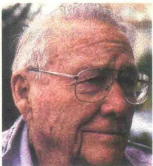

图 15-5 老年斑:自由基攻击细胞的证据（引自 Starr and Taggart，2001）。儿童细胞中合成的超氧化物歧化酶和过氧化氢酶的数量多，可有效清除细胞氧自由基；老年人合成蛋白质的功能下降，超氧化物歧化酶和过氧化氢酶浓度减少，清除自由基能力低，皮肤上老年斑是自由基对细胞攻击的证据。

由于维生素 E、维生素 C 等具有清除自由基的作用，所以适当补充这些物质能够弥补体内合成超氧化物歧化酶和过氧化氢酶的不足，达到延缓衰老的目的。

细胞生长能力的减退是衰老的重要表现。细胞衰老现象可延缓，但不能逆转。衰老细胞停止于细胞周期的 $G_{1}$ 期，不能进入S期。细胞在体外培养时，不增殖的衰老细胞比例逐渐上升，最后所有的细胞都成为衰老细胞。体外培养的细胞在衰老后，并不立即死亡，如定期更换培养液，停止增殖的衰老细胞仍可维持生存。

## 15.2 细胞死亡

细胞死亡（cell death）的一般定义是细胞生命现象不可逆的停止。细胞死亡有两种形式:一种为坏死（necrosis）性死亡，是由外部的化学、物理或生物因素的侵袭而造成的细胞崩溃裂解；另一种为程序性细胞死亡（programmed cell death, PCD），或称细胞凋亡（apoptosis），是细胞在一定的生理或病理条件下按照自身的程序结束其生存。多细胞生物随时都在进行着有规律的程序性细胞死亡，如人类的淋巴细胞系统、神经系统等。可通过活体染色来判断细胞是否死亡，常用的方法是用中性红或台盼蓝染色。中性红染色时活细胞染成红色，死细胞不着色；台盼蓝则相反，染成蓝色的是死细胞，不着色而透明的是活细胞。除了形态学特征外，更重要的是根据细胞是否具有生活力，主要是细胞的繁殖能力来判断。单细胞生物的细胞死亡，即是个体的死亡；而多细胞生物个体死亡时，并非机体的所有细胞都立即停止生命活动。所以对多细胞个体死亡的判断，不能简单地以心脏停止跳动作为标准，而是以脑神经是否死亡来判断。

## 15.2.1 多细胞有机体中细胞数量和质量的控制

在多细胞生物体中，细胞分化发育到一定的阶段，细胞的数量要控制在一定的水平，不能让其无限地分裂和增殖。不同的生物控制的细胞数量水平是不同的，如一个受精的老鼠的卵细胞和一个受精的人的卵细胞在体积上大小相似，但是成年的老鼠比成年的人要小得多，这主要是细胞数量的差别:成年人体的细胞数量比成年鼠的细胞数量多得多。那么是什么原因控制着这种数量的差异？这主要是细胞的增殖、细胞的存活寿命和细胞的死亡这三者间有着严格的调控机制。另外，多细胞个体不仅控制着细胞数量，也要控制细胞的质量，特别是对那些与个体同寿的细胞质量更要严格控制。即使在同一个体内，有些组织和器官体积大，有些体积较小。例如，是什么控制大象的鼻子长得很长？答案是不清楚的，但可以推测，多细胞有机体通过信号调节细胞的数量和质量。

单细胞的生物如细菌和酵母都是尽可能快地生长和分裂，它们的增殖速率依周围环境中的营养而定。而多细胞生物体中的细胞是高度组织化的，因此细胞的增殖必须靠信号行事，需要补充细胞数量时，由特定的组织发出指令。因此，对于动物细胞的增殖仅有营养是不够的，还必须有信号，这种信号通常来自邻近细胞，由信号决定细胞是进行增殖还是停止进入细胞周期。

大多数体外培养的动物细胞都需要一些特别的生长因子促使细胞的分裂和增殖。这些生长因子主要是选择性地调控某些与分裂增殖有关基因的表达，进行细胞分裂的控制。表 15-2 列出一些常见的生长因子及其功能。

表 15-2 常见生长因子及其功能

<table><tr><td>生长因子</td><td>功能*</td></tr><tr><td>血小板衍生生长因子(PDGF)</td><td>激活结缔组织细胞增殖</td></tr><tr><td>表皮生长因子(FGF)</td><td>激活皮肤组织细胞增殖</td></tr><tr><td>成纤维细胞生长因子(FGF)</td><td>激活成纤维细胞增殖</td></tr><tr><td>肝细胞生长因子(HGF)</td><td>激活肝细胞增殖</td></tr><tr><td>红细胞生成素(EPO)</td><td>激活红细胞的增殖、分化和发育</td></tr><tr><td colspan="2">*表中除红细胞生成素外,其他生长因子都能激活多种类型细胞的增殖。</td></tr></table>

PI-3 激酶-PKB 信号途径在动物细胞的生存中具有重要作用。当 PI-3 激酶通过 SH2 结构域与被生长因子激活的特异 RTK 磷酸化酪氨酸位点结合后被激活。激活的 PI-3 激酶将质膜中 PI（4,5）P₂ 进一步磷酸化成 PI（3,4,5）P₃，PIP₃ 可招募两个蛋白激酶——Akt 与 PDK1，通过各自的 PH 结构域结合到质膜上。PKB 一旦结合到质膜，立即被 PDK1 及另一个蛋白激酶 mTOR 磷酸化而激活。激活的 PKB 与质膜脱离，在细胞质中将程序性死亡抑制蛋白磷酸化，使其激活。被激活的程序性死亡抑制蛋白可抑制细胞的程序性死亡，从而促进了细胞的存活（见图 5-54）。

我们已经讨论过，细胞周期中的 DNA 损伤关卡对细胞生长质量的监控至关重要。DNA 损伤关卡是对细胞周期进行全程监控，一旦发现 DNA 损伤，包括 DNA 断裂、复制不完全等，立即启动修复程序。例如，当 DNA 在 S 期受到损伤时可激活肿瘤抑制基因 p53 表达的 p53 蛋白，p53 蛋白进一步激活 CDK 抑制蛋白基因 p21 的转录和表达，合成的 p21 蛋白抑制 S 期细胞周期蛋白-CDK 复合物的活性，一直等待受损伤的 DNA 修复和正确复制之后才进入 G₂ 期（见图 13-33）。

其实，动物细胞不仅增殖需要信号，而且是继续生存还是进入死亡都是由信号决定的。如果细胞失去了生存因子（survival factor），就要进入程序性死亡。

## 15.2.2 细胞凋亡及其形态特征

细胞凋亡又称程序性细胞死亡，是指为维持内环境稳定，由基因控制的细胞自主的有序性死亡，它涉及一系列基因的激活、表达及调控等作用，因而具有生理性和选择性。

凋亡的概念源自希腊语，原意是指树叶或花的自然凋落；而细胞发生程序性死亡时，就像树叶或花的自然凋落一样，凋亡的细胞分散于正常组织细胞中，无炎症反应，不遗留疤痕。死亡的细胞碎片很快被巨噬细胞或邻近细胞清除，不影响其他细胞的正常功能。

## 15.2.2.1 细胞坏死、细胞凋亡及细胞焦亡

细胞坏死与细胞凋亡是两种完全不同的过程和生物学现象，在形态学、生化代谢改变、分子机制、细胞的结局和意义等方面都有本质的区别。

细胞坏死是因病理（如外伤）而产生的被动死

亡；而细胞凋亡的原因较多，如因 DNA 损伤而又无法修复等则进入凋亡途径，因而是细胞接受指令后的主动死亡。细胞凋亡是由它的生存环境、自身的代谢状况、发育史及基因组等因素触发的，并且是受高度程序性控制的。

细胞坏死与细胞凋亡有三个根本的区别。第一，引起死亡的原因不同:如物理性或化学性的损害因子、缺氧与营养不良等均可导致细胞坏死；而细胞凋亡则是由基因控制的。第二，死亡的过程不同:坏死细胞的质膜通透性增高，致使细胞肿胀，细胞器变形或肿大，早期核无明显形态学变化，最后细胞破裂；细胞凋亡的细胞不会膨胀、破裂，而是收缩并被割裂成膜性小泡后被吞噬。第三，坏死的细胞裂解要释放出内含物，并常引起炎症反应，在愈合过程中常伴随组织器官的纤维化，形成疤痕；细胞凋亡的细胞没有被完全裂解，不会释放内含物，所以不会引起炎症。图 15-6 是两种死亡的过程比较。

近年来发现细胞在受到炎症感染或病理性损伤后也会启动一种基因控制的死亡程序，将这种死亡称为细胞焦亡（pyroptosis），由Gasdermin家族蛋白介导，并常常伴有炎性因子的活化。

近年的研究已明确焦亡通路的关键分子:巨噬细胞在发生炎症时可经典和非经典的炎症小体通路完成对炎症性胱天蛋白酶（胱天蛋白酶-1/4/5/11）的活化，炎症性胱天蛋白酶和部分凋亡性胱天蛋白酶可以通过水解GSDMD等Gasdermin家族蛋白释放其N端活性结构域，进而形成寡聚体在质膜打孔，引起细胞膜破裂。

焦亡的命名起源于希腊语，将 “pyro-”（意为

图 15-6 细胞的两种死亡过程的比较（引自 Plopper et al., 2015）。正常细胞受到外伤后经过坏死而清除，坏死的细胞经过胀大、爆裂，最后引起炎症。正常细胞受到 DNA 损伤等通过凋亡进行清除，凋亡的细胞经过细胞断裂成碎片被吞噬细胞所吞噬，不会有炎症发生。

fire）结合-ptosis 词根组合，命名为 “pyroptosis”。

## 15.2.2.2 细胞凋亡的形态特征

细胞凋亡具有明显的形态学特征，包括:细胞变圆，染色质凝缩、分块，胞质皱缩（图 15-7）。

被吞的 吞噬细胞
死亡细胞

图 15-7 细胞凋亡与细胞坏死的形态比较（引自 Alberts et al., 2015）。A 和 B 是凋亡的细胞、C 是坏死细胞的电镜照片。A 与 C 是培养皿培养中死亡的细胞，而 B 是发育组织中凋亡的细胞，已经被巨噬细胞所吞噬。照片中可见到 A 与 B 中死亡的细胞形态比较完整，而 C 中坏死的细胞形态已经崩溃。

凋亡细胞的核 DNA 在核小体连接处断裂成核小体片段，并向核膜下或中央异染色质区凝缩形成浓缩的染色质块，在电镜下呈高电子密度。随着染色质不断凝缩，核纤层断裂消失，核膜在核孔处断裂形成核碎片。同时在细胞凋亡过程中，由于不断脱水，细胞质不断凝缩，细胞体积减小。凋亡细胞的核经核碎裂形成染色质块（核碎片），然后整个细胞通过出芽、起泡等方式形成一些球形的突起，并在其基部绞断而脱落产生大小不等的内含胞质、细胞器及核碎片的凋亡小体（apoptotic body）；或通过分隔机制，在凋亡细胞内由内质网分隔成大小不等的分隔区，靠近细胞膜端的分隔膜与细胞核融合并脱落形成凋亡小体；最后，凋亡小体被周围细胞或单核细胞吞噬（图 15-8）。

图 15-8 细胞凋亡的结构变化（引自 Karp，1996）。

细胞凋亡最突出的生化特征是染色质 DNA 有控制的裂解，并且是由于内源性内切核酸酶基因的活化和表达而造成的结果。这种由内源性内切核酸酶切割的染色质 DNA 片段大小是有规律的，即均为 200bp 的倍数。因此，抽提其中的 DNA 进行琼脂糖凝胶电泳，或进行氯化铯-溴化乙锭超速离心时，呈现出梯状（ladder）谱型（图 15-9），可作为鉴别是否发生细胞凋亡的一个重要的生化标志。

图15-9 凋亡的细胞的DNA梯状谱型

(引自 Alberts et al., 2015)。

由上述可见，细胞凋亡与细胞坏死在形态学、生化反应的改变、分子机制、细胞结局等方面都有本质的区别（表 15-3）。

表 15-3 细胞凋亡与细胞坏死的比较

| 比较内容 | 细胞凋亡 | 细胞坏死 |
| --- | --- | --- |
| 质膜 | 不破裂 | 发生破裂 |
| 细胞核 | 固缩,DNA片段化 | 弥漫性降解 |
| 细胞质 | 由质膜包围形成凋亡小体 | 溢出,细胞破裂成碎片 |
| 细胞质生化改变 | 溶酶体的酶增多 | 溶酶体解体 |
| 蛋白质合成 | 有 | 无 |
| 基因活动 | 有基因调控 | 无基因调控 |
| 自吞噬 | 常见 | 缺少 |
| 线粒体 | 自身吞噬 | 肿胀 |
| 诱发因素 | 生理性信号 | 强烈刺激信号 |
| 对个体影响 | 生长、发育、生存所必需 | 引起炎症 |

## 15.2.3 细胞凋亡的基因调控机制

2002 年的诺贝尔生理学和医学奖授予了在器官发育和细胞凋亡研究领域中做出奠基性贡献的 3 位科学家:英国的 Brenner、Sulston 和美国的 Horvitz。他们创造性地用线虫作为实验模型，实现了对器官发育过程中细胞分裂、分化的原位观察，完成了细胞图谱的绘制，在此基础上发现并研究了调控器官发育细胞凋亡的关键基因及其功能，并进一步在高等哺乳动物中发现了相关功能基因。

细胞凋亡是基因调控作用的结果。有很多基因参与调控细胞凋亡过程，调控环节包括信号转导、基因表达、蛋白质生物合成和代谢过程等。这些基因也叫细胞凋亡相关基因，大致可分两类:一类叫细胞凋亡遗传学相关基因，主要从线虫中获得，与线虫中131个细胞的程序性死亡的遗传控制有关，包括ced-1～ced-9、nuc-1、ces-1、ces-2和egl-1；另一类主要针对哺乳类细胞，包括原癌基因、肿瘤抑制基因和病毒癌基因，如bcl-2家族、c-myc、p53、Ela和Elb等。也可将上述相关基因分为另外两种类型，即其表达可促进程序性细胞死亡者和可抑制程序性细胞死亡者，前者包括ces-2、ced-3、ced-4、p53、c-myc、Ela、ICE、TNF-a、APO-1/fos等，后者包括egl-1、ces-1、ced-9、bcl-2、Elb、EBV-LMP-1、BHRF-1、crmA、A-20等。

## 15.2.3.1 细胞凋亡的两个阶段

健康细胞进入细胞凋亡是由信号决定的，这种信号有可能是细胞外的，也有可能是细胞内的。细胞凋亡分为两个阶段:一是死亡激活期（activation phase），此阶段主要是接受来自内部或外部的死亡信号（death图 15-10 凋亡细胞被巨噬细胞吞噬（引自 Cooper and Hausman，2013）。凋亡细胞及细胞碎片被吞噬细胞所识别并被吞噬。凋亡细胞表面的磷脂酰丝氨酸作为识别信号被吞噬细胞识别。磷脂酰丝氨酸通常存在于正常细胞质膜的内叶，发生凋亡时位于凋亡细胞质膜的外叶。

signal）并做出反应，即接受指令并决定死亡；二是死亡执行期（execution phase），即执行一套死亡程序，包括发生染色质凝缩，并逐步分布在核膜周围；接着发生细胞质浓缩，此时桥粒和中间纤维的连接被破坏，膜泡形成凋亡小体，最后被吞噬细胞吞噬和降解等。凋亡的细胞之所以能够被吞噬细胞识别和吞噬，是因为这些细胞的表面具有“将我吃掉”的信号，这种信号在正常细胞的表面是不存在的。研究得最清楚的被吞噬信号是存在于凋亡细胞的质膜脂双层外叶的磷脂酰丝氨酸（phosphatidylserine）分子，它一般存在于正常细胞质膜脂双层的内叶（图15-10）。

## 15.2.3.2 秀丽隐杆线虫细胞凋亡的调控基因

关于细胞凋亡的分子基础研究最初是在秀丽隐杆线虫（Caenorhabditis elegans）中获得突破。在胚胎发育期间，秀丽隐杆线虫有1090个体细胞，但在发育过程中有131个细胞死亡。因此，一个成熟的秀丽隐杆线虫有959个体细胞和1000～2000个性细胞。线虫的成虫分雌雄同体和雄性两种性别，雌雄同体相当于雌性（图15-11）；虫体透明，有6对染色体，约3000个基因。

秀丽隐杆线虫的细胞死亡是一种典型的程序性细胞死亡，15个基因分别在不同程度上与线虫的程序性细胞死亡有关。

图 15-11 雌雄同体的秀丽隐杆线虫（引自 Hartl，1991）。

ced-3、ced-4、ced-9 和 egl-1 4 个基因构成了线虫执行死亡的“死亡机器”（death machinery）。遗传学研究发现 ced-3 和 ced-4 是细胞杀手，在 ced-3 或 ced-4 突变体中，雌雄同体发育中应该死去的 131 个细胞都活下来了；ced-9 可抵消 ced-3 和 ced-4 的作用，防止细胞被杀死，因此是存活因子，在 ced-3 和 ced-4 的杀死细胞作用中起负调控。进一步的研究发现真正的细胞杀手是 ced-3 而不是 ced-4。ced-4 的作用是衔接子（adapter），对 ced-3 引起的程序性细胞死亡起促进作用（图 15-12）。

图 15-12 线虫中 CED-3 蛋白的激活（引自 Lodish et al., 2013）。① EGL-1 蛋白作为触发细胞死亡的应答信号，激活后与线粒体上的 CED-9 不对称结合，导致与线粒体上另一个 CED-9 结合的 CED-4 二聚体与 CED-4 脱离；② CED-4 形成八聚体；③ CED-4 八聚体与 2 分子的 CED-3 酶原结合，并将 CED-3 激活；④ 启动细胞凋亡。

## 15.2.3.3 胱天蛋白酶介导蛋白酶解级联反应

细胞凋亡是由细胞内一个特异性的蛋白酶家族成员触发的，它们在细胞内能够切割多种蛋白质的特殊序列，引起巨大变化，并导致细胞死亡及被吞噬。这些蛋白酶在其活性位点都有一个半胱氨酸，并在靶蛋白特异的天冬氨酸位点进行切割，因此将之称之为胱天蛋白酶（caspase），又称凋亡蛋白酶，其中c代表半胱氨酸，asp代表天冬氨酸。胱天蛋白酶在细胞内合成时是没有活性的前体，仅仅是在细胞凋亡期间被激活。胱天蛋白酶分为两大类:一类是起始者（initiator）胱天蛋白酶，另一类是执行者（executioner）胱天蛋白酶。图15-13显示的是起始者胱天蛋白酶与执行者胱天蛋白酶在细胞凋

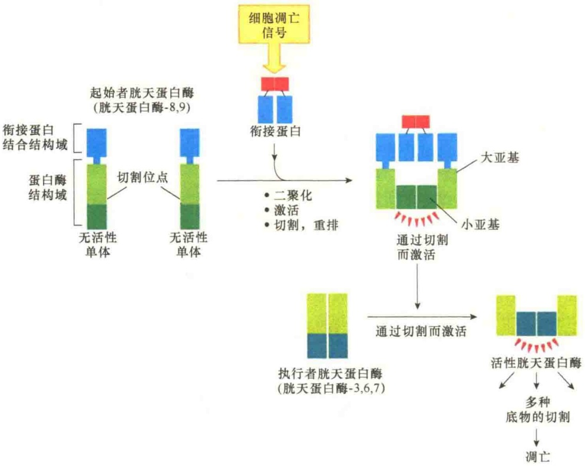

图 15-13 细胞凋亡期间胱天蛋白酶的激活（引自 Alberts et al., 2015）。起始者胱天蛋白酶在 C 端有一个蛋白酶结构域，在 N 端有一个较小的衔接蛋白结合结构域，并且是无活性的单体，有时将它称为胱天蛋白酶原（procaspase）。凋亡信号触发了衔接蛋白与胱天蛋白酶的氨基端结合，由于衔接蛋白的结合引起胱天蛋白酶二聚化并被激活。胱天蛋白酶被激活后，相互从蛋白酶结构域的切割位点进行切割，被切开的两部分经过重排形成由大、小两个亚基组成的二聚体，再装配成含有两个胱天蛋白酶与两个衔接蛋白组成的具有活性的复合物。执行者胱天蛋白酶合成时是无活性的二聚体，经起始者胱天蛋白酶切割重排后形成有活性的四聚体，执行降解作用。

亡中的激活。

起始者胱天蛋白酶负责细胞凋亡的起始。在正常情况下，起始者胱天蛋白酶是没有活性的，并且以可溶性的单体存在于胞质溶胶中。在凋亡信号的触发下，它们与衔接蛋白一起装配成一个大的复合物，在复合物内，两个胱天蛋白酶配对形成二聚体，并激活酶活性，随后，激活的胱天蛋白酶将伴随的蛋白质部分切开，装配成稳定的具有酶活性的复合物，在细胞内行驶其功能。

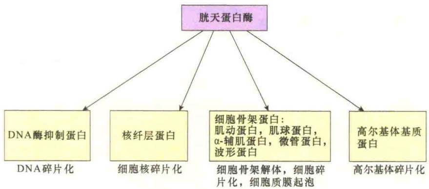

图 15-14 胱天蛋白酶的靶位点（引自 Cooper and Hausman，2013）。胱天蛋白酶可切割细胞内 100 多种蛋白质，诱导细胞凋亡。切割的蛋白质包括 DNA 酶抑制剂、核纤层蛋白、细胞骨架蛋白、高尔基体基质蛋白等。

起始胱天蛋白酶的主要作用就是激活执行者胱天蛋白酶。胱天蛋白酶合成后是以无活性的二聚体存在于胞质溶胶中，当它们被起始者胱天蛋白酶在特殊部位切割后，发生分子重排，形成有活性的构型。一个起始者通常可激活多个执行者，起级联放大作用。执行者胱天蛋白酶一旦激活，随即发生大量的蛋白质切割，直至杀死细胞。

由于胱天蛋白酶家族的成员较多，它们作用时分成一些亚组被激活，每一组胱天蛋白酶对应不同的激活信号。例如，胱天蛋白酶-3、6、7和8在FAS/TNF介导的细胞凋亡途径中起作用；而胱天蛋白酶-9和3一起参与线粒体中Apaf-1、细胞色素c介导的细胞凋亡。在人类，已经鉴定了15种不同的胱天蛋白酶，Ced-3是线虫中唯一的胱天蛋白酶。

研究表明，胱天蛋白酶是细胞凋亡最大的效应物（effector）或执行者（executioner），通过对细胞内100多种靶蛋白进行切割，推进细胞凋亡（图15-14）。

胱天蛋白酶切割 100 多种细胞内的蛋白质，诱导细胞发生凋亡的形态变化。胱天蛋白酶切割的一个关键靶蛋白是 DNase 抑制蛋白（inhibitor of DNase），该蛋白质被切割后，释放的 DNase 会将核 DNA 片段化。此外，胱天蛋白酶还切割核纤层，导致细胞核片段化；切割了细胞骨架蛋白，使细胞质膜形成无规则的膜泡进而导致细胞碎片化；高尔基体基质蛋白被切割，使高尔基体片段化。胱天蛋白酶对磷脂翻转酶进行切割并将其激活，从而将磷脂酰丝氨酸转位到细胞质膜的外叶，导致凋亡细胞被吞噬细胞识别并被吞噬。

## 15.2.3.4 细胞表面死亡受体激活凋亡的外源途径

细胞外信号蛋白与细胞表面死亡受体（death receptor）结合触发了凋亡的外源途径（extrinsic pathway）。死亡受体是含有细胞外配体结合结构域及细胞内死亡结构域的单次穿膜蛋白，其中死亡结构域是受体激活细胞凋亡所必需。死亡受体是同源三聚体，并且属于肿瘤坏死因子（tumor necrosis factor，TNF）家族。该家族包括 TNF 及 Fas 死亡受体。激活死亡受体的配体也是同源三聚体，这些配体也属于 TNF 信号蛋白家族。

了解得较为清楚的细胞表面死亡受体激活凋亡的外源途径的例子是 K 淋巴细胞表面 Fas 配体对靶细胞表面 Fas 死亡受体的激活从而触发细胞凋亡（图 15-15）。

有很多细胞能够生产一些抑制蛋白阻止外源细胞凋亡途径。例如，某些细胞合成一种FLIP蛋白，该蛋白质与起始者胱天蛋白酶很相似，但是没有酶的活性，因为该蛋白质在它的活性部位缺少半胱氨酸。FLIP能够与胱天蛋白酶-8在DISC中组成二聚体，虽然异源二聚体中的胱天蛋白酶-8似乎被激活了，但是不能在所需要的位点切割成所需要的稳定的激活状态，因而，细胞凋亡信号被阻断了。这种抑制机制可有效地防止凋亡的外源途径不适当的激活。

## 15.2.3.5 Bcl-2家族对凋亡内源信号的调控

在线虫中鉴定到的调控细胞凋亡的第三个基因是 ced-9，该基因与哺乳动物中的 bcl-2 基因非常相似，bcl-2 是 1985 年在 B 淋巴瘤中发现的癌基因，与其他的癌蛋白（如 Ras）不同的是，Bcl-2 能够刺激细胞增殖，抑制细胞凋亡，因此 Ced-9 与 Bcl-2 具有相似的功能。特别是 Bcl-2 对凋亡的调控作用引起人们极大的关注。

Bcl-2 蛋白家族主要是通过控制线粒体细胞色素 c 及线粒体膜间腔蛋白质向细胞质释放来调控细胞凋亡的内源途径。某些 Bcl-2 家族蛋白通过促进释放来促进细胞凋亡，而有些 Bcl-2 家族蛋白通过阻止释放来抗凋亡。两大类 Bcl-2 蛋白间的活性平衡决定着细胞是生存还是死亡。

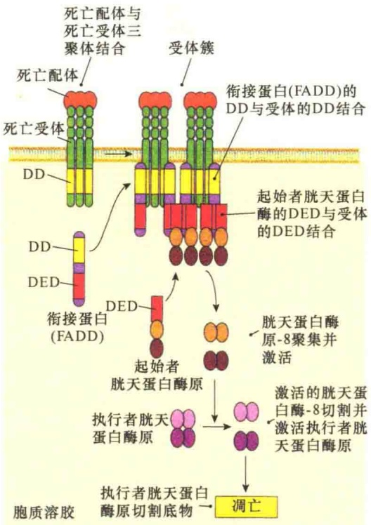

图 15-15 通过 Fas 死亡受体激活细胞凋亡的外源途径（引自 Plopper et al，2015）。K 淋巴细胞表面三体 Fas 配体与靶细胞表面三体 Fas 受体相互作用导致几个配体与受体结合的三体成簇（图中显示了两个受体三体），受体成簇激活了受体尾部死亡结构域（death domain，DD），激活的受体死亡结构域与细胞质中衔接蛋白 FADD（Fas-associated death domain，Fas 结合死亡结构域）的相似结构域相互作用。每一个 FADD 蛋白可以招募一个起始者胱天蛋白酶（胱天蛋白酶-8），FADD 与起始胱天蛋白酶的 DED（death effector domain，死亡效应物结构域）形成死亡诱导信号复合物（death-inducing signaling complex，DISC），在 DISC 内部，两个相邻的起始胱天蛋白酶相互作用并相互切割，形成一个有活性的蛋白酶二聚体，激活的蛋白酶二聚体进行自身切割，将酶与 DED 分开，释放出激活的胱天蛋白酶进入细胞质，并通过切割将执行者胱天蛋白酶激活，启动细胞凋亡。

哺乳动物编码一个约有20个成员组成的与Bcl-2相关的蛋白家族，分成3个功能相关的类群（图15-16）。①抗凋亡（anti-apoptotic）Bcl-2蛋白，又称促生存（prosurvival）Bcl-2蛋白，此类蛋白质含有4个不同的Bcl-2同源（Bcl-2-homology，BH）结构域（BH1～BH4）；②促凋亡效应蛋白（pro-apoptotic effector protein），主要是2个成员，即Bax与Bak，此类蛋白质含有4个不同的Bcl-2同源结构域；③促凋亡BH3-only蛋白（pro-apoptotic BH3-only protein），此类蛋白质仅有一个BH3同源结构域。

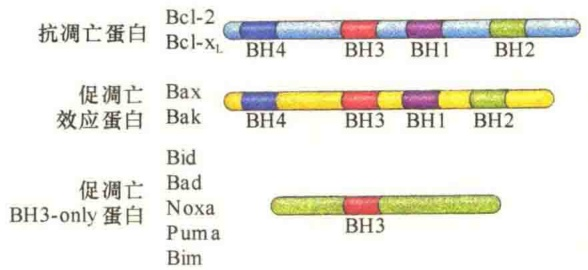

图 15-16 Bcl-2 蛋白家族（引自 Cooper and Hausman, 2013）。Bcl-2 家族按功能分为 3 类:抗凋亡蛋白（Bcl-2、Bcl-xL）；促凋亡效应蛋白（Bax、Bak），有 4 个 Bcl-2 同源结构域（BH1～BH4）；促凋亡 BH3-only 蛋白（Bid、Bad、Noxa、Puma、Bim），仅有 1 个 BH3 同源结构域。

当凋亡刺激信号触发内源途径时，促凋亡效应物 Bcl-2 家族蛋白被激活，从而在线粒体外膜形成寡聚体，通过一种尚不清楚的机制诱导线粒体细胞色素 c 及其他线粒体膜间腔蛋白释放（图 15-17）。

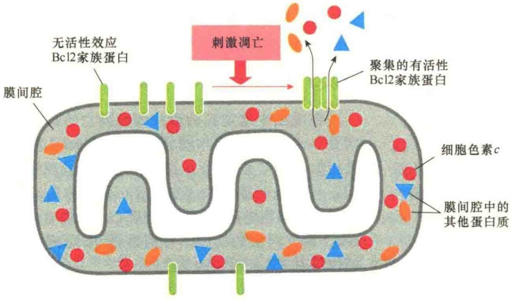

图 15-17 内源凋亡途径中促凋亡效应 Bcl-2 家族蛋白的作用（引自 Alberts et al., 2015）。当激发凋亡时，促凋亡效应 Bcl-2 家族蛋白（主要是 Bax/Bak）聚集在线粒体外膜上，将线粒体膜间隙的细胞色素 c 及其他一些蛋白质释放到细胞质，机制尚不清楚。

在哺乳动物细胞中，Bax 和 Bak 是主要的 Bcl-2 家族效应蛋白，它们中至少有一个参与了凋亡内源途径。研究证明，当这两种蛋白质都突变时，细胞就会抗凋亡。Bak 在没有凋亡信号时定位在线粒体的外膜，而 Bax 主要位于细胞质，当被凋亡信号激活后转移到线粒体。Bax 与 Bak 活性主要依赖于促凋亡 BH3-only 蛋白。

抗凋亡 Bcl-2 家族蛋白，如 Bcl-2 自身及 Bcl-X$_{L}$ 都是定位在线粒体外膜的细胞质面，作用是帮助阻止线粒体膜间隙蛋白不合时宜地释放，这些抗凋亡的 Bcl-2 家族蛋白主要是通过与线粒体膜或胞质溶胶中促凋亡的蛋白质结合来抑制细胞凋亡。例如，在线粒体外膜上，它们与 Bak 结合并阻止其寡聚化，从而抑制了细胞色素 c 及其他膜间隙蛋白的释放。至少有 5 种哺乳动物抗凋亡 Bcl-2 家族蛋白，每一种哺乳动物细胞的生存至少需要其中的一种。但是，为了诱导凋亡途径，很多此类蛋白质必须被抑制，BH3-only 蛋白介导这种抑制作用。

BH3-only 蛋白是 Bcl-2 家族蛋白中最大的一个亚类，细胞在应答凋亡刺激时需要产生并激活 BH3-only 蛋白。BH3-only 蛋白主要是通过对抗凋亡 Bcl-2 家族蛋白的抑制来促进凋亡。BH3-only 蛋白的 BH3 结构域与抗凋亡 Bcl-2 蛋白上一个长亲水沟结合，中和它们的活性。通过这种结合与抑制，使得 Bax、Bak 在线粒体表面聚集，促进了线粒体间隙蛋白释放到细胞质诱导细胞凋亡。某些 BH3-only 蛋白可直接与 Bax、Bak 蛋白结合，帮助激发它们聚集到线粒体外膜，形成通道样结构，允许线粒体膜间隙蛋白渗漏进入细胞质中，这一作用被称为线粒体外膜渗透作用（mitochondrial outer membrane permeabilization, MOMP）。图 15-18 总结了 BH3-only 蛋白促进凋亡的内源途径的两种方式。

## 15.2.3.6 依赖于线粒体凋亡的内源途径

除了外部信号激发细胞凋亡外，细胞内源信号也会激发细胞凋亡，包括:DNA损伤、细胞质中 $Ca^{2+}$ 浓度过高、极度氧胁迫（产生大量的自由基）等。

从上面对 Bcl-2 家族调节凋亡的内源途径机制的讨论中可以看到，内源途径的一个关键蛋白质是细胞色素 c，它是一种水溶性的、线粒体电子传递链中的蛋白质。细胞色素 c 一旦进入胞质溶胶，就有了完全不同的作用。当它们被释放到胞质溶胶后，与一个衔接蛋白——凋亡蛋白酶激活因子-1（apoptotic protease activating factor-1, Apaf-1）结合，并引起Apaf-1聚集装配成一个轮状的七聚体的凋亡体（apoptosome），凋亡体中的Apaf-1招募起始者胱天蛋白酶-9，在凋亡体中，起始者胱天蛋白酶-9被最大化激活，激活的胱天蛋白酶-9激活下游的执行者胱天蛋白酶，诱导细胞凋亡（图15-19）。

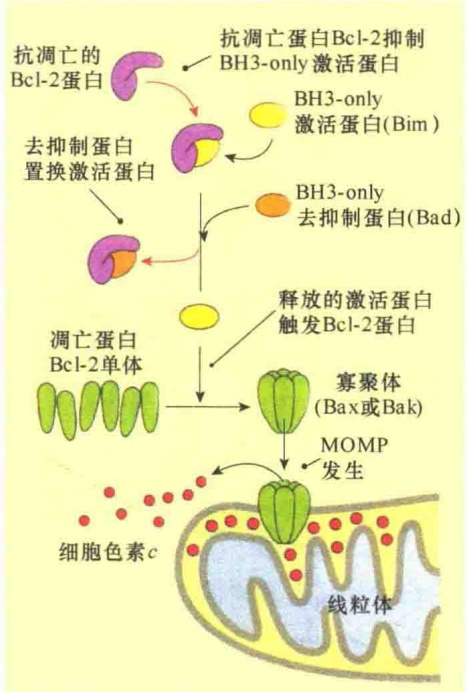

图 15-18 Bcl-2 家族蛋白 BH3-only 调节凋亡的两种方式（引自 Plopper et al., 2015）。Bcl-2 家族蛋白 BH3-only 或者直接激活 Bax 与 Bak，或者通过对抗凋亡 Bcl-2 家族蛋白抑制作用促进凋亡的内源途径。

## 15.2.4 细胞生存与死亡调控的意义

在发育中的组织和成年的组织中进入凋亡的细胞数量大得惊人。例如，正在发育的脊椎动物的神经组织中，大约有半数以上的神经细胞在形成后不久就要正常死亡。在健康的成年人体的骨髓和肠组织中每小时大约有10亿个细胞死亡。动物机体靠对细胞增殖和细胞周期的正负控制，以及对细胞凋亡的正负控制来维持细胞总数的平衡和机体的生命活力（图15-20）。

## 15.2.4.1 细胞凋亡在形态建成中的作用

细胞凋亡在形态建成中起重要作用。例如，手指和脚趾在发育的早期是连在一起的。通过细胞凋亡使一部分细胞进入自杀途径才将单个指加以分开（图 15-21）。

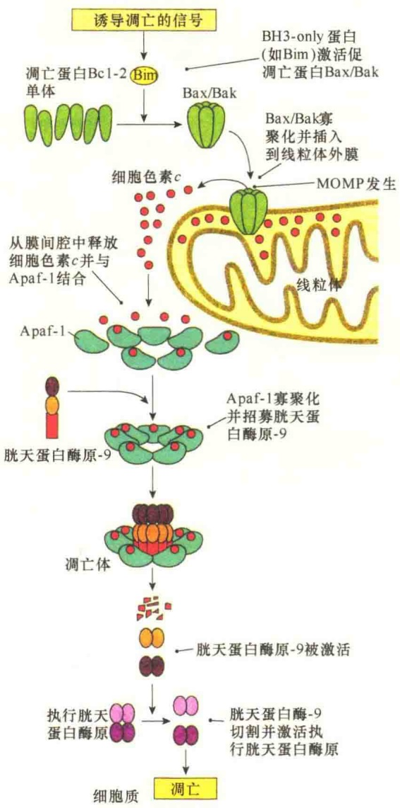

图 15-19 依赖于线粒体凋亡的内源途径（引自 Plopper et al., 2015）。

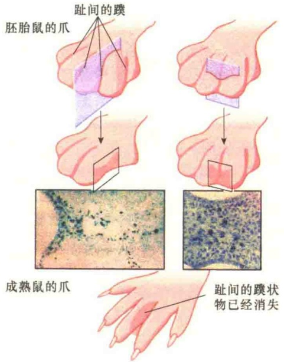

图 15-21 细胞凋亡在小鼠脚趾形成中的作用（引自 Plopper et al., 2015）。开始时脚趾是由蹼连在一起的，经细胞凋亡使脚趾分开。

另外，对于生物发育成熟后一些不再需要的结构，通过细胞凋亡加以消除。例如，蝌蚪的尾巴就是靠细胞凋亡消除的（图 15-22）。

图 15-22 在蝌蚪向蛙发育的变态反应中细胞凋亡的作用（引自 Alberts et al., 1998）。当蝌蚪变成蛙时，尾巴经细胞凋亡而消失。主要是因血液中甲状腺激素的增加而诱导的细胞凋亡所致。

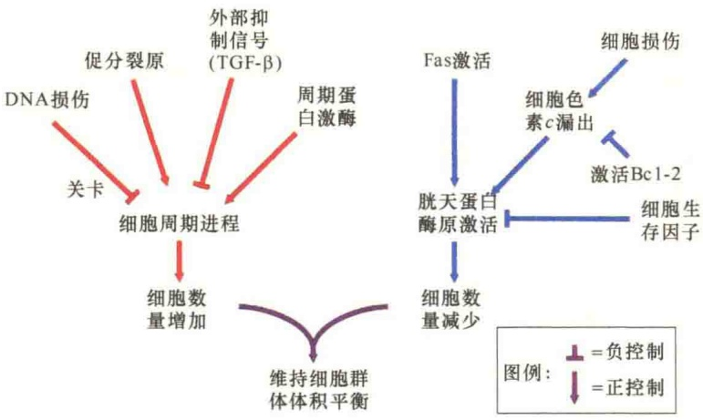

图 15-20 动物机体的细胞数量控制途径（引自 Griffiths et al., 2012）。

## 15.2.4.2 生存因子与细胞凋亡对神经细胞发育的影响

细胞凋亡不仅参与形态建成，而且能够调节细胞的数量和质量。例如，在神经系统的发育过程中，神经细胞必须通过“竞争上岗”获得生存的机会。在胚胎中产生的神经细胞一般是过量的，然后通过竞争数量有限的、从靶细胞分泌出来的生存因子（survival factor），只有那些获得足够生存因子的神经细胞才能生存下去，而其他的神经细胞将会经由细胞凋亡而消失（图 15-23）。

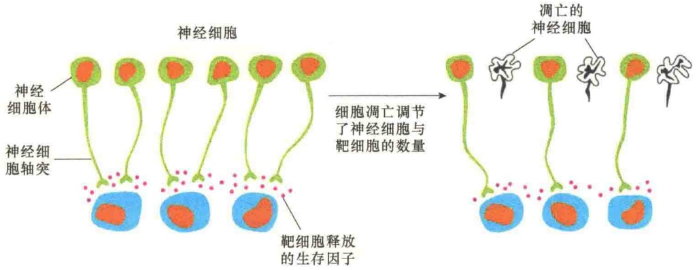

图 15-23 细胞凋亡对发育中神经细胞数量的调节（引自 Alberts et al., 2015）。生成的神经细胞多于能够支持它们生存的生存因子的数量，这些生存因子是由靶细胞释放出来的。某些得不到生存因子的神经细胞则通过细胞凋亡而消失。

## 15.2.4.3 生存因子对细胞凋亡的抑制

大多数动物细胞需要来自其他细胞连续的生存信号才能避免细胞凋亡。细胞外的生存因子通常结合在受体细胞的表面，激活细胞内的信号通路，通过调节 Bcl-2 家族蛋白的数量来抑制细胞的凋亡（图 15-24）。某些生存因子可刺激抗凋亡蛋白 Bcl-2 家族蛋白，包括 Bcl-2 及 Bcl-X$_{L}$ 来促进细胞的生存。还有一些生存因子通过对促凋亡的 BH3-only 蛋白（如 Bad）功能的抑制来促进细胞生存。在果蝇中，有些生存因子通过对抗-IAP 蛋白（如 Bid）

的磷酸化并将其失活，从而恢复 IAP 蛋白对凋亡的抑制作用。

IAP 蛋白, 即凋亡抑制蛋白 (inhibitor of apoptosis protein, IAP), 最早从昆虫病毒中鉴定出, 它的作用是防止被感染的宿主细胞因感染病毒而通过凋亡与病毒同归于尽, 后来发现大多数动物细胞都能合成该类 IAP 蛋白。在果蝇中发现了一类抗-IAP (anti-IAP) 的蛋白质, 如 Reaper、Grim、Hid 等, 这些蛋白质是在一些凋亡信号的刺激下合成的, 目的是抑制 IAP 的抗凋亡作用, 促进细胞凋亡。在果蝇中, IAP 与抗-IAP 的相互作用对于调节果蝇在发育过程中细胞数量的平衡与发展具有十分重要的作用。

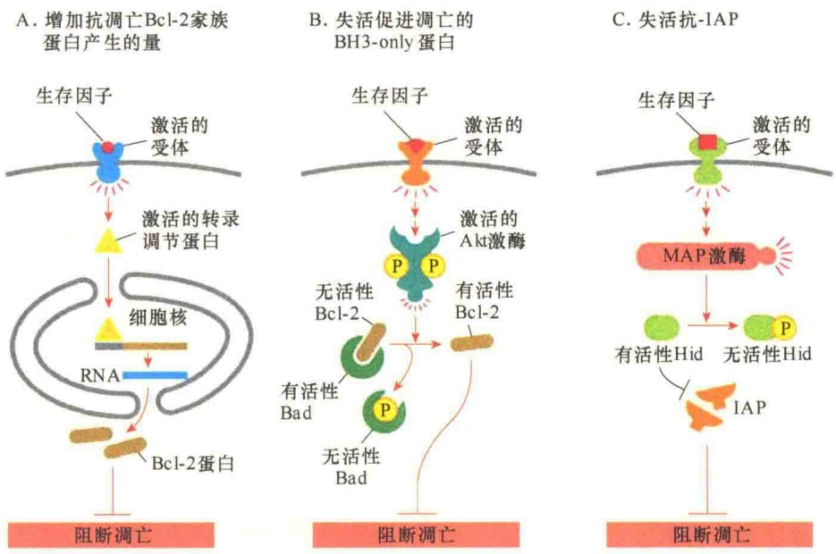

图 15-24 细胞外生存因子抑制细胞凋亡的三种途径（引自 Alberts et al., 2015）。三种方式的共同点是生存因子都与表面受体结合传递生存信号，但细胞内部的传递机制不同。A. 通过对转录因子的激活启动 Bcl-2 蛋白编码基因表达，增加 Bcl-2 蛋白的量来抗凋亡、促生存。B. 通过激活 Akt 激酶将促凋亡的 Bad 蛋白磷酸化，从而释放出 Bcl-2 蛋白，进而促进细胞生存。C. 启动 MAP 激酶系统，将抗凋亡的 BH3-only 蛋白家族中 Hid 蛋白磷酸化而失活，失活了的 Hid 失去对抗凋亡蛋白 IAP 的抑制，使得 IAP 尽情发挥抗凋亡作用，促进细胞生存。

对于 IAP 与抗-IAP 蛋白在哺乳动物细胞凋亡中的作用知之甚少。当细胞凋亡的内源途径被激活时，抗-IAP 从线粒体膜间腔释放出来，在细胞质中阻断 IAP 蛋白的作用，从而促进细胞凋亡。但是，在小鼠中，如果丧失了哺乳动物主要的 IAP 蛋白（称为 XIAP 蛋白），或者两个已知的哺乳动物的抗-IAP 蛋白（分别叫做 Smac/Diablo 和 Omi），似乎对小鼠的发育没有影响。在线虫中，甚至没有抑制凋亡的 IAP 蛋白的存在。显然，对凋亡的严格控制在不同的动物中有着不同的机制。

## 15.3 癌

世界上每年死亡的人群中至少有20%以上是死于癌症。癌症实际上是一种细胞病，这种细胞病的最大特点就是不受机体内关于细胞生长与生殖的管控，凋亡的信号失灵，生长与生殖变得“肆无忌惮”；更可怕的是，癌细胞能够“肆意转移”，“侵占他人”地盘，破坏了组织规则，使组织的正常功能丧失，最终的代价是个体的死亡，因此，人们常常“谈癌色变”。

从现代生命观来说，癌（cancer）导致的生命死亡也有其积极的一面，它可以促进人类的新老更替，只不过，不希望癌变发生得太早，而是发生得越晚越好，同时，也不希望给身体带来太多的痛苦，而应该是可控的痛苦，至少是大部分可控的。

随着细胞生物学，特别是癌生物学的研究取得了一系列的进展，以及临床应用取得一系列的重要突破，癌不再那么可怕，癌是可控的，甚至是可治的。因此，正确认识癌的起因、发生与发展的一些特点，对于癌的防治具有重要意义。

## 15.3.1 癌的特性及发育

“cancer”一词源于拉丁语“crab”，是用于描述一种由于体内组织的无限生长，最后夺去生命的疾病。虽然癌的起因很多，基因突变是最根本的原因，但突变都要经过一个十分缓慢的微进化（microevolutionary），认识这种微进化对于早发现、早治疗十分重要。

## 15.3.1.1 癌的类型

癌可以来自体内任何分化细胞的不正常增殖，所以从种类上说，大约有100多种不同的癌。在临床治疗上，各种癌在原发性组织与转移性组织中对药物处理的反应是不同的。肿瘤（tumor）是任何不正常增殖的细胞，分为良性（benign）与恶性（malignant）。

良性肿瘤（benign tumor），如普通的皮肤疣，一直保持在原来的部位，既不侵入周围的正常组织，也不扩散到身体的其他部位。恶性肿瘤（malignant tumor）既能入侵周围的正常组织，如胰腺癌（图 15-25），又能通过循环系统及淋巴系统扩散，即转移（metastasis）到身体的其他部位。只有可转移的肿瘤才称之为癌，它们能够入侵正常组织并可转移到身体的其他部位，具有极大的危险性。良性肿瘤通常可以通过外科手术摘除，而扩散到身体其他组织的恶性肿瘤是难以通过手术完全切除的。

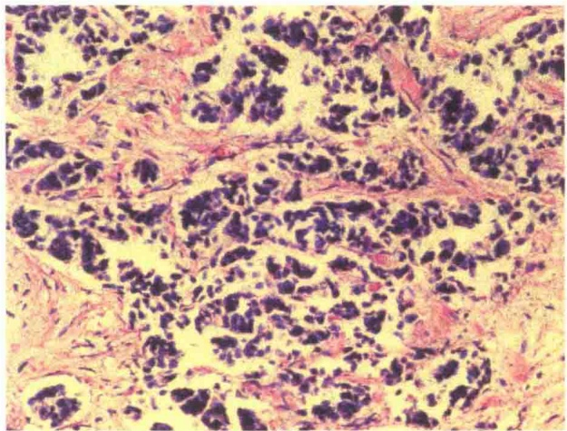

图 15-25 胰腺癌入侵的光学显微照片（引自 Cooper and Hausman, 2013）。暗紫色的癌细胞已经侵入正常的胰腺组织（粉红色）。

根据癌变涉及的细胞类型的不同，将癌分为三个类群:①上皮癌（carcinoma），简称癌，是最常见的一种类型，主要是从组织的外表面和内表面生长的癌，如肺癌、乳腺癌和结肠癌等，大约占人类癌的90%；②瘤（sarcoma），主要是源于中胚层形成的支持组织（骨、软骨、脂肪、结缔组织和肌组织等）中形成的癌；③淋巴瘤（lymphoma）和白血病（leukemia），是由淋巴和血液产生的癌，白血病主要是指癌细胞已经大量进入血液中，大约占人类癌的8%。

## 15.3.1.2 癌细胞的基本特性

癌细胞与正常细胞在结构上和化学性质上都有很大的不同，即便是不同类群癌细胞之间也有很大差异，所以难以描述癌细胞的所有特性。可以通过体外培养了解一些关于癌细胞的行为和基本特性。

1）失去生长的接触抑制

正常细胞在体外培养时，细胞通过分裂增殖并铺满培养器皿的表面形成单层（monolayer）后即停止分裂（图 15-26A，B），曾将细胞达到相互接触时停止分裂的现象称为接触抑制（contact inhibition），又称为密度依赖性抑制（density-dependent inhibition）。由于培养基中的生长因子耗尽时也会产生生长抑制，所以将正常细胞因相互接触而抑制分裂的现象改称为密度依赖性生长抑制（density-dependent inhibition of growth）。在相同条件下培养的癌细胞对密度依赖性生长抑制失去敏感性，因而不会在形成单层时停止生长，而是相互堆积形成多层生长的聚集体（图 15-26C，D），这种现象也说明癌细胞的生长和分裂已经

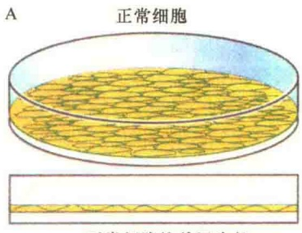

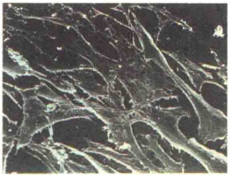

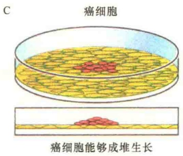

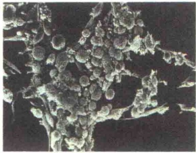

图 15-26 正常细胞与癌细胞生长特性比较（引自 Karp，2010）。正常细胞体外培养时，在培养器皿表面形成单层即停止生长（A，B）；而由病毒转化的或由致癌化学物质诱导的癌细胞会成堆生长（C，D）。

失去了控制，调节细胞正常生长和分裂的信号对于癌细胞已不再起作用。

2）自分泌生长刺激 在正常情况下，生长因子是控制细胞周期的信号分子，调节细胞分裂的速率。但是，某些癌细胞能够分泌刺激自身增殖的生长因子促进自身分裂（图 15-27）。

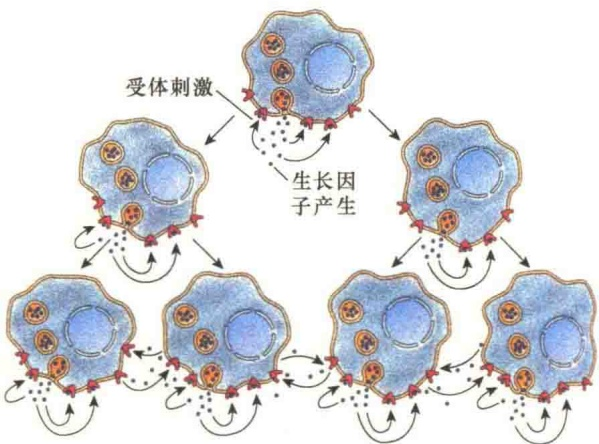

图 15-27 自分泌生长刺激（引自 Cooper，2000）。一个癌细胞产生生长因子，不仅能够刺激自身增殖，也能刺激相邻细胞增殖，导致癌细胞快速增殖。

3）细胞死亡特性改变 当正常细胞遇到生长因子不足、毒性物质伤害、X射线照射、DNA损伤等不良因素情况时，就会启动程序性细胞死亡，让这些细胞进入死亡途径，避免分裂产生缺陷细胞。但是，癌细胞丧失了细胞凋亡机制，这也是导致癌细胞过度增殖的主要原因之一。

4）失去了间隙连接 正常细胞通过间隙连接与其周围细胞保持代谢偶联和电偶联，这对于细胞和组织的生长控制具有重要作用。研究发现，癌细胞的间隙连接减少，如将荧光染料注入正常的细胞后，染料很快向周围细胞扩散，但是将荧光染料注入癌细胞，则只停留在被注射的细胞内，这一实验说明癌细胞之间的通讯连接有了缺陷。这样，同一组织内的细胞间就失去了通讯联系，只好“各自为政”，整个组织就失去了协调性。

5）染色体异常 癌细胞细胞核的显著变化就是染色体的变化。正常细胞在生长和分裂时能够维持二倍体的完整性，而癌细胞常常出现非整倍性（aneuploidy），有染色体的缺失或增加。一般而言，正常细胞中染色体整倍性的破坏，会激活导致细胞程序性死亡的信号，引起细胞凋亡；但是癌细胞染色体整倍性的破坏，不会进入程序性死亡，因为这种细胞对程序性死亡的信号已不再敏感了，这也是癌细胞区别于正常细胞的一个重要指标。

6）细胞骨架的变化 由于癌细胞的细胞骨架变化较大，导致形态发生很大变化。正常细胞的细胞质中有高度组织化的细胞骨架网络结构，而癌细胞中的细胞骨架不仅少且杂乱无章。

7）细胞表面蛋白减少，细胞黏着降低 一些恶性肿瘤常常会合成和分泌一些蛋白酶，降解细胞的某些表面结构，降低了细胞黏着。正因为癌细胞失去了黏着特性，使得其具有在体内转移的能力。

以上是通过细胞培养发现的癌细胞的基本特性，如果就癌细胞在体内的恶性生长与转移来看，其至少有以下6种基本特性（图15-28）。

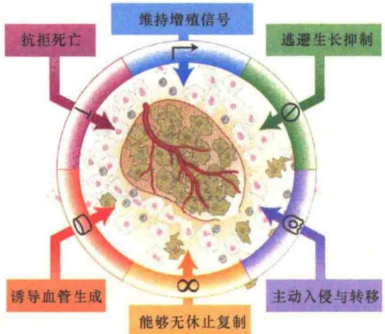

图 15-28 癌细胞生存与转移的6种特性（引自 Lodish et al., 2013）。

第一，自我维持增殖信号（sustaining proliferative signaling）。癌细胞的增殖不依赖于外源信号，而是自我维持增殖信号。如图15-27所示，癌细胞自身产生生长因子，不仅刺激自身，同时也刺激相邻的癌细胞增殖。第二，逃避生长抑制（evading growth suppressor）。在体内，细胞的增殖与死亡是受调控的，当数量超标时，需要通过程序性死亡进行调节，但癌细胞能够逃避生长控制，会越长越大。第三，主动入侵与转移（activating invasion and metastasis）。由于癌细胞的生长失去接触抑制，并且主动侵入相邻的正常组织，甚至借道血液循环系统及淋巴系统转移到其他组织，并在新的部位扩增。第四，能够无休止复制（enabling replicative immortality）。正常细胞内的DNA复制受周期调控，并且有自我修复机制，但是，癌细胞缺少DNA复制的修复，即使错了也继续复制，所以突变越来越多，包括一些重要基因的突变，如抑癌基因突变，这将是灾难性的。第五，诱导血管生成（inducing angiogenesis）。由于癌肿块的增大，导致氧供给不足，癌细胞能够自我诱导产生血管，与肌体的血管相通，从而从体内的血液循环系统中获取生长所需的氧，同时也获得了营养。第六，抗拒死亡（resisting death）。在正常的组织中，通过细胞的凋亡调控细胞的质量与数量，但是癌细胞脱离了这一调控系统，变得“我行我素”，能够抗拒死亡信号，并持续增殖，极度破坏了肌体内细胞数量的平衡，最终导致个体的死亡。

## 15.3.1.3 肿瘤的发育

从细胞水平看，癌的发生与发育涉及多步骤的缓慢过程，在此过程中两个主要因素是突变与选择，由于突变导致增殖、生存、入侵及转移能力增强而被选择下来。肿瘤发生的第一步是肿瘤的起始（tumor initiation），它是由于一个遗传改变，导致一个细胞不正常增殖而引起的。而这种变坏的细胞随着多轮的突变与自然选择，变得越来越糟糕。当然，肿瘤的发生与进展涉及很多因素，持续的年限也很久。

在起始阶段，某个细胞获得了一个突变，或是获得一个表观遗传（epigenetic）的变化，使之比相邻的细胞多了一个特性，能够形成一个自身的环境并能更好地在该环境中生长。在肿瘤中，环境恶劣，少氧，营养匮乏，并且被周围正常细胞设置了许多生长的障碍，但是，随着肿瘤细胞数量越来越多，至少有个别细胞有机会突破相邻正常细胞的封锁，因此，随着肿瘤的生长，进程加快，适应性最强的子代细胞继续分裂，并最终在发育损伤部位形成显性克隆（dominant clone）（图 15-29）。

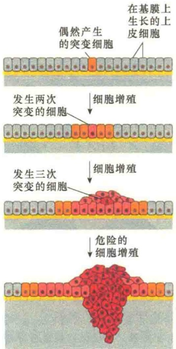

图 15-29 肿瘤发育与克隆形成（引自 Alberts et al., 2015）。图中显示肿瘤通过几轮反复突变与增殖，最终形成一个由恶性癌细胞组成的克隆。每一轮，细胞都要经过一个突变来增强增殖或降低死亡，这样，它们的子代肿瘤就组成了克隆，每个克隆再经过突变，并逐渐增加细胞数量向前推进，最后侵入基膜并起始转移。

如同动植物发育，肿瘤也会进化成不同的亚克隆细胞，亚克隆之间在遗传上具有多样性。这些亚克隆可以独立转移到不同环境，并在适合的环境中生存。此外，每个亚克隆可以发生不同的突变获得新的特性，因此增加了肿瘤遗传的多样性。

## 15.3.1.4 癌细胞转移

恶性肿瘤的一个显著特点是能够侵入（invade）相邻的组织，并转移（metastasis）到其他的组织。如果在转移过程中，细胞继续增殖的话，就会沿途留下肿瘤的“种子”，大多数肿瘤细胞最终都会获得转移能力。

正常细胞通常因细胞-细胞间的黏着以及基膜等物理障碍被限制在原有的器官及组织，但是，癌细胞具有穿过基膜的能力并转移到身体的其他组织与器官（图 15-30）。

## 15.3.2 癌的遗传学基础

癌是一种基因性疾病，因为所有的癌都与基因的改变有关；但癌与先天性遗传疾病不同，后者系缺陷基因通过性细胞传递到子代而发病，而癌主

要是体细胞后天获得性 DNA 的改变导致细胞无节制地增殖，这种增殖不断侵袭周围正常组织，导致疾病。所以，在大多数情况下，癌症是不遗传的。从细胞水平上看，癌的发育又是极偶然的事件。从遗传上看，癌都是由一个细胞发展而来，由一个失去了增殖控制的细胞发展而来，因此将癌看成是单克隆的。究其根源是基因突变及表达了错误的蛋白质，导致细胞生理生化表型的改变。将突变后导致细胞癌变的基因统称为癌基因。

## 15.3.2.1 癌发生的生化起因

癌的发生源于表达了突变的蛋白质，突变的蛋白质结构发生了变化，影响了细胞的正常生长。突变后可诱发癌变的蛋白质大约分为7类（图15-31）:①某些细胞外信号分子，如生长因子（growth factor）；②信号受体（signal receptor）；③信号转导蛋白（signal transduction protein）；④转录因子（transcription factor）；⑤细胞周期控制蛋白（cell-cycle control protein）；⑥DNA修复蛋白（DNA-repair protein）；⑦抗凋亡蛋白（antiapoptosis protein），包括促进凋亡的肿瘤抑制蛋白，以及促进细胞生存的癌蛋白。

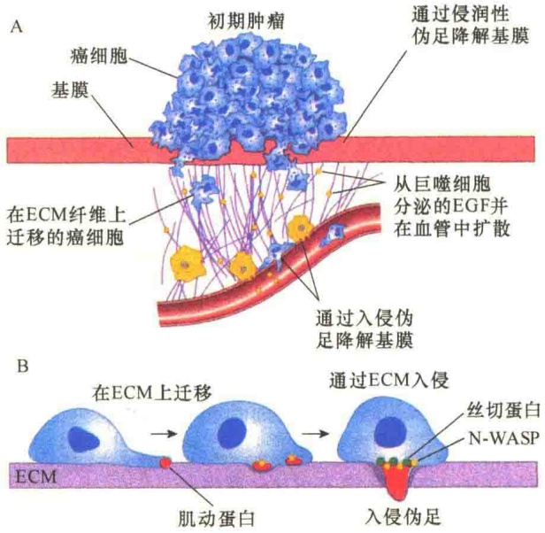

图 15-30 癌细胞转移（引自 Lodish et al., 2013）。A. 以乳腺癌细胞为例，转移的第一步，某些乳腺癌细胞离开肿瘤，附着到基膜；通过细胞外基质纤维到达血管，癌细胞通过诸如表皮生长因子（EGF）之类的信号，附着到血管上，EGF 是由巨噬细胞分泌的；癌细胞进一步穿过血管的上皮细胞的壁进入血流。B. 癌细胞伸展的侵润性伪足（invadopodium）能够产生金属蛋白酶（metalloprotease）及其他的一些蛋白酶来开辟通路。

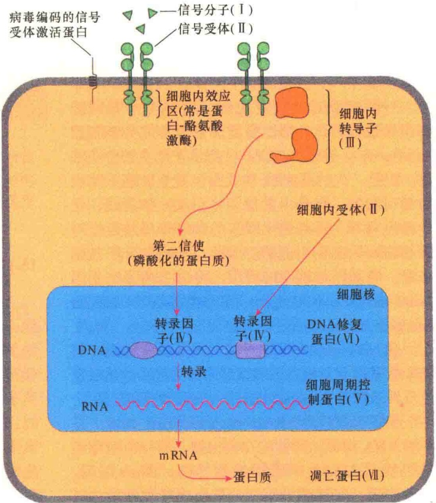

图 15-31 参与细胞生长于增殖控制的 7 类蛋白质（引自 Lodish et al., 2013）。

## 15.3.2.2 病毒癌基因与细胞癌基因

病毒中有几个家族被称为肿瘤病毒（tumor virus），能够直接诱发实验动物与人发生癌变。其中包括引起肝癌的乙型与丙型肝炎病毒、引起颈部癌及生殖器癌的乳头瘤病毒（papilloma virus）、梅克尔细胞多瘤病毒（Merkel cell polyomavirus）、疱疹病毒（herpesvirus），以及反转录病毒（retrovirus），如人的T细胞淋巴瘤病毒（成年T细胞白血病）。另外，HIV可在HIV患者体内诱发癌变并发生免疫缺陷。

除了 RNA 病毒引起细胞癌变外，有些 DNA 病毒也能引起细胞癌变。表 15-4 列出了部分与肿瘤有关的 DNA 病毒和 RNA 病毒。

表 15-4 部分 DNA、RNA 病毒

<table><tr><td>病毒家族</td><td>诱导人的肿瘤</td><td>基因组大小/kb</td></tr><tr><td colspan="3">DNA 病毒</td></tr><tr><td>乙型肝炎病毒</td><td>肝癌</td><td>3</td></tr><tr><td>多瘤病毒及 SV40</td><td>梅克尔细胞瘤</td><td>5</td></tr><tr><td>乳头瘤病毒</td><td>颈部癌及生殖器癌</td><td>8</td></tr><tr><td>疱疹病毒</td><td>伯基特淋巴瘤、鼻咽癌、卡波西肉瘤</td><td>100~200</td></tr><tr><td colspan="3">RNA 病毒</td></tr><tr><td>丙型肝炎病毒</td><td>肝癌</td><td>10</td></tr><tr><td>反转录病毒</td><td>成人 T-细胞白血病</td><td>9~10</td></tr></table>

对肿瘤病毒的研究揭示一些特异的基因能够诱导细胞转化为癌，将此类基因称之为癌基因（oncogene）。癌基因的发现，揭示了癌变的分子基础。但是，大约有80%在人身上发生的癌不是由病毒引起的，而是由其他因素引起，如射线、化学致癌剂等。这些理化因素的致癌作用是通过对细胞癌基因突变引起的。因此，从癌的分子基础来看，癌基因是根本的原因，可分为病毒癌基因（viral oncogene, v-oncogene）和细胞癌基因（cellular oncogene, c-oncogene）。

通过对 v-癌基因的研究发现了 c-癌基因。而将 v-癌基因与 c-癌基因联系起来的关键实验是对致癌反转录病毒（oncogenic retrovirus）的研究。

劳氏肉瘤病毒（Rous sarcoma virus，RSV）是一种RNA病毒，可使鸡产生肉瘤。第一个病毒癌基因就是在RSV中发现并鉴定的，即src基因。实验表明，RSV感染培养的鸡胚成纤维细胞，可使鸡胚成纤维细胞发生转化；将转化的鸡成纤维细胞导入小鸡体内，可诱导小鸡在1\~2周内长出一个大的肿瘤。但是，用与 RSV 亲缘关系密切的禽白血病病毒（avian leukosis virus，ALV）做对照，不会发生小鸡胚成纤维细胞的转化（图 15-32）。

已经从不同的动物，包括鸡、火鸡、小鼠、大鼠、猫与猴子等分离了40多种高度致癌的反转录病毒。所有这些病毒，都像RSV一样，至少含有一个（有些含两个）与病毒复制无关，但可以引起细胞转化的癌基因。在某些情况下，不同的病毒含有相同的癌基因。这些癌基因中，有很多基因编码的蛋白质都是促进细胞增殖信号途径中的重要成分（如Ras、Raf蛋白）。

图15-32 RSV与ALV转化实验（引自Cooper and Hausman, 2016）。RSV与ALV病毒基因组都能在鸡胚成纤维细胞中复制，但是只有RSV能引起细胞转化。

## 15.3.2.3 致癌基因

致癌基因（carcinogenic gene）又称致癌关键基因（cancer critical gene），意指所有因突变可促进癌的发生或生成的基因。根据突变基因的产物活性高低及对癌形成的影响，将致癌基因分为三类。第一类是原癌基因（proto-oncogene）。此类基因未突变时，基因产物具有正常的细胞功能，一旦突变，导致该基因过表达或表达产物的活性过高从而导致细胞癌变。将原癌基因突变致癌的突变称为功能获得突变（gain-of-function mutation），因此类突变获得了诱发细胞癌变的功能。功能获得突变致使原癌基因转变成了癌基因。第二类是肿瘤抑制基因(tumor suppressor gene)，此类基因突变丧失了对肿瘤的抑制作用。将肿瘤抑制基因的突变称为功能失去突变（loss-of-function mutation），它们因突变失去了功能之后导致细胞癌变。第三类是基因组维护基因(genome maintenance gene), 因为它们的突变导致基因组不稳定。例如, $p53$ 基因, 它的突变会失去对细胞基因组 DNA 维护的能力, 此类基因也是功能会失去突变。表 15-5 总结了三类致癌基因的一些基本特性。

表 15-5 三类致癌基因的比较

| 基因类型 | 基因的正常功能 | 基因产物举例 | 突变效应 | 突变基因的遗传特性 | 基因突变的原因 |
| --- | --- | --- | --- | --- | --- |
| 原癌基因 | 促进细胞的生存或增殖 | 抗凋亡蛋白;促进细胞增殖信号传导及信号转导途径中的成分;转录因子 | 功能获得突变,允许细胞的增殖与生存不受调节 | 遗传显性突变 | 点突变;染色体转位;基因扩增 |
| 肿瘤抑制基因 | 抑制细胞的增殖与生存 | 促凋亡蛋白质;细胞周期进程的抑制蛋白;DNA/染色体损伤的关卡监控蛋白;阻止细胞增殖信号途径中的成分 | 功能失去突变,允许细胞的增殖与生存不受调节 | 遗传隐性突变 | 基因缺失;点突变;甲基化作用 |
| 基因组维护基因 | DNA损伤修复及防止DNA损伤 | DNA修复酶 | 功能失去突变,允许突变累积 | 遗传隐性突变 | 基因缺失;点突变;甲基化作用 |

原癌基因只要一个拷贝突变就会转变成癌基因，因此原癌基因的突变是显性的；而肿瘤抑制基因与基因组维护基因则需要两个拷贝都突变了才能诱发癌变，所以肿瘤抑制基因与基因组维护基因突变是隐性的（图 15-33）。

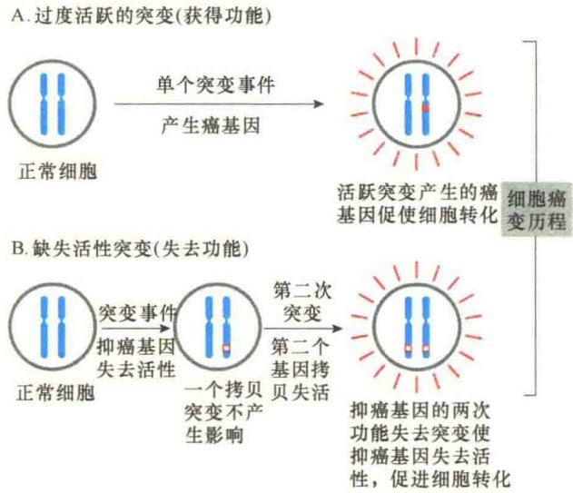

图 15-33 两类致癌基因突变（引自 Alberts et al., 2015）。

A. 功能获得突变只需发生一次突变，就能够促进细胞癌变。由于此类突变仅涉及一对等位基因中的一个，所以是显性突变。

B. 功能失去突变需要发生两次突变，使得一对等位基因的两个拷贝都发生了突变才会促进细胞癌变，因此是隐性突变。

## 15.3.2.4 原癌基因与功能获得突变

原癌基因是正常细胞中来自反转录病毒的致癌基因。在正常的细胞中，它们是细胞内重要的调节基因。在很多情况下，这些基因编码的蛋白质在正常细胞中通常参与增殖的信号调控（如 ras、raf）。癌基因是相应的原癌基因不正常的表达，或原癌基因突变的形式，从突变的角度来说，这种突变是功能获得突变。

原癌基因突变成癌基因，称为原癌基因的激活（activation）或转变（conversion），涉及功能获得突变，至少有4种可能的机制。①点突变（point mutation）:在原癌基因中发生了单个碱基对的变化导致产生了具有超活性（hyperactive）或持续活性的蛋白质。②染色体易位（chromosomal translocation）导致两个基因融合成一个杂合基因，编码一个嵌合的蛋白质，这种蛋白质的功能与亲代蛋白质不同，常常是组成型表达。③染色体转位，这种转位与前面的易位不同，这种转位将一种生长调控基因置于不同的启动子的控制之下，导致该基因不合时宜地表达。④扩增（amplification），如不正常的DNA复制。一段含有原癌基因的DNA扩增，拷贝数增加，导致编码蛋白的超量合成。例如，Raf原癌基因蛋白含有两个结构域:一个是氨基端的调节结构域，另一个是羧基端的蛋白激酶结构域。在病毒Raf原癌基因蛋白中，其氨基端的调节结构域已经缺失，并被部分缺失的病毒Cag序列（$\Delta$Cag）所替代（图15-34），结果是蛋白激酶不受调节地持续合成，引起细胞转化。

Ras 蛋白基因的点突变是原癌基因功能获得突变的典型例子。在人体正常的细胞中，原癌基因 ras 编码的 Ras 蛋白在生长因子类信号分子的信号通路中具有重要作用，但是在关键位置发生点突变后，会导致癌变。第一个发现的突变是第 12 位的甘氨酸被缬氨酸取代，ras 原癌基因突变成癌基因，导致细胞癌变（图 15-35）。其后又发现，第 12、13、61 位氨基酸被其他的氨基酸取代也会导致 ras 原癌基因突变成癌基因。

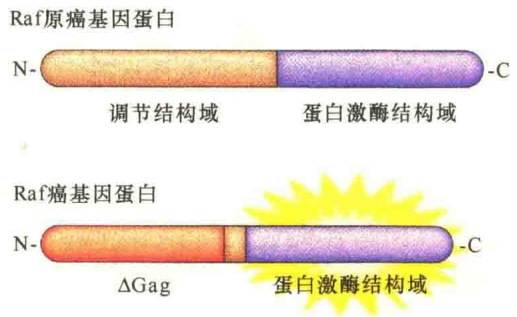

图 15-34 Raf 原癌蛋白（引自 Cooper and Hausman，2016）。

表 15-6 列出了人体常见的癌基因与诱发的肿瘤。

## 15.3.2.5 肿瘤抑制基因与功能失去突变

一般情况下，肿瘤抑制基因编码的蛋白质以不同的方式抑制细胞增殖。这类基因突变，失去了其

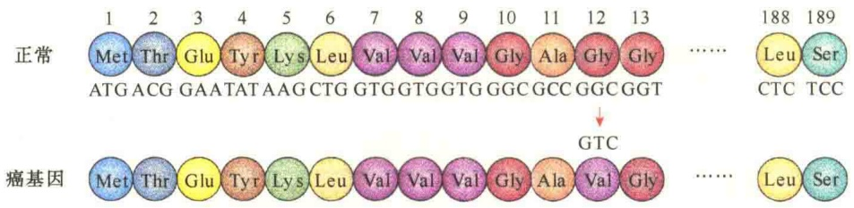

图 15-35 ras 原癌基因的点突变（引自 Cooper and Hausman，2016）。

对肿瘤发育的“抑制”功能。涉及功能失去突变导致细胞癌变的抑癌基因编码的蛋白质可分为以下5类:①调节或抑制细胞进入细胞周期的蛋白质（如p16及Rb蛋白）；②作为分泌激素或抑制细胞增殖的发育信号受体及转导蛋白（如TGF-β）；③细胞关卡控制蛋白，如监控DNA复制正确与否及DNA是否有损伤的p53蛋白；④促进凋亡的蛋白质；⑤参与DNA修复的酶类。

表 15-6 人体常见的癌基因与肿瘤

| 癌基因 | 激活机制 | 肿瘤 |
| --- | --- | --- |
| abl | 易位 | 慢性髓样白血病,急性淋巴细胞白血病 |
| bcl-2 | 易位 | 卵泡B细胞淋巴瘤 |
| CCND1 | 易位 | 甲状腺腺瘤,B细胞淋巴瘤 |
| CCND1 | 扩增 | 鳞状细胞、膀胱、乳腺、食管、肝及肺癌 |
| Cdk4 | 点突变 | 黑素瘤 |
| CTNNB1 | 点突变 | 结肠癌 |
| eRbB | 扩增 | 星形细胞瘤,多种其他类型瘤 |
| eRbB | 点突变 | 肺癌 |
| eRb-2 | 扩增 | 乳腺癌、卵巢癌 |
| c-myc | 易位 | 伯基特淋巴瘤 |
| L-myc | 扩增 | 肺癌 |
| N-myc | 扩增 | 成神经细胞瘤、肺癌 |
| PDGFR | 易位 | 慢性骨髓单核白血病 |
| PDGFR | 点突变 | 胃肠基质瘤 |
| PI3K | 点突变 | 乳腺癌、卵巢癌、胃癌、肺癌 |
| B-raf | 点突变 | 黑素瘤、结肠癌 |
| rasH | 点突变 | 甲状腺腺瘤 |

续表

| 癌基因 | 激活机制 | 肿瘤 |
| --- | --- | --- |
| rasK | 点突变 | 结肠、肺、胰腺及甲状腺癌 |
| rasN | 点突变 | 急性髓样淋巴细胞白血病、甲状腺腺瘤 |

目前推测人的基因组织中大约有 20 多种肿瘤抑制基因。表 15-7 列出了部分肿瘤抑制基因及突变后引发的肿瘤。

表 15-7 肿瘤抑制基因的功能及突变后引起的肿瘤

| 基因 | 突变后引发的癌变 |
| --- | --- |
| APC | 结肠/直肠癌 |
| BRCA1 | 乳腺癌与卵巢癌 |
| BRCA2 | 乳腺癌 |
| INK4 | 黑素瘤、肺癌、脑瘤、白血病、淋巴癌 |
| p53 | 脑瘤;乳腺癌、结肠/直肠癌、食道癌、肝癌、肺癌;肉瘤、淋巴瘤 |
| PTCH | 基底细胞瘤 |
| PTEN | 脑瘤,黑素瘤,前列腺癌、内皮癌、肾癌及肺癌 |
| Rb | 成视网膜细胞瘤,肉瘤,膀胱、乳腺与肺癌 |
| Smad2 | 结肠/直肠瘤 |
| Smad4 | 结肠/直肠瘤,胰腺瘤 |

1）Rb 基因 Rb 基因是世界上第一个被克隆和完成全序列测定的肿瘤抑制基因，为成视网膜细胞瘤易感基因。Rb 基因转录产物约 4.7kb，表达产物为 928 个氨基酸组成的蛋白质，分子质量约 105kDa，称为 P105-Rb。Rb 蛋白分布于核内，是一类 DNA 结合蛋白。

Rb 基因与癌的关系有两种情况:一种是遗传性的（hereditary），或称家族性（familial），即某些家族的儿童中高频率发生成视网膜细胞瘤；另一种是散发（sporadic）性的，即在无家族关系人群的较年长者中零散发生。成视网膜细胞瘤发生的家族性表明该病是可遗传的。从成视网膜细胞瘤儿童的细胞中进行的遗传分析，发现患者 13 号染色体有一小段缺失（图 15-36），并且这种缺失不仅是肿瘤细胞，而且在身体其他所有组织中都是缺失的，这表明该缺失是遗传下来的。

图 15-36 在成视网膜细胞瘤中 Rb 基因的缺失（引自 Cooper and Hausman, 2016）。

遗传性视网膜瘤儿童的 $Rb$ 基因的两个拷贝中有一个是正常的，一个 $Rb$ 基因拷贝有缺失突变，这种儿童会在生命的早期患视网膜瘤，而且是两只眼睛都会发生。携带有遗传性 $Rb$ 突变的儿童发生视网膜细胞病变必须在另一个 $Rb$ 基因拷贝也发生突变导致功能丧失之后（图15-37A），因为只有$Rb$ 基因的两个拷贝都失活，才会引起病变。对于非遗传的视网膜瘤患者而言，由于遗传的一对 $Rb$ 基因是正常的，所以需要经过两次独立的自发突变（图15-37B），才会发生视网膜细胞癌变，这种概率要小得多，即使发生，也是在年龄很大以后，并且通常只会影响一只眼睛。

2）p53 基因 p53 基因是迄今发现与人类肿瘤相关性最高的基因，该基因编码一种分子质量为 53kDa 的蛋白质，命名为 p53。

p53 蛋白有两类功能，一是调节细胞周期的进程，其目的是维护基因组的稳定；二是调节细胞凋亡，目的是防止细胞癌变。因此，p53 基因既是基因组维护基因，也是肿瘤抑制基因。

p53 蛋白主要集中于核仁区，能与 DNA 特异结合，其活性亦受磷酸化调控。p53 蛋白在 S 期磷酸化，其抑制细胞分裂的活性消失。正常 p53 蛋白的生物功能好似“基因组卫士”（guardian of the genome），在  $G_{1}$  期检查 DNA 损伤点，监测细胞基因组的完整性。如有损伤，p53 蛋白阻止 DNA 复制，以提供足够的时间使损伤 DNA 修复；如果修复失败，p53 蛋白则引发细胞程序性死亡阻止具有基因损伤、可能诱发癌变的细胞产生；如果 p53 基因的两个拷贝都发生了突变，对细胞的增殖失去控制，导致细胞癌变（图 15-38）。

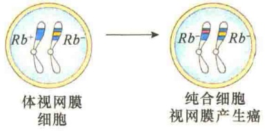

B. 随机性成视网膜细胞瘤

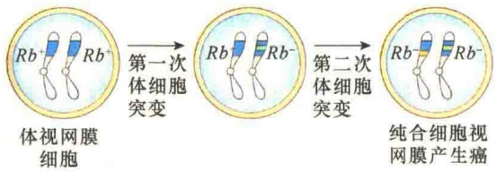

图 15-37 自发的体细胞突变对成视网膜细胞瘤的作用（引自 Lodish et al., 2013）。成视网膜细胞瘤是由一对等位基因 Rb 决定的。A. 在家族性成视网膜细胞瘤患者中，他们出生时就携带了一个突变的 Rb 基因拷贝，后经自发突变，使两个 Rb 基因都成为突变的形式，这样很快发展为成视网膜细胞瘤。B. 非遗传的视网膜瘤需要经过两次独立的自发突变，才会发生视网膜细胞癌变，这种概率很小。

图 15-38 p53 蛋白的作用（引自 Cooper and Hausman, 2016）。p53 蛋白既能调控 DNA 损伤的细胞进入细胞周期，又能在 DNA 损伤的诱导下，启动凋亡蛋白 Bcl2 家族成员 PUMA 及 Noxad 表达诱导细胞凋亡。MDM2 是癌基因蛋白，是一种泛素连接酶，能够将 p53 蛋白泛素化后降解。

在健康的  $G_{1}$  细胞中，p53 蛋白的浓度很低，如果  $G_{1}$  细胞受到遗传损伤（如受到紫外光照射或化学致癌物的作用），p53 蛋白的浓度会快速上升。将含有断裂链的 DNA 注入细胞，可检测到 p53 蛋白浓度的这种变化。研究表明，p53 蛋白的浓度变化不是由于 p53 基因表达的提高，而是由于 p53 蛋白降解速度的下降（即稳定性提高）。p53 蛋白的降解受 MDM2 蛋白的调控，该蛋白质与 p53 蛋白结合，并将 p53 蛋白由细胞核输出到细胞质，并经泛素化途径被降解。在 DNA 损伤关卡途径中，p53 蛋白要被磷酸化，p53 蛋白被磷酸化之后不再与 MDM2 蛋白结合，也就不会被运送到细胞质中被降解，因此 DNA 损伤后细胞核中 p53 的浓度升高，从而激活 p21 基因和 BAX 基因的表达，使细胞停止分裂或使细胞进入程序性死亡。如果 p53 基因突变，等于失去了分子警察，DNA 损伤引起的突变失去监控，就会导致细胞癌变。

表观遗传学的改变是导致肿瘤抑制基因永久失活的另一类重要方式。可以通过 DNA 甲基化，以及改变组蛋白修饰酶（histone modifying enzyme）或染色质重塑复合物的活性等将肿瘤抑制基因沉默。这些表观遗传学的改变导致肿瘤抑制基因不可逆的失活。

DNA 甲基化发生在 CpG 岛的胞嘧啶中，它们主要存在于基因的启动子中。这些胞嘧啶的甲基化会导致启动子的抑制。大部分结直肠癌的特征是 DNA 超甲基化（hypermethylation）。DNA 低甲基化（hypormethylation）也是癌症的标志。许多与癌症有关的基因的启动子被低甲基化，引起它们所控制基因的表达增加。例如，25% 的急性髓样细胞白血病的特征是 DNA 低甲基化，这是由于催化 CpG 二核苷酸甲基化的酶失活突变所致。最近发现的与 DNA 甲基化有关的 DNA 修饰包括在 CpG 岛上 5-甲基胞嘧啶转化为羟基化的变体（5-羟基甲基胞嘧啶）。这种 DNA 修饰也与癌症有关。催化这些转化的酶是 DNA 羟化酶家族的成员。这些酶需要 α-酮戊二酸作为辅

犹他大学的研究者发现大象身上细胞数量是人类的100倍，但大象的癌症致死率低于5%，而人类的癌症致死率则为25%。通过对大象的DNA分析，发现一些大象身上至少有40个p53基因拷贝，相比之下，人类只有两个p53基因拷贝。由此可见p53基因对癌的抑制作用有多大。

## 15.3.2.6 肿瘤抑制基因失活的机制

有多种方式使肿瘤抑制基因失活，包括基因突变与表观遗传（epigenetic）。在基因突变中，通过基因突变使肿瘤抑制基因失活的方式也有多种，以Rb基因为例，有多达6种可能的方式使正常的Rb基因失活（图15-39）。

图 15-39 肿瘤抑制基因功能丧失突变的6种可能的方式（引自Alberts et al., 2015）。一个表型正常但含有失活Rb基因拷贝的缺陷细胞可通过6种可能的遗传方式将正常Rb基因拷贝失活:①不分离引起正常拷贝的染色体丢失；②丢失染色体后，含突变基因的染色体加倍；③通过有丝分裂重组；④有丝分裂重组期间发生基因转换，是正常基因拷贝转换成突变的基因拷贝；⑤正常基因拷贝缺失；⑥正常基因拷贝发生点突变。

助因子，并受到环烷二酸2-羟戊二酸的抑制。编码染色质修饰蛋白及调节蛋白基因也与肿瘤发生有关。多种类型的肿瘤全基因组测序显示，大约40个编码表观遗传调节蛋白的基因突变的频率较高。在多种肿瘤中还发现了编码组蛋白甲基转移酶、组蛋白去甲基化酶和组蛋白乙酰基转移酶的基因突变。

在与癌症相关的染色质重塑因子中，主要是SWI/SNF复合物。这种大的、由多种蛋白组成的复合物的核心区有一个ATP依赖的螺旋酶，该酶调控组蛋白的修饰与染色质重塑。例如，SWI/SNF复合物可以改变核小体的位置与结构，决定调控转录的DNA结合蛋白能否与相关基因结合。如果一个被SWI/SNF复合物介导的染色质重塑而正常激活或是被抑制的靶基因，若编码SWI或SNF蛋白的基因发生了突变将会引起靶基因表达的改变。通过转基因鼠的研究表明，SWI/SNF复合物抑制E2F基因的表达，从而抑制了细胞周期的进程。因此，SWI/SNF功能的丢失，如同Rb功能的丢失，导致细胞的过快生长，甚至癌变。事实上，在老鼠体内，Rb蛋白招募SWI/SNF蛋白抑制编码E2F蛋白的基因转录。在人类和老鼠的研究中获得的证据也有力地证明SNF5基因与癌症有关。SNF5蛋白是SNF复合物的核心成分。在人类中，SNF5基因突变会导致肾脏内形成最常见的横纹肌样肿瘤，此外，也有可能在脑及其他组织形成肿瘤，并且具有家族遗传倾向。研究还发现，编码各种不同BAF蛋白（也是SNF复合物的亚基）的基因在 $40\%$ 的肾癌、$50\%$ 的卵巢癌中发生了突变；此外，在肝癌和膀胱癌中，BAF蛋白变异的比例也很高。总之，表观遗传失调已成为肿瘤发生的重要原因。

## 15.3.3 癌的预防与治疗

对癌的防治主要在三个水平:预防、诊断与治疗。预防是第一位的，防重于治。事实证明，有些癌是可以预防的。尤其是戒烟对癌的预防是非常重要的。高度敏感的分子分析方法，有利于精确进行早期诊断，诊断越早，越有利于手术及放射治疗，因为发现早，肿瘤小，更重要的是早期的肿瘤没有转移与扩散。

## 15.3.3.1 致癌剂

能够引起细胞癌变的物质称为致癌剂（carcinogen）。引起癌细胞发生的原因很多，大致分为4种类型:化学因素、辐射、病毒和遗传。化学因素主要是各种化学致癌物；物理因素主要是紫外光等的辐射作用；病毒和遗传则是指病毒癌基因和细胞癌基因。

英国伦敦医生 Hill 在 1761 年首次提出化学致癌观点。1775 年，另一位英国外科医生 Pott 获得环境因子与癌发生的相关证据。他发现一些男性烟囱清洁工人的鼻腔和阴囊皮肤等是癌的高发部位，原因是过度与煤烟接触有关。在过去几十年内，经动物实验，已经从煤烟中分离出几百种致癌化学物质。后来发现煤炭工业、印染工业中的某些化学物质也具有致癌性。

由于人类生活在一个十分复杂的环境中，而且所接触到的各种致癌物随着工业的发展而发生不断的变化，所以很难确切地得出癌与致癌物的关系。由于个人的生理和心理素质不同、生活习性不同，对癌的易感性也是不同的。

人类在自然环境中受到的辐射主要来自太阳的紫外线、外层空间的宇宙射线（cosmic ray）以及自然发生的放射性元素的放射性（emission）。另外，还受到来自医疗、工业和军事活动中人为产生的高能辐射，这些辐射主要是X射线和放射性元素的辐射。阳光致癌作用主要通过对热带地区长时间在太阳下工作的人们的观察推测的，因为他们皮肤癌的发病率相当高，并且只有那些暴露于阳光的部位易感皮肤癌。遮盖身体部位或用可吸收紫外辐射防护剂进行保护都会降低皮肤癌的诱发。

由于 X 射线具有较强的穿透力，可以穿透皮肤到达内部器官，所以致癌能力远较紫外线强。1895 年，Roentgen 发现受这种辐射的人，其癌的易感性大大增加，后来通过动物实验证实了 X 射线对癌的诱发。但是在临床上，X 射线对某些疾病的治疗效果远大于对癌的诱发。不过 X 射线治疗带来的副作用是肯定的，如某些国家，在临床上采用 X 射线处理头和颈部浅表皮肤癣、粉刺，其甲状腺癌的发病率比其他国家高。因此在利用 X 射线作为治疗手段时一定要权衡利弊。

一些放射性元素的辐射对癌的诱发效应同X射线相类似。第一位从事放射性研究的科学家居里夫人发现了放射性元素镭，她后来死于白血病，这显然与她过度与放射性接触相关。

虽然致癌的因素很多，但是烟草中的烟却是当今世界上最重要的致癌剂，它诱发的癌症死亡率超过任何其他的致癌因素（表 15-8）。

表 15-8 环境与生活方式对癌发生的影响

| 诱因 | 占癌症的比例/% | 死亡人数/年 |
| --- | --- | --- |
| 吸烟 | 33 | 189 000 |
| 饮食、超重、肥胖 | 25 | 143 000 |
| 缺少运动 | 5 | 28 600 |
| 病毒 | 5 | 28 600 |
| 酒精 | 3 | 17 200 |
| 紫外线及离子辐射 | 2 | 11 400 |
| 机遇性致癌剂 | 5 | 28 000 |

注:表中是美国2012年的数据，引自Colditz et al., 2012。

## 15.3.3.2 致癌剂的致突变作用

关于化学致癌物和辐射等因素对癌的诱发机制目前尚不清楚，通过对一些特别致癌物的分析，发现与 DNA 突变有关。

图 15-40 是几种致癌物对 DNA 的诱变作用。在亚洲，一些储藏在潮湿条件下的坚果、谷类容易长黄曲霉，这些真菌产生的黄曲霉毒素 B（aflatoxin B）是肝癌的主要诱因。其机制是黄曲霉毒 B 能够引起肿瘤抑制基因 p53 的第 249 位密码中的碱基置换，即 G→T，因此在普查中可作为肝癌检测的一种指标。虽然毋庸置疑，食物和环境中的诱变剂是致癌的因素，但大多数致癌的突变主要来自正常代谢过程中的 DNA 损伤。

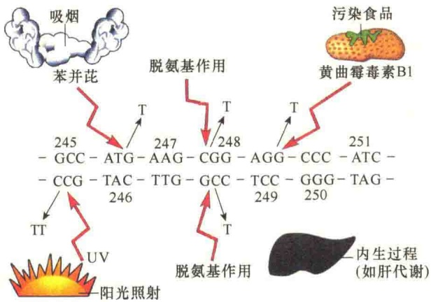

图 15-40 某些理化因子的致癌作用（引自 Karp，1996）。图中随机挑选了 p53 基因中 7 个密码子。这些密码子在人的癌症患者中有 50% 会发生缺失或突变。图中显示了几种不同致癌物，包括苯并芘（benzopyrene）（它是在香烟的烟雾中发现的）、黄曲霉毒素 B1、阳光中的紫外线等作用于该序列引起突变的机制。每一种致癌物都引起一种不同的碱基置换。图中也显示了由于内源代谢引起的脱氨作用，也会导致 C→T 突变。

实际上，直接作用于 DNA 的致癌剂很少，并且在化学上是相当惰性的。只有当它们在肝组织中，经过 P450 氧化酶代谢处理转变成更具反应性的分子后才能对 DNA 具有伤害性。P450 氧化酶在正常情况下，是将毒性物质转变成无害的物质。不幸的是，它们对某些化学分子的作用是高度致突变的，通过这种方式被激活的致癌剂包括苯并芘，这是一种存在于煤焦油、烟及黄曲霉素 B1 中的致癌剂。

目前已知的致癌因子都不具特异性。但是由真菌产生的黄曲霉素 B1 是最具威胁的、具有一定特异性的致癌剂。黄曲霉毒素 B1 是由真菌产生的，在自然条件下污染热带坚果，包括花生、玉米、稻谷、小麦、花生油等粮油食品，且以南方高温、高湿地区受污染最为严重。黄曲霉毒素 B1 的代谢主要发生在肝脏，它在细胞色素 P450 混合功能氧化酶的作用下转化成黄曲霉毒素 M1、黄曲霉毒素 M2、黄曲霉毒素 P1、黄曲霉毒素 Q1、黄曲霉毒素 B2α、黄曲霉毒素醇等物质，是非洲人及亚洲人患肝癌的重要原因。

## 15.3.3.3 癌症治疗

在我国，癌症已经成为疾病死因之首。数据显示，我国男性5种最常见肿瘤依次为肺癌、胃癌、食管癌、肝癌和结直肠癌，加起来占所有癌症病例的2/3；女性最常见肿瘤依次为乳腺癌、肺癌、胃癌、结直肠癌和食管癌，占所有癌症病例的60%，其中，乳腺癌占所有女性癌的 15%。男性和女性肺癌、胃癌、肝癌、食管癌和结直肠癌 5 种最常见癌死亡病例占所有癌死亡病例的 3/4。

随着科学的发展，治疗的方法与药物也越来越多。例如，化学疗法常常同时使用两种或两种以上的药物，称为“综合化学疗法”，大多数病患的化疗都是使用这样的方式进行。对早期或较早期实体肿瘤来说，手术切除仍然是首选的治疗方法。根据手术的目的不同，可分为根治性手术、姑息性手术、减瘤手术、探查性手术和预防性手术等。此外还有一些其他治疗方法，如①靶向治疗:如治疗EGFR敏感突变的非小细胞肺癌，疗效显著，但耐药基因的出现是目前阻碍进一步提高疗效的主要障碍。②免疫疗法:利用人体内的免疫机制来对抗肿瘤细胞，目前较有进展的就是癌症疫苗疗法和单克隆抗体疗法。③中医中药治疗:配合手术、放化疗可以减轻放化疗的毒副作用，促进患者恢复，增强对放化疗的耐受力。④基因治疗:通过外源基因导入人体以纠正基因缺陷的方法，最终达到直接或间接抑制或杀伤肿瘤细胞的目的。⑤内分泌治疗:如性激素可以用于乳腺癌、前列腺癌、子宫内膜癌的姑息治疗。

在癌症的治疗中，最重要的问题是如何研制对癌基因及肿瘤抑制基因特异的靶向药物。传统的癌治疗药物中的大多数都是针对损伤肿瘤 DNA 或是抑制肿瘤 DNA，其结果是，这些药物不仅对肿瘤细胞有害，而且对正常细胞也有害。抗癌药物的毒性限制了在临床上的使用。

一种有效抑制肿瘤而不会对其他细胞产生毒性的方法是干扰血管生成而不是直接作用于癌细胞。对于肿瘤细胞而言，需要通过建立新的血管获得氧与营养以供肿瘤细胞生长的需要。因此，对于肿瘤的发育而言，血管的生成至关重要。通过动物及临床试验，证明血管生成抑制剂对人类癌的发育具有很好的抑制作用。2004年美国食品药品监督管理局（FDA）批准了第一个用于抗癌的血管生成抑制剂:一种用于治疗结肠癌的VEGF的单克隆抗体。这种单克隆抗体现在也用于成（神经）胶质细胞瘤、肾癌及肺癌的治疗。

靶向治疗是在细胞分子水平上针对已经明确的致癌位点（该位点可以是肿瘤细胞内部的一个蛋白质分子，也可以是一个基因片段），来设计相应的治疗药物，药物进入体内会特异地选择致癌位点发生作用，使肿瘤细胞特异性死亡，而不会波及肿瘤周围的正常组织细胞，所以分子靶向治疗又被称为“生物导弹”。靶向药物的研制是今后癌治疗的重要发展方向。

## 15.3.3.4 癌症的负性免疫调节治疗

2018年诺贝尔生理学或医学奖授予两位免疫学家——美国的James P. Allison与日本的本庶佑（Tasuku Honjo），以表彰他们“发现负性免疫调节治疗癌症的疗法”方面的贡献。

机体免疫系统的根本特性是识别“自身”（self）与“异己”（non-self），以保证及时攻击和清除入侵的外来细菌、病毒和其他威胁。T细胞在机体免疫防御中起着十分关键的作用。T细胞能够发现异常信号，是因为它表面有一种名为CD28的受体分子，一旦与被识别为“异己”的分子结合，即会触发免疫系统进行防御。此外，T细胞上还有其他一些蛋白质充当了T细胞的“加速器”（accelerator），它们也是触发完全免疫反应（full-blown immune response）所必需。但是在被激活的T细胞表面还有一个与CD28结构十分相似的蛋白质——细胞毒性T淋巴细胞相关抗原（CTLA-4），它起抑制T淋巴细胞的免疫作用。也就是说，免疫系统能够自己控制自己，一方面是避免过于强烈的免疫反应把自己搞“垮”了；另一方面是在感染的后期机体进入一种免疫抑制的状态，所以CTLA-4蛋白是T淋巴细胞后期产生的、给T淋巴细胞踩“刹车”的，本是免疫细胞自我调整的过程，却被肿瘤细胞利用了。因为肿瘤细胞表面也有类似的“刹车”分子，它与T淋巴细胞的CD28作用，从而逃脱了T淋巴细胞的免疫作用。

CTLA-4 是细胞毒性 T 淋巴细胞相关抗原 4（cytotoxic T lymphocyte antigen-4）的缩写，又名 CD152，于 1987 年被法国科学家发现。随后，多位科学家的研究工作提示，这个在结构上与 CD28 类似的分子却执行着一种截然相反的功能:如果把 CD28 比作为 T 细胞活化的“油门”，CTLA-4 则起“刹车”作用，以防止 T 细胞的过度活化。与其他研究人员将这一机制作为自体免疫疾病治疗标靶不同，美国的 Allison 提出了免疫检查点（immune checkpoint）的概念，设想，如果“阻击” CTLA-4，那么 T 细胞受到的束缚是否会被解除，进而全力对抗肿瘤细胞呢？1996 年，Allison 首次证明抗体阻断 T 细胞抑制分子（CTLA-4）可增强抗肿瘤免疫反应并清除肿瘤，并逐步发展成可应用于人体的新疗法。

1992 年，本庶佑在 T 细胞表面发现了 PD-1 蛋白。起初本庶佑推测它与细胞凋亡相关，因此用 programmed cell death（程序性细胞死亡）的首字母将其命名为 PD-1。接下来的近十年时间，本庶佑在京都大学的实验室精心设计了一系列巧妙的实验，揭示了 PD-1 也是 T 细胞“刹车”蛋白，但是与

CTLA-4 的作用机制不同。在 2012 年进行的一项临床试验中，基于抑制 PD-1 的新方法被用于不同类型癌症病患的治疗，效果非常好。T 细胞 “刹车” 蛋白 CTLA-4 和 PD-1 抗肿瘤机制总结于图 15-41。

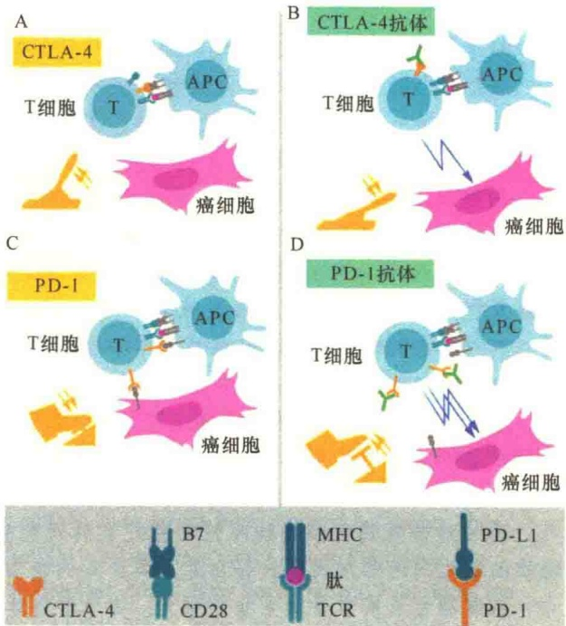

图 15-41 CTLA-4 和 PD-1 的免疫抑制作用及相应抗体的刹车效应。A. T 细胞激活需要双信号:一是 T 细胞受体（TCR）识别结合抗原呈递细胞（antigen-presenting cell，APC）表面的 MHC-抗原肽复合物；二是 T 细胞表面 CD28 与 APC 表面 B7 分子结合的共刺激信号；而 CTLA-4 则作为“刹车”与 B7 结合抑制 T 细胞的活化。B. 抗 CTLA-4 抗体（绿色）可阻断“刹车”功能，导致 T 细胞激活，攻击癌细胞。C. PD-1 是另一种抑制 T 细胞活化的“刹车”分子。D. 抗 PD-1 抗体可阻断“刹车”功能，导致 T 细胞激活，高效攻击癌细胞。

在负性免疫调节治疗癌症的方法中还有一个重要的蛋白质——PD-L1（programmed cell death ligand 1），即程序性细胞死亡-配体，也称为表面抗原分化簇274（cluster of differentiation 274，CD274）。2000年和2001年，本庶佑与Gordon Freeman合作发现了PD-1的两个配体PD-L1和PD-L2，其中PD-L1就是美籍华人科学家陈列平于1999年发现的B7-H1。陈列平教授发现了B7-H1，并证明B7-H1可以抑制T细胞免疫反应。2002年，陈列平证实肿瘤细胞表面的PD-L1可以保护肿瘤细胞逃避免疫攻击，而这一肿瘤免疫逃逸作用可被PD-L1抗体逆转。2006年，陈列平首次将抗PD-1/PD-L1抗体药物引入肿瘤治疗，在美国开始了I期临床试验，抗癌效果明显。

每年2月4日是世界抗癌日，2017年的抗癌主题为 “我们能，我能战胜癌症”。对于癌症的正确态度应一是重视，二是战胜。其实，癌症并没有人们想象的那么可怕，并不是不治之症。它与心脑血管病一样，也是种慢性病，只要能够做到早发现、早诊断、早治疗，1/3可以预防；1/3可以治愈；还有1/3则可以通过改善症状减轻痛苦，有尊严地活着。

## 本章小结

衰老是机体在退化时期生理功能下降和紊乱的综合表现，是不可逆的生命过程。细胞衰老是客观存在的，同新陈代谢一样，细胞衰老是细胞生命活动的客观规律。

细胞具有一定的寿命，可分为三类:①接近于动物的整体寿命；②缓慢更新的细胞，其寿命比机体的寿命短；③快速更新的细胞。

细胞衰老过程是细胞生理与生化反应发生变化的过程，主要表现是细胞对环境变化适应能力和维持细胞内环境恒定能力的降低。细胞衰老有9个基本特征，包括:DNA复制发生错误、基因表达出错、染色体端粒缩短、蛋白质退化失能、衰老细胞“拒绝死亡”、线粒体功能失调、新陈代谢失调、组织停止修复和更新、细胞之间无法交流等。

有关衰老的学说很多，包括遗传程序说、体细胞突变论、端粒缩短论、自由基理论等。

细胞死亡有两种形式，一种为坏死性死亡，是由外部化学、物理或生物因素的侵袭而造成的细胞崩溃裂解；另一种为程序性细胞死亡或细胞凋亡，是细胞在一定的生理或病理条件下按照自身的程序结束其生存。

细胞凋亡与细胞坏死有三个根本的区别:①引起死亡的原因不同；②死亡的过程不同；③细胞坏死常引起炎症反应，而细胞凋亡则不会引起炎症。

通过对秀丽隐杆线虫程序性细胞死亡的研究揭示细胞凋亡是由一系列的基因控制的，并发现所有的动物细胞的凋亡都涉及胱天蛋白酶及其介导的蛋白酶解级联系统。死亡的诱因有内部因素及外部因素。

细胞凋亡具有重要的生物学意义:参与形态建成、调节细胞的数量和质量。

癌细胞是一种突变的体细胞，这种突变体脱离了细胞社会关于增殖和存活的控制，因此可以无限增殖产生肿瘤。引起细胞癌变的因素很多，包括化学、辐射、病毒和遗传等。

从遗传上看，癌的发生主要涉及两类基因:原癌基因与肿瘤抑制基因。原癌基因发生功能获得突变及肿瘤抑制基因发生功能失去突变都会导致癌变。癌症并不是不治之症，关键是早发现、早诊断、早治疗，做到防治结合。

## 思考题

（1）细胞衰老有哪些基本特征？

（2）什么是程序性细胞死亡？包括哪些过程？

（3）什么是胱天蛋白酶？起始者胱天蛋白酶是如何激活的？

（4）何谓致癌基因？如何分类？

(5) $Rb$ 基因是人类抑癌基因的一个典型例子。当该基因的两个拷贝都发生突变时, 癌症就会发生。如果肿瘤抑制基因 (如 $Rb$) 能在人类所有细胞中都以高水平表达, 你认为癌症能被根除吗? 解释你的答案。