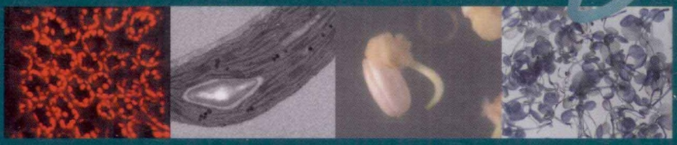

EXPERIMENT OF CELL BIOLOGY

# 细胞生物学实验教程

(第二版)

王金发 何炎明 刘兵 主编

# 细胞生物学 实验教程（第二版）

Experiment Of Cell Biology

高等教育出版中心

电话:010-64030233

http://www.sciencep.com

e-mail: bio@mail.sciencep.com

销售分类建议:生物学/实验教材

www.sciencep.com

ISBN 978-7-03-030163-5

定价:30.00元

# 国家精品课程配套立体化教材

# 细胞生物学实验教程

(第二版)

王金发 何炎明 刘兵 主编

科学出版社

北京

## 内容简介

本书是王金发教授主持编写的《细胞生物学》配套实验教材，是在2004年出版的《细胞生物学实验教程》基础上重新修订的。全书包括12章共71个实验，内容既保留了目前在细胞生物学研究领域中经常用到的经典实验，又新增了不少与现代细胞生物学和分子生物学相关的新技术，包括:线粒体膜电位检测，抗性膜和胆固醇去除，细胞电泳技术，DNA、RNA和蛋白质的原位杂交，差异基因表达，酵母中cDNA的表达，细胞凋亡检测，果蝇胚胎的共聚焦显微技术等。

本书可供综合性大学及农林、医学、师范院校本科生和研究生细胞生物学实验课教学使用，也可作为从事相关专业研究人员的参考用书。

图书在版编目(CIP)数据

细胞生物学实验教程/王金发,何炎明,刘兵主编.—2版.--北京:科学出版社,2011

(国家精品课程配套立体化教材)

ISBN 978-7-03-030163-5

I. ①细… II. ①王…②何…③刘… III. ①细胞生物学-实验-高等学校-教材 IV. ①Q2-33

中国版本图书馆 CIP 数据核字(2011)第 061170 号

责任编辑:单冉东 / 责任校对:李影

责任印制:张克忠 / 封面设计:耕者设计工作室

科学出版社出版

北京东黄城根北街16号

邮政编码:100717

http://www.sciencep.com

化学工业出版社印刷厂 印刷

科学出版社发行 各地新华书店经销

2004年1月第一版 开本:787×1092 1/16

2011年2月第二版 印张:163/4

2011年2月第十次印刷 字数:390000

印数:38 001-44 000

定价:30.00元

(如有印装质量问题,我社负责调换)