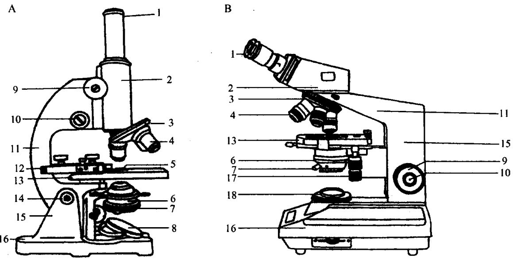

## 第一章 光学显微镜技术

显微镜是在人们认识到凸透镜放大作用的基础上发明的。据历史记载，12世纪阿拉伯人阿尔海琴（Anlagen）已会磨制透镜。1604年荷兰眼镜商詹森（Janssen）创造了第一台放大率不超过10倍的复式显微镜。半个多世纪后，英国物理学家胡克创制了第一架具有科学研究价值的显微镜，首次观察了木栓的显微图像，他发现并命名了细胞（cell）。真正观察到活细胞的是荷兰科学家列文虎克，他用自制的显微镜观察到了池塘水中的原生动物，还有人和哺乳类动物的精子、细菌等。可以说没有显微镜的发明就没有细胞的发现。

随着现代科学技术的发展，显微镜的种类越来越多，性能更加完善，使用范围也越来越广泛，不仅可以用来观察细胞形态和内部结构，而且还可以通过与其他技术的结合，进行细胞化学成分的定位、定性、定量，以及物质代谢、细胞生理、免疫和遗传等功能方面的研究，是细胞生物学研究中用途最广的仪器之一，没有它也就无法打开生物界的微观大门。因此了解各种普通光学显微镜及其结构原理和操作方法具有重要的作用和意义。本章将介绍常用的普通光学显微镜和特殊显微镜的结构、原理、应用以及显微摄影技术。

## 实验 1 普通光学显微镜的构造原理及使用方法 【实验目的】

(1) 熟悉普通光学显微镜的主要结构和基本性能。

（2）掌握低倍镜、高倍镜和油镜的正确使用方法。

（3）初步了解光学显微镜的维护方法。

## 【实验原理】

普通光学显微镜（microscope）是最常用的一种光学显微镜。它利用光线照明，标本中各点依其光吸收（光的振幅发生变化）的不同而在明亮的背景中成像。它由物镜、目镜、聚光器、光源、载物台和支架等部件组成。其中，聚光镜用于调节显微镜的照明，物镜和目镜是放大微小物体成像的主要部件。其基本成像原理是:目镜、物镜、聚光器各自相当于一个凸透镜，被检标本置于聚光器与物镜之间，物镜可使标本在物镜的上方形成一个倒立的放大实像（倒像）。目镜将此倒像进一步放大成像于人眼的视网膜上，形成一个正立的实像（正像）。显微镜中放大的倒立的虚像与视网膜上正立的实像是相吻合的，该虚像看起来好像在离眼睛250mm处（图1-1）。

图1-1 光学显微镜的放大原理及光路图

## 【实验仪器、材料和试剂】

普通光学显微镜、擦镜纸、动植物组织细胞装片、香柏油、二甲苯擦镜水。
【实验内容与方法】

## （一）普通光学显微镜的基本构造

普通光学显微镜主要由三部分组成:机械部分、照明部分和光学部分（图1-2）。1. 机械部分

（1）镜座（base）:是显微镜的基座，起稳定和支持整个镜身的作用。有的显微镜在镜座内装有照明光源等构造。

(2) 镜柱（pillar）:连接镜座和镜臂的短柱。

（3）镜臂（arm）:是支持镜筒和镜台的在镜柱上方弯曲的部分，拿镜时手握此臂，方便搬动。镜筒直立式显微镜在镜臂和镜柱之间有一可活动的关节称为倾斜关节，可使镜臂做适当倾斜，便于观察。使用时倾斜度一般不应超过 $45^{\circ}$，否则光镜重心偏移而容易翻倒。镜筒倾斜式显微镜由于镜臂和镜柱连为一体，故无此关节。

（4）镜筒（light tube）:位于镜臂前方的圆筒状结构，上端安装目镜，下端与物镜转换器相连。根据镜筒的数目，光镜可分为单目和双目两类（图1-2），单目又分直立式和倾斜式两种，而双目的镜筒均为倾斜的。

图1-2 普通光学显微镜的结构示意图（高文和等，2001）

A. 单目显微镜；B. 双目显微镜

移动器螺旋；18. 灯室

（5）物镜转换器（revolving nosepiece）:圆盘状，在镜筒下方，其上装有3或4个放大倍数不同的物镜，可以按顺时针或逆时针方向自由旋转。转换器的内缘有一“T”形卡，用于对准和固定物镜位置，转动旋转盘可使不同的物镜到达工作位置，使物镜和光轴同心（合轴）。

(6) 载物台（stage）:又称平台，位于镜筒的下方，方形或圆形，放置玻片标本用。载物台的中央有一圆形通光孔，两旁各有一压片夹。有的载物台上装有标本移动器，移动器上装有弹簧夹，用于固定标本片。移动器的一侧有两个旋钮，转动旋钮可使玻片前后左右移动，以方便寻找观察目标。在移动器上还附有一纵横游标尺，用于计算标本移动的距离和确定标本的位置。

(7) 调节钮 (regulator): 位于镜臂的上端或下端, 有一对大小旋钮, 为调节焦距之用。大旋钮为粗调节钮, 转动粗调节钮可使镜筒 (或载物台) 升降, 调节焦距。旋转一周可使镜筒 (或载物台) 升降 $10 \mathrm{~mm}$, 一般用于低倍镜调焦。小旋钮为细调节钮, 转动细调节钮可使镜筒 (或载物台) 缓慢升降, 每旋转一周使镜筒 (或载物台) 升降约 $0.1 \mathrm{~mm}$, 适用于高倍镜、油镜或分辨物像清晰度调焦。

## 2. 照明部分

（1）反光镜（reflecting mirror）:位于载物台下方、镜柱前面的一个圆镜。镜的一面为平面，另一面为凹面。平面镜聚光力弱，适于强光源和平行光源。凹面镜聚光力强，适用于弱光源或散射光源。反光镜的方位可以随意调节。较新的双目光镜光源通常装在光镜的镜座内，通过按钮控制开关，镜座侧面有一滑动键或旋钮，可调节光线强弱。

(2) 聚光器（condensor）:在载物台下方，由一组透镜组成，可使反射光线聚集于

标本上。一般在镜柱一侧有一旋钮，可使聚光器升降，与物镜配合使用。

(3) 光圈（aperture）:在集光器下方，由一组活动金属片组成，构成一个可开可缩的孔。在其外侧有一小柄，可以调节控制光线通过。在光圈的下方常装有滤光片架，可以放置不同颜色的滤光片。

## 3. 光学部分

（1）目镜（eyepiece）:又称接目镜，短圆筒状，装在镜筒上端，在目镜的侧面刻有放大倍数，每台显微镜常备有3或4只放大倍数不同的目镜，如5×、10×、15×等，在使用时，可根据不同的需要选择倍数的大小，最常用的是10×目镜。通过目镜就能观察到被放大的物像。

(2) 物镜 (objective): 装在物镜转换器上的一组镜头, 一般有低倍镜、高倍镜、油镜三种。每个物镜上刻有相应的标记。低倍镜筒上刻有 $10 \times$ 或 $15 \times$ 等标志, 高倍镜筒上刻有 $40 \times$ 或 $45 \times$ 标志。油镜上一般为 $100 \times$ 。N.A. 表示镜口率, 镜口率反映镜头分辨力的大小, 其数字越大, 表示分辨力越高。各种物镜的性质见表 1-1。

表 1-1 标准物镜的性质比较

| 放大倍数 | 镜口率(N.A.) | 分辨率/μm | 工作距离/mm |
| --- | --- | --- | --- |
| 10 | 0.28 | 1.00 | 6.50 |
| 40 | 0.65 | 0.42 | 0.60 |
| 100 | 1.30 | 0.21 | 0.20 |

## （二）普通光学显微镜的性能和质量

普通光学显微镜的性能和质量的高低受分辨率、放大率、镜口率、焦点深度和视场宽度等的影响，这些指标都有一定限度，彼此间相互作用又相互制约，改善或提高某方面的性能，都会使另一性能降低。

## 1.分辨力

分辨力（resolving power）又称分辨率或分辨本领，指显微镜或人眼在25cm的明视距离处，能清楚地把两个被检细微物点分开的最小距离的能力。这两点之间的距离即为其分辨力，这个距离越近，其分辨率越高。据测定，人眼的分辨率约为100μm，而光学显微镜的分辨率可达0.2μm。显微镜的分辨率依下列公式来计算:

$$
R = 0. 6 1 \lambda / \mathrm{N.A.} (\mathrm{N.A.} = n \cdot \sin \theta)
$$

式中，R 为分辨力； $\lambda$  为照明光源的波长，白光约为  $0.5\mu m$ ；N. A. 为镜口率；n 为介质的折射率，n 的最大值为 1.5； $\sin\theta$  为透镜视锥半顶角的正弦。

## 2. 放大率

放大率是光学显微镜的另一个重要参数，光镜放大倍数的计算公式如下:

$$
\text {实物放大倍数} = \text {物镜放大倍数} \times \text {目镜放大倍数}
$$

光学显微镜常用的最大放大倍数一般为 1600 倍。物镜放大率是对一定镜筒长度而言的，镜筒长度变化后，不仅放大率随之变化，而且成像质量也受到影响。因此使用显