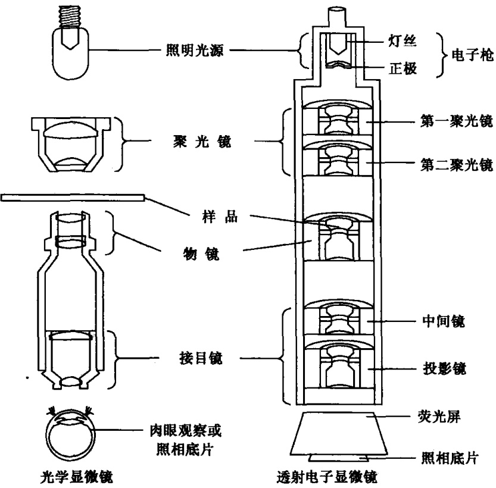
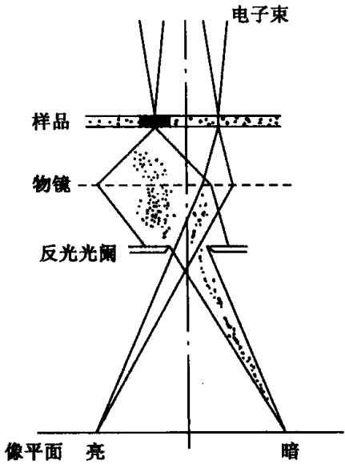

## 第二章 电子显微镜技术

电子显微镜（electron microscope，EM）技术是研究细胞亚显微结构的有力手段，也是细胞生物学学科建立的基础之一。

电子显微镜是以电子波作为光源，电磁场作透镜，利用电子散射过程产生的信号进行显微成像的大型仪器设备。由于电子束的波长比光的波长短100 000倍，因而用电子束代替光波，可大大提高显微镜的分辨率。因此电子显微镜的放大倍数要比光学显微镜的放大倍数高得多，它的放大倍数可达几十万倍，甚至达一百余万倍。所以利用电子显微镜技术，就可以观察到在光学显微镜下看不到的各种细胞器的微细结构。随着科学技术的发展，电子显微镜技术越来越先进，掌握好电镜技术，对细胞生物学的研究有非常重要的意义。

根据电镜的电子波照射样品的方式不同和利用电子散射信号的不同以及加速电压的不同，可以把它们分为各种类型。本章主要介绍在细胞生物学中常用的两种电子显微镜，透射电子显微镜（transmission electron microscope，TEM）和扫描电子显微镜（scanning electron microscope，SEM），使学生对这两种电子显微镜的基本结构、工作原理、仪器使用和生物样品制备技术方面获得初步的了解。

## 实验4 透射电子显微镜

## 【实验目的】

(1) 了解透射电子显微镜的主要结构、功能及基本工作原理。

(2) 了解透射电子显微镜的使用方法。

## 【实验原理】

透射电子显微镜是发明最早、应用最广泛的电子显微镜。在细胞生物学上，可用于观察和研究细胞内部的亚显微结构，蛋白质、核酸等生物大分子的形态结构及病毒的形态结构。

电子显微镜中的成像透镜是磁透镜，或称电子透镜。所谓磁透镜是指轴对称的磁场。在透射电子显微镜（透射电镜）中磁透镜的作用是使穿透样品的透射电子会聚成像。由于磁透镜和光学显微镜中的成像作用类似，透射电镜和光学显微镜在几何光学方面具有相似性，透射电镜与光学显微镜的基本结构，如图2-1所示。在透射电镜中，以电子枪作为照明光源，从电子枪灯丝发射的电子束经聚光镜会聚照射到样品上。带有样品结构信息的透射电子（transmission electron，TE）进入成像系统，被各级成像透镜聚焦、放大后，投射在观察荧光屏上，形成透射电子显微镜像。

图2-1 光学显微镜与透射电子显微镜（透射电镜）的结构比较

【实验仪器、材料和试剂】

(1) 仪器:透射电子显微镜。

(2) 材料:生物样品、铜网。

## 【方法与步骤】

## （一）透射电镜的结构

透射电镜的基本结构由电子光学系统（镜筒）、真空系统、供电系统三部分组成。电子光学系统由照明系统、样品室、成像系统、观察窗和记录用的照相机等组成。透射电镜的镜筒是由电子枪、6～8级电磁透镜（electron magnetic lens）及一些光路元件组成的密闭圆筒，可以控制电子束的形状和发射强度，是透射电镜的核心。电子枪发射电子波作为光源，而电磁透镜则能控制电子的轨道，因为电子是带电的，所以电磁透镜能够改变电子束的方向。在透射电镜中有5个电磁透镜，根据每个磁场的功能并沿用光镜的称谓习惯，自上而下依次称为:第一和第二聚光镜、物镜、中间镜（2或3级）和投影镜。样品置于末级聚光镜和物镜之间。观察室和照相室在投影镜下方。透射电镜有庞大的供电系统和真空系统，其中真空系统是用两种类型的真空泵串联起来，从而获得电镜镜筒中的真空，当电镜启动时，第一级旋转式真空泵获得低真空，第二级采用油扩散泵而获得高真空。

## （二）透射电镜的基本工作原理

一般生物样品的透射电镜图像，可以用“质量-厚度”（mass-thickness， $\rho t$ ）反差成像原理作简单描述（图 2-2）。电镜的镜筒内建立强加速场，生物样品常采用 60～100kV 的加速电压。电子枪阴极发射出的电子在加速场中获得速度和能量，足以透射过 50～70nm 厚的生物样品并使之成像。聚光镜使来自电子枪的电子束聚焦，并常以散焦的状态泛光式地照射在样品上。此时，入射电子束与样品原子之间相互作用发生一种物理现象——电子散射（electron scattering）。在电子散射过程中，大部分电子直接透过样品，称为直接透射电子（transmission electron, TE）；有一部分电子在穿透样品过程中不仅改变运动方向，而且可能还损失能量，这些 TE 称为弹性或非弹性散射电子（elastically scattered electrons, inelastically scattered electrons）。样品结构的“质量-厚度”（ρt）越高，元素

图 2-2 TEM 散射吸收（“质量-厚度反差成像原理”）（辛华，2001）

的原子序数越大，电子散射越强，TE中的直接透射电子越少，而弹性或非弹性散射电子越多。样品下方设计了一个30～80μm的小孔称反差光阑（contrast aperture），拦截（吸收）散射强的电子，而使直接TE及部分弱散射电子通过。这样，能通过光阑进入成像系统的TE就带有样品上的微细结构信息了。ρt相对高的结构区域，电子散射强，能通过反差光阑进入成像系统的TE少；反之，则多。这些TE经过几级成像透镜的放大，由末级投影镜投射到观察室荧光屏上，激发荧光屏发出可见光。TE多，荧屏亮，TE少，荧屏暗。屏点的亮暗程度一一对应着样品微细结构ρt的高低。这样，生物样品的透射电子显微图就形成了，其图像分辨率（resolution）比透射电镜的分辨本领（resolving power）差1个数量级。事实上，透射电镜成像机制比上述复杂得多，尤其对原子尺度的透射电子显微成像，则必须用波的传输理论解释，相关理论和技术属于高分辨率电子显微学的范畴，不在此讨论。

（三）使用操作程序（演示教学）

(1) 打开电源，抽真空。

(2) 演示照明系统（电子枪+聚光镜）合轴。

（3）演示取放样品。

（4）演示加速电压选择、物镜光阑选择、观察区域选择、放大倍数选择、图像聚焦及拍照记录。

（5）关机操作。

【作业】

简述透射电子显微镜的“质量-厚度”的成像原理。

(戚康标)

## 实验 5 透射电子显微镜样品制备

## 【实验目的】

(1) 了解对透射电子显微镜生物样品的基本要求。

(2) 了解常规超薄切片技术的基本过程及原理。

## 【实验原理】

透射电子显微镜（TEM）生物样品制备是20世纪50年代以后发展起来的，根据不同的观察目的、不同的材料，现在已有几十种不同的样品制备方法，如超薄切片技术、负染色技术、电镜细胞化学技术、免疫电镜技术、电镜放射自显影技术、真空喷镀技术、核酸电镜技术、冷冻蚀刻技术及其他冷冻制样技术，同时尚有各种技术方法的交叉结合等。在TEM“质量-厚度”成像原理解释的工作范围内，任何样品制备方法，其样品都必须满足下述4项基本要求:①样品结构应有“质量-厚度”差异；②对厚度一致的样品，其厚度最好为50～70nm；③尽可能减少人工损伤及附加结构；④能耐受镜筒内高真空及高能量入射电子束，不变形，不升华。本实验仅就超薄切片技术进行演示教学。

超薄切片技术是 TEM 样品制备最基本最常用的技术，其制备过程与石蜡切片有许多相似之处，即都包括取材、固定、脱水、包埋、切片、染色等基本步骤。所不同的是，使用的试剂不同，对样品制备过程中各种条件的要求更严格、更精细。

## 【实验仪器、材料和试剂】

（1）仪器、用具:超薄切片机、制刀机、玻璃条、恒温箱、控温烤箱、冰箱、光学显微镜、磁力搅拌器、手术剪刀、眼科镊子、铜网镊子、量杯、量筒、烧杯、培养皿、注射器、吸管、青霉素小瓶、玻璃缸、载玻片、酒精灯、铜网、滤纸、牙签、睫毛笔、样品盒、包埋模具、医用胶布。

(2) 材料:鼠肝或其他生物组织。

(3) 试剂: $0.2 \mathrm{~mol} / \mathrm{L}$ PBS、$2.5 \%$ 戊二醛、$1 \%$ 四氧化锇、$50 \%$ 乙醇、$60 \%$ 乙醇、$70 \%$ 乙醇、$80 \%$ 乙醇、$90 \%$ 乙醇、无水乙醇、$90 \%$ 丙酮、无水丙酮、环氧树脂Epon812、DDSA、MNA、DMP-30、乙酸铀染液、柠檬酸铅染液。

## 【方法与步骤】

（一）试剂配制

(1) $0.2\mathrm{mol / L}$ PBS

A 液:磷酸氢二钠（$\mathrm{Na_2HPO_4 \cdot 2H_2O}$）35.61g 加双蒸水溶解至 1000ml。  
B 液:磷酸二氢钠（$\mathrm{NaH_2PO_4 \cdot 2H_2O}$）31.21g 加双蒸水溶解至 1000ml。  
根据不同要求，按不同配比，可得不同 pH 的 0.2mol/L PBS，见表 2-1。