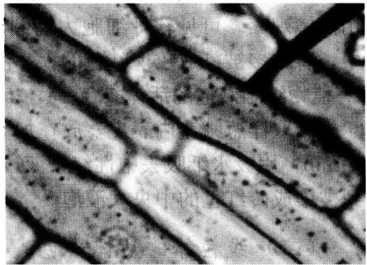

## 第三章 细胞的形态结构

细胞是生命活动的基本结构单位和功能单位，它的体积很小，如人和动物细胞的直径为 $10\sim 20\mu \mathrm{m}$ ，而人眼的分辨率是 $100\mu \mathrm{m}$ ，所以人的眼睛是看不到这些细胞的。细胞内的一些结构的体积更小，如线粒体、高尔基体、中心体、核仁、染色体等，用肉眼就更看不到了，但它们的大小都在 $0.2\mu \mathrm{m}$ 以上，而一般光学显微镜最大的分辨率为$0.2\mu \mathrm{m}$ ，因此可以借助显微镜来观察细胞的外部形态结构和内部的一些细胞器结构。电子显微镜的分辨率又比光学显微镜提高了1000倍，能观察到的物体的大小可达到$0.2\mathrm{nm}$ ，用它就可以观察到细胞内各种细胞器的细微结构。通常把在光学显微镜下所见到的结构称为显微结构，而在电子显微镜下所见到的微细结构，则被称为亚显微结构或超微结构。

## 实验 8 细胞形态结构与几种细胞器的观察

## 【实验目的】

在普通光学显微镜下识别细胞和细胞器的形态结构，掌握生物绘图的方法。

## 【实验原理】

细胞在形态上是多种多样的，有球形、椭圆形、扁平形、立方形、梭形、星形等。虽然细胞的形状各异，但是它们却有共同的基本结构特点，都由细胞膜、细胞壁（植物）、细胞质和细胞核组成。细胞中的各种细胞器，如线粒体、高尔基体、中心体、核仁、染色体等，一般经过固定染色处理后，大多数可以在光学显微镜下看见（图3-1）。细胞器的形态结构在普通光学显微镜下与在电子显微镜下所看到的结构有很大的差别。

图3-1 细胞形态结构

A. 柿胚乳细胞示胞间连丝；B. 马蛔虫受精卵分裂中期示中心粒；C. 兔的神经节细胞中高尔基体； D. 小鼠肝细胞线粒体

【实验仪器、材料和试剂】

（1）仪器、用具:复式显微镜、擦镜纸。

(2) 材料: 洋葱根尖切片、小白鼠肝切片、兔神经节切片、马蛔虫受精卵切片。

（3）试剂:香柏油或液体石蜡、二甲苯。

## 【方法与步骤】

## 1. 洋葱根尖切片细胞的观察

先用低倍镜观察根尖的纵切面，注意分生区、伸长区、成熟区细胞的异同，然后再用高倍镜仔细观察细胞的形态结构，特别注意细胞的形状、大小，以及细胞壁、细胞核、核仁、细胞质、液泡的形态结构。

## 2. 兔神经节细胞切片高尔基体的观察

先在低倍镜下找到兔神经节细胞，然后转用高倍镜观察，可看到细胞内淡黄色的背景上有黄褐色的细胞核，核的周围分布着许多深褐色的（硝酸银镀染）高尔基体，呈弯曲的线状、颗粒状，少量分散在细胞质中。

## 3. 小白鼠肝细胞切片线粒体的观察

先用低倍镜后用高倍镜观察，可见到许多肝小叶，每小叶有许多紧密排列成索状的多角形的肝细胞，细胞中央有大而圆的细胞核。这时，转用油镜观察，可见到细胞质内分布着许多被苏木精染成深紫色的线粒体，呈颗粒状和线状。

## 4. 马蛔虫受精卵切片中心体的观察

取马蛔虫受精卵切片，在显微镜下找到充满子宫腔的受精卵，每个马蛔虫受精卵外围有一层较厚的卵膜，膜内有宽大的围卵腔，各围卵腔内有处在不同分裂期的卵细胞。找到分裂中期的细胞，在细胞中央被染成蓝色条状或棒状的结构，这就是染色体。可见在染色体两侧各有一个较小的，亦被染成蓝色的小粒，称中心粒。在中心粒的周围可见呈放射状的星丝。

## 【作业】

（1）画出洋葱根尖细胞图，并标示出细胞的各部分。

(2) 画出兔神经节细胞高尔基体图，并标示出细胞的各部分。

(3) 画出小白鼠肝细胞线粒体图，并标示出细胞的各部分。

（4）画出马蛔虫受精卵细胞中心粒图，并标示出细胞的各部分。

(戚康标)

## 实验 9 液泡系和线粒体的活体染色

## 【实验目的】

掌握动物、植物细胞活体染色的原理和有关的技术。

## 【实验原理】

活体染色是指对生活有机体的细胞或组织能着色，但又无毒害的一种染色方法。目的在于显示生活细胞内的某些天然结构，而不影响细胞的生命活动和产生任何物理、化学变化引起细胞的死亡。活体染色技术可用来研究生活状态下的细胞结构和生理、病理状态。

液泡是细胞内浓缩产物的主要场所，有十分重要的功能。中性红（neutral red）是

液泡的特殊染色剂，只将液泡染成红色。在细胞处于生活状态时，细胞质和细胞核不被中性红染色。

线粒体是细胞内的一个重要细胞器，是细胞进行呼吸作用的场所。詹纳斯绿 B（Janus green B）对线粒体染色具有专一性，是毒性最小的碱性染料。詹纳斯绿 B 染色是由于线粒体中的细胞色素氧化酶系的作用，染料始终保持氧化状态，呈蓝绿色，而周围的细胞质被还原成无色的色基（图 3-2）。

图3-2 洋葱鳞茎内表皮细胞线粒体

## 【实验仪器、材料和试剂】

(1) 仪器、用具: 显微镜、解剖盘、剪刀、镊子、解剖刀、吸管、载玻片、盖玻片、擦镜纸、吸水纸。

(2) 材料:洋葱鳞茎、小白鼠或兔子、青蛙。

(3) 试剂

1) Ringer 溶液:

氯化钠 8.5g（变温动物用6.5g）
氯化钙 0.12g
碳酸氢钠 0.20g
氯化钾 0.14g
磷酸氢二钠 0.01g
葡萄糖 2.0g
加蒸馏水 至1000ml

2) 1%和1/3000中性红溶液:称取0.5g中性红溶于50ml Ringer溶液中，稍加热（30～40℃）使之很快溶解，用滤纸过滤，装入棕色瓶于暗处保存，否则易氧化沉淀，失去染色能力。

临用前，取 $1\%$ 中性红溶液 $1 \mathrm{ml}$，加入 $29 \mathrm{ml} Ringer$ 溶液混匀，装入棕色瓶备用。

3) 1%和1/5000 詹纳斯绿 B 溶液:称取 0.5g 詹纳斯绿 B 溶于 50ml Ringer 溶液中，稍加热（30～40℃）使之很快溶解，用滤纸过滤，即成 1%原液。临用前，取 1% 原液 1ml，加入 49ml Ringer 溶液混匀，即成 1/5000 工作液，装入棕色瓶备用，以保持

它的充分氧化能力。

## 【方法与步骤】

## （一）液泡系的活体染色与观察

## 1. 蛙（蟾蜍）胸骨剑突软骨细胞的液泡系活体染色观察

解剖蛙（蟾蜍），剪取胸骨剑突软骨最薄部分一小块，放入载玻片中央的1/3000中性红染液中，染色5～10min。然后用吸管吸去染液，滴加Ringer溶液，盖上盖玻片，用油镜观察。可见软骨细胞为椭圆形，细胞核及核仁清楚易见，在细胞核上方的胞质中，有许多被染成玫瑰红色的大小液泡，这一特定的区域称为高尔基区。

## 2. 植物细胞液泡的活体染色

撕取洋葱鳞茎内表皮，放在加有一滴 1/3000 的中性红染液的载玻片中，染色 5～10min，用吸水纸吸去中性红染液，换上 Ringer 溶液，盖上盖玻片，显微镜观察，可见到被染成砖红色的中央大液泡。

## （二）线粒体的活体染色

## 1. 动物细胞线粒体活体染色的观察

（1）取样染色:用水溺死兔子，置于解剖盘中，迅速打开腹部，取肝边缘较薄的肝组织一小块，放入盛有 Ringer 溶液的表面皿内，洗去血液。

（2）取另一干净表面皿，滴加1/5000詹纳斯绿B溶液，再将肝组织块移入染液，但不可将组织块完全浸没，要让组织上面部分半裸露在外面，这样细胞内的线粒体酶系可充分得到氧化，易被染色。当组织块边缘被染成蓝绿色时即可（一般需染20～30min）。

（3）分离细胞:染色后，用两根解剖针左右手同时操作，将两根针压住组织块，然后用右手稍稍用力拉开组织块，这样就会有一些细胞或细胞群与组织块分离开。

（4）装片:用吸管将分离的细胞吸起，滴一滴在载玻片上，盖上盖玻片，显微镜观察。在高倍镜或油镜下观察，可见肝细胞中的线粒体被染成蓝绿色，呈颗粒状或线条状，在细胞核周围分布特别多。

## 2. 植物细胞线粒体的活体染色

（1）用吸管吸取 1/5000 詹纳斯绿 B 染液，滴一滴在干净的载玻片上，然后用镊子撕取洋葱鳞茎内表皮一小块，置于染液中，染色 10～15min。

(2) 吸去染液, 加一滴 Ringer 溶液, 注意使内表皮展平, 盖上盖玻片, 显微镜观察。在高倍镜下, 可见表皮细胞中央被一大液泡所占据, 细胞核被挤到旁边, 线粒体被染成蓝绿色, 呈颗粒状或线条状。

## 【作业】

(1) 简述液泡系中性红活体染色及线粒体詹纳斯绿 B 活体染色的原理。

(2) 分别绘图示液泡和线粒体形态及分布。

(戚康标)