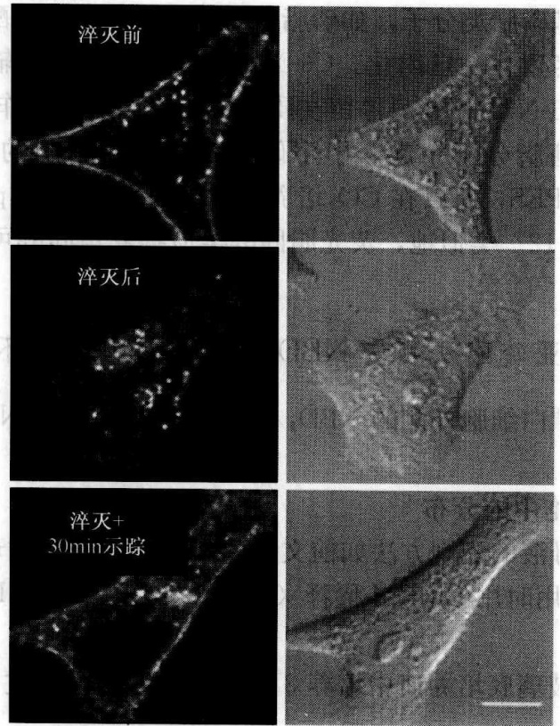
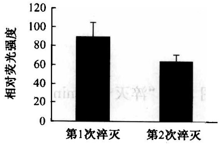

## 实验 10 用荧光脂质进行细胞活体染色

## 【实验目的】

学习用荧光脂质进行细胞膜染色的原理与技术。

## 【实验原理】

合成荧光脂质类似物是一类人工合成的、带有荧光基团标记的脂质类似物，可混合于质膜成分中，是研究膜脂动力学的有力工具。但是多种合成脂质分子中，只有小部分可用于细胞生物学研究，原因是这些合成类似物与对应的细胞天然成分相比，疏水性较差，易与细胞膜解离。此外，荧光脂质带有大量荧光基团，部分荧光基团可能影响其脂质结构原有的物理和生物学特性，导致进入细胞的荧光脂质分子与内源脂质分子的行为并非完全一致，因此，相关实验必须设定合适的对照。

## 【实验仪器、材料和试剂】

(1) 仪器与用具: 激光共聚焦显微镜、35mm 玻璃底培养皿、60mm 培养皿、螺口玻璃瓶 (聚四氟乙烯内衬)、分光光度计。

(2) 材料:HeLa 细胞。

(3) 试剂: C6-NBD-SM, C6-NBD-Cer、C12-NBD-Cer、C6-NBD-PS、C5-BODIPY-Cer。以上荧光脂质分子的结构如图 3-3 所示。

| C6-NBD-SM$\begin{array}{c}CH_{3}(CH_{2})_{12}CH=C-CHOH \\ \| \\ NH(CH_{2})_{5}-C-NH-CH-O-P-OCH_{2}CH_{2}N'(CH_{3})_{3} \\ \| \\ NO_{2} \end{array}$ | C6-NBD-PS$\begin{array}{c}O \\ \| \\ CH_{3}(CH_{2})_{14}C-O-CH_{2} \\ \| \\ NH(CH_{2})_{5}-C-O-CH-O-P-OCH_{2}C-NH_{3} \\ \| \\ NO_{2} \end{array}$ |
| --- | --- |
| C6-NBD-Cer$\begin{array}{c}CH_{3}(CH_{2})_{12}CH=C-CHOH \\ \| \\ NH(CH_{2})_{5}-C-NH-CH-O-P-OCH_{2}CH_{2}N'(CH_{3})_{3} \\ \| \\ NO_{2} \end{array}$ | C12-NBD-Cer$\begin{array}{c}CH_{3}(CH_{2})_{12}CH=C-CHOH \\ \| \\ NH(CH_{2})_{11}-C-NH-CH-O-P-OCH_{2}CH_{2}N'(CH_{3})_{3} \\ \| \\ NO_{2} \end{array}$ |
| C5-BODIPY-Cer$\begin{array}{c}CH_{3}(CH_{2})_{12}CH=C-CHOH \\ \| \\ H_{3}C-N(B-N(CH_{2})_{4}-C-NH-CH-O-P-OCH_{2}CH_{2}N'(CH_{3})_{3} \\ \| \\ H_{3}C \end{array}$ |  |

图3-3 荧光脂质分子的结构（Celis，2006）

DMEM 培养基、DMEM F-12、磷酸缓冲液（PBS）、连二亚硫酸钠、Brefeldin A（布雷菲德菌素 A）。

具体配制方法见各实验步骤。

## 【方法与步骤】

## (一) NBD 标记的不同脂质分子在成纤维细胞质膜中的动态检测

本实验通过跟踪嵌入到细胞质膜的荧光脂质分子的去向，研究不同脂质分子的分布及去向。荧光脂质去向的不同取决于脂质分子亲水头部的特性。

## 1. 荧光脂质溶液配制方法

将 C6-NBD-PS 溶解于氯仿，C6-NBD-SM 溶解于乙醇（1mg/ml）。氯仿溶液应保存于螺口玻璃瓶（聚四氟乙烯内衬），而乙醇原液可用玻璃或者塑料管保存。母液存于 -20℃。使用前真空抽干（先通氮气再经真空干燥），溶剂挥发干燥后的脂质分子加入 DMEM 培养基使其浓度为 4μmol/L。摇匀溶液并置于 4℃ 保存。

## 2. 步骤

(1) 在 $35 \mathrm{~mm}$ 的玻璃底培养皿中培养 2 份 HeLa 细胞 $1 \sim 2$ 天, 至细胞达到 $50 \% \sim 80 \%$ 汇合率。

(2) 用冰冷的 DMEM 洗涤 HeLa 细胞 2 次。

(3) 细胞层中加入 $1 \mathrm{ml}$ 含有 $4 \mu \mathrm{mol} / \mathrm{L}$ C6-NBD-SM 或 C6-NBD-PS 的 $1 \mathrm{ml}$ DMEM, $4^{\circ} \mathrm{C}$ 孵育细胞 $30 \mathrm{~min}$ 。

(4) 将其中 1 份样品用冰浴的 DMEM F-12 洗涤 2 次, 然后加入 $1 \mathrm{ml}$ 冰浴的 DMEM F-12。共聚焦显微镜记录荧光图片 (图 3-4, “0min” 样品)。

图3-4 C6-NBD-PS和C6-NBD-SM标记的HeLa细胞在 $4^{\circ}\mathrm{C}$ 处理 $30\mathrm{min}$ （0min）和在$4^{\circ}\mathrm{C}$ 处理后在 $37^{\circ}\mathrm{C}$ 孵育 $30\mathrm{min}$ （30min）的荧光共聚焦显微图像（Celis，2006）标尺 $= 10\mu \mathrm{m}$

(5) 另外 1 份样品用冰冷的 DMEM 洗涤 2 次, 然后加入 $1 \mathrm{ml}$ 预热到 $37^{\circ} \mathrm{C}$ 的 DMEM。

(6) 在 $37^{\circ} \mathrm{C}$ 条件下, $\mathrm{CO}_{2}$ 培养箱中孵育细胞 $30 \mathrm{~min}$ 。

(7) 室温下 DMEM F-12 洗涤细胞 2 次。

(8) 加入 1ml DMEM F-12 并镜检观察 HeLa 细胞（图 3-4，“30min”样品）。

## 【注意事项】

在低温条件下（2～4℃），C6-NBD-SM与C6-NBD-PS这两种荧光脂质分子都可通过脂质自发流动从培养基转运到细胞质膜外层中。提高温度可诱导ATP依赖的C6-NBD-PS脂双层翻转扩散（flip-flop）。在哺乳动物细胞中，脂质的能量依赖型双分子层翻转扩散只存在于氨基磷脂类分子，如磷脂酰丝氨酸和磷脂酰乙醇胺中。翻转扩散可在低至7℃的条件下观察到。一旦内化，C6-NBD-PS可被自发运输到内膜系统，与C6-NBD-PS不同的是，C6-NBD-SM只停留在质膜外层并通过内吞作用内化。C6-NBD-SM可与C6-NBD标记的糖脂分子一起，用于研究恶性肿瘤细胞的极性脂质运输。由于DMEM F-12含有HEPES，所以在 $CO_{2}$ 培养箱外反应也可保持pH稳定。观察时应使用无酚红的DMEM F-12。类似地，荧光胆固醇类似物麦角固醇可用于跟踪细胞表面胆固醇的去向。

## （二）通过连二亚硫酸法测量 NBD 标记鞘磷脂的循环量

连二亚硫酸盐可漂白细胞外侧的 NBD，基于该原理，可对 NBD 标记的脂质结合到质膜上的量进行测定。

## 1. 检测荧光脂质在细胞中的分布

溶液:荧光脂质母液的配制方法如前文所述。连二亚硫酸钠母液为 $1\mathrm{mol} / \mathrm{L}$ 的水溶液（需新鲜配制），使用时用DMEM稀释（最终浓度:$50\mathrm{mmol} / \mathrm{L}$）。

步骤:

（1）在 35mm 的玻璃底培养皿中培养 3 份 HeLa 细胞，经过 1～2 天，至细胞长到 50%～80% 汇合率。

(2) 用冰冷的 DMEM 洗涤细胞 2 次。

(3) 加入含有 $4\mu \mathrm{mol} / \mathrm{L}$ C6-NBD-SM 的 $1\mathrm{ml}$ DMEM, 在 $4^{\circ}\mathrm{C}$ 反应 $30\mathrm{min}$ 。

（4）用冰冷的DMEM洗涤细胞2次，然后加入 $1\mathrm{ml}37^{\circ}\mathrm{C}$ 预热的DMEM。

(5) $\mathrm{CO}_{2}$ 培养箱中，$37^{\circ} \mathrm{C}$ 孵育细胞 $30 \mathrm{~min}$。

（6）室温下用DMEMF-12洗涤其中一份样品2次，然后加入1ml DMEM F-12并在显微镜下观察（图3-5，“淬灭前”）。

(7) 室温下用 DMEM 洗另外两份样品 2 次。

(8) 加入 1ml 溶解有 50mmol/L 连二亚硫酸钠的 DMEM 溶液，室温反应 1min。

（9）室温下用DMEM F-12洗涤8中的其中一个样品2次，然后加入1ml DMEM F-12并在显微镜下观察（图3-5，“淬灭后”）。

(10) 室温下，用 DMEM 洗涤最后 1 个样品 2 次。

(11) $\mathrm{CO}_{2}$ 培养箱中, $37^{\circ} \mathrm{C}$ 孵育细胞 $30 \mathrm{~min}$ 。

(12) 室温下用 DMEM F-12 洗涤细胞 2 次。

(13) 加入 1ml DMEM F-12 并在显微镜下观察（图 3-5，“淬灭+30min 示踪”）。

## 2. C6-NBD-SM 循环量的测定

步骤:

（1）在 60mm 的培养皿中培养 2 份 HeLa 细胞，培养 1～2 天至细胞长到 50%～80% 汇合率。

(2) 用冰冷的 DMEM 洗涤细胞 2 次。

(3) 加入含有 $4\mu \mathrm{mol} / \mathrm{L}$ C6-NBD-SM 的 $2\mathrm{ml}$ DMEM, 在 $4^{\circ}\mathrm{C}$ 反应 $30\mathrm{min}$ 。

图 3-5 C6-NBD-SM 标记的 HeLa 细胞在  $37^{\circ}$ C 孵育 30min（淬灭前），连二亚硫酸钠漂白 HeLa 细胞表面的荧光脂质（淬灭后），连二亚硫酸钠漂白细胞表面荧光脂质后  $37^{\circ}$ C 孵育细胞 30min （淬灭 + 30min 示踪）的荧光共聚焦显微图像（Celis，2006）
标尺= $10\mu m$

(4) 用冰冷的 DMEM 洗涤细胞 2 次，然后加入 $2 \mathrm{ml} 37^{\circ} \mathrm{C}$ 预热的 DMEM。

(5) ${\mathrm{{CO}}}_{2}$ 培养箱中, ${37}^{ \circ  }\mathrm{C}$ 孵育细胞 ${30}\mathrm{\;{min}}$ 。

(6) 室温下用 DMEM 洗涤细胞 2 次。

(7) 加入 2ml 含有 50mmol/L 连二亚硫酸钠的 DMEM 溶液，室温反应 1min。

(8) 室温下, 用 PBS 洗涤其中一个培养皿 2 次, 然后加入 $1 \mathrm{ml}$ 含有 $1 \%$ Triton X-100 的 PBS。刮取细胞并在 Jasco FP-6500 分光光度计上测量 $535 \mathrm{~nm}$ 处的 OD 值 (激发

图3-6 C6-NBD-SM标记的HeLa细胞在$37^{\circ}C$ 孵育 $30\mathrm{min}$ 后立即用连二亚硫酸钠处理（first quench）和在 $37^{\circ}C$ 孵育 $30\mathrm{min}$ 后立即用连二亚硫酸钠处理后再次在 $37^{\circ}C$ 的DMEM中孵育 $30\mathrm{min}$ （second quench）的荧光强度比较（Celis，2006）

光波长 475nm）（图 3-6，“第 1 次淬灭”）。

(9) 室温下用 DMEM 洗涤另外一个培养皿。

（10）加入 2ml DMEM， $CO_{2}$ 培养箱中，37℃孵育细胞 30min。

（11）加入 2ml 含有 50mmol/L 连二亚硫酸钠的 DMEM 溶液，室温反应 1min。

（12）室温下 PBS 洗涤细胞 2 次，然后加入 1ml 含有 1% Triton X-100 的 PBS。

(13) 刮落细胞层并在 Jasco FP-6500 分光光度计上测量 535nm 处的 OD 值（激发光波长 475nm）（图 3-6，“第 2 次淬灭”）。