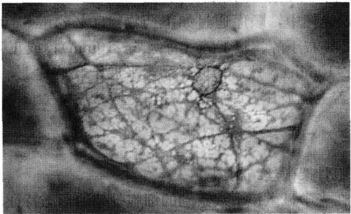

## 【注意事项】

(1) 由于溶剂蒸发使荧光脂质原液在贮存时会逐渐浓缩。NBD 标记脂质的溶液浓度可通过测定波长 $475 \mathrm{~nm}$ 吸光率来确定浓度是否改变。

(2) 脂质分子可能发生降解。可通过薄层层析来鉴定脂质样品的纯度, 当脂质发生降解时, 必须更换新的荧光脂质试剂。

## 【作业】

（1）简述荧光脂质分子标记在细胞质膜研究中的作用原理。

(2) 对所做的实验的结果作比较分析。

(刘兵)

## 实验 11 植物细胞骨架的光学显微镜观察

## 【实验目的】

了解细胞骨架的结构特征及其样品制备技术。

## 【实验原理】

细胞骨架（cytoskeleton）是由蛋白质丝组成的复杂网状结构，根据其组成成分和形态结构可分为微管、微丝和中间纤维。它们对细胞形态的维持，细胞的生长、运动、分裂、分化，物质运输，能量转换，信息传递，基因表达等起到重要作用。用适当浓度的 Triton X-100 处理细胞，可将细胞质膜中和细胞质中的蛋白质和全部脂质溶解抽提，但细胞骨架系统的蛋白质不受破坏而被保存，经用戊二醛固定，考马斯亮蓝 R250 染色后，可在光学显微镜下观察到由微丝组成的微丝束为网状结构（图 3-7），这就是细胞骨架。

图3-7 洋葱鳞茎内表皮细胞骨架

## 【实验仪器、材料和试剂】

（1）仪器、用具:普通光学显微镜、50ml烧杯、玻璃滴管、容量瓶、试剂瓶、载玻片、盖玻片、镊子、小剪刀、吸水纸、擦镜纸。

(2) 材料:洋葱鳞茎。

## (3) 试剂

1）M缓冲液:50mmol/L咪唑、50mmol/L KCl、0.5mmol/L MgCl₂、1mmol/L EGTA [乙二醇双（α-氨基乙基醚）四乙酸]、0.1mmol/L EDTA、1mmol/L巯基乙醇或DTT（二硫苏糖醇）。

2）6mmol/L（pH6.8）磷酸缓冲液（用  $NaHCO_{3}$  调 pH）。

3）1% Triton X-100，用 M 缓冲液配制。

4）0.2%考马斯亮蓝 R250，其溶剂为:甲醇 46.5ml、冰醋酸 7ml、蒸馏水 46.5ml。

5）3%戊二醛，用2）液配制。

6）50%乙醇、70%乙醇、95%乙醇。

7）叔丁醇、正丁醇、二甲苯、中性树胶。

## 【方法与步骤】

（1）撕取洋葱鳞茎内表皮（约 $1\mathrm{cm}^2$ 大小若干片）置于装有 $\mathrm{pH6.8}$ 磷酸缓冲液的$50\mathrm{ml}$ 烧杯中，使其下沉。

(2) 吸去磷酸缓冲液，用 1% Triton X-100 处理 20\~30min。

(3) 吸去 Triton X-100，用 M 缓冲液洗 3 次，每次 10min。

(4) 3%戊二醛固定0.5\~1h。

(5) pH6.8 磷酸缓冲液洗 3 次，每次 10min。

(6) 0.2%考马斯亮蓝 R250 染色 20\~30min。

（7）用蒸馏水洗 1 或 2 次，细胞置于载玻片上，加盖玻片，于普通光学显微镜下观察。

(8) 若观察效果好，可制作成永久切片:

在有样品的 50ml 烧杯中，顺序通过如下药物:50%乙醇、70%乙醇、95%乙醇、1/2 V 95%乙醇+1/2 V 叔丁醇、叔丁醇（每级 5～10min）；或正丁醇、正丁醇、二甲苯、二甲苯（每级 5～10min），然后捞取样品，平展于载玻片上，经镜检，效果好的，可加一滴中性树胶，盖上盖玻片，即成永久片。

## 【作业】

（1）绘出植物细胞骨架微丝结构图。

(2) 分析和论述在光学显微镜下观察到的细胞骨架的形态特征。

(戚康标)

## 实验 12 细胞骨架的免疫荧光显示

## I.动物细胞微管的观察

## 【实验目的】

(1) 学习用间接免疫荧光法显示动物细胞微管技术。

(2) 了解动物细胞内微管的结构特征。

## 【实验原理】

微管（microtubule）是真核细胞所特有并普遍存在的结构，它是由管蛋白（α和β管蛋白二聚体）和少量微管结合蛋白（MAP）聚合而成的管状纤维，在不同类型的细胞中微管具有相同的基本形态；管蛋白二聚体螺旋盘绕装配成微管的壁，13个二聚体绕一周，这是单管；它们又可以进一步组装成二联管（在纤毛和鞭毛）或三联管（在基体和中心粒）。观察微管可用电镜和免疫组织化学方法，其中较常用的有间接免疫荧光技术。用抗微管蛋白的免疫血清（一级抗体，如兔抗微管蛋白抗体）与细胞一起温育，该抗体将与胞质中的微管（抗原）特异结合，然后再加荧光素标记的抗球蛋白抗体［二级抗体，如异硫氰酸荧光素（FITC）标记的羊抗兔抗体］共同温育，该二抗与一抗结合，从而使微管间接地标上荧光素。置荧光显微镜下用一定波长激发光照射，即由荧光所在显示出微管的形态和分布。间接免疫荧光法特异和灵敏度均较高，广泛用于生物大分子或结构的定位和形态显示。

## 【实验仪器、材料和试剂】

（1）仪器、用具:荧光显微镜、冰箱、毛细吸管、放有湿纱布的铝盒、载玻片、35mm小染色缸、振荡器、指甲油。

## (2) 材料

1）培养在盖玻片上的动物细胞。

2）细胞涂片、组织块冰冻切片、石蜡切片、塑料包埋切片、铺片（小血管、胃肠道、胆管、心脏等可分层剥离铺片，用甲醛-明胶液粘片在载玻片上，注意某些动物细胞微管不发达、形态不典型，如分化成熟的红细胞、粒细胞、淋巴细胞、巨噬细胞等，一般不宜采用）。

(3) 试剂

1）0.01mol/L 磷酸盐缓冲生理盐水（PBS，pH7.2）:

$$
\begin{array}{l l} 0. 2 \mathrm{mol/L} \mathrm{Na} _ {2} \mathrm{HPO} _ {4} & 7 7 \mathrm{ml} \\ 0. 2 \mathrm{mol/L} \mathrm{NaH} _ {2} \mathrm{PO} _ {4} & 2 3 \mathrm{ml} \\ \mathrm{NaCl} & 0. 1 5 \mathrm{mol/L} \\ \text {重蒸馏水} & \text {至} 1 0 0 0 \mathrm{ml} \end{array}
$$

2) PEM 缓冲液:
pipes 80mmol/L
EGTA 1mmol/L
MgCl₂ 0.5mmol/L

用 NaOH 调 pH 至 6.9\~7.0，注意先用 8mol/L 的浓 NaOH 调节，然后用较稀的 NaOH 溶液小心调制。

3）PEMD缓冲液:含1%二甲基亚砜（DMSO）的PEM溶液。

4）PEMP缓冲液:含 $4\times$ 聚乙二醇（PEG）的PEM溶液。

5）固定液:3.7%甲醛-PEMD溶液。

6) 0.5% Triton X-100/PEMP 溶液。

7）1%和0.3%的Triton X-100/PBS溶液。

8）兔抗微管蛋白抗体（一抗）和 FITC-羊抗兔抗体（二抗）。使用前用 0.3% Triton X-100/PBS 或直接用 PBS 稀释 20 倍以上，一般第一抗体稀释度应更高。最好在使用前试验最佳工作稀释度，以特异性染色反应荧光最强而非特异性染色阴性为最佳。

9）甘油-PBS（9:1），pH5.0～9.0。

## 【方法与步骤】

（1）细胞培养在裁成小条的盖玻片上，长到++至+++时取出，用PEMP缓冲液轻轻漂洗细胞。

(2) 0.5% Triton X-100/PEMP 溶液预温到 37℃，处理细胞 1.5\~2min。Triton X-100 是非离子型去污剂，可适当增加细胞膜的通透性，使抗体容易进入细胞，同时 Triton X-100 抽提掉若干杂蛋白质使胞质背景清晰。

(3) PEMP 洗细胞 2 次。

(4) 用 $3.7\%$ 甲醛-PEMD溶液在室温下固定样品 $30\mathrm{min}$。

(5) PBS 洗 2 次，用滤纸吸干多余的液体。

（6）结合一抗。用毛细吸管滴约 20pl 已经稀释的兔抗微管蛋白抗体放于载玻片中央，将盖片条的细胞面覆于其上，在 37℃ 湿盒内温育 60min。

（7）取出细胞样品，放 35mm 小染色缸内，按 PBS→1% Triton X-100/PBS→PBS 顺序漂洗细胞，每次 3\~5min，可以放在振荡器上振荡漂洗。取出盖片条，用滤纸吸干液体。

（8）结合二抗。用已经稀释的 FITC-羊抗兔抗体与细胞温育 40～60min。操作步骤同（6），洗涤步骤同（7）。

（9）去离子水洗样品 2 次，稍干，滴加甘油-PBS 封片，四周涂指甲油封固。样品在  $4^{\circ}$ C 置暗处可保存数天。

## Ⅱ.植物细胞微管的观察

## 【实验目的】

（1）学习用间接免疫荧光法显示植物原生质体质膜内的微管。