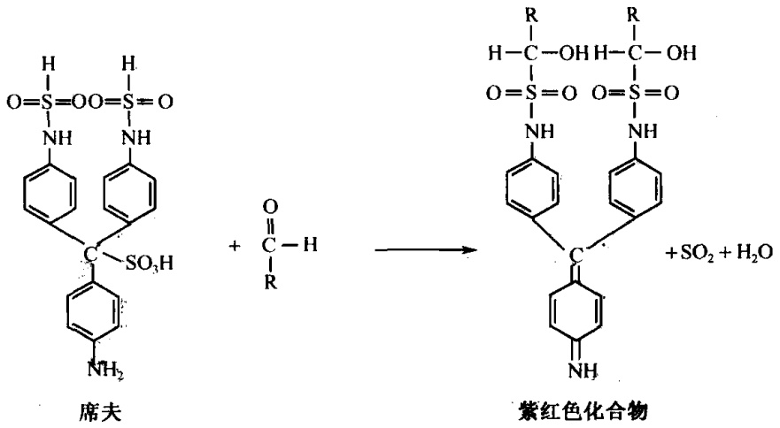

图4-2 PAS反应

图4-3 过氧化物酶联苯胺反应

## 【实验仪器、材料和试剂】

(1) 仪器、用具:显微镜、镊子、染色钵、刀片、载玻片、盖玻片、吸水纸等。

（2）材料:马铃薯块茎、洋葱根尖或洋葱鳞茎。

(3) 试剂

1）高碘酸溶液:

高碘酸（$\mathrm{HIO_4 \cdot 2H_2O}$）

0.4g

95%乙醇

1/3mol/L 乙酸钠溶液 (2.72g 乙酸钠溶于 100ml H₂O) 蒸馏水

$$
10 \mathrm{ml}
$$

2）席夫试剂（配法见Feulgen反应）。

3）亚硫酸水溶液（配法见Feulgen反应）。

4） $70\%$ 乙醇。

5）联苯胺溶液:在 $0.85\%$ 盐水内加入联苯胺至饱和为止，临用前加入 $20\%$ 体积的 $\mathrm{H}_2\mathrm{O}_2$ ，每 $2\mathrm{ml}$ 加一滴。

6）0.1%钼酸铵溶液:称取0.1g钼酸铵溶于100ml 0.85%盐水中。

## 【方法与步骤】

## 1. 细胞中多糖的测定

\- 高碘酸-席夫（PAS）反应

(1) 把马铃薯块茎用刀片徒手切成薄片。

(2) 浸于高碘酸溶液 5\~15min。

(3) 移入 70%乙醇中浸片刻。

(4) 席夫试剂染色 15min。

(5) 亚硫酸水溶液洗 3 次，每次 1min。

(6) 蒸馏水洗片刻。

(7) 装片镜检。

## 2. 细胞中过氧化物酶的测定

## - 联苯胺反应

（1）把洋葱根尖徒手切成  $20 \sim 40 \mu m$  厚的薄片或用镊子撕取洋葱鳞茎内表皮一小块。

(2) 浸在溶有 $0.1\%$ 钼酸铵的 $0.85\%$ 盐水溶液中 $5\mathrm{min}$ （钼酸铵的作用是催化剂）。

(3) 浸在联苯胺溶液内 2min 至切片出现蓝色。

(4) 在 $0.85\%$ 盐水溶液中洗 $1\mathrm{min}$。

(5) 将薄片置于载玻片上展开，盖上盖玻片，显微镜检查。

## 【作业】

(1) 简述 PAS 反应及联苯胺反应的原理。

(2) 绘图示细胞中多糖及过氧化物酶的分布。

(戚康标)

## 实验 18 细胞中酸性磷酸酶的定位

## 【实验目的】

（1）了解和掌握酸性磷酸酶定位的原理及操作步骤。

(2) 观察酸性磷酸酶在细胞中的分布。

## 【实验原理】

酸性磷酸酶（ACP）是溶酶体的特征性酶，主要存在于巨噬细胞，定位于溶酶体内。正常条件下，巨噬细胞处于休止状态，酶活性很低。但在合适的 pH 条件下，经过活化，其形态、代谢和功能上表现出一系列显著的变化，如膜活性增高和酸性磷酸酶活性增强，从而改变其渗透性，底物可以渗入，酶活力被显示。通常酸性磷酸酶在 pH 为

5 左右时发生作用，能水解磷酸酯而释放出磷酸基， $PO_{4}^{3-}$  与底物中硝酸铅反应生成磷酸铅沉淀物。由于这些沉淀物是无色的，需再与黄色的硫化铵反应，生成棕黄色到棕黑色的硫化铅沉淀而被显示出来。其反应过程如下:

$$
\beta - \text {甘油磷酸钠} \xrightarrow {\text {酸性磷酸酶}} \text {甘油} + \mathrm{PO} _ {4} ^ {3 -}
$$

$$
\mathrm{PO} _ {4} ^ {3 -} + \mathrm{Pb} (\mathrm{NO} _ {3}) _ {2} \longrightarrow \mathrm{Pb} _ {3} (\mathrm{PO} _ {4}) _ {2} \downarrow
$$

$$
\mathrm{Pb} _ {3} (\mathrm{PO} _ {4}) _ {2} + (\mathrm{NH} _ {4}) _ {2} \mathrm{S} \longrightarrow \mathrm{PbS} \downarrow (\text {棕黑色})
$$

## 【实验仪器、材料和试剂】

（1）仪器、用具:注射器、解剖剪、镊子、恒温水浴锅、显微镜、载玻片、盖玻片、吸水纸、擦镜纸。

(2) 材料:小白鼠。

(3) 试剂

1）6%淀粉肉汤:牛肉膏0.3g，蛋白胨1.0g，氯化钠0.5g，可溶性淀粉6.0g，蒸馏水100ml，煮沸灭菌，4℃保存，使用时热水浴融化。

## 2）酸性磷酸酶作用液（临用时配）:

称取硝酸铅 25mg，加入 0.05mol/L 乙酸缓冲液 22.5ml，搅动使之全部溶解后，再缓慢地逐滴加入 3%β-甘油磷酸钠液 2.5ml，边加边搅动，防止产生絮状沉淀。

3）甲醛钙固定液:甲醛 10ml，10%CaCl₂10ml，蒸馏水 80ml。

4）0.05mol/L乙酸缓冲液:

A液（0.2mol/L乙酸液）:冰醋酸1.2ml加蒸馏水至100ml；

B 液（0.2mol/L 乙酸钠液）:NaAc·3H₂O 2.72g 加蒸馏水至 100ml；

取 A 液 30ml + B 液 70ml + 蒸馏水 300ml 即成 0.05mol/L 乙酸缓冲液，置 4℃ 保存。

5）2%硫化铵液（临用时配）:硫化铵 2ml+蒸馏水 98ml。

## 【方法与步骤】

## 1. 前处理

(1) 小白鼠每日腹腔注射 $6\%$ 淀粉肉汤 $1 \mathrm{ml}$, 连续注射 3 天。

(2) 第 3 天注射后 $3 \sim 4 \mathrm{~h}$, 再向腹腔注射 $1 \mathrm{ml}$ 生理盐水, 过 $3 \sim 5 \mathrm{~min}$ 后用颈椎脱臼法处死小鼠, 剖开腹腔, 吸取腹腔液。

## 2. 制片

(1) 将腹腔液滴一滴于冰冻的干净载玻片上，并用牙签涂开，自然干燥。

(2) 标本放入作用液中，37℃保温 30min。

(3) 蒸馏水中漂洗片刻。

(4) 放入甲醛钙固定液中固定 5min。

(5) 蒸馏水中漂洗。

(6) 放入 2% 硫化铵液中 3\~5min。

(7) 蒸馏水中漂洗，镜检。

显微镜下观察，小鼠腹腔巨噬细胞为不规则形状，阳性细胞内有大小不等的棕色或棕黑色的颗粒即为酸性磷酸酶。

## 3. 对照实验

标本放入作用液前先用高温（50℃）处理30min，使酶失去活性，做好标记，其他步骤相同。也可在对照组的作用液中不加入β-甘油磷酸钠，而以蒸馏水代替。

## 【注意事项】

作用液中铅离子的浓度是至关重要的，必须现配现用，当铅离子浓度过低时产生的磷酸离子不能被完全捕捉而引起弥散，并可进入细胞核内造成细胞核染色的假阳性，孵育时间过长也可发生酶扩散和核染色的现象。

## 【作业】

简述实验的原理，记录分析实验结果。

(戚康标)

## 实验 19 细胞中碱性磷酸酶的定位

## 【实验目的】

(1) 了解冰冻切片的制作过程。

(2) 熟悉碱性磷酸酶定位的原理及操作步骤。

（3）观察碱性磷酸酶在细胞中的分布。

## 【实验原理】

碱性条件下（pH9.2～9.8），碱性磷酸酶经镁离子激活后可以分解磷酸酯，释放出磷酸根离子，磷酸根与钙盐反应，生成磷酸钙沉淀物。磷酸钙无色，须与硝酸钴反应生成磷酸钴，再与黄色硫化铵作用形成黑色的硫化钴沉淀物，从而能够显示出细胞内碱性磷酸酶的分布。

## 【实验仪器、材料和试剂】

（1）仪器、用具:冰冻切片机、解剖剪、镊子、恒温水浴锅、显微镜、染色缸、载玻片、盖玻片、吸水纸、擦镜纸。

(2) 材料:小白鼠肾冰冻切片。

(3) 试剂

1）碱性磷酸酶作用液:

$$
3 \% \text {甘油磷酸钠} \quad 10 \mathrm{ml}
$$