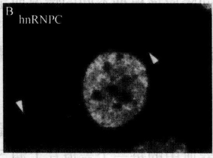

| 溶液 | 相对分子质量 | 分配系数 | 溶血时间 |
| --- | --- | --- | --- |
| 3mol/L 甲醇 | 32.04 | 0.0097 |  |
| 3mol/L 乙醇 | 46.07 | 0.0357 |  |
| 3mol/L 丙醇 | 58.0 | 0.156 |  |

## 3. 电解质和非电解质溶液对细胞膜透性的影响

（1）将试管编号，注明溶质名称及摩尔浓度。

(2) 按编号分别加入不同浓度的葡萄糖及氯化钠溶液 $2 \mathrm{ml}$ 。

(3) 每管各加入两滴血液，按住管口，倒置一次。

(4) 室温放置 $15 \mathrm{~min}$, 观察发生溶血的浓度, 确定等渗浓度。

（5）按下表记录实验结果。

(6) 计算等渗摩尔系数。

<table><tr><td rowspan="2">溶液</td><td colspan="8">摩尔浓度</td></tr><tr><td>M/8</td><td>M/9</td><td>M/10</td><td>M/12</td><td>M/13</td><td>M/14</td><td>M/16</td><td>M/18</td></tr><tr><td>葡萄糖</td><td></td><td></td><td></td><td></td><td></td><td></td><td></td><td></td></tr><tr><td>氯化钠</td><td></td><td></td><td></td><td></td><td></td><td></td><td></td><td></td></tr></table>

## 实验 23 核质穿梭测定法

## 【实验目的】

掌握穿梭蛋白的检测方法，了解穿梭蛋白在细胞中的活动情况。

## 【实验原理】

穿梭蛋白是一类可以在细胞核与细胞质中穿梭往返的蛋白质。目前发现的穿梭蛋白都为多功能蛋白，它们进行核/质穿梭的主要生物学功能是在胞核及胞质之间充当运输载体及进行信号传递，对于在细胞质中发生的反应起到重要调节作用。

核穿梭蛋白可以用几种方法检验，如利用酵母检验穿梭到细胞质的核蛋白，可以用温度敏感型入核的突变细胞株。这种方法，只要细胞处于限定的温度下，目标蛋白就会在细胞质中积累，即表明了穿梭运动的存在。在高等真核动物中，Goldstein 在 1958 年第一次用 $^{35}$ S 甲硫氨酸标记细胞，研究穿梭于细胞质和细胞核的核蛋白，结果来自 $^{35}$ S 甲硫氨酸标记细胞的细胞核被转移到另外一个没有被标记的细胞中。1989 年，Borer 等发展了抗体显微注射和种间异核体测定法。

其中，种间异核体成为应用最广泛的穿梭测定方法。它包括至少两个来自不同种类的细胞核杂交细胞的形成。在一个种间异核体中，一个包含目标蛋白的细胞系（供体细胞）和来自不同种类、含有不同蛋白质的另一个细胞系（受体细胞）融合。在受体细胞核中，用荧光显微镜能检测到原本只存在于供体细胞核的目标蛋白。这种方法在转运抑制物的存在下进行，抑制剂能确保入核的蛋白质并没有在细胞质中被新合成，而是从供

体细胞核中出核的（图5-1）。

图5-1 异核体测定法（Celis，2006）

A. 单向入核通路会导致蛋白质在细胞核内的累积（非穿梭核蛋白）。或许蛋白质会被人核和出核通路同时标记，造成在细胞核和细胞质之间的动态循环（穿梭）；B. 异核体测定法可以区分穿梭和非穿梭的核蛋白。如果存在于供体细胞核内的一个蛋白质可以穿梭，那么它就会在受体细胞核中出现。非穿梭的蛋白质不会从供体细胞中出核，也不会在受体细胞核中被发现。测定法一定要在蛋白质合成抑制剂存在的情况下执行

异核体测定法经常用人类的 HeLa 细胞和鼠类的 NIH 3T3 细胞系。鼠类的细胞核容易区别典型的异染色质染色图案。

当一个穿梭蛋白被鉴定时，异核体测定法更可以被用于解释转运中的途径和信号。最近，异核体测定法被用于描述新入核蛋白质在细胞核内的通道（Leung and Lamond, 2002）。这个实验是一个转染了细胞核的穿梭蛋白的供体细胞系被作为蛋白质标记的资源，并从这些蛋白质进入受体细胞核之后开始计时，因为受体细胞核不含有这种蛋白质，所以入核之后的细胞核内通路会持续到核仁重现。

## 【实验仪器、材料和试剂】

（1）仪器、用具:荧光显微镜、 $CO_{2}$ 培养箱、 $35mm\times10mm$ 组织培养皿、 $10mm\times10mm$ 玻璃盖玻片、镊子。

(2) 材料:人 HeLa 细胞，鼠类 NIH 3T3 和（或）D. melanogaster SL2 细胞。

(3) 试剂

1）加有 Glutamax-I 的（MEM）和非必需氨基酸的（MEM）培养基。

2) Dulbeco's modified eagle medium (D-MEM).

3）胎牛血清（FBS）。

4）保存在  $37^{\circ}C$ 、 $5\% CO_{2}$  和  $29^{\circ}C$ 、 $5\% CO_{2}$ （只用于 HeLa×SL2 异核体）保温箱中的基本组织培养基。

5）转染试剂:脂质体或者Fugene。

6）蛋白质合成抑制剂:茴香霉素、放线菌酮。

7）聚乙二醇（PEG）1500。

8）人类蛋白质或者真核动物中表达的带有绿色荧光蛋白或者氨基酸同位素标记的融合蛋白初级抗体（如 Ha、FLAG、His）和抗标记初级抗体。

9）抗 hnRNP C mAb 4F4 和抗 hnRNP A1 9H10mAb。

10) DAPI。

11）荧光共轭次级抗体（Jackson 实验室）。

## 【方法与步骤】

## (一) HeLa×SL2 异质核

## 1. 细胞培养

（1）把细胞培养于加入了非必需氨基酸和 $10\%$ FBS的MEM培养基中，并置于$37^{\circ}\mathrm{C}$ 、 $5\% \mathrm{CO}_{2}$ 的培养箱中。

（2）在加入了 $12\% \mathrm{FBS}$ 和 $2\mathrm{mmol / L}$ 谷氨酰胺的施耐德（Schneider）培养基中培育D.melanogaster SL2细胞，并置于 $25^{\circ}C$ 没有 $\mathrm{CO}_{2}$ 的培养箱中（可以使用实验室中干净的抽屉）。这是一种悬浮生长的细胞系，它们可以在没有血清的情况下黏附在盖玻片上。

（3）异核体培养基:$\mathrm{HeLa} \times \mathrm{SL2}$ 异核体应该加入非必需氨基酸和 $12\%$ FBS 的 MEM 培养基中，置于 $29^{\circ}\mathrm{C}$ 、$5\% \mathrm{CO}_{2}$ 的培养箱中培养。

## 2. 溶液配制

（1）蛋白质合成抑制剂:50%乙醇稀释的10mg/ml溶液，储备在-20℃中。最后浓度应依照不同的细胞系决定。环己米特、茴香霉素最广泛使用的浓度范围是20～100μg/ml，依米丁的浓度是0.5～20μg/ml。

(2) 磷酸盐溶液缓冲的含盐 PBS: 137mmol/L NaCl, 2.68mmol/L KCl, 8.06mmol/L $\mathrm{Na}_{2}\mathrm{HPO}_{4}$, 1.47mmol/L $\mathrm{KH}_{2}\mathrm{PO}_{4}$, 即 1L 溶液需要称 $8\mathrm{gNaCl}$、0.2g KCl、1.14g $\mathrm{Na}_{2}\mathrm{HPO}_{4}$ 和 $0.2\mathrm{g}\mathrm{KH}_{2}\mathrm{PO}_{4}$, 高压灭菌。

## 3. 实验步骤

(1) 所有步骤都应该在超净工作台中进行，并且要使用灭菌的培养材料和试剂。

(2) HeLa 细胞应培养至铺满 $10\mathrm{mm} \times 10\mathrm{mm}$ 的盖玻片的 $75\%$ 左右，每个 $35\mathrm{mm} \times 10\mathrm{mm}$ 的培养皿可容纳 4 个这样大小的盖玻片。

（3）用不含血清的 HeLa 培养基悬浮培养指数生长期的 D. melanogaster SL2 细胞，使浓度为  $3 \times 10^{7} \sim 4 \times 10^{7}$  细胞/ml。

（4）去掉 HeLa 细胞培养基，把其中  $500\mu l$  的 SL2 悬浮液盖上盖玻片。在  $29^{\circ}C$ 、 $5\% CO_{2}$  培养箱中培养 20min，让 SL2 细胞贴壁。

(5) 更换培养基, 加入 $1.5 \mathrm{ml}$ 异核体培养基, 并且加入蛋白质合成抑制剂。把细胞置于 $29^{\circ} \mathrm{C} 、 5 \% \mathrm{CO}_{2}$ 培养箱至少 $3 \mathrm{~h}$, 以抑制蛋白质的合成。另外做一个对照试验, 用相同体积的 $50 \%$ 乙醇代替蛋白质合成抑制剂。

(6) 融合步骤，在无菌培养皿中的每一个盖玻片上加 $50\mu \mathrm{l}$ 预热至 $29^{\circ}C$ 的PEG

1500。

(7) 从培养箱中去除 HeLa/SL2 共培养基，并且用预热至 $29^{\circ}\mathrm{C}$ 的 PBS 洗 2 次。

(8) 用灭菌的镊子移开盖玻片, 在 PEG 滴剂中倒置 $2 \mathrm{~min}$ (细胞面朝下)。然后,把盖玻片 (细胞面朝上) 放置在新的 P35 培养皿上, 用预热至 $29^{\circ} \mathrm{C}$ 的 PBS 漂洗 2 次。用加入了蛋白质合成抑制剂的 $1.5 \mathrm{ml}$ 预热的异核体培养基代替 PBS, 在进行穿梭的时候把异核体放入培养箱中 (通常 $6 \mathrm{~h}$ 或者更久)。

(9) 根据 $1 \mathrm{~h}$ 间隔的时间进程, 用通常的方法固定并染色细胞。阳性和阴性对照试验应该使用单克隆抗体直接抗人类 hnRNPA 1 (一种穿梭于细胞核和细胞质的蛋白质) 和人类 hnRNPC (一种不穿梭的蛋白质), 见图 5-2。

图5-2 HeLa×SL2异核体（Celis，2006）

直接抗人类蛋白质的单克隆抗体通常都不能和存在于果蝇中的同源物反应。在这种情况中，外源人类蛋白质的穿梭可以在 HeLa×SL2 异核体中得到分析。A. HeLa×SL2 异核体的阶段对照图，箭头标志了来自于 HeLa 细胞质融合的细胞的小 SL2 细胞核；B. 在 A 中显示的异核体被人类非穿梭蛋白质 hnRNPC 的专一性单克隆抗体免疫染色，显示出异核体在蛋白质合成抑制剂（20μg/ml 依米丁）存在的情况下，被限制在 HeLa 细胞核内，箭头指出了 SL2 细胞核的位置；C. 用对人类 U2AF$^{65}$专一的单克隆抗体对 HeLa×SL2 异核体

进行免疫染色，显示出在 SL2 细胞核（箭头处）内的人类蛋白质，表明这个蛋白质具有穿梭的能力

## （二）$\mathrm{HeLa} \times 3\mathrm{T}3$ 异核体

## 1. 细胞培养

(1) 持续培养 HeLa 细胞于加入非必需氨基酸和 10% FBS 的 MEM 培养基中, 置于 $37^{\circ} \mathrm{C} 、 5 \% \mathrm{CO}_{2}$ 培养箱中。在进行异核体穿梭法和转染前 2 天, 应该把细胞分装到无菌的培养皿中。

(2)在加有10%FBS的D-MEM培养基中培养老鼠3T3细胞，培养箱设置37℃、5%CO₂。

(3) 异核体培养基:HeLa×3T3 异核体细胞的培养方法和 3T3 细胞的相同。

## 2. 溶液配制

(1) PBS: $137 \mathrm{mmol} / \mathrm{L} \mathrm{NaCl}, 2.68 \mathrm{mmol} / \mathrm{L} \mathrm{KCl}, 8.06 \mathrm{mmol} / \mathrm{L} \mathrm{Na}_{2} \mathrm{HPO}_{4}, 1.47 \mathrm{mmol} / \mathrm{L} \mathrm{KH}_{2} \mathrm{PO}_{4}$ 。即 $1 \mathrm{~L}$ 溶液需要称 $8 \mathrm{~g} \mathrm{NaCl}, 0.2 \mathrm{~g} \mathrm{KCl}, 1.14 \mathrm{~g} \mathrm{Na}_{2} \mathrm{HPO}_{4}$ 和 $0.2 \mathrm{~g} \mathrm{KH}_{2} \mathrm{PO}_{4}$, 高压灭菌。

(2) DAPI: 避光贮备 $1 \mathrm{mg} / \mathrm{ml}$ 的溶液并贮存在 $-20^{\circ} \mathrm{C}$; 染色溶剂: 用 PBS 稀释贮存液至 $1 \mu \mathrm{g} / \mathrm{ml}$, 避光保存在 $4^{\circ} \mathrm{C}$ 几个星期。