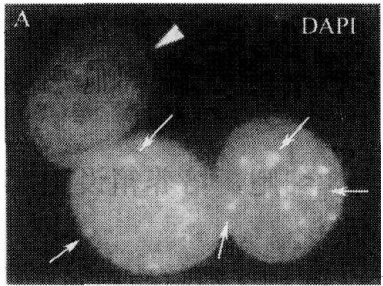
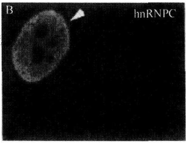

(3) 蛋白质合成抑制剂: 准备 $10 \mathrm{mg} / \mathrm{ml}$ 的存储溶液, 用 $50 \%$ 的乙醇溶解。保存于 $-20^{\circ} \mathrm{C}$ 中。最终的浓度根据不同的细胞系决定; 环己米特、茴香霉素使用最广泛的浓度范围是 $20 \sim 100 \mu \mathrm{g} / \mathrm{ml}$, 依米丁的浓度是 $0.5 \sim 20 \mu \mathrm{g} / \mathrm{ml}$ 。

## 3. 实验步骤

（1）所有步骤都应该在超净工作台中进行，并且要使用灭菌的培养材料和试剂。

(2) 在进行实验的前一天晚上, HeLa 细胞应该用目的重组物质转染, 并且继续在 $10 \mathrm{~mm} \times 10 \mathrm{~mm}$ 的盖玻片上生长至 $75 \%$ 左右的密度 (subconfluent density)。一个 $35 \mathrm{~mm} \times 10 \mathrm{~mm}$ 的组织培养无菌培养皿可以放置 4 个这样的盖玻片。普通的转染试剂, 如 Lipo-fectin 或者 Fugene, 在这个实验中非常有用, 可以依据它们附带的说明直接使用。转染和进行异核体实验的时间间隔应该根据不同的情况而定, 避免外源蛋白的过表达。

(3) 胰蛋白酶解和计数 3T3 细胞。对于每一个 P35 HeLa 培养, 需要准备 $1.5 \mathrm{ml}$ 3T3 的悬浮液, 该悬浮液浓度应为 $1 \times 10^{6} \text {细胞/ml}$, 带有 $10 \%$ FBS 和蛋白质合成抑制剂的 D-MEM。

(4) 除去 HeLa 细胞培养中的培养基, 盖上带有 3T3 悬浮液的盖玻片。在 $37^{\circ} \mathrm{C}$、$5 \% \mathrm{CO}_{2}$ 的培养箱中培养, 直到 3T3 细胞可以贴壁及蛋白质合成被抑制。

(5) 在灭菌的有盖培养皿中的每一个盖玻片上滴  $50 \mu l$  预热的 PEG 2000。

(6) 从培养箱中去除 HeLa/SL2 共培养基，并且用预热的 PBS 洗 2 次。

(7) 用灭菌的镊子移开盖玻片, 在 PEG 滴剂中倒置 $2 \mathrm{~min}$ (细胞面朝下)。然后, 把盖玻片 (细胞面朝上) 放置在新的 P35 培养皿上, 用预热的 PBS 漂洗 2 次。用加入了蛋白质合成抑制剂的 $1.5 \mathrm{ml}$ 预热的异核体培养基代替 PBS, 在进行穿梭的时候把异核体放入培养箱中 (通常 $1 \sim 5 \mathrm{~h}$)。

(8) 根据 $1 \mathrm{~h}$ 间隔的时间进程, 用常用的方法固定并染色细胞。另外还有一个检测外源蛋白所必需的实验, 细胞要用 DAPI 染色, 这样才能检测到异核体细胞核。阳性和阴性对照试验应该使用单克隆抗体直接抗人类 hnRNPA 1 (一种穿梭于细胞核和细胞质的蛋白质) 和人类 hnRNPC (一种不穿梭的蛋白质), 见图 5-3。

图5-3 $\mathrm{HeLa}\times 3\mathrm{T}3$ 异核体（Celis，2006）

HeLa 细胞被编码 GFP-U2AF65 的载体短暂感染，再在  $20 \mu g/ml$  依米丁存在的情况下和鼠类的 NIH 3T3 细胞融合。图中指出一个带有 DAPI（A）标记的单异核体，抗 hnRNPC mAb（B）和 GFP（C）。A. DAPI 染色的 HeLa×3T3 异核体。鼠类细胞很容易被分辨出，因为它所在的地方会出现光亮的斑和周围出现异质染色体（箭头处）。B. 在 A 中出现的异核体是用对非穿梭的人类 hnRNP C 蛋白专一的抗体染色的。hnRNP C 被困于 HeLa 细胞核内，确定了蛋白质合成受到了有效的抑制。C. 在 HeLa×3T3 中检测出 GFP，说明了原

来在 HeLa 细胞中的融合蛋白穿梭于细胞质和细胞核之间。标尺 = 10μm

## 【实验结果分析】

不同蛋白质的穿梭速率存在很大差异，一些很慢（如核仁素要用16h才能被细胞核的受体检测到），有一些很快（如运输受体在融合后的几分钟就能被核受体检测到）。因此，使用穿梭检测法最理想的时间应该是根据不同蛋白质所需的时间来决定。作为一个普遍的规律，蛋白质在HeLa×3T3异核体细胞核受体的检测，包括外源蛋白短暂地表达，它远远比HeLa×SL2中表达内源蛋白快。例如，相同的蛋白质、相同的供体和受体细胞核，在第一种方法中可能90min就可以完成，而第二种要用7h。

要正确地解释用异核体方法得到的结果，需要运用足够的控制。无论什么时候，穿梭运动应该在内源和外源表达蛋白中都存在，因为有时候氨基酸标记和蛋白质过量表达会影响结果。当检测内源蛋白穿梭运动时，一定要注意抗体的专一性。蛋白质合成抑制剂的效率一定要能被正确地控制，因为不同的细胞在对蛋白质合成抑制剂的敏感度上可能会有很大的差异性。关于转录抑制的效率的表示，应该使用对人类细胞核非穿梭蛋白专一的单克隆抗体染色的异核体。如果细胞质中的蛋白质继续合成，这些蛋白质就能被细胞核的受体检测到。任何时候，异核体都应该对目标蛋白和 hnRNPC 双重染色。或者，当目标蛋白同样也用 mAb 标记时，再做一个平行实验，而在这个实验中用抗 hnRNPC 的抗体来标记异核体。

如果一个穿梭蛋白被检验出来，那判断它是从细胞核孔中扩散出去的还是被细胞核通过受体调控通道运输出核就会变得方便了。为了这个目的，供体细胞应该放置于4℃，且时间要和异核体测定法在培养基中的时间一样，这种培养基加入了蛋白质合成抑制剂和20mmol/L的HEPES。随后进行目的蛋白的免疫染色。在低温中，受体调控的细胞核出入核运动是不会发生的。所以，如果蛋白质通过受体调控通道出核，它应该保留在细胞核中。相反，如果蛋白质可以被动地渗漏出细胞孔，它就会在细胞质中积累。如果转录没有被抑制，新合成的蛋白质就会在细胞质中积累，使测定无效。当根据短暂转染进行穿梭分析时，非常重要的一点是，要注意在细胞高水平表达蛋白质时，细胞质中积累外源蛋白和蛋白质被动扩散出核是一个普遍的事件。所以，外源蛋白的分析应该总是用低蛋白质表达量的细胞进行。另外，需要一个对照实验，说明外源蛋白渗漏至细胞质的程度（如低温改变的实验）。

在短暂转染中，种间异核体的应用，使利用蛋白突变体分析参与出核的蛋白质结构域变得可能。但是，这种分析只能用于保留全部核定位信号的突变体，对于渗漏到细胞质的小片段缺失的突变体应该要小心检测。

## 【注意事项】

（1）HeLa 细胞的融合是所有步骤中很重要的一步。如果培养基的浓度太低，形成的异核体的数目就会减少。如果细胞已经融合，那么 SL2 或者 3T3 就会没有空位黏附，而且它们的细胞核通常都会在 HeLa 的细胞核上方，使得结果无法分析。我们应该逐个检查 HeLa 细胞的盖玻片，选出其中浓度达到聚合前期的为好。

(2) 通常在融合期间, 细胞会大量损失。这可能是在盖玻片被翻转、PEG 液滴被吸取时产生的剪切力所致。为了避免这种情况，直接在盖玻片下方吸取 PBS，使之漂浮，然后用镊子把它捡起。蛋白质合成抑制剂能诱导培养基中高密度的细胞凋亡，一些细胞群可能对这些抑制剂的浓度高度敏感。这些细胞群在对别的细胞没有作用的抑制剂浓度下，就可以产生反应。所以，抑制剂的类型和浓度应谨慎选择。环乙酰亚胺是使用最广泛的抑制剂，虽然一些细胞系对于它会比对依米丁更敏感。在一些例子中，蛋白质合成抑制剂可能很难达到目标的效果，因为在培养基中发现了很多新翻译的蛋白质。为了防止这些蛋白质妨碍测定法的进行，通常会对异核体用抗 hn-RNPC 和抗 4F4mAb 进行双标记，只有在异核体中这种蛋白质才会被限制在人类细胞核中。

（3）在准备阶段找到 HeLa×3T3 异核体是一件困难的事，因为在细胞质中对比度不强，以致不能形成清晰的视野。最好的方法是去寻找两个靠近的细胞核，这通过 DAPI 染色就能找到。对鼠类细胞核进行鉴定同样也需要一定的 DAPI 的染色。对 4F4mAb 进行染色可以作为辅助的手段，因为当翻译被抑制时，它只标记人类细胞。

（4）当分析一个短暂转染蛋白的穿梭能力时，用低表达量的细胞是很重要的。一个好的荧光显微镜对于检测低表达蛋白是必需的。通常，会形成多核的异核体。他们也应该被考虑到穿梭检测法中，因为很难同时检测到供体细胞核和达到蛋白质的原始表达水平（因为蛋白质会扩散到其他细胞核中）。

## 【作业】

（1）细胞的融合是实验的重要环节，在细胞融合过程中，应如何调节培养基的浓度？

(2) 全面分析实验结果，描述不同蛋白质穿梭速率的差异，以及穿梭蛋白的运动情况。

(戚康标)

## 实验 24 线粒体膜电位检测

## 【实验目的】

掌握用罗丹明123染色法检测线粒体膜电位的原理和方法。

## 【实验原理】

线粒体膜电位是指线粒体膜两侧离子浓度不同所产生的跨膜电位差，它反映了线粒体功能的完整性，是评价线粒体功能的敏感指标。罗丹明123（Rhodamine 123）是一种可透过细胞膜的阳离子荧光染料，可指示线粒体跨膜电位的状况。在正常细胞中，罗丹明123能够依赖线粒体跨膜电位进入线粒体基质，其荧光强度会减弱或消失。在凋亡细胞中，线粒体膜完整性被破坏，线粒体膜通透性转运孔开放，引起线粒体跨膜电位（$\Delta \Psi_{\mathrm{m}}$）的崩溃，罗丹明123重新从线粒体中释放出来，从而发出强黄绿色荧光。可通过采用荧光显微镜、荧光光度计或流式细胞仪检测荧光信号的强弱来反映线粒体膜电位的变化和凋亡的发生，适用于培养的细胞或从组织中提取出的线粒体的膜电位检测。

## 【实验仪器、材料和试剂】

(1) 仪器、用具: $\mathrm{CO}_{2}$ 培养箱、高速离心机、荧光显微镜、荧光光度计或流式细胞仪、培养瓶、离心管。

(2) 材料:动物培养细胞。

(3) 试剂: $0.1 \sim 50 \mu \mathrm{g} / \mathrm{ml}$ 罗丹明 123 染液、培养基（参见“实验 33 人体外周血淋巴细胞培养与染色体标本制备”）。

## 【方法与步骤】

(1) 将培养细胞按 $1 \times 10^{6}$ 个/ml 的浓度重悬于培养基中。

(2) 加入  $0.1 \sim 50 \mu g/ml$  罗丹明 123 染液。

(3) 在细胞培养箱中按 $37^{\circ}\mathrm{C}$ 、 $5\% \mathrm{CO}_{2}$ 的条件孵育 $1 \sim 30\mathrm{min}$ 。

（4）用培养基重悬细胞，再离心收集，重复2次，以洗涤细胞。

(5) 重悬细胞于培养基中，37℃、5% CO₂ 的条件培养 60min。

(6) 按激发波长 $488 \sim 505 \mathrm{~nm}$ 、发射波长 $515 \sim 575 \mathrm{~nm}$ （一般为 $530 \mathrm{~nm}$），用荧光显微镜、荧光光度计或流式细胞仪检测荧光信号。

## 【注意事项】

（1）罗丹明 123 染液的使用浓度依细胞种类不同而不同，一般为  $3 \sim 10 \mu g/ml$ 。

(2) 染色孵育时间依细胞种类不同而不同, 一般 $10 \mathrm{~min}$ 。

（3）注意保持染液中 $\mathrm{pH}$ 的一致性，以免影响膜电位。

## 【作业】

每组取3个样本，每个样本随机选取3个视野，取其平均数进行统计学分析。

(冯冬茹)

## 实验 25 细胞电泳

## 【实验目的】

(1) 了解细胞电泳的意义和基本原理。

(2) 掌握红细胞的电泳速度测定方法。

## 【实验原理】

在电场作用下，液体介质中的悬浮质点与介质的相对运动，称为电泳。将细胞制成悬浮溶液，使单个游离的细胞分散于等渗的介质中，在电场作用下，细胞在电泳室内发