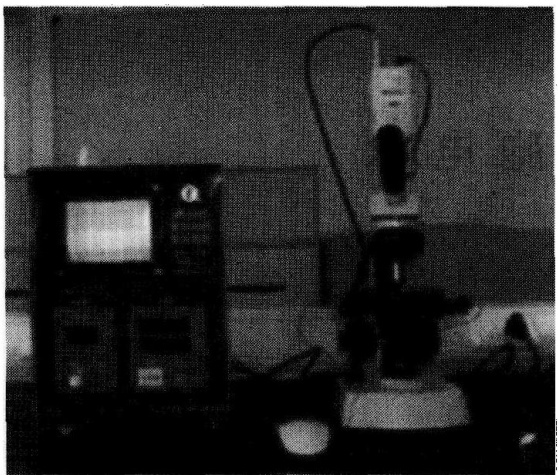
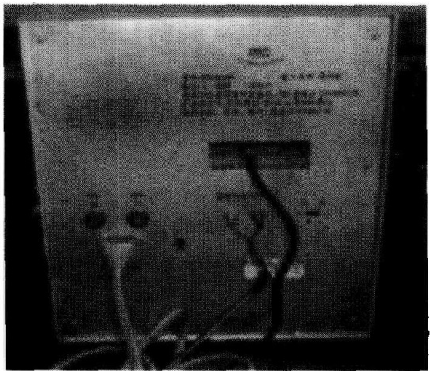
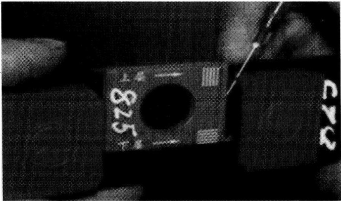
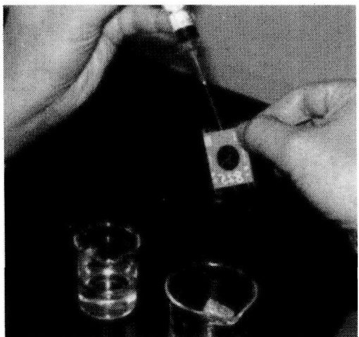
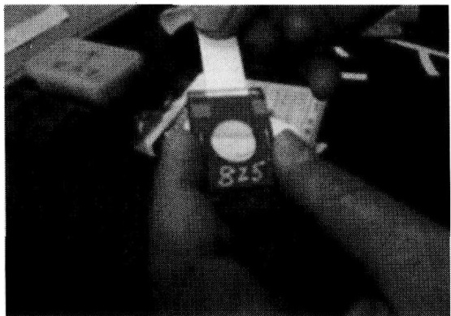

生运动，这种现象称为细胞电泳。

每种细胞在恒定的条件下（如温度、电压、电流、介质浓度、pH 等）其电泳速度和  $\zeta$  电位十分稳定，但在各种有害因子、病理状态的影响下，其表面电荷会降低，所以细胞电泳速度和  $\zeta$  电位值也发生改变（降低）。

目前, 细胞电泳技术已广泛应用在生命科学各研究领域中, 其意义在于: ① 研究生命结构的表面性质; ② 推测细胞表面构造和功能及大分子物质在细胞表面的吸附作用并且进行免疫反应; ③ 可以鉴定细胞或单细胞有机体的机能和病理状态。

## 【实验仪器、材料和试剂】

(1) 仪器、用具: WD-9408C 型显微细胞电泳系统主机、极向转换开关 (专用鼠标控制器)、WD-9408C 型显微观察电泳槽、专用显微镜 (带摄像头)、注射器、 $100 \mathrm{ml}$ 烧杯、离心机、离心管、滤纸、擦镜纸。

(2) 材料:兔子或罗非鱼血。

(3) 试剂: 肝素钠、蔗糖、氯化钠。

1）0.85%生理盐水。

2) $8 \%$ 蔗糖肝素液: 在 $8 \%$ 的蔗糖液中, 每毫升加入 $4 \sim 5 \mathrm{U}$ (国际单位)的肝素,混匀后备用。

## 【方法与步骤】

## （一）系统的安装及使用

(1) 将随机所配电源线与有接地保护的电源插座连接好。

(2) 将摄像头通过接口与显微镜连接牢固。

(3) 将随机所配摄像头电源线按红正黑负连接主机 (后面板) 及摄像头电源接线端 (图 5-4、图 5-5)。

(4) 将视频线分别与主机（后面板 VIDEO IN）和摄像头视频输出端相连（图 5-5）。

图5-4 显微（细胞）电泳装置

图5-5 主机背面连接

(5) 将电泳仪后面板的 “内/外” 选择开关拨向 “外” 档。

（6）将随机所配专用鼠标控制器与仪器面板下方9芯插座相连。

(7) 将黑红两色的电极线对应插入输出插座, 连接显微观察电泳槽 (图 5-6)。

图5-6 细胞电泳槽装置

(8) 打开电泳仪的电源开关，此时累计时间和微粒数均为 0。

(9) 设定预置微粒 (细胞) 数, 可按上下 “-/+” 键选择, 红细胞电泳一般预置数设定为 11。

(10) 调节电泳仪的输出电压到所需值, 一般为 $40 \sim 80 \mathrm{~V}$, 此时输出电压的有无和极性受鼠标左右按键的控制。

## （二）电泳检测步骤

## (1) 细胞介质的制备

1) 如果是观察无机物等微粒, 根据测试的需要, 一般在烧杯中按比例: $50 \sim$ $100 \mathrm{ml}$ 的蒸馏水 (或纯净水) 加入 $0.01 \sim 0.05 \mathrm{~g}$ 的样品, 充分搅拌均匀。

2）如果是观察细胞，原则上应考虑细胞渗透压和酸碱度等因素配制稀释剂。

红细胞电泳的介质为 $8\%$ 蔗糖肝素液。

## (2) 样品的制备

1) 用注射器抽取 $1 \sim 2 \mathrm{ml}$ 新鲜血液, 加入到装有 $5 \mathrm{ml} 0.85 \%$ 生理盐水的离心管中, $1000 \mathrm{r} / \mathrm{min}$ 离心 $5 \mathrm{~min}$, 去上清液备用。

2）取 $5\mathrm{ml}$ 细胞介质，用针头加入1或2滴离心后的血液，摇匀备用。

(3) 样品灌注（图 5-7）

图5-7 样品灌注

（4）把显微观察电泳槽平放于显微镜载物台上（注意正反面），尽量将观察窗对准显微镜镜头的中心。两边用压板固定好。

（5）寻找显微电泳槽上下两玻璃内壁的标记:由于槽腔内的两个表面均刻有永久性的光学标记，因此，寻找腔内的任意深度都很方便。

## (6) 观测层的选择

从理论推导，该系统的显微观察电泳槽的两个静止层分别在电泳槽深度的 0.202 和 0.798 处。将总深度数值乘以 0.202 或 0.798，即是静止层的位置，将微调手轮旋至此位置。此时在监视器屏幕上能看清楚的微粒即处在静止层处。按下“左移”键，观察微粒是否移动，如果方向相反可改按“右移”键。观察微粒移动距离，可从监视器两条竖直标志线确定。

## (7) 观察层的计算

## 观察层由下式求出

$$
\mathrm{Dg} = D \times W
$$

式中，Dg 为确定观察的深度；D 为电泳槽的总深度（每个电泳小室不同）；W 为欲选定的观察深度比率。

例如，电泳槽的总深度（视觉）D 为  $825 \mu m$ ，欲选定的观察深度比率 W 为 0.202，确定的观察深度（Dg）则为  $825 \times 0.202 = 166.65 \mu m$ 。用  $\mu m$  表示。

根据计算结果，顺（逆）时针回转 166 格，即为观察层（静止层）。

说明:静止层——显微电泳技术的一个重要概念。

在外加电场的作用下，处在两端封闭的毛细管中不同深度的各层微粒的泳动速度是不同的，这是微粒受到电泳和电渗两种因素作用的结果。单纯的电泳通常使各层微粒以同一速度移向正极，电渗的情况却比较复杂。在外加电场的作用下，沿管壁的一层，以较高的速度流向负极，越是远离管壁，液层的流速越低。

管的两端是封闭的，管内的液体流动总量为零。因此，在同一时间内，有多少液体沿管壁附近流向负极，就必然有同量液体流向正极。流速是逐层变化的，在两种流向之间，存在流速为零的一层，即为静止层。处在静止层上的微粒（细胞），其移动速率才等于电泳率。在静止层附近，深度的微小偏离，将引起测定速度的较大误差。因此，准确地确定静止层，是显微电泳中一项最精细、最重要的工作。

断面长方形观察电泳槽的静止层在距电泳槽前壁的0.202和0.798处。

## (8) 电泳

## (9) 电泳率的计算

电泳率定义为:在  $1 \, V/cm$  电势梯度下，每秒钟泳动  $1 \, \mu m$  为 1 电泳率单位。这个定义可以用下式表达:

$$
\mathrm{EMP} = \frac {S / t}{V / L}
$$

式中，S 为单一微粒泳动路程（ $\mu m$ ）；t 为泳动所需时间（s）；V 为电极两端电压（V）；L 为电泳槽电极之间的长度（4.2cm）。一般，L、S 值是固定的，若用 K 表示  $S \cdot L$ ，则系数 K = SL。

电泳率 $\mathrm{EMP} = K / (tV)$。

## (三) 主机操作步骤

(1) 监视器屏幕标有 5 条竖直等分的刻度线, 如图 5-8 所示。彼此两条之间的距离请看 CCD 上的数字标记。

(2) 调节显微镜到欲观察的深度。从主机监视器上找到最清晰的微粒（细胞），如果微粒（细胞）不在标线上，则先按下“暂停”键，按鼠标左键或右键，将微粒（细

图5-8 监视屏刻度线示意图

胞）移动到某一标线上，在“暂停”期间仪器不记时。

(3) 电泳计时时应先按右键右移微粒 (细胞) 至另一标线然后再按左键返回原标线 [一个来回 (4 格) 为一次微粒 (细胞) 移动时间], 松开鼠标, 刚才的时间及个数被记录。

(4) 另选一在标线的微粒 (细胞) 重复以上步骤, 直到测完全部微粒 (细胞), 此时仪器蜂鸣报警, 表示记数完毕。

(5) 按一下 “暂停” 键, 蜂鸣器停止鸣响。此时将总时间和微粒 (细胞) 数记录下来, 然后可以按 “清除” 键, 重新开始测量。

【注意事项】

(1) 总时间是微粒（细胞）往返的总时间，所以距离应是往返的距离。

(2) 如果微粒（细胞）移动过快或过慢，可以调节输出的电极电压值。

（3）如果电压值调不上去，电流灯亮，说明所配的样品太脏，须重新配制样品。

(4) 专用显微镜标定记录应妥善保存！切勿遗失，否则将无法工作。

(5) 显微观察电泳槽为贵重精密易损部件, 应小心使用及保管, 使用后用纯净水清洗干净 (图 5-9) (不可用有机溶剂清洗电泳槽), 并用滤纸条和擦镜纸条擦干 (图 5-10), 最后在专用包装盒内保存。

图5-9 纯净水冲洗电泳小室

图5-10. 用滤纸、擦镜纸抹净电泳小室