## 第六章 细胞分裂与染色体畸变

生长和增殖是生命的重要特征。无论是单细胞生物还是多细胞生物，每个细胞都必须进行生长和分裂，细胞通过分裂将复制的遗传物质均等地分配到两个子细胞中，保证了细胞遗传的稳定。细胞的生长和增殖有严格的程序和精确的调控，一旦出现异常，有机体就会出现病变，甚至形成恶性肿瘤。研究细胞的增殖具有重大的理论意义和实践意义。细胞分裂有三种方式:无丝分裂（amitosis）、有丝分裂（mitosis）和减数分裂（meiosis）。

## 实验 26 细胞的无丝分裂与有丝分裂

## 【实验目的】

(1) 了解细胞增殖的方式。

(2) 了解无丝分裂、有丝分裂的基本过程及其生物学意义。

（3）掌握有丝分裂过程中各时期的主要特点。

(4) 掌握有丝分裂标本临时压片技术。

## 【实验原理】

细胞周期是生长与繁殖的周期，每个生物体都必须通过细胞分裂，才能达到生长与繁殖的目的。细胞分裂对生物体的个体维持与种族延续有着十分重要的意义。

无丝分裂是低等生物增殖的主要方式，最早是雷马克（Remak）于1841年在鸡胚血球细胞中发现的。由于分裂过程不经过染色体的组装、纺锤体形成等一系列变化，故称无丝分裂。其后又陆续在各种动植物细胞中发现无丝分裂，尤其是在分裂旺盛的细胞中更为常见。

有丝分裂是高等生物体细胞增殖的主要方式。有丝分裂过程包括一系列复杂的核的变化，染色体和纺锤体的出现，以及它们平均分配到每个体细胞的过程。有丝分裂过程划分为前期、中期、后期和末期四个阶段，但各阶段之间没有明显的界限，它是一个连续的变化过程。

## 【实验仪器、材料和试剂】

(1) 仪器、用具:显微镜、钟表镊、刀片、载玻片、盖玻片、擦镜纸、吸水纸。

(2) 材料:草履虫无丝分裂装片、洋葱根尖或蚕豆根尖。

(3) 试剂

1）Carnoy 固定液（甲醇:冰醋酸=3:1）。

2) 1mol/L HCl。

3）改良苯酚品红染色液的配制:

母液 A:称取 3g 碱性品红，溶于 100ml 70% 乙醇中（此液可于 4℃ 冰箱中长期保存）。

母液 B:取 A 液 10ml，加入 90ml 5% 苯酚水溶液（2 周内使用）。

取 B 液 45ml，加入 6ml 冰醋酸和 6ml 37% 甲醛。此为苯酚品红染色液。

取苯酚品红染色液 10ml，加入 90ml 45% 的乙酸和 1.8g 山梨醇。放置 2 周后，染色效果较好。此液称为改良苯酚品红染色液。

## 【方法与步骤】

## （一）草履虫无丝分裂的观察

（1）标本制备:草履虫无丝分裂装片，核染色。

(2) 观察: 在低倍镜及高倍镜下观察, 草履虫胞体被染成粉红色, 细胞核染成紫红色。分裂时草履虫大核沿胞体两端伸长, 进而在核的中部向内凹陷, 呈哑铃形, 然后断开形成两个核, 同时胞体也随之延伸, 中部出现分裂沟, 最后完全分裂成两个子细胞。

（二）洋葱根尖或蚕豆根尖细胞有丝分裂的临时压片观察

（1）材料发根:待根长达 $2\mathrm{cm}$ 时，切下根尖，浸入Carnoy固定液中4h，分别在$95\%$ 乙醇和 $85\%$ 乙醇中各浸泡30min，最后在 $70\%$ 乙醇中 $4^{\circ}\mathrm{C}$ 保存。

(2) 水解: 取出根尖放在 $1 \mathrm{~mol} / \mathrm{LHCl}$ 中 $60^{\circ} \mathrm{C}$ 水解 $8 \mathrm{~min}$, 蒸馏水水洗 3 次。

（3）染色:把处理好的根尖放在载玻片上，切取乳白色的分生区，用镊子轻轻捣碎，滴上一滴改良苯酚品红染色液，染色5～10min后，盖上盖玻片。

（4）压片:在盖玻片上面铺上吸水纸，固定好盖玻片，用拇指垂直压片，再用橡皮轻敲击，使材料压成均匀的薄层。

(5) 观察: 先用低倍镜寻找压片中处于分裂期的细胞, 然后转用高倍镜观察不同分裂期的细胞。可以看到, 染色质和染色体被染成紫红色, 细胞质不着色。

洋葱根尖细胞有丝分裂各时期特征见图6-1。

间期:细胞核内染色质分布均匀，核形态明显，核内可看到 $1\sim 3$ 个透明发亮的核仁。

前期:细胞核膨大，核中染色质浓缩成染色丝，并逐渐缩短变粗，形成具有一定形态的染色体。晚前期，核仁、核膜逐渐消失。

中期:染色体更加缩短变粗，排列在细胞的中央形成赤道板。这时染色体已纵裂成两条染色单体，但着丝粒未分裂。

后期:着丝粒纵裂，形成的两组染色单体分别向细胞两极移动。

末期:移到两极的染色体解螺旋、伸长变细成为染色丝，最后形成染色质。核仁、核膜重新出现，纺锤体消失。在两个新核之间凝聚成细胞板，进而形成细胞壁，形成两个子细胞。

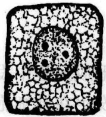

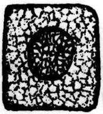

(2)

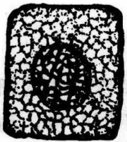

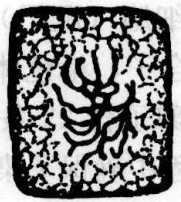

(4)

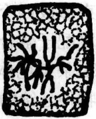

(5)

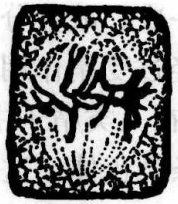

(6)

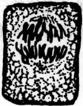

(7)

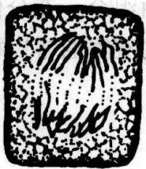

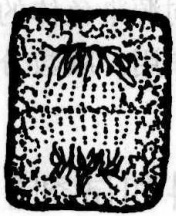

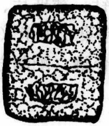

(10)

(9)

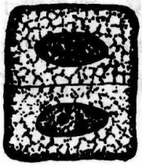

(11)

图6-1 洋葱根尖细胞有丝分裂过程（辛华，2001）

(1) 间期，(2)、(3)、(4)前期，(5)、(6)中期，(7)、(8)、(9)后期，(10)、(11)末期

## 【作业】

(1) 观察描绘草履虫无丝分裂的现象。

（2）绘出洋葱根尖细胞有丝分裂各时期细胞。

(何炎明)

## 实验27 细胞减数分裂

## 【实验目的】

(1) 了解动物、植物生殖细胞的形成过程。

(2) 了解生殖细胞减数分裂发生过程及各个时期的染色体和细胞变化特点, 加深对减数分裂意义的认识。

（3）掌握减数分裂标本的制备方法。

## 【实验原理】

减数分裂是一种特殊方式的细胞分裂，仅在配子形成过程中发生。不同生物减数分裂发生在生命周期的不同时段，动物的减数分裂通常发生在性细胞（配子）形成时，植物通常发生在单倍体细胞（孢子）形成时。这一过程的特点是:细胞连续进行两次核分裂，而染色体只复制一次，减数分裂结束形成四个子细胞（配子），每个子细胞染色体数目减少一半（n）。经过受精作用，雌雄配子融合为合子，染色体数目又恢复到母细胞的水平（2n）。例如，在人类精子中含23条染色体，卵子含23条染色体，受精后形成的合子含23对或46条染色体。这样在物种延续的过程中确保了染色体数目的恒定，从而使物种在遗传上具有相对的稳定性。另外，在减数分裂过程中包含的同源染色体配对、交换、分离和非同源染色体的自由组合，充分体现了遗传的三大规律在丰富基因的多样性中起着重要的作用。减数分裂的观察通常以植物花粉母细胞或动物精巢为材料进行观察。

## 【实验仪器、材料和试剂】

（1）仪器、用具:显微镜、钟表镊子、解剖针、载玻片、盖玻片、吸水纸。

(2) 材料:蝗虫（Catantops brachycerus）精巢、玉米（Zea mays L.）雄穗。

(3) 试剂: 乙醇、冰醋酸、改良苯酚品红染色液（配制方法见实验 26）。

## 【方法与步骤】

## （一）玉米花粉母细胞减数分裂的观察

在植物中，减数分裂的过程通常并不直接产生配子，而是先由减数分裂形成小孢子，小孢子经有丝分裂形成配子体，配子体再经有丝分裂产生配子，由配子进行有性繁殖。

## 1. 取材

在雌穗未抽出前 7～10 天，而雄花序即将抽出（手摸植株上部喇叭口处有松软感觉），以上午 9:00～11:00 取样为好，此时减数分裂较旺盛。剥去雄穗外部叶片，露出幼穗，新鲜幼穗可直接压片观察，也可用 Carnoy 固定液固定 12～24h，再经 95%乙醇和 85%乙醇各浸泡 30min，最后放在 70%乙醇中 4℃保存，可随时取用。

## 2. 染色、制片

取适当大小颖花各一朵，置载玻片上，用解剖针剥开内外颖，将花药剔出，加一滴改良苯酚品红染色液染色10min，边染色边用镊子轻轻捣碎花药，挤出花药中的花粉母细胞，最后用镊子除去残渣，盖上盖玻片，用吸水纸吸去四周多余的染液。

## 3. 镜检

在显微镜下检查花粉母细胞、二分体、四分体以及各个时期的细胞。花粉母细胞与一般体细胞的区别是细胞外有一层较厚的透明胼胝质壁，同时，细胞体积较近似等径的多角形，核也较大。