玉米的减数分裂过程见图6-2。

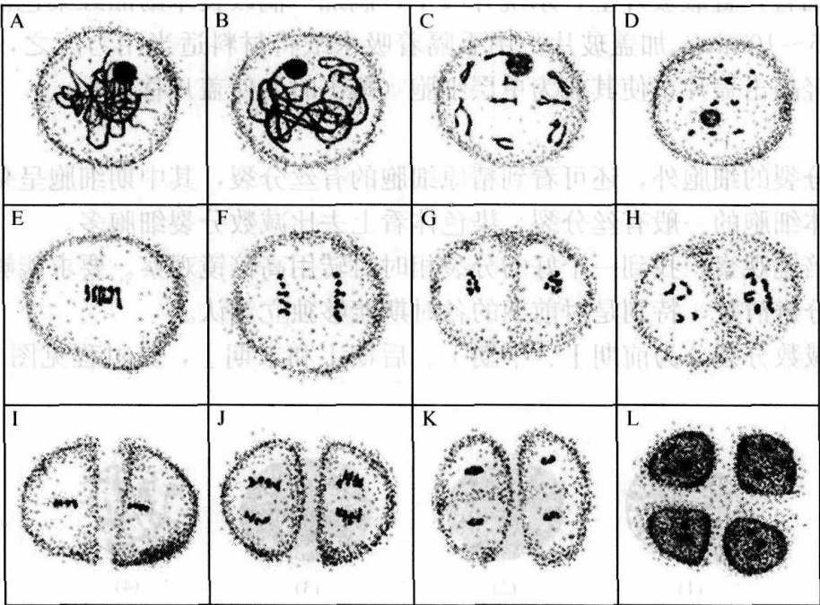

图6-2 玉米减数分裂

A. 细线期；B. 粗线期；C. 双线期；D. 终变期；E. 中期 I；F. 后期 I；G. 末期 I；H. 前期 II；I. 中期 II；J. 后期 II；K. 末期 II；L. 四分孢子

## (二) 蝗虫精母细胞减数分裂的观察

雄性动物精巢中精子形成的过程称精子发生。精子发生时二倍体生殖细胞叫做精子器，它经历分化、体积增大并形成二倍体初级精母细胞。初级精母细胞经历第一次减数分裂形成两个次级精母细胞，每一个包含单倍体染色体数目。此后，每一个次级精母细胞经历第二次减数分裂染色单体分离，形成两个精细胞，每一个精细胞经历分化和长出鞭毛，形成有功能的精子。与卵子发生不同的是，精子发生从一个精母细胞经历减数分裂可以产生四个有功能的配子。

蝗虫精巢取材方便，标本制备方法简单，染色体数目较少，分裂过程清楚。蝗虫初级精母细胞染色体数 $2n = 22 + X$ ，经过减数分裂形成四个精细胞，每个精细胞染色体数为 $n = 11 + X$ 或 $n = 11$ （注:蝗虫的性别决定与人类不同，雌性有两条XX染色体，雄性为XO，即只有一条X染色体，没有Y染色体）。

## 1. 取样

以夏、秋两季采集为宜，因此时蝗虫精母细胞正处于减数分裂旺期。蝗虫雌雄个体易于区别，一般雄虫个体较小，其腹部末端为交配器，形似船尾，而雌体较大，腹部末端分叉。

## 2. 固定

捕捉后将雄虫腹部剥开,取出精巢,放入 Carnoy 固定液中固定 $12 \mathrm{~h}$, 然后分别用 $95 \%$ 乙醇和 $85 \%$ 乙醇各浸泡 $30 \mathrm{~min}$, 最后放在 $70 \%$ 乙醇中, 于 $4 ^ {\circ} \mathrm{C}$ 冰箱中保存。

## 3. 压片

挑取精细管，置载玻片上，水洗并吸干，滴加一滴改良苯酚品红染色液，镊子轻轻捣碎，染色5\~10min，加盖玻片，用手隔着吸水纸将材料适当用力压之，再用带橡皮头的铅笔轻轻敲击盖片，使其成为单层细胞（敲击时勿使盖片移动）。

## 4. 镜检

除正在分裂的细胞外，还可看到精原细胞的有丝分裂，其中期细胞呈菊花状，细胞肥大，属于体细胞的一般有丝分裂，染色体看上去比减数分裂细胞多。

先用低倍镜观察，找到一个好的分裂相时再转用高倍镜观察。要求能够将减数分裂的各个时期分辨清楚，特别是对前期的各时期能够独立辨认。

第一次减数分裂分为前期Ⅰ、中期Ⅰ、后期Ⅰ和末期Ⅰ，其过程见图6-3。各时期特征如下。

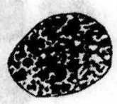

(1)

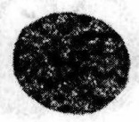

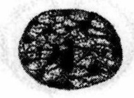

(2)

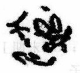

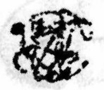

(5)

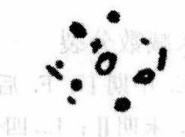

(6)

(3)

(4)

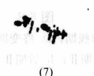

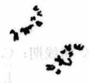

(8)

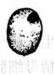

(9)

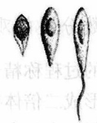

(10)

图6-3蝗虫精巢细胞减数分裂过程

（1）精原细胞，（2）细线期，（3）偶线期，（4）粗线期，（5）双线期，（6）终变期，

(7) 中期 I，(8) 后期 I，(9) 精细胞，(10) 精子

前期Ⅰ:减数分裂的前期Ⅰ时间很长，此时期染色体逐步折叠、浓缩；同时出现非姐妹染色体的节段交换现象。人们根据细胞核及染色体的形态变化将前期Ⅰ划分为5个时期，即细线期、偶线期、粗线期、双线期和终变期。

细线期细胞核膨大, 染色质浓缩、凝聚成染色丝, 染色丝上有许多染色粒。DNA 虽然已经复制, 但还看不出双线结构。此时由于染色体盘绕扭曲而分不清头尾。

偶线期进行同源染色体的配对，即联会（synapsis）。配对后的同源染色体形成二价体，但是尽管此时染色体比细线期清楚，但染色体仍很细长，所以也不能辨清染色体数目。

粗线期的染色体明显缩短变粗, 同源染色体配对完毕, 染色体纵向浓缩以及二价体或四价体变得明显。此时已经能够辨别染色体的头尾, 因而可以进行染色体初步计数。

双线期的特征是:染色体进一步缩短，配对的同源染色体开始分开。由于在粗线期非姐妹染色单体之间发生过交换，使同源染色体的相互吸引力消失，因此形成了不同形状的交叉现象。

终变期的染色体交叉数减少，染色体浓缩得最短，染色体呈现各种形状如“O”形、“8”形、“X”形、“V”形。核仁、核膜消失，此时进行染色体计数十分方便。

中期Ⅰ:配对的染色体排列在赤道面上，纺锤体形成，同源染色体的着丝粒与细胞两端的纺锤体相连。如果制备的细胞是从极面压成的标本，则可看到同源染色体排列成环形。

后期Ⅰ:同源染色体在纺锤体的牵引作用下，分别向细胞两极移动，每一极得到n条染色体，染色体数已减半。此时染色体的着丝粒尚未分裂，仍带着两个染色单体。由于雄性蝗虫的染色体数为23，因此，其中一组为11条染色体，另一组为12条染色体 $(11+X)$ 。

末期Ⅰ:染色体移到两极后聚集在一起，并逐步解旋而恢复到染色质状态。核仁、核膜重新出现，进行胞质分裂而形成两个子细胞。

经过一个简短的间期后，就进入第二次减数分裂，第二次减数分裂分为前期Ⅱ、中期Ⅱ、后期Ⅱ和末期Ⅱ。由于经过了减数第一次分裂，同源染色体已经分离，染色体数目已经减半，所以从形态上看第二次分裂的细胞体积较小。

前期Ⅱ:与末期Ⅰ紧密相连，时间短暂。在形态上与末期Ⅰ相似。

中期Ⅱ:同一着丝粒连接的染色单体排列在赤道面上，形成赤道板。

后期Ⅱ:着丝粒分裂，因此两条姐妹染色单体分离，在纺锤体的牵引下染色单体向细胞两极移动。

末期Ⅱ:染色体到达两极后，逐步解旋形成染色质，核仁、核膜重新出现，形成四个子细胞。细胞体积较小，形态与间期细胞类似。经过生长、发育、变态过程，逐渐形成梭形的精子。

## 【注意事项】

（1）采集的蝗虫要正确辨认清楚雌雄，一般雄性个体较小，其腹部末端为交配器，形似船尾，而雌性个体较大，腹部末端分叉。

（2）实验的成功关键在于必须选取合适发育时期的植物花药和动物精巢，必须根据外部形态指标并结合镜检作出判断。

【作业】

(1) 简述有丝分裂与减数分裂的异同。

（2）绘图示蝗虫精母细胞减数分裂各时期，并叙述其典型特征。

（3）填充:玉米花粉母细胞具有20条染色体（2n=20）， $G_{2}$ 期有（）条DNA，在第一次减数分裂后期是（）分离。末期Ⅰ形成（）个子细胞，每个子细胞具有（）条DNA，第二次减数分裂结束形成（）个子细胞，每个子细胞有（）条DNA，有（）条染色体。

(何炎明)

## 实验 28 环境因素及辐射诱变染色体改组的观察

## 【实验目的】

学会鉴别外界条件诱变染色体改组的各种类型，为进行环境监测和诱变育种提供细胞学方面的依据。

## 【实验原理】

目前，大量新的化合物的合成、原子能的应用、各种各样工业废物的排放等都存在污染环境的可能。欲了解这些因素对机体潜在的遗传危害，就需要一套高度灵敏、技术简单易行的系统来监测环境的变化。生物监测技术是目前进行环境污染，化学诱变物质以及辐射对机体损伤程度监测的一个主要指标。同时，它也为进行辐射防护、新药试验、食品添加剂的安全评价，以及染色体遗传疾病和癌症前期诊断等各个方面提供了很好的手段。

用于进行环境因素、诱变物质、辐射损伤的生物检测方法包括染色体畸变类型的检测和微核的检测等。常用于测试的材料有鸭跖草、水葱花、韭菜花等的花穗，以及蚕豆根尖和小白鼠等。一般来说，处于分裂过程的细胞，对环境因素最敏感，尤其是处于减数分裂时期的花粉母细胞。诱变物质、环境污染及辐射对人类和其他高等生物的遗传损伤，在细胞水平表现为染色体畸变，遗传损伤不仅表现在体细胞，而且还通过生殖细胞扩散和积累。

## 【实验仪器、材料和试剂】

(1) 仪器、用具:显微镜、解剖针、酒精灯、载玻片、盖玻片、吸水纸等。

(2) 材料:水葱花、韭菜花或紫露草花穗。

(3) 试剂:无水乙醇、冰醋酸、改良苯酚品红染色液、卡诺氏固定液。

## 【方法与步骤】

（一）污水对花粉母细胞减数分裂期染色体的作用

（1）取材:选取处于减数分裂期的花穗若干，剪下5～8cm的花序。部分插在自来水中作对照，另一部分插在污水中，处理12～24h，再移到自来水中恢复培养24h。

(2) 固定: 用卡诺氏固定液固定 $12 \mathrm{~h}$, 经 $95 \%$ 乙醇、$85 \%$ 乙醇各浸泡 $30 \mathrm{~min}$, $70 \%$ 乙醇 $4^{\circ} \mathrm{C}$ 保存。

（3）制片:剥取花药，用镊子轻轻捣碎，用改良苯酚品红染色5～10min，去掉残渣，盖上盖玻片。

（4）镜检:用低倍镜找到分裂期细胞，再转用高倍镜，可看到经污水处理过的细胞中，染色体畸变的类型和微核的数目，分别要比对照组高。微核出现的数量，可作为监测环境污染程度的指标。