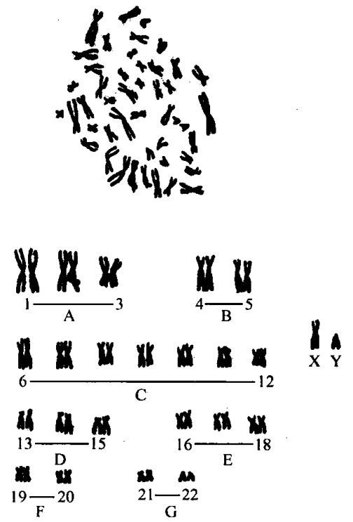

粒的相对位置。

$$
\text {着丝粒指数} = \frac {\text {短臂长度}}{\text {该染色体总长}} \times 1 0 0
$$

按Levan（1964）的标准划分:着丝粒指数为 $50.0\sim 37.5$ 称为中部着丝粒染色体(m)；指数为 $37.5\sim 25.0$ 称为亚中部着丝粒染色体（sm)；指数为 $25.0\sim 12.5$ 称为亚端部着丝粒染色体（st)；指数为 $12.5\sim 0.0$ 称为端部着丝粒染色体（t）。

人类体细胞的正常核型含有46条染色体，相互构成23对。其中22对是男女所共有的常染色体，一对为男女所不同的性染色体:男XY，女XX。根据丹佛(1960)、伦敦（1963）和芝加哥（1966）会议提出的标准，即按照染色体的长度依次减小和着丝粒位置及其他特征，把人类体细胞染色体分为7个组群，各自特征简括于表7-1。

表 7-1 人类染色体组型

| 群组号 | 染色体号 | 形态大小 | 着丝粒位置 | 随体 | 次缢痕 | 鉴别程度 |
| --- | --- | --- | --- | --- | --- | --- |
| A | 1~3 | 最大 | m | 无 | 常见1号 | 可鉴定 |
| B | 4~5 | 次大 | sm | 无 |  | 不易 |
| C | 6~12+X | 中等 | sm | 无 | 常见9号 | 难鉴定 |
| D | 13~15 | 中等 | st | 有 | 偶见13号 | 难鉴定 |
| E | 16~18 | 较小 | 16m, 17sm和18sm | 无 | 常见16号 | 可鉴定 |
| F | 19~20 | 小 | m | 无 |  | 不易 |
| G | 21~22+Y | 最小 | st | 有、Y无 |  | 难鉴定 |

【实验仪器、材料】

(1) 仪器、用具:摄影显微镜、胶卷、冲印放大器材、剪刀、镊子、毫米尺、胶水。

(2) 材料:人类体细胞染色体标本。

## 【方法与步骤】

（1）在显微镜下找出染色体分散良好、长度适中、姐妹染色单体清楚的中期分裂相进行显微拍摄。

(2) 将显微拍摄放大的照片上的一个细胞的全部染色体，一条一条分别剪下。

（3）根据染色体的长短和形态特征进行同源染色体的目测配对。

（4）测量出每条染色体短臂和长臂长度，计算出各条染色体的相对长度、着丝粒指数、臂指数，并记录原始数据。

(5) 根据测量数据校正目测配对排列的结果，进行调整排列。

（6）把染色体按一定顺序一对一对地排列，排列时注意短臂向上，长臂向下，性染色体单独排列，最后把染色体贴成一完整的染色体组型图（图7-3、图7-4）。

(7) 翻拍。

图7-3 正常男性染色体核型（高文和，2001）

图7-4 正常女性染色体核型（高文和，2001）

## 【作业】

剪贴男性、女性核型各一套。

(何炎明)

## 实验 37 染色体核仁组织区（NOR）的显示 【实验目的】

(1) 熟悉银染显示人类染色体核仁组织区的原理和方法。

(2) 熟悉染色体上核仁组织区的所在部位及特征。

## 【实验原理】

银染技术可以显示中期染色体上的核仁组织区（NOR）。由于正在转录或已转录的rRNA基因部位伴有丰富的酸性蛋白，而这种蛋白质含有SH基团和二硫键，能将 $\mathrm{Ag}-\mathrm{NO}_3$ 中的 $\mathrm{Ag^{+}}$ 还原成黑色 $\mathrm{Ag}$ 颗粒，故 $\mathrm{AgNO_3}$ 可将具有转录活性的核仁形成区（rRNA基因）特异性地染成黑色，而无转录活性的区域则不着色。酸性蛋白是核仁的主要成分，占核仁量的 $40\% \sim 80\%$ ，具有调节rDNA表达的作用。已知哺乳类动物编码18S rRNA、28S rRNA的基因（rDNA）是位于特定染色体的核仁组织区。在人类中期细胞的5对[(13～15)和(21～22)]近端部着丝点染色体短臂的次缢痕区呈现黑色的小球体就是核仁组织区。已证明该小球体是一种酸性蛋白，它与核糖体 RNA 的转录活性有关。用 DNA-RNA 原位杂交技术证明，人类 NOR 是 18～28S 核糖体基因的位点所在。

银染法可用于遗传学、细胞学、医学等方面的研究，在染色体分析时，可帮助确定D组和G组染色体易位和诊断染色体疾病。

## 【实验仪器、材料和试剂】

（1）仪器、用具:显微镜、恒温水浴箱、培养箱、培养皿、载玻片、盖玻片、镊子、吸管。

(2) 材料:片龄在 1 周内的人染色体标本。

(3) 试剂

1）50%AgNO₃溶液:称取50g AgNO₃溶于100ml蒸馏水中。

2）氨银溶液:称取 $4\mathrm{g}\mathrm{AgNO}_3$ 溶于 $5\mathrm{ml}$ 蒸馏水中，再加入 $5\mathrm{ml}$ 浓氨水（$\mathrm{NH_4OH}$）。

3）3%福尔马林溶液:3ml 36%甲醛溶液，加蒸馏水97ml，用4g无水乙酸钠调pH至7，4℃保存，使用前用甲酸将pH调至4.5。

## 【方法与步骤】

## （一）硝酸银染色法

(1) 在一张片龄在 1 周内的人染色体标本上, 滴加 $4 \sim 8$ 滴 $50 \% \mathrm{AgNO}_{3}$ 溶液, 立即覆以盖玻片, 放入潮湿密封的培养皿中, 置于 $37^{\circ} \mathrm{C}$ 温箱中 $24 \sim 48 \mathrm{~h}$, 或 $50^{\circ} \mathrm{C}$ 温育 $2 \sim 5 \mathrm{~h}$ 。

（2）取出，用流水冲去盖片。

(3) 2%Giemsa 染色 10\~15s。

（4）水洗，空气干燥，镜检。

## （二）氨银染色法（Ag-As 染色）

（1）在一张片龄为1周以内的人染色体标本上，滴加4～8滴50%AgNO₃溶液，立即覆以盖玻片，放入潮湿密封的培养皿中，置37℃温箱中24～48h，或50℃温育2～5h。

(2) 取出，用流水冲去盖片，再以蒸馏水洗 2 次，室温晾干。

（3）用吸管加4滴氨银溶液和4滴 $3\%$ 福尔马林溶液（pH4.5）于染色体标本上，立即覆以盖玻片，室温条件下作用12min。

(4) 流水冲去盖片，再以蒸馏水洗净。

(5) 用 $2\% \mathrm{Giemsa}$ 复染 $10 \sim 15 \mathrm{s}$。

(6) 水洗，空气干燥，镜检。

实验结果:以上两法各有优缺点，银染法染色得到的染色体标本上仅仅显示 Ag-NOR，染色体臂并不着色，图像颜色较淡；Ag-As 染色，图像颜色鲜明，但染色体有时失真，染色体臂有时也被银染色。

## 【注意事项】

(1) $\mathrm{AgNO}_{3}$ 溶液应现配现用, 用量不可过多或过少。

(2) 银染液可使衣服、皮肤染色，操作时应特别小心。

(3) 3%福尔马林溶液的 pH 必须调至 4.5。

## 【作业】

(1) 简述 NOR 银染的原理。

（2）记录并分析实验结果。

(何炎明)

## 实验 38 姐妹染色单体色差分析技术

## 【实验目的】

(1) 了解姐妹染色单体区分染色技术（SCD）的原理和方法。

(2) 通过姐妹染色单体互换（SCE）标本的观察，掌握 SCE 的计数方法。

## 【实验原理】

在 DNA 复制过程中，核苷类似物 5-溴脱氧尿嘧啶核苷（BrdU）或 5-碘脱氧尿嘧啶核苷（IdU）可以代替胸腺嘧啶核苷（T）掺入到新复制的 DNA 链中。哺乳类动物细胞在含有 BrdU 的培养液中培养，第一次分裂时，中期染色体的两条姐妹染色单体的 DNA 链，一股是原来的母链，一股是含有 BrdU 的新链，它们在染色时，两条姐妹染色单体着色相同。当细胞进入第二次分裂时，中期染色体的两条姐妹染色单体，一条是单股含 BrdU 的 DNA，另一条则是双股都含 BrdU 的 DNA，由于双股都含 BrdU 的 DNA 分子构型有变化，这条染色单体对某些染色剂的亲和力降低，用 Giemsa 染液染色时就可清楚看到双股都含 BrdU 的 DNA 链所组成的单体着色浅，而仅一条链含 BrdU 的单体着色深。这样根据两条姐妹染色单体所显示的颜色深浅不同，可以区分中期染色体的姐妹染色单体。应用姐妹染色单体区分染色法（sister chromatid differential staining，SCD），可以研究细胞周期、染色体半保留复制、染色体的分子结构与畸变，以及 DNA 的复制、损伤与修复等一系列问题。

来自一个染色体的两条单体之间同源片断的互换称为姐妹染色单体互换（sister chromatid exchange，SCE）。这种互换是完全的，对称的。由于姐妹染色单体染色上的明显差异，如果姐妹染色单体间在某些部位发生互换，则在互换处可见有一界限明显、颜色深浅对称的互换片断，故 SCE 易于计数，即使在一定距离内发生多次互换，也可被检测出来。

目前认为SCE反映了DNA的损伤，可以使用SCE作为哺乳类动物突变形成的指