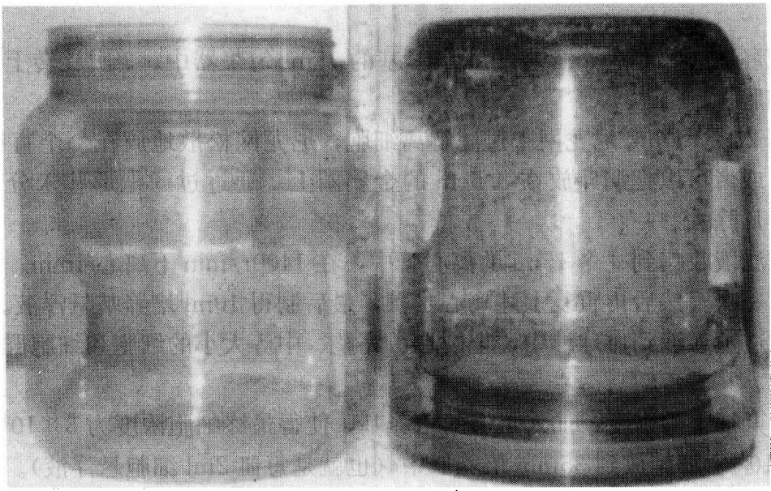

(2) 熟悉原代培养细胞观察方法。

## 【实验原理】

直接从机体获取的细胞进行的培养称为原代培养。这种培养过程主要是采用无菌操作的方法，把组织（或器官）从动物体内取出，经酶消化处理，使其分散成单个细胞，然后在人工条件下培养，使其不断地生长和繁殖。原代培养是建立各种细胞系的第一步。由于原代培养的细胞刚从活体组织中分离出来，所以在一定程度上能反映生物体内的生活状态。利用原代培养技术可以在体外进行各种类型细胞的增殖、遗传、变异、分化和脱分化、恶变与去恶变等研究。原代培养可分为组织块培养法和消化法两种。

## 【实验仪器、材料和试剂】

（1）仪器、用具:$\mathrm{CO}_{2}$ 培养箱、倒置显微镜、超净工作台、高压锅、恒温水浴箱、离心机、解剖剪、解剖镊、眼科剪、眼科镊、蜡盘、血细胞计数板、离心管、培养瓶、纱布、培养皿、微量加样器、吸管、移液管、酒精灯、酒精棉球、试管架等。

(2) 材料:新生乳鼠或孕鼠。

## (3) 试剂

1）RPMI 1640 培养基每 100ml 培养液中含 90% RPMI 1640、10% 小牛血清、双抗（青霉素、链霉素）100U/ml，用 7.4% NaHCO₃ 调 pH 至 6.8～7.0，培养液需过滤灭菌。

2）D-Hank液（无钙、镁离子的Hank液）。

3）0.25%胰蛋白酶液:称0.25g胰蛋白酶干粉，加D-Hank液100ml，溶解后过滤灭菌，调pH至7.4，密封置4℃冰箱保存。

## 【方法与步骤】

（1）处死动物:将出生2～3天乳鼠，用拉颈椎方法处死，用自来水浸湿背部被毛，将动物背部向上钉在蜡盘中，用碘酒棉球擦拭腰部两侧的被毛，再用酒精棉球擦拭碘酒擦过的部位。

（2）取肾:在腰部的后缘，用解剖镊提起皮肤，然后用解剖剪剪开皮肤，将剪开的皮肤拉向两侧。此时可进入无菌室或在超净工作台操作，再用碘酒与酒精棉球在暴露的肌肉上擦拭消毒，再换一把无菌的解剖剪及解剖镊，剪开背部的肌肉，暴露出腹腔，即可见肾脏。一般右肾略低于左肾，用弯头眼科镊取出肾脏，置于无菌培养皿中。

(3) 剪肾: 用眼科剪及眼科镊, 将肾膜剪破, 剥向肾门, 剪去肾膜和脂肪, 并用 D-Hank 液洗涤一次, 放入另一培养皿内, 另换一把灭菌的眼科剪及镊, 纵向剪开肾脏, 去掉肾盂部分, 将肾剪成数块。用 D-Hank 液洗涤一次, 把肾块移入无菌的青霉素瓶 (或小烧杯) 中。用弯头眼科剪将肾剪成 $1 \mathrm{~mm}^{3}$ 大小的块, 再用 D-Hank 液洗 2 或 3 次, 直到液体澄清为止。

（4）消化及分散组织块:向上述清洗过的组织内加入5～6倍量的0.25%胰蛋白酶液（pH为7.4～7.6），置于37℃水浴中消化。消化时间为20～40min，每隔10min摇动一次青霉素瓶，以便组织块散开，一直消化至组织块变得疏松、黏稠状，并且颜色略变为白色为止。此时，由水浴中取出青霉素瓶，在超净台中吸去胰蛋白酶液，加入5ml培养液，用吸管反复吹打组织块，直到大部分组织块分散成混淆的细胞悬液为止。分散的细胞悬液可经两层灭菌的纱布（或不锈钢网）过滤至另一烧杯中。

（5）计数与稀释:从过滤的细胞悬液中取出 1ml 细胞液滴在血细胞计数板上，按白细胞计数法进行计数，计数后用培养液稀释。稀释后的浓度一般以每毫升含 30 万～50 万个细胞为宜。

(6) 分装与培养: 将稀释好的细胞悬液分装于培养瓶中 (一般 $5 \mathrm{ml} /$ 小方瓶, $1 \mathrm{ml} /$ 青霉素瓶), 塞紧瓶塞, 在培养瓶上做好标记, 置于 $37^{\circ} \mathrm{C} \mathrm{CO}_{2}$ 培养箱培养。

（7）观察:逐日检查培养物是否污染，观察细胞生长情况。培养物为紫红色，显示细胞生长不好；培养物为橘红色，显示细胞生长良好。经1～2天培养后，若生长较差或培养液变红，则应在无菌操作下倒去原培养液，加入新的培养液或维持液（与培养液完全相同，只不过所用的血清量为5%）。此后，每隔3～4天更换一些维持液。待细胞已基本长成致密单层时，即可进行传代培养。

## 【注意事项】

(1) 培养液的配制要用三蒸水, 经过滤灭菌后, 密封置 $4^{\circ} \mathrm{C}$ 冰箱保存。

(2) 培养材料的选择，应尽量选取胚胎或幼小的生物体组织或者繁殖能力较强的组织。

（3）实验过程要严格无菌操作，用具、器皿要高压灭菌。

## 【作业】

（1）观察、记录培养细胞的结果。

（2）如何提高原代细胞培养的成功率。

(何炎明)

## 实验 43 果蝇胚胎细胞的原代培养

## 【实验目的】

通过果蝇胚胎细胞的原代培养来研究未分化细胞分化成各种类型细胞的过程。

## 【实验原理】

果蝇胚胎细胞的原代培养为研究未分化细胞分化成各种类型细胞提供了一个独特的系统。加上果蝇作为经典遗传学和分子遗传学研究的模式生物这一优越条件，果蝇胚胎细胞的体外分化分析将使我们对发育有更深入的了解。原代胚胎细胞培养在 Seecof、Shields 和 Sang 等的实验基础上已独立研究出来了。培养过程在技术上并不复杂且可以用于解决一系列生物学问题。

培养是从胚胎细胞原肠胚早期开始，我们能观察从特定的前体到最终分化为不同类型细胞的发育过程。在培养中分化的细胞类型主要是神经细胞和多核肌纤维，但是其他表皮和中胚层的衍生物也存在。培养形成一系列具有神经传递素系统、离子通道、轴突专一化，甚至有功能的神经肌肉连接和突触活动等高度分化表型的神经细胞。

## 【实验仪器、材料和试剂】

（1）仪器、用具:塑料广口瓶、尼龙筛（25～100μm孔径）、刮铲、漏斗、滤纸、镊子、血球计、15ml玻璃匀浆器、35mm塑料培养皿、圆玻璃盖玻片等。

(2) 材料:果蝇（Drosophila melanogaster）。

（3）试剂:青霉素、链霉素、胰岛素、带有谷氨酸盐的  $1 \times$  Schneider 果蝇培养基（购自 GIBCO）、灭活的胎牛血清对羟基苯甲酸甲酯。

1）青霉素-链霉素贮存液:每升培养基用 10ml 青霉素-链霉素溶液（10 000U/ml）（最后浓度为青霉素 100U/ml，链霉素 100μg/ml）。

2）胰岛素贮存液:把胰岛素溶入0.05mol/L HCl，使得浓度为2mg/ml。过滤消毒后存放在4℃（可以稳定储存1年）。最后在培养基中的浓度为0.2μg/ml。

3）Schneider 含有谷氨酸盐、胰岛素和 5% 灭活胎牛血清的果蝇培养基:加 10ml 消毒过的青霉素-链霉素贮存液，0.1ml 胰岛素贮存液和 50ml 灭活胎牛血清（最后血清浓度为 5%）到 1L 含有谷氨酸盐的 Schneider 培养基中。培养基可以在 4℃ 下保持良好稳定状态长达 1 个月。

4）次氯酸钠-乙醇溶液:把 10ml 95%乙醇和 10ml 3%次氯酸钠在一个小烧杯中混匀。该溶液可以把胚胎浆膜去掉和对胚胎消毒。

## 【方法与步骤】

（一）卵子采集和生长到原肠胚期前阶段

（1）葡萄汁琼脂卵子收集皿的制备:将 160ml 水、160ml 葡萄汁和 6.4g 琼脂在 1L 的烧瓶中混合。用微波炉溶解琼脂，小心不要让溶液沸腾而溢出。从微波炉取出后，加入 0.8g 对羟基苯甲酸甲酯，混合均匀后倒入 12 个大的培养皿（14cm）中。

(2) 从 $8 \sim 12$ 个普通培养瓶中转移 1.5 个星期大的成年果蝇到新的食物上铺有干酵母的培养瓶中。让果蝇在 $25^{\circ} \mathrm{C}$ 潮湿的空间内适应 $1 \sim 2$ 天，在将要进行胚胎培养当天，把成年蝇转移到一个胚胎采集瓶中。图 8-2 展示了一个自制的采集瓶或者可以购买到类似的采集瓶。通常每个产卵群体用大约 3000 个成年蝇。为了方便，建议房间用倒置的白天和黑夜，这样采集工作就可以在早晨进行。将干酵母溶于 $2 \%$ 丙酸中，取少量涂在一小片滤纸上，把滤纸放在一个大的葡萄汁琼脂卵子收集皿（$14 \mathrm{~cm}$）的中间，来吸引雌蝇产卵。

(3) 把胚胎采集瓶倒置在食物盘上 1\~2h 来采集卵子。

(4) 如果时间如期望一样控制得很好，可以提前 $30\mathrm{min} \sim 1\mathrm{h}$ 进行预采集，并且可

图8-2 用于胚胎采集的大的塑料广口瓶（Celis，2006）

左边的广口瓶是空的，右边的有一个葡萄汁琼脂胚胎采集板套在底部，装有约3000只成年蝇。在广口瓶边上穿了很多孔并用尼龙布盖上，使得空气可以有效流动

以舍去盘子。这对于诱导已经长时间储存卵子的雌蝇产卵是必要的。

(5) 把卵子采集皿移开胚胎采集瓶, 盖上盖子, 胚胎在 $25^{\circ} \mathrm{C}$ 下培养 $3 \mathrm{~h}$, 生长到原肠胚早期。

## （二）胚胎的获取

(1) 胚胎应该在 $3.5 \mathrm{~h}$ 的生长周期前 $5 \sim 10 \mathrm{~min}$ 收集, 这样使得培养可以在正 $3.5 \mathrm{~h}$ 开始。

(2) 去掉有酵母混合物的滤纸。

(3) 用去离子水轻柔地把器皿中成年果蝇和其他碎片洗掉。

(4) 放一些水到器皿上, 然后用毛刷轻轻地把胚胎拨松。

(5) 把悬浮的胚胎倒进尼龙筛，然后冲洗和收集其他食物皿。

（6）继续冲洗掉大的食物粒子和其他碎片，必要时可以用镊子去除。

(7) 把有胚胎的尼龙筛转移到一个消毒过的培养罩上。

## （三）胚胎培养

(1) 按平常组织培养的步骤, 先用乙醇清洁超净工作台。以下的全部步骤都在无菌的条件下进行。

(2) 用刮铲把胚胎转移到装有次氯酸钠-乙醇溶液的烧杯中, 轻轻搅拌 $1 \sim 2 \mathrm{~min}$ 。时间可以稍有变化但搅拌时间不要超过 $3 \mathrm{~min}$ 。时间长短根据次氯酸盐的新鲜度和对产量及灭菌程度的要求不同而不同。较短时间可以得到更多的产物, 而如果希望完全去除酵母污染物就需要相对长一点时间。

(3) 把胚胎倒入一个有尼龙网滤纸的小漏斗, 用大约 $500 \mathrm{ml}$ 的灭菌蒸馏水粗略地