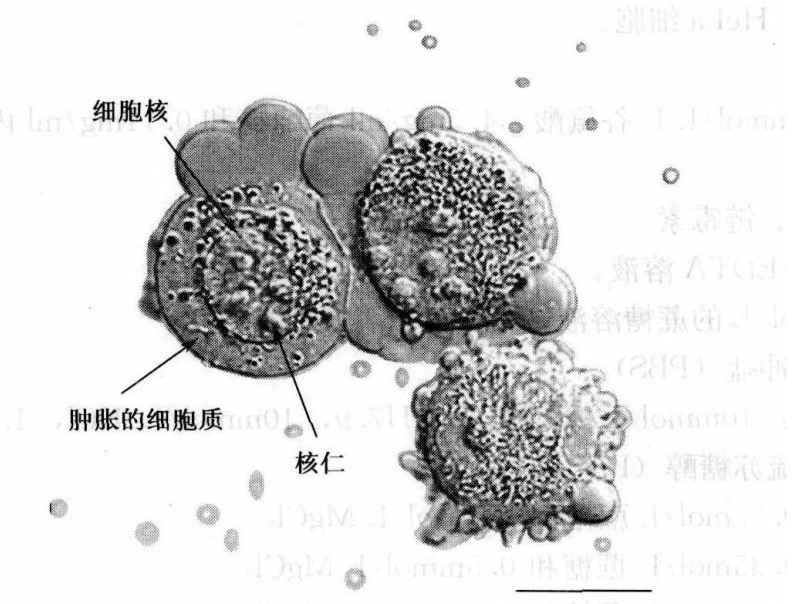
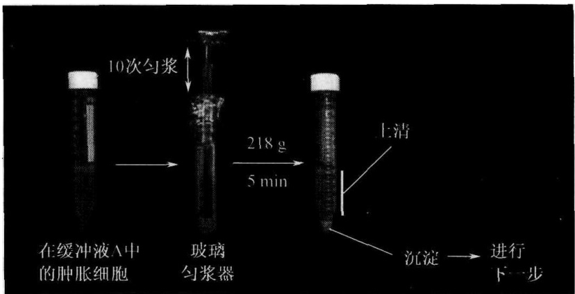
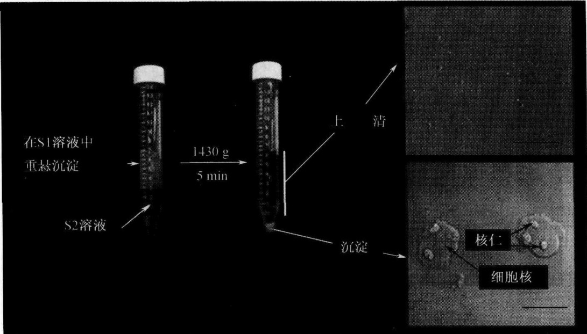
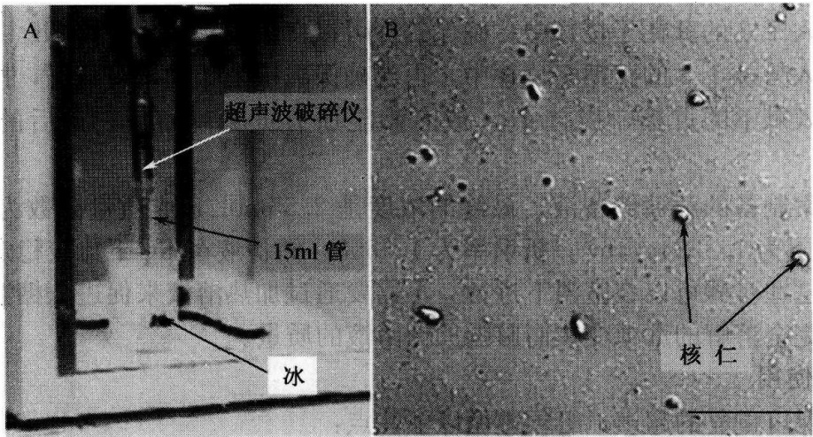

(5) $150\mu \mathrm{m}$ 筛在过度使用后会被连接的组织阻塞。通过在 $4\mathrm{mol} / \mathrm{LNaOH}$ 中浸泡 $20\sim 30\mathrm{min}$ 并用大量水洗刷可清洗干净。长期在 $4\mathrm{mol} / \mathrm{LNaOH}$ 中浸泡会侵蚀用于将网格固定到筛孔的胶水，故应避免。

## 【作业】

(1) 大鼠高尔基体纯化过程中，为什么所有的溶液都必须保存在 $4^{\circ} \mathrm{C}$?

(2) 检测高尔基体, 计算高尔基体膜的产量, 拍片并分析其形态特征。

(戚康标)

## 实验48 核仁的分离

## 【实验目的】

(1) 学习和掌握 HeLa 细胞的培养技术。

(2) 学习和使用梯度离心、超声破碎和相差显微镜观察技术。

(3) 掌握利用 HeLa 细胞分离纯化细胞核仁的方法。

## 【实验原理】

人类细胞的核仁是一个突出的核亚结构，它由染色体13、14、15、21和22上连续重复的核糖体基因装配而成，是rDNA转录和核糖体亚基合成的地点（Shaw and Jordan，1995）。在电子显微镜下显示，核仁形态分为三个不同的亚结构:纤维中心（FC）及其周围的致密纤维组分（DFC）和颗粒区（GC）（Shaw and Jordan，1995）。由于核仁具有高密度和稳定的结构，用直接的处理方法就能使核仁得到有效的纯化。在20世纪60年代初，自从人肿瘤和啮齿动物肝脏细胞纯化核仁获得初步成功以后，许多研究都报道了关于游离核仁的描述。核仁从各种各样的哺乳动物组织中被纯化，包括肝脏，大脑（Banks and Johnson，1973）和甲状腺（Voets et al.，1979），也可以从非哺乳物种的细胞中被纯化，如蛙的细胞。大范围地分离纯化核仁的方法，为鉴别、纯化和研究核仁提供了极好的依据，同时也为人们对核仁结构的认识起到重要的促进作用。

本实验是基于从培养人细胞中分离细胞核的程序。这个程序非常稳定，分离的核仁由具有合适能量的超声处理，能使核的其他部分被断裂而核仁保持完整。将分离的核仁通过一个密度梯度离心，得到纯度比较高的核仁成分。然后利用高灵敏大规模的光谱技术进行详细分析（Andersen et al., 2002），这种方法是生产高纯度核仁的可再生和有效的途径。

## 【实验仪器、材料和试剂】

（1）仪器、用具:$\mathrm{CO}_{2}$ 培养箱、组织匀浆器、相差显微镜、Misonix XL2020 超声仪、冷冻离心机、陪替氏培养皿。

(2) 材料:HeLa 细胞。

(3) 试剂

1）含有 4mmol/L L-谷氨酸、4.5mg/ml 葡萄糖和 0.11mg/ml 丙酮酸钠的 DMEM 培养基。

2）青霉素、链霉素。

3）胰岛素-EDTA溶液。

4）2.55mol/L的蔗糖溶液（制备蔗糖溶液见备注）。

5）磷酸缓冲盐（PBS）

缓冲液 A:10mmol/L HEPES，pH7.9，10mmol/L KCl，1.5mmol/L  $MgCl_{2}$ ，0.5mmol/L 二硫苏糖醇（DTT）。

S1 溶液:0.25mol/L 蔗糖和 10mmol/L MgCl₂。

S2 溶液:0.35mol/L 蔗糖和 0.5mmol/L MgCl₂。

S3溶液:0.88mol/L蔗糖和0.5mmol/L $\mathrm{MgCl_2}$

所有的溶液都以全蛋白酶抑制剂片补足，使最后的浓度为 1 片/50ml。

## 【方法与步骤】

(1) 将 HeLa 细胞（CCL-2）接种于 $10\mathrm{cm} \times 14\mathrm{cm}$ 的陪替氏培养皿中，培养基用 DMEM 培养基（含有 $4\mathrm{mmol/L}$ L-谷氨酸、$4.5\mathrm{mg/ml}$ 葡萄糖和 $0.11\mathrm{mg/ml}$ 丙酮酸钠），加入 $100\mathrm{U/ml}$ 的青霉素和 $100\mu\mathrm{g/ml}$ 的链霉素 $[1\% (V/V)$ 青霉素/链霉素溶液]，并在 $37^{\circ}\mathrm{C}$、$5\% \mathrm{CO}_{2}$ 下培养，直到大于 $90\%$ 的细胞聚集（每个培养皿大约有 $10^{7}$ 个细胞）。具有这个数目的 HeLa 细胞，尽管会影响分离核仁的纯度，但是可以减少准备的步骤，并可以提供高产量和高纯度的核仁。确保每一个步骤都用相差显微镜监控（见后）。核仁分离 $1\mathrm{h}$ 后，更换新鲜、预热的培养基。

(2) 通过胰酶处理获得细胞。用预热的 PBS 清洗每个培养皿 3 次，并在最后一次清洗后除去 PBS，每个培养皿加入 $2 \mathrm{ml}$ 的胰岛素-EDTA 溶液。旋动培养皿，确保胰岛素-EDTA 均匀分布，并将培养皿置于培养箱约 $5 \mathrm{~min}$ 。在相差显微镜下检查，确保所有的细胞已经游离。如有需要，可延长孵育的时间。每个培养皿加入 $8 \mathrm{ml}$ 预热的培养基，用吸液管吹打使所有细胞形成单细胞悬浮液。将所有的细胞转至 $100 \mathrm{ml}$ 的 Falcon 管中。对于某些 HeLa 细胞系，还需在 $5 \mathrm{ml}$ 冰冻的 PBS 中刮下细胞。因为这种可能会在某些 HeLa 细胞中造成不纯的核仁制备，所以这并不是最佳方法。

(3) 加入冰冻的 PBS, 在 $4^{\circ} \mathrm{C}$ 下离心 (1000r/min), 重复 3 次清洗细胞。

（4）最后一次 PBS 清洗后，用 5ml 缓冲液 A 重悬细胞，在冰上孵育 5min。滴一小滴细胞悬浮液于玻片上，在相差显微镜下用 20×物镜观察。细胞应该是胀大但没有破裂的（图 9-4）。培养的哺乳动物细胞的核仁在 37℃、低渗条件下会裂解（Zatsepina et al., 1997）。因此在这步骤中保持细胞悬浮液在冰上是很必要的。

（5）将细胞悬浮液转至 7ml 预冷的玻璃匀浆器。用致密的匀浆棒匀浆 10 次，同时保持匀浆器置在冰上。所需的匀浆次数取决于所用的细胞类型。因此每匀浆 10 次就要在相差显微镜下检查匀浆的细胞。当大于90%的细胞破裂就停止，保持核仁的完整无缺，这时核仁上面会附着各种细胞质的物质。大多数情况下，这种细胞质杂质不会影响分离的核仁的最终纯度（图9-5）。在4℃下218g离心匀浆后的细胞5min。沉淀中含有浓缩的，纯度不高的核仁。

图9-4 经过步骤（4）后的HeLa细胞（Celis，2006)

注意胀大的细胞质和突出的细胞核标尺=10μm

图 9-5 步骤（5）和（6）（Celis，2006）

(6) 用 $3 \mathrm{ml}$ 的 S1 溶液重悬沉淀, 然后轻轻吹打使沉淀重悬。不能重悬的沉淀中含有裂解的细胞核, 应该弃去。用 $3 \mathrm{ml}$ 的 S2 溶液使重悬液分层。需注意的是, 要保持两层液体的清晰分离。在 $4^{\circ} \mathrm{C}$ 下 $1430 \mathrm{~g}$ 离心 $5 \mathrm{~min}$ 。这个步骤可以形成更为干净的核沉淀。加入 $3 \mathrm{ml}$ 的 S2 溶液, 吹打, 重悬沉淀 (图 9-6)。

(7) 用 60s 的脉冲对核悬浮液进行超声 (每次超声间隔 10s), 使用 Misonix XL2020 超声仪, 装上微探头, 能量调至第 5 挡。在相差显微镜下监测超声后的细胞核。当观察到没有完整的细胞, 而核仁是致密的, 折射强的球体 (图 9-7A、图 9-7B)。最佳的超声时间取决于所用的细胞类型。如果是第一次尝试从一种类型的细胞分离核仁，就需要每超声10s就在显微镜下检查超声的物质。超声过度会造成核仁的破坏。

图9-6 步骤（7）(Celis，2006)

注意离心前 S1 和 S2 层之间的清晰分界。插图为上清和沉淀的 DIC 图像。注意沉淀中细胞核内突出的核仁。标尺 = 10μm

图9-7 A.超声的设置；B.超声后的细胞核的DIC图像（Celis，2006）注意突出的核仁。标尺 $= 10\mu \mathrm{m}$

(8) 用 $3 \mathrm{ml}$ 的 S3 溶液使超声后的样品分层, 并在 $4^{\circ} \mathrm{C}$ 下 $2000 \mathrm{~g}$ 离心 $10 \mathrm{~min}$ 。沉淀中含有核仁, 同时上清可以保留作为核质部分 (图 9-8)。

(9) 用 $0.5 \mathrm{ml}$ 的 S2 溶液重悬核仁, 在 $4^{\circ} \mathrm{C}$ 下 $1430 \mathrm{~g}$ 离心 $5 \mathrm{~min}$ 。沉淀中含有高纯度的核仁。在相差显微镜下观察, 确保预备物中只含有高纯度的核仁, 而没有其他物质 (图 9-8)。可以使核仁在 $0.5 \mathrm{ml}$ 的 S2 溶液中重悬, 并在 $-80^{\circ} \mathrm{C}$ 下保存。

## 1. $2.55\mathrm{mol / L}$ 蔗糖溶液的配制方法

(1) 称取 $1710 \mathrm{~g}$ 的蔗糖 (BDH), 把它放在干净的容器中。