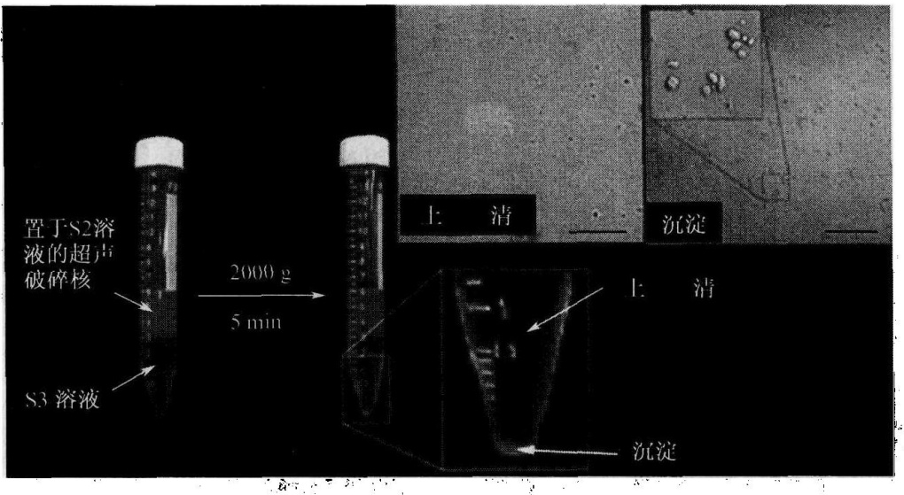

图9-8 步骤（9）(Celis，2006)

注意离心前后S2和S3层之间清晰分界，沉淀应该是小而可见（插图）；

上清和沉淀的DIC图像，沉淀中应该包含纯化的核仁

(2) 在 $5 \mathrm{~L}$ 的烧杯中准确加入 $900 \mathrm{ml}$ 的水和一个磁棒, 把烧杯放在搅拌器上并开始搅拌。

(3) 加入 1/3 的蔗糖于烧杯中，确保磁棒可以自由地转动，搅拌 1h。

(4) 加入另外 1/3 的蔗糖于烧杯中，再次确保磁棒的转动没有减弱，搅拌 1h。

(5) 加入剩下的蔗糖, 搅拌 $1 \mathrm{~h}$, 或者直至所有蔗糖均溶解。最后的体积应准确为 $2 \mathrm{~L}$ 。

以上方案制备的蔗糖储备液，最终的浓度是 2.55mol/L 或质量分数为 66%。它的密度在  $20^{\circ}$ C 下为 1.3224g/cm $^{3}$ ，折射率为 1.4558。储备液在  $4^{\circ}$ C 下比较稳定，适用于核仁的分离。这些步骤可以在室温下进行，不需要通过加热溶液来促进蔗糖溶解，因为加热会使没有完全溶解的蔗糖变焦而影响蔗糖溶液的质量。

## 2. 超声仪的使用

为了确保可重复的超声，必须遵循以下几点:

(1) 实验使用装上微探头的 Misonix XL2020 超声仪，能量设为第 5 挡。

(2) 每次换探头后必须调整超声仪。按照制造商的手册去调整程序。

(3) 由于超声会引起溶液局部强烈的升温。为了减少这种升温, 正确的方法是缩短超声时间和增加脉冲之间的间隔时间, 并把试管置于冰上或在冷室中进行超声。

(4) 如果探头过于接近液体表面, 会产生泡沫, 并降低超声效率。解决的方法是将探头浸没在溶液中, 大概在试管底部上面的 $5 \mathrm{~mm}$ 处, 但探头不要碰到试管底部或试管壁。

(5) 当重复使用时, 超声探头的末端会产生凹陷, 随着时间的推移超声的效率会逐渐降低。因此, 在探头逐渐老化时, 必须用相差显微镜来监测超声的结果, 并及时调节超声的时间, 如果超声的效率显著下降时就要更换探头, 以保持高效率的超声效果。

## 3. 分离核仁的分析

(1) 免疫标记纯化的核仁: 在涂有一层多熔素的玻片上滴加约 $5 \mu \mathrm{l}$ 的核仁悬浮液,

并晾干液滴，在进行标准的免疫着色步骤前，将玻片置于 PBS 中 5min。

(2) 为了在凝胶中分离核仁蛋白质, 可以直接在 Laemmli SDS 样品缓冲液或者在首选的缓冲液中重悬样品, 在分离的核仁中, 高浓度的核酸使裂解的样品非常黏滞, 样品通过 QIAshredder spin 柱子后会变澄清。也可以用 RIPA 缓冲液来提取核仁 (150mmol/L NaCl, 1%NP40, 0.5%脱氧胆酸, 0.1%SDS, 50mmol/L Tris pH 8.0)。用 RIPA 缓冲液处理的核仁裂解液可以用来进行免疫沉淀。

## 4. 核仁分离方法适用的细胞类型

上述的方案可以应用于其他细胞类型。除了 HeLa 细胞外，对这方案作出少许修改后，可以用于分离来自 MCF-7（人乳腺上皮细胞）、WI-38（人纤维原细胞）、IMR-32（人成神经细胞瘤）、HL60（人前髓细胞白血病）的细胞，还有植物拟南芥的细胞。当对一种不同的细胞类型使用该方案时，必须在每一步骤后都用相差显微镜仔细检查产物。例如，不同的细胞类型可能需要一个不同的均质化过程和（或）超声强度。 $MgCl_{2}$  的浓度也会对分离核仁的纯度有很大的影响。如果分离的核仁不够纯，可以尝试降低 S2 和 S3 溶液的  $MgCl_{2}$  浓度。如果产量太低，或者核仁碎片化，则提高  $MgCl_{2}$  的浓度。

## 【作业】

(1) 在分离核仁的过程中，为什么要用超声处理？如何掌握最佳的超声时间？

（2）观察和分析纯化核仁的结果。

(戚康标)

## 实验 49 过氧化物体的分离

## 【实验目的】

学习用蔗糖密度梯度离心法分离纯化小鼠肝脏的过氧化物体。

## 【实验原理】

研究过氧化物体（PO）的独特功能与结构，前提条件是获得这个细胞器的高度纯化片段。然而，实现这一前提条件受到两个方面的限制:①过氧化物体的相对含量极少（占总肝脏蛋白的2%）；②过氧化物体容易破碎。因此在分离过氧化物体的过程中，需要保持一个温和、均一的外部环境，需要把机械压、静水压和渗透压对过氧化物体的损伤减到最低。

一般分离过氧化物体大致需要 3 个步骤:①获得组织匀浆或破坏细胞；②利用差速离心法纯化匀浆；③利用密度梯度离心法分离已纯化的过氧化物体。

在匀浆过程中，通常需要在一个低盐浓度、等张等压的媒介中进行，目的是避免聚合。添加螯合剂（如EDTA）可以防止微粒体的聚集，减少其对过氧化物体的污染。另外，匀浆缓冲液（HB）应该添加抗氧化剂（DTT）和蛋白酶抑制剂（PMSF、$\varepsilon-$氨基己酸)，以防止分离过氧化物体过程中发生氧化和蛋白质酶解反应。

分离纯化过氧化物体通常利用密度梯度离心来实现，经典的方法是利用蔗糖密度梯度和特制的转子来分离纯化，实际上是在一个等压的环境中，使自生的梯度与垂直转子相结合，从而达到分离过氧化物体的目的。若要获得高度纯化的过氧化物体，最直接的方法是利用甲泛葡胺（metrizamide）、nycodenz或碘克沙醇（OptiPrep）的碘化梯度介质，以及垂直转子来分离。后者中，过氧化物体能与较高密度的物质（1.24g/cm³）相互结合，因为它们对低分子质量物质具有渗透性，所以能很好地从溶酶体、线粒体和微粒体中分离出来。

用上述方法，可以从正常鼠的肝脏中提取高纯度（>98%）的过氧化物体。同时，这种方法已经被应用到从哺乳动物的肝脏和肾脏中提取过氧化物体。运用这种方法，再加上微分离心法，还可以分离出过氧化物体的亚结构。流程见图9-9。

图 9-9 分离小鼠肝脏高纯度（>98%）PO 的流程图（Celis，2006）

【实验仪器、材料和试剂】

（1）仪器、用具:灌流装置（自制）、电动高速搅拌器、研钵、聚四氟乙烯杵、冷冻低速和高速离心机、折射计。

(2) 材料:体重为 $220 \sim 250 \mathrm{~g}$ 的雌鼠，实验前一晚需要停止喂食。

(3) 试剂:MOPS、PMSF、DTT、乙醇、EDTA、$\varepsilon$-氨基己酸、蔗糖、甲泛葡胺

NaOH。

## 【方法与步骤】

## （一）灌流和匀化

## 1. 溶液配制

（1）匀化缓冲液（HB）:首先在蒸馏水中溶解 85.56g 的蔗糖（250mmol/L）、1.046g MOPS（5mmol/L）、0.372g 的 EDTA- $Na_{2}$ （1mmol/L）、1ml（0.1%）的乙醇，然后用 NaOH 调到 pH7.2，最后加水至 1L，4℃ 贮藏。使用前每 100ml 加入:0.2μl 的 PMSF，0.1ml 的 1mol/L ε-氨基己酸，20μl 的 1mol/L DTT。

(2) 盐溶液 (0.9%):在蒸馏水中溶解 9g 的 NaCl，定溶至 1L。

## 2. 实验步骤

(1) 麻醉动物。

(2) 称动物体重, 剖腹, 通过静脉入口向肝脏灌流 $0.9\%$ 的盐溶液, 直至血液全部排干。

（3）移除肝脏，把周围组织分离开，称量肝重，并将其切成碎片，收集在一个冰浴的陶制研钵中，研钵中预先加入 $3\mathrm{ml / g}$ （肝脏净重）的冷冻HB。

(4) 用杵把组织研磨、匀化（1000r/min）。

(5) 将匀浆倒入 50ml 的离心管中。

## （二）亚细胞水平的分馏

## 1. 溶液配制

匀浆冲液（HB）方法同上。

## 2. 实验步骤

（1）将匀浆放在冷冻低速离心机中离心 $10\mathrm{min}$ （70g），除去碎片、未破碎的肝细胞、血细胞及大部分的核。

(2) 小心倾倒出上清液, 把小颗粒悬浮在 $2 \mathrm{ml} / \mathrm{g}$ 的 HB 中再次匀浆、离心, 条件与步骤 (1) 相同。

（3）倾倒出第二次的上清液，并与第一次的（去核后的上清液）合并，弃去沉淀颗粒。

(4) 把去核后的上清液在冷冻高速离心机中离心 10min (1950g)。

（5）轻轻地把上清液倒出，把小颗粒悬浮在 $1\mathrm{ml / g}$ 的冷冻HB中，再次离心(1950g)。最后的固体小颗粒（重线粒体碎片）含有线粒体、大微粒体薄片及一些剩余核质。而合并在一起的上清液就是线粒体后上清液。

(6) 把线粒体后上清液高速离心 $20 \mathrm{~min}$ (25300g); 除去上清液以及吸取微红色的蓬松层; 把固体小颗粒悬浮在约 $10 \mathrm{ml}$ 的冷冻 HB 中; 再次离心 $15 \mathrm{~min}$ (25300g)。把最后的固体小颗粒再次悬浮在 $5 \mathrm{ml}$ 的冷冻 HB 中, 它包含富集的重过氧化物酶体的碎片, 即轻线粒体的碎片。相对应的上清液可以用于直接准备微粒体碎片和最终上清液