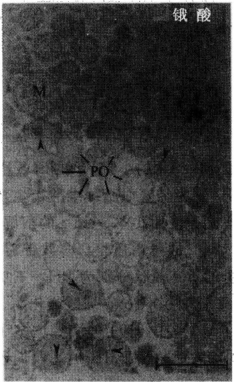

(细胞溶质的可溶蛋白质)，或者用于继续分离出轻过氧化物体。

（7）分离到这个程度，用 $g(\max) = 39000$ 的RCF去离心。把固体小颗粒悬浮在$5\mathrm{ml}$ 的冷冻HB中，里面包含富集的轻过氧化物体碎片。

## （三）甲泛葡胺密度梯度离心

## 1. 溶液配制

（1）梯度缓冲液（GB）:配制1L，把1.046g MOPS（5mmol/L）、0.372g的EDTA- $Na_{2}$ （1mmol/L）、1ml（0.1%）的乙醇溶解于蒸馏水中，然后再用NaOH调到pH7.2，最后加水到1L，4℃贮藏。使用前每100ml加入0.2μl的PMSF，0.1ml的1mol/Lε-氨基己酸、20μl的1mol/L DTT。

## (2) 甲泛葡胺溶液 (MS)

1）60%（w/V）的储存溶液:把60g的甲泛葡胺在GB中边搅拌边溶解。最后加GB到100ml。4℃贮藏。

2）梯度溶液:在 $60\%$ 的储存溶液中分别取 $3.78\mathrm{ml}$ 、 $3.38\mathrm{ml}$ 、 $3.53\mathrm{ml}$ 、 $2.06\mathrm{ml}$ 、 $3.2\mathrm{ml}$ 溶液。加入GB到 $10\mathrm{ml}$ 、 $7\mathrm{ml}$ 、 $6\mathrm{ml}$ 、 $3\mathrm{ml}$ 、 $4\mathrm{ml}$，用折射计把其分别调节到密度为 $1.12\mathrm{g/ml}$ 、 $1.155\mathrm{g/ml}$ 、 $1.19\mathrm{g/ml}$ 、 $1.225\mathrm{g/ml}$ 、 $1.26\mathrm{g/ml}$ 。

## 2. 实验步骤

甲泛葡胺密度梯度的准备:

（1）把 4ml、3ml、6ml、7ml、10ml 的 MS（1.12～1.26g/ml）分别加入到 40ml 的离心管中，形成一个不连续的梯度。

(2) 马上把这个梯度在液氮中冷冻，并贮存在 $-20^{\circ}\mathrm{C}$ 中。

(3) 使用一个金属架在室温中解冻。

梯度离心:

(1) 在解冻的梯度中加入 $5 \mathrm{ml}$ 富集轻/重过氧化物体碎片, 密封离心管。

(2) 在一个垂直型转子中梯度离心，使用慢加速度/减速度模式， $g(\max)=39\ 000$ 。在这种条件下，高纯度的重过氧化物体会停留在1.23～1.24g/ml的密度带中，而轻过氧化物体则会停留在1.20～1.21g/ml的密度带中。

（3）用碎片收集器重新获得过氧化物体碎片，用注射器把离心管刺破进行收集。把碎片储藏在 $-80^{\circ}C$ 下。

（4）除去甲泛葡胺，因为它会干扰过氧化物体酶（如尿酸氧化酶）以及蛋白质活性的测定。用 HB 稀释过氧化物体碎片 10 倍，然后各自以 25 000g 和 39 000g 进行离心。

## 【实验观察结果】

表 9-3 所列是重过氧化物体碎片的含量，这是以特异的过氧化物体酶测定的，从表中可以看出原匀浆 38 倍的提纯率。这些过氧化物体碎片的总蛋白质超过 95% 是过氧化物体，而线粒体和微粒体各占大约 2%，溶酶体的含量则小于 1%。以下是通过电子显微镜方法来测定的，显示了过氧化物体在碎片中所占比例为 98%\~99%（图 9-10 和图 9-11）。在图 9-10 中，过氧化物体含有典型的内含物尿酸氧化酶，但在细胞器之间的空隙里也可以看到一些游离的核心酶。在图9-11中，大多数的过氧化物体细胞间质中可以观察到过氧化氢酶的细胞生化反应产物的电子密度，这是经过碱性 $3,3^{\prime}$ -二氨基联苯培养基中的过滤准备培育的，从图中可以看出过氧化物体的完整性以及没有出现过氧化氢酶的渗漏。

表 9-3 正常鼠肝中纯化的重 PO 碎片的含量

| 酶 | mU/mg 匀浆/(mg/g 肝脏) | 覆盖率/% | RSA |
| --- | --- | --- | --- |
| 蛋白质 | 256.36±82.94 | 0.28±0.08 | - |
| 过氧化氢酶 | 203±42.7 | 0.28±0.08 | 37.67±4.28 |
| HA-氧化酶 | 3.3±0.7 | 9.46±1.06 | 40.25±5.83 |
| FA β-氧化 | 3.6±0.96 | 11.18±3.25 | 36.32±5.09 |
| β-葡糖苷酸酶 | 38±5.88 | 0.01±0.01 | 0.07±0.06 |
| 磷酸酶 | 31 | 0.15 | 0.07 |
| 酯酶 | 1229±246.7 | 0.01±0.01 | 0.09±0.07 |
| NADPH-CcR | 18±4.6 | 0.18 | 0.702 |
| Cc-氧化酶 | 127±35.6 | 0.02±0.02 | 0.09±0.05 |
| L-GIDH | 57±16.5 | 0.08±0.02 | 0.679 |

注:HA-氧化酶。α羟基酸氧化酶；FAβ-氧化。脂肪酸β-氧化；NADPH-CcR。NADPH-细胞色素c还原酶；Cc-氧化酶。细胞色素c氧化酶；L-GIDH。L-谷氨酸盐脱氢酶；RSA。相对特异活性。

图9-10 被分离的重PO经过戊二醛、锇酸固定后在电子显微镜下的图像。从图中可以看出碎片主要含有PO，所含的线粒体(M)非常少。很多PO含有尿酸盐氧化酶核心（箭头处）

(Celis, 2006)

图 9-11 比图 9-10 多了预先经过碱性 3, 3'-二氨基联苯培育的过程，这是为了得到过氧化氢酶的定位。我们可以注意到大多数 PO 的细胞间质中的过氧化氢酶的电子密度反应产物。这说明了过氧化氢酶没有渗漏及它的完整性。标尺 = 1μm (Celis, 2006)

图 9-12（R道）显示了小鼠肝脏的重过氧化物体的多肽样品（SDS-PAGE），此图中并没有出现典型的线粒体和微粒体条带，因此可以看出其高度的提纯。同时，此图还显示了肝脏过氧化物体蛋白成分在小鼠（R道）和豚鼠（G道）中的显著差异。在图 9-13 中，可以明显地看到特异过氧化物体蛋白质可以被选择性地诱导。例如，经降血脂纤维酸衍生物处理后，鼠的三功能蛋白质（PH）被诱导增加，而同时过氧化氢酶（Cat）和尿酸氧化酶（Uox）伴随性地减少了。

图9-12 左边是高度纯化的重PO的SDS-PAGE，R为鼠肝的，G为豚鼠肝脏的PO。该实验使用$10\% \sim 12.5\%$ 的溶解冻胶，而每条道使用的蛋白质质量为R道$2.4\mu \mathrm{g}$、G道$5.4\mu \mathrm{g}$。多肽带着银色。分子质量标准为:BSA(66kDa)，卵清蛋白（45kDa），胰蛋白酶原（24kDa）。我们可以注意到小鼠和豚鼠的多肽图样的显著不同。标尺 $= 1\mu \mathrm{m}$ (Celis，2006)

图9-13 右边是高度纯化的小鼠PO的SDS-PAGE, Co为对照组，BZ则为经降血脂纤维酸衍生物处理后的实验组。该实验使用 $10\% \sim 15\%$ 的溶解冻胶，每条道都加入 $5.0\mu \mathrm{g}$ 的蛋白质量。多肽带着银色。图中有箭头指示的PO多肽分别为PH，三功能蛋白质；Cat，过氧化氢酶；Uox，尿酸氧化酶。我们可以注意到，在BZ组中，PH被诱导增多了，而Cat和Uox则伴随性地减少了。同时，我们还可以把图9-13的Co（对照组）与图9-12的R道对照，这两者是不同的，而实验使用的溶解冻胶浓度也是不同的（Celis，2006）

这里略述的延伸步骤能成功地从正常小鼠或再生小鼠的肝脏中分离重过氧化物体和轻过氧化物体，其中，这两者的密度、大小、形状、动力学组成都不相同。此外，从人的肝癌细胞系 HepG2 中也可以获得与前两者不同的过氧化物体。然而，这些组织中的过氧化物体亚群并不能通过传统的梯度离心法提纯，这主要是因为它们的沉淀性质与其他的亚细胞器（特别是微粒体）非常接近。但无论如何，对它们的提纯是非常必要的，这不仅对人体中过氧化物体重要功能的研究，而且对其生源论的研究也有非常重要的意义。

除了密度梯度离心法之外，还可以利用免疫自由流电泳（IFFE）的方法来分离、提纯过氧化物体（PO）。IFFE不仅能有效地从小鼠肝脏的轻线粒体碎片中提取完整的过氧化物体（$\rho = 1.22 \sim 1.24 \mathrm{~g/cm}^3$），而且还能从重线粒体碎片和线粒体后碎片中提取过氧化物体。IFFE结合了电泳分离与免疫反应的高度选择性这两者的优点。它利用的原理是，在电泳缓冲液的pH约为8.0（等于IgG分子的pI）的条件下，结合了抗体的亚细胞微粒的电泳迁移率会大大地降低。利用IFFE方法可以从不同的肝亚细胞碎片中分离出过氧化物体，我们通过免疫印迹可以知道这些过氧化物体的细胞间质以及膜蛋白的组成是不同的。这有力地说明了IFFE是一种分离提纯过氧化物体不同亚群的有效方法。

## 【注意事项】

（1）在匀浆过程中，为了避免聚合，除了添加螯合剂（如 EDTA）外，还需要注意保持一个低盐浓度和等张等压的媒介条件。

(2) 在去上清液时动作需要小心轻巧。

## 【作业】

(1) 观察和计算过氧化物体含量。

(2) 分析利用密度梯度离心法分离纯化过氧化物体的效果。

(戚康标)

## 实验 50 完整叶绿体的分离

## 【实验目的】

了解梯度离心法分离细胞成分的原理，掌握Percoll梯度法从植物叶组织中分离完整叶绿体的方法。

## 【实验原理】

梯度离心法是根据被分离样品的密度差异，在一定密度梯度的介质中加以离心力场，使得不同密度的颗粒悬浮停留在相应的介质梯度区。

植物细胞被细胞壁所包围，因此实验中必须在破碎细胞壁的同时保持叶绿体的完整。从破碎细胞中释放出来的叶绿体等质体可经适当的梯度离心，将完整叶绿体和破碎叶绿体分开。

植物细胞的质体中储存的淀粉致密颗粒可能在离心过程中造成质体破裂，因此可在较低光照条件下预处理植物1\~2天，以消除淀粉的积累作用。