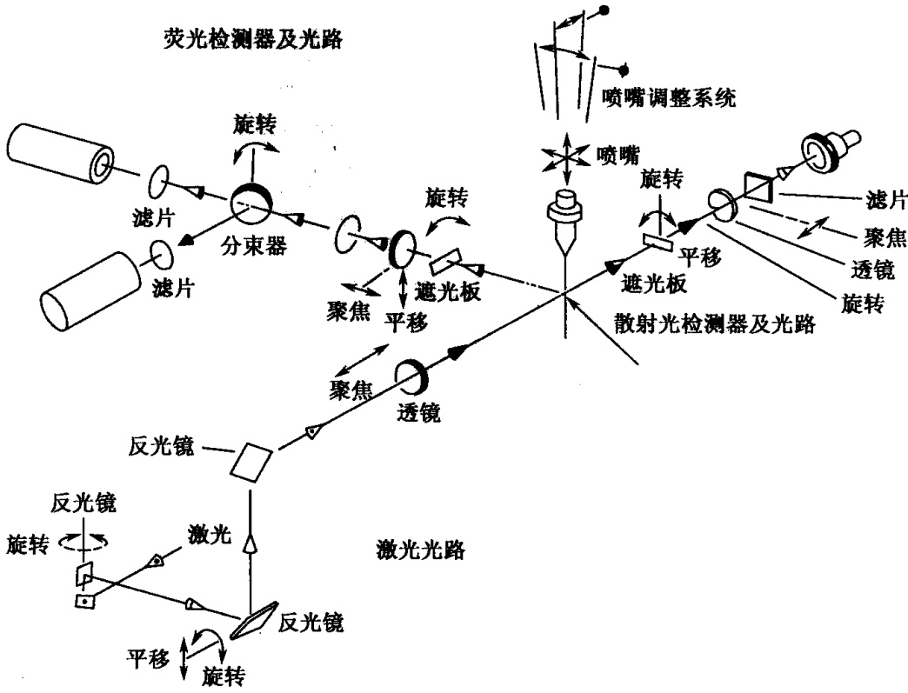

## 第十二章 其他技术

随着现代生物学的发展，越来越多的先进设备及手段用于细胞生物学的研究。其中包括流式细胞技术、免疫荧光技术、细胞凋亡检测技术等，这些检测技术以及设备正日益在细胞学实验中得以普及，具有高效、高精度等优点，与传统细胞学实验方法一起，成为细胞实验学不可或缺的组成部分。本章就这些技术作一个概要的介绍，包括细胞放射自显影、流式细胞技术、荧光标记、激光共聚焦技术、显微注射和凋亡检测。

## 实验 66 细胞放射自显影

## 【实验目的】

学习同位素标记培养细胞的方法；学习掌握放射自显影技术。

## 【实验原理】

在细胞培养液中掺入  $[^{3}H]$ -胸腺嘧啶核苷，可以正确标记细胞核。同位素标记分为瞬间标记和连续标记。瞬间标记为半小时至几小时，可使处于 S 期的细胞核获得标记。连续标记是使同位素与细胞接触约 24h（一个细胞周期），此时可使所有细胞核被  $[^{3}H]$  所标记。

细胞放射自显影用于研究细胞周期、细胞动力学和细胞的生物学特性比较等方面，如细胞增殖与分化异常、辐射对细胞的损伤与修复、DNA 和蛋白质合成等。

同位素的用量为 $1.85 \times 10^{4} \sim 1.48 \times 10^{5} \mathrm{~Bq/ml}$，以尽可能低而又能充分标记为佳。本实验中采用 $1.85 \times 10^{4} \mathrm{~Bq/ml}$ 培养液进行标记。

## 【实验仪器、材料和试剂】

(1) 仪器、用具: 冰箱、$\mathrm{CO}_{2}$ 培养箱、恒温水浴、电热搅拌恒温水浴、切片匣、搪瓷盘、乳胶小杯、恒温恒湿操作箱、切片干燥架、暗匣、培养皿、盖玻片。

(2) 材料:无支原体污染的培养细胞一瓶。

(3) 试剂

1）核Ⅳ乳胶。

2）D19B 显影液。

3）酸性坚膜定影液。

4）核固红或 Giemsa 染色液。

5） $[^{3}H]$ -胸腺嘧啶核苷、细胞培养液、Hank液、胰蛋白酶/EDTA消化液。

6）Carnoy固定液。

7) 乙醇。

8）加拿大树胶。

## 【方法与步骤】

(1) 培养细胞按常规法用胰蛋白酶/EDTA消化液进行消化, 用少量培养液分散细胞制成细胞悬液。

(2) 在放有 4 片盖玻片的平皿中加入 5～6ml 完全培养液。

（3）细胞悬液接种于平皿，使细胞分散均匀，每皿细胞数为 $5 \times 10^{4} \sim 6 \times 10^{4}$ 个，置于 $\mathrm{CO}_{2}$ 培养箱中培养 $4 \sim 6\mathrm{h}$。

（4）吸去培养液，加入含  $[^{3}H]$ -胸腺嘧啶核苷的 Hank 液（ $[^{3}H]$ -TdR 含量为  $1.85 \times 10^{4} Bq/ml$ ），标记培养 0.5～1h 后，小心吸出标记培养液，用 Hank 液反复漂洗细胞表面和平皿 3～5 次。加入完全培养液培养 30～48h，当细胞增殖到 2/3 满层时取出，吸去培养液，加入 4～5ml 固定液固定 20min。

（5）去固定液，先后用75%乙醇、50%乙醇、30%乙醇和蒸馏水依次洗脱，每次10min，最后用三蒸水漂洗后，取出长有细胞的盖玻片垂直于吸水纸上吸去多余的水分，自然干燥后用加拿大树胶封固于洁净的载玻片上（注意，一定要使生长细胞的面朝上），自然干燥。

以下为暗室操作:

(6) 从冰箱取出核IV乳胶, 取 2 或 3 匙至乳胶小杯中。调节 $40^{\circ} \mathrm{C}$ 的水浴, 使循环装置与乳胶杯两端接通, 水流不断通过乳胶杯外层形成一恒温水浴, 用玻璃棒不停搅拌杯中乳胶使其融化。

(7) 液化的乳胶用浸沾法或滴涂法使乳胶均匀涂布于载玻片表面。将玻片垂直于吸水纸上吸去多余的乳胶后插入暗箱晾干, $2 \sim 3 \mathrm{~h}$ 后取出放入切片匣, 外用两层黑纸包封, 套上塑料袋于 $4^{\circ} \mathrm{C}$ 冰箱曝光 $2 \sim 3$ 天 (曝光所需时间与使用的同位素剂量有关)。

(8) 取出标本先后在 D19B 显影液中显影，在酸性坚膜定影液中定影，显影温度为 $(19 \pm 1)^{\circ} \mathrm{C}$，显影 $2 \mathrm{~min}$，定影 $15 \mathrm{~min}$。定影后清水冲洗，三蒸水漂净，自然风干。

(9) 核固红或 Giemsa 染色 15min。

（10）镜检。先在低倍镜下找到细胞群，再用高倍镜观察标记细胞核，计数100个细胞中被标记的细胞核。

## 【注意事项】

实验中对同位素的使用，应严格遵守放射性核素使用规则。

## 【作业】

对观察的结果进行比较分析，计数100个细胞中被标记的细胞核。

(刘兵)

## 实验 67 流式细胞技术

## （一）流式细胞术

流式细胞术（flow cytometry）是对单个细胞或其他生物微粒进行快速定量分析与分选的一门技术。在分析或分选过程中，包在液流中处理过的单个细胞通过聚焦的光源，进而用各种光敏元件测量这些细胞散射光、荧光等参数而达到测量其化学性质和物理性质的目的，并可根据这些性质分选出高纯度的细胞亚群。包被细胞的液流称为鞘液，所用仪器称为流式细胞计（flow cytometer）。其他生物微粒指的是细菌、真菌、染色体、有机体和细胞聚合体等。

## （二）流式细胞计的基本结构

流式细胞计分为三部分:光学测量台、电子控制台及数据采集、贮存和处理计算机。目前，一些简易型的流式细胞计往往把光学台与电子控制台合在一起，在光学台上完成光学信号的测量和转换。由光学信号转换成的电模拟信号送入电子控制台进行整形、放大、模数转换，最后送到计算机里贮存处理，输出单参数直方图、二维点图、等高图、三维图以及一些统计结果。

为了保证细胞测量的正常进行，必须具备固定波长、固定功率，或波长固定、功率可调的光源系统，还要有提供稳定层流的鞘液系统。若采用大功率水冷却激光为光源，仪器还必须配备强大的水冷却系统，而增加了仪器的复杂性。一些仪器采用风冷激光器及压缩空气，大大简化了仪器，也便于操作和维护。

## （三）流式细胞计的原理

## 1. 光信号的测量

细胞的测量是在光学台上进行的，测量原理的示意图见图12-1。在氮气的压力下包在鞘液中的细胞一个接一个地由喷嘴喷出，形成连续的液流，液流中的细胞在激光照射激发下，就向各个方向发出散射光和荧光，通过安装在各方向上的光敏元件，就可得到每个细胞的一组相参数。以激光为光源时，可得到FSC、SSC、FL1及FL2等参数，分别称为前向散射光、90°散射光，以及取决于染色的不同波长的荧光参数。

前向散射光 FSC——forward light scatter  
90°散射光 SSC——side scatter  
荧光 1 FL1——fluorescence 1  
荧光 2 FL2——fluorescence 2  
荧光 3 FL3——fluorescence 3

图 12-1 FACS440 光测量系统示意图（刘鼎新和吕证宝，1997）

## 2. 参数的意义

## - FSC 参数

当一个细胞被激光照射后，散射光就射向空间的各个方向。细胞样品经染色处理后荧光也会射向空间各个方向，但散射光在空间各个方向上的强弱不同，这种强度变化就反映了物质的性质。把光检测器放在最佳位置上就会获得反映细胞不同性质的信号。

激光  $0^{\circ}$  方向上有较强的衍射光。当用遮光板除去本底光的影响时，这个方向的散射光强度是  $d/\lambda$  的函数。 $\lambda$  代表激光波长，在测量时是不变的，而 d 表示细胞的大小，因此 FSC 参数可反映细胞的大小尺寸。

## - SSC 参数

在激光  $90^{\circ}$  方向上，衍射光明显减弱，而反射、折射光成分占了主要地位。这个信息反映了细胞内颗粒物质的大小和多少。即使细胞样品未经染色，也可以通过 FSC-SSC 二维图区分出一些大小不同、核内颗粒物质多少有差别的细胞亚群。例如，图 12-2 是外周血细胞经溶红细胞后各亚群的分布图，可分为 3 群细胞:淋巴细胞、单核细胞、粒细胞。其他外周器官如脾、淋巴结等也可得到类似的二维点图。

## ·荧光参数

荧光参数也可在 $90^{\circ}$ 方向上接收到信号。由于 $90^{\circ}$ 方向散射光较弱，容易分析出荧光信号，但必须使用一系列的光学元件才能达到目的。

## 3. 直方图、二维点图、三维图和二维等高图

在光学台得到FSC、SSC、FL1及FL2等一组参数后，这组模拟的电压量送入电子