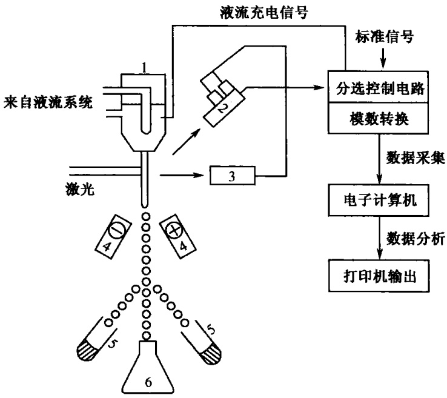

图 12-2 外周血 FSC-SSC 二维点图（刘鼎新和吕证宝，1997）

从左到右，三群细胞分别为淋巴细胞、单核细胞、粒细胞

控制台整形放大，再经模数转换成数字信号。

## （四）流式细胞计在细胞分析中的应用

## 1. 对细胞样品的要求

在流式细胞测量中大量检测的是细胞样品。上机前，样品制备是重要的一步。若制备不出好的样品，就无法测出好的结果。对细胞样品最基本的要求是把细胞样品制成单细胞悬液。悬液要求:①不能有团块；②不能有过多的碎片；③细胞的密度为（0.5～1.5）×10$^{6}$个/mL，过高、过低的密度都不适于测量。得到细胞悬液后，对感兴趣的细胞成分进行荧光染色，染色方案请参考有关文献。选择荧光染料时，必须考虑染料的激发和发射光谱。

## 2. 单参数测量

细胞样品不染色时，也可得到 FSC 及 SSC 参数两个形态方面的信息。在测量细胞成分时，需要对细胞进行染色或多重染色。进行单色荧光的测量为单参数测量，两种或两种以上荧光染料标记过的测量为多参数测量。应用最广泛的一种是细胞成分测量（如 DNA 含量、蛋白质含量、胞浆内  $Ca^{2+}$  及 pH 的测量），另一种是免疫荧光测量。

## - 细胞成分测量

细胞成分测量中开展最多的是核内 DNA 测量。细胞在增殖过程中分为四期—— $G_{1}$ 、S、M 及 $G_{2}$ 期，以及静止期 $G_{0}$ 期。在这个过程中细胞核内 DNA 的量是变化的。 $G_{0}+G_{1}$ 期细胞的 DNA 为 2C 单位， $G_{2}+M$ 期为 4C 个单位，S 期细胞 DNA 含量介于 2C 和 4C 之间。选择合适的 DNA 染料染色后上机测试就会得到图 12-3 所示的曲线。曲线的第一峰是 $G_{0}+G_{1}$ 期的二倍体细胞，第二峰是 $G_{2}+M$ 期的四倍体细胞，中间部分是 S 期细胞。通过一定模式的数学模拟软件拟合这条线，得到各周期的细胞数目及其占总数的百分比，以及 $G_{0}+G_{1}$ 峰的变异系数等参数。DNA 测量是流式细胞术开展最早的测量技术，有一套成熟的染色工艺和许多数学模型。

图12-3 细胞周期测试样品曲线（刘鼎新和吕证宝，1997）

DNA 含量的测定对于细胞增殖、细胞动力学、肿瘤学以及药物实验的研究都有重要意义。

## - 免疫荧光的测量

由于免疫学和分子生物学的飞速发展，流式细胞计在免疫学中的应用也日渐广泛。主要是用流式细胞术研究免疫细胞表面一些特征分子如抗原、受体等。现已发现免疫细胞的表型不同功能也就不同，通过抗原抗体反应，可将其分为不同的亚群。对 T 细胞的表型研究是目前免疫学最关注的问题，已经发现 T 细胞表面可以结合 100 多种抗原，根据与这些抗原的结合特性可把 T 细胞分成许多亚群。对 T 细胞亚群及其分化的研究势必推动免疫学前进。已开始用多激光多参数流式细胞计对 T 细胞进行三染、四染以及更多染色的研究。

由于体外细胞培养技术的进展，现有许多实验室对体外培养的免疫细胞用 PHA、PMA、CONA 以及白细胞介素刺激后或用基质细胞上清液培养或共同孵育后，用流式细胞计观察其细胞表型的变化。还发现免疫细胞在分化成熟过程中，表面分子（表型）表达也不相同。用流式细胞计对表型的研究，可以区别免疫细胞成熟的程度。

另外，对于一些免疫疾病与艾滋病患者免疫细胞表型的研究，流式细胞计也能提供许多有价值的诊断和治疗信息。

（1）线性坐标及对数坐标:当细胞样品中各细胞亚群的染色差异不大时，可用线性放大器将每个细胞的脉冲按其高度比例放大而可采用线性坐标。在样品各亚群染色差异较大时，用线性放大器放大后这些细胞就不能显示在同一屏幕上，因此可采用对数放大器。利用其非线性将小脉冲放大倍数加大将大脉冲放大倍数减小，相当于加宽了显示屏。对数放大器有利于观察小细胞之间的差别。在免疫荧光测量中一般要求采用对数放大器，因而采用对数坐标。

(2) 标准和对照: 在测量之前为了保证仪器的正常运转, 通常要用塑料微球对仪器进行校正, 以保证不同操作人员、不同时间仪器的稳定和条件一致。校正仪器的微球是标准之一。现在流式细胞计使用的标准很多, 如鳟鱼红细胞、醛化鸡红细胞、固化的淋巴细胞等, 这些称为外标。在有些测量中往往在样品中掺入一些其他的已知细胞共同染色, 称为内标, 在测定 DNA 含量时常常使用内标。

流式细胞计测量的是相对量，所以许多测量要设置参照。尤其在免疫荧光测量中不知道抗原与受体的情况下，必须设置不结合抗原的负参照和结合已知数量抗原的正参照。参照必须和其他测试样品的处理条件相同。测量免疫样品时，参照的设置很重要，否则阳性结果并无意义。例如，在测患者外周血CD3、CD4、CD8的比例时，每个患者应设一个参照，对多个患者只设置一个正常人参照的做法是不正确的。

## 3. 多参数测量

## - 细胞成分的测量

可用两种染料显示细胞的不同成分，也可用一种染料显示细胞的两种不同成分。例如，AO可同时显示核的DNA与RNA，还可用抗BrdU抗体+FITC和S期细胞结合，再用PI显示DNA，最后用二维图将S期细胞与 $\mathrm{G_0 + G_1}$ 及 $\mathrm{G_2 + M}$ 期细胞分开。

## - 免疫荧光的测量

用单克隆抗体结合不同荧光染料，再通过抗原抗体反应将不同的颜色结合到免疫细胞上就形成免疫荧光的多参数测量。已经发现 T 细胞表面在分化过程中有 100 多种抗原和受体，因此就可能结合多种荧光染料，对更精细地研究 T 细胞亚群、T 细胞的增殖分化、功能具有很大的意义。

## - 多参数测量的补偿问题

在进行细胞多重染色时，往往会发生 2 种或 3 种荧光染料的光谱互相重叠现象而影响多参数测量的准确性。为此，在 BD 公司生产的仪器中采用电子补偿器消除这种干扰。消除方法一般用经验校准，直至在屏幕上出现正确的图形为止。另外一种方法是用阳性对照来校正。

## （五）分选的原理与应用

## 1. 分选的原理

将经过染色的细胞样品上机测试，可在显示屏上得到不同的亚群。有必要将某一细胞亚群分离出来时，就需用流式细胞计的分选技术。

如图 12-4 所示，电子控制台产生一高频振荡信号送到光学台，使喷嘴产生高频振荡。振频决定喷嘴的大小，高频振荡信号使得连续流动的鞘液变成液滴。液流经过一段距离才变成液滴，从光源照在液流的交点到液滴形成的一段距离是分选中的重要参数。

分选前，在显示屏上划分要分选的两群细胞，相当于建立两个标准信号区。在测量细胞时，若所测的信号落入这个“区”中，则触发逻辑电路，经过一段延时再触发充电电路，使要分离的该液滴充电，则这个带电的液滴在通过电场后，受电场作用而偏向一侧，落入收集管中。这样细胞不断流出，信号不断与两个标准“区”的信号相比较，决定带正电或负电而发生不同偏转。

图12-4 分选示意图（刘鼎新和吕证宝，1997）

1. 喷嘴；2. 接受 $90^{\circ}$ 散射光信号及荧光信号的光电倍增管；3. 前向散射光光电

二极管；4. 高压偏转电极；5. 分选收集管；6. 鞘液收集罐

分选时的注意事项:

(1) 从激光与液流的交点到断裂点, 也就是得到信号到充电之间有一时间延迟——这段延迟的长度非常重要, 将直接影响分选纯度。这一长度用液滴的多少来计算, 在分选时, 一般要调整为 $1 \mathrm{~L} 5 \sim 16$ 滴。

（2）提高纯度，需要改进回收。通常要分选一个细胞，同时要有3个液滴带电——除含细胞的液滴外，一前一后两个液滴也要充电。因为振荡频率较高，一般为23～36kHz，即每秒可产生2万～3万个液滴。

(3) 如果两个细胞靠得很近, 高纯度分选时逻辑电路将放弃对这两个细胞的分选。

(4) 分选时最大细胞外径不得超过喷嘴内径的 1/3。

(5) 样品中绝不能存在较大的团块，否则会堵塞发生短路现象。

## 2. 无菌分选

分选分为两种:一种分出细胞亚群后不做培养，另一种分出细胞后还需进一步培养，因而要求在分选过程中严格无菌，称为无菌分选。这项工作必须对仪器液流系统进行改造，增加消毒液罐。

无菌分选必须做好以下工作:

(1) 实验室内的空气进行净化。

(2) 工作台用 70%乙醇消毒。

(3) 用 $0.05\%$ 的Hibitane液对液流管道消毒。

(4) 操作人员消毒。

(5) 冷却活细胞样品。

(6) 细胞样品制备时要严格无菌，收集管要用小牛血清洗一下，并放入少量的小牛