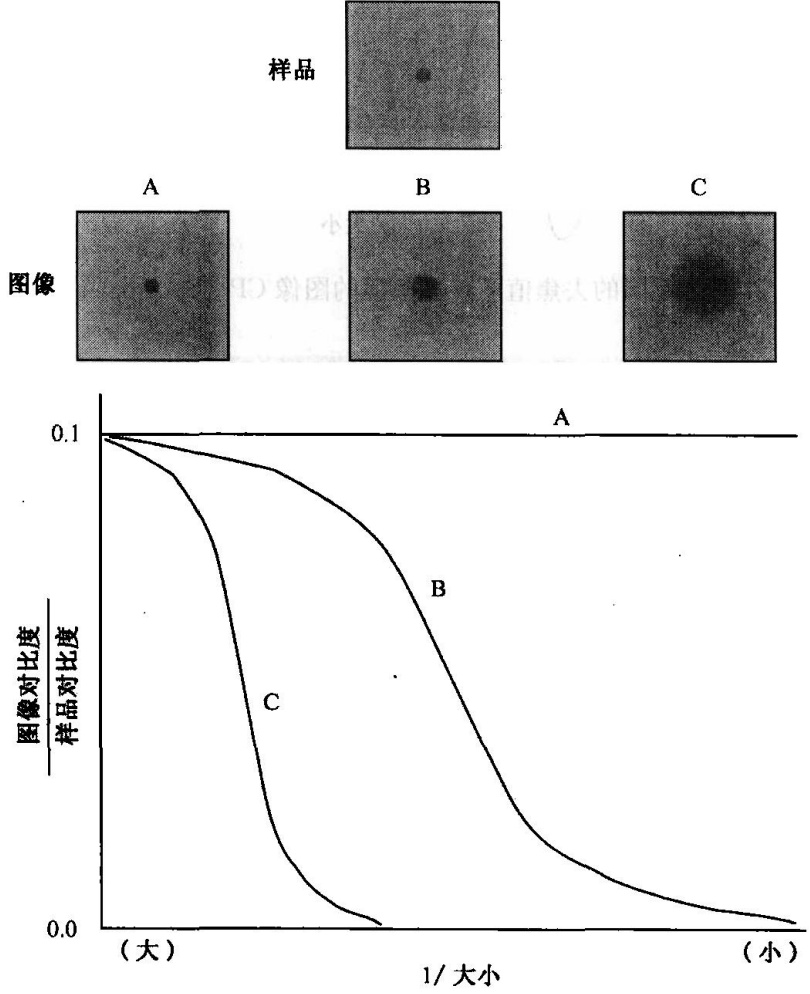
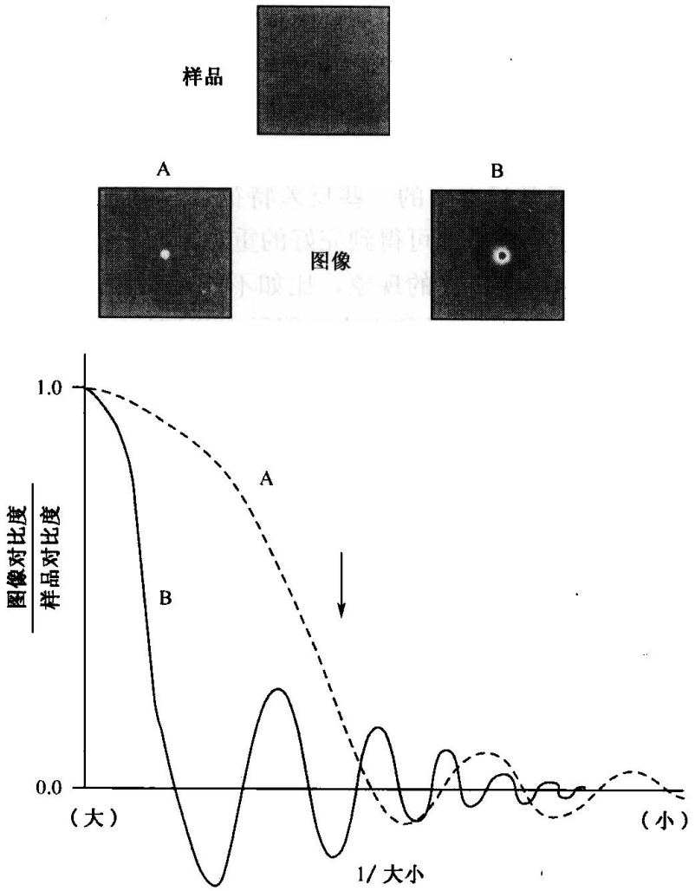
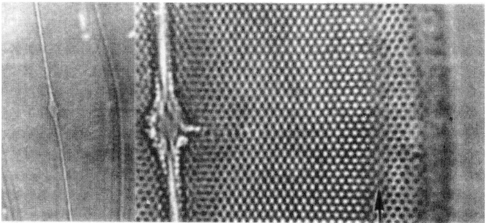

波长下，荧光素可被有效激发，罗丹明却不能。当选用其他荧光标记，如荧光素与得克萨斯红共同标记样本时，在普通显微镜和共焦显微镜下的结果都很好。

## 4. 样品制备

共聚焦显微样品的制备可沿用传统光学显微镜技术的制备方法，这其中包括未经预处理的活组织和经过固定的样品。假如物镜的工作距离足够大，大多数组织表面下0.5nm就能达到一般的清晰度要求。如果一个1nm厚的样品被封固在两层盖片之间，通过上下两边的成像，通常就可以充分检测出样品。对于需要最高精确度的制备，为避免样品产生球面相差就要求最大厚度限制在0.2nm。

如果样品采用一般方法固定，特别是用于免疫细胞化学标记的样品，由于采用了去垢剂分离或甲醇处理，会存在大量的凹陷，对这类厚样品必须小心封固，以避免压迫，同时减少盖片到样品表面的距离，无论何时，使用小型盖片都是非常重要的。大的盖片可能随着物镜的运动而弯曲，造成液体流失或样品移位，基于这个原因，最好使用低黏度的浸油。

## 5. 成像方式

共聚焦透镜可利用样品发出的几种不同来源的光学信息而成像，利用样品的散射光可形成“反射”图像，即沿入射照明光路返回的光线途径，当然散射光线与光源的波长相同。用反射模式很容易观察胶态金标志。利用辣根过氧化物酶（HRP）氧化二氨基联苯胺形成的不溶性底物，也可以形成明亮的反向散射图像。除了检测直接的反射图像，共聚焦显微镜也能容易地检测细胞膜与膜下底物反射光线之间的干涉模式。这项技术即干涉反射反差显微技术，非常适用于观察完整的活细胞。

样品被激发出的荧光是产生共聚焦图像最常用的光学信息来源。在这种情况下，成像光与照明光有着不同的波长。因此，可以与常见的荧光显微镜一样使用二色分光镜，分开荧光与反射光信号。激发荧光更重要的特点在于能够利用不同的荧光标记，同时获得两个或三个精确调准的图像。

## 6. 光褪色

如果成像时精心操作，现代的共聚焦显微镜可以得到数字图像，这比人眼观察图像引起的光褪色要小。为避免光褪色，尤其是当厚样品进行三维重现时，应用一些处理方式可避免光褪色。活样品比较难防止光褪色，但多数情况下可在成像所需的短暂时间内使用脱氧剂，如通常用于厌氧代谢研究的一类酶系统（Oxyrase $^{TM}$ 、Oxyrase、Ashand、Ohio）。

## （二）去旋方法

采用这种技术的目的是通过计算方法去除非焦光线对成像造成的影响，以提高厚样品的成像质量。其步骤是利用关于样品和光学系统的所有已知信息（特别是对于非聚焦作用的量化理解），从观察到的部分聚焦图像来预测样品在聚焦状态下的“形貌”。通常采用的方法是先对所观察样品的真实状态给出一个预测的模式，再对这个模式反复改进，直到这个预测模式经过实际去焦作用后形成的图像，与真正观察到的图像一致为止。

运用该技术，首先要理解使用透镜对所观察样品去焦后图像的影响。为了理解这一点，需要介绍一下反差传递功能（contrast transfer function，CTF）的概念。这一功能描绘了样品的反差变化在图像中能可靠的重复的程度。理想的反差传递意味着图像反差与样品反差一致。CTF通常用比率表示，因此理想的反差传递即CTF等于1.0，实际情况是CTF总小于1.0。通常标本中的一些反差特征会比其他一些反差特征得到更真实的传递，一个标本的大部分信息都可得到完好的重现，而一些非常细节的信息却很难获得——这在光学显微技术中是常见的现象，比如不能观察比入射光波长更小的样品。因此CTF的数值也反映了可观察样品的大小。图示CTF时，一般用图像与样品的反差比值作为竖轴、对可观察样品的大小的倒数（空间频率）为横轴作图。

图 12-7 显示了一个好的显微镜的 CTF 的图形，表示样品制备的很薄，并且准确定位于物镜焦平面上的状态。当样品被移出焦平面时，会出现什么现象呢？令人惊讶的是:CTF 将产生波状振动，在某些区域变成负值。这意味着对于样品的某些特征，我们观察到的图像与真实样品之间存在着逆向反差，即对于 CTF 处于负值的状态，实际上是样品的黑暗部分在图像中却成为明亮的，反之亦然（图 12-8）。随着去焦程度的增加，CTF 的振荡会越发显著，即图像中更多的特征将受到逆向反差的影响。

图 12-7 反差传递功能（CTF）示意图及相应的实物与成像效果对比图（Spector et al., 1998）
A. 理想（不可能）的显微镜；B. 标准的好显微镜；C. 差的或使用不当的显微镜

图12-8 在两个不同的去焦值下，显微镜的图像CP（Spector et al., 1998）

图 12-9 因去焦造成的对比度回复（Spector et al., 1998）

左图为在普通显微镜上用 $60 \times \mathrm{N}$. A. 1.4透镜拍摄的一个明视野硅藻图片。右图为左边图片的一小部分的放大图, 从中可以看出因去焦造成的反相转换。硅藻壳是弧形的, 边缘比较薄, 因此透镜到硅藻的距离是变化的。换句话说, 视野里就包括一个去焦值范围。在这个去焦值范围里, CTF两次改变信号。从左向右, 可以看到孔洞从黑变白, 然后又从白变黑。箭头处表明的是黑和白孔区的中间位置的一条带, 孔洞的反差很

低，即这一个去焦值下此处结构的 CTF 接近零（照片由 University of Pennsylvania 的 Murray 提供）

在几乎所有样品上都很容易观察到这一现象，使用好的干镜头或油镜，找到样品的一个小的高反差特征（最好是一粒小尘埃或一道刮痕）。从正确的调焦位置的任何一侧，小心地上调或下调一小段距离，就会发现颗粒从明到暗再从暗到明的变化。假如能够充分地控制调焦，就能发现一个位置，在明暗振荡的中途，在这一处实际上看不到尘埃颗粒。因此鉴于成像的“不真实性”，在解释显微镜图像时需要非常的仔细。

在相应的光学系统下观察时，CTF包含了我们需要预测已知样品样貌的所有信息，然而，问题在于人们观察样品成像形态的目的，是为了了解样品的真实结构。尽管理论上可以利用一个数字化的“去旋”步骤，通过观察到的外表信息复原样本真正的结构，然而实践中用迭代法进行计算效果更好。在这一流程中，样品被视为不连续的平面组成，通常得到的数据就是一叠样品的图像，这些图像通过细微改变显微镜的调焦收集得到。以取自一个9平面厚的样品中的第5个平面（图12-10和图12-11）为例说明迭代计算法。

图 12-10 将一个聚焦平面图像加到在不同去焦程度下观察的邻近平面图上，形成厚样品图像（Spector et al., 1998）

以图 12-10 中所观察样本的第 5 层为例，当记录这个图像时，检测器所 “见” 到的是一张样品聚焦状态下的平面图 5 号，加上轻微去焦一格形成的模糊平面图 6 号，反向去焦一格形成的模糊平面图 4 号，以及去焦程度递增形成的模糊平面图 7 号和 3 号，依此类推的这些平面之和。假如我们最初已经对样本的 1～4 层以及 6～9 层结构有了预测，运用适合每个焦平面的已知 CTF，就可以预测这些模糊图层对于所观察图层 5 的影响，再将模糊的 1～4 及 6～9 从图像中抽出，我们就能推测出 5 号图是样品的平面外观图。对 9 个图都重复这一步骤，对样品预测程度就能提高。所有平面的操作顺序都以循环的形式重复，直到样品预测不再有显著改变（图 12-11）。

当聚焦值在所示两个值变化时, 用箭头标明的大小范围的物体会从黑变白, 或反之。图 12-9 给出了一个反差转换的例子。

幸运的是，观察生物样品的荧光显微镜都必须使用高孔径透镜，离成像平面较远的样品平面图对其作用就很次要了。因此在每一步循环中不必考虑所有的样品平面，实际