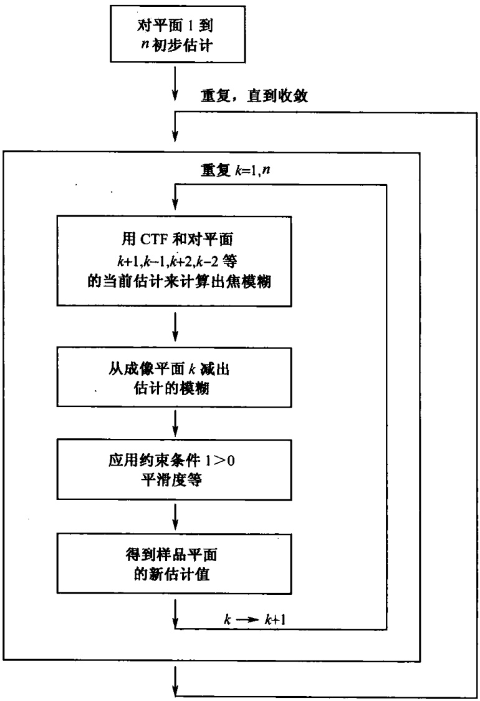
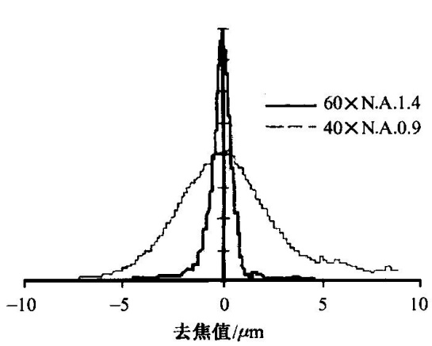

图 12-11 约束迭代去旋算法流程图（Spector et al., 1998）

计算中需要考虑在内的邻近平面的数量取决于聚焦递增的幅度、透镜的孔径数以及最终所需的分辨率。通常，对于有效孔径1.33的透镜，去焦值大于 $\pm4\mu m$ 范围以外的临近平面层就可以安全地忽略。对一些特定的样品，也可仅考虑最邻近平面的信息，这种情况适用于在小型PC机上进行快速运算。

迭代去旋程序的成功与否，关键取决于 CTF 的优劣，以及图像资料的精确性大小。通常的信号密集靶（signal-intensified target，SIT）照相图片，尽管精确到 8 位数，也并不比 5 位数或 6 位数的可靠得多。相比之下，成像数据更为优越的其他技术已在大多数去旋术中得到使用。

## （三）结果解释

尽管共聚显微技术和去旋技术形成图像的过程类似于进行光学“切片”，但是仍不同于真正的切片。因为其上下两个边界并没有明显的界定。一个真实的切片机切出的样品，原来样品的每一个点都明确地包含在某一切片中，细胞中的一个特定的位置要么在这一切片中，要么不是，取决于这一点所处的位置，而没有中间状态。然而，由于光学切片没有严格的界限，规定了何者被包括进光学切片，何者没有。取而代之的模式是，从中心点开始，距离越远，光强会越低。

光学切片中也有类似于切片“厚度”的概念，即描述距离切片中心点不同距离处的相对点密度的曲线半幅宽度（在最大峰值一半处的完全宽度）。通过搜集一个小的明亮物体（如荧光珠）的一系列密集排列的光学切片（对最大孔径的透镜，该“切片”间距是0.1μm），就很容易测量出这条曲线。物体在各个光学切片成像总光强图曲线应类似于图12-12，就是所说的光学系统的垂直点散功能（vertical point-spread function，VPSF），对于最高孔径数的透镜，共聚焦透镜的垂直点散功能的曲线半幅宽度约等于0.6μm。

图 12-12 X-Z 扫描直径  $0.9/\mu m$  的荧光珠并测量垂直点散功能（Spector et al., 1998）照片左边是用  $40 \times 0.9$  孔径的物镜扫描的，右边是用  $60 \times 1.4$  孔径的透镜扫描另一个不同的样品。用孔径较低的物镜，圆荧光珠看起来被拉得很长。因为降低孔径对垂直清晰度的影响比水平的更大。左边扫描在焦点上下明显不对称，说明有球面像差。右边的扫描（样品不同）也能看出少量的球面像差，比例尺  $2\mu m$ 。图中测出了这两种情况的垂直点散功能。在曲线中，球面像差表现为右峰和左峰的不对称

垂直点散功能的宽度随物镜孔径的平方而降低。对共聚焦系统这一宽度也随针孔大小的降低而降低。对所有的显微镜，垂直点散功能对球面像差很敏感（图12-12）。遗憾的是，当检测厚的样品时，往往不得不带来一定的球面像差。为了增加所收集的微弱的荧光样品光的数量，必须使用高孔径的油镜，样品紧贴盖片，而盖片依靠浸油与透镜紧密相连，但是对于一个厚样品，显然不是所有的区域都能具有这样紧密连接的状态。当样品焦平面设定越来越深时，图像随之因球面像差而越来越模糊，这一问题因最近发展起来的长工作距离的水浸物镜而大大改善。尽管目前所有的水浸透镜比最好的油浸物镜都昂贵，但可以得到盖片下方约 $200\mu \mathrm{m}$ 深处的优质图像。

## (四) 三维重建

共聚焦显微技术或去旋技术输出的信息通常是一叠光学切片，通过定量调焦而获得每一个图像。假如目的是搜集足够的信息使得尽可能在最高的清晰度下达到样品的三维重建，那么邻近的光学切片的定位就递增在大约是垂直 PSF 的半 FWHM 的位置处。

垂直方向的清晰度总是比水平方向的差，约只有水平方向的1/3。因而在三维重建中，特别是在共聚焦显微镜中，物体常常看起来在垂直方向延长。用于去旋技术的软件通常能纠正这一效应。另外一类似的纠正技术对共焦成像也非常有用（实际上是一个一维清晰边缘滤过器）。

## （五）故障检修指南

当获得的成像质量不好时，首先要考虑样品或设备是否出现了问题。假如有标准样，就可以用过去某天设备的表现与现在的表现作比较，这样就避免了大量时间的耗费。常用的两种标准样品是:直径0.2～0.5μm小荧光珠及荧光染料溶液。荧光珠应在玻片上铺成一层薄膜，晾干，用一层非常薄的抗褪色剂溶液封固。大的荧光染料溶液层应用盖片密封。在多频率设备下，荧光珠和荧光染料混合后，应使它们在各自的频率中都能测出（如混合荧光素得克萨斯红和Cy5溶液）。

在设备处于正常状态的时候，收集荧光珠的聚焦图像并加以储存，以及收集荧光染料溶液在盖片下几微米的图像，同时收集荧光珠的 X-Z 指标，记录所有的结果、灵敏度、背景、黑暗度或操作方式中的其他调节措施。在无光照条件下，找到这些参数读数为零时的设定位置以及找到这些参数读数略低于荧光珠聚焦时的饱和值的设定位置。仔细记录这些设置，同时记录使用的物镜及照明强度。当系统性能出现问题后可以重复标定一下。

下面列出了共聚焦显微系统一些常见故障。去旋系统是用标准镜操作的，因而大多数故障现象都和常用显微镜类似。假设检查显微镜的操作正确，那么问题就极可能是CTF使用不正确。大多数系统都有鉴定目标样品CTF特征的设备，可在不同的去焦水平下用一系列水平PSF测定。

现象:整个视野图像光强降低（在所有的放大率下）。

可能的原因:如果是起初亮一下，然后变暗，问题就是光褪色或焦点位置漂移造成的。用尽可能小的针孔收集一块没有遮盖的玻璃表面的反射图像，检验聚焦漂移（这一图像对焦点位置非常敏感），如果图像还是暗的，那么可能是共聚焦系统或激光的内镜没有校准。假如是后者，对一些波长的影响会比对其他波长的影响更强。例如，氩/氪和氪激光很易失去黄（568nm）和红（647nm）谱线，但保留蓝（488nm或647nm）谱线。

现象:在视野周围图像亮度降低，在低放大率下尤为明显。

可能的原因:假如在荧光和反射图像中都出现这一结果，那么可能是未进行校准（大多数系统）或内部设计缺陷（Bio-Rad）。如果荧光图像的故障现象比反射图像的更明显，则表明物镜存在色差。

现象:分辨率降低。

可能的原因:假如在薄（如荧光珠）和厚的样品检测中都出现这种现象，那么可能是共聚焦镜片未经校准，此时可检验激光束是否正确聚焦在物镜的轴线上，以及孔径后是否全部充满了入射光。假如问题只出现于厚样品中，那么球面像差可能是产生故障的原因，如果样品亮度足够，可尝试采用水浸物镜或带校正圈的物镜。

现象:调焦最亮的位置并非成像最清晰的位置。图像的亮度与清晰度不能兼得。

可能的原因:系统是非共聚焦的，照明系统的焦平面与成像系统的焦平面不吻合，可能的原因是针孔发生移动，或将光线会聚到针孔上的中间透镜未校准。

现象:图像上出现明暗相间的条纹。

可能的原因:机械振动、激光或检测器电路的电子振荡都是可能的原因。具体分析是何种原因，可用最大孔径针孔对荧光染料样品进行成像检测，这时的成像对机械振荡不敏感，但对电子振荡敏感。

现象:每一个图像都有固定的圆形亮点。

可能的原因:原因是从内部一个反射镜表面反射出的激光被检测到了。如果收集的是荧光图像，那么可能使用了不合适的滤光器。目前大多数系统都采用石英玻片和偏振滤片结合的方式来降低反射成像中产生的问题，如果其中的某个滤片发生偏转，那么也有可能造成这类现象。

\- 抗褪色剂（对固定样）

在 100ml 甘油中溶解:5g 正丙基镓酸盐、25g 1,4-氮杂二环 [2,2,2,] 辛烷、2.5g 间苯二胺。

## 【注意事项】

很少量的水就会大大降低这种以甘油为溶剂的抗褪色剂的效力。为了减少样品中残留的水，使用中最好排尽所有的缓冲液。在样品表面覆盖抗褪色剂，静置约 15min，然后排尽，再用新鲜的抗褪色剂封固。

少量残留的 Triton X-100 以及其他一些去垢剂可以将这种抗褪色剂转化为一种非常强的抑制剂。因此，如果使用抗褪色剂后出现荧光消失的现象，可先用平衡液充分浸润样品以清除去垢剂，然后再使用抗褪色剂。

一些可结合表面羟基的凝集素在 $100\%$ 的甘油中易于分解，在这种情况下，可将抗褪色剂溶于PVP（聚乙烯吡咯烷酮）中。

间苯二胺在空气中很易被氧化，产生能结合核酸的荧光物质。如果抗褪色剂似乎增加了背景，或对核酸染色（用荧光素滤过装置尤为明显），那么就有必要选用更为纯净的间苯二胺（氧化产物呈暗棕色，而纯净的间苯二胺近于纯白色）。间苯二胺在冷水中微溶，而氧化物则易溶，因此用大约5倍重量的冷水清洗间苯二胺粉末，就能去掉大部分氧化产生的杂质。

对于活细胞，使用 Oxyrase™（Oxyrase Inc., Ashland, Ohio），遵照生产商使用说明。

(刘兵)

## 实验 71 果蝇胚胎的共聚焦显微技术

## 【实验目的】

（1）熟悉果蝇胚胎细胞连接与细胞骨架的检测原理和技术。