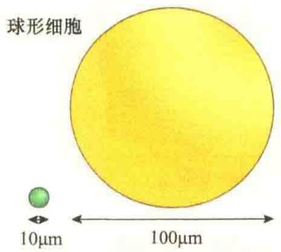
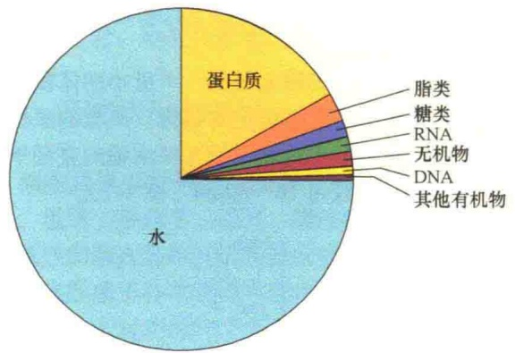
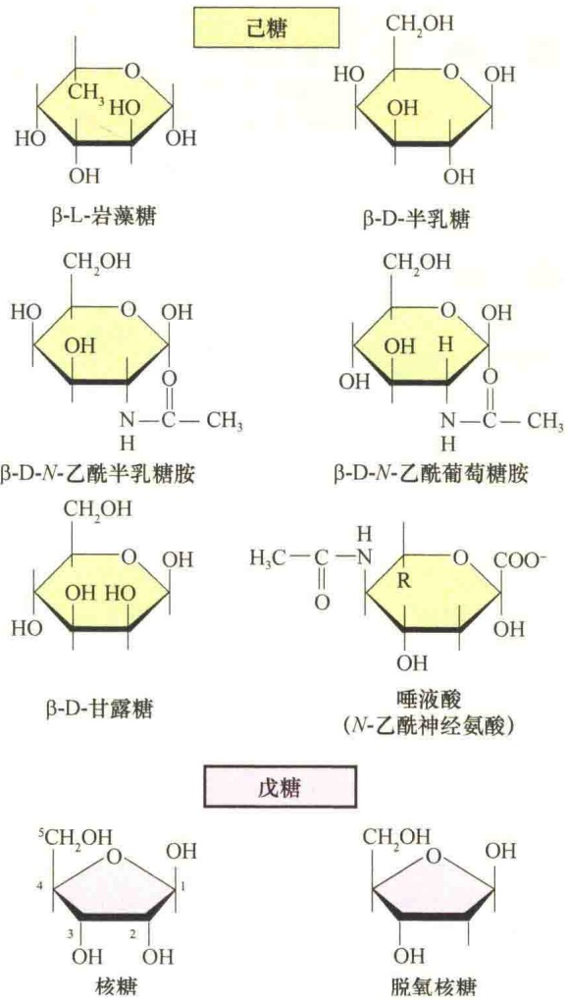
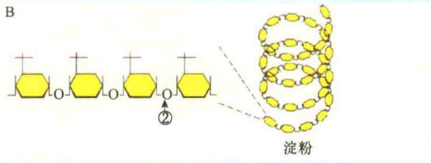

携带的遗传物质注入卵细胞。

## 1.3.4 细胞的大小及体积的恒定

细胞最为典型的特点是在一个极小的体积中形成极为复杂而又高度组织化的结构。典型的原核细胞的直径平均为 $1\sim 10\mu \mathrm{m}$ ，而真核细胞的直径平均为 $3\sim 30\mu \mathrm{m}$ ，一般为 $10\sim 20\mu \mathrm{m}$ （图1-7）。

图 1-7 典型的原核细胞、真核细胞、细胞器、病毒和分子的大小（引自 Kleinsmith and Kish，1995）。

某些不同来源的同类细胞的大小变化很大，如人的卵细胞直径只有0.1mm，而鸵鸟的卵细胞直径则有0.5cm。但是，来自不同物种的多数同类型细胞的体积一般是相近的，不依生物个体的大小而增大或缩小，如人、牛、马、鼠、象的肾细胞、肝细胞的大小基本相同。因此，器官的大小主要取决于细胞的数量，与细胞的数量呈正比，而与细胞的大小无关。

细胞本身的大小是不能随意改变的，细胞体积要维持相对恒定。哺乳动物细胞的体积大小受几个因素的限制，其中一个主要限制因素是体积与表面积的关系。以球形细胞为例（身体内的细胞并非都是球形）计算体积与表面积的关系（图1-8），结果表明，球形细胞增大，其体积的增加要比表面积的增加大得多。这样，当细胞增大到一定程度时，质膜的表面积就不适应细胞进行内外物质的交换，细胞为了维持一个最佳的生存条件，必须维持最佳的表面积，从而限制了体积的无限增大。

| 半径 | 5μm | 50μm |
| --- | --- | --- |
| 表面积(4πr2) | 314μm2 | 31400μm2 |
| 体积(4/3πr3) | 524μm3 | 524000μm3 |
| 表面积/体积 | 0.6 | 0.06 |

图 1-8 细胞体积与表面积间的关系（引自 Kleinsmith and Kish, 1995）。

另一个限制细胞体积的因素是细胞内关键分子的浓度。一些重要的分子在细胞内的拷贝数是很少的，当细胞体积增大时，这些分子的浓度就越来越稀，一些重要的生化反应需要一定的分子浓度才能进行，所以细胞内分子浓度就成了限制细胞体积无限增大的另一个因素。真核细胞的体积一般是原核细胞的1000倍，真核细胞为了解决细胞内重要分子的浓度问题，出现了特化的内膜系统，使一些反应局限于特定的膜性细胞器内，这样，一些重要反应的分子浓度并没有随细胞体积的增大而被稀释。

细胞不仅对其体积的增大有限制，而且对体积的减小也有限制。据研究，一个生活细胞要维持正常的独立生活功能，最低限度需要500～1000种不同类型的酶和蛋白质，这是目前在支原体中所发现的酶和蛋白质的量。而支原体是目前所知最小的原核细胞，它的体积只有0.2～0.3μm³，仍能完全独立地生存。很显然，细胞体积的最小化受制于维持细胞生命活动所需的酶和蛋白质种类的最低量。

## 1.3.5 细胞及细胞器的计量单位

有两种计量细胞大小的单位——微米（μm）和纳米（nm）。1μm等于 $10^{-6}$ m，1nm等于 $10^{-9}$ m。使用电子显微镜后又提出埃（Angstrom，Å）为超显微结构的计量单位，1埃（Å）等于0.1nm，但这个单位并不常用。1Å可粗略地看成是一个氢原子的直径。较大细胞器的直径通常用μm表示，如细胞核的直径为5～10μm，而线粒体的长度大约是2μm，DNA的宽度为2nm（图1-9）。

图 1-9 几种细胞结构的大小（引自 Becker et al., 1996）。

## 1.4 细胞的分子基础

生命是物质的，是一种特殊形式的物质运动，它是物质、能量和信息诸变量在特定时空的“表演”，其运转有赖于生命系统有组织的守时及与空间环境的合拍。

所有的细胞都是由水、蛋白质、糖类、脂类、核酸、盐类和各种微量的有机化合物所组成，表 1-4 为细菌细胞的化学组成。

表 1-4 细菌细胞的化学组成

| 化学成分 | 占细胞总质量的比例/% | 每种分子的类型数 |
| --- | --- | --- |
| 水 | 70 | 1 |
| 无机离子 | 1 | 20 |
| 糖及其前体 | 1 | 250 |
| 氨基酸及其前体 | 0.4 | 100 |
| 核苷及其前体 | 0.4 | 100 |
| 脂肪酸及其前体 | 1 | 50 |
| 其他小分子 | 0.2 | 约300 |
| 大分子(蛋白质、核酸和多糖) | 26 | 约3000 |

## 1.4.1 水

生命来自水。细胞中水的含量最高，通常占细胞总量的 70%～80%（图 1-10）。细胞中的所有反应都是在水中进行的，所以水是细胞生命活动的介质。

图 1-10 细胞中各主要成分的相对含量（引自 Kleinsmith and Kish, 1995）。

相邻水分子间的关系是靠氢键维系的（图 1-11），氢键赋予水分子一些独特的性质，而这些性质对于生活细胞是十分重要的。第一，氢键能够吸收较多的热能，将氢键打断需要较高的温度，所以氢键可维持细胞温度的相对稳定。第二，相邻水分子间形成的氢键使水分子具有一定的黏性，这样使水具有较高的表面密度。第三，水分子间的氢键可以提高水的沸点，这样使它不易从细胞中挥发掉。

图 1-11 水分子中的氢键（引自 Kleinsmith and Kish, 1995）。

水在细胞中既是反应剂也是溶剂。水分子参与了生命活动的一些重要反应，在大分子的合成过程中水是产物，而在分解反应中水是反应剂。

由于水是极性分子，所以水除了作为反应剂外，还是各种极性有机分子和离子的最好溶剂，主要是靠氢键的形成使这些分子和离子得以溶解（图 1-12）。

细胞中的水以两种形式存在:游离水和结合水。游离水是细胞代谢反应的溶剂；结合水则是以氢键和蛋白质结合的水分子，占细胞内全部水的4.5%，是原生质结构的一部分。

图 1-12 水的溶剂作用（引自 Kleinsmith and Kish, 1995）。

## 1.4.2 无机盐

无机盐是细胞的重要成分，并且是维持细胞生存环境的重要物质。根据无机元素在细胞内的作用分为四大类:①大分子的结构成分，主要是C、H、N、O、P、S等；②各种酶反应所需的离子，主要是 $Ca^{2+}$ 、 $Cu^{2+}$ 、 $Mg^{2+}$ 、 $K^{+}$ 、 $Na^{+}$ 、 $Cl^{-}$ 等；③各种酶活性所需的基础微量元素，包括Co、Cu、Fe、Mn、Zn等；④某些生物需要的特殊微量元素，如I、Cs、Br等。

无机元素的功能有:维持细胞内的 pH 和渗透压，以保持细胞的正常生理活动；同蛋白质结合组成具有特定功能的结合蛋白，参与细胞的生命活动；作为酶反应的辅助因子。

## 1.4.3 有机分子

细胞内有 4 类有机小分子:单糖、脂肪酸、氨基酸和核苷酸。细胞内的有机小分子约占细胞总有机物的 1/10，但却有许多不同的种类。有机大分子则包括多糖、蛋白质、DNA、RNA 等。糖可与蛋白质结合形成糖蛋白或蛋白聚糖。

## 1.4.3.1 单糖与多糖

糖（sugar）是一类称之为碳水化合物的有机分子，由碳、氢、氧按1∶2∶1的比例构成。简单的糖，或称单糖（monosaccharide）是最小的糖，仅含三个碳，但在生物体内常见的是五碳糖（pentose，戊糖）或六碳糖（hexose，己糖）。自然界最常见的六碳糖是葡萄糖，是较简单的糖，也是细胞的主要营养物质，它经过一系列氧化反应释放出能量，最终生成水和 $CO_{2}$ 。

除了葡萄糖，还有其他几种己糖在生物大分子糖构建中起重要作用（图 1-13）。虽然这些糖都含有 6 个碳原子，但是它们的羟基（—OH）或醛基是不同的。五碳糖也是重要的单糖，是核苷酸的重要组成部分。

单纯的多糖由许多葡萄糖残基组成，如动物细胞中的糖原和植物细胞中的淀粉，它们是细胞内贮存的营养物质，提供细胞代谢所需的能源（图 1-14）。

图 1-13 一些重要的单糖（引自 Kleinsmith and Kish, 1995）。

多糖（polysaccharide）是细胞的重要支持材料，是细胞壁的主要结构成分。青霉素之所以能够抑制革兰氏阳性菌的生长，就是阻止了细胞壁中特殊糖链的形成。

糖同蛋白质结合形成糖蛋白。在哺乳动物的组织、体液及分泌物中都有糖蛋白，不同的糖蛋白具有不同的功能。植物的糖蛋白一部分与细胞壁的多糖结合，另一部分以可溶的形式存在。

图1-14 相同的单糖构成不同的多糖（引自Karp，1996）。圆圈数字箭头表示三种不同的连接方式。

糖蛋白及其糖链具有很多重要的作用:①作为机体内外表面的保护剂及润滑剂，如鱼体表面黏液中就含有高唾液酸的糖蛋白，能防止水分的丧失。消化道、呼吸道、尿道等体腔黏膜能帮助运输，保护体腔不受机械、化学损伤和微生物感染及润滑等功能；②作为载体与维生素、激素、离子等结合，有助于这些物质在体内转移和分配；③参与细胞识别，是细胞识别的重要分子。几乎所有动物细胞表面都有少量糖，它的作用好比是细胞联络的文字或语言。

蛋白质的糖基化对蛋白质分子的理化性质有很大影响。①溶解度。糖基化往往使蛋白质在水中的溶解度增大。但是，若糖链增长到一定程度，由于相对分子质量增大和形成高级结构，亦会出现憎水性增加的现象。②电荷。氨基糖解离后，应带正电荷。但是，天然存在的氨基糖的氨基都被N-乙酰基取代，实际上相当于中性糖。许多糖链上有唾液酸或糖醛酸，解离后带负电荷，所以糖基化可能使蛋白质增加许多负电荷。

蛋白质的糖基化对蛋白质的生物功能也有很大影响。在迄今已知的上千种蛋白质中，50%以上是糖基化的。许多糖蛋白具有酶、激素、抑制剂等各不相同的生物活性，相当一部分糖蛋白，其分子中糖链是实现生物功能所必需的，去除或破坏糖链会使它们失去生物功能。但某些糖蛋白，去除糖链对其生物功能不会造成影响。

一些糖蛋白中的糖链通过增强蛋白质对热变性和蛋白水解酶的抗性，间接增强糖蛋白的生物学功能。

糖基化对蛋白质合成后加工和运输的影响也是很大的。例如，艾滋病病毒的外壳糖蛋白 gp120 和 gp41 就是由前体蛋白分子 gp160 加工而来的，这种切割加工的信号就是 N-乙酰氨基乳糖型糖链。

## 1.4.3.2 脂

与糖、氨基酸等的概念相比，脂（lipid）不是一类单一的化学分子，而是一类不溶于水、可被辛烷从细胞中提取出来的化学物质。细胞内常见的有以下6类脂（图1-15）。

脂肪酸（fatty acid）是最简单的脂，它是细胞的重要能源来源，按质量比计算，脂肪酸分解产生的能量相当于葡萄糖所产生能量的2倍。脂肪酸在细胞内最重要的功能是构成细胞结构，是细胞质膜的主要组分。脂肪酸具有长的碳链，末端含有羧基团（—COO $^{-}$ ），细胞中大多数具有重要作用的脂肪酸都含有偶数碳原子，最长的脂肪酸长度含有24个碳原子。细胞内几乎所有的脂肪酸分子都是通过它们的羧酸基团与其他分子共价连接。不饱和脂肪酸含有双键，饱和脂肪酸则不含双键。各种脂肪酸的碳氢链长度及所含碳-碳双键的数目和位置的不同，决定了它们不同的化学特性。

三酰甘油（triacylglycerol），俗称脂肪（fat），系指与甘油相连接的脂。甘油是三碳糖还原的衍生物。三酰甘油是细胞内储存脂肪的最好形式，可作为很好的能源以备细胞之需。在动物细胞中三酰甘油储存在脂肪细胞中，在脂肪细胞质中，几乎被脂肪滴所占据。

磷脂（phospholipid），与极低水溶性的三酰甘油相比，磷脂的骨架中含有水溶性的磷酸基团，因此磷脂是两亲性的分子，既亲水又疏水。磷脂可通过磷酸基团与甘油或长链的鞘氨醇（sphingosine）相连。磷脂是细胞质膜的主要结构成分。

糖脂（glycolipid）是鞘氨醇的衍生物，分子中一个糖取代了磷酸基团。由于糖是水溶性的，所以糖脂也是两亲性的。糖脂是某些膜的重要成分，特别是植物细胞与神经细胞的膜。

类固醇（steroid）是四元环，即菲（phenanthrene）构成的化合物，因此，类固醇的结构与其他的脂类有很大的不同。有些类固醇是激素，有些类固醇（如维生素D）可调节肠中钙的吸收，胆固醇在动物细胞中不仅是细胞质膜的成分，也是其他类固醇合成的前体。