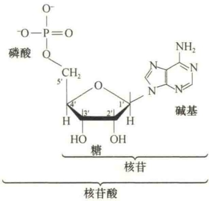
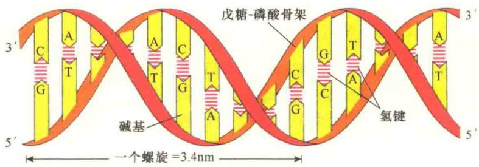
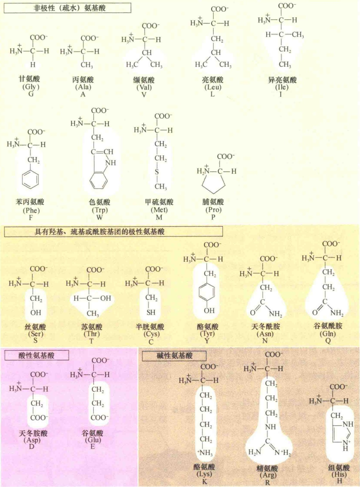
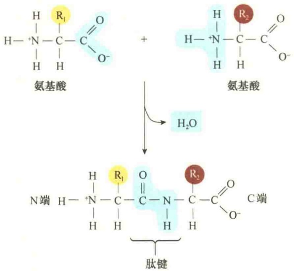
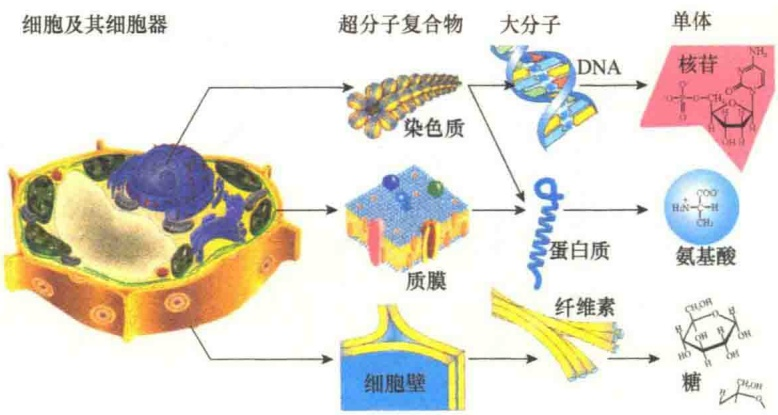

图 1-15 细胞内 6 类不同的脂（引自 Kleinsmith and Kish, 1995）。

萜（terpene）是由五碳的异戊二烯构成的脂。异戊二烯和它的衍生物与不同的化合物结合生成各种底物，如维生素A、辅酶Q、类胡萝卜素等，尽管结构相似，功能却有很大不同。

## 1.4.3.3 核苷酸与核酸

核酸是储存与传递遗传信息的载体，核苷酸（nucleotide）是组成核酸（nucleic acid）的基本单位，每个核苷酸分子由一个戊糖（核糖或脱氧核糖）、一个含氮碱基（嘧啶或嘌呤）和一个磷酸脱水缩合而成（图1-16）。

五碳糖（five-carbon sugar），即戊糖。核酸中有两类不同的戊糖，即脱氧核糖和核糖。它们之间唯一的差别就在于脱氧核糖的2'-碳原子上缺失了氧。由于这一差别，细胞内的核酸就分为脱氧核糖核酸与核糖核酸。

图 1-16 核苷酸的组成单位（引自 Kleinsmith and Kish, 1995）。

含氮碱基（nitrogenous base）。细胞中主要含有5种含氮碱基:胞嘧啶（C）、胸腺嘧啶（T）、尿嘧啶（U）、鸟嘌呤（G）、腺嘌呤（A）。主要形成8种核苷酸:腺苷酸（AMP）、尿苷酸（UMP）、鸟苷酸（GMP）、胞苷酸（CMP）、脱氧腺苷酸（dAMP）、脱氧胸苷酸（dTMP）、脱氧鸟苷酸（dGMP）、脱氧胞苷酸（dCMP）（图1-17）。

图 1-17 核苷酸中的碱基（引自 Kleinsmith and Kish, 1995）。

磷酸基团（phosphate group）。磷酸基团是核苷酸中的第三种成分，它与五碳糖连接，并将核苷酸相互连接形成核酸。磷酸基团是强酸，这就是为何将 DNA、RNA 称之为“酸”（acid）。

核苷酸除组成脱氧核糖核酸（DNA）和核糖核酸（RNA）外，有些核苷酸在细胞内起重要作

RNA 即是核糖核酸，种类较多，有 tRNA、rRNA、mRNA。还有一些存在于细胞核和细胞质中的小分子 RNA，它们具有不同的功能，在某些病毒中 RNA 是遗传物质。

## 1.4.3.4 氨基酸与蛋白质

1）氨基酸（amino acid）细胞内主要有20种氨基酸，它们的差别主要是R侧链不同，R侧链决定了氨基酸的化学性质（图1-19）。

氨基酸是组成蛋白质的基本单位，蛋白质是长的线性氨基酸多聚体，这些氨基酸通过一个氨基酸的羧基与另一个氨基酸的氨基之间形成的肽键而首尾相连，构成多肽链（图1-20）。多肽链的一端具有游离的氨基，称为氨基端，另一端具有游离的羧基，称为羧基端。多肽链中氨基酸残基的侧链通常不参与共价键形成，它们的理化特性决定了所组成蛋白质的特性，是蛋白质多种复杂功能的基础。

2）蛋白质（protein） 蛋白质是细胞内行使各种生物功能的生物大分子，估计在一个典型哺乳动物细胞中有10 000种不同的蛋白质执行着不同的功能（表1-5）。

组成蛋白质的基本构件只是20种氨基酸，为什么蛋白质却具有如此广泛的功能？其根本原因是蛋白质具有几乎无限的形态结构，因此蛋白质仅仅是一类分子的总称。换句话说，蛋白质之所以有如此广泛的作用，是因为蛋白质具有各种不同的结构，特别是在蛋白质高级结构中具有不同的结构域，而这种不同的空间构型使得蛋白质能够有选择地同其他分子进行相互作用，这就是蛋白质结构决定功能的特异性。正是由于蛋白质具有如此广泛的特异性才维持了生命的高度有序性和复杂性。

3）酶（enzyme） 酶是具有催化功能的蛋白质。它们能够与底物结合，将底物转变成一个或多个经修饰的产物，并且可极大地提高反应速度，保持细胞内温度的相对恒定。所以，酶是一种生物催化剂，维持细胞生命的正常进行。表1-6列出了细胞内一些重要的酶及其催化的反应。

用。例如，三磷酸腺苷（ATP）是细胞内化学能的载体，参与细胞内化学反应间能量传递。环腺苷酸（cAMP）是含嘌呤环状磷酸衍生物，作为细胞内通讯的信号分子，控制细胞内许多不同反应的速度。

脱氧核糖核酸即 DNA 分子，是遗传物质，只有一种类型，其结构是双螺旋的（图 1-18）。

图1-18 DNA的结构。

图 1-19 20 种氨基酸的结构。

图1-20 两个氨基酸之间通过脱水形成肽键。

表 1-5 细胞内蛋白质的某些功能

| 功能 | 举例 | 功能 | 举例 |
| --- | --- | --- | --- |
| 结构材料 | 胶原、角蛋白 | 激素 | 胰岛素、生长激素 |
| 运动 | 肌动蛋白、肌球蛋白 | 物质运输 | $Na^{+}$-$K^{+}$泵 |
| 营养储存 | 酪蛋白、铁蛋白 | 信号传导 | 乙酰胆碱受体 |
| 基因调控 | lac 操纵子 | 渗透压调节 | 血清白蛋白 |
| 免疫作用 | 抗体 | 毒素 | 白喉和霍乱毒素 |
| 电子转移 | 细胞色素 | 酶(催化作用) | 氧化还原酶、连接酶等 |

## 1.4.4 细胞结构体系的组装

细胞是由化学物质组成的。由于细胞的生命活动是高度有序的，所以细胞的化学物质不可能杂乱无章地堆积在一起，而是有规则地分级组装成复杂的细胞结构，如核糖体、细胞核、高尔基体和细胞骨架等（图 1-21）。

由生物分子组装成细胞，可以粗略地分成四级。第一级是构成细胞的较小有机分子的合成，包括碱基、氨基酸、葡萄糖、软脂酸，这些构成了细胞的化学单体。第二级由单体分子合成生物大分子，包括DNA、RNA、蛋白质、多糖。第三级由生物大分子进一步合成超分子的高级结构，如细胞质膜、染色质、多糖、微丝等。第四级由超级生物大分子组装成具有空间结构和生物功能的细胞器，如细胞核、线粒体、叶绿体、内质网、高尔基体、溶酶体、微体等，最后再由细胞器组成细胞。

表 1-6 细胞内一些常见的酶

| 酶 | 催化的反应 |
| --- | --- |
| 水解酶(hydrolase) | 催化切割水解反应的酶,如核酸酶与蛋白酶 |
| 核酸酶(nuclease) | 催化核苷酸之间键水解的酶。核酸内切酶是从多核苷酸链内部水解,而核酸外切酶则是从末端开始水解 |
| 蛋白酶(protease) | 水解蛋白质肽链中氨基酸残基间的肽键 |
| 合成酶(synthase) | 催化两个小分子成为大分子的酶 |
| 连接酶(ligase) | 将两个分子连接起来,是耗能过程,如DNA连接酶通过磷酸二酯键将两个分子末端相连 |
| 异构酶(isomerase) | 催化分子内的重排 |
| 聚合酶(polymerase) | 催化分子的聚合反应,如DNA、RNA的合成 |
| 激酶(kinase) | 催化分子添加磷酸基团的酶,蛋白质激酶是重要的激酶,催化蛋白质磷酸化 |
| 磷酸酶(phosphatase) | 催化底物脱去磷酸的酶 |
| 氧化-还原酶(oxido-reductase) | 催化一个分子氧化、另一分子还原的反应 |
| ATP酶(ATPase) | 水解ATP的酶,为细胞的生命活动提供能量 |
| GTP酶(GTPase) | 水解GTP的酶,GTP结合蛋白是一大类GTP酶 |

各种生物大分子到底如何组装成有功能的细胞结构和组织是当前细胞生物学所要研究的基本问题，目前对组装的机制提出过以下假说。①模板组装（template assembly）是指由模板指导，在一系列酶的催化下，合成新的、与模板完全相同的分子。这是细胞内一种极其重要的组装方式，DNA 和 RNA 的分子组装就属于此类。②酶促组装

图 1-21 植物细胞的化学组装（引自 Nelson and Cox，2013）。