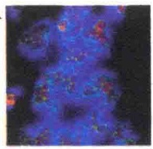
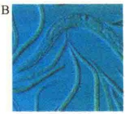
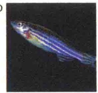
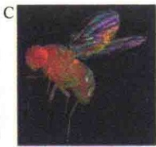
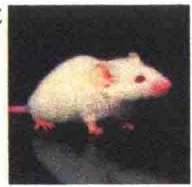
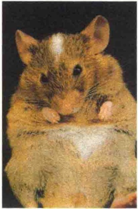

组成细胞的分子主要是有机分子，所以要形成细胞，地球上首先必须形成有机分子。20世纪20年代后期，苏联的生化学家Oparin提出地球上的有机分子是在合适的化学和物理条件下自然形成的。1953年，这一假说得到了实验的支持。实验的设计者是Miller，当时是一位研究生。他设计了一个实验装置，并通过实验证明在合适的物理化学条件下可以自动合成有机分子（图1-25）。

图 1-25 Miller 推测地球上的有机分子自动合成的实验装置（引自 Wolfe，1993）。

Miller 推测，大气层中含有甲烷和氨，也含有氢和水蒸气。他把这些气体一起放入实验装置中，然后一直与电火花接触，在这一装置中靠沸水提供水蒸气。反应一个星期后分析产物。令人惊讶的是，产物中有大量的有机物，包括尿素、生物和非生物的氨基酸等，实验证明了在雷电作用下能够利用大气中的分子合成有机分子。也就是说，在进化的某一过程中地球上有了构成细胞生命物质的基本单元——氨基酸、碱基、单糖等，为细胞的起源做好了物质准备。

## 1.6.1.2 分子聚合体的形成

从分子到原始细胞的生命进化过程中，两个主要事件是遗传信息的形成和细胞质膜的形成。遗传信息的形成是生命进化的转折点。核酶（ribozyme）的发现，说明RNA在生命起源中起了主导作用，它比DNA和蛋白质的起源都早。有机分子如何聚集形成分子聚合体，要有两个基本条件，即溶液中分子能够沉淀出来并能聚集排列形成稳定的结构，或者又能重新溶解。这种聚集有几种不同的机制，最典型的是脂双层结构的自动装配，为细胞质膜的形成提供了可能。

## 1.6.1.3 生命初级聚合体的形成

生命初级聚合体的形成包括:①如何利用能源驱动化学反应途径的进行；②酶分子的形成及酶催化反应途径的形成；③指导合成和再生的信息系统的形成。这里所指的生命初级聚合体的形成包括生物大分子的形成（酶和ATP等）、代谢的生物途径的形成、能量转换、信息的形成。这些生命初级聚合体一旦形成，生命的雏形即已形成。

## 1.6.1.4 原始细胞的形成

突变和自然选择是导致细胞生命形式形成的主要因素。上述各阶段的分子进化可视为是有利的突变，而这种有利的突变则被自然选择下来。将前几个阶段形成的膜结构、酶分子、能量转换系统、遗传信息系统和各种温和代谢途径聚集在一起就形成了原始的细胞。

## 1.6.2 真核细胞的进化

真核细胞由原核细胞进化而来，这是生物学家的基本共识。原核细胞向真核细胞进化的主要事件是呼吸代谢的发展和内膜系统的形成。细胞内两个与能量转换有关的细胞器——线粒体和叶绿体的起源主要是通过内共生机制，而内膜系统则是通过质膜的内陷形成的（图1-26）。首先形成内质网和核膜，然后逐步形成高尔基体、溶酶体、内体等内膜系统的其他结构，这样原核细胞就进化到低等真核细胞。

## 1.6.3 从单细胞向多细胞进化

虽然一个细胞可以是一个生命体，但这种生命体毕竟太简单。在细胞进化过程中出现了细胞的集合体，进一步发展到多细胞有机体。

细胞在向多细胞有机体进化的过程中，最重要的事件是出现细胞的分化，即在多细胞的有机体内，各种细胞向不同的方向发展，形成结构和功能各异的不同的组织，但又互相协调成为一个有机的整体。

在多细胞的有机体内，有一部分细胞高度特化，专门负责细胞生命的繁衍，这些细胞称为生殖细胞（germ cell），以别于有机体内的其他细胞，即体细胞（somatic cell）。

## 1.6.4 模式生物

现今的生物都是从共同祖先进化而来的，并且一些重要功能的基因在进化上是高度保守的，所以无论从细胞水平还是分子水平看，不同生物间都遵循共同规律，只不过由于进化梯级不同，结构的复杂性有所不同。因此，可以用比较容易研究的生物作为模型来研究其基因的结构和生物学功能，由此获得的信息可以应用于其他比较难以研究的生物。这些被生物学家选定的用于科学研究，并根据研究结果揭示某种具有普遍规律的生命现象的生物物种就称为模式生物（model organism）。常见的模式生物有酵母、线虫、果蝇、斑马鱼、小鼠及拟南芥等（图1-27）。

图 1-26 真核细胞的进化（引自 Karp，2010）。进化分为 5 个过程:①一个大的厌氧菌——异养菌吸收了一个小的需氧原核生物，有研究证明所吞的细菌是现今自然界存在的立克次氏体的祖先；②被吞入的好氧细菌进化成线粒体；③部分细胞质膜内陷，形成核膜、内质网膜的前体，形成初级真核细胞；④初级真核细胞继续进化成为无光合作用的原生动物、动物细胞；⑤在另一个途径，初级真核细胞吞入了具有光合作用的细菌，该细菌逐渐内化并演化成植物细胞的叶绿体。

A

D

图 1-27 6 种真核生物研究的模式生物（引自 Lodish et al., 2016）。A. 酵母，B. 线虫，C. 果蝇，D. 斑马鱼，E. 小鼠，F. 拟南芥。

1）酵母（yeast） 酵母是最简单的真核生物，有很多实验上的优越性，可用于研究真核生物的一些基本结构与功能。最常用的酿酒酵母（Saccharomyces cerevisiae）的基因组大小约是大肠杆菌的3倍，约6000个基因，比高等真核生物的基因组要小得多，但是，酵母却具有典型的真核生物的特征。它具有核膜包起的细胞核，有16条线性染色体，而且是单倍体，细胞质中含有细胞骨架及亚细胞组织。

酵母很容易培养，并可使用大肠杆菌的研究方法进行研究。虽然酵母不如大肠杆菌生长快，但2h也会分裂一次，也可形成单细胞长成的菌落，因此，可像大肠杆菌一样用于遗传操作。

酵母具有真核生物基本的遗传规律，包括基因突变、DNA复制和转录、RNA加工、蛋白质分选，以及细胞周期调控。因此，酵母是较好地研究真核生物基本遗传规律的模式生物。

## 2）秀丽隐杆线虫（Caenorhabditis elegans）

由于酵母是单细胞的真核生物，不宜用于研究多细胞真核生物发育等方面的遗传规律。线虫由于其具有一些独特的特点，成为研究动物细胞发育与分化的最好模式生物。

线虫的基因组比单细胞的酵母大，但比大多数动物细胞的基因组小。线虫大约有 19 000 个基因，是酵母基因组的 3 倍，几乎与人的基因数量相等。

从生物学的角度看，线虫是相当简单的多细胞的生物，成年的线虫只有959个体细胞、1000～2000个生殖细胞。此外，线虫很容易在实验室培养，方便遗传操作。

线虫可以在显微镜下进行观察，因其是透明的，这为发育的研究提供了极大的方便，可用于跟踪不同细胞系发育的途径，也可通过突变研究不同基因突变导致的发育变化。

3）黑腹果蝇（Drosophila melanogaster）如同线虫，果蝇也是研究发育生物学的最好模式生物。果蝇的基因组比线虫的大，但是基因的数量比线虫的少，只有14 000个基因。果蝇很容易在实验室喂养并长期保存。其发育周期也很短（2周），所以是很好的遗传实验材料。

通过对果蝇的遗传分析，已经揭示了一些参与发育与分化的基因，通过深入地研究分析，有助于揭示动物发育的机制，特别是有助于对多细胞生物身体发育与器官形成的了解。

4）斑马鱼（zebra fish） 斑马鱼是研究脊椎动物发育的极好模式生物。斑马鱼很小，容易在实验室内快速养殖，3～4个月一代，并且可以在体外进行胚胎发育，而且可进行移植，因此易于观察其早期的胚胎发育。已经建立了一系列分离影响斑马鱼发育突变体的方法，并鉴定了几千种突变体。由于斑马鱼是较易研究的脊椎动物，它已成为研究人与无脊椎动物间的一座桥梁。

5）小鼠（mouse） 在哺乳动物中，小鼠是最适合遗传分析的，虽然它比酵母、果蝇复杂得多，但已经鉴定了很多影响发育的突变体。更有意义的是，已经建立了一些工程鼠，可将外源基因导入小鼠的生殖系统，研究基因在整体动物体内的功能。小鼠之所以用作研究人发育的模式生物，不仅仅因为小鼠的基因组与人的基因组相似，而且同源基因的突变可产生相似的遗传缺陷，如白斑病就是一个典型的例子（图 1-28）。

6）拟南芥（Arabidopsis thaliana）植物分子生物学与发育的研究是一个活跃而又十分广泛的领域，并且具有十分重要的经济价值。由于植物覆盖的范围广而复杂，因此需要一个相对简单，又像线虫和果蝇那样具有代表性的模式生物，而开小花的拟南芥则是最好的研究植物发育的模式生物。

拟南芥的基因组有 $125 \times 10^{10}$ 个碱基对，含有约26000个基因。但很多基因是重复的，实际上只有约15000个基因，因此，它的复杂程度与线虫、果蝇相似。此外，拟南芥也是易于在实验室培养的，并建立了很多适于拟南芥进行分子遗传研究的方法，已经鉴定了一些与植物发育、开花相关的基因。这些研究表明植物与动物的发育有很大的相似性，也有很大的不同。

图 1-28 小鼠作为研究人的发育模式生物（引自 Cooper and Hausman，2013）。一个小孩与一只小鼠同一个基因突变造成相同的遗传缺陷。图示胸前的白斑是因为一个基因的突变影响了胚胎发育期黑素细胞的正常迁移所致。

7）大肠杆菌（E.coli）除了上述6类用于真核生物研究的模式生物外，大肠杆菌与噬菌体在分子遗传学的研究中则发挥了巨大作用。由于细菌的结构较为简单，所以是研究生物化学与分子生物学的理想原核生物。研究得最为深入的是E.coli。它是被最早用于研究分子遗传学机制的模式生物。今天我们所了解的大多数分子生物学概念，包括DNA复制、遗传密码、基因表达、蛋白质合成等都来自大肠杆菌的研究。

大肠杆菌有两个特点特别适合实验室的研究工作:一是结构简单，二是易于培养与繁殖。大肠杆菌约含 $4.6\times10^{7}$ 个碱基，约4300个基因。而人的基因组大约是大肠杆菌的1000倍以上，含2.0万～2.5万个基因。所以大肠杆菌以最小的基因组为基因分析做出了巨大贡献。

大肠杆菌的周期短、分裂快也是作为分子生物学研究材料的一大优势。在实验室培养条件下，大肠杆菌每20min分裂一次，在半固体琼脂培养基上，一般培养过夜后，一个单细胞就可以长成菌落，每个菌落中有 $10^{8}$ 个细胞。由于在短时间内可获得大量细胞，所以大肠杆菌对于分离细胞组分、研究抗生素抗性、基因突变等都是十分有利的。

## 1.7 合成生物学与“人造”细胞

美国科学家克雷格·文特尔（Craig Venter）

及其领导的一个20多人的科研小组通过合成生物学的手段，人工全合成蕈状支原体（Mycoplasma mycoides）的基因组，并引入山羊支原体（Mycoplasma capricolum）细胞，获得杂合细胞。该细胞表现出的是蕈状支原体的生命特性，其研究论文“创建由化学合成基因组控制的细菌细胞”发表在2010年5月20日出版的美国Science杂志上。这是地球上第一个由人类制造并能够自我复制的新物种。文特尔的团队将这一人造细胞称为“Synthia”（译为“辛西娅”，意为“合成体”）。

该成果一经报道立即引起了科学界的轰动。有人将“Synthia”称为“人造生命”，有人将“Synthia”称为“人造细胞”，其实这些说法都言之过甚。“人造”的简单理解就是从无到有地制造出来，而“Synthia”的基因组虽然是“造”出来的，实际上是按蕈状支原体的基因组仿造的，并没有改变遗传性；此外，“Synthia”的细胞质膜及其他一些生命“必需品”都是“租用”自山羊支原体。

尽管如此，这一成果仍具有重要的科学意义，这是人类首次用化学合成的方法，合成了一种生物完整的基因组，并能“借壳还魂”，从而向真正的人造生命迈进了关键的一步。

## 1.7.1 “Synthia”的诞生过程

整个实验如图 1-29 所示，分四个过程。

图1-29 “Synthia”的诞生过程（引自孙明伟等，2010）。

## 1.7.1.1 合成供体的基因组 DNA

首先，研究者选取基因数据库中的两种丝状支原体基因组序列，一种用于合成设计，另一种用于对照。将蕈状支原体的全基因组测序后，按照该序列信息用生化方法将其合成平均长度为1080bp的DNA片段，共计1078段。每相邻两个片段间具有80bp的部分重叠，以便于拼接和防止出错。将所有片段拼接起来，构成蕈状支原体的全长基因组。值得注意的是，这些合成的片段较天然基因组略有一些改动，但不会影响细胞的正常生命活动，包括去除了14个不重要的基因、27处单核苷酸多态性（其中 19 处在实验前被发现），为阻断基因而设计的两个插入序列，4 条用来区分于天然序列的“水印”标记（watermark）。

## 1.7.1.2 合成 DNA 片段的拼接与重组体筛选

这一过程最为重要，也最为复杂，策略上分为三个阶段。

（1）将以上合成的 1078 种 DNA 片段分别与载体 DNA 连接，并转化到酵母细胞中，其在酵母细胞中通过同源重组使这 1078 条 DNA 片段以 10 个为一组拼接为 109 个约 10kb 的片段。

（2）将这些连接有目的基因片段的载体从酵母