方法有活体标记与体外标记。活体标记是将细胞放在含有放射性物质（如含有 $^{35}$ S 标记的甲硫氨酸或 $^{3}$ H 标记物）的培养基中进行培养，由于细胞在生长过程中掺入了放射性的底物，因而被带上了标记。由于这一方法是在细胞生长繁殖过程中进行蛋白质、DNA 或 RNA 的标记，故称为活体标记法（in vivo labeling）。体外标记法（in vitro labeling）是在无细胞系统中，利用酶学的方法将放射性的核苷酸底物掺入到 DNA 分子中或 DNA 分子的末端，使之带上放射性标记的过程，体外标记是基因工程中常用的方法。图 2-13 是光学显微镜标本的放射自显影过程。

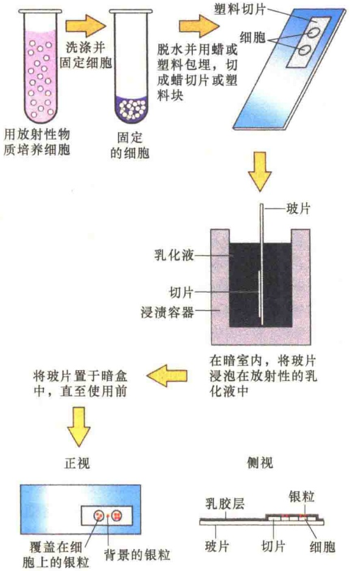

图 2-13 光学显微镜标本的放射自显影（引自 Karp，2010）

## 2.1.3 荧光显微镜与共聚焦显微镜

上面介绍的显微镜可以很好地观察细胞的结构，但是不能有效地提供细胞的分子信息，而荧光显微镜（fluorescence microscope）则提供了很好的研究手段。

## 2.1.3.1 荧光的原理

为了更好地理解荧光显微镜的工作原理，首先需要了解荧光现象。所谓荧光，是指分子从对光的吸收开始到发射较长波长的光为止的过程。图 2-14 显示了荧光的原理。

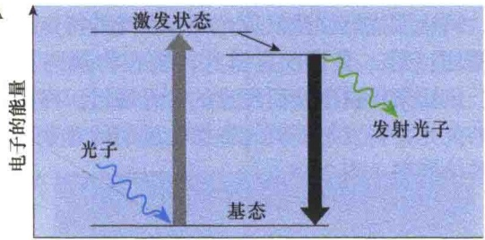

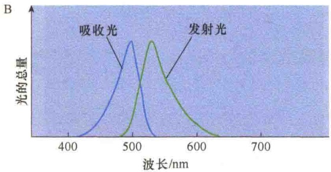

图 2-14 荧光的原理（引自 Jeff et al., 2012）。A. 来自单个原子的荧光图解。吸收具有某种能力的光（图中所示具蓝色箭头的波纹线）。电子从它的基础状态跃迁到激发状态，然后，高能的激发态的电子通过发射一个低能、波长较长的光子（绿光）后又恢复到基础状态。B. 典型的荧光分子吸收与发射光谱。蓝色曲线代表功能波长吸收光的量，而绿色曲线代表功能波长发射光的量。

当一个原子吸收了一个具有适当能量的光子（或量子）时，它的一个电子从基态跃迁为具有较高能量的激发态，最终，该电子将丧失部分能量，并回落到原来的基态，同时发射另外一个光子。发射的光子通常比吸收的光子的能量低（具有较长的波长），结果，吸收的蓝色光转变为发射的绿色光。

具体到真正的荧光分子，可能具有的能量要比图中显示的大得多，相应地，能够吸收与发射的不同能量也是很大的。对于每一个荧光分子而言，都具有自身特征性的吸收与发射光谱。

如果我们以分子可吸收波长的光照射分子，然后观察到它仅能以发射波长的光通过一个滤镜。可以在黑暗的背景下看到荧光，因为背景是暗的，即使极少量的发荧光的染料也能被检测到。相反，即使是相同量的非荧光染色的分子，因为染上的颜色很少，也是很难观察到的。

## 2.1.3.2 荧光显微镜

荧光显微镜是一种特殊类型的光学显微镜，它与一般光学显微镜不同的是利用光激发样品发射的荧光来研究细胞内物质的吸收、运输，以及化学物质的分布和定位等。标准的荧光显微镜具有两套阻断滤光片:第一套是激发滤片，装在光源与样品之间，只让那些能够激发荧光染料发光的特定波长的光通过；第二套是发射滤片，装在物镜与目镜之间，只让染料被激发所发出的荧光通过。样品经染色的荧光染料发射的荧光影像在黑暗的背景下很容易被检测到（图 2-15）。

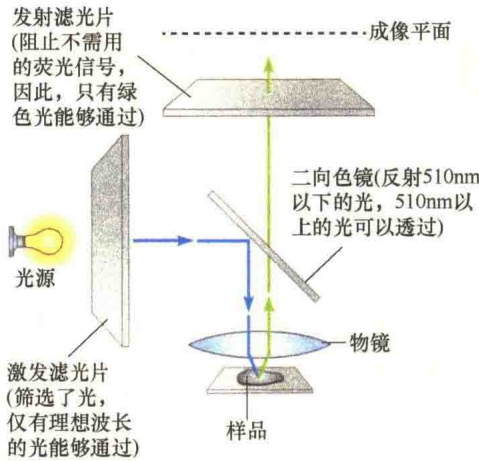

图 2-15 荧光显微镜的基本结构与光通路（引自 Jeff et al., 2012）。光源发射的荧光通过激发滤光片的阻断作用，仅让激发光通过（蓝色线条），激发光诱发样品中的荧光染料发射较长波长的光（绿色线条），发射滤光片除去激发光，仅允许发射光通过，最后，样品中荧光分子发射的光形成影像。

## 2.1.3.3 荧光抗体

用荧光显微镜研究特异分子或离子在细胞内的定位，研究者必须使用特殊的指示剂分子，即荧光探针（fluorescence probe）。所谓荧光探针，即能够发射荧光的分子，以指示特定的分子或离子的存在。荧光探针最常用的技术之一是免疫染色（immunol staining），其原理是抗体与抗原的特异性识别与结合。抗体可以通过将蛋白质或其他的大分子注射兔子或小鼠诱导产生。抗体是不能用光学显微镜直接观察的，所以它必须连接上一个荧光染料，如可以发射绿色荧光的荧光素（fluorescein），或者可以发射红色光的罗丹明（rhodamine）。将连接了荧光染料的抗体称为荧光抗体（fluorescence antibody）。为了测定一个特定蛋白质在细胞内的定位，蛋白质只要用荧光抗体简单染色后就可用适当波长的光对细胞进行观察。

直接用荧光染料标记的抗体可以在免疫荧光显微镜（immunofluorescence microscope）下进行观察（图 2-16A），免疫荧光显微镜常用于间接免疫荧光（indirect immunofluorescence）（图 2-16B）。

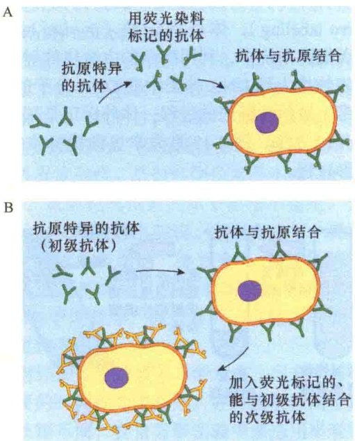

图 2-16 用荧光抗体进行免疫染色（引自 Jeff et al., 2012）。免疫荧光显微镜用荧光标记的抗体检测组织样品中特异的分子（抗原）。A. 直接免疫荧光。使用的与组织内特异分子结合的抗体是用荧光染料标记的，将这种标记的抗体加入到样品中，使之与检测的抗原结合，然后用荧光显微镜或共聚焦显微镜进行检测。B. 间接免疫荧光。使用两种抗体，初级抗体不用标记，并且直接与待检测的特异抗原结合。随后加入的次级抗体是用荧光标记的，但并不与待检测的抗原结合，而是与未标记的初级抗体结合，间接免疫荧光有效扩增了荧光信号，检测样品敏感性比直接荧光高得多。

在间接免疫荧光技术中，组织或细胞先用未经染料标记的抗体处理，此类抗体称为初级抗体（primary antibody，又称第一抗体），可以与细胞或组织中特异抗原位点结合，然后用第二种类型的抗体——次级抗体（second antibody，又称第二抗体）进行处理。次级抗体是用荧光染料标记的，它可以与初级抗体结合。由于初级抗体可以与多个次级抗体结合，使得与特异抗原结合的初级抗体所在的部位具有较强的荧光而便于检测。从结果上看，间接免疫荧光对要检测的目标进行了信号放大，由于这种放大作用是通过次级抗体，而不是初级抗体，所以是间接的。

用不同的抗体或荧光探针组合，可在相同的组织样品中同时标记不同分子，用不同组合的荧光滤片使不同的探针组合形成不同的影像，不同的影像构成细胞的结构（图 2-17）。

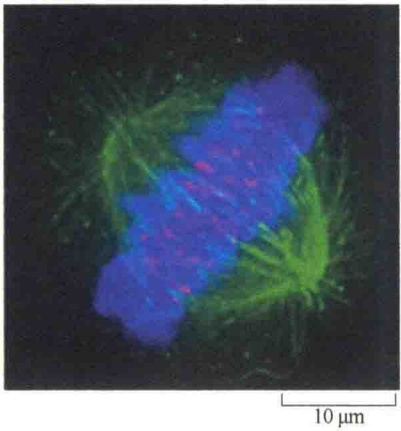

图 2-17 同一个细胞可同时用不同的探针进行观察（引自 Alberts et al., 2015）。照片显示了细胞有丝分裂的纺锤体及染色体。用三种不同的荧光探针标记三种不同的细胞组分:纺锤体微管用绿色荧光抗体进行标记，着丝粒用红色荧光抗体进行标记，凝聚染色体的 DNA 用蓝色荧光染料 DAPI（可与 DNA 沟结合的染料）标记。

## 2.1.3.4 共聚焦显微镜

一般的荧光显微镜有两个缺陷:第一，样品发射的荧光不仅来自聚焦的平面，还有来自分子的上方及下方，因此，观察者看到的影像因来自细胞内不同位置的分子荧光影像的影响而变得不够清晰，从而影响了对分子的真实排列的判断；第二，为了观察较厚的标本，必须先收集来自样品不同深度的系列影像，然后再按照原样品厚度排列构建其结构。已经创建了两种方法获得样品高分辨率的三维信息，由美国科学家马文·闵斯基（Marvin Minsky）发明的共聚焦显微镜（confocal microscopy）是目前最重要的获得样品高分辨率的三维信息最有力的工具。

从一个点光源发射的探测光通过透镜聚焦到被观测物体上，如果物体恰在焦点上，那么反射光通过原透镜应当汇聚回到光源，这就是所谓的共聚焦，简称共焦（confocal）。

共聚焦显微镜在荧光显微镜成像基础上加装了激光扫描装置，利用计算机进行图像处理，把光学成像的分辨率提高了30%～40%，使用紫外光或可见光激发荧光探针，从而得到细胞或组织内部微细结构的荧光图像，可在亚细胞水平上观察诸如 $Ca^{2+}$ 、pH、膜电位等生理信号及细胞形态的变化，是一种高分辨率的显微成像显微镜。

激光共聚焦扫描显微镜由激光光源、自动显微镜、扫描模块（包括共聚焦光路通道和针孔、扫描镜、检测器）、数字信号处理器、计算机及图像输出设备（显示器、彩色打印机）等部分组成。主要特点是用激光作为扫描光源，逐点、逐行、逐面快速扫描成像。扫描的激光与荧光收集共用一个物镜，物镜的焦点既是扫描激光的聚焦点，也是瞬时成像的物点。由于激光束的波长较短，光束很细，所以共聚焦激光扫描显微镜有较高的分辨力，大约是普通光学显微镜的3倍。系统经一次调焦，扫描限制在标本的一个平面内。调焦深度不一样时，就可以获得标本不同深度层次的图像，这些图像信息都储存于计算机内，通过计算机分析和模拟，就能显示细胞标本的立体结构（图2-18）。

A

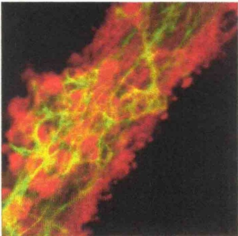

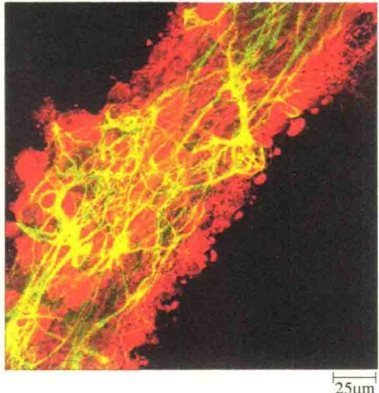

图 2-18 共聚焦荧光显微镜与普通荧光显微镜的比较（引自 Jeff et al., 2012）。图中的荧光照片显示的是用不同的荧光标记物染色的、用荧光标记的胶质细胞（红色）、神经细胞（绿色）。A. 一般的荧光显微镜照片，整个样品都是被光照射的，所以在聚焦的平面、上方、下方的荧光材料都会形成模糊的影像。B. 在共聚焦显微镜中，进入的光被聚焦在单个的平面，从样品发射的焦外荧光则被排除了，产生的影像泾渭分明。

## 2.1.3.5 绿色荧光蛋白

由于细胞是一个组装的动态结构，即使是最稳定的细胞，其内部也是动态的，包括蛋白质的合成与运输、某些结构的装配与去装配（如细胞骨架）、信号的传递与中止等。大多数显微技术只能研究“死”细胞，即需要将细胞或组织“杀死”后进行处理与观察。绿色荧光蛋白（green fluorescent protein，GFP）的发现与应用，使细胞的研究由“死”变活，可以研究细胞生活状态下细胞内一些物质的动态行为。

2008年10月8日，诺贝尔化学奖揭晓，日本科学家下村修（Osamu Shimomura）、美国科学家Martin Chalfie和美籍华裔科学家钱永健（Roger Y. Tsien）三人因发现和改造绿色荧光蛋白而获奖。

GFP 的编码基因于 1962 年被发现，1992 年被克隆。GFP 由 238 个氨基酸组成，分子质量为 26.9kDa，最初是从维多利亚多管发光水母中分离出来的，在蓝光照射下会发出绿色荧光。

GFP 是典型的 β 桶形结构，包含 β 折叠和 α 螺旋，将荧光基团包含在其中（图 2-19）。严密的桶形结构保护着发色团（chromophore），防止它被周围环境淬灭，内部面向桶形的侧链诱导 Ser65-Tyr66-Gly67 三肽环化，导致发色团形成。

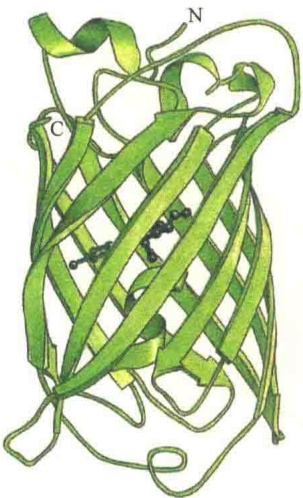

图 2-19 绿色荧光蛋白（GFP）的结构（引自 Alberts et al., 2015）。GFP 由 13 条 β 链形成一个桶状结构，活性的发色团包含在桶的内部，它是翻译后由三个氨基酸残基伸出的侧链。

虽然野生型 GFP 能够发出很绚丽的荧光，但它有不少缺点，比如有两个激发峰、光稳定性不好、在  $37^{\circ}$ C 不能正确折叠。

美籍华裔科学家钱永健在 GFP 改造上有多项发明创新。目前国际上广泛使用的荧光蛋白大多数是钱永健实验室改造后的变种，首个重大改变就是在 1995 年完成的单点突变（S65T）。这个突变显著提高了 GFP 的光谱性质，荧光强度和光稳定性也大大增强。突变后的 GFP 激发峰转移至 488nm，而发射峰仍保持在 509nm，这和常用的 FITC 滤光片匹配，提高了 GFP 的应用潜力。而 F64L 点突变则改善了 GFP 在 37℃ 的折叠能力，因此产生了增强型 GFP，也就是我们常见的 EGFP。

GFP 的其他突变还包括颜色突变，这其中大部分是钱永健创造的，有蓝色荧光蛋白、青色荧光蛋白和黄色荧光蛋白（图 2-20）。此外，还有对 pH 敏感的突变体，如 pHluorins。

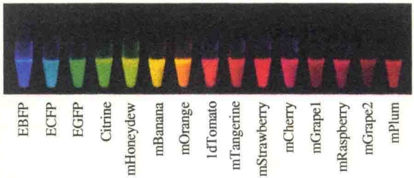

图 2-20 多种不同颜色的荧光蛋白（引自 Lodish et al., 2013）。图示发射不同荧光的试管及所含荧光蛋白的名称。

绿色荧光蛋白最基本的应用就是作为报告分子（reporter molecular），即荧光探针监控蛋白质的表达。可通过基因操作，将 GFP 的编码序列重组到感兴趣基因转录启动子的控制下，然后通过转基因技术，将重组的基因导入细胞，就可以直接监控到所感兴趣基因在活体内的表达（图 2-21）。

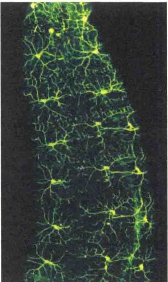

图 2-21 荧光蛋白作为报告蛋白（引自 Alberts et al., 2015）。通过 DNA 重组技术，将 GFP 编码序列置于果蝇的启动子控制下，该启动子只能在一套特异的神经元中被激活。图中的影像是通过荧光显微镜拍摄的活果蝇胚，显示了约 20 个神经元，每个神经元具有很多轴突和树突，与周围非荧光的细胞进行通讯。这些神经元刚好位于动物的表面，可敏感地感知环境。