荧光蛋白广泛应用于生物学研究。通过常规的基因操作手段，将荧光蛋白作为报告（reporter）蛋白，用于标记其他目标蛋白，这样可以观察、跟踪目标蛋白的时间、空间变化，提高了以前不能达到的时间和空间分辨率，而且可以在活细胞，甚至活体动物中观察到一些分子。

## 2.1.3.6 荧光共振能量转移技术

荧光蛋白不仅可用于检测细胞内蛋白质的定位，而且可用于研究蛋白质的动力学特性，揭示其是否与其他分子相互作用。其中一个关键技术就是荧光共振能量转移（fluorescence resonance energy transfer, FRET）技术。

FRET 是较早发展起来的一门技术，随着绿色荧光蛋白应用技术的发展，FRET 已经成为检测活体中生物大分子间纳米级距离及其变化的有力工具。

荧光共振能量转移是距离很近的两个荧光分子间产生的一种能量转移现象。当供体荧光分子的发射光谱与受体荧光分子的吸收光谱重叠，并且两个分子的距离在10nm范围以内时，就会发生一种非放射性的能量转移，即FRET现象，使得供体的荧光强度比它单独存在时要低得多，而受体发射的荧光却大大增强。

FRET 用于检测体内两种蛋白质之间的直接相互作用，最常用的一对荧光分子是 GFP 的衍生物:青色荧光蛋白（cyan fluorescence protein, CFP）作为供体蛋白，黄色荧光蛋白（yellow fluorescence protein, YFP）作为受体蛋白。将 CFP 与 YFP 分别与两种目的蛋白融合表达，当这两个蛋白质之间的距离在 5～10nm 的范围内，则供体发出的荧光可以被 YFP 所接收，并激发 YFP 发出黄色荧光。此时可以通过测量 CFP 荧光强度的损失量来确定这两种蛋白质是否相互作用。两个蛋白质间的距离越近，CFP 所发出的荧光被 YFP 接收的量就越多，检测器所接收的量就越少；反之，就不会产生 FRET 效应。FRET 效率反映了体内两种蛋白质相互作用的强弱（图 2-22）。

采用 FRET 技术可检测细胞内  $Ca^{2+}$  浓度的变化。研究者将 CFP 和 YFP 分别与钙调蛋白和钙调蛋白结合肽融合表达于同一个细胞内，当细胞内具有高的  $Ca^{2+}$  浓度时，钙调蛋白与钙调蛋白结合肽结合，可诱发 FRET，使受体蛋白 YFP 发出黄色荧光，因此细胞呈黄色；当细胞内  $Ca^{2+}$  浓度低时，FRET 几乎不发生，因此检测时 CFP 被激发，发出绿色荧光，细胞呈绿色（图 2-23）。

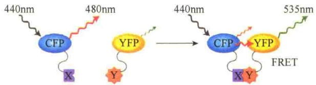

图 2-22 荧光共振能量转移检测蛋白质互作（引自 Lodish et al., 2013）。为了检测蛋白质 X 与 Y 是否互作，分别将它们与 CFP、YFP 重组连接。将重组的两种蛋白质的编码基因转入同一个细胞内表达。用 440nm 的光照射细胞，CFP 将发射 480nm 的荧光。如果 YFP 不与 CFP 靠近，将不能接收 480nm 的荧光，也就不会发射 535nm 的荧光。如果 X 与 Y 两种蛋白质互作，就会将 CFP 与 YFP 间的距离拉近，CFP 发射的 480nm 的荧光就会被 YFP 接收，从而发射 535nm 的荧光。

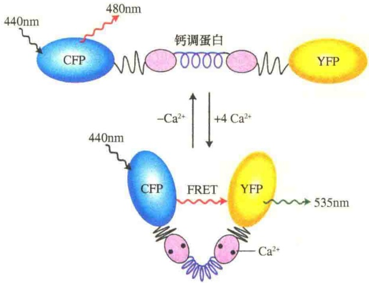

图 2-23 荧光共振能量转移检测局部生化环境（引自 Lodish et al., 2013）。将 CFP、YFP 与钙调蛋白重组成一个大的复合体，使其在细胞中表达。如果细胞内的  $Ca^{2+}$  浓度低，不会发生 FRET。若细胞内的  $Ca^{2+}$  浓度高，由于  $Ca^{2+}$  与钙调蛋白的结合，复合物发生构型变化，从而将 CFP 与 YFP 间的距离拉近，此时用相应的光激发 CFP，会发生 FRET 效应。

## 2.1.4 电子显微镜

光学显微镜的分辨率主要是受照明光线的波长限制，在可见光源下无法分辨小于 $0.2\mu \mathrm{m}$ 的细微结构，即使改用紫外光源，分辨率也只能是 $0.1\mu \mathrm{m}$ 。提高分辨率的最好办法就是缩短照明光源的波长，这导致了电子显微镜（electron microscope）的发明。光源与分辨率的关系同样适用于电子束，由于电子束的波长是光的波长的1/100000，因而用电子束代替光波，可极大提高显微镜的分辨率。1932年德国学者Max Knolls和Ernst Ruska发明了第一台电子显微镜，开拓了超微世界，发现了许多光学显微镜下看不到的结构，如细胞质膜、线粒体、细胞核、高尔基体、中心粒等细胞器的细微结构。将在光学显微镜中观察不到而只能在电子显微镜下观察的结构称为亚显微结构（submicroscopic structure）或超微结构（ultrastructure）。电子显微镜可分为两大类:透射电子显微镜和扫描电子显微镜。还有在这两类电子显微镜的基础上发展起来的具有特别功能的电子显微镜，如透射扫描电子显微镜、免疫电子显微镜、高压电子显微镜等。

## 2.1.4.1 透射电子显微镜

透射电子显微镜（transmission electron microscope，TEM）主要是让电子束穿透样品而成像。

透射电子显微镜的基本结构由三大部分组成:电子学系统（供电系统）、真空系统、电子光学系统（镜筒）。由于电子显微镜必须在高度真空条件下进行工作，阴极与阳极之间会放电，灯丝也会因受氧化或被阳离子轰击而缩短寿命，所以设计了真空系统。电子学系统即供电系统，需要高压稳压。透射电子显微镜的主体部分是电子光学系统（图 2-24）。

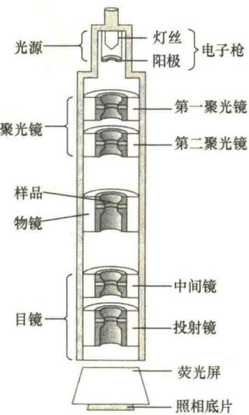

图 2-24 透射电子显微镜的电子光学系统（引自 Wolfe，1993）。

1）电子枪（electron gun） 电子枪是电子显微镜的照明源，主要由灯丝阴极（cathode）、阳极（anode）组成，在阴极灯丝与阳极之间有一个韦氏圆筒（Wehnelt cylinder），控制电子束的形状和发射强度。灯丝的阴极类似于灯泡的灯丝，当它发热时，可以从表面发射电子。在灯丝的下方有一个阳极，用来加速电子。阴极的电压一般为50～100kV，而阳极的电压为0V，两极的电压差异称为加速电压（accelerating voltage），当电子通过圆筒时，可引起加速。

2）电磁透镜（electromagnetic lens）电子显微镜的成像主要是依靠电子既像波又似粒子的性质，玻璃透镜能够使光射线弯曲穿过，电磁透镜则能控制电子的轨道。因为电子是带电的，所以电磁透镜能够改变电子束的方向。在透射电子显微镜中有5个电磁透镜:第一和第二聚光镜、中间镜、投射镜和物镜。聚光镜（condenser lens）的作用就是将来自电子枪的电子汇聚到标本上，通过它来控制照明电子束斑的大小，一般采用亮光聚光镜，以便达到最好的效果；第一聚光镜是强透镜，它的作用是缩小束斑直径，最小可达1\~2μm；第二聚光镜是弱透镜，作用是控制照明亮度、照明角孔径和照明斑的大小；物镜（objective lens）是电子显微镜最重要的部件，由它获得电子放大像；中间镜（intermediate lens）的作用是把物镜形成的一级放大像投射到投射镜上；投射镜（projector lens）的作用是把中间镜形成的二级放大像投射到荧光屏上，从而形成终像。

3）照相系统（photographic system）在投射镜下面是像的观察和记录系统，用荧光屏观察终像，用照相系统记录终像。

## 2.1.4.2 扫描电子显微镜

扫描电子显微镜使用与透射电子显微镜完全不同的方式成像，即用电视的方式成像。扫描电子显微镜是1965年发明的较现代的细胞生物学研究工具，主要用于观察标本的表面结构。

扫描电子显微镜（scanning electron microscope, SEM）主要是利用二次电子信号成像来观察标本的表面形态，即用极狭窄的电子束去扫描标本。通过电子束与标本的相互作用产生各种效应，其中主要是标本的二次电子发射。二次电子能够产生标本表面放大的影像，这种影像是在标本被扫描时按时序建立起来的，即使用逐点成像的方法获得的图像。扫描电子显微镜主要由电子光学系统和显示单元组成，它的光学系统结构见图 2-25。

扫描电子显微镜的真空系统和电子源与透射电子显微镜基本相似，但它的加速电压较低（只有5～30kV），这两类电子显微镜间的主要差别是成像原理不同。扫描电子显微镜用电子枪产生电子射线，经过聚光镜的电子聚焦，形成狭窄的电子束射到标本的表面，与此同时，位于聚光镜和物镜之间的偏转线圈（beam deflector）使电子束在标本上进行快速扫描，并同时将扫描信号传递到扫描器和显像管。当电子束在标本表面进行快速扫描时，标本中的分子被激发成高能状态，使原子外层的电子发射出来，即二次电子（secondary electron）。二次电子数量的多寡与标本材料的性质、标本表面的高低和凹凸有关。二次电子很快被上方的闪烁探测器（scintillator）捕获，当闪烁探测器结合电子后会发射出光质子，这些质子可用于产生电信号传递给显像管。由于显像管的荧光屏上的画面与标本被电子束照射面严格同步扫描，逐点逐行一一对应，所以标本任何一点上的二次电子发射强度的任何变化都会表现为荧光屏上对应点的亮度的变化，因而能反映标本表面的形态（图2-26）。

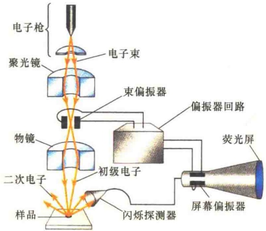

图 2-25 扫描电子显微镜的光学系统（引自 Jeff et al., 2012）。

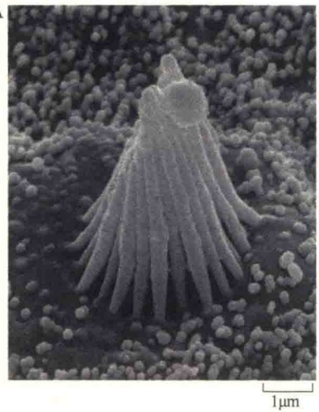

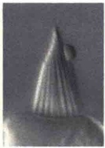

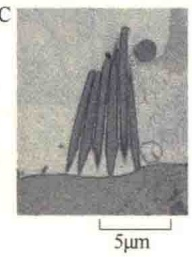

图 2-26 扫描电子显微镜、微分干涉相差光学显微镜、透射电子显微镜的图像比较（引自 Alberts et al., 2015）。A. 牛蛙内耳毛状细胞突起的硬纤毛扫描电子显微镜照片；B. 相同样品的微分干涉相差光学显微镜照片；C. 相同样品的薄片透射电子显微镜照片。

## 2.1.4.3 电子显微镜的标本制备

如同光学显微镜，电子显微镜的标本也需固定、包埋、切片、染色等。用于电子显微镜的组织固定比光学显微镜的要求更高。第一，标本要薄，这是因为电子的穿透能力十分有限，即使是100～200kV高压，电子穿透厚度仅为1μm，通常将标本制成50～100nm厚的薄片（一个细胞切成100～200片），称为超薄切片（ultrathin section）；第二，要很好地保持标本的精细结构，特别是在组织固定时要求既要终止细胞生命，又不能破坏细胞的结构；第三，标本要具有一定的反差，电子显微镜的标本切片最后被放置在载网上而不是玻片上（图2-27）。

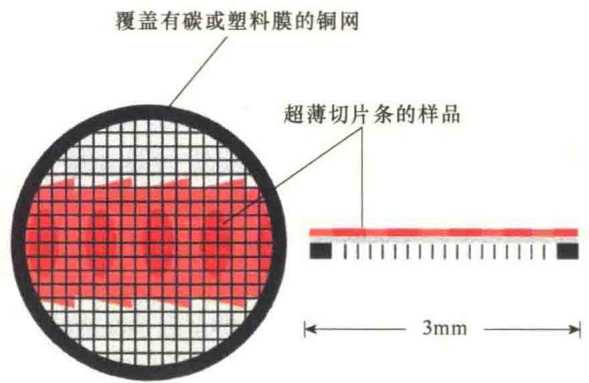

图 2-27 电子显微镜标本的金属载网（引自 Alberts et al., 2015）。

## 2.1.4.4 负染色技术

电子显微镜可用于检查很小的颗粒物质，包括高分子质量的聚合体，如病毒、核糖体、多亚基的酶、细胞骨架及蛋白质复合体等。只要有足够的反差，也可在电子显微镜下观察蛋白质和核酸分子。

用重金属盐（如磷钨酸钠、乙酸铀等）对铺展在载网上的标本进行染色，使整个载网都铺上一层重金属盐，而有凸起颗粒的地方则没有染料沉积。由于电子密度高的重金属盐包埋了标本中低电子密度的背景，增强了背景散射电子的能力以提高反差，这样，在图像中背景是黑暗的，而未被包埋的标本颗粒则透明光亮，这种染色称为负染色（negative staining）。负染色只染背景而不染标本，与光学显微镜标本的染色正好相反。一些生物大分子组成的结构，如病毒（图2-28）、线粒体、核糖体和蛋白质组成的纤维等可以通过负染色电镜技术观察其精细结构，还可以从不同角度观察三维结构。

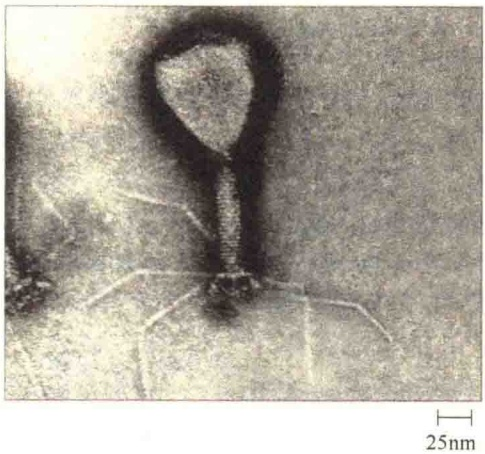

图 2-28 负染色（引自 Becker et al., 1996）。负染色的细菌病毒电子显微镜照片。

## 2.1.4.5 喷镀技术

喷镀（shadow casting）技术，又称投影技术，是电子显微镜中一种重要的增强背景和待观察标本反差的方法。由于喷镀时要求有一定的角度，朝向加热丝的一面被金属覆盖，而背向加热丝的标本面和背景则不能被金属覆盖，结果在电子显微镜下观察时，被金属覆盖的一面很暗，而未被覆盖的一面则光亮（图 2-29）。

## 2.1.4.6 冷冻断裂复型和冷冻蚀刻

冷冻断裂复型（freeze-fracture replication）和冷冻蚀刻（freeze-etching）是专门观察标本外表面的投影复型技术。

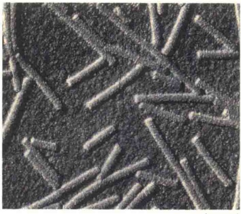

图 2-29 喷镀技术（引自 Becker et al., 1996）。用喷镀技术制备烟草花叶病毒的电镜照片。

胞质面的半层膜，而 E 面则是靠近细胞外基质面的半层膜，可清楚地观察到镶嵌蛋白。

冷冻蚀刻技术是在冷冻断裂技术的基础上发展起来的更复杂的复型技术。如果将冷冻断裂标本的温度稍微升高，让标本中的冰在真空中升华，表面就会浮雕出细胞质膜的超微结构；当大量的冰升华之后，对浮雕表面进行铂-碳复型，并在腐蚀性溶液中除去生物材料，复型经重蒸水多次清洗后，捞在载网上进行电镜观察（图 2-30）。

## 2.1.5 间接成像技术

光学显微镜和电子显微镜是利用质子和电子使标本直接成像的技术，还有一些显微方法是间接成像。所谓间接成像，举一个例子，假定你拿起一

冷冻断裂复型技术是先将生物标本在液氮中（-196℃）进行快速冷冻，防止形成冰晶，然后将冷冻的标本迅速转移到冷冻装置中，并迅速抽成真空。在真空条件下，用冰刀横切冷冻标本，使标本的内层被分开露出两个表面。例如，用冰刀切开细胞质膜时，分开的两个面分别称为P面（protoplasmic face）和E面（exo-plasmic face），P面是靠近细

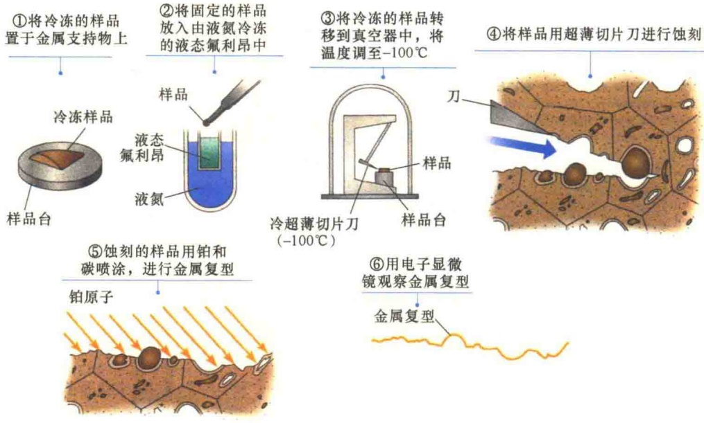

图 2-30 冷冻断裂复型与冷冻蚀刻技术（引自 Jeff et al., 2012）