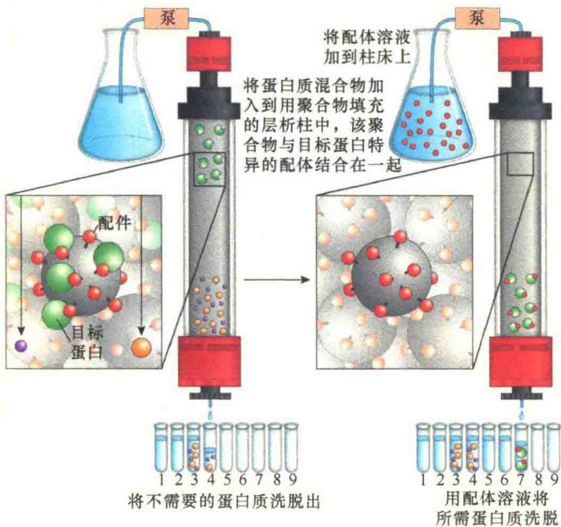
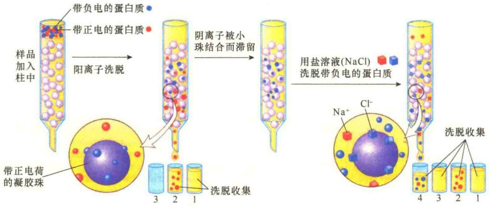
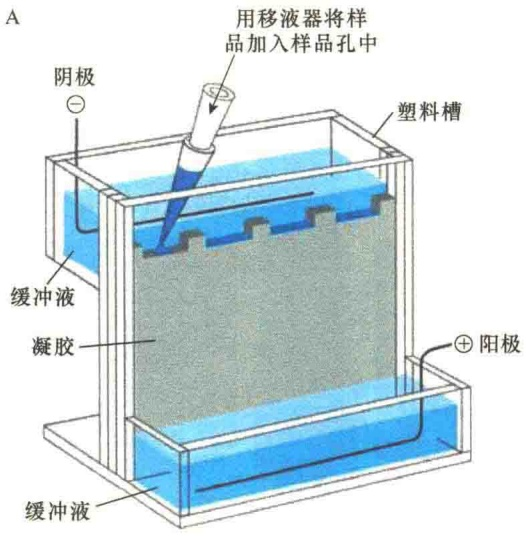
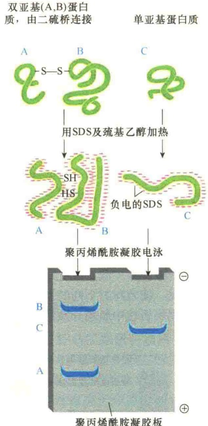
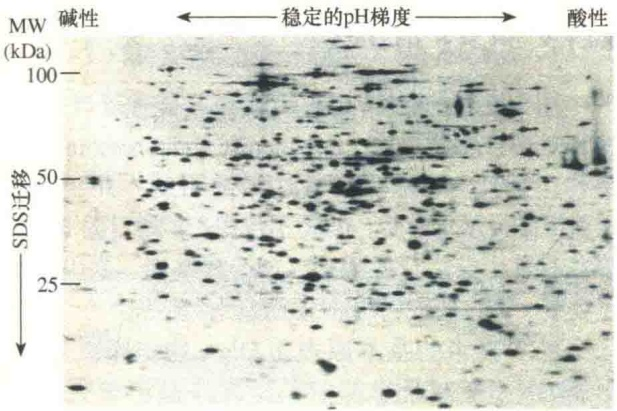
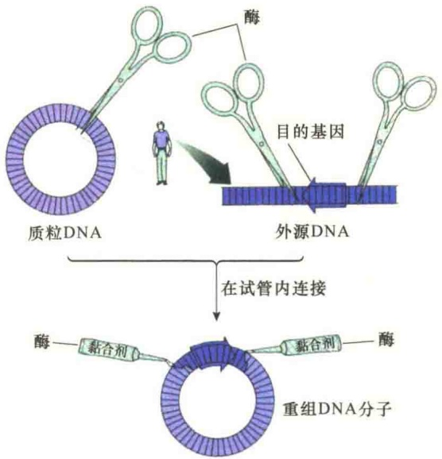
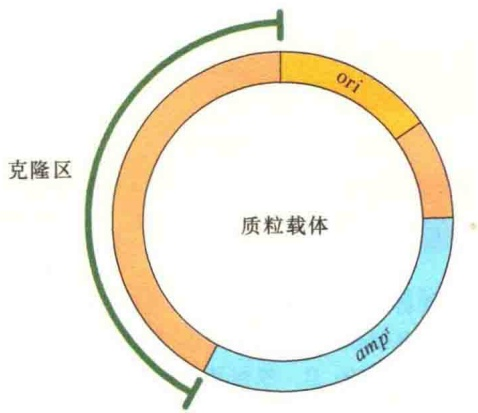
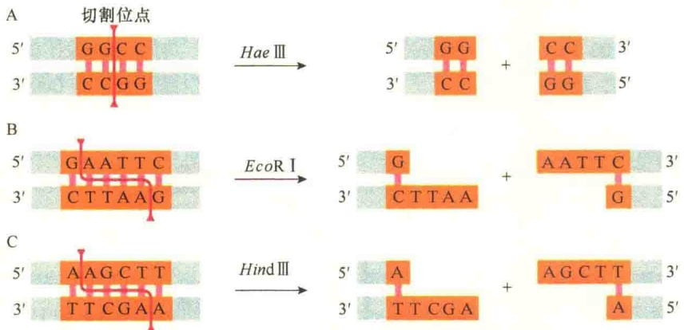

图 2-40 亲和层析（引自 Nelson and Cox，2013）。将待分离的蛋白质混合液泵入用聚合物填充的层析柱顶部，该聚合物与目标蛋白特异的配体共价结合在一起，仅有那些与配体具有高亲和力的蛋白质被保留在层析柱中，所有不与配体结合的蛋白质都会直接流出层析柱。清洗柱子后，用酸性溶液或能够破坏配体-目标蛋白结合的溶液将结合蛋白质洗脱下来并进行收集。

类和电荷量都不同，因而可与不同的离子交换剂以不同的亲和力相互交换吸附。当缓冲液中的离子基团与结合在离子交换剂上的蛋白质相竞争时，亲和力小的蛋白质分子首先被解吸附而洗脱，而亲和力大的蛋白质较后被解吸附和洗脱。因此，可通过增加缓冲液的离子强度和（或）改变酸碱度，改变蛋白质的吸附状况，使亲和力不同的蛋白质得以分离（图2-41）。根据层析柱中所用介质的电负性，分为阳离子交换柱（cation exchanger）与阴离子交换柱（anion exchanger）。

## 2.3.2 蛋白质电泳

电泳（electrophoresis）是最常用的分离蛋白质的技术，其基本原理是根据带电分子在电场中具有的迁移能力。

## 2.3.2.1 SDS-聚丙烯酰胺凝胶电泳

SDS-聚丙烯酰胺凝胶电泳（SDS-polyacrylamide gel electrophoresis，SDS-PAGE）是最常用的分离蛋白质的方法。聚丙烯酰胺凝胶是由丙烯酰胺单体（acrylamide，ACR）和交联剂N,N-甲叉双丙烯酰胺（N,N-methylene bisacrylamide，BIS）在催化剂的作用下聚合交联而成的三维网状结构的凝胶。通过改变单体浓度与交联剂的比例，可以得到不同孔径的凝胶，用于分离分子质量大小不同的物质。

SDS 即十二烷基硫酸钠（sodium dodecyl sulfate），是阴离子表面活性剂，它能以一定比例和蛋白质结合，形成一种 SDS-蛋白质复合物。由于 SDS 与蛋白质的疏水部分

结合，使蛋白质解折叠形成伸展的形式，并与其结合的蛋白质复合物或脂解离，以单体溶于去垢剂中。这时，蛋白质即带有大量的负电荷，并远远超过了其原来的电荷，从而使天然蛋白质分子间的电荷差别降低乃至消除。与此同时，蛋白质在 SDS 作用下结构变得松散，形状趋于一致，所以各种 SDS-蛋白质复合物在电泳时产生的电泳迁移率的差异，仅仅取决于蛋白质的分子质量。此外，SDS-蛋白质复合物在强还原剂β-巯基乙醇（β-mercaptoethanol）存在的情况下，蛋白质分子内二硫键被打开，这样分离出的谱带即为蛋白质亚基。

图 2-41 离子交换层析（引自 Lodish et al., 2013）。待分离的蛋白质混合液被泵入用带有正电荷或负电荷（图中所示带有正电荷）珠子填充的层析柱的顶部，带有相同电荷的蛋白质受到排斥而直接流出层析柱，而带有与珠子相反电荷的蛋白质则被珠子结合，结合的强度则取决于各自的结构。图中显示的被结合的带负电的蛋白质通过不同浓度的盐溶液（如 NaCl、KCl）进行洗脱。当盐与珠子结合时就将蛋白质置换下来，与珠子结合强的蛋白质需要较高浓度的盐溶液洗脱。

因此，当被 SDS 溶解的蛋白质混合物加载到聚丙烯酰胺凝胶中后，由于每一个蛋白质分子都结合有大量具有负电荷的 SDS 分子，使得蛋白质不再具有电负性，这样，就可在电压的作用下向正极移动。有两个因素决定了大小相同的蛋白质以相同的速度迁移:①蛋白质的天然结构被 SDS 完全解折叠了，所以它们的形态完全一样；②它们结合相同量的 SDS，具有相同量的负电荷。分子大的蛋白质具有较多的电荷，受到较大的电场力，同时也遇到较大的阻力，如果是在游离的溶液中，这两种作用被抵消了；但是在聚丙烯酰胺凝胶分子筛中，大的蛋白质的迁移要比小蛋白质滞后得多。结果，一个复杂的蛋白质混合物按照它们分子质量的大小被分成了一系列大小不同的带（图 2-42）。

经 SDS-PAGE 分离的量较大的蛋白质可通过考马斯亮蓝（Coomassie blue）等染料染色进行检测。即使少量的蛋白质也可通过一些特殊的处理方法进行检测，如银染（silver stain）可以检测到低于 10ng 的蛋白带。此外，可通过放射自显影检测更微量的蛋白带。

## 2.3.2.2 双向电泳

因为不同的蛋白质可能具有相同的体积、形态、质量，甚至相同的电荷，因此，大多数分离技术，如 SDS-PAGE 或离子交换层析等都不能将一个细胞或细胞器内的所有蛋白质分离开来。双向电泳（two-dimensional gel electrophoresis）通过结合两个不同的程序，能够在双向电泳图上分辨出高达 2000 个不同的蛋白质。

双向电泳的第一向是通过等电聚焦（isoelectric focusing）电泳将蛋白质多肽进行分离。在凝胶中加入双性电解质溶液，加上电场后建立稳定pH梯度。由于蛋白质是两性分子，在不同的pH环境中可以带正电荷、负电荷或不带电荷。对每个蛋白质来说都有一个特定的pH，此时蛋白质的静电荷为零，此pH即该蛋白质的等电点（isoelectric point）。将蛋白质样品加载至pH梯度介质上进行电泳时，它会向与其所带电荷相反的电极方向移动。在移动过程中，蛋白质分子可能获得或失去质子，并且随着移动的进行，该蛋白质所带的电荷数和迁移速度下降。当蛋白质迁移至其等电点pH位置时，其净电荷数为零，在电场中不再移动并最终停留在该位置上。

聚丙烯酰胺凝胶板

图 2-42 SDS-聚丙烯酰胺凝胶电泳（引自 Alberts et al., 2015）。A. 电泳装置；B. 以三种蛋白质单体显示分离的原理及最后形成的蛋白质带形。

双向电泳的第二向是 SDS-PAGE 电泳，按照蛋白质的分子大小进行分离。将经第一向等电点聚焦的凝胶加上横向电场，同一等电点聚焦的蛋白质，由于分子质量不同而分开。经染色（一般是银染）得到的电泳图是个二维分布的蛋白质图（图 2-43）。

图 2-43 双向聚丙烯酰胺凝胶电泳（引自 Alberts et al., 2015）。经双向凝胶电泳分离的大肠杆菌总蛋白，每一个点代表一种不同的蛋白质多肽。图中用于分离蛋白质的大肠杆菌先经含有放射性同位素的培养基培养，使大肠杆菌的蛋白质带上放射性，电泳后经放射自显影进行检测。

## 2.4 分子生物学方法

分子生物学方法是在分子水平上研究生物大分子的结构和功能的一系列方法。本节从基因工程（重组）技术及基因功能研究技术两个方面简要介绍几种分子生物学方法。

## 2.4.1 基因工程技术

基因工程（gene engineering）又称基因克隆（gene cloning）、基因操作（gene manipulation）、重组 DNA（recombinant DNA）技术。

基因工程技术是以分子遗传学为理论基础，以分子生物学和微生物学的现代方法为手段，将不同来源的基因（DNA 分子），按预先设计的蓝图，在体外构建杂合 DNA 分子，然后导入活细胞，以改变生物原有的遗传特性、获得新品种、生产新产品。基因工程技术为基因的结构和功能研究提供了有力的手段。

基因工程是20世纪70年代发展起来的一项具有革命性的研究技术，它的发明和发展，使生物学家能够在体外进行基因操作、基因转移、基因定点突变等研究。这项技术可概括为:分、切、连、转、选。“分”是指分离制备合格的待操作的DNA，包括作为载体的DNA和拟克隆的目的DNA；“切”是指用序列特异的限制性内切核酸酶切开载体DNA，或者切出目的基因；“连”是指用DNA连接酶将目的DNA同载体DNA连接起来，形成重组的 DNA 分子；“转”是指通过特殊的方法将重组的 DNA 分子送入宿主细胞中进行复制和扩增；“选”则是从宿主群体中挑选出携带有重组 DNA 分子的个体。基因工程技术的两个最基本的特点是分子水平上的操作和细胞水平上的表达，而分子水平上的操作即是体外重组的过程，实际上是利用工具酶对 DNA 分子进行“外科手术”（图 2-44）。

图 2-44 DNA 分子操作（引自 Postlethwait et al., 1991）。

## 2.4.1.1 质粒载体DNA

基因工程的主要目的是通过“基因移民”来改造生物的遗传性，帮助基因移民的工具就是分子运载体。基因工程上的载体（vector，vehicle）是指能将分离或合成的基因导入细胞的DNA分子，称为克隆载体。质粒DNA是基因工程中最常用的载体，就克隆一个基因（DNA片段）来说，最简单的质粒载体必须包括三个部分（图2-45）:复制区，含有复制起点（ori）；选择标记，主要是抗性基因(如  $amp^{r}$ ); 克隆位点, 便于外源 DNA 的插入。

图 2-45 质粒载体的基本元件。

就复制特性来讲，要求载体必须有独立的复制起点，最好是松弛型复制，这样便于得到大量的拷贝。有时需要有多个复制起点，能够在不同的宿主细胞中复制，扩大宿主范围。

具有合适的克隆位点，便于外源 DNA 的插入。克隆位点实际上是限制性内切核酸酶酶切位点，最好是具有多种限制性内切核酸酶的单切点，这样适应性强，克隆方便。如果一种酶在载体上有多个切点，就会限制该切点的使用。

具有可检测的选择标记，这也是一个重要的基本条件，选择标记最好是能够赋予宿主易于检测的表型。选择标记就是常说的报告基因（report gene），包括抗生素抗性标记，以及一些生化表型的标记。

另外，一个理想的质粒载体必须具有低分子质量，因为小分子的质粒 DNA 易于操作，不容易被损伤，也容易被分离纯化。一般而言，小分子质量的质粒分子的拷贝数比较高，酶切位点也少。

## 2.4.1.2 限制性内切核酸酶

限制性内切核酸酶（restriction endonuclease）是指那些具有识别双链 DNA 分子中的某种特定核苷酸序列，并由此切割 DNA 双链结构的核酸内切酶。

限制性内切核酸酶对 DNA 的切割有两种方式，即平切和交错切。所谓平切，就是限制性内切核酸酶在 DNA 双链的相同位置切割 DNA 分子，这样产生的末端就是平末端。交错切就是限制性内切核酸酶在 DNA 双链的不同位置切割 DNA，产生的 DNA 片段的末端不是平齐的，称为黏性末端（图 2-46）。

## 2.4.1.3 PCR扩增DNA

用于克隆的 DNA 也可通过 PCR 技术进行扩增。PCR 是聚合酶链反应（polymerase chain reaction）的简称，是 K. B. Mullis 在 1983 年发明的，并于 1993 年获得诺贝尔化学奖。PCR 不仅用于扩增目的 DNA，现在有着十分广泛的用途，如合成基因、基因的定点突变、考古研究、法医学、基因检测等。

PCR 技术的基本原理是 DNA 的半保留复制。由于 DNA 复制是半保留的，两条链都可以作为模板。在 DNA 复制时，需要一个 RNA 引物，同时需要 DNA 聚合酶、4 种单核苷酸和一些辅助因子。在体内，DNA 的复制是周期性的，所以基因扩增的数量有限。PCR 技术在体外利用人工合成的引物，再加上 DNA 聚合酶和一些合适的底物和因子，通过对温度的控制，使 DNA 不断处于变性、复性和合成的循环之中，达到扩增目标 DNA 的目的。图 2-47 是用 PCR 扩增具有特定黏性末端的 DNA 片段用于 DNA 克隆。

## 2.4.1.4 DNA电泳

用限制性内切核酸酶消化（切割）及 PCR 扩增的 DNA 片段可通过电泳进行分离、大小的鉴定（图 2-48）。DNA 分子间由于电负性不同、大小不同、形态不同，因此在电场中移动的速度也就不同，并能够在保留 DNA 生物学活性的条件下将它们分离开来。电泳可以在固态支持物，如滤膜、琼脂糖凝胶、聚丙烯酰胺凝胶中进行，操作很方便。

在 DNA 电泳中，DNA 片段在凝胶中移动的速度受其长度、电荷、形态的影响。一般而言，小片

图 2-46 限制性内切核酸酶切割产生的黏性末端与平末端（引自 Alberts et al., 2015）。A. 限制性内切核酸酶 Hae Ⅲ识别靶序列后在两条链中轴线切割，产生具有平末端的产物；B. 限制性内切核酸酶 EcoR I 识别序列后，在两条链的识别序列的交错部位切割，产生具有 5' 端的产物；C. 限制性内切核酸酶 Hind Ⅲ识别序列后，在两条链的识别序列的交错部位切割，产生具有 5' 端的产物。

段的 DNA 移动的速度要比大片段快。电泳支持物及其浓度因被分离的 DNA 片段的大小而定，大小在 100 个碱基对到几千个碱基对之间的 DNA 片段，用 1% 的琼脂糖凝胶就可以有效地分离，片段之间分辨的范围在几百个碱基对之间。如果要分辨的 DNA 片段间的大小差异为单个的碱基（如 DNA 测序），就需要用聚丙烯酰胺凝胶。

最初，用电泳分析病毒 DNA 片段时，病毒 DNA 必须先进行放射性标记，然后用放射自显影进行 DNA 片段的检测。后来发现溴化乙锭能够结合 DNA，用溴化乙锭直接在凝胶中对 DNA 进行染色