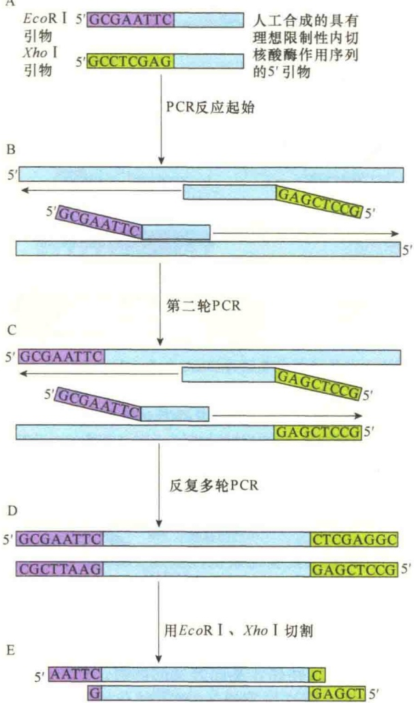
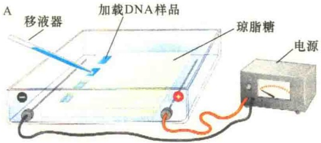
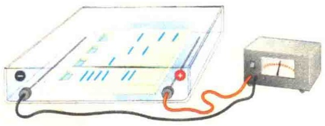
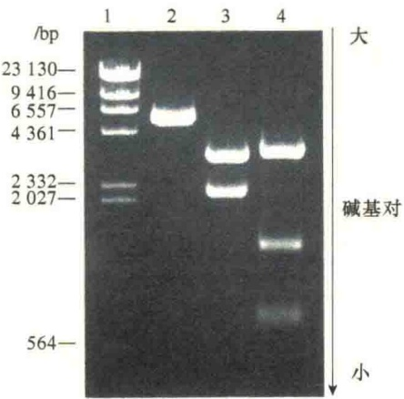
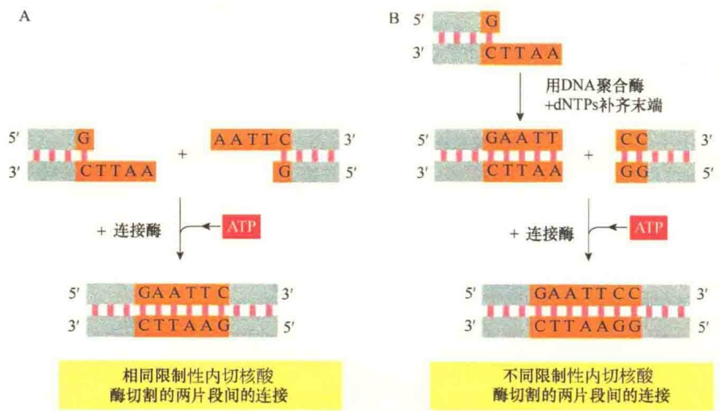
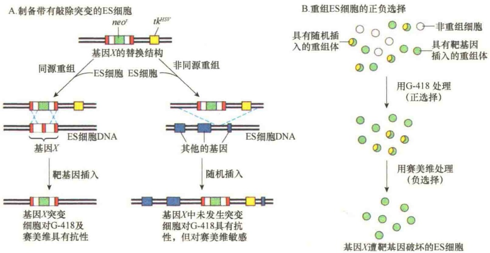
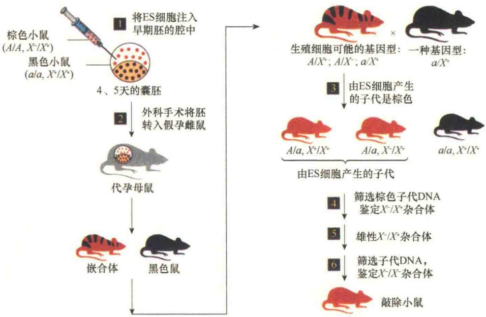
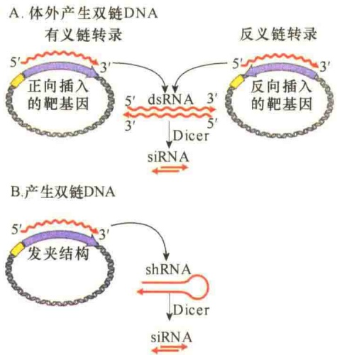

A

图2-47 用含有EcoRI与XhoI序列的引物通过PCR扩增克隆DNA序列（引自Watson et al., 2007）。A. 设计一对引物，它们的3'端与靶序列配对，而5'端分别含有限制性内切核酸酶EcoRI与XhoI序列，对于EcoRI是GAATTC，而对于XhoI则是CTCGAG。B. 将靶DNA序列进行变性后与引物一起进行退火（复性）。在第一轮PCR循环中，引物的5'端是单链的，并未与靶序列杂交。C. 在下一轮PCR中，图中仅显示了新合成的DNA链与引物退火，此时合成的双链DNA分子是由PCR扩增而来，并且在其末端有了限制性内切核酸酶的切割位点。D. 第二轮以后所有的PCR产物的两端都有了限制性内切核酸酶的作用序列。E. 当这些PCR产物用EcoRI和XhoI切割后，就会产生具有黏性末端的DNA片段，方便与载体连接。

就方便得多。将染色并经电泳分离的DNA片段在紫外线（ultraviolet, UV）照射下可清楚地看到一系列的DNA条带（band），每一条带代表一条限制性内切核酸酶切割后产生的DNA片段。片段的大小可用已知的分子标记进行估算。只要经凝胶分离的DNA带中DNA片段的含量在0.005μg以上，就可以在 UV 下检测到。重要的是，双链 DNA 片段经电泳分离后不会受到伤害，从胶上溶解下来后可用于进一步的实验。

B

C

图2-48 DNA片段的电泳分离（引自Watson et al., 2007）。电泳是带负电的DNA在电场中通过多孔的琼脂糖凝胶移动的过程。A. 在用琼脂糖浇注的凝胶板的井（well）中加载DNA样品，通常在样品中加入蓝色指示剂，以便掌控电泳的时间（由于指示剂的分子小，当指示剂移动到凝胶的近边缘处可停止电泳）。B. 打开电泳仪的电源，带负电荷的DNA分子向正极移动，小分子的DNA片段比大分子的DNA片段移动得快，大小相同的DNA片段移动的速度相同，从而会在琼脂糖凝胶中形成带（其他因素也有影响，如电荷、形态等，但大小是主要因素）。C. 电泳结束后，从凝胶板中取出琼脂糖凝胶，经溴化乙锭染色后，可在UV下观察分离的DNA条带（注:溴化乙锭是致癌剂，UV对人体有伤害，操作时都需严格防范）。

## 2.4.1.5 DNA连接酶

连接酶（ligase）是一类用于核酸分子连接形成磷酸二酯键的核酸合成酶，有DNA连接酶和RNA连接酶之分。1967年在噬菌体T4感染和未感染的大肠杆菌中都发现并提取了多核苷酸连接酶。此酶能在模板上连接DNA片段。1972年又发现在T4感染的大肠杆菌中有另一种连接酶，不用模板就能连接RNA片段。1974年证实这一现象后，将1967年发现的多核苷酸连接酶叫做DNA连接酶，把1972年发现的叫做RNA连接酶。基因工程中使用的主要是T4 DNA连接酶，该酶既能连接黏性末端，又能连接平末端（图2-49）。

图 2-49 DNA 连接酶在体外将 DNA 片段连接成重组的 DNA 分子（引自 Alberts et al., 2015）。连接反应中，需要 ATP 提供能量。A. DNA 连接酶可以将两个相同的黏性末端连接成一个完整的 DNA 片段，图中显示的两个片段都是经 EcoR I 切割产生的黏性末端。B. 图中连接的是由两种不同的限制性内切核酸酶切割产生的不同末端的片段:EcoR I 切割产生的黏性末端需先经 DNA 聚合酶将黏性末端补平，然后在 DNA 连接酶的作用下再与限制性内切核酸酶 Hac III 切割产生的平末端的 DNA 片段连接成一个完整的 DNA 分子。

## 2.4.2 基因功能研究技术

随着分子生物学的发展，创造了大量进行基因功能研究的新方法，包括基因敲除技术、RNA 干涉技术、基因编辑技术等。

## 2.4.2.1 基因敲除小鼠

基因敲除（gene knockout）是指一个有功能的基因通过基因工程方法完全被剔除的人工突变技术。这项技术是 M. R. Capecchi 于 20 世纪 80 年代末在犹他大学发展起来的。实验的动物通常是小鼠，被剔除了功能基因的小鼠就称为敲除小鼠（knockout mice）。基因敲除技术已成功地应用于一些遗传病的研究，还可用于研究特定基因的细胞生物学活性及发育调控的基因作用等，因此是研究基因功能的一项非常有用的技术。基因敲除是一套组合技术，包括基因重组、细胞分离、转基因等。

获得基因靶向敲除（gene-targeted knockout）的小鼠分两个阶段进行。第一阶段是构建一个含有靶基因的等位基因受到破坏的 DNA，并将其导入来自囊胚期的胚胎干细胞（ES），经过体外培养，尽管大多数转染 ES 细胞的 DNA 重组发生在非同源位点，也会有一小部分转染 ES 细胞的 DNA 与靶基因发生同源重组。为了能够将同源靶向基因插入的重组体挑选出来，在体外构建重组 DNA 时插入了两个标记基因，并与靶基因一同导入 ES 细胞。其中一个标记基因是新霉素抗性基因（ $neo^{r}$ ），该标记基因赋予细胞对G-418抗性，该选择标记插入到靶基因X中，导致基因X失活，该选择标记属于正选择标记（positive select marker），即将 $neo^{r}$ 基因插入到X基因中，这样在X基因突变的同时，获得 $neo^{r}$ 的抗性表型。用这种重组的DNA转化细胞，受体细胞会产生两种表型效应:靶基因X失活了，但同时获得正选择标记，因为获得 $neo^{r}$ 抗性基因的细胞可以在加有新霉素的培养基中生长，而没有得到突变X基因的细胞仍然对新霉素敏感，这样就可以分离和鉴定靶细胞了。第二个选择性标志是在X基因外侧插入一个负选择标记（negative select marker），即来自单性疱疹病毒的胸腺激酶基因（ $tk^{HVU}$ ），该标记赋予细胞对细胞毒核苷类似物9-(1,3-二羟基-2-丙氧甲基）鸟嘌呤（商品名:赛美维，Ganciclovir）敏感的特性。这样，经同源重组的ES细胞就能够在添加有新霉素与细胞毒性核苷类似物赛美维的培养基上被选择出来，因为非正确同源重组及未重组的细胞都不能生长（图2-50）。

第二阶段实验是产生敲除基因的小鼠。将X基因敲除突变的杂合ES细胞注入野生型受体小鼠的囊胚泡中，然后将囊胚泡转移到代孕（pseudopregnant）的雌性小鼠（图2-51）。产生的子代中既有嵌合体，也有纯合体，根据毛色很容易区别开。然后将嵌合小鼠与纯合小鼠交配，获得敲除基因进入生殖细胞的后代，再经几轮繁殖可获得纯的敲除基因的小鼠。

图 2-50 敲除小鼠的第一阶段实验——ES 细胞的分离（引自 Lodish et al., 2013）。A. 将体外构建的含有两种选择标记，且靶基因失活的重组 DNA 导入 ES 细胞后，有两种重组方式:一种是同源重组，此类 ES 细胞获得对新霉素的抗性，但目标基因突变了；另一种是非同源重组，虽然获得了新霉素抗性，但可被细胞毒性核苷类似物赛美维杀死。B. 将体外构建的 DNA 导入 ES 细胞后，可在含有新霉素及细胞毒性核苷类似物赛美维培养基上分离 X 基因突变的 ES 细胞。

图 2-51 靶向基因敲除小鼠的获得（引自 Lodish et al., 2013）。①将基因型为 A/A, $X^{-}/X^{+}$ (A 为选择标记基因显性纯合, X 为敲除基因杂合) 棕色小鼠的胚性干细胞注入基因型为 a/a, $X^{+}/X^{+}$ (选择标记基因隐性纯合, X 为敲除基因纯合正常) 黑色小鼠的 4.5 天的囊胚中；②将早期的胚移植到代孕的雌性小鼠, 通过棕黑色杂合肤色发现子代中含有 ES 细胞衍生组织的嵌合小鼠；③将嵌合小鼠与黑色小鼠回交, 获得棕色的子代小鼠, 表明由 ES 产生的细胞进入了小鼠的生殖系统；④～⑥从棕色小鼠的尾部提取 DNA 进行分析, 并经互交最终筛选纯合的基因敲除小鼠 ($X^{-}/X^{-}$)。

指双链的 RNA 能够阻止与其对应的 mRNA 的表达，而对于其他序列的 mRNA 则没有影响。RNAi 依赖于真核细胞将双链 RNA 切割成短的（23nt）具有抑制作用的双链 RNA 的能力，这些 RNA 被称为干扰小 RNA（small inhibitory RNA, siRNA）。切割反应是由核酸内切酶 Dicer 催化的。Dicer 是 RNase Ⅲ 家族中的一员，主要切割 dsRNA 或者茎环结构的 RNA 前体成为小 RNA 分子。Dicer 有着较多的结构域，最先在果蝇中发现，并且在不同的生物体上表现出很高的保守性。

由 Dicer 切割产生的 siRNA 能够引起同源 mRNA 的降解，降

## 2.4.2.2 RNA干涉

最直接的抑制特异基因功能的方法莫过于 RNA 干涉（RNA interference，RNAi），在技术上，RNAi 要比基因敲除简单。RNAi 最早发现于线虫，它是解作用是由 RNA 诱导的沉默复合物（RNA-induced silencing complex，RISC）催化的。RISC 介导 siRNA 对其靶 mRNA 互补序列的识别与杂交，其结果是 RISC 复合物中特异的核酸酶对 siRNA-mRNA 杂交体的切割。这一作用模式说明 RNAi 的作用是特异性的，因为它要与其靶 mRNA 进行特异性碱基配对，然后再将其杂交的 mRNA 进行降解，使该基因的功能遭到永久性的破坏。

Dicer 与 RISC 在细胞内的正常功能是通过细胞小的内源 RNA 分子（micro-RNA，miRNA）进行基因调节的。

有两种方法可获得特异序列的 siRNA。第一种方法是通过体外转录靶基因的有义链（sense strand）、反义链（antisense strand），并退火形成 dsRNA，然后将获得的 dsRNA 注入成熟线虫的性腺，在线虫的体内，dsRNA 在 Dicer 作用下转变成 siRNA（图 2-52A），siRNA 与 RISC 复合物结合后，引起细胞内相对应的 mRNA 分子快速降解。

图 2-52 研究 RNA 干涉的两种方法（引自 Lodish et al., 2013）。A. 体外产生用于干涉特定靶基因双链 siRNA 的方法。先将特定靶基因 DNA 序列以正、反两个方向插入强启动子控制之下的质粒载体中，然后通过体外转录获得该基因的有义链及反义链的 RNA，进而退火形成该特异基因的双链 RNA，经 Dicer 切割后形成 siRNA，将其导入细胞可将靶基因沉默。B. 体内获得特定基因 siRNA 的方法。体外构建一个含有特定靶基因两个片段并联的重组体，导入细胞后，有义链转录合成 RNA，由于前后两段是互补的，合成的 RNA 有可能形成发夹式的双链 RNA（shRNA），经 Dicer 切割后产生 siRNA。

第二种方法是在体内（in vivo）产生特异的双链 RNA。一种有效的方法是表达一个经体外设计的合成基因:含有相应靶基因的有义链与反义链两个并联片段，当该基因转录时，将会形成一个双链的 RNA 发夹（hairpin）结构，称为小发夹 RNA（small hairpin RNA）或 shRNA。然后 shRNA 在 Dicer 的作用下产生 siRNA（图 2-52B），siRNA 与 RISC 复合物结合后引起细胞内相对应的 mRNA 分子快速降解。

## 2.4.2.3 CRISPR/Cas编辑技术

细菌制造了地球上最大的生物量，毫不奇怪，病毒对细菌的感染远远多于对植物和动物的感染。最近的发现揭示很多种类的细菌（几乎所有的古细菌）使用大量的非编码小分子RNA捕捉并破坏入侵的病毒RNA。细菌的这种防卫系统称为CRISPR（clustered regularly interspaced short palindromic repeat），即成簇的、规律间隔的短回文重复序列。CRISPR虽然与siRNA、miRNA有些类似，但有两个重要的差别。第一，当细菌或古细菌被病毒感染时，它们有一种机制将病毒的DNA转变成短的片段，然后逐渐整合到细菌的基因组中。这种短的整合的病毒DNA具有“免疫性”，因为它们能够作为模板，转录产生大量的非编码RNA，称为crRNA（CRISPR RNA）。这些crRNA可以识别重新感染细菌细胞的原病毒。所以CRISPR系统的这种特点类似于哺乳动物的适应性免疫，细菌能够记忆过往的感染经验，并进一步用于保护再感染。CRISPR系统的第二个特点是crRNA能够与一些特异的蛋白质结合，从而能够识别双链DNA并将之破坏，而不仅仅是单链RNA。虽然CRISPR系统介导的免疫机制还不十分清楚，其基本原理可以概括为三步（图2-53）。

第一步，病毒 DNA 必须整合到细菌基因组特定的 CRISPR 位点区域，而 CRISPR 位点区域是由宿主的几百个重复序列构成的，每个重复序列是被来自以前感染的病毒 DNA 或其他外源 DNA 序列（25～70 个核苷酸对）隔开的。新的病毒 DNA 总是在 CRISPR 位点的 5' 端进行整合，该端首先进行转录。因此，每个 CRISPR 位点都有以前感染的暂时性记忆。很多细菌与古细菌的基因组中携带有几个大的 CRISPR 位点，因此具有广泛的病毒免疫性。第二步，CRISPR 位点转录成长的 RNA 分子，然后被加工成非常短的（大约 30 个核苷酸）crRNA。第三步，crRNA 与 Cas（CRISPR-associated）蛋白结合成复合物。Cas 是一类较为保守的核酸酶，能够识别一定构象的 RNA 并与之结合，识别互补的病毒 DNA 序列。形成的 CRISP/Cas 复合物能够识别与 crRNA 互补的 DNA 并进行降解反应。在此过程中，crRNA 作为引导 RNA（guide RNA，gRNA），通过碱基配对，与靶 DNA 形成互补结构。

细菌的 CRISPR 系统如今已被科学家人工搬移到植物与动物细胞中，成为动植物基因功能研究的有力工具，它比基因敲除或基因干涉更有效，而且方便快捷。例如，通过转基因将突变基因导入小鼠的实验