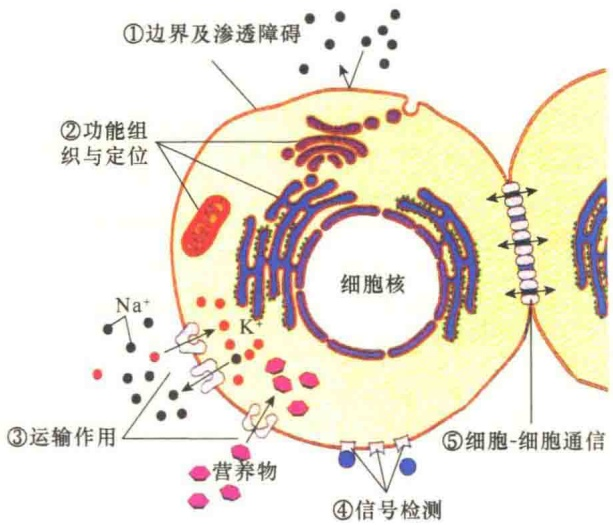
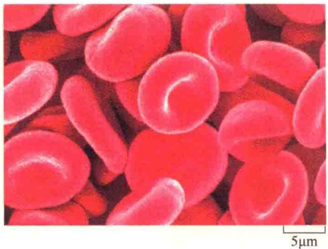
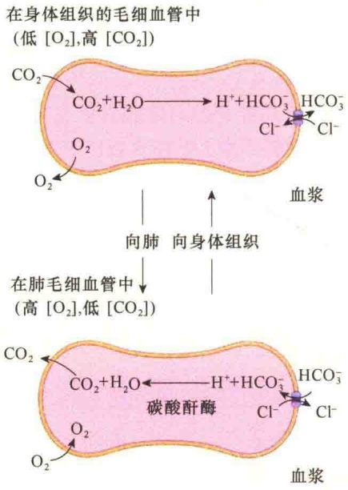
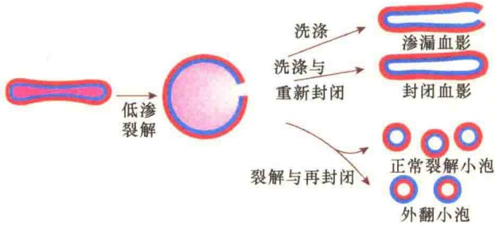
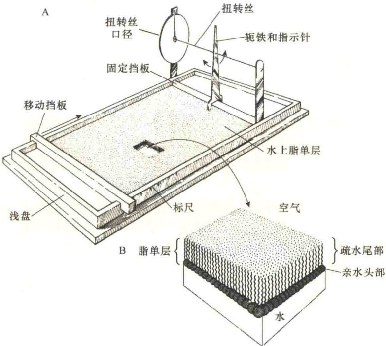

# 细胞质膜与穿膜运输

3.1 概述

3.1.1 细胞的膜结构

3.1.2 细胞膜的功能

3.2 红细胞与细胞膜结构的研究

3.2.1 红细胞的生物学特性

3.2.2 红细胞膜结构的研究

3.2.3 红细胞质膜的相关蛋白质

3.3 膜的化学组成

3.3.1 膜脂

3.3.2 膜糖

3.3.3 膜蛋白

3.4 细胞质膜的结构与特点

3.4.1 细胞质膜的结构模型

3.4.2 细胞质膜的不对称性

3.4.3 细胞质膜的流动性

3.5 物质的穿膜运输

3.5.1 质膜物质运输概述

3.5.2 被动运输

3.5.3 主动运输

3.5.4 主动运输与被动运输的比较及动物与植物主动运输的比较

细胞最基本的特点就是有一层脂与蛋白质组成的膜结构包裹在最外层，DNA 外面被包了膜，就有了温馨的“家”，也就结束了“流浪”生活，开始安居乐业。

细胞质膜很薄，无法用光学显微镜观察，直到20世纪50年代后期，由于制片和染色技术的发展，J. D. Robertson首次在电子显微镜下观察到细胞质膜的3层结构，后来发现无论是动物、植物还是微生物，无论是细胞质膜还是内膜系统的膜都具有相同的超微结构。

## 3.1 概述

膜（membrane）通常是指分隔两个空间的一层薄薄的结构，可以是自然形成的或是人造的，有时很柔软。存在于细胞结构中的膜不仅薄，而且具有半透性（semipermeability），允许一些不带电的小分子自由通过。

## 3.1.1 细胞的膜结构

细胞膜（cell membrane）是细胞膜结构的总称，它包括细胞外层的膜和存在于细胞质中的膜，有时也特指细胞质膜。

质膜（plasma membrane）是指包围在细胞表面的一层极薄的膜，主要由膜脂和膜蛋白所组成。质膜的基本作用是维护细胞内微环境的相对稳定，并参与同外界环境进行物质交换、能量和信息传递。另外，在细胞的生存、生长、分裂、分化中起重要作用。

真核生物除了具有细胞表面膜外，细胞质中还有许多由膜分隔成的各种细胞器。这些细胞器的膜结构与质膜相似，但功能有所不同，这些膜称为内膜（internal membrane）或胞质膜（cytoplasmic membrane）。内膜包括细胞核膜、内质网膜、高尔基体膜等。由于细菌没有内膜，所以细菌的细胞质膜代行胞内膜的作用。

习惯上把细胞所有的膜结构统称为生物膜（biomembrane 或 biological membrane），实际上它是细胞内膜和质膜的总称。生物膜是细胞的基本结构，它不仅具有界膜的作用，还参与全部的生命活动。

## 3.1.2 细胞膜的功能

真核细胞具有丰富的膜结构，了解膜的功能对于理解细胞膜的结构和细胞的生命活动是十分重要的。细胞膜的结构体系和功能如图 3-1 所示。

图 3-1 细胞膜的功能概览（引自 Becker et al., 1996）。

1）界膜和区室化（delineation and compartmentalization）细胞膜最重要的作用就是确定了细胞的边界，并且在细胞质中划分了许多以膜包被的区室。作为界膜的膜结构对于细胞生命的进化具有重要意义，这种界膜不仅使生命进化到细胞的生命形式，也保证了细胞生命的正常进行，它使遗传物质和其他参与生命活动的生物大分子相对集中在一个安全的微环境中，有利于细胞的物质和能量代谢。细胞内空间的区室化不仅扩大了膜的表面积，还使细胞的生命活动更加高效和有序。

2）调节运输（regulation of transport）膜为两侧的分子交换提供了一个屏障，一方面可以让某些物质“自由通透”，另一方面又作为某些物质出入细胞的障碍。膜对物质的运输具有选择性，有些物质在细胞内的浓度很高，有些物质只能沿浓度梯度进入细胞，这需要通过特殊的运输机制来调节。

3）功能定位与组织化（localization and organization of function）细胞膜的另一个重要功能就是通过形成膜性细胞器，使细胞的功能定位在一定的细胞结构并组成相互协作的系统。例如，细胞质中的内质网、高尔基体等膜性细胞器的基本功能是参与蛋白质的合成、加工和运输；而溶酶体的功能是起消化作用，酸性水解酶主要集中在溶酶体。又如，线粒体内膜的主要功能是进行氧化磷酸化，与该功能有关的酶和蛋白复合体集中排列在线粒体内膜上。叶绿体的类囊体是光合作用的光反应场所，所以在类囊体膜中聚集着与光能捕获、电子传递和光合磷酸化相关的功能蛋白及酶。

4）信号的检测与传递（detection and transmission of signal）细胞通常用质膜中的受体蛋白从环境中感知并接收化学信号和电信号。细胞质膜中具有各种不同的受体，能够识别并结合特异的配体进行信号传递，引起细胞内的反应。例如，细胞通过质膜受体接收的信号决定对糖原的合成或分解，膜受体接收的某些信号则与细胞分裂有关。

5）参与细胞间的相互作用（intercellular interaction）在多细胞的生物中，细胞通过质膜进行细胞间的多种相互作用，包括细胞识别、细胞黏着、细胞连接等。例如，动物细胞可通过间隙连接，植物细胞则通过胞间连丝进行相邻细胞间的通信，这种通信包括代谢偶联和电偶联。

6）能量转换（energy transduction）细胞膜的另一个重要功能是参与细胞的能量转换。例如，叶绿体利用类囊体膜上的结合蛋白进行光能的捕获和转换，最后将光能转换成化学能储存在糖类中。同样，膜也能够将化学能转换成可直接利用的高能化合物 ATP，这是线粒体的主要功能。

细胞膜的这些基本功能也是生命活动的基本特征，膜的功能是通过其特殊化学组成和结构实现的。

## 3.2 红细胞与细胞膜结构的研究

哺乳动物血液中成熟的红细胞（red blood cell, erythrceyte）不仅结构简单，而且获取方便、各自独立存在，所以是研究膜结构的最好材料。人们对膜结构的认识，大多来自对红细胞膜结构的研究。

## 3.2.1 红细胞的生物学特性

## 3.2.1.1 红细胞的形态结构

成熟的红细胞呈双面凹陷或单面凹陷的盘状（图 3-2），直径 7.5～8.3μm，厚度 1.7μm，体积 8.3μm，表面积 145μm²，表面积与体积的比值较大，有利于细胞变形、气体交换和携带。

图 3-2 红细胞的形态 (引自 Cooper and Hausman, 2016)。扫描电镜下显示的人的红细胞双凹形态。

## 3.2.1.2 红细胞的功能

红细胞的主要功能是将肺吸进的  $O_{2}$  运送到身体的其他组织，并带走呼出的  $CO_{2}$  （图 3-3）。

图 3-3 机体内红细胞的运输作用（引自 Becker et al., 1996）.

红细胞对  $O_{2}$  和  $CO_{2}$  的运输与膜的性质有关。氧是一种小分子，它能够自由扩散通过红细胞质膜进入红细胞内，并被血红蛋白结合。红细胞质膜的这种性质使得红细胞能够从肺中摄取氧，因为在肺毛细管中  $O_{2}$  的压力高，因而  $O_{2}$  很容易透过红细胞质膜进入红细胞；又由于肺毛细管中  $CO_{2}$  的压力很低，红细胞中的  $CO_{2}$  就会释放出来。红细胞从肺组织中获得  $O_{2}$  后通过循环系统进入体组织毛细管，在体组织毛细管中由于  $O_{2}$  压力低、 $CO_{2}$  压力高， $O_{2}$  就会从红细胞中释放出来，而  $CO_{2}$  则会进入红细胞。

由于气体  $CO_{2}$  难溶于水溶液，进入红细胞后就难以溶解到红细胞的细胞质中。这要依赖于红细胞质中的碳酸酐酶（carbonic anhydrase），它可将  $CO_{2}$  转变成水溶性的碳酸氢根阴离子（ $HCO_{3}^{-}$ ）。水溶性的碳酸氢根阴离子通过红细胞质膜中的带 3 蛋白，同  $Cl^{-}$ 进行交换排出红细胞，所以将带 3 蛋白称为阴离子交换蛋白。

## 3.2.1.3 红细胞血影

将红细胞分离后放入低渗溶液中，水很快渗入到细胞内部，使红细胞膨胀、破裂，从而释放出血红蛋白（是红细胞中唯一一种非膜蛋白），此时的红细胞就变成了没有内容物的空壳。由于红细胞质膜具有很好的变形性、柔韧性和可塑性，当红细胞的内容物渗漏之后，它的质膜可以重新封闭起来（图3-4），此时的红细胞被称为血影（ghost），它是分离红细胞膜蛋白的最好材料。

图 3-4 红细胞血影及封闭、未封闭小泡的形成（引自Alberts et al., 2002）。红细胞吸水膨胀形成裂口后释放出内容物，形成开口的红细胞血影或封闭的血影。若是红细胞完全瓦解，破裂的质膜碎片也会自我封闭形成正常的或外翻性的小泡。

## 3.2.2 红细胞膜结构的研究

红细胞具有很多特有的性质，因而其是研究膜结构的最好材料。第一，红细胞生命周期长，数量大，取材容易（体内的血库），极少有其他类型的细胞污染，并且是单个存在，不需要进行组织消化；第二，红细胞的结构简单，成熟的哺乳动物红细胞中没有细胞核和线粒体等膜性细胞器，细胞质膜是它的唯一膜结构，所以分离后不存在其他膜污染的问题；第三，红细胞在低渗溶液中容易破裂，释放出内容物，这样就很容易分离到红细胞的质膜；第四，分离到红细胞质膜后就非常容易分离出红细胞的膜蛋白了。所以，用红细胞做材料研究细胞质膜的结构，其“性价比”很高。

## 3.2.2.1 膜脂的发现及脂单层概念的提出

关于膜的化学组成和结构的研究始于18世纪90年代，开拓者是C. Overton。他意识到细胞似乎是由一层具有选择性和渗透性的外被包裹的，它只允许某些物质通过。Overton用植物的根毛做实验，发现脂溶性物质很容易进入细胞，而水溶性的物质却不能。实际上他发现了亲脂性（lipophilic）物质与细胞的关系。根据这一研究结果，Overton认为在细胞的外被中有脂的存在。他还进一步推测，细胞的外被中很可能有胆固醇和卵磷脂的存在，这种推测后来被证明是完全正确的。

关于细胞质膜的化学组成和结构研究的第二个重要进展是 I. Langmuir 提出的脂单层（lipid monolayer）的设想。他将纯化的磷脂溶于苯后铺展在朗格缪尔槽（Langmuir trough）的水面上，研究了脂的展层行为。实验中，他先将纯化的脂溶于苯，然后将苯-脂溶液置水面上展层，当苯挥发后，留下的脂在水面上形成脂单层，亲水的头部朝向水面，疏水的尾部背离水面（图 3-5）。脂单层概念是 20 世纪初膜结构研究的基础，导致了脂双层的发现。

图 3-5 在 Langmuir 槽中展现脂单层（引自 Becker et al., 1996）。A. 槽由一个浅盘和一个可移动的挡板组成。移动挡板可将磷脂单层向固定挡板端挤压，形成致密的脂单层。B. 磷脂在脂单层的排列方向。

## 3.2.2.2 细胞质膜结构的基础——脂双层

1925 年两位荷兰科学家 E. Gorter 和 F. Grendel 根据对红细胞质膜的研究首次提出质膜的基本结构是双脂分子层。这两位科学家在看到了 Langmuir 的研究论文后，认为可以用 Langmuir 的展层方法研究红细胞膜脂的结构，因为 Overton 已经提出在细胞的外层有脂的包被，推测红细胞的表面也有脂的存在。在红细胞的外侧包被中有多少脂尚不清楚，但是，他们在显微镜下观察到人的红细胞是扁平状，直径约为  $7 \mu m$ 。根据红细胞的体积，他们推测红细胞的表面积约为  $100 \mu m^{2}$ 。于是他们分离纯化了红细胞，并从一定数量的红细胞中抽提脂类，按 Langmuir 的方法进行展层，并比较展层后的脂单层的面积和根据体积所推算的总面积。Gorter 和 Grendel 发现用提取的脂铺展后测得的面积同实际测量的红细胞的表面积之比为 2（1.8～2.2）:1，为了解释这一结果，他们提出红细胞膜的基本结构是脂双层（lipid bilayer）。他们还推测脂双层具有热力学的特点，认为极性的亲水基团朝向外侧的水性环境。它们的实验和依据实验所得出的结论具有非常重要的意义，这是人类第一次从分子水平研究细胞膜的结构。

## 3.2.3 红细胞质膜的相关蛋白质

红细胞的寿命约为 120d，在生存期中大约行程为 500 000m。在血液循环中，红细胞要穿过小于自身直径一半的微小通道（脾窦），在脾脏内要经受少氧、低 pH 等不利环境的考验，在心脏内又要受到瓣膜涡流冲击。不难想象，红细胞在这样长而艰险的运输途径中保持结构的完好，它的细胞质膜起了重要作用。可以推测，红细胞的细胞质膜一定有非常特别的结构，仅仅是脂双层可能难以解释。

## 3.2.3.1 红细胞皮质骨架

研究发现红细胞质膜的内侧有一种特殊的结构，是由膜蛋白和纤维蛋白组成的网架（图 3-6），它参与维持细胞质膜的形状并协助质膜完成多种生理功能，这种结构被称为红细胞皮质骨架