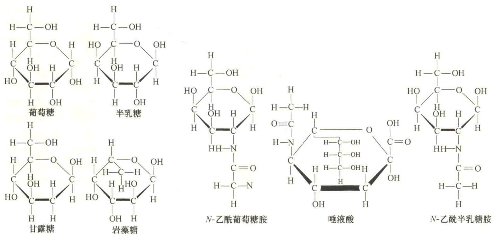
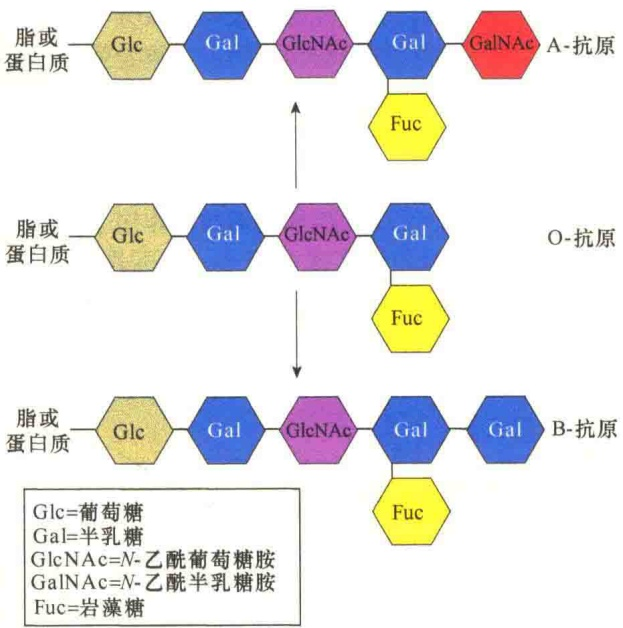
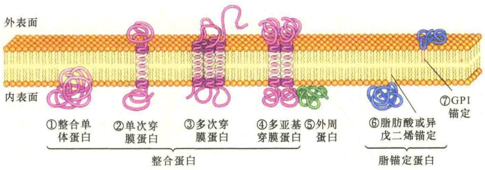
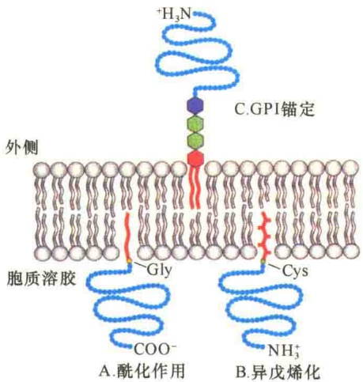
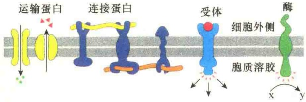
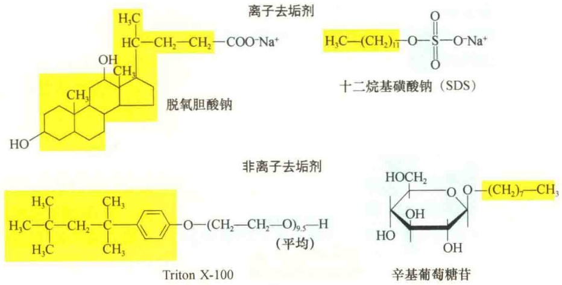
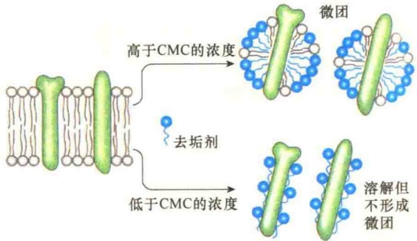

基团存在时才有功能。

膜脂的含量及种类影响着膜的物理性质，表 3-3 列出一些生物膜所含脂类的差异。

表 3-3 一些生物膜的主要脂类组成

<table><tr><td rowspan="2">来源</td><td colspan="4">含量(mol%)</td></tr><tr><td>PC</td><td>PE+PS</td><td>SM</td><td>胆固醇</td></tr><tr><td>细胞质膜(人的红细胞)</td><td>21</td><td>29</td><td>21</td><td>26</td></tr><tr><td>细胞质膜(大肠杆菌)</td><td>0</td><td>85</td><td>0</td><td>0</td></tr><tr><td>髓鞘膜(人的神经元)</td><td>16</td><td>37</td><td>13</td><td>34</td></tr><tr><td>内质网膜(大鼠)</td><td>54</td><td>26</td><td>5</td><td>7</td></tr><tr><td>高尔基体膜(大鼠)</td><td>45</td><td>20</td><td>13</td><td>13</td></tr><tr><td>线粒体内膜(大鼠)</td><td>45</td><td>45</td><td>2</td><td>7</td></tr><tr><td>线粒体外膜(大鼠)</td><td>34</td><td>46</td><td>2</td><td>11</td></tr></table>

注:PC，磷脂酰胆碱；PE，磷脂酰乙醇胺；PS，磷脂酰丝氨酸；SM，（神经）鞘磷脂。

## 3.3.2 膜糖

膜中的糖占膜重量的2%～10%，糖含量的多少依细胞的不同而不同，如红细胞膜中蛋白质占52%、脂占40%、糖占8%。在8%的糖中有7%与膜脂共价连接在一起形成糖脂，其余93%的糖则与膜蛋白共价相连形成糖蛋白。应该特别指出的是，细胞质膜上所有的膜糖（membrane carbohydrate）都位于质膜的外表面，内膜系统中的膜糖则位于细胞器膜的内表面。

## 3.3.2.1 膜糖的种类

自然界存在的单糖及其衍生物有200多种，但存在于膜的糖类只有9种，而在动物细胞质膜上的主要是7种，即D-葡萄糖（D-glucose）、D-半乳糖（D-galactose）、D-甘露糖（D-mannose）、L-岩藻糖（L-fucose）、N-乙酰-D-半乳糖胺（N-acetyl-D-galactosamine），N-乙酰葡萄糖胺（N-acetyl-glucosamine）、唾液酸（sialic acid）（图3-14）。

## 3.3.2.2 膜糖的存在方式

真核细胞质膜中的糖类通过共价键同膜脂或膜蛋白相连，即以糖脂或糖蛋白的形式存在于细胞质膜上。

在糖蛋白中，糖是以短的分支寡聚糖形式存在的。典型的糖蛋白每个支链有15个以下的单糖分子。唾液酸通常位于糖支链的末端，使糖链具有负电荷。糖与氨基酸的连接主要有两种形式，即O-连接和N-连接。

O-连接是糖链与肽链中的丝氨酸或苏氨酸残基相连，O-连接的糖链较短，约含4个糖基。N-连接是糖链与肽链中天冬酰胺残基相连，N-连接的糖链一般有10个以上的糖基。另外，N-连接的方式较O-连接普遍。

糖蛋白是细胞膜中最为丰富的蛋白质，事实上，真核生物细胞膜上的蛋白质几乎都是糖蛋白。糖蛋白主要存在于细胞质膜上，内膜中糖蛋白极少。在动物细胞中，糖蛋白是糖萼（glycocalyx）

图 3-14 细胞膜中常见的 7 种糖类。

的主要成分；而在植物细胞中，主要是由糖脂构成膜包被。内膜系统中的内质网和高尔基体是糖蛋白和糖脂的合成场所。

## 3.3.2.3 膜糖的作用

膜糖在细胞的生命活动中具有重要作用，它们可以提高膜的稳定性，增强膜蛋白对细胞外基质中蛋白酶的抗性，帮助膜蛋白进行正确的折叠和维持正确的三维构型。同时，膜糖也参与细胞的信号识别、细胞的黏着。如同某些糖脂一样，膜蛋白中的糖基是细菌和病毒感染时的识别和结合位点。另外，糖蛋白中的糖基还帮助新合成蛋白质进行正确的运输和定位。例如，溶酶体的酶蛋白都有一个6-磷酸甘露糖的标记，这样便于被识别和被分选装入溶酶体小泡。

凝集素（lectin）是一类能与糖类特异结合的蛋白质，能使细胞发生凝集。凝集素最初是从植物种子中发现的，有些具有剧毒，因而对种子具有保护作用。有些凝集素存在于细胞表面，参与细胞间的识别。由于凝集素能与细胞表面的糖蛋白、蛋白多糖、糖脂结合，而且不同凝集素识别糖基的不同特异序列，发生特异性的结合，因此，在细胞生物学中被广泛地用于定位和分离各种含糖的细胞膜分子。

ABO 血型决定子（determinant），即 ABO 血型抗原，是一种糖脂或糖蛋白，其寡糖部分具有决定抗原特异性的作用（图 3-15）。

ABO 血型决定子是短的、分支寡糖链，如 A 型血的人具有一种酶，这种酶能够将 N-乙酰半乳糖胺添加到糖链的末端；B 型血的人具有在糖链末端添加半乳糖的酶；AB 型血的人具有上述两种酶；O 型血的人则缺少上述两种酶，在抗原的末端既无 N-乙酰半乳糖胺，也无半乳糖。

## 3.3.3 膜蛋白

虽然膜脂构成膜的基本结构，但是生物膜的特定功能主要是由蛋白质决定的。膜蛋白（membrane protein）占膜的40%～50%，有50余种。在不同细胞中膜蛋白的种类及含量有很大差异，有的含量不到25%，有的达到75%。

图 3-15 血型抗原（引自 Karp, 2010）。人的血型是 A 型、B 型、AB 型还是 O 型，是由红细胞膜脂或膜蛋白中的糖基决定的。A 型血的人红细胞膜脂寡糖链的末端是 N-乙酰半乳糖胺（GalNAc），B 型血的人红细胞膜脂寡糖链的末端是半乳糖（Gal），O 型则没有这两种糖基，而 AB 型血的人则在末端同时具有这两种糖基。

膜蛋白的相对分子质量也有很大差别，为 10 000～250 000。我们已讨论过的红细胞的质膜是较为简单的，只有十几种主要膜蛋白。体外培养的 HeLa 细胞的膜较为复杂，有 50 余种主要蛋白质。一般来说，功能越复杂的膜，其上的蛋白质种类越多。

## 3.3.3.1 膜蛋白的分类

由于膜蛋白种类多、功能复杂，对膜蛋白没有一定的分类标准，通常可根据膜蛋白的存在方式进行粗略分类。膜蛋白在膜上的存在方式，主要是根据膜蛋白与膜脂的关系分为整合蛋白、外周蛋白、脂锚定蛋白（图 3-16）。

1）整合蛋白（integral protein）又称内在蛋白（intrinsic protein），部分或全部镶嵌在细胞膜中或内外两侧，以非极性氨基酸与脂双分子层的非极性疏水区相互作用而结合在膜上。整合蛋白所含疏水氨基酸的成分较高。实际上，整合蛋白几乎都是完全穿过脂双层的穿膜蛋白（transmembrane protein），其亲水部分暴露在膜的一侧或两侧表面，疏水区同脂双分子层的疏水尾部相互作用；仅有少数整合蛋白通过疏水区嵌在膜中，而不是穿过膜。穿膜蛋白可再分为单次穿膜蛋白、多次穿膜蛋白、多亚基穿膜蛋白等。穿膜蛋白一般含25%～50%的α螺旋，也有β折叠，如线粒体外膜和细菌质膜中的孔蛋白就是β折叠。

图 3-16 膜蛋白的主要存在方式（引自 Becker et al., 1996）

2）外周蛋白（peripheral protein）又称周边蛋白、附着蛋白（attachment protein）。这类蛋白质完全外露在脂双层的内侧或外侧，主要通过非共价键附着在脂的极性头部或整合蛋白亲水区的一侧，间接与膜结合。

外周蛋白可用高盐或碱性 pH 条件分离。实际上，有时外周蛋白与整合蛋白是难以区分的，因为许多膜蛋白是由多亚基组成的，其中有的亚基插入脂双层，有的亚基则是外周蛋白。

外周蛋白为水溶性，占膜蛋白总量的20%～30%，在红细胞中约占50%，如红细胞的血影蛋白和锚蛋白都是外周蛋白。外周蛋白可以增加膜的强度。

3）脂锚定蛋白（lipid-anchored protein）又称脂连接蛋白（lipid-linked protein），通过共价键的方式与脂分子结合，位于脂双层的外侧。其主要有两种结合方式:一种方式是蛋白质直接结合于脂双分子层；另一种方式是蛋白质并不直接与脂双层结合，而是通过一个糖分子间接与脂双层结合（图3-17）。

通过与糖的连接被锚定在膜脂上的蛋白质主要是通过短的寡糖与包埋在脂双层外侧脂层中的糖基磷脂酰肌醇（glycosylphosphatidylinositol，GPI）相连而被锚定在质膜的外侧。之所以能够在膜上发现这类脂锚定蛋白，是因为用特异识别和切割含有肌醇磷脂的磷脂酶处理细胞膜能释放出蛋白质。这类脂锚定蛋白通常是膜受体、酶和细胞黏着分子。一种很少见的贫血——阵发性睡眠性血红蛋白尿症就是GPI合成缺陷，导致红细胞容易破裂所致。

另一类存在于细胞质面的脂锚定蛋白是直接通过与脂双层中的碳氢链形成共价键进行锚定的。目前至少发现两种蛋白质（Src 和 Ras）是通过这种方式被锚定在质膜的细胞质面，提示这种锚定方式与细胞从正常状态向恶性状态转化有关。

图 3-17 脂锚定蛋白（引自 Lodish et al., 2013）。A. 胞质蛋白，如 v-Src 蛋白通过脂酰链与 N 端的甘氨酸（Gly）相连，从而锚定到质膜上。豆蔻基（十四烷基，C14）与棕榈基（十六烷基，C16）是最常见的酰基锚定点。B. 另一些胞质蛋白（如 Ras、Rab 蛋白）通过 C 端 1\~2 个半胱氨酸的异戊二烯锚定到质膜上，锚定的点通常是法尼醇（C15）和牻牛儿基（C20）基团。C. 细胞质膜外侧的蛋白质通过 GPI 锚定到细胞质膜的外侧。质膜中的磷脂酰肌醇通过糖（不同的 GPI 锚定的糖的数量与性质不同）及磷脂酰乙醇胺与蛋白质相连。

## 3.3.3.2 膜蛋白的功能

细胞质膜有着许多重要的生物学功能，这些功能大多数是由膜蛋白来执行的。膜蛋白中有些是运输蛋白，转运特殊的分子和离子进出细胞；有些是酶，催化与酶相关的代谢反应；有些是连接蛋白，起连接作用；还有些是受体，起信号接收和转导作用等（图 3-18，表 3-4）。

图 3-18 膜蛋白的某些功能（引自 Alberts et al., 1994）。

表 3-4 某些膜蛋白及其功能

| 功能蛋白 | 示例 | 作用方式 |
| --- | --- | --- |
| 运输蛋白 | $Na^{+}$-$K^{+}$泵 | 主动将$Na^{+}$泵出细胞,将$K^{+}$泵入细胞 |
| 连接蛋白 | 整联蛋白 | 将细胞内肌动蛋白与细胞外基质蛋白相连 |
| 受体蛋白 | 血小板生长因子(PDGF)受体 | 与细胞外的PDGF结合,在细胞质内产生信号,引起细胞的生长与分裂 |
| 酶 | 腺苷酸环化酶 | 在细胞外信号作用下,使细胞内产生cAMP |

## 3.3.3.3 去垢剂分离膜蛋白

膜蛋白很难纯化与研究，原因是膜蛋白与膜脂或其他的蛋白质结合得很紧。又由于整合蛋白是双亲媒性分子，所以很难以水溶液的形式分离整合蛋白。用去垢剂分离小的整合蛋白是分离膜蛋白的常用方法。

去垢剂（detergent）可分为离子和非离子两类（图 3-19），有些是天然产物，如胆碱盐（bile salt）；

图 3-19 四种常见去垢剂的分子结构。每种去垢剂的疏水部分用深色表示，亲水部分用浅色表示，脱氧胆酸钠是天然产物，SDS、TritonX-100、辛基葡萄糖苷是人工合成产物。

大多数是合成的分子。十二烷基磺酸钠（SDS）是常用的离子去垢剂，它不仅可使细胞膜崩溃，并与膜蛋白的疏水部分结合使其分离，而且还破坏膜蛋白内部的非共价键，使蛋白质变性，故不宜用于分离膜蛋白。Triton X-100 是常用的温和非离子去垢剂，它可以使膜脂溶解，又不会使蛋白质变性。

去垢剂是一种一端亲水、一端疏水的双亲媒性分子，它们具有极性端和非极性的碳氢链，当它们与膜蛋白作用时，可以用非极性端与蛋白质的疏水区作用，取代膜脂，极性端指向水中，形成溶于水的去垢剂-膜蛋白复合物，从而使膜蛋白在水中溶解、变性、沉淀。

当用非离子去垢剂分离膜蛋白时，一定要注意去垢剂的浓度。若去垢剂的浓度高于临界微球浓度（critical micelle concentration，CMC），分离的蛋白质会与磷脂、去垢剂形成混合的微球而不溶于水，也就影响了后续对蛋白质的功能研究。若以低浓度的去垢剂（CMC以下）分离膜蛋白，去垢剂会与整合蛋白的大部分疏水区结合，就不会形成微球，从而保持分离的膜蛋白能够溶于水，便于后面的研究（图3-20）。

## 3.3.3.4 用人工脂质体研究膜蛋白的功能

为了测定膜蛋白的功能，可以利用脂质体法。上面我们已经讨论过可以用非离子去垢剂，如Triton X-100，使膜脂溶解，分离纯化出有生物功能的膜蛋白，然后将分离纯化的膜蛋白插入到人工脂质体中，就可以研究膜蛋白的功能。有人用这种方法研究了来自细胞质膜的 $Na^{+}/K^{+}-ATPase$ 的功能（图3-21）。

实验中首先用去垢剂溶解膜蛋白，然后进行蛋白质的分离纯化，再将分离纯化的膜蛋白与适当的磷脂混合，并用透析法除掉去垢剂，就可形成脂质体小泡。如果分离的膜蛋白是  $Na^{+}/K^{+}-ATPase$  的成分，这些重建的小泡在  $Mg^{2+}$  和 ATP 的存在下，可进行  $Na^{+}/K^{+}$  的主动运输，通过对脂质体内外  $Na^{+}$  和  $K^{+}$  浓度的测定，即可确定加入到人工脂质体上的蛋白质是不是  $Na^{+}/K^{+}-ATPase$ 。

图 3-20 用非离子去垢剂分离膜蛋白（引自 Lodish et al., 2013）。

## 3.4 细胞质膜的结构与特点

细胞的各种结构同它们相应的功能是一致的。由于细胞的生活物质被包裹在细胞质膜内，而细胞的新陈代谢活动必须与细胞外物质间进行交换，这就要求细胞质膜具有特殊的结构，以保证生命活动的正常进行。

## 3.4.1 细胞质膜的结构模型

关于细胞质膜结构的研究从19世纪末就开