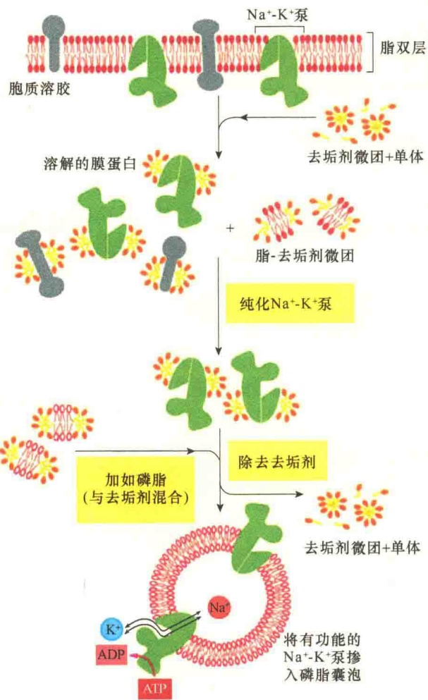
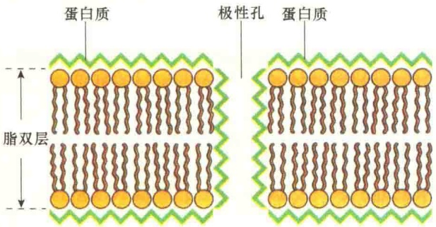
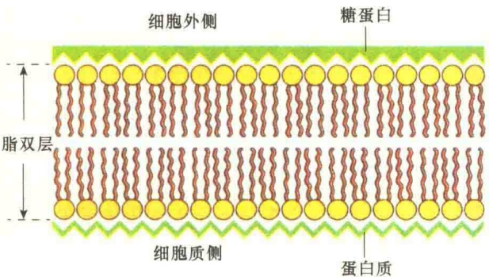
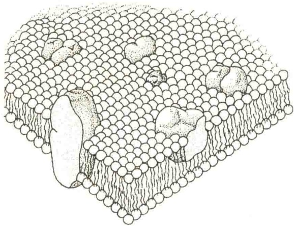
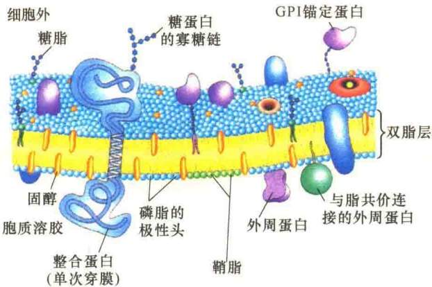
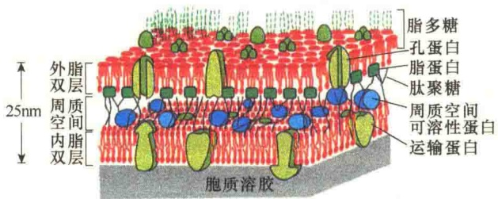
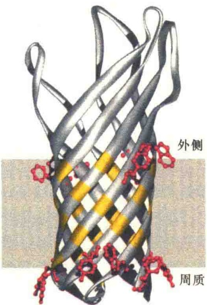
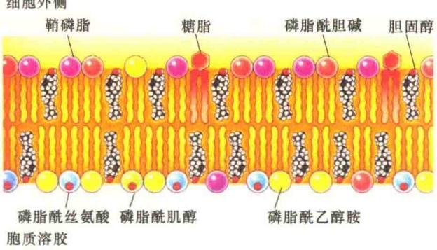
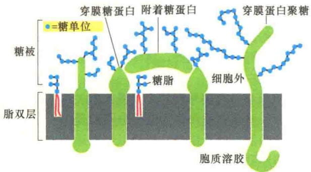

图 3-21 利用脂质体法研究膜蛋白的功能（引自 Alberts et al., 1994）。图中所示是用温和去垢剂溶解质膜，然后纯化膜蛋白，最后重建有功能  $Na^{+}/K^{+}-ATPase$  的实验过程。实验中要分离纯化  $Na^{+}/K^{+}-ATPase$ ，然后将它掺入到磷脂小泡（脂质体）。

始了。19世纪90年代，E. Overton发现了脂溶性物质容易透过细胞，提出了脂肪栅的膜结构设想。1925年，荷兰的两位科学家E. Gorter和F. Grendel根据对红细胞的研究，提出细胞的外面有一个脂双层结构。但是，这些研究工作只是认识到膜脂的存在，并没有将蛋白质与膜的功能真正联系起来。直到1935年，人们认识到膜蛋白的存在，提出膜脂和膜蛋白“联姻”的结构模型。1972年，S. J. Singer和G. Nicolson提出流动镶嵌模型，实现了细胞质膜结构与功能的统一。

## 3.4.1.1 片层结构模型

膜的脂双层结构的提出，解释了关于细胞的一些基本特点，但是不能解释膜的一些重要性质，特别是溶质渗透性（solute permeability）和电抗性（electrical resistance），而溶质对膜的渗透性主要与溶解性相关。例如，葡萄糖很容易进入大多数细胞，虽然半乳糖的大小、形态与葡萄糖相似，但却难以进入细胞。这种渗透性的差异细胞是如何控制的？当时的生物学家难以认识清楚，但他们已经认识到细胞对底物的识别似乎与膜的透性差异相似。于是生物学家开始猜想，膜上是否有类似于酶的结合位点与葡萄糖结合并促进葡萄糖进入细胞？当时还发现，生物膜对离子的透性比人工脂双层要容易，如1h透过红细胞的 $K^{+}$ 的量相当于1天透过人工脂双层的 $K^{+}$ 的量。

为了研究膜透性差异的原因，J. Danielli 和 H. Davson 进行了一系列的研究，主要是测量三酰甘油在水中的表面张力，并与细胞的表面张力相比较。由于三酰甘油是完全疏水的油性分子，将三酰甘油置于水中就形成了球形油滴，与水接触的面积非常小，说明油滴的表面张力相当高。于是，他们推测，如果活细胞的表面都是由脂肪构成的脂双层，那么表面张力就应该与油滴相似。但测量的结果要低得多，说明膜并非只是由脂肪构成的。他们在实验中还发现，在油滴中加入蛋白质，可使油滴的表面张力降至与活细胞表面张力相同的水平。

根据这些实验结果，1935年，Davson和Danielli提出双分子片层结构模型或称“三明治式”模型。他们认为膜的骨架是脂肪形成的脂双层结构，但是，为了降低活细胞的表面张力，他们假定在脂双层的内外两侧都有一层蛋白质包被，即蛋白质-脂-蛋白质的三层结构，内、外两层的蛋白质层都非常薄。他们还认为，蛋白层是以非折叠、完全伸展的肽链形式排列在脂双层的内、外两侧。这一模型提出后，很快又进行了一些细微的修改，认为在膜上有一些二维伸展的孔，孔的表面也是由蛋白质包围着的，这样孔就具有极性，提高了水对膜的通透性。图3-22所示为Davson和Danielli于1954年最后修改的片层结构模型（lamella structure model）。

该模型是第一次用分子术语描述的膜结构，并将膜结构与所观察到的生物学性质联系起来，对后来的研究有很大的启发。

## 3.4.1.2 单位膜模型

1959 年，J. D. Robertson 利用电子显微镜技术对各种膜结构进行了详细研究。在电子显微镜下发现细胞膜类似铁轨结构（railroad track），两条暗线被一条明亮的带隔开，显示暗-明-暗的三层，总厚度为 7.5nm，中间层为 3.5nm，内、外两层各为 2nm，并推测暗层是蛋白质，透明层是脂，建议将这种结构称为单位膜（图 3-23）。

图 3-22 Davson-Danielli 片层结构模型（引自 Wolfe，1993）。

图 3-23 Robertson 的单位膜模型（引自 Wolfe，1993）。

单位膜模型（unit membrane model）是在片层结构模型的基础上发展起来的另一个重要模型，它与片层结构模型有许多相同之处，最重要的修改是膜脂双分子层内、外两侧的蛋白质存在的方式不同。单位膜模型强调的是蛋白质为单层伸展的β折叠片状，而不是球形蛋白。另外，单位膜模型还认为膜的外侧表面的膜蛋白是糖蛋白，而且膜蛋白在两侧的分布是不对称的。这一模型能够解释细胞质膜的一些基本特性。例如，质膜有很高的电阻，这是由于膜脂的非极性端的碳氢化合物是不良导体的缘故；再如，由于膜脂的存在，使它对脂溶性强的非极性分子有较高的通透性，而脂溶性弱的小分子则不易透过膜。

单位膜模型也有一些不足:首先，该模型把膜看成是静止的，无法说明膜如何适应细胞生命活动的变化；其次，不同的膜其厚度不都是7.5nm，一般为5\~10nm；再次，如果蛋白质是伸展的，则不能解释酶的活性与构型的关系。此外，该模型也不能解释为什么有些膜蛋白很容易被分离，有些则很难。

## 3.4.1.3 流动镶嵌模型

1966 年，Lenarnard 和 Singer 发现膜蛋白的氨基酸链中有 30% 是以  $\alpha$  螺旋的形式弯曲存在的，而不像片层结构模型那样完全伸展在两侧。若将膜蛋白展开后铺展在膜的外层，其厚度是7～8nm的几倍，显然与所观察的结果不符。另外，根据Singer的观察，如果蛋白质是完全伸展的，则需要消耗大量的能量以维持疏水氨基酸暴露在水性环境中。事实上，蛋白质总是倾向于折叠，让亲水和疏水的不同基团处于不同的环境中，以维持最低的能量状态。

一些研究者发现磷脂在水中的行为都是趋向形成脂双层，并且都是将亲水的基团朝向表面，这种排列方式会降低表面张力，因而不需要蛋白质包被。

20 世纪 60 年代发展起来的冰冻蚀刻技术，首次揭示了膜中有蛋白质颗粒存在。

1972 年，Singer 和 Nicolson 总结了当时有关膜结构模型及各种研究新技术的成就，提出了流动镶嵌模型（fluid mosaic model），保留了单位膜模型中有关脂双分子层的正确概念，但对蛋白质的存在状态进行了较大的修改，认为球形膜蛋白分子以各种镶嵌形式与脂双分子层相结合，有的附在内表面、有的附在外表面，有的全部或部分嵌入膜中，有的贯穿膜的全层，这些大多是功能蛋白（图 3-24）。

图 3-24 Singer-Nicolson 的流动镶嵌模型（引自 Karp, 1996）。

流动镶嵌模型有两个主要特点。第一，蛋白质不是伸展的片层，而是以折叠的球形镶嵌在脂双层中，蛋白质与膜脂的结合程度取决于膜蛋白中氨基酸的性质。第二，膜具有一定的流动性，不再是封闭的板块结构，以适应细胞各种功能的需要。

流动镶嵌模型最高明之处就是认识到不同的膜蛋白与膜脂的亲和性是不同的，因而影响膜蛋白在膜中的位置，即膜蛋白与膜脂的作用方式。整合蛋白具有一个或多个疏水区，与脂双层内部的疏水区具有亲和力，因而这些蛋白质与膜脂结合较紧而不易除去。然而，这些整合蛋白也有一个或多个亲水区，使它们伸向膜外，进入膜两侧的水相。另一类膜蛋白——外周蛋白，缺少疏水区，因而不能插入脂双层，但是能够通过弱的静电作用同膜脂的亲水头结合或是与整合蛋白的亲水区结合，因此，外周蛋白较容易从膜中分离，并且可以溶于盐溶液而不需用去垢剂处理。

流动镶嵌模型强调了膜的流动性和不对称性，较好地体现了细胞的功能特点，被广泛接受，也得到许多实验的支持。后来又发现糖类是以糖脂或糖蛋白的形式存在于膜的外侧表面。图 3-25 是现今被广为接受的生物膜结构模型。

图 3-25 由流动镶嵌模型发展而来的生物膜结构模型（引自 Nelson and Cox, 2017）。

## 3.4.1.4 大肠杆菌细胞质膜

流动镶嵌模型同样适合原核生物。革兰氏阴性菌，如大肠杆菌的细胞质膜是双层的膜结构（图 3-26）；而革兰氏阳性菌，如链球菌、葡萄球菌等只有一层细胞膜结构。

图 3-26 大肠杆菌的双层膜结构模式图（引自 Alberts et al., 1994）。内膜是细胞质膜。在内、外脂双层之间，是细菌的细胞壁，主要成分是肽聚糖，肽聚糖是由蛋白质和多糖构成的，附着在外膜的脂蛋白上。

真核生物的细胞质膜中没有孔蛋白（porin），但是在革兰氏阴性菌的外膜上存在丰富的孔蛋白。

孔蛋白也存在于线粒体和叶绿体的外膜上，性质与革兰氏阴性菌的孔蛋白类似，但是它们允许较大的分子通过，其中线粒体孔蛋白可通过分子质量为 6kDa 的分子，而叶绿体的孔蛋白则可通过分子质量为 10～13kDa 的分子。

孔蛋白是膜整合蛋白，它的膜脂结合区与其他的穿膜蛋白不同，不是  $\alpha$  螺旋，而是  $\beta$  折叠（图 3-27）。

图 3-27 大肠杆菌外膜中一种孔蛋白 OmpX 的结构模型（引自 Lodish et al., 2016）。所有的孔蛋白都是三聚体，以 β 折叠形成孔的壁，中心是一个孔。

## 3.4.2 细胞质膜的不对称性

流动镶嵌模型的一个主要特点就是膜不对称性（membrane asymmetry）。细胞质膜的不对称性是指细胞质膜中各种成分的分布是不均匀的，包括种类和数量的不均匀。

膜的主要成分是蛋白质、脂和糖，膜的不对称性主要是指这些成分分布的不对称，以及这些分子在方向上的不对称。

## 3.4.2.1 不对称性的表现

1）膜脂分布的不对称性 膜脂分布的不对称性表现在膜两侧分布的各类脂的含量比例不同，各种细胞的膜脂不对称性差异很大。由于膜脂在两叶分布的差别，造成不同膜区的功能各异。例如，在红细胞膜脂双层中，在外脂单层含鞘磷脂、磷脂酰胆碱较多，而在内脂单层含磷脂酰乙醇胺、磷脂酰丝氨酸较多（图3-28）。

2）膜蛋白分布的不对称性 膜蛋白的分布是绝对不对称的，每种膜蛋白在膜内都有特定的排布方向。例如，红细胞的血型糖蛋白分子伸向膜内侧面与伸向外侧面的氨基酸残基的数目不对称。血图 3-28 细胞质膜中脂的不对称分布（引自 Cooper et al., 2013）。膜脂的外脂单层主要含有磷脂酰胆碱、鞘磷脂和糖脂。内脂单层含有磷脂酰乙醇胺、磷脂酰丝氨酸和磷脂酰肌醇。胆固醇两侧均有分布。图中磷脂酰丝氨酸和磷脂酰肌醇头部净的电负性已经标示。

影蛋白分布在红细胞膜的内侧面。一般而言，细胞质面的蛋白质比外表面的少，一些酶和受体处于膜的外表面，如 5'-核苷酸酶、磷酸酯酶、 $Mg^{2+}$ -ATP 酶、激素受体、生长因子受体等。腺苷酸环化酶则是处于质膜的内表面。

糖脂和糖蛋白的糖基在质膜上的分布也是不对称性的（图 3-29）。糖脂均分布在动物细胞的外表面。糖蛋白的糖基也是分布于质膜脂双层的外脂单层，如血型糖蛋白、带 3 蛋白。

图 3-29 膜糖分布的不对称性（引自 Alberts et al., 2015）

## 3.4.2.2 不对称性的意义

膜脂、膜蛋白及膜糖分布的不对称性导致了膜功能的不对称性和方向性，保证了生命活动的高度有序性。

膜脂在膜中的分布是不对称的，这种不对称性的生物学作用虽然取得了一些研究进展，但目前了解得还是很少。例如，糖脂位于脂双层的外侧，其作用可能是作为细胞外配体（ligand）的受体；磷脂酰丝氨酸主要集中在脂双层的内叶，在生理pH下带负电荷，这种带电性使得它能够与带正电的物质结合，如可与血型糖蛋白A穿膜α螺旋邻近的赖氨酸、精氨酸结合；磷脂酰胆碱出现在衰老的淋巴细胞外表面，作为被吞噬细胞吞噬的信号；磷脂酰胆碱也出现在血小板的外表面，此时作为血凝固的信号；磷脂酰肌醇主要集中在内脂单层，它们在将细胞质膜的刺激向细胞质传递的过程中起关键作用。

膜脂双层不仅内、外两个脂单层的功能不同，不同区域的功能也不相同，造成这种功能上的差异主要是膜蛋白、膜脂和膜糖分布不对称引起的。

细胞间的识别、运动、物质运输、信号转导等都具有方向性，这些方向性的维持则依赖于膜蛋白、膜脂和膜糖的分布不对称性。

## 3.4.3 细胞质膜的流动性

膜的流动镶嵌模型说明生物膜是一种动态的结构，具有膜脂的流动性（fluidity）和膜蛋白的运动性（mobility）。膜的流动性概念是指膜内部的脂和蛋白质分子的运动性。膜的流动性不仅是膜的基本特性之一，也是细胞进行生命活动的必要条件。

膜的流动性主要是由膜脂双层的状态变化引起的。在生理条件下，膜脂多呈液晶态；温度下降至某点，则变为晶态；一定温度下，晶态又可熔解再变成液晶态。这种临界温度称为相变温度，在不同温度下发生的膜脂状态的改变称为相变（phase transition）。

膜脂由于成分不同而各有其不同的相变温度。在某一温度下，有些脂处于晶态，另一些脂仍处于液态。处于这两种不同状态的磷脂分子分别各自汇集，形成了相的分离，从而形成一些流动性不一的微区（domain）。由于膜脂的流动，给膜蛋白提供了可以流动的环境，加上膜蛋白自身构型的变化，使膜蛋白处于动态之中。

膜的主要成分是脂和蛋白质，所以膜的流动主要是由脂和蛋白质的流动引起的。

## 3.4.3.1 膜脂的运动

脂的流动是造成膜流动的主要因素，概括起来，膜脂的运动方式主要有三种（图3-30）。①侧向扩散（lateral diffusion），又称侧向迁移。在同一脂单层内的脂分子经常互相换位，其速度相当快，有人推测细菌质膜中磷脂以这种方式从细胞的一端扩散到另一端只需1～2s。这种运动始终保持脂分子在质膜中的排布方向，即亲水的基团朝向膜表面，疏水的尾指向膜的内部。②旋转（rotation）运动，即每个脂分子都围绕其长轴做快速旋转。③屈