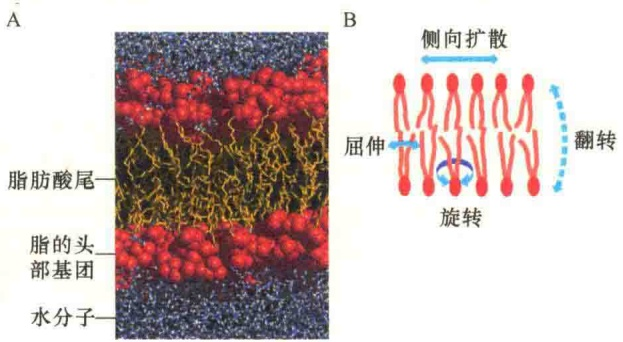
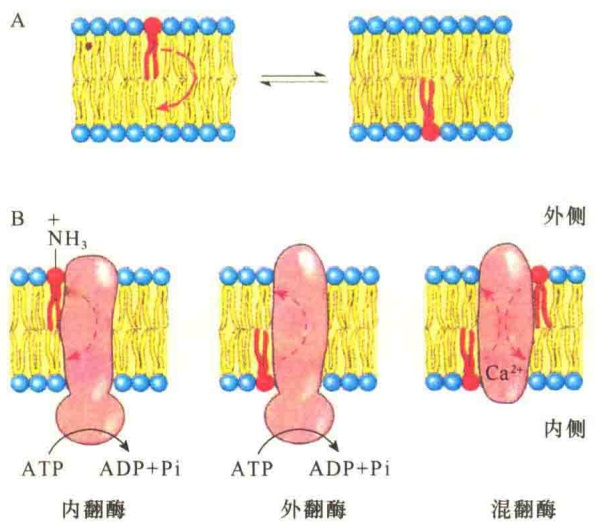
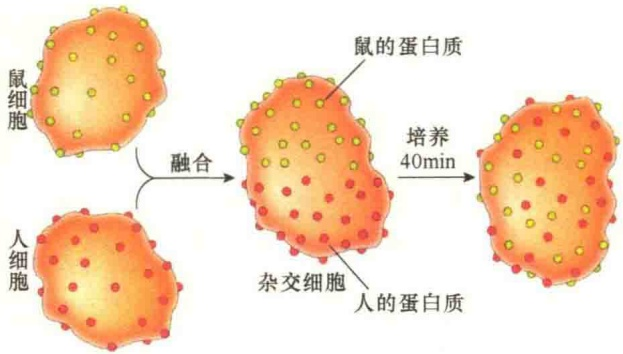
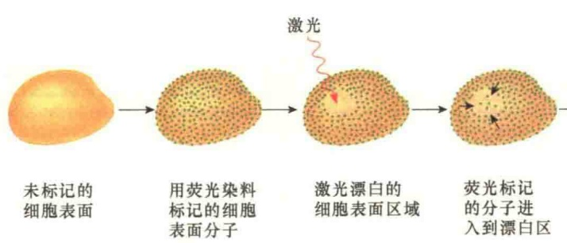
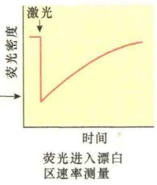
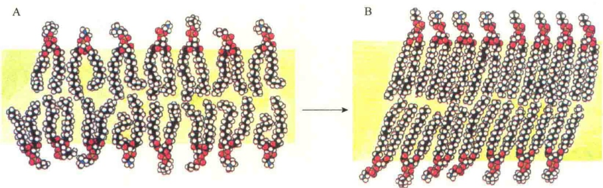
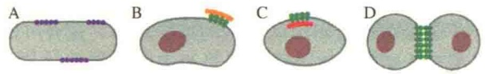
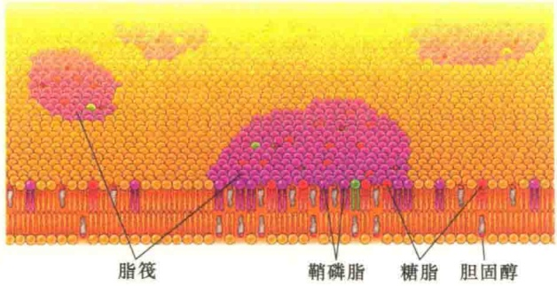
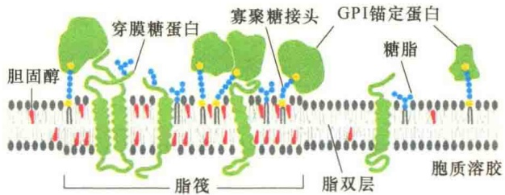
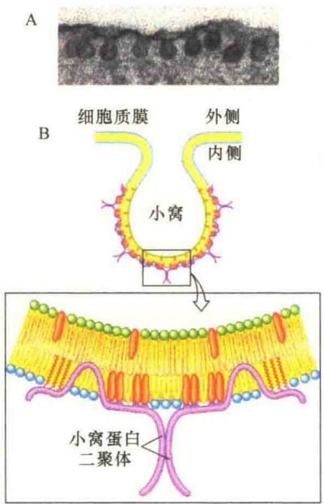

图 3-30 磷脂分子在人工脂双层中的运动（引自 Alberts et al., 2015）。A. 100 个磷脂酰胆碱分子规则地排成双层，通过计算机计算它们的位置变化，从而监测到膜脂的运动。B. 膜脂三种运动方式:侧向扩散、屈伸、旋转，偶尔也会有翻转。

伸（flexion），即膜脂围绕着与膜平面相垂直的轴进行弯曲摆动。

翻转（flip-flop）是指脂分子从脂双层的一个层面翻转至另一个层面的运动。这种运动是很少发生的，也是最为剧烈的一种运动。发生翻转运动时，磷脂的亲水头部基团必须克服内部疏水区的阻力，这在热力学上是不利的。但是有些细胞含有翻转酶（flip-floppase）能够促使某些磷脂从膜脂的一侧脂单层翻转到另一侧脂单层，这些酶在维持膜脂的不对称分布中起重要作用（图3-31）。

翻转酶属于P型ATPase，每翻转一个磷脂需要消耗 1 分子 ATP。翻转酶对于膜脂种类的不对称分布具有重要作用。

图 3-31 磷脂在脂双层中的翻转（引自 Nelson and Cox, 2013）。A. 非催化性翻转:磷脂在质膜脂的两脂单层间缓慢翻转，这种翻转没有酶的催化，速度极慢。B. 磷脂在翻转酶的催化下，在质膜脂的两脂单层间翻转。有三种类型的翻转酶:内翻酶（flippase），将外脂单层的脂翻转到内脂单层；外翻酶（floppase），将内脂单层的脂翻转到外脂单层；混翻酶（scramblase），既能外翻又能内翻，调整内、外脂单层膜脂的数量平衡。

## 3.4.3.2 膜蛋白的运动

由于膜蛋白分子质量较大，它不可能像膜脂那样运动。利用现代分子生物学研究技术和摄像观察，发现依据所研究蛋白的不同，运动方式也不同，可以归纳为以下几种运动形式。①随机移动。有些蛋白质能够在整个膜上随机移动，移动的速率比用人工脂双层测得的要低。②定向移动。有些蛋白质比较特别，在膜中做定向移动，如有些膜蛋白在膜上可以从细胞的一端移向另一端。③局部移动。有些蛋白质虽然能够在膜上自由移动，但只能在局部范围内做旋转移动和侧向移动。

## 3.4.3.3 膜流动性的生理意义

细胞质膜适宜的流动性是质膜行使功能的必要条件。例如，细胞质膜中有相当数量的酶催化着不同的反应，酶活性与流动性有极大的关系，如卵磷脂-胆固醇转酰基酶的活性与膜的流动性密切相关，膜流动性大，有利于酶的侧向扩散和旋转运动，酶活性提高。

膜的一个重要功能是参与物质运输，如果没有膜的流动性，细胞外的营养物质则无法进入，细胞内合成的胞外物质（如胞外酶、胞外蛋白）及细胞废物也不能运到细胞外，这样细胞就会因停止新陈代谢而死亡。

膜流动性与信号转导有着极大的关系。细胞质膜上有一些蛋白质可作为信号分子的受体，它可与细胞外的信号分子结合，然后以某种运动方式，将信号传递到细胞内，如果没有膜的流动性，信号也就无法向细胞内传递。不难想象，细胞与外界失去了信息交流，它还能生存多久。

膜流动性与细胞周期也有密切的关系。研究证明，在 M 期，膜流动性最高，而在  $G_{1}$  期和 S 期，膜流动性最低。

细胞的生命活动需要消耗能量，细胞内能量转换的工厂是线粒体和叶绿体（植物）。线粒体和叶绿体都是膜性细胞器，能量转换反应包括电子转移和ATP的生成都是在膜中进行的，如果没有流动性，能量转换是不可能的。

另外，膜的流动性与发育和衰老过程都有相当大的关系。例如，成年鼠的脂肪细胞质膜与幼年鼠的细胞质膜相比，其磷脂的饱和脂肪酸含量较高，膜流动性较低。

## 3.4.3.4 膜流动性的研究方法

为了研究和证明膜的流动性，科学家们发展了许多不同的研究方法，获得了许多直接的证据，证明了膜的流动性。

1）人鼠细胞融合实验 细胞融合（cell fusion）即细胞杂交，是将两种不同类型的细胞结合形成一个杂种细胞的过程。融合可通过促溶剂，如灭活的仙台病毒、聚乙二醇等进行诱导。成功融合的细胞只有一个连续的细胞质膜、一个完整的细胞核。

1970 年，Frye 和 Edidin 进行了-人鼠细胞融合实验，令人信服地证明了膜蛋白的流动性（图 3-32）。

2）荧光漂白后恢复 荧光漂白后恢复（fluorescence recovery after photobleaching, FRAP）不仅能够证明膜的流动性，同时也能测量膜蛋白扩散的速率。实验中首先用荧光物质标记膜蛋白或膜脂，然后用激光束照射细胞表面某一区域，使被照射区域的荧光淬灭变暗形成一个漂白斑。由于膜的流动性，漂白斑周围的荧光物质随着膜蛋白或膜脂的流动逐渐将漂白斑覆盖，使淬灭区域的亮度逐渐增加，最后恢复到与周围的荧光强度相等（图3-33）。

细胞质膜蛋白的标记方法有很多种。可以用非特异性的染料，如用异硫氰酸荧光素（fluorescein isothiocyanate，FITC）将细胞质膜蛋白全部进行标记。也可用特异性的探针（如荧光抗体）标记特异的膜蛋白。膜蛋白一旦被标记，就可用激光束进行局部照射处理，使荧光脱色，从而形成直径约为1μm的白斑。若是可移动的膜蛋白，则会因蛋白质的移动，使白斑消失；若是不可移动的膜蛋白，则白斑不会消失。

根据荧光恢复的速度，可推算膜脂的扩散速度为每秒钟几微米；而膜蛋白的扩散速度变化幅对称分布带来膜功能的不对称。

图 3-32 通过细胞融合证明膜蛋白的流动性（引自 Cooper and Hausman，2004）。将小鼠细胞和人细胞在灭活的仙台病毒诱导下进行融合；将标记的抗体加入到融合的人、鼠细胞中，其中小鼠的抗体是用发绿色荧光的荧光素（fluorescin）进行标记。人的抗体是用发红色荧光的罗丹明（rhodamine）进行标记。加入标记抗体分别与融合细胞表面的抗原结合，显示不同的颜色区。将融合细胞置于 37℃ 培养 40min，细胞表面的颜色相互混合在一起。将一部分样品置于 4℃ 培养 40min，则不出现表面颜色混合（结果未示出）。

## 3.4.3.5 影响膜流动性的因素

影响膜流动性的因素主要来自膜本身的组成成分、遗传因子及环境的理化因素（如温度、pH、离子强度、药物等）。

1）温度对膜流动性的影响 温度（temperature）是影响膜流动性最主要的环境因素。构成膜的脂既可以是晶态，又可以液态存在，主要是根据温度的变化而定。例如，用磷脂酰胆碱和磷脂酰乙醇胺构建的人工脂双层结构，37℃时以相对流动的液态存在，呈现典型的二维液晶；如果温度慢慢地降低达到某一点时，脂就会由正常的拟液态（liquid-like state）变成冷冻的晶体胶态（frozen crystalline gel），磷脂的运动大受限制（图3-34），这种温度

度较大，少数膜蛋白的扩散速度可达到膜脂的扩散速度，大多数蛋白的扩散速度都比膜脂的慢，还有一些膜蛋白完全限于某一个区域。正是由于这种限制，使膜形成一些特定的膜微区（membrane domain），这些微区具有不同的蛋白质组成和功能。这实际上是膜蛋白不

图 3-33 荧光漂白后恢复测定膜蛋白的扩散速率（引自 Becker et al., 2003）。实验的第一步是用荧光染料标记膜蛋白；第二步是用激光束在细胞表面产生圆形漂白斑；第三步是随着时间的推移，漂白区逐渐恢复荧光。坐标图是经照射形成的白斑恢复荧光的速率，与蛋白质流动的速率系数呈正相关。

图 3-34 温度影响脂双层的结构状态（引自 Karp，1996）。图中所示是由磷脂酰胆碱和磷脂酰乙醇胺构建的人工脂双层。A. 在相变温度以上，磷脂有较大的自由度。B. 在相变温度以下，磷脂的运动大大受限制，成为结晶的胶态。

## 就是相变温度（transition temperature）。

## 2）膜脂的结构和组成对膜流动性的影响

膜脂的结构与组成的不同，会大大改变膜的相变温度。脂的结构和组成对膜流动性的影响主要表现在4个方面:脂肪酸链的长度、脂肪酸链的不饱和程度、脂双层中胆固醇的含量，以及卵磷脂和鞘磷脂的比值。

（1）脂肪酸链的长度对流动性的影响。长链的脂肪酸具有较高的相变温度，而短链脂肪酸的相变温度较低，这就意味着，膜若是含有丰富的长链脂肪酸，那么流动性就低；反之，膜中短链脂肪酸的含量丰富，膜的流动性就高。其原因是短链能减低脂肪酸链尾部彼此相互作用，在相变温度以下，不易相互凝聚。

(2) 脂肪酸链的不饱和程度对流动性的影响。不饱和脂肪酸比饱和脂肪酸具有较低的相变温度,也就是说,如果膜脂中含有丰富的不饱和脂肪酸,膜的流动性就高。原因可能是不饱和双键的存在会降低膜脂分子间排列的有序性,增加了膜的流动性。

（3）胆固醇对膜流动性的调节作用。真核细胞质膜中有大量的胆固醇插在磷脂之间，几乎多至每一个磷脂分子就有一个胆固醇。胆固醇的甾环区与磷脂分子的脂肪酰链相互作用，可以加强膜脂双层的稳定性，增加膜脂有序性而降低其流动性，调节膜的机械性能。

在相变温度以上，胆固醇可使磷脂分子的脂酰链末端的甲基运动减小，即限制膜的流动性。在相变温度以下，胆固醇可增加脂类分子脂酰链的运动，这样可以增强膜的流动性。也就是说在相变温度以下，增加胆固醇可提高流动性；在相变温度以上，增加胆固醇则降低膜的流动性，所以认为胆固醇是膜结构中的“可塑分子”（plasticizer）。

胆固醇的可塑性对于动物细胞质膜具有重要意义，所以一些动物细胞质膜中磷脂与胆固醇的比值会达到1:1；但在核膜中只有1:（0.1～0.2），在线粒体膜中只有1:（0.02～0.05）。因为在这些细胞器中，胆固醇存在的意义并不大。但是在溶酶体的膜中，胆固醇的含量比较多，目的是加固溶酶体的膜，防止其破裂，因为溶酶体中包含许多“杀手”，一旦逃逸，就会酿成大祸！

胆固醇除了调节膜的流动性外，在磷脂双层中还有其他的作用。它能够迫使磷脂的头部分开，促进膜表面的分子穿过内层。通过这种影响，胆固醇帮助结合在膜表面的蛋白质分子进入细胞。虽然胆固醇能够促进蛋白质进入细胞，但也能促使脂双层磷脂的尾部合拢，以阻止离子和一些物质（如葡萄糖等）的进入。

（4）卵磷脂和鞘磷脂的比值对膜流动性的影响。哺乳动物膜中卵磷脂和鞘磷脂的含量约占整个膜脂的50%，其中卵磷脂所含的脂肪酸链的不饱和程度高，链较短，相变温度低，因此，若卵磷脂含量高，则流动性强。而鞘磷脂则与之相反，它含的脂肪酸链的饱和程度高，相变温度也高，因此，若鞘磷脂的含量高，则流动性弱。在37℃时，两种脂均处于流动状态，但后者的微黏性较大。衰老的细胞质膜和动脉硬化的细胞质膜上的卵磷脂与鞘磷脂的比值低，流动性弱。

3）膜蛋白对膜流动性的影响 虽然膜蛋白能够在膜中进行侧向移动和旋转运动，但由于膜蛋白与膜脂的结合是功能性的，它必然要以某种方式同细胞内、细胞外、细胞与细胞间发生联系，组成特殊的膜区，这样膜蛋白的运动就会受到限制，从而影响了膜的流动性。例如，整合蛋白往往聚集成群，因而影响相互的运动；膜整合蛋白往往同膜下骨架相连或同细胞外基质成分相互作用，这样必然影响膜蛋白的流动性；有些整合蛋白具有细胞连接的作用，特别是参与紧密连接的蛋白质基本是固定不动的；还有些整合蛋白与细胞外配体、抗体及药物大分子等相互作用，这些都是限制膜蛋白运动的因素。膜蛋白某些限制膜流动性的因素综合示于图 3-35。

图 3-35 四种限制膜蛋白侧向移动的方式（引自 Alberts et al., 2015）。A. 膜蛋白自我装配成大的聚合体。B. 细胞外基质中的某些分子与膜蛋白结合。C. 细胞内的某些分子与膜蛋白结合。D. 相邻两细胞表面膜蛋白相互作用。

另外，膜蛋白和膜脂相互作用也会对膜脂流动性产生影响，如整合蛋白使膜脂的微黏性增加，从而使膜流动性降低。

4）脂筏 质膜中的蛋白质并非是随机分布的，也并非所有的脂都可以从质膜的两脂单层间进行翻转。由于鞘磷脂具有较长的饱和脂肪酸链，常常与胆固醇、糖脂形成结构致密的微结构域（microdomain），即脂筏（lipid raft）（图3-36）。

图 3-36 细胞质膜中的脂筏（引自 Cooper and Hausman, 2013）。

细胞膜脂的外脂单层形成的脂筏比较稳定，流动性较低，更难被无离子去垢剂溶解，它们像是质膜外脂单层脂海上漂浮的“筏”。脂筏中富含GPI锚定蛋白（图3-37），从而使得脂筏更为稳定。脂筏并非密不透风，膜蛋白能够快速移入和移出脂筏，这使得膜脂中的蛋白质能够正常参与相关的生化反应。

质膜中脂筏的数量很多，在某些情况下可占膜总面积的 50%。通过对培养的成纤维细胞的测定，可知脂筏的直径大约为 50nm，每个脂筏含有几千个鞘磷脂及 10～50 个蛋白质。由于大多数细胞都可表达 50 种以上的膜蛋白，这就有理由推测，一个脂筏就可能含有一整套的膜蛋白。膜蛋白的相对聚集，对于膜的生物学功能是非常重要的。例如，对于一个涉及两种膜蛋白相互作用才能引起的生物反应来说，由于这两种蛋白质共存于同一个脂筏中，使得它们间的相互作用更“快速便捷”。

图 3-37 脂筏中 GPI 锚定蛋白、胆固醇、糖脂及鞘磷脂之间的分子空间排布（引自 Alberts et al., 2015）。脂筏中含有较多的 GPI 锚定蛋白、胆固醇、糖脂及鞘磷脂，它们形成了一个个功能微区。

5）小窝蛋白与胞膜小窝 在电子显微镜下，往往看到质膜的部分区域有向内凹陷的小窝，它的形成与小窝蛋白（caveolin）相关。小窝蛋白是膜整合蛋白，有两个球形的结构域，通过一个疏水的发夹（hairpin-shaped）将其结合到细胞质膜的内侧（图3-38）。

图 3-38 通过小窝蛋白向内的拉力使质膜形成内陷的胞膜小窝（引自 Nelson and Cox，2013）。A. 标记的脂肪细胞电子照片。B. 通过小窝蛋白形成的弯曲。两个小窝蛋白形成二聚体，每个小窝蛋白的疏水发夹结构域整合到质膜，并通过三个长链酰基团（红色）将小窝蛋白锚定在膜脂。当有若干个小窝蛋白集中在质膜内侧的某个区域时（相当于脂筏），就会使质膜形成胞膜小窝。图中橙色显示的是胆固醇。

由小窝蛋白作用形成的胞膜小窝（caveolae）可看成是细胞质膜内小叶形成的脂筏。胞膜小窝具有重要的细胞功能，包括参与细胞内的膜泡转运、细胞外信号向细胞内传递等。