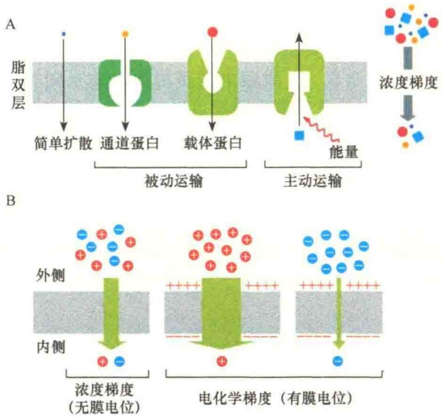
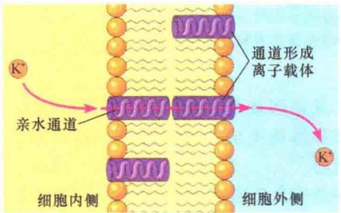
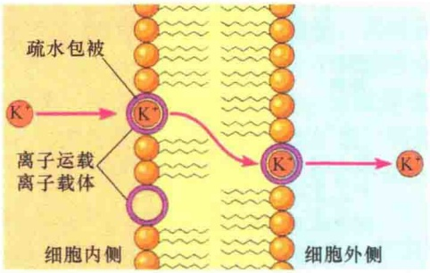
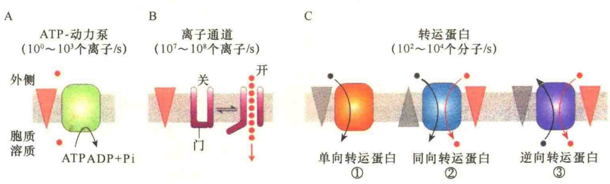
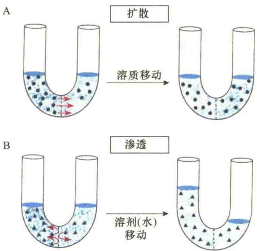
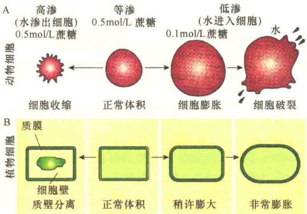
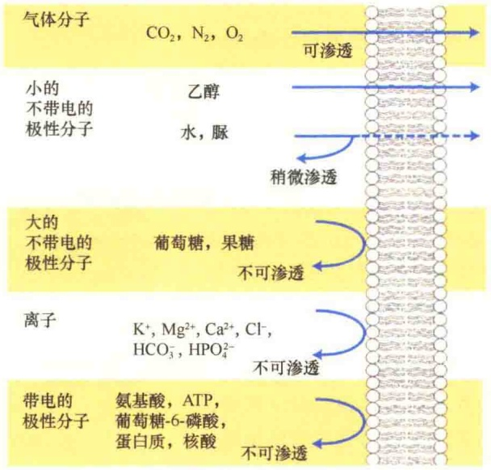
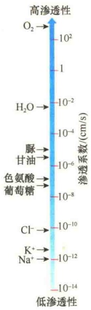

## 3.5 物质的穿膜运输

细胞质膜对细胞的生命活动起保护作用，为细胞的生命活动提供相对稳定的环境，这是细胞质膜最基本的功能。由于细胞的生命活动是特殊的分子运动，细胞内有些物质或离子的浓度特别高，这就要求细胞质膜不仅仅作为物质出入细胞的屏障，还要具有调控分子和离子通过的能力。换句话说，细胞质膜必须具有选择性地进行物质穿膜运输、调节细胞内外物质和离子平衡及渗透压平衡的能力，这就是细胞质膜的半通透性。

## 3.5.1 质膜物质运输概述

各种细胞及细胞内的膜性细胞器最基本的特点是能够维持不同的物质浓度，完成不同的生命活动。这些物质中有些是生物大分子，有些则是离子。细胞维持物质的不同浓度有双重作用:一方面，它要保持细胞代谢物的稳定，不让它们随意渗漏到周围环境中；另一方面，又要能够进行必要的物质交换，包括代谢物的排除和分泌及营养物质的吸收。

## 3.5.1.1 物质运输的范畴

细胞进行的物质运输分为三种不同的范畴。

1）细胞运输（cellular transport） 这种运输主要是细胞与环境间的物质交换，包括细胞对营养物质的吸收、原材料的摄取、代谢废物的排除及产物的分泌。例如，细胞从血液中吸收葡萄糖，细胞质膜上的离子泵将  $Na^{+}$  泵出、将  $K^{+}$  泵入，都属于这种运输范畴。细胞运输主要是通过细胞质膜进行的运输，又称为膜运输（membrane transport）。

2）胞内运输（intracellular transport）这是真核生物细胞内膜性细胞器与细胞内环境进行的物质交换，包括细胞核、线粒体、叶绿体、溶酶体、过氧化物酶体、高尔基体和内质网等与细胞内的物质交换。胞内运输主要是通过细胞内的膜泡进行的运输，故此称为细胞内膜运输（intracellular membrane traffic）。

3）转细胞运输（transcellular transport）这种运输不仅仅是物质进出细胞，而是从细胞的一侧进入，从另一侧出去，实际上是穿越细胞的运输。在多细胞生物中，整个细胞层作为半透性的障碍，而不仅仅是细胞质膜。例如，植物的根部细胞负责吸收水分和矿物质，然后将它们运输到其他组织即是这种运输。

## 3.5.1.2 膜运输的类型:被动运输与主动运输

膜是溶质自由出入细胞的重要屏障，这种屏障作用对于细胞的功能而言既是必需的，但有时又是不利的，必须克服。

根据运输时对化学能的需求，将溶质的穿膜运输分为两大类:被动运输（passive transport）和主动运输（active transport），图 3-39 显示了这两种运输的主要特点。

图 3-39 膜运输的不同形式(引自 Alberts et al., 2015)。A. 被动运输是顺浓度梯度自动进行的运输，或是由通道蛋白、转运蛋白介导，其特点是倾向于细胞内、外物质浓度的平衡，这种运输不消耗化学能。主动运输则需要代谢能，通常由称之为泵的转运蛋白介导，并且是逆浓度梯度或电化学梯度进行的物质运输，其结果是建立细胞两侧的浓度梯度或电化学梯度。B. 电化学梯度会影响膜的物质运输。电化学梯度包括膜电位及溶质的浓度梯度，电化学梯度提高了离子穿膜运输的动力。

被动运输倾向于将溶解的分子依靠扩散从高浓度区流向低浓度区，不消耗 ATP。主动运输需要消耗 ATP，因为通过这种方式运输的通常是极性分子和大分子，或是将物质从低浓度区向高浓度区运输，最后建立新的浓度梯度。

在被动运输中，虽然有些分子由于分子小或非极性可以自由扩散通过脂双层，但是大多数被动运输都需要膜蛋白的帮助。帮助被动运输的膜蛋白主要是穿膜蛋白，根据它们作用方式的不同可分为两种类型:通道蛋白和载体蛋白。通道蛋白帮助被动运输时不需要与被运输的分子结合，只是提供一个亲水的通道；而载体蛋白需要与被运输的分子结合，然后帮助被运输的分子通过膜。这两种膜蛋白在促进扩散时都不需要消耗 ATP，也不能将物质从低浓度区运向高浓度区。

与被动运输不同的是，主动运输都是由特殊的膜蛋白帮助的，这些膜蛋白被称为泵（pump），实际上是一些酶蛋白，它们能够水解 ATP，然后利用 ATP 水解释放的能量驱动物质进行逆浓度梯度的运输。

## 3.5.1.3 离子载体

人们对自然状态下膜转运蛋白（membrane transport protein）参与膜运输的认识主要来自对离子载体（ionophore）的应用。

所谓离子载体，是一些能够极大提高膜对某些离子通透性的物质。大多数离子载体是细菌产生的抗生素，它们能够杀死某些微生物，其作用机制就是提高了靶细胞膜通透性，使得靶细胞无法维持细胞内离子的正常浓度梯度而死亡。根据改变离子通透性的机制不同，将离子载体分为两种类型:通道形成离子载体（channel-forming ionophore）和离子运载离子载体（ion-carrying ionophore）。

1）通道形成离子载体 短杆菌肽A（gramicidin A）是一种通道形成离子载体，它是由15个氨基酸组成的线性肽，其中8个是L-氨基酸、7个是D-氨基酸。它具有疏水的侧链，两个短杆菌肽A分子在一起形成穿膜的通道，能够有选择地将单价阳离子顺电化学梯度通过膜（图3-40），不过它并不显著提高运输速度。可被短杆菌肽A离子通道运输的阳离子有:$\mathrm{H}^{+} > \mathrm{NH}_{4}^{+} > \mathrm{K}^{+} > \mathrm{Na}^{+} > \mathrm{Li}^{+}$。

图 3-40 通道形成离子载体的作用机制（引自 Becker et al., 1996）。

2）离子运载离子载体 缬氨霉素（valinomycin）是一种离子运载离子载体，它是由12个氨基酸组成的环形小肽，也是一种脂溶性的抗生素。将缬氨霉素插入脂质体后，通过环的疏水面与脂双层相连，极性的内部能精确地固定 $K^{+}$ 。它在一侧结合  $K^{+}$ ，然后向内侧移动通过脂双层，将  $K^{+}$  释放到细胞外侧，降低了细胞内  $K^{+}$  的浓度梯度（图 3-41）。

图 3-41 离子运载离子载体的作用机制（引自 Becker et al., 1996）

从上面介绍的两个离子载体的例子可以得到两个基本结论:①膜转运蛋白具有选择性；②膜转运蛋白通过两种机制进行物质运输，一是形成水性通道，二是与被运输的物质结合，以扩散的方式穿膜，即可移动载体（mobile carrier）的运输。

## 3.5.1.4 参与分子及离子穿膜转运的三类主要膜蛋白

由于质膜是半透性的，大多数物质都不能自由穿过，即使能够通过扩散进入细胞的一些小分子也难以快速通过。因此，多数物质，即使是自由扩散系数高的脲、脂肪酸，以及某些气体（如  $CO_{2}$ 、 $NH_{3}$  等）都需要特定蛋白质的帮助才能快速通过质膜。根据膜蛋白参与协助物质穿过质膜的方式不同，可分为以下三种类型（图 3-42）。

1）ATP 动力泵（ATP-powered pump） 这种运输与化学反应相偶联，通过水解 ATP 获得能量驱动小分子或离子逆浓度梯度或电势或电化学梯度运输，所以 ATP 动力泵介导的是主动运输。

2）通道（channel）蛋白 能够将水、特异的离子或亲水的小分子运输通过膜，这种运输是顺浓度梯度或顺电位梯度，是不需要化学能的运输，但需要通道蛋白，因此称为被动运输（passive transport）或促进扩散（facilitated diffusion）。有些通道是敞开的，称为无门控通道（nongated channel）。但是，大多数通道都是在有化学或电信号时才会打开，称为门控通道（gated channel）。

3）转运蛋白（transporter） 可运输各种离子或分子穿过细胞质膜，但运输的速率要比通道蛋白低。已经鉴定了三类不同的转运蛋白:①单向转运蛋白（uniporter），仅运输一种类型的分子顺浓度梯度穿过细胞质膜，葡萄糖与氨基酸就是借助于单向转运蛋白进入细胞的。通道蛋白与单向转运蛋白都属于促进转运蛋白。②同向转运蛋白（symporter）和③逆向转运蛋白（antiporter）都是离子或分子偶联的运输。在偶联运输的两个离子或分子中，一个是顺浓度梯度运输，另一个则是逆浓度运输梯度运输。同向转运是偶联的两个分子朝同一个方向，逆向转运则是偶联的两个离子或分子背向而行。偶联运输也是一种耗能的运输，只不过不是直接水解 ATP，而是利用另一个主动运输的“余热”。

图 3-42 参与分子及离子穿膜转运的三类主要膜蛋白的作用方式（引自 Lodish et al., 2013）。膜中三角形表示浓度的高低。A. ATP 动力泵:使用 ATP 水解释放的能量，驱动离子或小分子逆电化学梯度运输。B. 离子通道:允许特异的离子（或水）顺电化学梯度运输。C. 转运蛋白:有三种不同类型的转运蛋白促进特异的小分子或离子移动。①单向转运蛋白，促进分子顺浓度梯度运输。②同向协同运输，两个不同的分子或离子借助于转运蛋白顺浓度梯度朝同一方向运输。③逆向协同运输，一个分子需要催化进行逆浓度梯度运输，另一个则是顺浓度梯度运输。

## 3.5.2 被动运输

非电解质通过扩散跨过细胞质膜进入细胞必须具备两个条件:第一，该物质在细胞外的浓度很高；第二，细胞质膜必须对这种物质具有通透性。膜对某种溶质具有透性，必须满足两个条件之一:溶质自身能够直接穿过脂双层，或是质膜中有可允许该溶质通过的穿膜孔道。

## 3.5.2.1 扩散与渗透

细胞质膜具有两个基本的特性:允许小分子物质通过扩散（diffusion）穿过细胞质膜；可以让水通过渗透（osmosis）通过细胞质膜。但是扩散和渗透在概念上是不同的（图 3-43）。

扩散是指物质沿着浓度梯度从半透性膜浓度高的一侧向浓度低的一侧移动的过程，通常把这种过程称为简单扩散。这种移动方式是单个分子的随机运动，无论开始的浓度有多高，扩散的结果是两边的浓度达到平衡。虽然这种移动不需要消耗化学能，主要是依靠扩散物质自身的力量，但从热力学角度考虑，它利用的是自由能。如果改变膜两侧的条件，如加热或加压，就有可能改变物质的流动方向，其原因就是改变了自由能。所以，严格地说，扩散是物质从自由能高的一侧向自由能低的一侧流动。

图 3-43 简单扩散和渗透的比较（引自 Kleinsmith and Kish, 1995）。A. 在简单扩散中，膜允许溶质透过，溶质从浓度高的一侧移向浓度低的一侧，当达到平衡时，两侧的浓度相等。B. 在渗透中，膜不允许溶质透过，但是水（溶剂）能够从溶质浓度低的一侧向溶质浓度高的一侧渗透，当达到平衡时，两侧溶质的浓度是相等的，但含有过多水分的一侧具有较高水压。

渗透的含义则是指水分子及溶剂通过半透性膜的渗透。水的渗透同样是从自由能高的部位向自由能低的部位移动，如果考虑到溶质的话，水是从溶质浓度低的地方向溶质浓度高的地方流动。

细胞的渗透现象能够很好地解释生物学上的一个熟知现象:细胞在不同浓度的溶液中会发生膨胀（swell）或收缩（shrink）。实际上这种现象取决于溶液中的溶质和细胞中该物质的浓度（图3-44）。

正是根据水与水中溶质在膜通透性上的差别，才将膜称为半透性的（semipermeable）。当两种不同浓度的溶液被半透性的膜分隔开后，高溶质浓度的一侧是高渗的（hypertonic），而低溶质浓度的一侧则是低渗的（hypoosmotic），若两侧的溶质浓度相等则称为等渗的（isoosmotic）。

图 3-44 动物细胞和植物细胞在不同浓度蔗糖溶液中的行为（引自 Kleinsmith and Kish，1995）。A. 当将动物细胞置于高渗溶液中，水则会从细胞中渗出，细胞发生收缩；在低渗溶液中，细胞会吸水膨胀和破裂。B. 当将植物细胞置于高渗溶液中，细胞脱水发生质壁分离（plasmolysis）；若是低渗溶液，植物的细胞壁保护细胞防止膨胀破裂，此时由于水的进入，细胞内的压力升高，使细胞变得坚硬。

## 3.5.2.2 被动运输:简单扩散及限制因素

简单扩散（simple diffusion）是被动运输的基本方式，不需要膜蛋白的帮助，也不消耗 ATP，只靠膜两侧保持一定的浓度差，通过扩散发生的物质运输。气体分子

实验，并测量它们的扩散速率，最后得出结论:细胞质膜的通透性具有选择性。他发现物质的脂溶性（在油/水中的分配系数）越强，越容易通过质膜。

20 世纪 30 年代，Collander 的实验室进行了另外一些实验研究细胞质膜的通透性，发现分子本身的大小也是十分重要的。有些分子的脂溶性高，但是分子大，扩散的速率就很慢，只有那些分子质量小、脂溶性高的分子才能快速扩散。根据实验结果，还推测质膜的通透性孔径不会大于 0.5～1.0nm，能够扩散的最大的生活物质是水分子。

物质的带电性也是限制扩散的一个主要因素。带电的物质通常与水结合形成一个水合的外壳，这不仅增加了它们的分子体积，同时也大大降低了脂溶性。因此，所有带电荷的分子（离子），不管它多小，都是不能自由扩散的。

一般说来，气体分子（如  $O_{2}$ 、 $CO_{2}$ 、 $N_{2}$ ）、小的不带电的极性分子（如脲、乙醇）、脂溶性的分子等易通过质膜，大的不带电的极性分子（如葡萄糖）和各种带电的极性分子都难以通过质膜（图 3-45）。

## 3.5.2.3 被动运输:促进扩散及特点

由于细胞质膜具有选择性通透作用，使一些脂溶性和小分子较为容易进入细胞，但是限制了一些大的和带电荷的物质进入细胞，而这些物质通常是细胞生命活动所必需的。一般而言，大分子、非脂溶性的物质和带电荷的物质只要有足够的时间，都可通过扩散进入细胞，但由于它们的扩散系数低，

细胞质膜的这种被动运输方式并非对任何物质都是适合的，它具有一定的限制，限制因素是物质的脂溶性、分子大小和带电性。

19 世纪末，Overton 根据植物细胞的质壁分离现象做了一系列的实验，研究不同的物质对细胞质膜的通透性。例如，将植物细胞放在高浓度的蔗糖溶液中，很快就可以在显微镜下观察到质壁分离，但是将蔗糖溶液换成浓的乙醇溶液，则看不到质壁分离，据此推测，乙醇能够快速扩散进入细胞内，直到细胞内外平衡。后来用含有不同物质的浓溶液重复这一

图 3-45 不同分子对人工磷脂双层膜的通透性（引自 Lodish et al., 2013）。气体、小的疏水分子和小的不带电的极性分子能够透过人工膜；水是稍微通透的，离子和大的不带电的极性分子不能通过膜。

