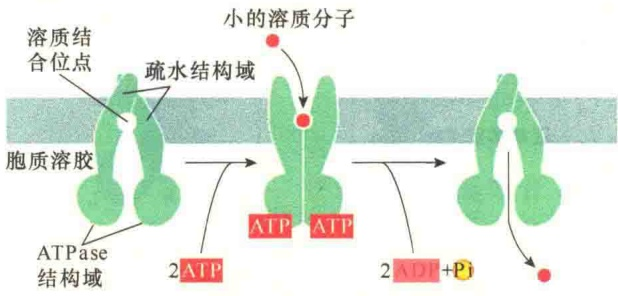
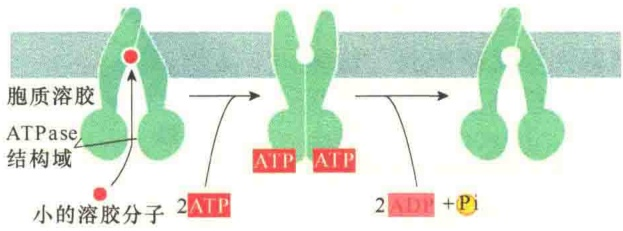
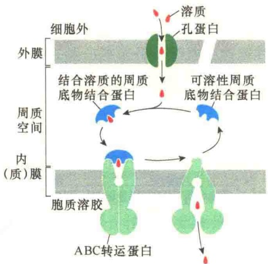
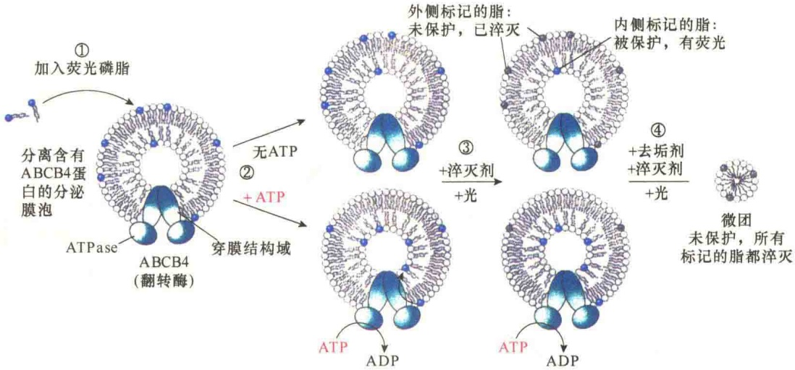
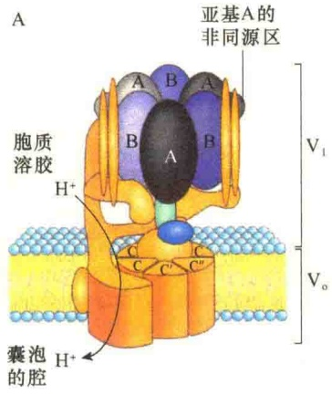
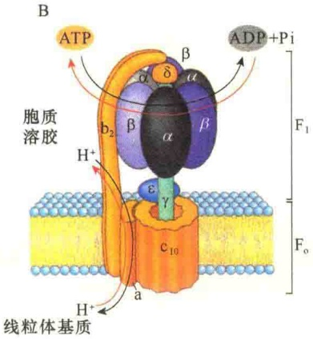
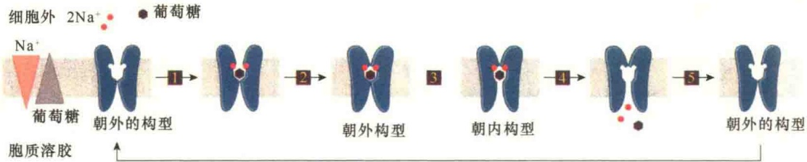
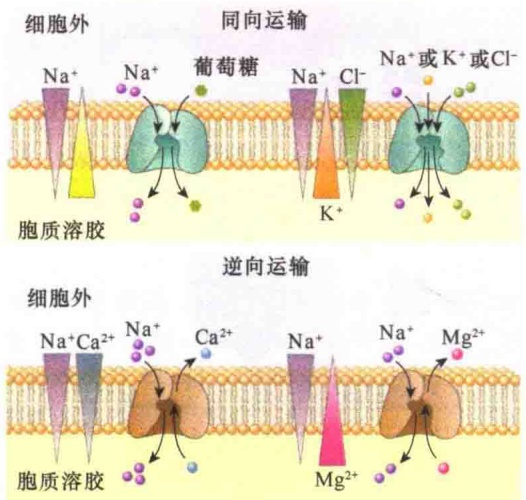
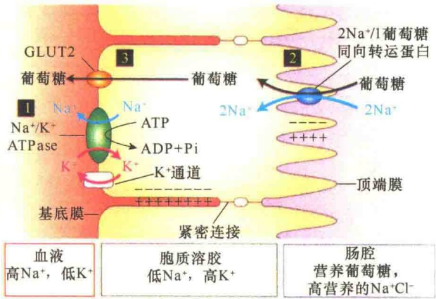
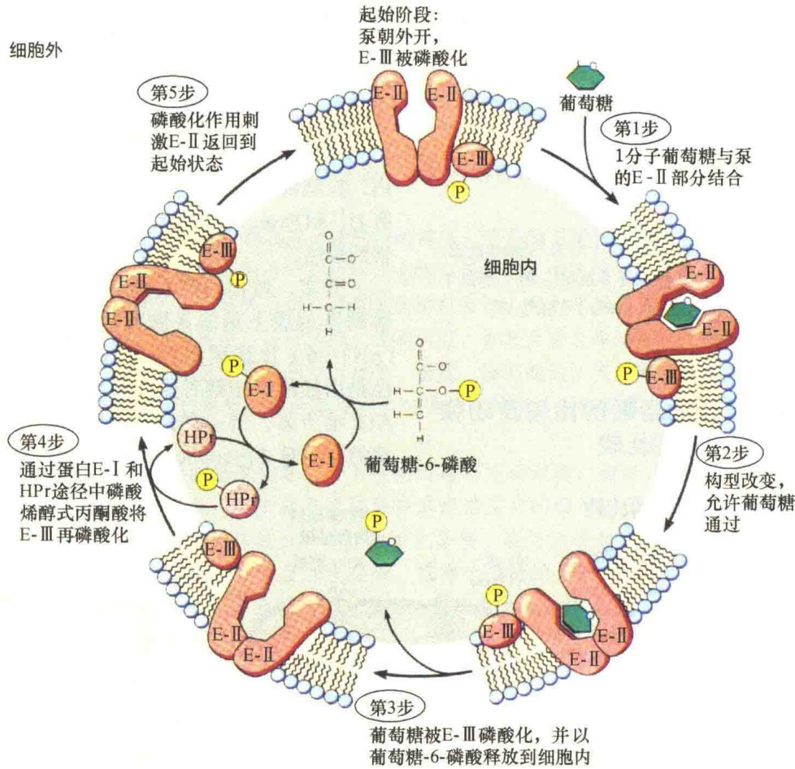

屠呦呦作为发现青蒿素第一人获得2015年诺贝尔生理学或医学奖。

在大多数脊椎动物细胞的内质网膜中也有 ABC 转运蛋白，将此类蛋白质称为抗原加工相关转运蛋白（transporter associated with antigen processing, TAP）。它们的作用是将细胞质中由蛋白酶体降解的一些不同大小的肽段转运到内质网，经膜泡转运到细胞表面，供毒性 T 淋巴细胞进行安全识别。如果这些肽是来自外来感染的病毒或细菌细胞，则会将该细胞杀灭。

ABC 转运蛋白与人的健康有密切的关系，表 3-10 列出了几种人体中发现及鉴定的某些 ABC 转运蛋白。

表 3-10 几种人体中鉴定的 ABC 转运蛋白

| ABC转运蛋白 | 组织表达 | 功能 | 突变后引起的相关疾病 |
| --- | --- | --- | --- |
| ABCB1(MDR1) | 肾上腺,肾,脑 | 输出脂溶性药物 |  |
| ABCB4(MDR2) | 肝 | 将磷脂酰胆碱运入胆汁 |  |
| ABCB11 | 肝 | 将胆盐运入胆汁 |  |
| CFTR | 外分泌组织 | 运输氯离子 | 囊性纤维化 |
| ABCD1 | 过氧化物酶体膜中广泛存在 | 影响氧化特长链脂肪酸氧化酶的活性 | 肾上腺脑白质营养不良 |
| ABCG5/8 | 肝,肠 | 输出胆固醇及其他固醇 | β-谷固醇血症 |
| ABCA1 | 广泛存在 | 输出胆固醇及磷脂,使之进入高密度脂蛋白(HDL) | Tangier病* |

\* 一种类固醇转运病，血清中缺乏HDL，由染色体9q31上ABC1基因突变所引起。

从作用机制看，原核生物与真核生物的 ABC 转运蛋白基本相似:都需要结合两个 ATP，并将 ATP 水解获取能量，驱动物质转运；但与 P 型泵不同，不需要磷酸化（图 3-56）。

在革兰氏阳性细菌的内膜中也有 ABC 转运蛋白的存在，其功能是协助进行物质转运（图 3-57）。

某些 ABC 转运蛋白具有翻转酶的作用。通过基因工程技术克隆了 ABCB4 蛋白（也称 MDR2），该蛋白质存在于肝细胞的质膜中。通过体外实验，证明该蛋白质起翻转酶作用，能够将磷脂从脂质体膜的外叶翻转到内叶（图 3-58）。

## 3.5.3.6 V型泵与F型泵的作用机制

V型ATPase是ATP驱动的转运质子的一类图 3-56 ABC 转运蛋白进行的小分子的运输（引自 Alberts et al., 2015）。A. 细菌 ABC 转运蛋白。在静息状态下，两个穿膜结构域的细胞外侧端是靠在一起的，从而封闭了物质流入的通路，当两个细胞质侧的 ATP 结合结构域各结合一个 ATP 分子，外侧端打开，小的水溶性分子与 ABC 转运蛋白的水溶性位点结合，此时两个 ATP 结合结构域相互靠近，使得被结合的分子无法进入细胞；ATP 水解，并驱动细胞质面的两个 ATP 结合结构域相互离开，从而将被转运的分子释放到细胞内，这一机制有利于细菌从环境中吸收营养。B. 真核细胞中的 ABC 转运蛋白，机制与细菌的相似，只不过显示的是将细胞内的物质运向细胞外，这也是癌细胞多抗药性的原因。

A. 细菌ABC转运蛋白

B. 真核细胞ABC转运蛋白

图 3-57 双层膜细菌中 ABC 转运蛋白的辅助运输作用（引自 Alberts et al., 2015）。水溶性的物质通过扩散穿过外膜中孔蛋白的孔，然后在周质空间与游离的水溶性周质空间蛋白结合，并将其转移到内膜的 ABC 转运蛋白，与内膜 ABC 转运蛋白结合后被泵入细胞质。

图 3-58 ABCB4 蛋白磷脂翻转酶活性的荧光淬灭分析（引自 Lodish et al., 2013）。①合成含有 ABCB4 蛋白的人工膜泡，并含有荧光标记了头部的磷脂，内外侧均有标记的磷脂；②样品分成两组，一组加入 ATP，另一组不加 ATP；③两组样品均用光进行照射，如果 ABCB4 蛋白具有翻转酶的活性，添加了 ATP 的样品的膜内侧的荧光增强，而未加 ATP 的样品内侧的荧光保持不变；④用去垢剂处理，使膜泡解体，继续进行光淬灭，荧光消失。

ATPase，所有的 V 型 ATPase 都是仅运输  $H^{+}$ ，其作用是使一些生物细胞内的膜泡区室建立酸性环境，“V” 是英文 vacuole 或 vesicle（液泡）的首字母。这种类型的质子泵可将真菌、植物细胞中液泡内的环境维持在 pH3～6，显然低于胞质溶胶（pH7.0）的酸碱度。在动物细胞中，V 型 ATPase 可在溶酶体、内体、高尔基体及一些分泌泡内建立酸性环境。各种 V 型 ATPase 都有类似的复合结构:有一个穿膜结构域  $(V_{0})$ ，起质子通道的作用；一个外周结构域  $(V_{1}), V_{1}$  中有 ATP 结合位点，并具有 ATP 酶的活性（图 3-59A）。

F型ATPase是位于线粒体内膜及叶绿体的类囊体膜上的ATP酶，既可以水解ATP驱动质子由低向高处流，又可以利用质子的电化学梯度合成ATP。“F”是能量偶联因子（energy-coupling factor）的factor的首字母。F型ATPase由两部分组成（图3-59B）:$\mathrm{F_0}$ 是整合膜蛋白，此处的“o”是该蛋白质受药物寡霉素（oligomycin）抑制而得名。$\mathrm{F_1}$ 是外周蛋白，“1”意指该蛋白质是线粒体中分离的若干与能量偶联的因子中的第一个因子。线粒体中的F型ATPase简写为 $\mathrm{F_0F_1}$ ATPase，将叶绿体中的F型ATPase简写为 $\mathrm{CF_0CF_1}$ ATPase。

F型ATPase本身属水解酶，但是能够催化两个方向的反应，既能合成ATP，又能水解ATP，就看处于何种环境中。在线粒体的内膜上，由于处于强大的 $\mathrm{H^{+}}$ 质子梯度环境中，可驱动ATP合成。所以在线粒体的氧化磷酸化反应中，$\mathrm{F_0F_1}$ -ATPase的主要功能就是合成ATP，属于ATP合酶（ATP synthase）。

图3-59 V型泵与F型泵（引自Nelson and Cox，2013）。A. $\mathrm{H^{+}}$-ATPase利用ATP，将细胞质中的 $\mathrm{H^{+}}$ 泵入液泡与溶酶体，创造低的内部pH环境，它有一个整合的膜蛋白复合物（$\mathrm{V_o}$），$\mathrm{V_o}$ 含有多个相同的C亚基及一个伸向细胞质的外周蛋白复合物（$\mathrm{V_1}$），在 $\mathrm{V_13}$ 个相同的B亚基上有ATP酶的活性位点。B. 线粒体 $\mathrm{F_oF_1}$ ATPase/ATP合酶有一个整合在膜中的结构域 $\mathrm{F_o}$，具有多个拷贝的C亚基，以及一个外周结构域 $\mathrm{F_1}$，该结构域含有3个α亚基、3个β亚基、1个δ亚基、1个ε亚基及1个中央轴γ。

## 3.5.3.7 协同转运

协同转运（cotransport）又称偶联运输，它不直接消耗 ATP，但要依赖离子泵建立的离子梯度。

动物细胞中，质膜上的钠钾泵和载体蛋白协同完成葡萄糖、氨基酸等的逆浓度梯度的协同转运。转运的机制是:载体蛋白有两个结合位点，可分别与细胞外的  $Na^{+}$  、糖（氨基酸）等结合， $Na^{+}$  和葡萄糖分别与载体结合后，载体蛋白借助

$Na^{+}/K^{+}$ 泵运输时建立的电位梯度，将 $Na^{+}$ 与葡萄糖（或氨基酸）同时运输到细胞内，在细胞内释放的 $Na^{+}$ 又被 $Na^{+}/K^{+}$ 泵输出细胞外维持 $Na^{+}$ 的电位梯度。

有一种同向协同运输  $Na^{+}$ 与葡萄糖的转运蛋白，称为  $2\ Na^{+}/1$  葡萄糖同向转运蛋白（two  $Na^{+}/one\ glucose\ symporter$ ），可一次向细胞内同时运输 2 个  $Na^{+}$ 和 1 个葡萄糖，能够维持细胞内极高的葡萄糖浓度（图 3-60）。

图 3-60  $2Na^{+}/1$  葡萄糖同向转运蛋白的工作原理示意图（引自 Lodish et al., 2013）。 $2Na^{+}/1$  葡萄糖同时与外向开放的各位点结合引起转运蛋白的构型发生变化，导致转运蛋白朝内开放，从而向细胞质释放了  $2Na^{+}/1$  葡萄糖，此后又恢复原有的构型。

实际上， $Na^{+}/K^{+}$ 也是一种协同运输，属于逆向协同。通过 $Na^{+}/K^{+}$ 泵在细胞两侧建立了 $Na^{+}/K^{+}$ 的梯度，这种浓度梯度的势能促进了一些 $Na^{+}$ 依赖的协同运输（图3-61），这也是细胞合理利用ATP、最大化节约能源的明智之举。

图 3-61 某些  $Na^{+}$  依赖的协同运输（引自 Plopper，2016）。 $Na^{+}/K^{+}$  建立的细胞外的  $Na^{+}$  梯度能够驱动葡萄糖、 $Cl^{-}$ 、 $K^{+}$ 、 $Ca^{2+}$ 、 $Mg^{2+}$  的协同运输。

关于细胞的主动运输有两种说法:一种说法是直接主动运输（direct active transport）和间接主动运输（indirect active transport）；另一种说法是初级主动运输（primary active transport）和次级主动运输（secondary active transport）。这两种说法都是将主动运输分为两类:与 ATP 水解偶联的为直接（初级）主动运输；间接利用 ATP 的为间接（次级）主动运输。

## 3.5.3.8 穿细胞运输

穿细胞运输（transcellular transport）是指某些类型的分子与离子穿过极性细胞的运输。所谓极性细胞是指不对称的细胞，即有不同的两个侧面，在细胞质膜上存在生化活性不同的区域。研究较为深入的极性细胞就是一些组织的上皮细胞。例如，肠上皮细胞的细胞质膜有两个不同的区域:朝向组织外侧的部分称为顶端（apical），朝向内侧的称为基底面（basal surface），基底面朝向肠的内侧。肠细胞之所以能够组成两个不同的区域，是因为紧密连接（tight junction）的作用（详见第4章），阻止了物质从该侧进入细胞（图3-62）。

## 3.5.3.9 细菌中的主动运输

在细菌中发现一些特殊的主动运输方式，如磷酸化转运、细菌视紫红质质子泵等，这两种运输方式的能量来源是不同的。

1）磷酸化运输 磷酸化运输（phosphorylating transport）方式最早发现于细菌中，后来在动物细胞中也发现有类似的穿膜运输方式，又称为基团转运。其机制是通过对被转运到细胞内的分子进行共价修饰（主要是进行磷酸化）使其在细胞中始终维持“较低”的浓度，从而保证这种物质不断地沿浓度梯度从细胞外向细胞内转运。在这种运输系统中，涉及几种酶和一个被称为HPr（histidine-containing phosphocarrier protein）的小分子蛋白质；被转移的基团是磷酸烯醇式丙酮酸的高能磷酸键上的磷酸基团，运输中所需要的能量则由磷酸烯醇式丙酮酸的高能磷酸键提供。在细菌细胞中，这种运输作用主要是进行一些糖的运输，如乳糖、葡萄糖、甘露醇等（图3-63）。

图 3-62 葡萄糖通过穿细胞运输由肠腔进入血液（引自 Lodish et al., 2013）。①细胞质膜的  $Na^{+}/K^{+}$  泵建立  $Na^{+}$ 、 $K^{+}$ 浓度梯度；②  $K^{+}$  通过非门控通道向外侧流动，建立细胞内的负电位， $Na^{+}$ 的浓度梯度与膜电势促成了  $2Na^{+}/1$  葡萄糖向细胞内的同向协同转运；③ 进入细胞质的葡萄糖经由基底膜的 GLUT2 单向转运蛋白，被运输到血液中。

在该运输方式中，首先将供体磷酸烯醇式丙酮酸的磷酸基团转移到细胞质的酶Ⅰ（E-I），然后将磷酸基团转移给HPr蛋白，起始步骤对于各种糖的运输都是相同的。第二步要根据被运输的糖而定，如运输的是葡萄糖，HPr蛋白要将磷酸基团转给酶Ⅲ（E-Ⅲ），再转给位于质膜中的酶Ⅱ（E-Ⅱ），但对于甘露糖的转运则不需E-Ⅲ的参与，可直接

图 3-63 细菌细胞中糖的磷酸化运输（引自 Becker et al., 1996）。

将磷酸基团转给位于质膜中的 E-Ⅱ；最后由 E-Ⅱ 将磷酸基团转给被运输的糖。E-Ⅱ 和 E-Ⅲ 对于不同的糖具有特异性。该运输方式中，被转运进入细胞中的糖浓度，从形式上看没有提高，但实质上是提高了，只不过通过磷酸化作用进行了修饰，造成一种没有提高的假象。这一机制虽然是“瞒天过海”，但确实是一种求生存的智慧！

2）细菌视紫红质质子泵 嗜盐的厌氧菌