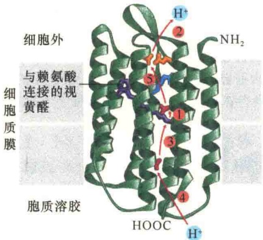
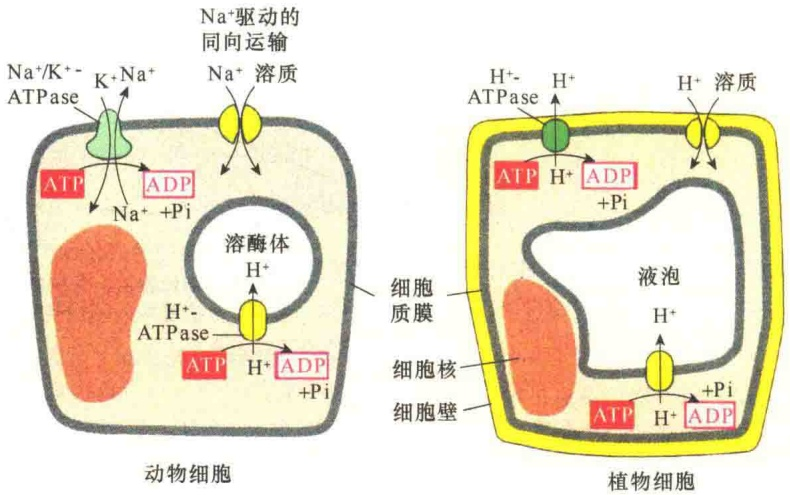
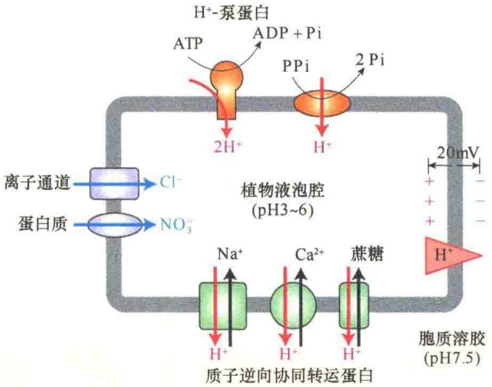

Halobacterium halobium 生活在阳光充足的盐水池中。在进化过程中，这种菌的细胞质膜上出现了多种能被光线激活的蛋白质，“紫膜”（purple membrane）是该菌质膜上一些特化的区域（斑块），上面只含一种蛋白质，就是细菌视紫红质（bacteriorhodopsin）。该蛋白质含有7个α螺旋，每个螺旋长3\~4nm，在蛋白质的中部有几个能够吸收光的视黄醛基团，又称发色基团；该基团吸收光时，能引起整个分子的构型发生变化，导致H⁺从细胞内运送到细胞外（图3-64），结果造成了细胞内外的质子浓度差，这种浓度梯度可被另一种膜蛋白用于ATP的合成。实际上细菌视紫红质是一种质子泵，在该系统中，H⁺的运输由光提供能量。

图 3-64 细菌视紫红质分子的三维结构（引自 Alberts et al., 2015）。以  $\alpha$  螺旋 7 次穿膜的视紫红质多肽链。图中标出了发色团所在的部位及光激活引起  $H^{+}$ 循环的可能途径。

## 3.5.4 主动运输与被动运输的比较及动物与植物主动运输的比较

表 3-11 不同运输机制的主要特性

| 性质 | 简单扩散 | 促进扩散 | 主动运输 |
| --- | --- | --- | --- |
| 参与运输的膜成分 | 脂 | 蛋白质 | 蛋白质 |
| 被运输的物质是否需要结合 | 否 | 否/是 | 是 |
| 能量来源 | 浓度梯度 | 浓度梯度 | ATP水解或浓度梯度 |
| 运输方向 | 顺浓度梯度 | 顺浓度梯度 | 逆浓度梯度 |
| 特异性 | 无 | 有 | 有 |
| 运输的分子高浓度时的饱和性 | 无 | 有 | 有 |

## 3.5.4.2 动物细胞与植物细胞主动运输的比较

动物细胞和植物细胞不仅结构有所差别，载体蛋白也有所不同（图3-65）。动物细胞质膜上有 $\mathrm{Na^{+}/K^{+}-ATPase}$，并通过对 $\mathrm{Na^{+}}$、$\mathrm{K^{+}}$ 的运输建立细胞的电化学梯度；但在植物细胞（包括细菌细胞）的质膜中没有 $\mathrm{Na^{+}/K^{+}-ATPase}$，代之的是 $\mathrm{H^{+}-ATPase}$，并通过对 $\mathrm{H^{+}}$ 的运输建立细胞的电化学梯度，使细胞外 $\mathrm{H^{+}}$ 的浓度比细胞内的高；与此同时，$\mathrm{H^{+}}$ 泵在周围环境中创建了酸性 $\mathrm{pH}$，然后通过 $\mathrm{H^{+}}$ 质子梯度驱动的同向运输，将糖和氨基酸等输入植物的细胞内。在动物细胞溶酶体膜和植物细胞的液泡膜上都有 $\mathrm{H^{+}-ATPase}$，它们的作用都一样，保持这些细胞器的酸性。

其实，植物的液泡膜上的运输系统远比动物溶酶体的膜上运输系统复杂。植物液泡中的pH（pH3～6）比胞质溶胶低（pH7.5），液泡中的酸性是由液泡膜中两种质子泵维持的，一种是V型ATP动力泵，另一种是植物细胞特有的焦磷酸驱动的质子泵（pyrophosphate-powered proton），这两

## 3.5.4.1 主动运输与被动运输的比较

细胞质膜中进行的被动运输与主动运输的方式各样，机制也各不相同，概括起来，对那些不带电的小分子可以通过简单扩散的方式透过细胞质膜直接进入细胞，如乙醇、二氧化碳和氧。其他的物质大多数都可以在通道蛋白或载体蛋白的帮助下进入细胞。被动运输都是顺浓度梯度运输，并且不需要消耗自由能以外的能量。在主动运输中能够逆化学梯度进行运输，但这需要消耗能量，并且需要载体蛋白。现将物质主要运输方式列于表3-11。

图 3-65 动植物细胞载体介导的物质运输的相似与差异（引自 Alberts et al., 1998）。

种泵都是将  $H^{+}$ 逆浓度梯度运入液泡中。液泡膜中还含有  $Cl^{-}$ 、 $NO_{3}^{-}$ 两种通道蛋白，可将细胞质中的  $Cl^{-}$ 、 $NO_{3}^{-}$ 运入液泡。此外，液泡膜中还有逆向协同转运蛋白利用液泡膜  $H^{+}$ 泵产生的  $H^{+}$ 势能驱动液泡膜中的  $Na^{+}$ 、 $Ca^{2+}$ 、蔗糖等通过逆向协同转运到液泡中（图3-66）。

植物细胞液泡对离子及蔗糖的富集具有重要的生理意义。例如，在植物的叶中，液泡通过 $H^{+}$ 泵建立的电化学梯度，驱动 $H^{+}/$ 蔗糖的逆向转运，使得液泡在白天将叶绿体光合作用合成的多余蔗糖储存在液泡中，夜间再将这些蔗糖运到细胞质用于代谢，生成 $CO_{2}$ 、 $H_{2}O$ ，同时合成ATP。

图 3-66 植物液泡中离子与蔗糖的富集（引自 Lodish et al., 2013）。

## 本章小结

细胞质膜是细胞的基本结构，生物膜具有界膜和区室化、调节运输、功能定位和组织化、信号检测与传递、能量转换等功能。

红细胞结构简单，是研究膜结构的最好材料。红细胞质膜内侧有膜蛋白和纤维蛋白组成的皮质骨架，它参与维持细胞质膜的形状并协助质膜完成多种生理功能。

细胞质膜的主要成分是膜脂、膜蛋白、膜糖三大类。磷脂、鞘磷脂、胆固醇是主要的膜脂，具有双亲媒性。根据膜蛋白的存在方式可分为整合蛋白、外周蛋白、脂锚定蛋白。细胞质膜的生物学功能主要是由膜蛋白来执行的；可以采用离子型和非离子型的去垢剂来分离膜蛋白。膜糖一般以糖脂或糖蛋白的形式存在于质膜的外表面。

流动镶嵌模型是目前被广泛接受的细胞质膜的结构模型，它强调了膜的不对称性和流动性。膜脂、膜蛋白及膜糖分布的不对称性导致了膜功能的不对称性和方向性，保证了生命活动的高度有序性。流动性包括膜脂的侧向扩散、旋转运动、屈伸运动、翻转运动和膜蛋白的随机移动、定向移动、局部移动等，膜的流动性与细胞质膜的酶活性、物质运输、信号转导、能量转换、细胞周期、发育及衰老等过程有很大关系。可以通过人鼠细胞融合实验、荧光漂白后恢复等技术研究膜的流动性。温度、脂肪酸链长度、不饱和程度、胆固醇含量、卵磷脂和鞘磷脂的比值及影响膜蛋白运动的因素都能够影响膜的流动性。细胞质膜上还有一些功能微区，如脂筏、胞膜小窝等。

物质穿膜运输是细胞质膜的基本功能，分为被动运输和主动运输。被动运输不消耗 ATP，且顺浓度梯度，可分为简单扩散和促进扩散，后者需要载体蛋白或通道蛋白的帮助。通道蛋白有电位门控通道、配体门控通道、机械门控通道等。水可以通过简单扩散方式穿膜，也可以通过水孔蛋白协助穿过细胞质膜。

主动运输的 4 个基本特点是:逆浓度梯度运输、依赖于膜转运蛋白、需要代谢能、具有选择性和特异性。参与主动运输的 ATPase 可分为 P 型泵、V 型泵、F 型泵和 ABC 转运蛋白。 $Na^{+}/K^{+}$  泵和  $Ca^{2+}$  泵均属于典型的 P 型泵。

细菌的主动运输有磷酸化运输、细菌视紫红质质子泵等。

## 思考题

（1）从细胞质膜结构模型的研究过程可知，创新是最主要的发展动力，请简要说明之。

(2) 一些整合在膜上的酶不仅依赖周围环境的脂质作为支持物, 而且需要它们的协助发挥酶活性, $\mathrm{Na}^{+} / \mathrm{K}^{+}$-ATPase 就是一例。请设计一个实验, 验证膜流动性对 $\mathrm{Na}^{+} / \mathrm{K}^{+}$-ATPase 催化速度的影响。

（3）有四种 ATP 驱动的运输泵，请分别说明这四种类型的运输泵的作用与特点。

(4) 药店出售的药物中有一些是抑制胃酸分泌的质子泵抑制剂。请问这些药物的作用原理是什么？

(5) 脂筏含有丰富的鞘磷脂与胆固醇, 有人认为, 胆固醇在脂筏的形成中起关键作用, 甚至认为没有胆固醇就不可能形成脂筏。你支持这一观点吗? 请说明理由。