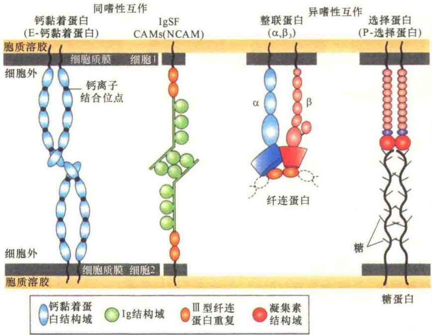
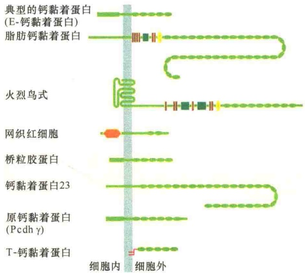
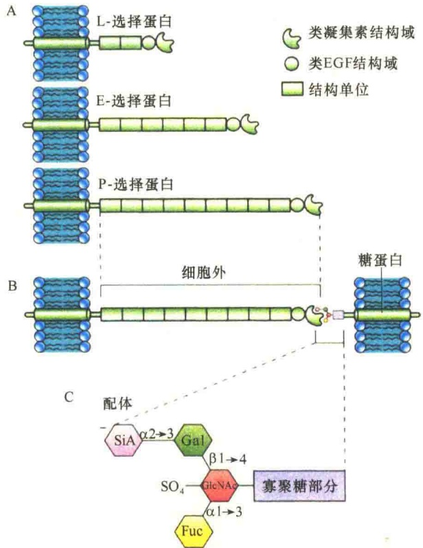

## 4.2 细胞识别与细胞黏附

在多细胞的生命有机体中，不同类型的细胞必须组成不同的组织，如脊椎动物中的肌肉组织、上皮组织、神经组织、结缔组织等。在细胞形成组织的过程中，需要在细胞与细胞之间建立某种联系，在不同组织之间也需要建立睦邻友好关系，才能维持整体生命活动的运行（图 4-20）。

相同组织的细胞要组成组织，需要分三步走:首先要相互识别；识别后要相互靠近，进行黏附；随着关系的进一步密切，可通过连接组成组织。细胞识别（cell recognition）指细胞对同种或异种细胞、同源或异源细胞、自己和异己分子的认识和鉴别。细胞黏附（cell adhesion）则是指相邻细胞或细胞与细胞外基质以某种方式黏附在一起，组成组织或与其他组织分开，这种黏附的方式比较松散。另外，从事件发生的次序来说，细胞识别在先，细胞黏附在后，识别是黏附的基础。就细胞组成组织而言，组织内各细胞间更为紧密的结合则是靠各种形式的连接。

## 4.2.1 细胞识别及细胞拣出

在多细胞生物中，单个细胞要组成精密的组织、器官及器官体系，首先必须具有相互识别的能力，然后通过黏附和连接将细胞组织起来。生物学家早在1907年就发现细胞具有相互识别的能力，从那以后，科学家们不断认识细胞间选择性地识别、黏附，对参与细胞识别和黏附的细胞表面分子的认识和了解也越来越深入。

## 4.2.1.1 细胞识别的特性

多细胞生物有机体中有三种识别系统:抗原与抗体的识别，酶与底物的识别，细胞之间的识别。抗原与抗体的识别属于免疫反应，酶与底物的识别属于催化反应，而细胞与细胞的识别反应最为复杂，不仅涉及组织的建立，也包括通过细胞表面受体与胞外信号分子的选择性相互作用，从而导致一系列生理生化反应的信号传递。无论是哪一种识别系统，都有一个共同的基本特性，就是具有选择性，或是说具有特异性。

细胞识别是细胞发育和分化过程中一个十分重要的环节，细胞通过识别和黏着形成不同类型的组织，由于不同组织的功能是不同的，所以识别本身就意味着选择。

为了研究细胞的识别和黏着，1907年Wilson通过实验研究了两种不同颜色的海绵细胞的行为。分别从黄色海绵和红色海绵中分离单细胞，然后将两种不同颜色的细胞类群混合在一起。但是，这两种类型的海绵细胞很快就各自分开聚集，红色海绵细胞聚集到一起，黄色海绵细胞也是如此，二者互不混淆。这是人类最早通过实验认识到细胞具有识别和选择性结合的能力。此后，在许多生物中都发现了细胞的识别和黏附，不仅是简单的多细胞生物，也包括复杂的、有各种组织分化的多细胞生物中不同组织的细胞都具有这种能力和特性。

图 4-20 人上皮组织细胞与细胞之间、细胞与细胞外基质之间的相互作用（引自 Karp，2010）。上皮中的细胞相互之间具有特殊的连接结构，并且与细胞外基质也有特殊的接触方式。

有人用两栖类胚性细胞做实验，研究细胞的识别。分别用蛋白酶将外胚层和中胚层水解成单细胞，并分别标记上不同的颜色，然后将这两种细胞混合；在混合之初，它们混合得很好，但是随着时间的推移，外胚层的细胞移向外侧并聚集在一起，这也是它们在胚胎中的正确位置；来自中胚层的细胞移向内侧，这也是它们在胚胎中的正确位置。这两种游离的细胞迅速重新聚集成团后，同种细胞形成独立的聚合体，每种聚合体只含一种颜色的细胞，这种现象称为拣出（sorting out）。后来用三个胚层的细胞做实验，同样证明细胞的识别具有选择性，非同类的细胞不会混合聚集（图 4-21）。

图 4-21 细胞识别与拣出实验证明（引自 Alberts et al., 2015）。实验中，将分散悬浮的中胚层、神经板、表皮细胞随机混合在一起，它们不仅能够相互识别，而且还会排列到胚胎期原来的位置，即神经管的细胞在内层，表皮细胞在外层，来自中胚层的细胞位于中间层。

## 4.2.1.2 细胞识别与拣出的分子基础

细胞拣出的分子基础是什么？研究发现钙黏着蛋白（cadherin）在发育过程中对细胞的拣出起关键作用。在胚胎发育过程中，特殊类型的钙黏着蛋白的表达，对于发育形成组织具有重要作用。通过离体培养的细胞研究表明，在细胞的同亲性结合（homophilic binding）及组织形成过程中，钙黏着蛋白具有决定作用。例如，一种离体培养的细胞系，称为L-细胞，不能表达钙黏着蛋白，因此，它们之间不能相互黏着。如果将编码E-钙黏着蛋白的基因转染L-细胞，可促使L-细胞相互识别与黏着（图4-22A）。如果将表达不同钙黏着蛋白的L-细胞混合在一起，它们能够相互识别与拣出并分离开。如果将能够表达同一种钙黏着蛋白，但是表达量不同的两种细胞混合在一起，它们也能相互拣出，即表达量高的与表达量低的分开聚集（图4-22B），据此推测表达量的差异也是细胞拣出的一种指标。

## 4.2.1.3 识别反应

细胞识别引起的细胞反应大致有三种类型:内吞、细胞黏附和信号反应。

红细胞衰老并被脾脏细胞吞噬是细胞识别后引起吞噬反应的典型例子。红细胞膜中糖脂的糖基除了与血型有关外，还决定着红细胞的寿命。血型糖蛋白含有大量的唾液酸，糖链末端唾液酸的存在状况与红细胞的寿命相关，可作为被吞噬的信号。红细胞寿命一般为3～4个月，然后在脾脏中被吞噬。用唾液酸酶处理分离的红细胞，除去红细胞中的唾液酸，然后将这种红细胞重新注入原来的动物体内，发现注入

图 4-22 钙黏着蛋白依赖的细胞拣出（引自 Alberts et al., 2015）。培养的细胞根据表达的钙黏着蛋白的类型与水平进行拣出。A. 表达 E-钙黏着蛋白与表达 N-钙黏着蛋白的细胞拣出；B. 表达高水平的 E-钙黏着蛋白与表达低水平的 E-钙黏着蛋白的细胞拣出，可发现表达高水平的 E-黏着蛋白的细胞拣出能力更强，拣出后位于内部。

的红细胞很快在脾脏中被吞噬，而没有除去唾液酸的正常的红细胞则相安无事。究其原因，当唾液酸被除去之后，暴露出的半乳糖残基可能是红细胞衰老的标记被脾脏细胞识别并将之吞噬，这个例子既说明了细胞识别后的反应，又说明了糖在识别过程中的作用。

识别后的第二种反应则是发生黏附，包括细胞同细胞外基质的黏附、细胞与细胞的黏附，进一步发展就成为细胞连接。

识别后的第三种反应就是引起信号转导，发生一系列的生理生化反应，使细胞更好地适应环境。

## 4.2.2 细胞黏附的机制

在细胞识别的基础上，同类细胞发生聚集形成细胞团或组织的过程称为细胞黏附。它对于胚胎发育及成体的正常结构和功能都有重要的作用。在发育过程中，由于细胞间细胞黏附的强度不同，决定着细胞在内、中、外三胚层的分布。在器官形成过程中，通过细胞黏附，使具有相同表面特性的细胞聚集在一起形成器官。

## 4.2.2.1 细胞黏附分子

在细胞识别过程中，细胞的膜糖起重要作用，而引起细胞黏附的主要是膜蛋白。参与细胞黏附的分子称为细胞黏附分子（cell adhesion molecule, CAM）。

至今，已经发现了多种细胞黏附分子，如神经细胞黏附分子（neural cell adhesion molecule, NCAM）、神经胶质细胞黏附分子（neuroglia cell adhesion molecule, Ng-CAM）、肝细胞黏附分子（liver-cell adhesion molecule, L-CAM）。细胞间黏附分子（intercellular adhesion molecule, ICAM）是普遍存在的一种细胞间黏附分子，它的配体是白细胞功能相关抗原1（leucocyte function-asso-ciated antigen 1, LFA-1）；而白细胞内皮细胞黏附分子（leucocyte endothelial cell adhesion molecule, LECAM）是白细胞内皮细胞中发现的细胞黏附分子。上述细胞黏附分子都是糖蛋白，在细胞外结构域都有与肽共价结合的糖基。根据细胞黏附分子的作用方式可分为三个家族:①免疫球蛋白超家族，如血管细胞黏附分子（vascular cell adhesion molecule, VCAM）、Ng-CAM和ICAM等；②钙黏着蛋白家族，如E-钙黏着蛋白、P-钙黏着蛋白、N-钙黏着蛋白；③选择蛋白家族，如LEU-CAM1（即是后来的L-选择蛋白）、E-选择蛋白、P-选择蛋白等。后两种家族的细胞

图 4-23 钙黏着蛋白、IgSF、整联蛋白和选择蛋白介导的细胞黏附（引自 Lodish et al., 2013）。

黏附分子是钙依赖性的，而免疫球蛋白超家族介导的多数是非钙依赖性的。

## 4.2.2.2 细胞黏附方式

经细胞黏附分子介导的细胞黏附可能有三种作用方式:①相邻两细胞表面由同种细胞黏附分子的相互介导黏附；②相邻两细胞表面由互补的细胞黏附分子的相互作用介导黏附，互补分子可同时存在于同一细胞或不同细胞；③中介分子（如凝集素）介导的与细胞表面黏附分子的互补作用。

参与细胞黏附的蛋白质有四个家族:①钙黏着蛋白；②免疫球蛋白超家族（immunoglobulin superfamily，IgSF）的某些成员；③整联蛋白家族中的某些成员；④选择蛋白。细胞黏附方式总结于图4-23。

钙黏着蛋白与 IgSF 能够介导同类细胞的黏着，这种黏着属于自我黏着，即同嗜性相互作用（hemophilic interaction）。而整联蛋白介导的是细胞与细胞外基质的黏着，这种黏着是非自我黏着，称为异嗜性相互作用（heterophilic interaction）。选择素介导的也是异嗜性黏着，只不过是细胞与细胞间的异嗜性黏着。

## 4.2.2.3 细胞黏着蛋白及介导的细胞黏附

根据细胞间的关系，可分为细胞与细胞的黏附、细胞与细胞外基质的黏附；若根据黏附中是否需要钙，可分为钙依赖性黏附与非钙依赖性黏附。无论何种黏附，都涉及黏着蛋白。

关于整联蛋白介导的细胞与细胞外黏附在细胞外基质部分已经介绍，下面重点讨论钙黏着蛋白、选择蛋白、IgSF介导的细胞黏附。

1）钙黏着蛋白介导的细胞-细胞间黏附 钙黏着蛋白是一个大的糖蛋白家族，介导钙依赖性的细胞黏着，并介导细胞外基质中的信号向细胞质中的传递。在大多数不同类型的细胞表面都发现了钙黏着蛋白，该家族的不同成员在体内的分布也有特异性。研究较为清楚的钙黏着蛋白是E-钙黏着蛋白、N-钙黏着蛋白、P-钙黏着蛋白。钙黏着蛋白超家族是主要的一类黏着蛋白，分布极为广泛（表4-6）。

表4-6 钙黏着蛋白超家族中某些成员及功能

| 黏着蛋白 | 细胞分布 | 连接功能 | 在小鼠中失活引起的表型 |
| --- | --- | --- | --- |
| E-钙黏着蛋白 | 表皮组织 | 黏着连接 | 胚泡期死亡;不能形成致密的胚 |
| N-钙黏着蛋白 | 神经元、心脏、肺、骨骼肌、成纤维细胞 | 黏着连接 | 胚胎因心脏缺陷而死亡 |
| P-钙黏着蛋白 | 胎盘、表皮、乳腺上皮细胞 | 黏着连接 | 腺体发育不正常 |
| VE-钙黏着蛋白 | 内皮细胞 | 黏着连接 | 血管发育不正常(内皮细胞程序性死亡) |

钙黏着蛋白介导同类细胞间的相互黏着，主要是通过双方细胞表面的钙黏着蛋白相互作用，也就是同嗜性的细胞黏附，即所谓的“自我黏着”，并且通过基因工程方法得到证明。钙黏着蛋白介导的同类细胞的黏着能力能够很好地解释为什么同类细胞具有“拣出”功能，钙黏着蛋白是将细胞组成组织并维持成年生物体内的组织有序性的最关键的因素。钙黏着蛋白通常以二聚体的形式介导细胞黏附，这样介导的细胞黏附的结合力较强；不仅如此，钙黏着蛋白常常以成丛的二聚体介导细胞黏附（图4-24），如果仅以单体介导细胞黏附，结合力则很弱。

图 4-24 钙黏着蛋白介导的细胞黏附（引自 Karp，2010）。

钙黏着蛋白也是一个超家族的糖蛋白（图4-25），典型的钙黏着蛋白的细胞外部分含有5个同质重复的结构域（如E-钙黏着蛋白），两个结构域之间间隔的区域可与 $Ca^{2+}$ 结合。与 $Ca^{2+}$ 结合后，细胞外部分变得较为坚硬，并且与相邻细胞的钙黏着蛋白相互作用，从而介导进行黏着。非典型的钙黏着蛋白的细胞外结构域的数量可达30个之多。钙黏着蛋白的细胞内结构域也是多种多样的，表明与细胞内不同类型的配体作用，包括信号分子、介导与细胞骨架相连的衔接蛋白等。某些钙黏着蛋白，如T-钙黏着蛋白，不含穿膜区，这种钙黏着蛋白是通过糖基磷脂酰肌醇锚定到质膜上的。

2）选择蛋白介导的细胞黏附 选择蛋白（selectin）是膜整合糖蛋白的一个家族，它能够识别从另一个细胞表面伸展出来的特异的糖基团，并与之特异性结合，因此它也是细胞表面受体。选择蛋白有一个小的细胞质结构域、一个单次穿膜的结构域、一个大的细胞外片段，在这个片段上可分为几个结构域，包括最外端的具有凝集素作用的结构域（图 4-26）。

图 4-25 钙黏着蛋白超家族（引自 Alberts et al., 2015）

图4-26 选择蛋白的结构与功能（引自Karp，2010）。A.三种类型的选择蛋白。它们的细胞外结构域有一个类凝集素的结构域，能够识别糖蛋白寡糖链末端相似的糖配体（B）。C.糖配体的详细结构。末端的岩藻糖（fucose，Fuc）和唾液酸（sialic acid，SiA）对于选择蛋白的识别作用特别重要。N-乙酰葡萄糖胺（GlcNAc）常常被硫酸化。