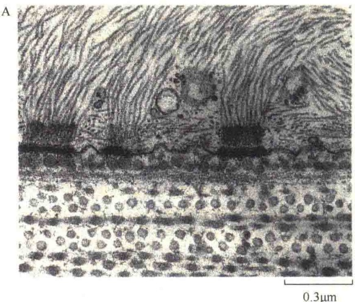
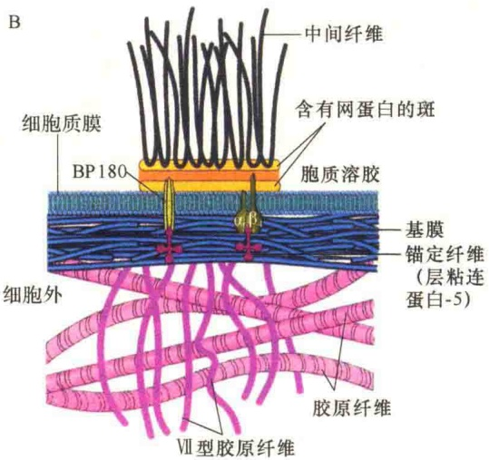
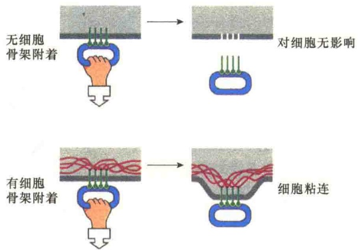
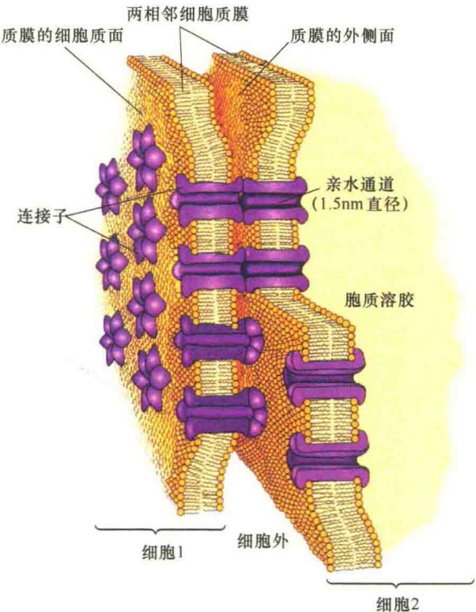
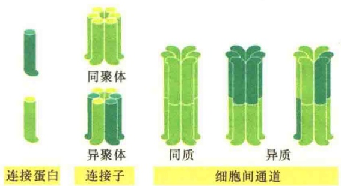
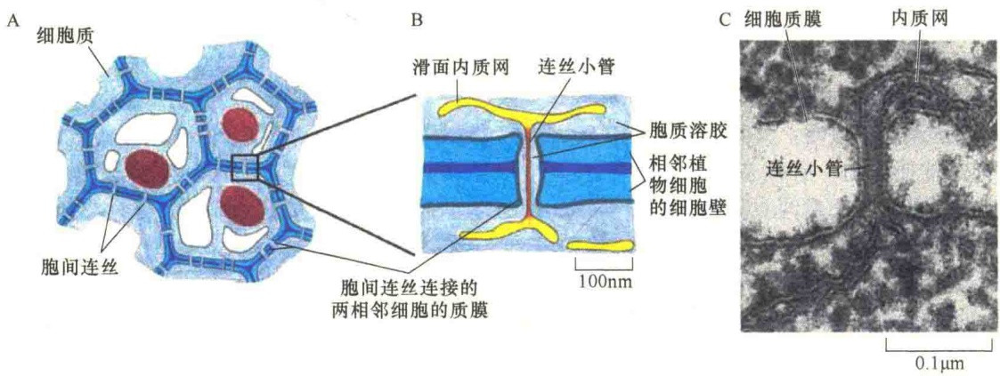

仅提供了将周围细胞连成一体的结构组成，同时还增加了细胞的机械强度。由此可见，钙黏着蛋白在维持上皮细胞组织的整体性方面具有重要作用。临床上有一种自我免疫症——天疱疮，就是丧失上皮细胞的桥粒连接而患上严重的皮肤水泡。

2）半桥粒:细胞-细胞外基质连接 在桥粒连接中，如果穿膜蛋白细胞外结构域不是与另一细胞的穿膜蛋白相连，而是与细胞外基质相连，形态上类似半个桥粒，这种连接称为半桥粒。与桥粒连接相比，半桥粒连接有两点不同:首先，参与连接的穿膜蛋白不是钙黏着蛋白而是整联蛋白；其次，整联蛋白的细胞外结构域不是与相邻细胞的整联蛋白相连而是与细胞外基质相连，已经从半桥粒中分离到  $\alpha_{6}\beta_{4}$  整联蛋白二聚体。半桥粒主要位于上皮细胞的基底面，作用是将上皮细胞与其下方的基膜连接在一起（图 4-41）。

0.3μm

图 4-41 半桥粒（引自 Karp，2010）。A. 表皮细胞基底面桥粒的电子显微镜照片。图中有几个半桥粒并清晰可见细胞内的中间纤维骨架。B. 半桥粒主要结构及其分子组成。在半桥粒连接处有两种穿膜蛋白。第一个穿膜蛋白是  $\alpha_{6}\beta_{4}$  整联蛋白，其细胞外头部与基膜中的层粘连蛋白相连，细胞内尾部锚定在含有网蛋白的细胞质斑中，而细胞质骨架中间纤维也锚定在细胞质斑中，从而将基膜、细胞质膜、细胞骨架结合起来。第二个穿膜蛋白是 BP180，帮助  $\alpha_{6}\beta_{4}$  整联蛋白进行细胞连接。

## 4.3.3.3 细胞黏附在细胞与环境互作中的作用

我们先讨论了由细胞黏附分子介导的4种不同的细胞黏附，后又讨论了由细胞黏附分子介导的4种锚定连接（黏着带、黏着斑、桥粒和半桥粒）。细胞黏附是经细胞识别后建立组织的初级反应，锚定连接为组织的建立提供了结构保障。

因此，锚定连接对于相对固定细胞、增强组织的强度具有重要作用。特别是细胞骨架的参与，使同一组织的细胞能够紧密地结合在一起。细胞中的中间纤维网络通过桥粒和半桥粒锚定在质膜上，加固了上皮细胞之间及上皮细胞与其下方结缔组织之间的联系。桥粒与半桥粒如同铆钉一样，对上皮及其下方结缔组织所承担的机械张力和剪切力起了分散作用。肌动蛋白是细胞皮质骨架的主要成分，这种骨架成分通过黏着带和黏着斑将相邻细胞的质膜或质膜与细胞外基质蛋白联系在一起，不仅增强了组织的机械强度（图 4-42），更重要的是形成了组织网络和组织整体。此外，锚定连接也参与细胞的信号转导。

图 4-42 细胞骨架在细胞连接中的重要性（引自 Alberts et al., 1994）。若无细胞骨架参与，在外力作用下，很容易将两个细胞拉开；当有细胞骨架相连时，可抵抗一定的外力作用，维持细胞组织的整体性。

## 4.3.4 通讯连接

通讯连接是一种特殊的细胞连接方式，位于特化的、具有细胞间通讯作用的细胞。它除了有机械的细胞连接作用之外，还可以在细胞间形成电偶联或代谢偶联。动物细胞与植物细胞的通讯连接方式是不同的，动物细胞的通讯连接为间隙连接（gap junction），而植物细胞的通讯连接则是胞间连丝（plasmodesmata）。

## 4.3.4.1 间隙连接

间隙连接是1967年被发现的，是动物细胞第三种类型的连接方式。间隙连接存在于大多数脊椎动物、无脊椎动物细胞中，尤其在需要进行快速通讯的细胞中特别丰富，如神经细胞和肌细胞。

间隙连接是细胞表面的特化结构，它为相邻细胞中离子和小分子的流通打开了一个直接的通道，促进细胞-细胞间的运输（cell to cell transport）。在心肌细胞中，当发生肌收缩时，心肌细胞间的间隙连接能够促进电信号的传递。

间隙连接的主要结构是连接子（connexon）。所谓“间隙”，有两层含义:其一是在间隙连接处，相邻细胞质膜间有2～4nm的间隙；其二是相邻两细胞通过连接子对接形成通道，允许小分子的物质直接通过这种通道从一个细胞流向另一个细胞（图4-43）。

连接子是一种穿膜蛋白，每个连接子由6个相同或相似的连接蛋白（connexin）亚基构成。每个连接子长为17nm，环绕中央形成孔径约为1.5nm的水性通道。

间隙连接通道蛋白的组成是多种多样的，不同组织来源的连接子的分子质量大小有很大差别。连接子的大小虽然不同，但所有连接子的结构相同，即都有4个 $\alpha$ 螺旋的穿膜区和2个细胞外环。

人的基因组测序表明:人的细胞组织中至少有20种不同的连接蛋白，有很多细胞表达一种以上的连接蛋白，可以装配成同质寡聚连接子（heterooligomeric connexon），即连接子由6个相同的亚基组成；也可以装配成异质寡聚连接子（homo-oligomeric connexon），即连接子由多种亚基组成。这样，两个细胞间装配成的连接子，有可能是同质的，也有可能是异质的（图4-44）。

相邻两细胞分别用各自的连接子相互对接形成细胞间的通道，实验证明间隙连接能够允许分子质量在 1200Da 以下的分子通过。Loewenstein 将染料注入用间隙连接连起来的一排昆虫细胞中的一个，然后在光学显微镜下观察，发现染料很快从一个细胞移向下一个细胞，而且比预料的要快得多。这种染料是亲水性的，分子质量为300Da。他们还用类似的实验证明了离子能够自由通过间隙连接。在Loewenstein的实验中，能够自由通过间隙连接的最大分子是1200Da，这说明其他的一些小的信号分子，如cAMP和 $IP_{3}$ 等也能自由通过。

图 4-43 间隙连接的结构（引自 Becker et al., 2003）。相邻两细胞各提供一个连接子并对接，在两细胞质膜中形成圆柱形的通道。每个连接子由 6 个连接蛋白亚基构成环形结构，环形中央部分是一个直径为 2.5\~3nm 的水性通道。

图 4-44 间隙连接的连接子结构（引自 Alberts et al., 2015）。间隙连接的连接子由相邻两细胞共同组成，它们的组成可以是同质的，也可以是异质的。

Gilula 和他的同事们通过实验获得了第二信使自由通过间隙连接的直接证据。他们用了两种培养的细胞系:一种是卵巢细胞，这种细胞没有去甲肾上腺素的受体，所以不会对去甲肾上腺素或其他的胆碱激素做出应答；另外一种是心肌细胞，具有去甲肾上腺素受体，并受该激素的刺激。当将这两种细胞放在一起培养时，它们很快通过间隙连接连成一体，加入去甲肾上腺素后，不仅心肌细胞做出了应答，卵巢细胞也做出了应答。这一结果说明卵巢细胞之所以能够对去甲肾上腺素做出反应，是从心肌细胞得到了第二信使的结果。

上述实验以及后来的一些实验都证明间隙连接不仅具有机械连接作用，还能在细胞间形成电偶联（electrical coupling）和代谢偶联（metabolic coupling）。电偶联在神经冲动信息传递过程中起重要作用，代谢偶联可使小分子代谢物和信号分子通过间隙连接形成的水性通道从一个细胞到另一个细胞。例如，cAMP 和  $Ca^{2+}$  等都可通过间隙连接从一个细胞进入到相邻细胞，因此，只要有部分细胞接收信号分子的作用，就可以使整个细胞群发生反应。同时，在偶联的细胞之间，可以“共享”营养物质。

对肿瘤细胞间隙连接的研究表明:恶性肿瘤细胞的通讯能力存在缺陷，当用一种皮肤致癌剂佛醇二酯加入人肿瘤细胞培养液中，细胞间电偶联的比例从90%下降到6%，除去佛醇二酯后，电偶联逐渐恢复。因此认为致癌剂起着抑制连接通讯作用。有理由推测，细胞间的通讯抑制使癌变中的细胞失去正常细胞的调控作用，这可能是癌变的一个重要因素。

在胚胎发育过程中，间隙连接介导的细胞通讯显得尤为重要。在胚胎发育的一定阶段，一部分细胞与另一部分细胞失去偶联，开始向各自特定的方向发展，而同一部分这群细胞则保持互相偶联，以协调的方式向同一方向发展，表现出整体性。有一种假说认为，在胚胎发育的一定阶段，某种小分子物质可以通过间隙连接从高浓度区域移到低浓度区域，从而在一群细胞之间建立一个平缓的浓度梯度。这种区域性的浓度向这群细胞提供了它们自身的“位置信息”，可以让它们按其在胚胎中的位置而调控其分化方向。

间隙连接的作用受细胞质中  $Ca^{2+}$  和  $H^{+}$ 浓度的调节。间隙连接在低  $Ca^{2+}$  浓度时开放，此时的细胞质处于静息状态；当  $Ca^{2+}$  浓度升高时，间隙连接的通道逐步缩小，当  $Ca^{2+}$  浓度达到  $10^{-5}$  mol/L 时，通道完全关闭。提高  $H^{+}$ 浓度，也就是将细胞质中 pH 从 7.0 降低到 6.8 或更低，间隙连接的通道也会关闭。间隙连接除了受  $Ca^{2+}$  和  $H^{+}$ 调节外，还受其他因素的调节。

## 4.3.4.2 胞间连丝

虽然植物细胞没有动物细胞所具有的特异性连接方式，又有着较厚的细胞壁，但是细胞壁并没有完全封闭细胞。植物细胞壁通常含有小的开口，叫胞间连丝，通过它，细胞间可以进行连接。在电子显微镜下见到的胞间连丝似乎是以一个狭窄的、直径30～60nm的圆柱形细胞质通道穿过相邻的细胞壁。胞间连丝中有连丝微管（desmotubule）通过，并认为它是由两个细胞的滑面内质网衍生而来的（图4-45）。

胞间连丝不仅使相邻细胞的细胞质膜、细胞质、内质网交融在一起，而且也是植物细胞间物质运输和信息传递的重要通道，它与动物细胞的间隙连接有许多相同之处。正常情况下它允许800Da以下的分子渗透，也能让离子自由通过，它的活性同样受  $Ca^{2+}$  浓度的调节等，因此具有植物信号转导的作用。

图 4-45 植物的胞间连丝（引自 Alberts et al., 2015）。A. 胞间连丝穿过植物细胞壁形成细胞质通道并将相邻细胞连接在一起。B. 胞间连丝通过连丝小管穿过两细胞壁与相邻细胞的滑面内质网相通。C. 水蕨（water fern）的胞间连丝切片的电子显微镜照片。两细胞质膜形成一个连续的孔，并且可看到两细胞的内质网及穿过两细胞的连丝微管。

与间隙连接不同的是，胞间连丝的孔能够扩张，允许大分子，包括蛋白质和 RNA 分子通过。这是 20 世纪 80 年代通过研究病毒经植物细胞的胞间连丝从一个细胞向另一个细胞扩散时发现的。此外，还发现病毒编码一种能够与植物细胞胞间连丝的壁相互作用的移动蛋白（movement protein），这种蛋白质能够增加胞间连丝孔的直径。后来的研究发现，植物能够自己合成移动蛋白介导细胞间的大分子运输。

我们分别讨论了细胞中三大类细胞连接，现将它们的功能、主要特点等总结于表 4-8。

表 4-8 细胞连接的方式与特点

| 连接类型 | 功能 | 特征 | 相关结构 |
| --- | --- | --- | --- |
| 紧密连接 | 封闭细胞空间 | 沿着嵴进行膜连接 | 穿膜连接蛋白 |
| 锚定连接 |  |  |  |
| 黏着带 | 细胞-细胞黏着连接 | 形成连续的黏着带 | 与肌动蛋白纤维相连 |
| 黏着斑 | 细胞-ECM黏着连接 | 形成局部的黏着点 | 与肌动蛋白纤维相连 |
| 桥粒 | 细胞-细胞黏着连接 | 形成局部的黏着点 | 与中间纤维相连 |
| 半桥粒 | 细胞-基膜黏着连接 | 形成局部的黏着点 | 与中间纤维相连 |
| 通讯连接 |  |  |  |
| 间隙连接 | 动物细胞间离子和分子的交换 | 连接子(具有3nm孔径的跨膜蛋白) | 两个细胞通过各自的连接子对接形成通道可能通过衔接与细胞骨架相连 |
| 胞间连丝 | 植物细胞间的物质交换 | 两细胞间形成直径为30~60nm通道 | 内质网穿过两细胞壁与肌动蛋白相连 |

## 4.4 植物的细胞外结构:细胞壁

植物与动物有一个很重要的不同，就是植物没有骨骼系统，但是植物细胞却有相当的强度。赋予植物细胞强度的，不是骨骼，而是植物的细胞壁（图 4-46）。植物细胞壁除了给整体植物提供机械强度之外，也保护细胞免遭渗透及机械损伤。另外，植物的细胞壁可以保护植物免受微生物，特别是真菌和细菌的侵染。坚硬的细胞壁对于植物的形态也有决定性的作用，若除去细胞壁，植物细胞就会失去其正常的形态。植物细胞壁是造成植物细胞与动物细胞性质上差异的主要因素，如植物细胞不能迁移，也不可能发育成动物细胞所具有的神经系统。

10μm

图 4-46 植物的细胞壁（引自 Alberts et al., 2015）。
A. 灯芯草根尖细胞的电镜照片，可见到细胞间的细胞壁。
B. 两相邻细胞间典型的细胞壁，图中所示两个较深的部分是穿过细胞壁的胞间连丝。

曾经有人把植物的细胞壁看成是相当惰性地包围在细胞外的细胞分泌物，现代的研究发现植物细胞壁是一个动态结构，能够进行很多活动。例如，与细胞壁有关的酶可将细胞外的营养转变成可通过细胞质膜进入细胞的小分子化合物；细胞壁也可以作为物质通透的障碍在代谢和分泌过程中起重要作用。

## 4.4.1 植物细胞壁的结构

植物有两种类型的细胞壁:初生细胞壁（primary cell wall）和次生细胞壁（secondary cell wall），它们是在不同阶段分泌合成的（图 4-47）。

细胞壁的分泌合成是逐步、分层次进行的，合成越早，最后离开质膜越远。首先形成的是中间层（middle lamella），其构成成分主要是果胶。果胶是相邻两细胞壁所共有的，并且起到将两个细胞连接在一起的作用。

分泌合成的第二个区带称为初生壁，是在细胞